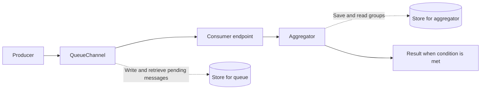

# What Is MessageStore?

In the **SPRING_INTEGRATION_CORE** module, MessageStore is the component that enables an integration flow to retain messages when they cannot be processed immediately. This lesson belongs to the **Message store** chapter, focusing on the nature of the message store, its relationship with MessageChannel and endpoints, and how to use it in Java DSL.

After this lesson, you will be able to explain where messages are kept while an aggregator is waiting for data, distinguish between in-memory storage and persistent storage, and identify what still needs to be configured for error handling or recovery after an application stops.

## 1. From the Need to Hold Messages to Message Store

Suppose an ordering system receives three packing notifications for an order:

- Package A is ready.
- Package B is ready.
- Package C is ready.

The application only generates an “order ready for delivery” notification once all three have been received. If only A and B have arrived, the aggregator must hold them while waiting for C. Similarly, when a producer puts messages into a QueueChannel faster than a consumer can process them, the channel must hold the backlog.

These components have state that needs to exist across multiple message receptions. Spring Integration provides the Message Store mechanism to separate state persistence from the orchestration logic of the integration component. [Message Store Documentation](https://docs.spring.io/spring-integration/reference/message-store.html).



The two stores in the diagram represent two storage roles. One store holds the queue waiting to be consumed; the other holds the data of groups waiting to be aggregated. They are not two steps that every flow is required to have.

With the order example, the question to ask is: if the JVM stops after receiving A and B, will the next startup still find them or will it have to request a resend? The answer depends on the store implementation, the committed state, and how the application reconnects to the old data.

## 2. Definition and Boundary of Responsibilities

**MessageStore is a Spring Integration strategy interface for storing and retrieving Message objects.** Storage can be implemented using data structures inside the JVM or using an external storage system.

A Message consists of a payload and headers. For example, the payload might be package information, while headers contain `orderId`, an event code, and routing information. Storing only the payload does not fully express the data the flow may need when resuming processing. [Message Model](https://docs.spring.io/spring-integration/reference/message.html).

The division of responsibilities in a flow is as follows:

| Component | Responsibility |
| --- | --- |
| Message | Carries the data and headers of a single exchange |
| MessageChannel | Provides a way to send and receive messages |
| Endpoint | Performs a step such as transforming, routing, or aggregating |
| MessageStore and group storage contracts | Holds messages or group state for components that require storage |
| Gateway | Translates application calls into message exchanges |

A MessageStore does not schedule polling on its own, invoke business services, decide on retries, or send error notifications. Those behaviors belong to endpoints and flow configuration. Declaring a store bean also does not automatically write every message to the store: the consuming component must be wired to that bean.

For example, a transformer that processes immediately on a DirectChannel typically does not need its own store. An aggregator that needs to hold multiple inputs for aggregation has a clear need for state storage.

## 3. Distinguishing the Storage Contracts

In casual discussion, “message store” may refer generally to Spring Integration's storage mechanism. When writing Java, you need to distinguish the specific interfaces.

| Interface | Data and Main Operations | Typical Use Case |
| --- | --- | --- |
| `MessageStore` | Add, read, and remove Messages by UUID | Storing individual messages; claim check |
| `BasicMessageGroupStore` | Add to group, get group, count, and poll messages in a group | Base contract for group-based storage |
| `MessageGroupStore` | Extends group operations, supports completion state and expiration callbacks | Aggregator, resequencer |
| `ChannelMessageStore` | Contract branch for stores optimized for channels | QueueChannel backed by a store |

Both `MessageGroupStore` and `ChannelMessageStore` extend `BasicMessageGroupStore`. They do not implicitly extend `MessageStore`. An implementation may implement multiple interfaces, such as `SimpleMessageStore`; therefore, you should not assume that every store for a channel can be used with an aggregator. [MessageGroupStore API](https://docs.spring.io/spring-integration/api/org/springframework/integration/store/MessageGroupStore.html), [ChannelMessageStore API](https://docs.spring.io/spring-integration/api/org/springframework/integration/store/ChannelMessageStore.html).

### 3.1. Operations on Individual Messages

Common methods of `MessageStore` include:

```java
<T> Message<T> addMessage(Message<T> message);

Message<?> getMessage(UUID id);

Message<?> removeMessage(UUID id);

long getMessageCount();
```

You need to understand their meanings accurately:

- `getMessage(id)` reads the message; it does not mean the message has finished being processed.
- `removeMessage(id)` is a separate removal operation and may return `null` if not found.
- `addMessage(...)` returns the stored Message. An implementation may create a different instance, so when storing by UUID, obtain the ID from the returned value.
- `getMessageCount()` is an optional capability; an implementation may not support it.

If an implementation also manages groups, removing an individual message is still subject to constraints while the message belongs to a group. Operate through the group contract for data owned by an aggregator. [MessageStore API](https://docs.spring.io/spring-integration/api/org/springframework/integration/store/MessageStore.html).

### 3.2. Message ID, Correlation Key, and Business ID

Three types of keys often appear side by side but serve different purposes:

| Key | Example | Meaning |
| --- | --- | --- |
| Message ID | UUID in `headers.id` | Technical identifier of a Message |
| Correlation key/group ID | `aggregate:order:SO-1001` | Groups Messages that need to be processed together |
| Business event ID | `packing-event-781` | Identifies a business event across resends |

A resent event may be wrapped in a new Message with a new UUID. Therefore, using a UUID to store messages does not replace duplicate detection based on the business event ID.

For example, the same “package A is ready” notification appearing twice with two different Message IDs can still cause a group to reach a count of three elements prematurely. This is an issue of the input contract and idempotency, not something solved simply by changing the store implementation.

## 4. In-Memory Storage vs. Persistent Storage

`SimpleMessageStore` is an implementation based on JVM memory. The no-argument constructor creates a store with unlimited capacity by default. It is suitable for learning and testing, but data will be lost when the process loses its memory. Other constructors allow configuring capacity limits. [SimpleMessageStore API](https://docs.spring.io/spring-integration/api/org/springframework/integration/store/SimpleMessageStore.html).

| Criterion | In-Memory Store | External Store with Appropriate Persistence Configuration |
| --- | --- | --- |
| Data location | JVM heap | Database or corresponding backend |
| When the JVM stops abruptly | Cannot retain data sitting in the heap | Can read back data that has been written and committed |
| Access cost | No network round-trip to a backend | Involves I/O, data conversion, and possibly locking |
| What must be managed | Heap, number of groups, payload size | Capacity, connections, schema, indexes, and backend durability |
| Required testing | API behavior and group lifecycle | Additional restart, rollback, and old-data read tests |

“Outside the JVM” is not enough to conclude that data is durable. For example, a database running in an in-memory-only mode can still lose data when the database itself stops.

At the same time, a successful store write only protects state at that write boundary. It does not by itself confirm that all subsequent business steps have completed.

## 5. Minimal Example: Store, Read, and Remove a Message

The example below only requires the corresponding Spring Integration core and Spring Messaging libraries in your project. Place the code in `MessageStoreDemo.java` when practicing.

```java
import java.util.UUID;

import org.springframework.integration.store.MessageStore;
import org.springframework.integration.store.SimpleMessageStore;
import org.springframework.messaging.Message;
import org.springframework.messaging.support.MessageBuilder;

public class MessageStoreDemo {

    public static void main(String[] args) {
        MessageStore store = new SimpleMessageStore();

        Message<String> original = MessageBuilder
                .withPayload("Package A is ready")
                .setHeader("orderId", "SO-1001")
                .setHeader("eventId", "packing-event-781")
                .build();

        Message<String> stored = store.addMessage(original);
        UUID storedId = stored.getHeaders().getId();

        if (storedId == null) {
            throw new IllegalStateException("Message must have an ID");
        }

        Message<?> loaded = store.getMessage(storedId);
        if (loaded == null) {
            throw new IllegalStateException("Message not found");
        }

        System.out.println(loaded.getPayload());
        System.out.println(loaded.getHeaders().get("orderId"));

        store.removeMessage(storedId);

        if (store.getMessage(storedId) != null) {
            throw new IllegalStateException("Message has not been removed");
        }
    }
}
```

The printed output is:

```text
Package A is ready
SO-1001
```

The program explicitly calls `addMessage`, `getMessage`, and `removeMessage` to clarify the API. In a typical aggregator configuration, the framework performs the group storage operations; business code does not need to insert an extra `addMessage` call before every send.

Do not interpret this example as a workflow where “retrieving guarantees successful processing.” If an external side effect is performed and the process stops before the removal step, the next run may encounter that message again.

## 6. Using a Store Behind a QueueChannel

QueueChannel holds messages for a consumer to receive later. When using Java DSL, you can pass a `ChannelMessageStore` and a stable group ID to `MessageChannels.queue(...)`. [MessageChannels API](https://docs.spring.io/spring-integration/api/org/springframework/integration/dsl/MessageChannels.html).

Standalone illustrative configuration:

```java
import org.springframework.context.annotation.Bean;
import org.springframework.context.annotation.Configuration;
import org.springframework.integration.channel.QueueChannel;
import org.springframework.integration.dsl.MessageChannels;
import org.springframework.integration.store.SimpleMessageStore;

@Configuration
public class OrderInboxConfiguration {

    @Bean
    public SimpleMessageStore queueMessageStore() {
        return new SimpleMessageStore();
    }

    @Bean
    public QueueChannel orderInbox(SimpleMessageStore queueMessageStore) {
        return MessageChannels
                .queue(queueMessageStore, "queue:order-inbox:v1")
                .get();
    }
}
```

In this configuration:

1. `orderInbox.send(message)` puts a Message into the store-backed queue.
2. `orderInbox.receive(timeout)` retrieves a Message from the queue.
3. A consumer endpoint connected to the channel will need a poller to actively fetch data.
4. Because the store is still `SimpleMessageStore`, this configuration does not yet provide data retention across restarts.

The group ID `queue:order-inbox:v1` represents a logical queue, unlike the per-order group ID of an aggregator. With a persistent store, you must reuse the exact same identifier to access the old queue after a restart. Generating a random UUID for the group name on every startup can cause the application to switch to a new queue while the old data remains in the backend. [MessageGroupQueue API](https://docs.spring.io/spring-integration/api/org/springframework/integration/store/MessageGroupQueue.html).

The store does not run a consumer on its own. If messages can be sent but stay in the queue indefinitely, check the consumer, poller, and schedule before concluding there is a bug in MessageStore.

## 7. Using MessageGroupStore in an Aggregator with Java DSL

### 7.1. Input Contract

The following example aggregates exactly three package notifications for an order:

- The payload is the package name: `A`, `B`, or `C`.
- The `orderId` header must exist.
- Three valid and distinct notifications are sent once each in this demonstration.
- The result is the string `A, B, C`.
- The group is removed when normal aggregation completes.

Inputs in a real-world system need additional validation and duplicate handling based on package code or event ID. Checking only `group.size() == 3` does not prove that three distinct packages were received.

### 7.2. Flow Configuration

Place the following configuration in `OrderAggregationConfiguration.java`. The example uses Java DSL with `IntegrationFlow.from(...)` and does not require a database or broker yet.

```java
import java.util.stream.Collectors;

import org.springframework.context.annotation.Bean;
import org.springframework.context.annotation.Configuration;
import org.springframework.integration.channel.DirectChannel;
import org.springframework.integration.channel.QueueChannel;
import org.springframework.integration.config.EnableIntegration;
import org.springframework.integration.dsl.IntegrationFlow;
import org.springframework.integration.store.MessageGroupStore;
import org.springframework.integration.store.SimpleMessageStore;

@Configuration
@EnableIntegration
public class OrderAggregationConfiguration {

    @Bean
    public DirectChannel orderParts() {
        return new DirectChannel();
    }

    @Bean
    public QueueChannel completedOrders() {
        return new QueueChannel(10);
    }

    @Bean
    public MessageGroupStore orderGroupStore() {
        return new SimpleMessageStore();
    }

    @Bean
    public IntegrationFlow orderAggregationFlow(
            DirectChannel orderParts,
            QueueChannel completedOrders,
            MessageGroupStore orderGroupStore) {

        return IntegrationFlow.from(orderParts)
                .aggregate(aggregator -> aggregator
                        .messageStore(orderGroupStore)
                        .correlationStrategy(message ->
                                "aggregate:order:"
                                        + message.getHeaders().get("orderId"))
                        .releaseStrategy(group -> group.size() == 3)
                        .outputProcessor(group ->
                                group.getMessages().stream()
                                        .map(message ->
                                                message.getPayload().toString())
                                        .sorted()
                                        .collect(Collectors.joining(", ")))
                        .expireGroupsUponCompletion(true))
                .channel(completedOrders)
                .get();
    }
}
```

The input flow uses a DirectChannel, so send calls pass through the aggregator on the sender's thread. The output QueueChannel only holds results so that test code can receive them; it does not change where the aggregator stores input data.

The configuration decisions are clearly separated:

| Configuration | Question Answered |
| --- | --- |
| `messageStore(orderGroupStore)` | Where are the groups kept? |
| `correlationStrategy(...)` | Which Messages belong to the same group? |
| `releaseStrategy(...)` | When can a group be aggregated? |
| `outputProcessor(...)` | How is a group transformed into the result payload? |
| `expireGroupsUponCompletion(true)` | Should the entire group be removed after normal completion? |

These options belong to the Java DSL for correlating handlers and aggregators. [CorrelationHandlerSpec API](https://docs.spring.io/spring-integration/api/org/springframework/integration/dsl/CorrelationHandlerSpec.html), [AggregatorSpec API](https://docs.spring.io/spring-integration/api/org/springframework/integration/dsl/AggregatorSpec.html).

The `aggregate:order:` prefix expresses the scope of the key. If multiple flows access the same backend, avoid having two unrelated flows share the same storage region and the same group ID.

### 7.3. Testing State Before and After Group Completion

The following JUnit Jupiter example uses the same configuration above. The test verifies meaningful behavior: two messages do not produce output yet, they are sitting in the group, and the third message produces the exact result and cleans up the group.

```java
import org.junit.jupiter.api.Test;

import org.springframework.context.annotation.AnnotationConfigApplicationContext;
import org.springframework.integration.channel.QueueChannel;
import org.springframework.integration.store.MessageGroupStore;
import org.springframework.messaging.Message;
import org.springframework.messaging.MessageChannel;
import org.springframework.messaging.support.MessageBuilder;

import static org.junit.jupiter.api.Assertions.*;

class OrderAggregationTest {

    @Test
    void waitsForThreePartsThenRemovesCompletedGroup() {
        try (var context = new AnnotationConfigApplicationContext(
                OrderAggregationConfiguration.class)) {

            MessageChannel input =
                    context.getBean("orderParts", MessageChannel.class);
            QueueChannel output =
                    context.getBean("completedOrders", QueueChannel.class);
            MessageGroupStore store =
                    context.getBean("orderGroupStore", MessageGroupStore.class);

            assertTrue(input.send(part("A"), 1000));
            assertTrue(input.send(part("B"), 1000));

            assertNull(output.receive(0));
            assertEquals(2,
                    store.messageGroupSize("aggregate:order:SO-1001"));

            assertTrue(input.send(part("C"), 1000));

            Message<?> result = output.receive(1000);
            assertNotNull(result);
            assertEquals("A, B, C", result.getPayload());
            assertEquals(0, store.getMessageGroupCount());
            assertNull(output.receive(0));
        }
    }

    private static Message<String> part(String name) {
        return MessageBuilder.withPayload(name)
                .setHeader("orderId", "SO-1001")
                .build();
    }
}
```

This test verifies the flow within a single process using an in-memory store. It does not verify persistent storage, rollback, or concurrent processing from multiple applications. The code snippets in this lesson are practice code; they must be run in a project with the corresponding dependencies declared.

The illustrative configuration does not set a timeout for a group with fewer than three notifications. If C does not arrive, the group with A and B continues waiting. When moving to production scenarios, you must decide on the wait deadline and the action on expiration.

## 8. Switching to a JDBC Store

Spring Integration has two JDBC implementations that must be distinguished:

- `JdbcMessageStore` serves message storage and stateful patterns such as aggregator or claim check.
- `JdbcChannelMessageStore` is specifically optimized for message channels.

For the aggregator example, you can replace the `orderGroupStore` bean with the snippet below, keeping the `MessageGroupStore` contract type in the flow parameter:

```java
import javax.sql.DataSource;

import org.springframework.context.annotation.Bean;
import org.springframework.integration.jdbc.store.JdbcMessageStore;
import org.springframework.integration.store.MessageGroupStore;

// Replace the @Bean orderGroupStore() method in the previous configuration.
// DataSource must be configured separately.
@Bean
public MessageGroupStore orderGroupStore(DataSource dataSource) {
    return new JdbcMessageStore(dataSource);
}
```

This is a method inside a configuration class, not a standalone Java file. The project needs the `spring-integration-jdbc` module, a JDBC driver, and the corresponding tables. The `org/springframework/integration/jdbc/schema-*.sql` scripts inside the JAR are the starting point for creating the schema for the right database. Declaring the bean does not replace the schema preparation step. [JdbcMessageStore API](https://docs.spring.io/spring-integration/api/org/springframework/integration/jdbc/store/JdbcMessageStore.html).

If your target is a QueueChannel, choose the channel implementation and configure the query provider for the specific database management system. Do not pass `JdbcChannelMessageStore` into an aggregator configuration just because both contain “MessageStore” in their names. [JDBC Message Store Guide](https://docs.spring.io/spring-integration/reference/jdbc/message-store.html).

### 8.1. Payloads and Headers Must Be Readable Again

An in-memory store can hold an object currently alive in the JVM. A persistent store must convert data into a storable representation and reconstruct it when reading.

With the default serialization mechanism of `JdbcMessageStore`, pay attention to serializable data; unsuitable headers may be dropped. Payloads containing open streams, database connections, or objects tied to the current session are generally not an appropriate data contract for recovery after restart. [Limitations of Persistent Stores](https://docs.spring.io/spring-integration/reference/message-store.html).

A more manageable practical contract is:

- The payload carries self-contained data, such as a JSON string or a DTO compatible with the chosen serializer.
- Business headers contain simple values such as order ID, package ID, and event ID.
- Large resources are referenced by a stable key if embedding the entire data is unnecessary.
- When upgrading the application, test reading back data written by the previous version.

In particular, the temporary reply channel of a gateway is tied to the running process. Storing a Message does not keep a call waiting at a gateway alive across a restart. For long-running or interruptible work, design a result destination and a persistent lookup key suited to the business flow.

## 9. Persistence, Transactions, and Exactly-Once Processing

Consider a queue stored via JDBC:

```text
t1: The message has been written and committed.
t2: The consumer retrieves the message from the queue.
t3: The consumer calls a payment API.
t4: The consumer records the processing result.
```

If the application stops between t2 and t3, the ability to recover the message depends on whether the retrieval from the store occurred inside an uncommitted transaction. If t2 has committed while t3 has not run, the message may have left the queue even though the business operation was not performed.

If it stops between t3 and t4, the API may have succeeded in processing the payment, but the application has not recorded it yet. Retrying during recovery can trigger another payment request.

Therefore, it is necessary to distinguish:

| Capability | Question |
| --- | --- |
| Persistence | After a process failure, is the committed state still in the backend? |
| Transactions | Which operations commit or roll back together? |
| Retry | Upon failure, which step is executed again? |
| Idempotency | Does executing again create additional business side effects? |

With a polling consumer and a transaction-supporting store, you can configure a transaction manager on the poller so that receiving and appropriate synchronous processing participate in the same transaction. Normal transactional context is bound to a thread; adding an ExecutorChannel or a queue boundary that spawns separate processing must be considered separately. [Transaction Support](https://docs.spring.io/spring-integration/reference/transactions.html).

You need to choose a transaction manager appropriate for the store's resource. At the same time, a JDBC transaction manager cannot automatically roll back side effects that already happened in an external HTTP API. In the payment example, an idempotency key handled by the receiving side or a reconciliation mechanism is an additional design element.

Sending an error to `errorChannel` also does not mean the message automatically returns to the store. The outcome still depends on the transaction, whether the exception is propagated or swallowed, and the retry/recovery configuration.

## 10. Group Lifecycle Management and Recoverability

An aggregator manages both pending messages and the state of the group. A group that has emitted a result is not necessarily deleted completely right away.

The `expireGroupsUponCompletion(true)` configuration in the example chooses to delete the group after normal completion. Late-arriving Messages with the same correlation key can create a new group. If completion state is retained, the aggregator can recognize and reject late-arriving Messages; in return, there must be a plan to clean up that metadata. [Aggregator Group Lifecycle](https://docs.spring.io/spring-integration/reference/aggregator.html).

Decisions to clarify in the design:

| Scenario | Decision Needed |
| --- | --- |
| All valid Messages arrive | Emit result and choose a policy to keep or delete completion state |
| Missing Messages past deadline | Discard the group, route the incomplete group to separate handling, or allow partial results |
| Message arrives after group ends | Ignore, reconcile, or start a new processing session according to business rules |
| Application restarts while group is waiting | Connect to the right store, keep stable correlation keys, and handle old groups |
| Number of groups grows continuously | Monitor group age, identify missing data, and implement appropriate cleanup |

`MessageGroupStoreReaper` is an option to assist with scanning for expired groups. Expiration requires a schedule and corresponding action; merely having a timestamp or a store bean does not create a data cleanup process.

In the three-package example, automatically emitting “ready for delivery” when only A and B are present is a business error. An appropriate expiration policy might be recording an order with missing notifications and routing it to reconciliation, rather than allowing a partial result.

### 10.1. Multiple Instances Processing Concurrently

A shared backend lets instances access the same data, but is not sufficient to coordinate the entire sequence of reading, adding, checking, and releasing results of an aggregator.

When multiple aggregator instances operate on the same group, an appropriate shared locking mechanism is required. An in-memory lock of one JVM cannot protect a group from an instance in another JVM. Distinguish the correlating handler's lock from transactional guarantees or locks inside the store implementation; they serve different layers of operations. [Aggregator Lock Registry](https://docs.spring.io/spring-integration/reference/aggregator.html#_lock_registry).

This example uses a single application context and does not demonstrate multi-instance deployment behavior.

### 10.2. Useful Observability Information

Useful metrics depending on backend capabilities include the number of pending messages, the number of incomplete groups, the age of the oldest group, write/read rates, error counts, and data size.

If incoming traffic exceeds group completion rate for an extended period, switching from heap to a database only changes where data accumulates. You still need to find the root cause: missing parts, wrong correlation, slow consumers, or an unsuitable expiration policy.

Do not directly modify an aggregator's MessageGroups for a “quick cleanup” while the flow is running. Operational actions must go through mechanisms designed for group lifecycle with proper concurrency coordination.

## 11. Distinguishing from Related Concepts

| Concept | Role | How Does It Differ from MessageStore? |
| --- | --- | --- |
| Application cache | Reduces computation or data access cost | Cache eviction mechanisms may not be suitable for unprocessed messages |
| Message broker | Provides messaging infrastructure, distribution, and broker mechanisms | MessageStore does not provide network protocols or consumer management on its own |
| Business repository | Stores business truths such as orders and invoices | Pending messages are integration state, not implicitly official business records |
| MetadataStore | Stores key-value state of endpoints | Suitable for metadata and some idempotent mechanisms, different from the contract for storing entire Messages or groups |
| Claim check | Holds large content and passes a reference key through intermediate steps | Is a pattern that uses MessageStore, not a different storage backend |

MetadataStore provides a key-value contract and is used in stateful scenarios or to support an idempotent receiver. You should not conflate `MetadataStore` with the metadata that MessageGroupStore uses to manage groups. [Metadata Store](https://docs.spring.io/spring-integration/reference/meta-data-store.html).

In claim check, one step puts the Message into the store and passes a key; a later step uses the key to retrieve the content. The removal policy after retrieval must be chosen based on whether the content needs to be used again. [Claim Check](https://docs.spring.io/spring-integration/reference/claim-check.html).

## 12. Common Beginner Mistakes

| Misconception or Configuration Error | Consequence | How to Handle |
| --- | --- | --- |
| Creating a MessageStore bean without attaching it to the component needing storage | The flow continues using the previously configured storage mechanism | Explicitly pass the store to the queue or aggregator |
| Using SimpleMessageStore and expecting recovery after restart | State in the heap is lost | Use a backend configured with durability meeting requirements |
| Choosing JdbcChannelMessageStore for an aggregator | Wrong API contract | Choose an implementation supporting MessageGroupStore |
| Using a new UUID as the queue's group ID on every startup | Cannot read the old logical queue | Use a stable identifier and manage key scoping |
| Only counting Messages to conclude all events arrived | Emits wrong result when duplicate messages occur | Check required business elements and duplicate-prevention mechanism |
| Setting no policy for incomplete groups | Waiting groups and storage usage keep growing | Choose a wait deadline and a handling process for missing parts |
| Treating persistent storage as an exactly-once business effect guarantee | Duplicate side effects when retrying after failure | Design appropriate transactions, idempotency, and reconciliation |

## 13. Self-Check for Applicability

After running the example, try the following changes and explain the expected result before modifying the code:

1. Send A and B with the same `orderId`, and send C with a different `orderId`. Does any group meet the condition?
2. Send A, A, B as three new Messages. Why might the current count condition emit a wrong result?
3. Remove `expireGroupsUponCompletion(true)` and inspect the group after emitting the result. How do you distinguish the number of Messages currently held from the group metadata count?
4. Stop an application after receiving two packages and restart it with an in-memory store. What was lost?
5. When replacing with JDBC, where must data be written and committed, and which key must the application reuse to continue the old group?
6. If business processing calls an API successfully and the application stops before recording the result, which part does MessageStore solve and which part requires idempotency?

A meaningful recovery test must close the old process or application context, create a new runtime, reconnect to the same persistent backend, and verify that committed data is still usable. Creating a new Java object while keeping the same old in-memory store does not prove recoverability after a process failure.
