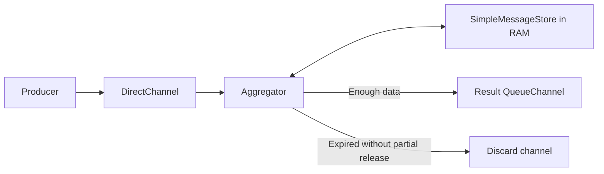

# SimpleMessageStore

## 1. Purpose and Context

In the **Message store** chapter of the `SPRING_INTEGRATION_CORE` module, this lesson explains how `SimpleMessageStore` holds message state in memory so an endpoint can wait before continuing processing. The focus is on the relationship between `Message`, `MessageChannel`, aggregator, and Java DSL configuration; it also clarifies limits regarding capacity, error handling, and testing.

After this lesson, you will be able to:

- Distinguish storing a single message by ID from storing multiple messages by group ID.
- Configure capacity and wait timeout when the store is full.
- Attach a store to an aggregator and inspect pending groups.
- Choose group cleanup policies, handle late-arriving messages, and avoid unbounded data retention.
- Recognize when to switch to a persistent store.

The APIs and examples are aligned with **Spring Integration 6.5.0**, using Java 17 or later. The configuration examples require the `org.springframework.integration:spring-integration-core` dependency; the test examples require JUnit Jupiter. In a Spring Boot application, let the application's BOM manage the compatible Spring versions. The 6.5.0 baseline here is the reference baseline for this lesson.

## 2. What Problem Does SimpleMessageStore Solve?

Suppose a system receives three parts of an order at three different times. The aggregator must hold the first two parts while waiting for the final part. `SimpleMessageStore` provides a place to hold messages and group state directly in the heap of the Java process.

This class belongs to the `org.springframework.integration.store` package and implements contracts for message storage, group storage, and channel-backing operations. Data is held in RAM-based map structures. See the definition and constructors in the [SimpleMessageStore 6.5.0 Javadoc](https://docs.spring.io/spring-integration/docs/6.5.0/api/org/springframework/integration/store/SimpleMessageStore.html).

In an integration flow, components collaborate as follows:

| Component | Responsibility in the Order Example |
| --- | --- |
| `Message<OrderPart>` | Carries one order part and its headers |
| `DirectChannel` | Delivers the message to the endpoint on the current calling thread |
| Aggregator endpoint | Finds the group, checks the release condition, and creates the result |
| `SimpleMessageStore` | Holds messages and group state during the wait |
| Output `QueueChannel` | Holds results for the consumer to receive later |



The store does not invoke business services on its own or determine whether an order has enough data. Those decisions belong to the endpoint and its configured strategies. When reading a flow, separately identify where messages are transported, where state is held, and where processing decisions are made.

If the JVM stops, data residing in `SimpleMessageStore` is not recovered from a persistent backend. This is a convenient choice for learning, testing, or transient state that can be reconstructed. The [Spring Integration Message Store documentation](https://docs.spring.io/spring-integration/reference/message-store.html) explains the role of in-memory stores and other storage options.

## 3. Two Storage Paths to Distinguish

### 3.1. Individual Messages

This API group works with the ID in `MessageHeaders.ID`:

```java
store.addMessage(message);
store.getMessage(message.getHeaders().getId());
store.removeMessage(message.getHeaders().getId());
```

The message ID is typically a framework-generated `UUID`. It identifies one specific message; a business key such as `orderId` may appear across many different messages.

### 3.2. Messages Belonging to a Group

This API group works with a correlation key:

```java
store.addMessageToGroup("order:ORD-42", message);
store.getMessageGroup("order:ORD-42");
store.removeMessagesFromGroup("order:ORD-42", message);
store.removeMessageGroup("order:ORD-42");
```

The group ID has type `Object`, but in applications you should use a stable, observable key with consistent `equals()`/`hashCode()`, such as the string `order:ORD-42`. Group storage operations are described in the [MessageGroupStore Javadoc](https://docs.spring.io/spring-integration/docs/6.5.0/api/org/springframework/integration/store/MessageGroupStore.html).

With `SimpleMessageStore`, adding a message to a group does not simultaneously place it in the individual-message lookup region. When inspecting an aggregator, read the group metrics rather than inferring from individual-message counters.

| What to Observe | Appropriate API |
| --- | --- |
| Messages stored via `addMessage()` | `getMessageCount()` |
| Total messages across all groups | `getMessageCountForAllMessageGroups()` |
| Number of groups currently held | `getMessageGroupCount()` |
| Number of messages in one group | `messageGroupSize(groupId)` |

### 3.3. Direct Example Without a Spring Context

```java
package example;

import org.springframework.integration.store.SimpleMessageStore;
import org.springframework.messaging.Message;
import org.springframework.messaging.support.MessageBuilder;

public class StoreBasics {

    public static void main(String[] args) {
        SimpleMessageStore store = new SimpleMessageStore(10, 3, 0L);

        Message<String> standalone = MessageBuilder
                .withPayload("audit:received")
                .build();

        store.addMessage(standalone);
        System.out.println(store.getMessageCount()); // 1
        System.out.println(store.getMessage(
                standalone.getHeaders().getId()).getPayload());

        Message<String> first = MessageBuilder
                .withPayload("part-1")
                .build();
        Message<String> second = MessageBuilder
                .withPayload("part-2")
                .build();

        String groupId = "order:ORD-42";
        store.addMessageToGroup(groupId, first);
        store.addMessageToGroup(groupId, second);

        System.out.println(store.messageGroupSize(groupId)); // 2
        System.out.println(store.getMessageGroupCount()); // 1
        System.out.println(store.getMessageCountForAllMessageGroups()); // 2
        System.out.println(store.getMessageCount()); // Still 1

        store.removeMessagesFromGroup(groupId, first);
        System.out.println(store.messageGroupSize(groupId)); // 1

        store.removeMessageGroup(groupId);
        store.removeMessage(standalone.getHeaders().getId());

        System.out.println(store.getMessageGroupCount()); // 0
        System.out.println(store.getMessageCount()); // 0
    }
}
```

When calling `getMessageGroup()` with a nonexistent key, this implementation returns an empty group object; that read does not automatically register a new group in the store. To conclude whether a group is actually retained, examine its lifecycle and group counters rather than only checking for non-`null`. Details about independent storage regions and group reads are shown in the [SimpleMessageStore 6.5.0 source code](https://github.com/spring-projects/spring-integration/blob/v6.5.0/spring-integration-core/src/main/java/org/springframework/integration/store/SimpleMessageStore.java).

## 4. Capacity: Which Limit Protects Which Part?

Commonly used constructor:

```java
new SimpleMessageStore(individualCapacity, groupCapacity, upperBoundTimeout);
```

| Parameter | Meaning |
| --- | --- |
| `individualCapacity` | Limit for individual messages stored via `addMessage()` |
| `groupCapacity` | Limit for the number of messages in **each group** |
| `upperBoundTimeout` | Time to wait for free space when an add operation hits a limit, in milliseconds |

`new SimpleMessageStore()` sets no capacity limit. A capacity value less than 1 means unlimited for the corresponding region; `0` does not mean forbidding adding messages. The single-argument constructor sets the same value for the individual region and per-group capacity. These constructor rules are in the [SimpleMessageStore Javadoc](https://docs.spring.io/spring-integration/docs/6.5.0/api/org/springframework/integration/store/SimpleMessageStore.html).

### 4.1. Group Capacity Does Not Cap the Total Number of Groups

Example configuration:

```java
SimpleMessageStore store = new SimpleMessageStore(100, 3, 0L);
```

A group `order:A` can hold three messages, and at the same time group `order:B` can also hold three messages. Adding group `order:C` continues to create another group. The value `3` neither limits the entire store to three messages nor limits the store to three groups.

Therefore, you must design both the group size limit and the group lifetime. For example, if 5,000 orders arrive every minute and one-third of them permanently miss their final message, the number of waiting groups still grows even though each group only holds two messages.

An estimate to guide design:

```text
Memory holding state ≈ total retained messages × average size
                      + group metadata
                      + collection, lock, and auxiliary object overhead
```

This is an estimate to identify dominant factors, not an exact heap measurement formula. A 1 MB image payload and an order ID payload of a few dozen bytes produce vastly different memory usage even when message counts are identical.

### 4.2. Wait Timeout When Full Differs from Group Lifetime

For waiting for a slot at a capacity limit:

| `upperBoundTimeout` | Waiting Behavior |
| --- | --- |
| `0` | Try immediately, do not wait for space |
| Positive number | Wait up to the configured number of milliseconds |
| Negative number | Wait until space becomes available or the thread is interrupted |

This mechanism is based on `UpperBound`; see the [UpperBound 6.5.0 source code](https://github.com/spring-projects/spring-integration/blob/v6.5.0/spring-integration-core/src/main/java/org/springframework/integration/util/UpperBound.java). This is not a TTL, does not schedule group cleanup, and is not a gateway reply timeout.

A notable configuration mistake: setting group capacity to 3 while the release strategy requires 4 messages. The fourth message has no room to be stored, so the count-of-4 condition can never be reached under normal flow. Increasing the wait timeout does not fix that contradiction; you must fix the limit or the business condition.

In 6.5.0, an out-of-space add for an individual message throws `MessagingException`; an out-of-space add to a group throws `IllegalStateException`. When passing through an endpoint, the exception may be wrapped further. This is implementation behavior verified in [SimpleMessageStore.java](https://github.com/spring-projects/spring-integration/blob/v6.5.0/spring-integration-core/src/main/java/org/springframework/integration/store/SimpleMessageStore.java) and should not be generalized into a universal contract across all message store types.

## 5. Wiring SimpleMessageStore with an Aggregator via Java DSL

### 5.1. Example Requirements

Each order in the example has exactly three valid parts, sent once each. `orderId` is the group key. After the third part, the flow creates an `OrderBatch`. If 30 seconds pass with no new part and the group is still incomplete, the held parts are routed to the discard channel.

To focus on the store, the example uses the count condition `size() == 3`. With real data where duplicate deliveries are possible, you must add rules to verify each part's identity before relying on count.

```java
package example;

import java.util.Comparator;
import java.util.List;

import org.springframework.beans.factory.annotation.Qualifier;
import org.springframework.context.annotation.Bean;
import org.springframework.context.annotation.Configuration;
import org.springframework.integration.channel.DirectChannel;
import org.springframework.integration.channel.QueueChannel;
import org.springframework.integration.config.EnableIntegration;
import org.springframework.integration.dsl.IntegrationFlow;
import org.springframework.integration.store.SimpleMessageStore;

@Configuration(proxyBeanMethods = false)
@EnableIntegration
public class OrderPartsConfig {

    public record OrderPart(String orderId, int partNumber, String sku) {
    }

    public record OrderBatch(String orderId, List<OrderPart> parts) {
    }

    @Bean
    public DirectChannel orderPartsInput() {
        return new DirectChannel();
    }

    @Bean
    public QueueChannel completedOrders() {
        return new QueueChannel(100);
    }

    @Bean
    public QueueChannel discardedOrderParts() {
        return new QueueChannel(100);
    }

    @Bean
    public SimpleMessageStore orderPartsStore() {
        return new SimpleMessageStore(100, 3, 0L);
    }

    @Bean
    public IntegrationFlow orderPartsFlow(
            @Qualifier("orderPartsInput") DirectChannel input,
            @Qualifier("completedOrders") QueueChannel output,
            @Qualifier("discardedOrderParts") QueueChannel discarded,
            @Qualifier("orderPartsStore") SimpleMessageStore store) {

        return IntegrationFlow.from(input)
                .aggregate(a -> a
                        .messageStore(store)
                        .correlationStrategy(message ->
                                ((OrderPart) message.getPayload()).orderId())
                        .releaseStrategy(group -> group.size() == 3)
                        .outputProcessor(group -> {
                            List<OrderPart> parts = group.getMessages().stream()
                                    .map(message ->
                                            (OrderPart) message.getPayload())
                                    .sorted(Comparator.comparingInt(
                                            OrderPart::partNumber))
                                    .toList();
                            return new OrderBatch(parts.get(0).orderId(), parts);
                        })
                        .groupTimeout(30_000L)
                        .sendPartialResultOnExpiry(false)
                        .expireGroupsUponCompletion(true)
                        .expireGroupsUponTimeout(true)
                        .discardChannel(discarded)
                        .sendTimeout(1_000L))
                .channel(output)
                .get();
    }
}
```

The methods for attaching the store, setting correlation, release, and timeout are described in the [CorrelationHandlerSpec Javadoc](https://docs.spring.io/spring-integration/docs/6.5.0/api/org/springframework/integration/dsl/CorrelationHandlerSpec.html). The result-building method and completed-group removal policy are described in the [AggregatorSpec Javadoc](https://docs.spring.io/spring-integration/docs/6.5.0/api/org/springframework/integration/dsl/AggregatorSpec.html).

In this configuration, the individual-message region has capacity 100, but the aggregator uses the group-message region. That value does not become a total 100-message limit for the aggregator. The two output queues have their own limits and must be consumed; if full, sending results or discards can also fail.

`@EnableIntegration` provides the Spring Integration infrastructure, including the default scheduler serving group timeouts. Waiting for results happens via `completedOrders`, whereas each send to `DirectChannel` only runs the corresponding processing on the calling thread. A gateway expecting a reply after each part must have a wait contract aligned with the grouping behavior; timing out at the gateway does not automatically delete the group from the store.

### 5.2. Tracking Two Interleaved Groups

With valid messages and no timeout occurring yet:

| Send # | Message | State After Processing |
| --- | --- | --- |
| 1 | A, part 2 | Group A has one message |
| 2 | B, part 1 | Groups A and B each have one message |
| 3 | A, part 1 | Group A has two messages |
| 4 | A, part 3 | Emits batch A, removes group A |
| 5 | B, part 2 | Group B has two messages |
| 6 | B, part 3 | Emits batch B, removes group B |

`outputProcessor` sorts explicitly by `partNumber`; the output does not depend on which part the producer sends first. If a transformer placed before the aggregator creates a new message, ensure the data serving as the group key remains intact after the transformation step. If a filter drops a part, the group may never satisfy the release condition and will need an expiration path.

## 6. Group Lifecycle: Hold, Complete, and Remove

In message aggregation design, three separate questions must be answered: whether the release condition is met, whether a trace of the group still needs to be retained, and where a group waiting too long will go.

| Scenario | Policy to Consider |
| --- | --- |
| Group is receiving parts | Hold messages, wait for release or timeout |
| Group is complete, late messages must be blocked | Retain completion metadata for a period of time |
| Group is complete, key may be reused for a new run | Remove the group upon completion |
| Group is missing parts for too long | Discard or emit partial results per business rules |

`completeGroup(groupId)` marks completion; `removeMessageGroup(groupId)` deletes the group. Calling these two APIs directly while an aggregator owns the group can break the lifecycle managed by the endpoint. Prefer configuring policies on the aggregator. Completion and expiration operations belong to the [MessageGroupStore contract](https://docs.spring.io/spring-integration/docs/6.5.0/api/org/springframework/integration/store/MessageGroupStore.html).

### 6.1. Trade-offs of Immediate Group Removal

The example chooses `expireGroupsUponCompletion(true)` so the group is cleaned up after creating the batch. If a new message carrying the same `orderId` arrives afterward, it can start a new group. When late-arriving messages must be rejected, retain completion metadata with `false` and clean it up on an appropriate schedule. Group retention/removal policies and correlation ID reuse are explained in the [Aggregator documentation](https://docs.spring.io/spring-integration/reference/aggregator.html).

Define business identity before choosing a policy: an `orderId` used across an order's entire lifetime differs from a key like `orderId + processingAttempt`. If a retry is allowed to start a new run, the key should express that run. If a retry resends the same part, you must recognize already-processed parts; creating a message with a new UUID does not prove it is a new business event.

### 6.2. Timeout and Group Cleanup

The aggregator's `groupTimeout(30_000L)` measures the period during which a group receives no new messages. `sendPartialResultOnExpiry(false)` chooses to discard when the group expires and the release strategy has not allowed emission; setting `true` allows aggregating the currently available parts into a result. Enabling this flag only selects the behavior on expiry and does not provide a timer by itself. This mechanism is described in [Aggregator and Group Timeout](https://docs.spring.io/spring-integration/reference/aggregator.html#agg-and-group-to).

Another approach is scanning the store with `MessageGroupStoreReaper`:

```java
import org.springframework.integration.store.MessageGroupStoreReaper;

// Place in a method that has a reference to the store to scan.
MessageGroupStoreReaper reaper = new MessageGroupStoreReaper(store);
reaper.setTimeout(60_000L);
reaper.run(); // Single scan; needs a scheduler to run periodically.
```

The reaper triggers the store's expiration mechanism, which in turn invokes registered callbacks. The aggregator registers a callback to apply its policy. When a store is used directly, appropriate cleanup callbacks/policies must be defined; do not assume calling `expireMessageGroups()` is always equivalent to deleting all old data.

`setTimeout()` sets the group age threshold to evaluate, while the schedule for calling `run()` determines the scan frequency. For example, scanning every 5 seconds with a 60-second threshold does not guarantee cleanup at exactly second 60. See the [MessageGroupStoreReaper Javadoc](https://docs.spring.io/spring-integration/docs/6.5.0/api/org/springframework/integration/store/MessageGroupStoreReaper.html). How timestamps are selected and callbacks invoked is shown in [AbstractMessageGroupStore.java](https://github.com/spring-projects/spring-integration/blob/v6.5.0/spring-integration-core/src/main/java/org/springframework/integration/store/AbstractMessageGroupStore.java).

Give each aggregator/resequencer with an independent lifecycle its own store. Sharing a store means expiration scans and callbacks must coordinate across multiple endpoints; adding a group ID prefix only addresses key collision risk, not cleanup ownership.

## 7. copyOnGet, Payloads, and Concurrent Access

By default `copyOnGet` is `false`: when a group already exists, `getMessageGroup()` returns a reference to the active group in use. Do not directly modify collections or group state from administrative tools while an endpoint is processing. Spring specifically warns against operations outside the aggregator in [Message Store: SimpleMessageStore notes](https://docs.spring.io/spring-integration/reference/message-store.html).

When you need to read a copy of the group, you can configure:

```java
SimpleMessageStore store = new SimpleMessageStore(100, 10, 0L);
store.setCopyOnGet(true);
```

This copies the group structure on read; it should not be understood as deep-copying every payload. If a payload contains a mutable `ArrayList`, the producer might still hold a reference to it. Mutating the list after sending can cause the held data to differ from expected data. Using immutable payloads or creating copies at the send boundary makes data lifecycles easier to control.

The implementation has concurrent data structures and locks for group operations. However, a hand-written application sequence such as “read size, check, then add” still consists of multiple operations. Let the endpoint manage the release condition instead of building a parallel coordinator based on discrete reads.

A distributed lock also does not turn the heaps of two JVMs into a shared storage area. If two instances receive parts of the same order and each instance keeps its own store, each still sees only its own subset of data. Multi-instance designs must coordinate message routing, state storage location, and locking mechanisms together.

## 8. Using as Backing Storage for QueueChannel

A regular `QueueChannel` can use its own in-memory queue. To demonstrate using a store behind a queue, you can wrap the store with `MessageGroupQueue` and pass it into the channel's `Queue`-accepting constructor:

```java
import org.springframework.integration.channel.QueueChannel;
import org.springframework.integration.store.MessageGroupQueue;
import org.springframework.integration.store.SimpleMessageStore;
import org.springframework.messaging.Message;
import org.springframework.messaging.support.MessageBuilder;

// Snippet placed inside a method.
SimpleMessageStore queueStore = new SimpleMessageStore(100, 10, 0L);
MessageGroupQueue queue = new MessageGroupQueue(
        queueStore, "queue:pending-orders", 10);
QueueChannel pendingOrders = new QueueChannel(queue);

boolean accepted = pendingOrders.send(
        MessageBuilder.withPayload("ORD-42").build(), 0L);
if (!accepted) {
    throw new IllegalStateException("Queue is full");
}

Message<?> next = pendingOrders.receive(0L);
```

This queue uses a stable group ID to represent one logical queue. The queue capacity and per-group capacity are both set to 10 to avoid two conflicting limits. The constructor and wrapper role are described in [MessageGroupQueue](https://docs.spring.io/spring-integration/docs/6.5.0/api/org/springframework/integration/store/MessageGroupQueue.html); the corresponding channel constructor is in [QueueChannel](https://docs.spring.io/spring-integration/docs/6.5.0/api/org/springframework/integration/channel/QueueChannel.html).

The consumer side can call `receive()` as in the example or use an endpoint with a poller. Both the queue and the store in the example remain in process memory. To continue receiving data after a restart, the underlying backend must be capable of persistent storage; merely keeping the same group ID is not enough.

## 9. Capacity Errors and Error-Handling Paths

In a flow using `DirectChannel`, processing errors are propagated back to the sending thread. When processing occurs on a poller or executor, errors must be routed through an asynchronous mechanism, typically becoming an `ErrorMessage` sent over an error channel according to infrastructure configuration. The `errorChannel` header does not automatically convert every synchronous call into asynchronous error delivery. See [Spring Integration Error Handling](https://docs.spring.io/spring-integration/reference/error-handling.html).

When encountering store-full errors, handling should be based on the root cause:

| Cause | Direction to Adjust |
| --- | --- |
| Release requires more messages than group capacity | Fix the release condition or the capacity |
| Groups frequently miss their final part | Investigate the data source and expiration policy |
| Sudden spike in correlation keys | Check group keys, retention time, and ingestion capacity |
| Results are backed up in the output queue | Add/restore consumers and check queue limits |
| Payloads are larger than expected | Reduce retained data size or change storage design |

Repeatedly retrying a group that cannot be released does not create more space. Increasing capacity without investigating stalled groups may only delay the time until the heap fills up.

A successful add operation also does not mean downstream business effects have occurred exactly once. If a service after the aggregator fails, you must determine which data is still retained, which data can be replayed, and which side effects have already occurred. With `SimpleMessageStore`, do not expect a database transaction rollback to automatically restore RAM state.

## 10. Testing Important Boundaries

### 10.1. Per-Group Capacity and Individual Storage Region

The following tests directly illustrate the 6.5.0 reference behavior without starting a Spring context:

```java
package example;

import org.junit.jupiter.api.Test;
import org.springframework.integration.store.SimpleMessageStore;
import org.springframework.messaging.Message;
import org.springframework.messaging.MessagingException;
import org.springframework.messaging.support.MessageBuilder;

import static org.junit.jupiter.api.Assertions.*;

class SimpleMessageStoreTest {

    @Test
    void groupCapacityAppliesToEachGroup() {
        SimpleMessageStore store = new SimpleMessageStore(1, 2, 0L);

        store.addMessageToGroup("A", message("A-1"));
        store.addMessageToGroup("A", message("A-2"));
        store.addMessageToGroup("B", message("B-1"));
        store.addMessageToGroup("B", message("B-2"));

        assertEquals(2, store.messageGroupSize("A"));
        assertEquals(2, store.messageGroupSize("B"));
        assertEquals(4, store.getMessageCountForAllMessageGroups());
        assertEquals(0L, store.getMessageCount());
        assertThrows(IllegalStateException.class,
                () -> store.addMessageToGroup("A", message("A-3")));
    }

    @Test
    void removingStandaloneMessageFreesItsCapacity() {
        SimpleMessageStore store = new SimpleMessageStore(1, 2, 0L);
        Message<String> first = message("first");

        store.addMessage(first);
        assertThrows(MessagingException.class,
                () -> store.addMessage(message("second")));

        store.removeMessage(first.getHeaders().getId());
        assertDoesNotThrow(() -> {
            store.addMessage(message("replacement"));
        });
        assertEquals(1L, store.getMessageCount());
    }

    private static Message<String> message(String payload) {
        return MessageBuilder.withPayload(payload).build();
    }
}
```

The first test prevents the misconception that capacity 2 caps the entire store at two messages. The second test confirms that removing an individual message restores the capacity to accept a new message.

### 10.2. Testing the Flow and Group Cleanup

Place the following test in the same package as `OrderPartsConfig` from section 5:

```java
package example;

import java.util.List;

import org.junit.jupiter.api.Test;
import org.springframework.context.annotation.AnnotationConfigApplicationContext;
import org.springframework.integration.channel.QueueChannel;
import org.springframework.integration.store.SimpleMessageStore;
import org.springframework.messaging.Message;
import org.springframework.messaging.MessageChannel;
import org.springframework.messaging.support.MessageBuilder;

import static org.junit.jupiter.api.Assertions.*;

class OrderPartsFlowTest {

    @Test
    void releasesOnlyAfterThreePartsAndRemovesTheGroup() {
        try (var context = new AnnotationConfigApplicationContext(
                OrderPartsConfig.class)) {
            MessageChannel input = context.getBean(
                    "orderPartsInput", MessageChannel.class);
            QueueChannel output = context.getBean(
                    "completedOrders", QueueChannel.class);
            SimpleMessageStore store = context.getBean(
                    "orderPartsStore", SimpleMessageStore.class);

            send(input, 2);
            send(input, 1);

            assertNull(output.receive(0L));
            assertEquals(2, store.messageGroupSize("ORD-42"));

            send(input, 3);

            Message<?> result = output.receive(1_000L);
            assertNotNull(result);
            var batch = assertInstanceOf(
                    OrderPartsConfig.OrderBatch.class, result.getPayload());
            assertEquals("ORD-42", batch.orderId());
            assertEquals(List.of(1, 2, 3), batch.parts().stream()
                    .map(OrderPartsConfig.OrderPart::partNumber).toList());
            assertEquals(0, store.getMessageGroupCount());
            assertEquals(0, store.getMessageCountForAllMessageGroups());
        }
    }

    private static void send(MessageChannel input, int partNumber) {
        var part = new OrderPartsConfig.OrderPart(
                "ORD-42", partNumber, "SKU-" + partNumber);
        assertTrue(input.send(MessageBuilder.withPayload(part).build()));
    }
}
```

For broader business coverage, add scenarios for two interleaved orders, duplicate messages, messages arriving after completion, and incomplete groups being discarded. Timeout tests should wait on a bounded condition rather than relying on a fixed `sleep` duration. Creating a new store can demonstrate per-instance state scope; proving true restart recovery requires an actual process restart test with an appropriate backend.

## 11. Operational Observability and Choosing a Store Type

In a loaded environment, monitor the number of retained messages, group count, group age, timeout/discard rate, capacity errors, and heap/GC. Monitoring only `getMessageCount()` can miss all aggregator messages. Group counters are computed in [AbstractMessageGroupStore](https://github.com/spring-projects/spring-integration/blob/v6.5.0/spring-integration-core/src/main/java/org/springframework/integration/store/AbstractMessageGroupStore.java); consider the cost of scanning large numbers of groups at high frequency.

For example, if output per minute remains steady while the number of groups grows continuously, investigate groups that never receive enough parts. If the group count is stable while heap grows, inspect payload sizes and held references. If groups expire en masse after deploying a new filter, check whether the filter is dropping data that the release strategy still requires.

| Requirement | Option Assessment |
| --- | --- |
| Learning EIP, trying Java DSL, quick testing | `SimpleMessageStore` is convenient |
| Short-lived state reproducible within one JVM | Usable if capacity and lifecycle are controlled |
| Pending data must survive restarts | Requires a store capable of persistent storage |
| Multiple instances processing the same group | Requires shared-state design or consistent routing |
| Need transactions and recovery when processing fails | Evaluate all transaction boundaries and backend characteristics |

When switching to JDBC, Redis, or another backend, re-verify payload/header serialization, schema or keys, locking mechanisms, and group recovery behavior. An example running well in RAM does not prove that channel references in headers can be stored and restored with their original meaning. The [Message Store documentation](https://docs.spring.io/spring-integration/reference/message-store.html) details serialization and header limitations when using persistent stores.
