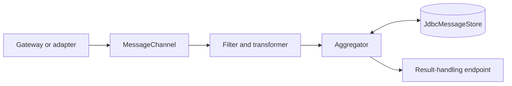

# JdbcMessageStore

## 1. The Problem: Retaining Integration Flow State Across Runs

In the **SPRING_INTEGRATION_CORE** module, `Message` carries data, `MessageChannel` connects processing steps, and endpoints perform work such as transformation, routing, or aggregation. For a stateful endpoint, an additional question must be answered: where is the pending data stored?

Suppose an order must receive three results: payment, inventory reservation, and shipping. The aggregator has received two results when the application stops to deploy a new version. If the group resides only in memory, the next startup will no longer know about the two earlier results.

`JdbcMessageStore` persists message state to a relational database via JDBC. It suits correlating components such as aggregator and resequencer, as well as the claim check pattern. This class provides both the `MessageStore` and `MessageGroupStore` contracts. [JdbcMessageStore API](https://docs.spring.io/spring-integration/api/org/springframework/integration/jdbc/store/JdbcMessageStore.html).

After this lesson, the learner will be able to configure the store, attach it to an aggregator with Java DSL, design transaction boundaries, explain recovery after restart, and diagnose causes when groups stall or data fails to be read back.

## 2. Where Does the Store Sit in an Integration Flow?



In this flow:

- A gateway or adapter brings messages into the system.
- A filter discards invalid messages; a transformer normalizes payload and headers.
- The aggregator determines which messages belong to the same group and when to emit the result.
- The store persists messages along with group state as requested by the aggregator.
- Downstream endpoints use the aggregated result to perform business logic.

Declaring a `JdbcMessageStore` bean does not make every channel or endpoint persistent. The component that needs state storage must be configured to use that store. A `DirectChannel` still passes messages directly between handlers; it does not automatically write every message to the database.

### 2.1. Two Storage Contracts

| Contract | Unit of Work | Typical Operations | Use Case |
|---|---|---|---|
| `MessageStore` | A single message with an identifier | `addMessage`, `getMessage`, `removeMessage` | Claim check |
| `MessageGroupStore` | A group of messages plus group state | Add to group, read group, mark complete, remove group | Aggregator, resequencer |

A group is not just a list of payloads. The endpoint also needs to know whether the group is complete, creation timestamp, update timestamp, and information for ordered processing. This is why an aggregator's store cannot simply be replaced with a table containing only a JSON payload column while preserving framework behavior.

### 2.2. Distinguishing Similarly Named Components

| Component | Main Purpose | Key Point to Remember |
|---|---|---|
| `SimpleMessageStore` | Stores messages and groups in memory | Convenient for learning or experimentation; data does not survive process loss |
| `JdbcMessageStore` | Stores messages and groups in an RDBMS | Suitable for aggregator and claim check |
| `JdbcChannelMessageStore` | Stores message channel queues | Optimized specifically for channels; do not use in place of an aggregator's store |
| `JdbcMetadataStore` | Stores key-value metadata | Suitable for checkpoints or processed-state flags, does not replace a full message store |
| `JdbcLockRegistry` | Coordinates locks via the database | Helps multiple instances coordinate operations on the same group |

If the primary need is to persist a `QueueChannel`, consider `JdbcChannelMessageStore`. The Spring Integration documentation clearly distinguishes general-purpose stores from stores optimized for channel queues. [JDBC Message Store](https://docs.spring.io/spring-integration/reference/jdbc/message-store.html).

## 3. What Data Is Written to the Database?

### 3.1. Tables of the General-Purpose Store

With the default prefix `INT_`, the main tables of `JdbcMessageStore` include:

| Table | Role |
|---|---|
| `INT_MESSAGE` | Stores the identifier and serialized data of each message |
| `INT_MESSAGE_GROUP` | Stores the state of each group |
| `INT_GROUP_TO_MESSAGE` | Links groups to the messages belonging to them |

Scripts bundled with the JDBC module may also create tables for channels, metadata, and locks. For instance, `INT_CHANNEL_MESSAGE` serves the channel store; `INT_LOCK` serves the JDBC locking mechanism. Not every table in the same script is used by `JdbcMessageStore`. You can inspect the exact structure in the [Spring Integration 6.5.3 H2 schema](https://raw.githubusercontent.com/spring-projects/spring-integration/v6.5.3/spring-integration-jdbc/src/main/resources/org/springframework/integration/jdbc/schema-h2.sql).

These tables are internal framework structures. `GROUP_KEY` should not be assumed to be a raw `orderId` or `batchId` string that can be queried directly. To work with business identifiers, use the store's API and the endpoint's correlation strategy.

### 3.2. Schema Must Match the Library Version

Script paths typically follow the form:

```text
org/springframework/integration/jdbc/schema-<database>.sql
```

For example, with H2:

```text
classpath:org/springframework/integration/jdbc/schema-h2.sql
```

Obtain the script from the exact `spring-integration-jdbc` artifact the application uses. Do not copy DDL from another version and assume column names, data types, or table structures remain unchanged.

In real deployments, put the required schema into Flyway or Liquibase to control changes. Do not re-run non-idempotent table creation scripts on every application startup. Changing the prefix in Java configuration also does not automatically create or rename existing tables.

## 4. Preparing the Hands-On Example

The example below uses Java 17 or later, Spring Boot, and the Java DSL APIs available in Spring Integration 6.5. Dependency versions are managed by the project's BOM. When using another version, use the schema packaged with that version.

### 4.1. Dependencies

In a Spring Boot project with dependency management:

```xml
<dependency>
    <groupId>org.springframework.boot</groupId>
    <artifactId>spring-boot-starter-integration</artifactId>
</dependency>

<dependency>
    <groupId>org.springframework.boot</groupId>
    <artifactId>spring-boot-starter-jdbc</artifactId>
</dependency>

<dependency>
    <groupId>org.springframework.integration</groupId>
    <artifactId>spring-integration-jdbc</artifactId>
</dependency>

<dependency>
    <groupId>com.h2database</groupId>
    <artifactId>h2</artifactId>
    <scope>runtime</scope>
</dependency>
```

H2 is only for local hands-on practice. The JDBC driver must be replaced with the target database's driver when moving across environments.

### 4.2. Using File-Based H2 to Observe Restart Behavior

```yaml
spring:
  datasource:
    url: jdbc:h2:file:./data/order-message-store;DB_CLOSE_ON_EXIT=FALSE
    driver-class-name: org.h2.Driver
    username: sa
    password: ""
  integration:
    jdbc:
      initialize-schema: never
  sql:
    init:
      mode: never
```

The file path is resolved relative to the application's working directory. Two runs must point to the same database file if you want to observe data recovery.

For an empty practice database, on the first initialization, temporarily replace the `spring.sql.init` section with:

```yaml
spring:
  sql:
    init:
      mode: always
      schema-locations: classpath:org/springframework/integration/jdbc/schema-h2.sql
```

Keep `spring.integration.jdbc.initialize-schema: never` in the rest of the configuration so only one schema initialization mechanism runs. After creation succeeds, switch `spring.sql.init.mode` back to `never` before the next run.

If you use `jdbc:h2:mem:...`, data is lost once the JVM process exits. Even `DB_CLOSE_DELAY=-1` on an in-memory database does not make data survive JVM shutdown.

## 5. Declaring the Store and Attaching It to an Aggregator

### 5.1. Serializable Payload

Each partial result is represented by a small DTO:

```java
package example.integration.store;

import java.io.Serial;
import java.io.Serializable;

public record PartResult(
        String orderId,
        String partId,
        boolean successful
) implements Serializable {

    @Serial
    private static final long serialVersionUID = 1L;
}
```

In the example, `partId` is `PAYMENT`, `STOCK`, and `SHIPPING` respectively. `batchId` will be placed in a header to distinguish each collection attempt. An order reprocessed in another attempt must use a different `batchId`.

### 5.2. Java DSL Configuration

```java
package example.integration.store;

import javax.sql.DataSource;

import org.springframework.context.annotation.Bean;
import org.springframework.context.annotation.Configuration;
import org.springframework.integration.channel.DirectChannel;
import org.springframework.integration.channel.QueueChannel;
import org.springframework.integration.config.EnableIntegration;
import org.springframework.integration.dsl.IntegrationFlow;
import org.springframework.integration.jdbc.store.JdbcMessageStore;
import org.springframework.jdbc.datasource.DataSourceTransactionManager;
import org.springframework.messaging.MessageChannel;
import org.springframework.messaging.PollableChannel;
import org.springframework.transaction.PlatformTransactionManager;
import org.springframework.transaction.annotation.EnableTransactionManagement;

@Configuration
@EnableIntegration
@EnableTransactionManagement
public class OrderStoreConfiguration {

    @Bean
    public JdbcMessageStore orderGroupStore(DataSource dataSource) {
        JdbcMessageStore store = new JdbcMessageStore(dataSource);
        store.setTablePrefix("INT_");
        store.setRegion("order-results-v1");
        return store;
    }

    @Bean
    public PlatformTransactionManager integrationTransactionManager(
            DataSource dataSource) {
        return new DataSourceTransactionManager(dataSource);
    }

    @Bean
    public MessageChannel orderResultInput() {
        return new DirectChannel();
    }

    @Bean
    public PollableChannel orderSummaryOutput() {
        return new QueueChannel();
    }

    @Bean
    public IntegrationFlow aggregateOrderResults(
            JdbcMessageStore orderGroupStore) {
        return IntegrationFlow.from("orderResultInput")
                .aggregate(spec -> spec
                        .messageStore(orderGroupStore)
                        .correlationStrategy(message ->
                                message.getHeaders()
                                        .get("batchId", String.class))
                        .releaseStrategy(group -> group.size() == 3)
                        .expireGroupsUponCompletion(false))
                .channel("orderSummaryOutput")
                .get();
    }
}
```

The attachment point is `.messageStore(orderGroupStore)`. The DSL lets you configure the correlation strategy, release strategy, and store on the same endpoint. [Aggregators and Resequencers in Java DSL](https://docs.spring.io/spring-integration/reference/dsl/java-aggregators.html).

Meaning of the configuration:

1. Messages with the same `batchId` go into the same group.
2. When the group has three messages, the aggregator emits a result.
3. The default group processor creates a payload containing a collection of the input payloads.
4. `expireGroupsUponCompletion(false)` keeps a trace of the completed group instead of deleting the entire group immediately after release.
5. `orderSummaryOutput` is an in-memory queue to make results easy to observe during practice.

The example assumes each part is sent exactly once and each `batchId` belongs to only one order. The `group.size() == 3` condition counts messages; it does not confirm that all three distinct `partId` values are present. When redelivery can occur, deduplicate by business key or use a release strategy that checks for the full expected result set, and also specify how duplicates in the output are handled.

### 5.3. Sending Messages Inside an Explicit Transaction

```java
package example.integration.store;

import org.springframework.beans.factory.annotation.Qualifier;
import org.springframework.messaging.Message;
import org.springframework.messaging.MessageChannel;
import org.springframework.messaging.support.MessageBuilder;
import org.springframework.stereotype.Service;
import org.springframework.transaction.annotation.Transactional;

@Service
public class OrderResultIngress {

    private final MessageChannel input;

    public OrderResultIngress(
            @Qualifier("orderResultInput") MessageChannel input) {
        this.input = input;
    }

    @Transactional(transactionManager = "integrationTransactionManager")
    public void accept(String batchId, PartResult result) {
        if (batchId == null || batchId.isBlank()) {
            throw new IllegalArgumentException("batchId must not be blank");
        }

        Message<PartResult> message = MessageBuilder
                .withPayload(result)
                .setHeader("batchId", batchId)
                .build();

        if (!this.input.send(message)) {
            throw new IllegalStateException("Message was not accepted");
        }
    }
}
```

Invoke `accept` through the Spring-managed bean so the transaction interceptor takes effect. Instantiating the object with `new` or self-invoking a `@Transactional` method from inside the same object does not create a transaction under standard proxy mechanisms.

Because the input is a `DirectChannel`, the aggregator is invoked synchronously on the sending thread. The store's JDBC operations can participate in the transaction managed by `integrationTransactionManager` on the same `DataSource`.

The output `QueueChannel` in the example is only for observation. Putting results into an in-memory queue does not roll back together with JDBC. If you need atomic business updates alongside group state, use a synchronous JDBC handler in the same transaction or write an outbox record in the same transaction to publish afterward.

## 6. Observing Group Lifecycle and Recovery After Restart

### 6.1. Execution Scenario

From a runner, controller, or integration test, call the `OrderResultIngress` bean in order:

```java
ingress.accept("ORDER-42:ATTEMPT-1",
        new PartResult("ORDER-42", "PAYMENT", true));

ingress.accept("ORDER-42:ATTEMPT-1",
        new PartResult("ORDER-42", "STOCK", true));
```

After both calls have committed, stop the application. Restart it with the same database, prefix, and region, then send the remaining result:

```java
ingress.accept("ORDER-42:ATTEMPT-1",
        new PartResult("ORDER-42", "SHIPPING", true));
```

When running in a test or observation code with a reference to `PollableChannel orderSummaryOutput`, retrieve the result using:

```java
Message<?> summary = orderSummaryOutput.receive(1_000);
if (summary == null) {
    throw new IllegalStateException("No aggregated result");
}

Collection<?> results = (Collection<?>) summary.getPayload();
```

The result-reading snippet uses `java.util.Collection` and `org.springframework.messaging.Message`. The default output is a collection of payloads; do not write tests assuming the order `PAYMENT`, `STOCK`, `SHIPPING` unless an ordering requirement is explicitly configured.

### 6.2. Expected State

| Time | Group State | Output Result |
|---|---|---|
| After `PAYMENT` commits | Group has one message | None yet |
| After `STOCK` commits | Group has two messages | None yet |
| After restart, before new message | Group state remains in database | None yet |
| After `SHIPPING` and successful processing | Group is complete per aggregator configuration | Collection of three results |

Restarting does not generate a new input message on its own. In this example, it is the `SHIPPING` result arriving after the restart that triggers the aggregator to read back the group and evaluate the release strategy.

To inspect the store via API in the lab:

```java
MessageGroup group = orderGroupStore
        .getMessageGroup("ORDER-42:ATTEMPT-1");

int pendingMessages = group.size();
boolean completed = group.isComplete();
```

`MessageGroup` belongs to the `org.springframework.integration.store` package. After full release with a configuration that retains completed groups, do not expect member messages to remain intact inside the group; the completion marker and pending messages are two different kinds of state.

### 6.3. Persistent Data Does Not Mean Endpoints Automatically Resume All Work

Three scenarios must be separated:

- **Incomplete group:** the next arriving message can trigger reading and processing the group again.
- **Group needing expiration:** there must be an expiration check or scheduling mechanism after restart.
- **Result already emitted to an in-memory channel:** the aggregator's store does not recover data on behalf of that output channel.

A restart test is only meaningful when writes before the restart have committed. Closing and reopening an application context while a test transaction remains uncommitted does not prove durability as in a real deployment.

## 7. Transactions Determine the Consistency Boundary

### 7.1. Individual Operations Must Be Bound into One Unit of Work

Receiving a single message may entail writing message data, updating group associations, updating status, and calling a downstream endpoint. Individual SQL statements succeeding is not enough to prove the entire processing step is atomic.

For a synchronous flow, the boundary can be organized as follows:

```text
BEGIN
  receive message into aggregator
  update group state in JdbcMessageStore
  if group is released:
    write business result or outbox using the same DataSource
COMMIT
```

If an error requiring rollback occurs, that error must propagate back to the transaction boundary. When an advice or error handler swallows the exception and treats the run as successful, the transaction may commit instead of rolling back.

### 7.2. Threads and Resources Participating in Transactions

Normal JDBC transactions are bound to a thread. `DirectChannel` lets calls proceed synchronously; switching to `ExecutorChannel` or a queue for another worker to process introduces a boundary that must be designed separately. The sending thread's transaction does not automatically follow the message to the receiving thread. For endpoints reading from a pollable channel, transactions can be configured on the poller. [Transaction Support](https://docs.spring.io/spring-integration/reference/transactions.html).

For the store and business updates to participate in the same local transaction:

- They must use JDBC resources managed by the same transaction manager.
- The call must fall within the same active transaction boundary.
- Exceptions must trigger rollback according to configured rules.

Two differently named transaction managers do not automatically coordinate just because both beans belong to the same Spring application context.

### 7.3. HTTP and External Side Effects

Suppose a handler successfully calls the shipping API, but the database commit fails. A subsequent retry may call that API again. A JDBC rollback cannot undo HTTP side effects that have already happened.

When external side effects exist, the design must add an idempotency key or an appropriate outbox. For example, a key like `ORDER-42:ATTEMPT-1:CREATE-SHIPMENT` helps the target system recognize the same business request being resent.

Therefore, using `JdbcMessageStore` is not enough to declare the entire workflow exactly-once. Group persistence, deduplication, and atomicity of external effects must be evaluated separately.

## 8. Serialization: Payloads Can Be Stored, but Headers May Change

### 8.1. Data Contract for Storage

With the default mechanism, prepare payloads that are Java serializable. Implementing `Serializable` on the outer class is insufficient if an inner field references a non-serializable object.

Data such as `String`, UUID, or small, clearly structured DTOs are far more suitable than placing an `InputStream`, a JDBC connection, an open request object, or a service bean inside the payload.

For headers, `JdbcMessageStore` drops non-serializable values before writing under the default mechanism. This means a mistake may manifest as a header disappearing when read back, rather than always throwing an exception at write time. [Message Store and Serialization](https://docs.spring.io/spring-integration/reference/message-store.html).

The custom header in the example is `batchId` of type `String`, because this is data that must persist stably across runs. Correlation keys should have a stable representation; avoid using a custom object whose identity depends on memory addresses or an unstable `toString()`.

### 8.2. `replyChannel` and `errorChannel`

These headers may hold references to channel objects in the current process. A channel object cannot be treated as a meaningful reply address across arbitrary JVMs or across restarts.

`HeaderChannelRegistry` can help represent channel references by name for appropriate flows, but an in-memory registry does not revive the temporary reply channel of a gateway that has stopped. For processing spanning a restart, provide a stably identified output destination and a result-retrieval mechanism suited to the business flow.

This is also why you must distinguish a gateway's reply timeout from a group's lifetime in the store: the gateway may have already timed out while the group continues being collected.

### 8.3. Changing DTO Structure While Old Data Remains

A stored payload represents a specific contract version. Before renaming classes, moving packages, modifying field types, or changing serializers, decide how existing records will be read.

For DTOs using Java serialization, declaring an explicit `serialVersionUID` helps control compatibility, though it does not guarantee every structural change is compatible. An application upgrade must account for data still waiting in the store.

If you customize serialization, both the writing and reading sides must agree on the format. You cannot simply switch the serializer to JSON while keeping the default deserializer and expect data to be read back. Data formats and schemas should be treated as versioned contracts.

## 9. Using JdbcMessageStore for Claim Check

In the claim check pattern, the flow saves the original message into the store and passes a small identifier through steps that do not yet need the large payload. When the content must be processed, a downstream component uses the identifier to retrieve the original message. Spring Integration provides claim check in/out transformers to implement this pattern. [Claim Check](https://docs.spring.io/spring-integration/reference/claim-check.html).

The basic API can be illustrated as follows:

```java
Message<String> original = MessageBuilder
        .withPayload("Document content to process")
        .setHeader("documentId", "DOC-15")
        .build();

Message<String> stored = documentStore.addMessage(original);
UUID reference = stored.getHeaders().getId();

// Pass the reference through steps that only need the identifier.
Message<?> restored = documentStore.getMessage(reference);
if (restored == null) {
    throw new IllegalStateException("Claim check does not exist");
}

// After the corresponding work has been processed successfully:
documentStore.removeMessage(reference);
```

This snippet uses `java.util.UUID`, `org.springframework.messaging.Message`, and `org.springframework.messaging.support.MessageBuilder`. `documentStore` is a configured `JdbcMessageStore` bean, optionally using its own region such as `document-claims-v1`.

`getMessage` is not equivalent to removal. Conversely, if data is deleted before recoverable work completes, a retry may still have the reference while losing the content to read.

With the claim check out transformer, the `remove-message` option decides whether the message is deleted upon retrieval. If kept for multiple reads, specify when data is cleaned up. If deleted upon retrieval, evaluate rollback and retry behavior for the entire processing unit.

Reading and deleting as shown in the API example also does not create an exclusive claim mechanism across multiple consumers. If business rules require only one consumer to pick up the work, an additional coordination mechanism is required.

## 10. Prefix, Region, and Multiple Instances

### 10.1. Two Ways to Partition

```java
store.setTablePrefix("ORD_INT_");
store.setRegion("order-results-v1");
```

Prefix changes the table names the store queries. The example above requires tables such as `ORD_INT_MESSAGE` to already exist. Region logically separates data within the same set of tables.

You can visualize data scope via the triple:

```text
database/schema + table prefix + region
```

Changing the region causes an instance to look at a different partition; old data may still remain intact but is no longer visible to that instance. This is a common reason an application appears to lose groups after a configuration change.

Region is a logical data partition, not a database authorization barrier. Environments requiring access isolation must still be designed with appropriate database accounts, schemas, or databases.

### 10.2. Sharing Data Is Not Enough for Safe Concurrent Processing

When two instances update the same group concurrently, the entire sequence of reading state, adding a message, evaluating release, and marking completion must be synchronized. Locks within one JVM cannot coordinate instances in another JVM.

Spring Integration provides `JdbcLockRegistry` for correlating components sharing a `MessageGroupStore` across multiple instances. [JDBC Lock Registry](https://docs.spring.io/spring-integration/reference/jdbc/lock-registry.html).

For a multi-instance deployment, you can add the following beans to the configuration:

```java
@Bean
public DefaultLockRepository orderLockRepository(DataSource dataSource) {
    DefaultLockRepository repository = new DefaultLockRepository(dataSource);
    repository.setRegion("order-result-locks-v1");
    return repository;
}

@Bean
public JdbcLockRegistry orderLockRegistry(
        DefaultLockRepository orderLockRepository) {
    return new JdbcLockRegistry(orderLockRepository);
}
```

Both classes belong to the `org.springframework.integration.jdbc.lock` package. Then pass `JdbcLockRegistry orderLockRegistry` into the flow creation method and add:

```java
.aggregate(spec -> spec
        .messageStore(orderGroupStore)
        .lockRegistry(orderLockRegistry)
        .correlationStrategy(message ->
                message.getHeaders().get("batchId", String.class))
        .releaseStrategy(group -> group.size() == 3)
        .expireGroupsUponCompletion(false))
```

Coordinating instances must share the store's data scope, the lock scope, and the correlation key generation logic. Each instance needs its own lock owner identity; do not configure them as the same owner.

You must also choose a lock time-to-live and renewal mechanism suited to the longest processing duration. If lock ownership expires before work finishes, the assumption that only one instance is operating may be violated.

## 11. Completed Groups, Expired Groups, and Data Cleanup

### 11.1. Why Retain a Completion Trace?

After a group emits a result, late-arriving messages with the same correlation key must be handled under a clear policy. Keeping completion state enables the endpoint to recognize that the group has already ended. Deleting the group immediately allows the same key to be recreated, so a late message can become the first member of a new group.

Thus, `expireGroupsUponCompletion(true)` is a decision about lifecycle and key reusability, not just a storage-saving option. Completion, discard, and late-message handling policies must be designed together. [Aggregator](https://docs.spring.io/spring-integration/reference/aggregator.html).

In the order example, using an attempt-scoped key such as `ORDER-42:ATTEMPT-1` helps distinguish a new processing run from a late message of a previous run. If duplicate processing must be prevented longer than the group retention window, a business audit record or metadata with an appropriate retention period is needed.

### 11.2. Groups That Never Receive Enough Data

If the shipping result never arrives, a group could remain indefinitely. The application must decide among options such as emitting partial results, routing messages to a failure-handling flow, or closing the group and recording missing data.

The store does not decide business deadlines on its own. Having a timestamp column in the database also does not mean the database automatically deletes groups by TTL.

`MessageGroupStoreReaper` helps trigger expiration on groups exceeding a time threshold. Bean example:

```java
@Bean
public MessageGroupStoreReaper orderGroupReaper(
        JdbcMessageStore orderGroupStore) {
    MessageGroupStoreReaper reaper =
            new MessageGroupStoreReaper(orderGroupStore);
    reaper.setTimeout(300_000L);
    return reaper;
}
```

`MessageGroupStoreReaper` belongs to the `org.springframework.integration.store` package. Declaring the bean alone does not create a schedule: a scheduler is needed to call `run()` periodically, such as via a `@Scheduled` method when scheduling is enabled. [MessageGroupStoreReaper API](https://docs.spring.io/spring-integration/api/org/springframework/integration/store/MessageGroupStoreReaper.html).

The 300-second threshold above is a time configuration for the store's expiration mechanism; it does not automatically guarantee an exact “300 seconds from the last message” SLA for every endpoint. Verify which timestamp is used and how the aggregator reacts when receiving the expire callback. The scheduler's polling interval also causes actual processing times to lag behind the configured threshold.

If using timeouts scheduled in memory by the endpoint, design a way to detect lingering groups after a restart. Persistent group storage does not mean every in-JVM timer is also persisted.

### 11.3. Do Not Clean Up Tables Piecemeal

Directly deleting rows in `INT_MESSAGE` while ignoring group links can create inconsistent data. Prefer the framework's APIs and lifecycle mechanisms. Maintenance jobs outside the application must understand all table relationships, transaction boundaries, and whether other instances are still using the data.

## 12. Error Handling and Operational Observability

### 12.1. Signals to Monitor

Track the number of waiting groups, age of the oldest group, group size, JDBC operation duration, rollback counts, and lock wait times. A steadily growing group may indicate a correlation bug or missing business bounds.

The following read-only queries help observe counts per partition with the default prefix:

```sql
SELECT REGION, COUNT(*) AS MESSAGE_COUNT
FROM INT_MESSAGE
GROUP BY REGION;

SELECT REGION, COMPLETE, COUNT(*) AS GROUP_COUNT
FROM INT_MESSAGE_GROUP
GROUP BY REGION, COMPLETE;
```

The message row count and group row count do not have to be equal. A waiting group has multiple messages, while a completed group may retain only a status marker.

### 12.2. Diagnosing by Symptom

| Symptom | Where to Check |
|---|---|
| Table or column not found error | Schema, permissions, prefix, and DDL version |
| Old groups not visible after restart | Database URL, H2 file path, region, prefix, and whether prior transactions committed |
| `NotSerializableException` on write | Payload type and all objects referenced by the payload |
| Payload read failure after upgrade | Classpath, class names, serialization compatibility, serializer/deserializer, and deserialization policy of the current version |
| Header disappears after read back | Whether header value is serializable; whether header references JVM-local resources |
| Group fails to release | Correlation key, release strategy, missing data, duplicate messages, or group already completed |
| Two instances produce inconsistent results | Distributed lock, lock scope, lock timeout, and transactions |
| Database grows continuously | Groups waiting forever, uncleaned completion markers, or undeleted claim checks |
| Database rolled back but external API was still called | External side effect is outside the local transaction; check idempotency or outbox |

Do not infinitely retry schema errors or undeserializable data. Transient infrastructure errors and data-contract errors require different handling to avoid creating a retry loop that can never succeed.

## 13. Costs and Design Limits

### 13.1. Cost by Message Count and Group Size

Persisting state to a database increases JDBC round-trips, serialization cost, and lock hold time. With a release strategy or processor that inspects the entire group, larger group sizes can make each evaluation more expensive.

Prefer compact DTOs, clearly bounded correlations, and appropriate retention periods. For very large payloads, consider storing content in dedicated object storage and letting messages carry a durable reference to that content.

### 13.2. Pools, Indexes, and Long Transactions

Processing thread counts should not be scaled independently of the connection pool and database capacity. A transaction holding a group lock while waiting on a slow network call can block other messages in the same group.

Indexes must match the queries of the store version in use and real data patterns. Measure query plans, lock waits, and latency before adding indexes; each index also increases write overhead.

### 13.3. A Store Does Not Replace a Broker

In the example, the database holds aggregator state; inputs and outputs still have their own characteristics. If the system needs distributed queues, delivery guarantees, or broker operational features, evaluate the corresponding channels and transports. Choosing `JdbcMessageStore` for state storage does not automatically provide those features to the entire flow.

## 14. Verification Scenarios When Integrating into a Project

The following scenarios verify the behavior of the design rather than only checking that beans initialize successfully:

| Scenario | How to Execute | What to Verify |
|---|---|---|
| Recover committed group | Send two results, stop process, reopen same DB, send final result | Output contains all results from before and after restart |
| Roll back group update | In a transactional synchronous flow, intentionally throw an error before commit | Uncommitted message does not become saved group state |
| Roll back business result | Use a JDBC handler in the same transaction, fail before commit | Group state and business updates do not commit out of sync |
| Different region | Read same correlation key via a store configured with a different region | Partitions do not see each other's data |
| Duplicate message | Resend the same business key via a new message | Deduplication or release policy does not complete the group early |
| Late-arriving message | Send additional data after group completion | Discard or group-recreation behavior matches the chosen policy |
| Expired group | Let an incomplete group exceed the threshold and run expiration | Failure flow or partial result is handled as configured |
| Multiple instances | Send the same correlation key concurrently through two instances | Locks and transactions preserve group processing rules |
| DTO upgrade | Read data written by an earlier application version | Serialization contract is compatible or has a migration path |

For CI, a real database via Testcontainers generally reflects dialect, transaction, and locking behavior better than H2 alone. A test reopening an application context over an in-memory database is still useful, but does not replace a process-loss test with data committed to a persistent store.

A complete design must define where group state is held, commit boundaries, how duplicate processing is identified, and data cleanup policies. When those pieces are clear, `JdbcMessageStore` becomes a verifiable component within a Spring Integration messaging flow.
