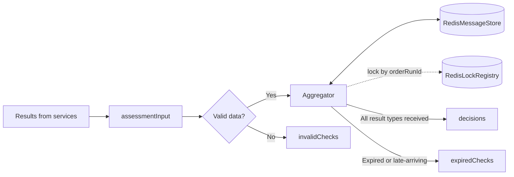

# RedisMessageStore

## 1. Purpose and Scope

In the **SPRING_INTEGRATION_CORE** module, **Message store** chapter, this lesson presents how to use `RedisMessageStore` to hold message state outside the process's memory. The focus is on connecting `Message`, channels, an aggregator, and Java DSL into a flow that can continue using stored data when the application restarts.

After this lesson, you will be able to:

- Distinguish storing a single message from storing the state of a message group.
- Configure the Redis connection, namespace, and serializer for the store.
- Attach the store to an aggregator and coordinate locks across multiple instances.
- Design wait deadlines, handling paths for rejected messages, and group cleanup policies.
- Test reading data back and recognize the limits of durability.

The Java examples use **Spring Integration 6.5.x, Java 17+** as the API baseline. Use a compatible set of Spring Boot/Spring Data Redis versions managed by the BOM; when applying this to Spring Integration 7.x, re-verify serialization APIs, especially Jackson classes.

## 2. Why Does an Aggregator Need a Message Store?

An order assessment requires three results: inventory check, payment, and fraud. They can arrive at different times, from different systems.

```text
09:00:00  STOCK arrives
09:00:02  PAYMENT arrives
09:00:03  application stops
09:00:08  application restarts
09:00:09  FRAUD arrives
```

If the first two results reside only in process memory, the aggregator after restarting will only see the last result. When state has been written to Redis and remains readable, the new instance can reuse those results to evaluate the completion condition.

`RedisMessageStore` implements both the `MessageStore` and `MessageGroupStore` contracts. The processing component decides how to group, the release condition, and the output; the store handles storing and retrieving state. These interfaces do not turn the store into an endpoint that executes business logic on its own. [RedisMessageStore 6.5.3 source code](https://raw.githubusercontent.com/spring-projects/spring-integration/v6.5.3/spring-integration-redis/src/main/java/org/springframework/integration/redis/store/RedisMessageStore.java).



In this design, Redis holds messages waiting to be aggregated. Where the final decision is stored and the delivery mechanism for results still need to be chosen separately.

## 3. MessageStore and MessageGroupStore

| Contract | Typical Operations | Scenario |
| --- | --- | --- |
| `MessageStore` | `addMessage(message)`, `getMessage(id)`, `removeMessage(id)` | Storing/reading a single message, supporting Claim Check |
| `MessageGroupStore` | `addMessageToGroup(groupId, message)`, `getMessageGroup(groupId)`, `removeMessageGroup(groupId)` | Aggregator, resequencer, and group lifecycle |
| `RedisMessageStore` | Supports both contracts above | Using Redis as the state store |

A `Message`'s ID is typically a `UUID` in the `id` header. The correlation key is the business key identifying a group; these two concepts serve two different purposes.

Example:

```text
Message A: id=uuid-A, orderRunId=ORDER-42:CHECK-1, type=STOCK
Message B: id=uuid-B, orderRunId=ORDER-42:CHECK-1, type=PAYMENT

Group: ORDER-42:CHECK-1
```

`orderRunId` identifies **one assessment run** of an order. If re-assessment is needed, use a new key such as `ORDER-42:CHECK-2`. This key naming prevents results from two processing runs from mixing into the same group.

### 3.1. Storage Structure and Namespace

In the `AbstractKeyValueMessageStore` source code of version 6.5.3, messages are wrapped for separate storage, while group metadata holds information such as the list of message IDs and completion state. You should not assume the entire group's payloads always live in a single Redis value. [AbstractKeyValueMessageStore source code](https://raw.githubusercontent.com/spring-projects/spring-integration/v6.5.3/spring-integration-core/src/main/java/org/springframework/integration/store/AbstractKeyValueMessageStore.java).

With the prefix `lesson:dev:assessment:v1:`, key formats in this implementation include:

```text
lesson:dev:assessment:v1:MESSAGE_<messageId>
lesson:dev:assessment:v1:MESSAGE_<groupId>_<messageId>
lesson:dev:assessment:v1:GROUP_OF_MESSAGES_<groupId>
```

The first format serves standalone messages; the latter two relate to messages within a group and group metadata. These are implementation details to aid diagnostics, not formats an application should write directly.

Choose namespaces by environment and purpose:

```text
orders:dev:assessment:v1:
orders:prod:assessment:v1:
orders:prod:claim-check:v1:
```

Instances processing the same flow must use the same namespace. Different flows need separate namespaces, especially when group expiration jobs are active.

## 4. Preparing Dependencies and Redis

In a project that already has a Spring Boot parent or BOM compatible with Spring Integration 6.5.x:

```xml
<dependencies>
    <dependency>
        <groupId>org.springframework.boot</groupId>
        <artifactId>spring-boot-starter-integration</artifactId>
    </dependency>
    <dependency>
        <groupId>org.springframework.integration</groupId>
        <artifactId>spring-integration-redis</artifactId>
    </dependency>
    <dependency>
        <groupId>org.springframework.boot</groupId>
        <artifactId>spring-boot-starter-data-redis</artifactId>
    </dependency>
    <dependency>
        <groupId>org.springframework.boot</groupId>
        <artifactId>spring-boot-starter-test</artifactId>
        <scope>test</scope>
    </dependency>
</dependencies>
```

Do not mix independent Spring Integration and Spring Data Redis versions manually. If not using Spring Boot, you must manage compatible versions and add a Redis client, such as Lettuce. The module providing the store is `spring-integration-redis`. [Redis Support 6.5 Documentation](https://docs.spring.io/spring-integration/reference/6.5/redis.html).

The example below assumes local Redis is listening on `127.0.0.1:6379`. The `lesson.*` properties are only for this hands-on lesson:

```properties
lesson.redis.host=127.0.0.1
lesson.redis.port=6379
lesson.store-prefix=lesson:dev:assessment:v1:
lesson.lock-prefix=lesson:dev:assessment-lock:v1
```

The Java configuration uses `@Value` with default values so it can also run via Spring Test without Spring Boot. In an application where Boot already provides a `RedisConnectionFactory`, use that factory and remove the illustrative factory bean to avoid duplicate declarations.

## 5. Java DSL Example: Aggregating Three Check Results

Business rules for the example:

1. Each `orderRunId` must have all three: `STOCK`, `PAYMENT`, and `FRAUD`.
2. A duplicate result cannot substitute for a missing result type.
3. Approve only when every aggregated result has `passed=true`.
4. The outcome of a single assessment run is immutable. If business rules allow adjustments, open a new assessment run or add explicit versioning rules.
5. Groups missing data upon expiration are routed to a separate handling path.

Below is a complete configuration class. The three output `QueueChannel` beans are in-memory queues for easy observation while learning.

```java
package example.integration;

import java.io.Serializable;
import java.util.EnumSet;
import java.util.Set;
import java.util.stream.Collectors;

import org.springframework.beans.factory.annotation.Value;
import org.springframework.context.annotation.Bean;
import org.springframework.context.annotation.Configuration;
import org.springframework.data.redis.connection.RedisConnectionFactory;
import org.springframework.data.redis.connection.lettuce.LettuceConnectionFactory;
import org.springframework.integration.channel.DirectChannel;
import org.springframework.integration.channel.QueueChannel;
import org.springframework.integration.config.EnableIntegration;
import org.springframework.integration.dsl.IntegrationFlow;
import org.springframework.integration.redis.store.RedisMessageStore;
import org.springframework.integration.redis.util.RedisLockRegistry;
import org.springframework.integration.store.MessageGroup;
import org.springframework.integration.store.MessageGroupStoreReaper;
import org.springframework.scheduling.annotation.EnableScheduling;
import org.springframework.scheduling.annotation.Scheduled;

@Configuration(proxyBeanMethods = false)
@EnableIntegration
@EnableScheduling
public class RedisOrderFlow {

    public enum CheckType {
        STOCK, PAYMENT, FRAUD
    }

    public record CheckResult(
            String orderRunId,
            CheckType type,
            boolean passed) implements Serializable {
    }

    public record OrderDecision(
            String orderRunId,
            boolean approved) implements Serializable {
    }

    @Bean
    RedisConnectionFactory redisConnectionFactory(
            @Value("${lesson.redis.host:127.0.0.1}") String host,
            @Value("${lesson.redis.port:6379}") int port) {

        return new LettuceConnectionFactory(host, port);
    }

    @Bean
    RedisMessageStore assessmentStore(
            RedisConnectionFactory connectionFactory,
            @Value("${lesson.store-prefix:lesson:dev:assessment:v1:}")
            String prefix) {

        return new RedisMessageStore(connectionFactory, prefix);
    }

    @Bean
    RedisLockRegistry assessmentLocks(
            RedisConnectionFactory connectionFactory,
            @Value("${lesson.lock-prefix:lesson:dev:assessment-lock:v1}")
            String lockPrefix) {

        return new RedisLockRegistry(connectionFactory, lockPrefix);
    }

    @Bean
    DirectChannel assessmentInput() {
        return new DirectChannel();
    }

    @Bean
    QueueChannel decisions() {
        return new QueueChannel();
    }

    @Bean
    QueueChannel invalidChecks() {
        return new QueueChannel();
    }

    @Bean
    QueueChannel expiredChecks() {
        return new QueueChannel();
    }

    @Bean
    IntegrationFlow assessmentFlow(
            RedisMessageStore assessmentStore,
            RedisLockRegistry assessmentLocks) {

        return IntegrationFlow.from("assessmentInput")
                .filter(CheckResult.class, RedisOrderFlow::validCheck,
                        filter -> filter.discardChannel("invalidChecks"))
                .aggregate(aggregator -> aggregator
                        .messageStore(assessmentStore)
                        .lockRegistry(assessmentLocks)
                        .correlationStrategy(message ->
                                ((CheckResult) message.getPayload())
                                        .orderRunId())
                        .releaseStrategy(RedisOrderFlow::hasAllCheckTypes)
                        .outputProcessor(RedisOrderFlow::toDecision)
                        .groupTimeout(60_000L)
                        .sendPartialResultOnExpiry(false)
                        .expireGroupsUponCompletion(false)
                        .expireGroupsUponTimeout(false)
                        .minimumTimeoutForEmptyGroups(300_000L)
                        .discardChannel("expiredChecks"))
                .channel("decisions")
                .get();
    }

    private static boolean validCheck(CheckResult result) {
        return result.orderRunId() != null
                && !result.orderRunId().isBlank()
                && result.type() != null;
    }

    private static boolean hasAllCheckTypes(MessageGroup group) {
        Set<CheckType> received = group.getMessages().stream()
                .map(message -> (CheckResult) message.getPayload())
                .map(CheckResult::type)
                .collect(Collectors.toSet());

        return received.containsAll(EnumSet.allOf(CheckType.class));
    }

    private static OrderDecision toDecision(MessageGroup group) {
        var checks = group.getMessages().stream()
                .map(message -> (CheckResult) message.getPayload())
                .toList();

        String orderRunId = checks.get(0).orderRunId();
        boolean approved = checks.stream().allMatch(CheckResult::passed);
        return new OrderDecision(orderRunId, approved);
    }

    @Bean
    MessageGroupStoreReaper assessmentReaper(
            RedisMessageStore assessmentStore) {

        var reaper = new MessageGroupStoreReaper(assessmentStore);
        reaper.setTimeout(300_000L);
        reaper.setExpireOnDestroy(false);
        return reaper;
    }

    @Bean
    ReaperJob assessmentReaperJob(MessageGroupStoreReaper assessmentReaper) {
        return new ReaperJob(assessmentReaper);
    }

    public static final class ReaperJob {

        private final MessageGroupStoreReaper reaper;

        public ReaperJob(MessageGroupStoreReaper reaper) {
            this.reaper = reaper;
        }

        @Scheduled(initialDelay = 15_000L, fixedDelay = 15_000L)
        public void expireOldGroups() {
            this.reaper.run();
        }
    }
}
```

`@EnableIntegration` registers Spring Integration infrastructure. Spring manages the lifecycle of `LettuceConnectionFactory`, the lock registry, and the reaper; do not manually invoke bean creation methods.

### 5.1. Reading the Flow by Responsibility

| Component | Responsibility in the Example |
| --- | --- |
| `assessmentInput` | Receives `Message<CheckResult>` on the sending thread |
| Filter | Rejects records missing a key or check type |
| Correlation strategy | Selects the group from `orderRunId` |
| Release strategy | Checks the set of received result types |
| Output processor | Builds `OrderDecision` |
| `assessmentStore` | Stores messages and group state in Redis |
| `assessmentLocks` | Coordinates access to the same group across instances |
| `decisions` | Holds results for the learning program/test to read |
| Reaper | Periodically scans groups eligible for expiration |

Checking the `CheckType` set is a choice specific to this problem. Using `group.size() == 3` alone could complete erroneously when the inputs are `STOCK, STOCK, PAYMENT`. Requiring all three types also does not replace business deduplication: duplicate records can still consume Redis memory.

If the system allows changing a result after a decision has been emitted, design a separate update flow. The aggregator above may have already completed before the correction arrives.

### 5.2. Sending and Receiving Messages

Place the following snippet in a Java method, with classes from `RedisOrderFlow` imported:

```java
try (var context =
        new org.springframework.context.annotation.AnnotationConfigApplicationContext(
                RedisOrderFlow.class)) {

    var input = context.getBean("assessmentInput",
            org.springframework.messaging.MessageChannel.class);
    var output = context.getBean("decisions", QueueChannel.class);

    input.send(new org.springframework.messaging.support.GenericMessage<>(
            new RedisOrderFlow.CheckResult(
                    "ORDER-42:CHECK-1",
                    RedisOrderFlow.CheckType.STOCK, true)));
    input.send(new org.springframework.messaging.support.GenericMessage<>(
            new RedisOrderFlow.CheckResult(
                    "ORDER-42:CHECK-1",
                    RedisOrderFlow.CheckType.PAYMENT, true)));
    input.send(new org.springframework.messaging.support.GenericMessage<>(
            new RedisOrderFlow.CheckResult(
                    "ORDER-42:CHECK-1",
                    RedisOrderFlow.CheckType.FRAUD, true)));

    var message = output.receive(1_000);
    if (message != null) {
        System.out.println(message.getPayload());
    }
}
```

With a clean Redis state for this group key, the expected output is:

```text
OrderDecision[orderRunId=ORDER-42:CHECK-1, approved=true]
```

Each re-run needs a new `orderRunId` or a new practice namespace. While completion metadata still exists, a new message with the same key will be treated as late-arriving.

The output queues in the example lose their contents when the JVM stops and are unbounded by default. In deployment, you need active consumers, load limits, and an output choice with appropriate durability. Storing groups in Redis does not automatically make other queues persistent.

## 6. Serialization: Storing Both Payload and Headers

The default serializer of `RedisMessageStore` is Java serialization. Payloads and any data stored alongside them must be compatible with the serializer; a non-serializable object in a header can cause write operations to fail. That is why the DTOs in the example implement `Serializable`. [Default serializer implementation](https://raw.githubusercontent.com/spring-projects/spring-integration/v6.5.3/spring-integration-redis/src/main/java/org/springframework/integration/redis/store/RedisMessageStore.java).

Inspect the actual message right before the storage boundary:

- Prefer DTOs containing only data such as strings, numbers, enums, and structures with an established serialization contract.
- Convert streams, request objects, connections, or framework objects into necessary data before storing.
- Keep headers needed for correlation, tracing, and business logic; handle headers referencing local resources according to the flow design.
- Test data written by an older application version when deploying a new version.

A Java channel inside `replyChannel` cannot become an inter-process address solely through serialization. If `HeaderChannelRegistry` is used to convert channel references into names, that registry still has a lifecycle and scope to manage. For long-waiting flows, use a stably named result destination and a business identifier.

### 6.1. Switching to JSON

You can configure `setValueSerializer(...)`. For the 6.5.x baseline and Jackson 2, a bean variant using a messaging-aware mapper is:

```java
@Bean
RedisMessageStore jsonAssessmentStore(
        RedisConnectionFactory connectionFactory) {

    var mapper =
            org.springframework.integration.support.json.JacksonJsonUtils
                    .messagingAwareMapper("example.integration");

    var serializer =
            new org.springframework.data.redis.serializer
                    .GenericJackson2JsonRedisSerializer(mapper);

    var store = new RedisMessageStore(
            connectionFactory, "lesson:dev:assessment:json:v1:");
    store.setValueSerializer(serializer);
    return store;
}
```

This is an option to **replace** the default store bean and requires compatible Jackson 2 dependencies. Do not add both beans and leave store selection ambiguous.

The mapper must handle the message envelope, headers, and internal store objects, not just the payload DTO. Restrict trusted packages according to real data; avoid opening deserialization permissions to all types. When moving to Spring Integration 7.x, check the corresponding Jackson 3 classes in the documentation for that version. [Redis Serialization Guide 6.5](https://docs.spring.io/spring-integration/reference/6.5/redis.html), [Current Redis Guide](https://docs.spring.io/spring-integration/reference/redis.html).

Changing the serializer does not automatically convert old data. A migration plan can be to drain old groups first, use a new namespace for new data, or build a tested migration. Within a namespace that still has active groups, all instances must read/write the same format.

## 7. Multiple Instances: Shared Store and Shared Locks

When two instances receive messages for `ORDER-42:CHECK-1` at the same time, each can execute the sequence of reading the group, adding the message, evaluating release, and updating state. Individual Redis commands do not replace coordinating this entire sequence.

An aggregator has local per-group locks. When groups are shared across processes, configure a distributed `LockRegistry` such as `RedisLockRegistry`. [Distributed Locks](https://docs.spring.io/spring-integration/reference/distributed-locks.html).

Instances in the example must agree on:

```text
store-prefix   = lesson:prod:assessment:v1:
lock-prefix    = lesson:prod:assessment-lock:v1
correlation    = same orderRunId rule
serialization  = same format and compatible data types
```

The two prefixes serve separate roles; they do not need to be identical. What matters is that every instance operating on the same group uses the same lock space and the same data space.

Redis locks have an expiration so they can be reclaimed if a process dies. Choose a TTL suited to the lock-holding duration; versions supporting renewal allow configuring a renewal scheduler. Losing lock ownership mid-operation must be monitored as a concurrency incident. [Redis Lock Registry](https://docs.spring.io/spring-integration/reference/redis.html#redis-lock-registry).

In this lab, the output processor only computes in memory and sends to a queue. If replaced with a long HTTP call, re-evaluate lock-holding scope and the possibility of duplicate side effects.

## 8. Timeout, Completed Groups, and Reaper

Three policies in the example serve three different needs:

| Policy | Example Value | Meaning |
| --- | --- | --- |
| `groupTimeout` | 60,000 ms | Idle time without a new message before forcing group completion evaluation |
| Reaper timeout | 300,000 ms | Group age threshold for a scan to evaluate expiration |
| Reaper fixed delay | 15,000 ms | Pause interval between executions of the scan task |
| `minimumTimeoutForEmptyGroups` | 300,000 ms | Retain empty group metadata for an additional period to detect late-arriving messages |

`groupTimeout` is a per-group mechanism, whereas the reaper scans the store. Tasks scheduled inside the JVM do not survive process termination on their own. Use a reaper or the correlation endpoint's orphan-group purge mechanism to handle groups remaining in the persistent store after a restart. [Aggregator Group Management and Timeout 6.5](https://docs.spring.io/spring-integration/reference/6.5/aggregator.html).

`MessageGroupStoreReaper` is a `Runnable`: setting a timeout and declaring the bean does not create a scan schedule. In the example, `ReaperJob` calls `run()` periodically; the Spring lifecycle starts the reaper. [MessageGroupStoreReaper source code](https://raw.githubusercontent.com/spring-projects/spring-integration/v6.5.3/spring-integration-core/src/main/java/org/springframework/integration/store/MessageGroupStoreReaper.java).

### 8.1. How Are Expired Groups Handled?

In the example:

- `sendPartialResultOnExpiry(false)` disallows emitting a normal decision when a check type is missing.
- `discardChannel("expiredChecks")` receives messages rejected due to expiration or arriving after the group has completed.
- The two options `expireGroupsUponCompletion(false)` and `expireGroupsUponTimeout(false)` retain completion metadata to recognize late-arriving messages.
- The reaper and empty-group timeout ensure this metadata is cleaned up later.

A completed group may have already discarded its member messages while keeping empty metadata. Thus, seeing a group exist does not mean member payloads still remain.

After metadata is cleaned up, a message reusing the correlation key can create a new group. If duplicate decisions must be blocked longer than metadata retention, record a business marker at the destination keyed by `orderRunId`, such as a unique constraint.

The durations above are learning parameters, not SLA guarantees. Scheduler intervals, system load, and group age calculation policies all affect actual processing times. Measure latency and determine the late-message window based on business needs.

### 8.2. Do Not Use Redis TTL Instead of Group Lifecycle

Manually setting `EXPIRE` on internal keys can cause messages and metadata to vanish at different times. It also does not invoke the aggregator's output processor or discard path.

Let the endpoint and store manage groups via their respective APIs. If special retention is required, design it with full awareness of the relationship between member data, metadata, and expiration handling.

Each independent aggregator should have its own store bean and namespace when using expiration callbacks. Sharing one store indiscriminately across endpoints can cause groups to be expired by the wrong component. [Message Store and Expiry Callbacks in Aggregator](https://docs.spring.io/spring-integration/reference/aggregator.html).

## 9. Choosing RedisMessageStore or RedisChannelMessageStore?

| Need | Appropriate Component |
| --- | --- |
| Holding groups for an aggregator or resequencer | `RedisMessageStore` |
| Storing standalone messages for Claim Check | `RedisMessageStore` |
| QueueChannel storing its queue in Redis | `RedisChannelMessageStore` |
| QueueChannel with priority as supported by Redis store | `RedisChannelPriorityMessageStore` |
| Storing metadata such as adapter read markers | `RedisMetadataStore` |

`RedisChannelMessageStore` is specialized for queues and uses Redis lists. It does not provide the full `MessageGroupStore` contract needed by an aggregator. `RedisMessageStore` supports groups, whereas for queue needs you should choose the specialized store. [Redis channel message stores](https://docs.spring.io/spring-integration/reference/redis.html#redis-channel-message-stores).

If you add a persistent queue before the aggregator, that is a separate assurance layer. You must inspect how items are popped from the queue, handed off to the handler, and handled if a consumer dies; do not infer message-broker-like acknowledgement semantics just from using a Redis list.

## 10. Standalone Messages and Claim Check

For large payloads where intermediate steps only need routing data, you can store the message and pass a token. Spring Integration's Claim Check has check-in and check-out transformers supporting this pattern. [Claim Check](https://docs.spring.io/spring-integration/reference/6.5/claim-check.html).

Direct API usage example, placed inside a method with a `connectionFactory` variable:

```java
var store = new RedisMessageStore(
        connectionFactory, "lesson:dev:claim-check:v1:");

var original = org.springframework.messaging.support.MessageBuilder
        .withPayload("content-to-store")
        .setHeader("businessKey", "DOCUMENT-42")
        .build();

store.addMessage(original);
java.util.UUID token = original.getHeaders().getId();

var restored = store.getMessage(token);
// Process restored when the original data is actually needed.

store.removeMessage(token);
// Only remove when the business lifecycle allows.
```

In the application, specify when the token expires, how many readers may access it, and how to handle a missing record. This token is the standalone message's ID; do not use `getMessage(groupId)` to read a group.

Separate the Claim Check namespace from the aggregator namespace so cleaning up one kind of data does not affect the other.

## 11. Error Handling and Transaction Limits

### 11.1. Classifying Errors by Action

| Symptom | How to Handle |
| --- | --- |
| Cannot connect to Redis | Check endpoint, credentials, timeout; retry with bounds |
| Payload/header cannot be serialized | Fix data contract, route to error-handling path |
| Cannot read data after deploy | Check class compatibility, serializer, and namespace |
| Lock contention or lost lock ownership | Check lock hold duration, load, and renewal configuration |
| Missing one result until expiration | Compensate data, mark assessment failed, or open a new assessment run |
| Target already processed but call timed out | Look up by business key before re-executing |

In a flow using `DirectChannel`, synchronous processing errors propagate back to the thread calling `send`. Not every exception automatically turns into a message on the global `errorChannel`. For pollers or asynchronous tasks, error reporting depends on the executor component and error handler. [Error Handling 6.5](https://docs.spring.io/spring-integration/reference/6.5/error-handling.html).

The `@Scheduled` task in the example must be monitored for errors like any normal background task. If you want to send errors into a Spring Integration flow, configure an appropriate error handler/scheduler; for group timeouts, also check the scheduler used by the aggregator.

Retrying serialization errors usually does not help. For network errors, a timeout can occur when the command was already executed by the server but the client missed the response. Design idempotent receivers and check state before concluding an operation did not occur.

### 11.2. Why There Is Not Exactly-Once Yet

Consider extending the output into:

```text
all three results received
    -> call voucher-issuance service
    -> update/complete group
```

If the service already issued the voucher but the process dies before fully recording state, the next run may issue another voucher. A distributed lock coordinates group access, while idempotency of the voucher-issuance operation requires a separate mechanism.

One design approach is passing `orderRunId` as an idempotency key and having the target store a single unique result for that key. When a transaction must span database changes and event publication, consider a transactional outbox suited to the target system.

Do not add `@Transactional` and assume Redis, a relational database, and HTTP all roll back together. Spring Data Redis requires explicit configuration for `RedisTemplate` to participate in transactions; Redis transactions also do not form atomic transactions with HTTP. `RedisMessageStore` builds its internal template itself, so configuring another template does not change its behavior. [Spring Data Redis Transactions](https://docs.spring.io/spring-data/redis/reference/redis/transactions.html), [RedisMessageStore source code](https://raw.githubusercontent.com/spring-projects/spring-integration/v6.5.3/spring-integration-redis/src/main/java/org/springframework/integration/redis/store/RedisMessageStore.java).

## 12. Redis Persistence and Operations

### 12.1. Distinguishing Two Kinds of Restarts

Application restart and Redis restart are two different experiments:

| Failure | Conditions for Data to Remain Usable |
| --- | --- |
| Application JVM dies, Redis stays up | Data was written and not deleted; new instance uses the exact configuration |
| Redis also dies and restarts | Persistence mechanism is required and stored data still exists |
| Failover to a replica | Evaluate replication lag and data-loss window |
| Deploy changes classes or serializer | Compatibility with already-stored data is required |

Redis offers RDB snapshots, AOF, or a combination of both. Persistence choices and fsync policies determine the data-loss window when the server fails. With containers, the data directory must be mounted on a volume with an appropriate lifecycle. [Redis persistence](https://redis.io/docs/latest/operate/oss_and_stack/management/persistence/).

### 12.2. Memory and Operation Costs

Pending messages are processing state. If the eviction policy allows dropping store keys under memory pressure, the flow can lose data needed to complete groups.

For a state store that must be retained, consider a dedicated Redis instance with `noeviction`; when out of memory, write commands are rejected instead of silently dropping data. The application must still handle write errors and throttle load. [Redis key eviction](https://redis.io/docs/latest/develop/reference/eviction/).

An initial estimate can use:

```text
pending capacity ≈ open groups
                 × average messages per group
                 × serialized message size
                 + metadata + Redis overhead
```

This is a model for designing load experiments, not an exact provisioning formula. Account for completion metadata, replica data, persistence, and headroom.

Monitor open group count, oldest group age, discard counts, serializer errors, Redis latency, lock contention, and memory usage. Store counting/scanning APIs may operate across many keys; avoid calling them frequently on large datasets without measuring cost.

Large groups also increase data-read costs for the release strategy and output processor. Bound group size or split the problem rather than merely increasing Redis memory.

## 13. Illustrative Testing with Real Redis

Testing serialization and readability from another client requires a real Redis or a dedicated Redis test container. Mocks cannot verify that data was encoded and decoded properly.

The class below sits in the same package as `RedisOrderFlow`, using JUnit Jupiter and Spring Test. It assumes test Redis is running at the configured address. Tests run sequentially to share the observation queue.

```java
package example.integration;

import java.util.UUID;

import org.junit.jupiter.api.Test;
import org.springframework.beans.factory.annotation.Autowired;
import org.springframework.beans.factory.annotation.Qualifier;
import org.springframework.data.redis.connection.RedisConnectionFactory;
import org.springframework.integration.channel.QueueChannel;
import org.springframework.integration.redis.store.RedisMessageStore;
import org.springframework.messaging.MessageChannel;
import org.springframework.messaging.support.GenericMessage;
import org.springframework.test.context.TestPropertySource;
import org.springframework.test.context.junit.jupiter.SpringJUnitConfig;

import static org.junit.jupiter.api.Assertions.*;
import static example.integration.RedisOrderFlow.CheckType.*;

@SpringJUnitConfig(RedisOrderFlow.class)
@TestPropertySource(properties = {
        "lesson.store-prefix=lesson:test:assessment:v1:",
        "lesson.lock-prefix=lesson:test:assessment-lock:v1"
})
class RedisOrderFlowTest {

    @Autowired
    RedisConnectionFactory connectionFactory;

    @Autowired
    @Qualifier("assessmentInput")
    MessageChannel input;

    @Autowired
    @Qualifier("decisions")
    QueueChannel output;

    @Autowired
    RedisMessageStore assessmentStore;

    @Test
    void anotherStoreInstanceCanReadTheMessage() {
        String prefix = "lesson:test:roundtrip:" + UUID.randomUUID() + ":";
        var writer = new RedisMessageStore(connectionFactory, prefix);
        var reader = new RedisMessageStore(connectionFactory, prefix);
        var original = new GenericMessage<>("payload-to-read-back");
        UUID id = original.getHeaders().getId();

        try {
            writer.addMessage(original);

            var restored = reader.getMessage(id);
            assertNotNull(restored);
            assertEquals(original.getPayload(), restored.getPayload());
            assertEquals(id, restored.getHeaders().getId());
        }
        finally {
            writer.removeMessage(id);
        }
    }

    @Test
    void duplicateTypeCannotReplaceTheMissingType() {
        String runId = "ORDER-TEST:" + UUID.randomUUID();

        try {
            submit(runId, STOCK);
            submit(runId, STOCK);
            submit(runId, PAYMENT);

            assertNull(output.receive(0));

            submit(runId, FRAUD);

            var completed = output.receive(1_000);
            assertNotNull(completed);
            assertEquals(
                    new RedisOrderFlow.OrderDecision(runId, true),
                    completed.getPayload());
            assertNull(output.receive(0));
        }
        finally {
            assessmentStore.removeMessageGroup(runId);
        }
    }

    private void submit(String runId, RedisOrderFlow.CheckType type) {
        boolean accepted = input.send(new GenericMessage<>(
                new RedisOrderFlow.CheckResult(runId, type, true)));
        assertTrue(accepted);
    }
}
```

The first test confirms two store objects read shared Redis data; it does not prove Redis survives a restart. The second test verifies the release condition by result type rather than message count.

To isolate CI environments, use a Redis container or dedicated test resource and assign a distinct prefix per run. Clean up only messages/groups created by the test; avoid `FLUSHALL` on a shared Redis.

### 13.1. Additional Scenarios to Practice

| Experiment | Expected Outcome to Observe |
| --- | --- |
| Send only STOCK and PAYMENT | No decision yet |
| Send FRAUD with `passed=false` | Decision `approved=false` is emitted |
| Send an empty key | Record goes to `invalidChecks` |
| Group has insufficient data until timeout | No decision; check `expiredChecks` |
| Send a message after the group has completed | Message is rejected while metadata remains |
| Two instances process the same group | Same namespace/lock registry coordinates operations |
| Insert a non-serializable header | Storage error is observed and classified properly |
| Change serializer while keeping old data | Incompatibility detected before deployment |

To test recovery when the JVM dies, send two result types, verify they are in the store, then abruptly kill the test application process. Start a new instance with the same namespace before the group cleanup deadline and send the final type. A decision must be produced from the stored data.

Separate this experiment from graceful shutdown, because lifecycle callbacks may handle state when the context closes. Separately test the case where no new messages arrive: the reaper must handle lingering groups after restart.

To evaluate Redis durability, run an additional experiment restarting Redis itself with persistence and a volume configured, then compare the recovered data.

## 14. Common Design Mistakes

| Design | Consequence | How to Adjust |
| --- | --- | --- |
| Using a new random key for each message | Each result lands in its own group | Keep a shared `orderRunId` for one assessment run |
| Only counting three messages | Duplicates can trigger premature release | Require all three result types |
| Instances use different prefixes | Cannot see the same group | Standardize the namespace for the same flow |
| Shared store but local locks | Race conditions across processes | Use an appropriate distributed lock |
| Not cleaning up waiting groups or completion metadata | Data grows over time | Set expiration policies and run a scanning job |
| Setting TTL directly on internal keys | State can become desynchronized | Use group lifecycle via endpoint/store |
| Writing headers containing live resources | Serialization errors or unusable data after restart | Convert to stable data before storing |
| Treating the example's output queue as persistent | Results lost when JVM dies | Choose a persistent/delivery mechanism for output |
| Changing serializer directly on an old namespace | Instances cannot read waiting groups | Plan format migration |
| Treating Redis storage as an exactly-once guarantee | Side effects may duplicate | Use business keys and idempotency at the target |

## 15. Reinforcement Exercise

Extend the example with a consumer that saves `OrderDecision` into a table with a unique key on `orderRunId`. Resend the same set of results, test late-arriving messages, and run two instances simultaneously. Observe the relationship between group completion, metadata cleanup, and decision records.

Next, add an input DTO transformation before the filter, along with a router based on `approved` to send decisions to two business flows. Preserve the data contract at the Redis boundary and check for serialization errors when adding new headers.

When explaining the design, explicitly identify what data resides in Redis, who holds the group lock, what condition allows emitting a decision, who handles overdue groups, and where side effects are protected from duplicate execution.
