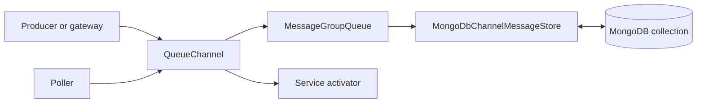

# MongoDbChannelMessageStore

## Lesson Objectives

In the **Message store** chapter of the **SPRING_INTEGRATION_CORE** module, this lesson explains how to use `MongoDbChannelMessageStore` as a message storage backend for a queue-backed channel. The learner will connect `Message`, `MessageChannel`, a poller, and an endpoint using Java DSL; choose the appropriate store for FIFO or priority; and identify where messages reside when the application stops or a handler fails.

The running example is a service that accepts order-processing requests. The producer needs to send quickly, while the consumer may pause when the warehouse system is busy. Pending requests must survive application restarts.

The examples use Spring Integration **6.5.x** APIs, Java 17 or later, and the synchronous MongoDB driver. This is the API baseline for reading the illustrative code, not a claim about the latest version. When adopting this in a project, use a compatible set of versions managed by your project's dependency management.

## 1. Position of the Store in the Message Flow

`MongoDbChannelMessageStore` is dedicated to serving message channels that store queues. It is not a channel, an endpoint, or a MongoDB outbound adapter. Producers still send `Message<?>` to the channel; consumers still receive from the channel via the `PollableChannel` interface. Storage details sit behind the scenes. [MongoDbChannelMessageStore Javadoc](https://docs.spring.io/spring-integration/docs/6.5.0/api/org/springframework/integration/mongodb/store/MongoDbChannelMessageStore.html).



Read the diagram along two paths:

- **Send:** the producer calls `send()`, and the channel translates the queue-enqueue operation into a store write.
- **Receive:** the poller calls `receive()`, and the channel retrieves a message from the store and passes it to the handler.

In a configuration without a transaction wrapping the receive, the message has already left the queue before the handler completes. The difference between “stored,” “received,” and “processed successfully” determines the recovery design in later sections.

| Component | Responsibility in the Order Example |
| --- | --- |
| `Message<String>` | Carries the processing command and headers such as `businessKey`, `priority` |
| `QueueChannel` | Provides queue send and receive operations |
| `MessageGroupQueue` | Bridges the queue interface to a message group in the store |
| `MongoDbChannelMessageStore` | Executes message storage and retrieval operations via MongoDB |
| Poller | Defines the receive schedule, messages per poll, and transaction boundary if present |
| Service activator | Executes business logic after receiving a message |

### 1.1. Choosing the Right Type of Store

Channel stores are optimized for queuing and polling messages. Do not choose one for an aggregator simply because you see `MessageGroupStore` in its inheritance hierarchy. Aggregators need group state and lifecycles different from a queue; several group operations are not implemented by a channel store. For an aggregator or resequencer using MongoDB, look at a store that fully supports those requirements, such as `MongoDbMessageStore`. [MongoDB Message Store](https://docs.spring.io/spring-integration/reference/6.5/mongodb.html#mongodb-message-store).

Example of a flow that has both queuing and aggregation:

```text
Order ingestion
    -> channel with MongoDbChannelMessageStore
    -> split order into line items
    -> aggregator with appropriate MessageGroupStore
    -> produce aggregated result
```

The two storage locations serve two purposes. A queue's group represents a logical channel; an aggregator's group typically represents a set of messages collected by a correlation key.

## 2. Queue Identity: Database, Collection, and groupId

To read the queue back after startup, the application must return to the same database, collection, and `groupId`. With `MessageGroupQueue`, `groupId` must remain stable across restarts and distinguish each logical queue. [MessageGroupQueue in Spring Integration 6.5.0](https://github.com/spring-projects/spring-integration/blob/v6.5.0/spring-integration-core/src/main/java/org/springframework/integration/store/MessageGroupQueue.java).

Illustrative convention:

```text
database   = integration_demo
collection = si_order_channel_messages
groupId    = orders:pending:v1
```

In this application, the string `orders:pending:v1` means the queue of pending order requests. It is not an order number and does not replace the `correlationId` header.

### 2.1. Two Common Identification Mistakes

**Generating a random groupId on every run:**

```java
// Not suitable if you want to reconnect to the same queue after restart.
new MessageGroupQueue(store, java.util.UUID.randomUUID().toString());
```

Each startup creates a new queue address. Old data may still sit in the database, but the consumer is looking at a different group.

**Letting two independent queues use the same groupId:**

```text
ordersQueue     -> collection A, groupId = work
invoicesQueue   -> collection A, groupId = work
```

In this design, two consumers are accessing the same message pool. If both payloads are strings, the mistake can even pass type checks and only surface in business logic.

Use responsibility-based identifiers, such as `orders:pending:v1` and `invoices:pending:v1`. When renaming a group or collection, plan how to drain, migrate, or archive the old queue.

### 2.2. Multiple Application Instances

If two instances point to the same group, treat them as competing consumers on one queue. If you want every instance to process every message, design a fan-out into separate queues.

This decision should be reflected explicitly in deployment configuration:

| Goal | Identifier Setup in the Example |
| --- | --- |
| Two workers load-sharing order processing | Same database, collection, and groupId |
| Independent orders and invoices | Separate groupIds or separate collections |
| Two independent test environments | Separate databases; optionally prefix collections |
| Creating a new flow and draining the old flow | Keep a consumer for the old group until drained |

## 3. Configuring a Persistent Queue with Java DSL

This section assumes a Spring Boot application compatible with Spring Integration 6.5.x. The configuration below resides within the application's component-scan scope.

### 3.1. Dependencies and Connection

Add the dependencies to a project that already has Spring Boot dependency management:

```xml
<dependency>
    <groupId>org.springframework.boot</groupId>
    <artifactId>spring-boot-starter-integration</artifactId>
</dependency>
<dependency>
    <groupId>org.springframework.boot</groupId>
    <artifactId>spring-boot-starter-data-mongodb</artifactId>
</dependency>
<dependency>
    <groupId>org.springframework.integration</groupId>
    <artifactId>spring-integration-mongodb</artifactId>
</dependency>
```

The MongoDB starter provides Spring Data infrastructure and the synchronous driver; the Integration artifact adds the message store. Using this store remains synchronous I/O even if the application has other reactive flows. [MongoDB Connection in Spring Integration](https://docs.spring.io/spring-integration/reference/6.5/mongodb.html#mongodb-connection).

In `application.yml` of the learning application:

```yaml
spring:
  data:
    mongodb:
      uri: mongodb://localhost:27017/integration_demo
```

MongoDB must be ready before the application initializes the store. The basic queue setup does not yet enable multi-operation transactions.

### 3.2. Store, Channel, and Consumer

```java
package vn.example.integration;

import java.time.Duration;

import org.springframework.beans.factory.annotation.Qualifier;
import org.springframework.context.annotation.Bean;
import org.springframework.context.annotation.Configuration;
import org.springframework.data.mongodb.MongoDatabaseFactory;
import org.springframework.integration.channel.QueueChannel;
import org.springframework.integration.config.EnableIntegration;
import org.springframework.integration.dsl.IntegrationFlow;
import org.springframework.integration.dsl.Pollers;
import org.springframework.integration.mongodb.store.MongoDbChannelMessageStore;
import org.springframework.integration.store.MessageGroupQueue;
import org.springframework.messaging.MessageHandler;
import org.springframework.messaging.PollableChannel;

@Configuration(proxyBeanMethods = false)
@EnableIntegration
public class OrderQueueConfiguration {

    public static final String ORDER_GROUP = "orders:pending:v1";

    @Bean
    MongoDbChannelMessageStore fifoChannelStore(
            MongoDatabaseFactory databaseFactory) {

        return new MongoDbChannelMessageStore(
                databaseFactory, "si_order_channel_messages");
    }

    @Bean
    PollableChannel ordersQueue(
            @Qualifier("fifoChannelStore") MongoDbChannelMessageStore store) {

        return new QueueChannel(new MessageGroupQueue(store, ORDER_GROUP));
    }

    @Bean
    IntegrationFlow ordersFlow(
            @Qualifier("ordersQueue") PollableChannel ordersQueue) {

        return IntegrationFlow.from(ordersQueue)
                .handle((MessageHandler) message -> {
                    String command = (String) message.getPayload();
                    String key = message.getHeaders()
                            .get("businessKey", String.class);
                    System.out.println("Processing " + key + ": " + command);
                }, endpoint -> endpoint
                        .id("orderConsumer")
                        .poller(Pollers.fixedDelay(Duration.ofMillis(500))
                                .receiveTimeout(0)
                                .maxMessagesPerPoll(5)))
                .get();
    }
}
```

`fifoChannelStore` is a Spring bean so Spring performs lifecycle initialization. `ordersQueue` uses a fixed group inside the collection. `ordersFlow` creates a polling consumer because the source is a `PollableChannel`.

In the example, each poll fetches up to five messages and then waits per the `fixedDelay` schedule. If processing each command takes 200 ms, five commands can take about one second, excluding I/O. Therefore, this configuration does not mean the consumer processes exactly ten commands per second.

`receiveTimeout(0)` tells the poller to attempt an immediate receive on each poll. When no data is available, the poller waits until the next scheduled run. This approach is also easy to reason about when producer and consumer live in different JVMs; it does not rely on internal wait notifications of a single queue object.

Do not add a second consumer just to peek at messages using `receive()`: that operation removes messages from the queue and competes with `orderConsumer`.

### 3.3. Sending Messages

From a producer bean with `@Qualifier("ordersQueue") PollableChannel ordersQueue` injected, you can send:

```java
import org.springframework.messaging.Message;
import org.springframework.messaging.support.MessageBuilder;

Message<String> command = MessageBuilder
        .withPayload("reserve-stock:ORD-2026-001")
        .setHeader("businessKey", "ORD-2026-001:reserve-stock")
        .build();

boolean accepted = ordersQueue.send(command);
if (!accepted) {
    throw new IllegalStateException("Failed to send order processing command");
}
```

A successful `send()` only confirms putting the message into the channel under the current configuration. It does not confirm that inventory has been reserved or that the order has finished processing. Connection or serialization errors can occur right at the send step.

In this example, `businessKey` is a business identifier set by the application to re-identify the same operation. Framework-generated Message IDs and business keys serve different roles.

### 3.4. Gateway on the Producer Side

The application can wrap the channel behind a business interface:

```java
import org.springframework.integration.annotation.MessagingGateway;
import org.springframework.messaging.handler.annotation.Header;

@MessagingGateway(defaultRequestChannel = "ordersQueue")
public interface OrderGateway {

    void submit(String command, @Header("businessKey") String businessKey);
}
```

Place the interface in a package scanned by `@IntegrationComponentScan`, then inject `OrderGateway` into the command-sending service. The `void` method suits this asynchronous ingestion example.

If users need to track results, the producer can return a request ID at the API layer and the consumer can update business status. A temporary reply channel from a synchronous call is not an address for recovering replies after a process restart.

## 4. FIFO and Priority: Which Ordering Is Guaranteed?

### 4.1. Store FIFO

At the 6.5.0 source baseline, the poll operation orders by `lastModifiedTime` and then ascending `sequence`; when priority is enabled, descending `priority` is placed ahead of those two keys. The internal `sequence` distinguishes records sharing the same millisecond timestamp. [Add and poll source code](https://github.com/spring-projects/spring-integration/blob/v6.5.0/spring-integration-mongodb/src/main/java/org/springframework/integration/mongodb/store/MongoDbChannelMessageStore.java).

Do not confuse this `sequence` with the splitter's `sequenceNumber` header. One value serves storage ordering in the store; the other describes an element's position within a message sequence in an integration flow.

In the order problem, clarify ordering requirements explicitly:

| Requirement | Design Consequence in the Example |
| --- | --- |
| Poll pending commands in queue storage order | Use FIFO mode |
| Urgent orders are polled before normal orders | Use priority and define priority levels |
| Complete business work strictly in received order | Avoid parallel processing within the scope requiring order |
| Preserve business order across distributed producers | Add business version or sequence and ordering rules |

For example, consumer A receives command 1 and calls the warehouse for two seconds. Consumer B receives command 2 and finishes in 100 ms. The poll order may still be accurate, yet command 2 finishes before command 1.

With multiple concurrent senders, do not rely on queue order to infer absolute causality between events. If a “cancel order” command is only valid after “create order,” represent that condition in business state.

### 4.2. Store and Channel with Priority

Add the following beans to the configuration class to create a separate priority queue:

```java
import org.springframework.integration.channel.PriorityChannel;

@Bean
MongoDbChannelMessageStore priorityChannelStore(
        MongoDatabaseFactory databaseFactory) {

    MongoDbChannelMessageStore store = new MongoDbChannelMessageStore(
            databaseFactory, "si_priority_channel_messages");
    store.setPriorityEnabled(true);
    return store;
}

@Bean
PollableChannel urgentOrdersQueue(
        @Qualifier("priorityChannelStore") MongoDbChannelMessageStore store) {

    return new PriorityChannel(store, "orders:urgent:v1");
}
```

This example has not attached a consumer to `urgentOrdersQueue`, so you can send multiple messages and read the results in order. The `PriorityChannel(store, groupId)` constructor uses the priority-enabled store as the backing queue. [PriorityChannel in Spring Integration 6.5.0](https://github.com/spring-projects/spring-integration/blob/v6.5.0/spring-integration-core/src/main/java/org/springframework/integration/channel/PriorityChannel.java).

```java
import org.springframework.integration.IntegrationMessageHeaderAccessor;

urgentOrdersQueue.send(MessageBuilder.withPayload("NORMAL-1")
        .setHeader(IntegrationMessageHeaderAccessor.PRIORITY, 1)
        .build());
urgentOrdersQueue.send(MessageBuilder.withPayload("URGENT-1")
        .setHeader(IntegrationMessageHeaderAccessor.PRIORITY, 9)
        .build());
urgentOrdersQueue.send(MessageBuilder.withPayload("URGENT-2")
        .setHeader(IntegrationMessageHeaderAccessor.PRIORITY, 9)
        .build());

System.out.println(urgentOrdersQueue.receive(0).getPayload());
System.out.println(urgentOrdersQueue.receive(0).getPayload());
System.out.println(urgentOrdersQueue.receive(0).getPayload());
```

With three sequential sends all succeeding and no other consumer present, the expected output is:

```text
URGENT-1
URGENT-2
NORMAL-1
```

Applications should always set priority as an `Integer`, such as `1`, `5`, `9`. Avoid sending a string `"9"` or mixing messages without priority alongside messages with priority and guessing the order.

`priorityEnabled` is a setting for the entire store bean. When having both FIFO and priority simultaneously, use two separate store beans. Both beans may share a collection as long as groups are separated; the example here separates collections for easier observation while learning. [Priority store configuration rules](https://docs.spring.io/spring-integration/docs/6.5.0/api/org/springframework/integration/mongodb/store/MongoDbChannelMessageStore.html).

Do not toggle `priorityEnabled` while the system is running to turn a FIFO backlog into a priority backlog: previously written messages may not carry priority metadata in the new way.

### 4.3. When High Priority Starves Low Priority

Suppose the system receives 20 priority-9 commands per second but can only process 15 commands. Priority-1 commands may continue waiting even though they arrived long ago.

When all orders must be served within a bounded deadline, you can design two queues and allocate processing slots, such as four urgent commands followed by one normal command. This is an application scheduling policy; setting a priority header alone does not express that policy.

## 5. Payloads and Headers Must Pass Through Storage

With the constructor taking `MongoDatabaseFactory` and no custom converter passed, the channel store's default configuration registers converters that write `Message` as binary; the write converter uses Java serialization. Therefore, you cannot assume any application payload can be stored simply because MongoDB accepts flexible documents. [Store converter initialization](https://github.com/spring-projects/spring-integration/blob/v6.5.0/spring-integration-mongodb/src/main/java/org/springframework/integration/mongodb/store/AbstractConfigurableMongoDbMessageStore.java), [MessageToBinaryConverter](https://github.com/spring-projects/spring-integration/blob/v6.5.0/spring-integration-mongodb/src/main/java/org/springframework/integration/mongodb/support/MessageToBinaryConverter.java).

### 5.1. Data Choices for the Example

Command strings in this lesson keep focus on queue mechanics. In real applications, you can choose JSON strings so the data contract does not depend directly on Java classes:

```java
String command = """
        {
          "schemaVersion": 1,
          "orderId": "ORD-2026-001",
          "action": "RESERVE_STOCK"
        }
        """;
```

If choosing a Java DTO for the default serialization setup, the DTO must be serializable and all nested objects must also be compatible:

```java
package vn.example.integration;

import java.io.Serializable;

public record ReserveStockCommand(
        String orderId,
        String warehouseId,
        int quantity) implements Serializable {

    private static final long serialVersionUID = 1L;
}
```

Adding `Serializable` does not by itself solve class renames, deletions, or data contract changes. Test reading messages written by the previous application version when verifying upgrade compatibility.

### 5.2. Inspect Headers as Well

Before the storage boundary, audit the data actually placed inside the message:

| Should Be Represented as Data | Should Not Carry Live Objects into a Persistent Message |
| --- | --- |
| Order ID, customer ID | Open HTTP request/response |
| Trace ID, tenant ID, business key | Database connection, session, or open stream |
| Stable channel name when error routing is needed | A temporary channel tied to a waiting call |
| Parameter values needed by the consumer | Service bean or callback holding process state |

This table is a design convention for the example, not a store's automatic header filter list. Test real messages through a full write-and-read cycle rather than only testing serialization of the payload alone.

If passing a custom `MongoTemplate` or `MappingMongoConverter` into the store, re-verify the entire write/read converter pair. A template used for business entities does not implicitly have the same message conversion mechanism as the default constructor.

The framework's binary read converter has an API to configure class patterns allowed for deserialization. For long-lived stored data, control collection write permissions and choose conversions suited to the data source. [BinaryToMessageConverter](https://github.com/spring-projects/spring-integration/blob/v6.5.0/spring-integration-mongodb/src/main/java/org/springframework/integration/mongodb/support/BinaryToMessageConverter.java).

## 6. Durability, Polling, and Mid-Flight Failures

### 6.1. Timeline of the Basic Configuration

Suppose the producer sends a reserve-stock command and the consumer has not enabled transactions:

```text
T0  Producer creates message
T1  Store writes message successfully
T2  Consumer polls: retrieves and removes message from queue
T3  Handler calls warehouse system
T4  Handler completes
```

In the 6.5.0 implementation, polling uses `MongoTemplate.findAndRemove()`. Retrieving and removing atomically avoids a two-step “read first, delete later” race. It does not cover the handler's entire business work. [Channel store poll source code](https://github.com/spring-projects/spring-integration/blob/v6.5.0/spring-integration-mongodb/src/main/java/org/springframework/integration/mongodb/store/MongoDbChannelMessageStore.java).

From the timeline, we can reason about failure scenarios in this exact example:

| Failure Point | Questions to Resolve |
| --- | --- |
| Before T1 | Does the producer retry? What confirms acceptance? |
| After T1, before T2 | Does the app reconnect to the right database, collection, and groupId to continue reading? |
| After T2, before T4 | The message has left the queue; what mechanism saves or rolls back the work in progress? |
| Warehouse reserved stock but app hasn't recorded result | Will reprocessing reserve stock a second time? |

Success of a MongoDB command is also governed by the deployment's write concern. Choose a write concern matching the acceptable data-loss risk; do not treat replacing RAM with a database as proof against all failure modes. MongoDB distinguishes single-document atomicity from multi-operation transactions. [MongoDB Atomicity and Transactions](https://www.mongodb.com/docs/manual/core/write-operations-atomicity/).

### 6.2. Adding Transactions to Polling

When you want to roll back the queue removal if a synchronous handler fails, you need a real MongoDB transaction and the transaction must wrap the receive itself. Adding `@Transactional` only to a business method called after the message has already been removed is too late to cover that receive operation.

Illustrative transaction manager bean:

```java
import org.springframework.data.mongodb.MongoTransactionManager;

@Bean
MongoTransactionManager channelTransactionManager(
        MongoDatabaseFactory databaseFactory) {

    return new MongoTransactionManager(databaseFactory);
}
```

In the flow bean, inject this transaction manager and replace the poller configuration with:

```java
endpoint -> endpoint
        .id("orderConsumer")
        .poller(Pollers.fixedDelay(Duration.ofMillis(500))
                .receiveTimeout(0)
                .maxMessagesPerPoll(1)
                .transactional(channelTransactionManager))
```

This snippet replaces the endpoint configuration part of `ordersFlow`, not a new parallel consumer. The example limits to one message per poll to make work boundaries easy to observe. The `.transactional(...)` API adds transaction advice around the polling task. [PollerSpec](https://github.com/spring-projects/spring-integration/blob/v6.5.0/spring-integration-core/src/main/java/org/springframework/integration/dsl/PollerSpec.java).

Prerequisites for execution:

1. MongoDB runs with a topology supporting transactions, such as a properly configured replica set; the standalone instance from the basic section is insufficient for this example.
2. The store and transaction manager use the same `MongoDatabaseFactory` so operations join the right session.
3. Receiving and related processing remain on the execution thread covered by the transaction.
4. Exceptions must propagate out of the transaction-advised scope so rollback rules apply.

Spring Data uses `MongoTransactionManager` to bind a session to the execution thread; MongoDB transactions require an active session. [Spring Data MongoDB Sessions and Transactions](https://docs.spring.io/spring-data/mongodb/reference/mongodb/client-session-transactions.html).

Initializing collections and indexes before letting workers accept load makes deployment more predictable. Transient transaction errors or commit failures require a retry policy suited to the error type; the snippet above does not configure such a policy yet.

### 6.3. What MongoDB Transactions Do Not Cover

In the HTTP stock-reservation example, a MongoDB transaction cannot roll back the call to the warehouse system:

```text
1. Consumer receives command inside MongoDB transaction.
2. Warehouse confirms stock reservation via HTTP.
3. Application encounters an error, MongoDB transaction rolls back.
4. Command reappears in queue and is processed again.
```

This situation requires the warehouse system to accept an idempotency key, or have another business protocol to recognize the same operation. Likewise, writing to PostgreSQL via a separate transaction manager requires an explicit coordination design.

Do not promise “exactly once” simply from using a channel store and enabling transactions. Describe precisely the effect to avoid repeating: sending an email, charging money, or deducting inventory. Then design duplicate protection right where that effect is produced.

## 7. Error Handling: Storing Pending Messages and Storing Failed Jobs

### 7.1. Error Channel for Observing and Routing Errors

The `QueueChannel` consumer runs after the producer's send call. Thus, a business error in the consumer does not automatically throw back to the completed producer call. With a scheduled poller, Spring Integration routes errors as an `ErrorMessage`; the message's `errorChannel` header can choose the destination, otherwise the default destination is used. [Error Handling](https://docs.spring.io/spring-integration/reference/6.5/error-handling.html).

Example creating a dedicated error channel:

```java
import org.springframework.integration.channel.DirectChannel;
import org.springframework.messaging.MessageChannel;

@Bean
MessageChannel orderErrors() {
    return new DirectChannel();
}

@Bean
IntegrationFlow orderErrorFlow() {
    return IntegrationFlow.from("orderErrors")
            .handle((MessageHandler) message -> {
                System.err.println("Order processing failed: "
                        + message.getPayload().getClass().getSimpleName());
            })
            .get();
}
```

Add `.errorChannel("orderErrors")` to the active poller configuration. The example above only illustrates error reception; it does not yet create a failure store or re-enqueue work.

Logging an error or sending an `ErrorMessage` does not put the original message back into the queue. In the basic configuration without transactions, design a way to retain failed requests if you want to reprocess them after a process terminates.

### 7.2. Separating Handler Retry from Persistent Recovery

`RequestHandlerRetryAdvice` supports retrying handler invocations and can be combined with a recovery callback when attempts are exhausted. Retrying immediately inside the handler differs from preserving work across restarts. [Retry Advice](https://docs.spring.io/spring-integration/reference/6.5/handler-advice/classes.html#retry-advice).

Applied to the order example:

| Scenario | Illustrative Policy |
| --- | --- |
| Warehouse returns transient error | Retry with limits and backoff |
| Command missing required order ID | Save rejection info to fix data |
| Retry attempts exhausted | Save a persistent failure record with business key and cause |
| Warehouse received command but connection dropped | Look up or resend with the same idempotency key |

If you need a queue to store failed jobs, you can create a separate channel with its own store and groupId, but convert errors into a simple data envelope rather than blindly persisting arbitrary exception objects:

```json
{
  "schemaVersion": 1,
  "businessKey": "ORD-2026-001:reserve-stock",
  "command": "reserve-stock:ORD-2026-001",
  "attempts": 3,
  "errorCode": "WAREHOUSE_UNAVAILABLE"
}
```

The design must specify clearly when the original message is marked failed and when the envelope is saved. If the two operations are not in the same transaction, inspect the window where work could be lost or duplicated.

### 7.3. Poison Messages and Rollback Loops

Suppose a handler always throws an exception because `quantity = -1`. If every error rolls back the poll, the message can be redelivered endlessly.

A complete policy requires error classification, attempt limits, and an escape path to a failure store. With transactions, an attempt counter stored inside the rolled-back transaction may also revert to its old value. Decide clearly where attempt counts are stored and updated.

Similarly, if a recovery callback swallows the exception and returns normally, the transaction advice may treat the task as complete. Agree on whether recovery means “work has been handed off to another responsible sink” or “still failed and must roll back.”

### 7.4. Business-Level Idempotency

For the command `reserve-stock:ORD-2026-001`, the business key convention is `ORD-2026-001:reserve-stock`. The consumer or warehouse system uses this key to recognize operations that already have a result.

Checking the key and writing the result as two separate operations can still race between two workers. A design can use a unique constraint and appropriate transaction when data resides together in MongoDB; with an external warehouse system, an idempotency contract is needed in the warehouse API.

The deduplication key must represent the exact business operation. Using only the order number would mistakenly block a “cancel reservation” operation after “reserve stock” if both actions must run independently.

## 8. Indexes, Capacity, and Queue Observability

### 8.1. Managing Indexes

The store has a mechanism to auto-create indexes at initialization; `setCreateIndexes(false)` disables that mechanism starting from versions supporting this option. Only disable it when your deployment process has already created the required indexes. [createIndexes option](https://docs.spring.io/spring-integration/reference/6.5/mongodb.html#mongodb-message-store).

Illustrative configuration snippet for an environment managing indexes separately:

```java
MongoDbChannelMessageStore store = new MongoDbChannelMessageStore(
        databaseFactory, "si_order_channel_messages");
store.setCreateIndexes(false);
```

Disabling index creation does not mean the store runs well without indexes. Operators must verify indexes against the deployed framework version, and also check index-creation permissions if letting the store initialize them automatically.

You can inspect indexes in `mongosh`:

```javascript
use integration_demo
db.si_order_channel_messages.getIndexes()
```

Do not treat a guessed set of index names as standard across all versions. When upgrading, compare query requirements and indexes in the exact target version.

### 8.2. Measuring Queue Depth by Group

With the example's store bean, measure pending messages via:

```java
int pending = store.messageGroupSize(
        OrderQueueConfiguration.ORDER_GROUP);
```

Do not use the total document count of the collection as queue depth. One collection may serve multiple groups and contain technical documents such as sequence counters.

Do not call `store.getMessageGroup(groupId).size()` as a substitute for the measurement above: for the channel store, `getMessageGroup()` only creates a wrapper object for the groupId without loading all messages. [getMessageGroup behavior](https://docs.spring.io/spring-integration/docs/6.5.0/api/org/springframework/integration/mongodb/store/MongoDbChannelMessageStore.html#getMessageGroup(java.lang.Object)).

Queue depth is a point-in-time snapshot. When another consumer is receiving, the count can change immediately after measurement.

### 8.3. Backlog and Producer Throttling

A database-backed channel still needs a load-throttling policy. In a channel configuration using `message-store`, do not attach a `capacity` attribute like an in-memory queue configuration; with a priority store, do not attach an arbitrary comparator expecting to change the query order. [Configuring a channel with a message store](https://docs.spring.io/spring-integration/reference/6.5/channel/configuration.html).

For example, the producer creates 100 commands per second and the consumer processes 80 commands per second. If those rates hold for one hour, the backlog grows by roughly:

```text
(100 - 80) × 3,600 = 72,000 commands
```

This is a scenario capacity calculation, excluding retries and actual sizes. If each stored message averages 4 KiB, the backlog data alone adds about 281 MiB, excluding indexes and other storage overhead.

You can limit ingestion at the API layer, scale consumer capacity within business limits, or separate job types with different processing durations.

### 8.4. Useful Signals

| Signal | How to Interpret in the Example |
| --- | --- |
| Queue depth by groupId | Number of waiting commands, not total in-flight work |
| Age of oldest pending command | Whether orders are missing service deadlines |
| Receive and completion rates | Distinguish backlog from slow consumers vs. increased send volume |
| Send, poll, and handler errors | Determine whether failure happened before or after queue removal |
| Failed and retried job counts | Spot retry loops making no progress |
| MongoDB latency and connection pool usage | Detect I/O resources limiting throughput |

These are metrics to design into the application; it is not a claim that every metric is exported out of the box by the store.

Messages in the queue are pending work. If you set a TTL to delete them, treat it as a business expiration policy and define how dropped work is handled, rather than using TTL merely to shrink the collection.

## 9. Integration Testing of Store and Poll Behavior

Mocking the store only tests API-calling code. To prove readability after persistence, run through real MongoDB and real message conversion.

The JUnit 5 snippet below uses the test database `si_channel_store_it`, creates a distinct collection per test, and drops only that collection. It requires `spring-boot-starter-test` in `test` scope and a test MongoDB running on localhost. These tests do not enable transactions and therefore do not require the transaction topology from section 6.2.

```java
package vn.example.integration;

import java.util.UUID;

import com.mongodb.client.MongoClient;
import com.mongodb.client.MongoClients;
import org.junit.jupiter.api.AfterEach;
import org.junit.jupiter.api.BeforeEach;
import org.junit.jupiter.api.Test;
import org.springframework.context.support.GenericApplicationContext;
import org.springframework.data.mongodb.MongoDatabaseFactory;
import org.springframework.data.mongodb.core.SimpleMongoClientDatabaseFactory;
import org.springframework.integration.IntegrationMessageHeaderAccessor;
import org.springframework.integration.channel.PriorityChannel;
import org.springframework.integration.channel.QueueChannel;
import org.springframework.integration.mongodb.store.MongoDbChannelMessageStore;
import org.springframework.integration.store.MessageGroupQueue;
import org.springframework.messaging.Message;
import org.springframework.messaging.support.MessageBuilder;

import static org.junit.jupiter.api.Assertions.*;

class MongoChannelStoreIntegrationTest {

    private static final String DATABASE = "si_channel_store_it";
    private static final String GROUP = "orders:test:v1";

    private MongoClient client;
    private MongoDatabaseFactory factory;
    private String collection;

    @BeforeEach
    void setUp() {
        client = MongoClients.create("mongodb://localhost:27017");
        factory = new SimpleMongoClientDatabaseFactory(client, DATABASE);
        collection = "channel_it_" + UUID.randomUUID().toString().replace("-", "");
    }

    @AfterEach
    void tearDown() {
        if (client != null) {
            try {
                if (collection != null) {
                    client.getDatabase(DATABASE)
                            .getCollection(collection).drop();
                }
            } finally {
                client.close();
            }
        }
    }

    private GenericApplicationContext openContext(boolean priority) {
        GenericApplicationContext context = new GenericApplicationContext();
        context.registerBean("store", MongoDbChannelMessageStore.class, () -> {
            MongoDbChannelMessageStore store =
                    new MongoDbChannelMessageStore(factory, collection);
            store.setPriorityEnabled(priority);
            return store;
        });
        context.refresh();
        return context;
    }

    private MongoDbChannelMessageStore store(GenericApplicationContext context) {
        return context.getBean("store", MongoDbChannelMessageStore.class);
    }

    private QueueChannel queue(MongoDbChannelMessageStore store, String group) {
        return new QueueChannel(new MessageGroupQueue(store, group));
    }

    @Test
    void readsPendingMessageAfterContextRecreation() {
        try (GenericApplicationContext first = openContext(false)) {
            MongoDbChannelMessageStore firstStore = store(first);
            QueueChannel queue = queue(firstStore, GROUP);
            assertTrue(queue.send(MessageBuilder
                    .withPayload("reserve-stock:ORD-001")
                    .setHeader("businessKey", "ORD-001:reserve-stock")
                    .build()));
            assertEquals(1, firstStore.messageGroupSize(GROUP));
        }

        try (GenericApplicationContext second = openContext(false)) {
            MongoDbChannelMessageStore secondStore = store(second);
            Message<?> restored = queue(secondStore, GROUP).receive(0);

            assertNotNull(restored);
            assertEquals("reserve-stock:ORD-001", restored.getPayload());
            assertEquals("ORD-001:reserve-stock",
                    restored.getHeaders().get("businessKey"));
            assertEquals(0, secondStore.messageGroupSize(GROUP));
        }
    }

    @Test
    void pollsHighPriorityThenFifoWithinSamePriority() {
        try (GenericApplicationContext context = openContext(true)) {
            PriorityChannel queue = new PriorityChannel(store(context), GROUP);
            assertTrue(queue.send(command("NORMAL-1", 1)));
            assertTrue(queue.send(command("URGENT-1", 9)));
            assertTrue(queue.send(command("URGENT-2", 9)));

            Message<?> first = queue.receive(0);
            Message<?> second = queue.receive(0);
            Message<?> third = queue.receive(0);
            assertNotNull(first);
            assertNotNull(second);
            assertNotNull(third);
            assertEquals("URGENT-1", first.getPayload());
            assertEquals("URGENT-2", second.getPayload());
            assertEquals("NORMAL-1", third.getPayload());
            assertNull(queue.receive(0));
        }
    }

    @Test
    void keepsDifferentGroupsSeparate() {
        try (GenericApplicationContext context = openContext(false)) {
            MongoDbChannelMessageStore store = store(context);
            QueueChannel orders = queue(store, "orders:test:v1");
            QueueChannel invoices = queue(store, "invoices:test:v1");

            assertTrue(orders.send(command("ORDER-ONLY", 1)));
            assertNull(invoices.receive(0));
            assertEquals(1, store.messageGroupSize("orders:test:v1"));
        }
    }

    private Message<String> command(String payload, int priority) {
        return MessageBuilder.withPayload(payload)
                .setHeader(IntegrationMessageHeaderAccessor.PRIORITY, priority)
                .build();
    }
}
```

The first test recreates the context and store while keeping external MongoDB intact. It proves the message can be read back through a new store, though it does not simulate a killed JVM or MongoDB failover. To test process restart, run the producer in process A, stop A after confirming the send, then run the consumer in process B with the same identifiers.

Do not start the application's `ordersFlow` during these explicit `receive()` tests, because the poller could consume messages before the test does.

Additional scenarios to test depending on system requirements:

| Scenario | Outcome to Observe |
| --- | --- |
| Change groupId after writing | New consumer does not see the old group's data |
| Unserializable payload or header | Failure surfaces when passing through the real write step |
| Handler throws without a transaction | Queue does not automatically restore the polled message |
| Handler throws with a transaction wrapping poll | Rollback allows the job to be received again |
| Two consumers reading the same group | Do not assume every consumer receives every message |
| New application version reads old message | Payload contract and converters remain compatible |
| Resend the same business key | Business logic does not produce unintended duplicate effects |

For rollback tests, use a test MongoDB replica set, finish the transaction, and then receive again in a fresh operation to avoid observing data inside the still-unfinished transaction.

## 10. Diagnosing by Symptom

| Symptom | Where to Check First |
| --- | --- |
| Database has data but consumer does not receive | Correct database, collection, groupId; whether endpoint and poller are running |
| Pending commands disappear after restart | Whether groupId changed; whether messages were already polled before stopping |
| Priority is not as expected | Correct store bean; `priorityEnabled`; header type and value; whether another consumer is polling |
| Payload fails to save | Object graph of payload/headers and active converters |
| Handler fails and message vanishes | Transaction boundaries, recovery callback, and failure storage mechanism |
| One message keeps reappearing | Permanent data error, rollback, and retry limits |
| Polling slows down as backlog grows | Actual indexes, MongoDB latency, connection pool, and poll frequency |
| Group count is always 0 while queue has data | Mistakenly calling `getMessageGroup().size()` instead of `messageGroupSize()` |
| Consumer in another JVM reacts slowly | Poll schedule, receive timeout, and reliance on internal signals |

Before concluding “message lost,” distinguish three states: still waiting in the queue, already received by a consumer, or already routed to error handling. An empty collection only shows storage state at the moment of observation, not the full processing history.

## 11. Applying to Integration Flow Design

For the order service in this lesson, a design might consist of a one-way command-receiving gateway, a transformer normalizing payloads, a filter checking required fields, a router classifying priority levels, MongoDB-backed channels, and a service activator executing business logic.

```text
OrderGateway
    -> normalize data
    -> validate input data
    -> route normal / priority
    -> persistent queues
    -> polling consumer
    -> idempotent business logic
    -> record result or failed job
```

Choose where to place the persistence boundary according to acceptance semantics. If a filter drops messages before the queue, the producer has no waiting job in the store to recover. If validation runs after the queue, the consumer must have a clear terminal path for invalid commands.

`MongoDbChannelMessageStore` solves storing pending channel messages in this design. Stable identifiers let you reconnect to the queue; priority determines poll order; pollers and transactions determine processing scope; and retries, failure persistence, and idempotency determine how work proceeds when failures occur.
