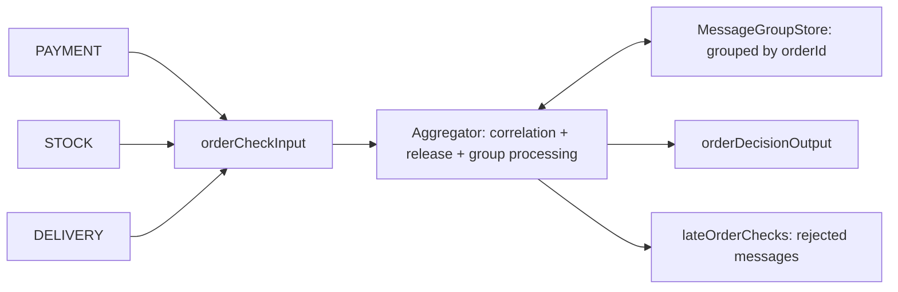

# MessageGroupStore

`MessageGroupStore` is the contract for storing the state of message groups sharing the same correlation key in Spring Integration. When an aggregator must wait for multiple messages before producing a result, the store holds the waiting group and information about that group. This is an important component of the **Message store** chapter in the **SPRING_INTEGRATION_CORE** module: designing flows with `Message`, `MessageChannel`, endpoints, and Java DSL, while understanding how to manage state, handle errors, and test integration patterns.

This lesson uses Java 17 and Spring Integration 6.5 APIs as the baseline for examples; this is the lesson's reference baseline, not a claim about your project's dependency versions. The main example requires `spring-integration-core`; the test example requires JUnit Jupiter; the JDBC section additionally requires `spring-integration-jdbc`, a JDBC driver, and a configured `DataSource`. Readers should know the structure of `Message<?>`, `DirectChannel`, `QueueChannel`, and the purpose of an aggregator.

## 1. Why Store an Entire Message Group?

Suppose a system decides to accept an order only after receiving all three check results:

| Check Type | Information Received |
| --- | --- |
| `PAYMENT` | Whether payment is valid |
| `STOCK` | Whether warehouse inventory is sufficient |
| `DELIVERY` | Whether the address is deliverable |

The three results are sent independently and may arrive out of order. One execution might unfold as follows:

| Time | Arriving Message | State to Retain |
| --- | --- | --- |
| t1 | PAYMENT for ORD-42 | ORD-42 has PAYMENT |
| t2 | STOCK for ORD-99 | ORD-99 has STOCK |
| t3 | STOCK for ORD-42 | ORD-42 is still missing DELIVERY |
| t4 | Duplicate PAYMENT for ORD-42 | ORD-42 is still missing DELIVERY |
| t5 | DELIVERY for ORD-42 | All three check types received to make a decision |

If waiting data is held in a service variable, we must manually solve grouping, thread contention, and state cleanup. In Spring Integration's design, responsibilities are separated into:

- `CorrelationStrategy` determines which group a message belongs to.
- `MessageGroupStore` holds the group's data and state.
- `ReleaseStrategy` decides whether the group is ready to be processed.
- `MessageGroupProcessor` creates the result from the group.

The aggregator orchestrates these components. The store does not decide whether an order is valid on its own or send results to a channel. This separation keeps business logic independent from where state is stored. [Aggregator model](https://docs.spring.io/spring-integration/reference/6.5/aggregator.html).



A channel transports or buffers messages between endpoints. A group store holds state serving a correlating endpoint; these two components carry out two distinct roles in the diagram.

## 2. Distinguishing the Storage Contracts

The name `MessageStore` is often used generically in documentation. When coding, inspect the exact Java type that the endpoint requires.

| Contract | Purpose |
| --- | --- |
| `MessageStore` | Store and find a single message by `MessageHeaders.ID` of type `UUID` |
| `BasicMessageGroupStore` | Basic group operations: add, get, count, poll, and remove group |
| `MessageGroupStore` | Adds group management for correlation, completion, metadata, and expiry |
| `ChannelMessageStore` | Marker contract for optimizations tailored to `QueueChannel` |

Both `MessageGroupStore` and `ChannelMessageStore` extend `BasicMessageGroupStore`. `MessageGroupStore` is independent of `MessageStore`; `MessageGroupStore` does **not** extend `MessageStore`. A concrete class may implement multiple contracts. [MessageStore API](https://docs.spring.io/spring-integration/docs/6.5.0/api/org/springframework/integration/store/MessageStore.html), [BasicMessageGroupStore API](https://docs.spring.io/spring-integration/docs/6.5.0/api/org/springframework/integration/store/BasicMessageGroupStore.html), [ChannelMessageStore API](https://docs.spring.io/spring-integration/docs/6.5.0/api/org/springframework/integration/store/ChannelMessageStore.html).

For example, `SimpleMessageStore` supports both individual message storage and group storage. `JdbcMessageStore` fits an aggregator, whereas `JdbcChannelMessageStore` is optimized for queue-backed channels. You cannot rely on a class name containing “Store” to pass it into `aggregate(...).messageStore(...)`; you must verify whether that class implements `MessageGroupStore`. [SimpleMessageStore API](https://docs.spring.io/spring-integration/docs/6.5.0/api/org/springframework/integration/store/SimpleMessageStore.html), [JDBC Message Store](https://docs.spring.io/spring-integration/reference/6.5/jdbc/message-store.html).

## 3. What Does MessageGroup Contain?

`MessageGroup` represents a group of messages processed in the same context. Useful methods include:

| Method | Meaning When Reading State |
| --- | --- |
| `getGroupId()` | The group's correlation key |
| `size()` | Current number of messages |
| `getMessages()` | The messages in the group |
| `isComplete()` | Whether the group has been marked complete |
| `getTimestamp()` | Group creation timestamp |
| `getLastModified()` | Most recent update timestamp |
| `getSequenceSize()` | Sequence size information, when messages carry sequence headers |
| `getLastReleasedMessageSequenceNumber()` | Tracks released sequence, useful for a resequencer |
| `getCondition()` | Auxiliary status string serving group logic |

These properties are group data, not the complete business data of the order. [MessageGroup API](https://docs.spring.io/spring-integration/docs/6.5.0/api/org/springframework/integration/store/MessageGroup.html).

### 3.1. Distinguishing Message ID and Group ID

In the example:

```text
message ID:  UUID of each Message
group ID:    "ORD-42"
business key for one result: ("ORD-42", PAYMENT)
```

A resent PAYMENT may carry a new message ID while still carrying the same business key. The store cannot infer from content alone that two messages represent the same business event.

The group key must be stable, non-`null`, and immutable after being used as a key. In multi-tenant or multi-attempt systems, you might choose a key such as `tenantId + ":" + orderId + ":" + attemptId`. Components must use the same key-generation rule; an overly broad key can mix two independent check runs into the same group.

### 3.2. An Empty Group Can Still Be Meaningful

After processing a group, an aggregator may discard the messages while retaining “completed” metadata. In that case, `size() == 0` and `isComplete() == true` is a valid state.

The completion marker lets the aggregator recognize late-arriving messages. Removing this marker allows the same group ID to initialize a new group. Therefore, “no messages left” and “no group left” mean different things. [AggregatingMessageHandler API](https://docs.spring.io/spring-integration/docs/6.5.0/api/org/springframework/integration/aggregator/AggregatingMessageHandler.html).

## 4. API Operations to Know

You do not need to implement a store yourself to use an aggregator. However, understanding the API helps when inspecting state and writing targeted tests.

| Operation Group | Representative API |
| --- | --- |
| Add and read | `addMessageToGroup(groupId, message)`, `addMessagesToGroup(groupId, messages...)`, `getMessageGroup(groupId)` |
| Count or poll | `messageGroupSize(groupId)`, `pollMessageFromGroup(groupId)` |
| Update state | `completeGroup(groupId)`, `setGroupCondition(groupId, condition)` |
| Remove | `removeMessagesFromGroup(groupId, messages...)`, `removeMessageGroup(groupId)` |
| Retrieve metadata | `getGroupMetadata(groupId)` |
| Expiration handling | `registerMessageGroupExpiryCallback(callback)`, `expireMessageGroups(timeout)` |
| Global observation | `getMessageGroupCount()`, `getMessageCountForAllMessageGroups()` |

`getMessageGroup` returns an empty group if none exists yet for that key, rather than `null`. `pollMessageFromGroup` both retrieves and removes a message from the group; FIFO depends on the implementation. `completeGroup` marks completion; it does not invoke the processor, send results, or delete the entire group. [BasicMessageGroupStore API](https://docs.spring.io/spring-integration/docs/6.5.0/api/org/springframework/integration/store/BasicMessageGroupStore.html), [MessageGroupStore API](https://docs.spring.io/spring-integration/docs/6.5.0/api/org/springframework/integration/store/MessageGroupStore.html).

### 4.1. Direct Manipulation Example

This is a standalone example to observe the contract; this store is not attached to an aggregator yet.

```java
import org.springframework.integration.store.MessageGroup;
import org.springframework.integration.store.MessageGroupStore;
import org.springframework.integration.store.SimpleMessageStore;
import org.springframework.messaging.Message;
import org.springframework.messaging.support.MessageBuilder;

public class GroupStoreDemo {

    public static void main(String[] args) {
        MessageGroupStore store = new SimpleMessageStore();
        String groupId = "ORD-42";

        Message<String> payment = MessageBuilder
                .withPayload("PAYMENT_OK")
                .build();
        Message<String> stock = MessageBuilder
                .withPayload("STOCK_OK")
                .build();

        store.addMessageToGroup(groupId, payment);
        store.addMessageToGroup(groupId, stock);

        MessageGroup group = store.getMessageGroup(groupId);
        System.out.println(group.size());         // 2
        System.out.println(group.isComplete());   // false

        store.completeGroup(groupId);

        MessageGroup completed = store.getMessageGroup(groupId);
        System.out.println(completed.isComplete()); // true
        System.out.println(completed.size());       // 2

        store.removeMessageGroup(groupId);
        System.out.println(store.getMessageGroupCount()); // 0
    }
}
```

No aggregated result is emitted in this example because there is no aggregator. In real flows, let the endpoint own group update operations; having another service directly add or remove messages can break the release condition the endpoint controls.

With `SimpleMessageStore`, `getMessageGroup` by default may return the live group currently in use. Do not modify `group.getMessages()` or call `group.add(...)` from observation code. Use the store API when changing state in standalone examples; once the store belongs to an aggregator, operate through the flow managed by the endpoint. [Notes on SimpleMessageStore](https://docs.spring.io/spring-integration/reference/6.5/message-store.html).

## 5. Group Lifecycle in an Aggregator

With this lesson's configuration, a group goes through the following steps:

1. A message arrives at the input channel.
2. The correlation strategy extracts `orderId`.
3. The handler locks the group context and adds the message to the store.
4. The release strategy checks whether enough result types have arrived.
5. If not yet sufficient, the message is retained to wait.
6. If sufficient, the processor builds `OrderDecision` and the handler sends the result.
7. After emitting the result successfully on the normal path, the handler marks the group complete and cleans up messages according to the chosen policy.

There are two critical choices after normal completion:

| Configuration | Retained State | Subsequent Message with Same Key |
| --- | --- | --- |
| `expireGroupsUponCompletion(false)` | Keeps completed group, discards processed messages | Aggregator sends it to the discard branch |
| `expireGroupsUponCompletion(true)` | Deletes the group | Can create a new group |

The default value of this option is `false`. Marking completion and removing messages after release belongs to the handler, not the full effect of calling `store.completeGroup(...)` alone. [AggregatingMessageHandler 6.5.0 source code](https://raw.githubusercontent.com/spring-projects/spring-integration/v6.5.0/spring-integration-core/src/main/java/org/springframework/integration/aggregator/AggregatingMessageHandler.java).

In the order domain, keeping the completion marker prevents a delayed PAYMENT from restarting aggregation. If you want to run a new check attempt, add `attemptId` to the key rather than arbitrarily deleting the old group.

## 6. Java DSL Example: Aggregating Order Check Results

The example below is a complete configuration using an in-memory store and clearly named channels. It does not rely on sequence headers because the three messages come from independent sources.

Chosen business rules:

- A decision is made only when all three check **types** are present.
- All results must have `passed == true` for the order to be accepted.
- Duplicate results of the same type and same value are treated as equivalent when computing the decision.
- Two results of the same type with conflicting values cause the flow to throw an error.
- Messages arriving after the group has completed are routed to the discard channel.

```java
package example.integration;

import java.io.Serializable;
import java.util.EnumMap;
import java.util.Map;
import java.util.Objects;

import org.springframework.beans.factory.annotation.Qualifier;
import org.springframework.context.annotation.Bean;
import org.springframework.context.annotation.Configuration;
import org.springframework.integration.channel.DirectChannel;
import org.springframework.integration.channel.QueueChannel;
import org.springframework.integration.config.EnableIntegration;
import org.springframework.integration.dsl.IntegrationFlow;
import org.springframework.integration.store.MessageGroup;
import org.springframework.integration.store.MessageGroupStore;
import org.springframework.integration.store.SimpleMessageStore;
import org.springframework.messaging.Message;

@Configuration
@EnableIntegration
public class OrderCheckConfiguration {

    public enum CheckType {
        PAYMENT, STOCK, DELIVERY
    }

    public record CheckResult(
            String orderId,
            CheckType type,
            boolean passed) implements Serializable {

        public CheckResult {
            if (orderId == null || orderId.isBlank()) {
                throw new IllegalArgumentException("orderId is required");
            }
            Objects.requireNonNull(type, "type is required");
        }
    }

    public record OrderDecision(
            String orderId,
            boolean accepted) implements Serializable {
    }

    @Bean
    public MessageGroupStore orderCheckStore() {
        return new SimpleMessageStore();
    }

    @Bean
    public DirectChannel orderCheckInput() {
        return new DirectChannel();
    }

    @Bean
    public QueueChannel orderDecisionOutput() {
        return new QueueChannel();
    }

    @Bean
    public QueueChannel lateOrderChecks() {
        return new QueueChannel();
    }

    @Bean
    public IntegrationFlow orderCheckFlow(
            @Qualifier("orderCheckStore") MessageGroupStore store) {

        return IntegrationFlow.from("orderCheckInput")
                .aggregate(spec -> spec
                        .messageStore(store)
                        .correlationStrategy(message ->
                                ((CheckResult) message.getPayload()).orderId())
                        .releaseStrategy(group ->
                                resultsByType(group).size()
                                        == CheckType.values().length)
                        .outputProcessor(OrderCheckConfiguration::decide)
                        .expireGroupsUponCompletion(false)
                        .discardChannel("lateOrderChecks"))
                .channel("orderDecisionOutput")
                .get();
    }

    private static Map<CheckType, CheckResult> resultsByType(
            MessageGroup group) {

        Map<CheckType, CheckResult> results =
                new EnumMap<>(CheckType.class);

        for (Message<?> message : group.getMessages()) {
            CheckResult current = (CheckResult) message.getPayload();
            CheckResult previous =
                    results.putIfAbsent(current.type(), current);

            if (previous != null
                    && previous.passed() != current.passed()) {
                throw new IllegalStateException(
                        "Conflicting result: "
                                + current.orderId() + "/" + current.type());
            }
        }

        return results;
    }

    private static OrderDecision decide(MessageGroup group) {
        Map<CheckType, CheckResult> results = resultsByType(group);
        String orderId = results.values().iterator().next().orderId();
        boolean accepted = results.values().stream()
                .allMatch(CheckResult::passed);

        return new OrderDecision(orderId, accepted);
    }
}
```

`messageStore(store)` attaches the store to the aggregator; `correlationStrategy` and `releaseStrategy` control how groups are used; `outputProcessor` creates the output payload. These options belong to the builders for the correlation handler and aggregator. [CorrelationHandlerSpec API](https://docs.spring.io/spring-integration/docs/6.5.0/api/org/springframework/integration/dsl/CorrelationHandlerSpec.html), [AggregatorSpec API](https://docs.spring.io/spring-integration/docs/6.5.0/api/org/springframework/integration/dsl/AggregatorSpec.html).

### 6.1. Why Not Use `size() == 3`?

Three messages could be PAYMENT, PAYMENT, and STOCK. A simple count condition would treat that as complete even though DELIVERY has not arrived.

`resultsByType` counts distinct enum values, thereby distinguishing the number of messages from the number of business parts received. This is a rule of the example, not an automatic deduplication feature of the store.

Duplicate messages still occupy space in the group before release. If a source keeps resending continuously, limit retries or filter duplicates by business key before the aggregator. Computing the decision correctly does not by itself solve storage capacity.

### 6.2. Why Still Wait for All Three After Seeing a `false` Result?

The example intends to produce a decision after collecting all three checks, even when one check fails. If business rules want immediate rejection as soon as `false` is seen, you must simultaneously update the release strategy, the processor, and the policy for remaining checks that arrive later.

Do not change only the release condition while leaving the processor assuming all three parts are present.

### 6.3. Role of the Channels in the Example

`orderCheckInput` is a `DirectChannel`, so aggregator processing runs on the thread calling `send`. `orderDecisionOutput` and `lateOrderChecks` are `QueueChannel` instances so test code can fetch results with `receive`.

`lateOrderChecks` is an illustrative name for the discard branch, not an error channel. If an expiration mechanism is added, the same discard channel can also receive messages from incomplete groups; in deployment, choose names and attach diagnostic metadata appropriate for all rejection reasons.

## 7. Testing Behavior Instead of Just Counting Data

Tests should verify both the output decision and group state. Checking only that the store holds three messages does not prove the aggregator grouped properly per business rules.

The JUnit class below uses the example's application context directly; each test creates its own context so no data is shared.

```java
package example.integration;

import example.integration.OrderCheckConfiguration.CheckResult;
import example.integration.OrderCheckConfiguration.CheckType;
import example.integration.OrderCheckConfiguration.OrderDecision;

import org.junit.jupiter.api.Test;

import org.springframework.context.annotation.AnnotationConfigApplicationContext;
import org.springframework.integration.channel.QueueChannel;
import org.springframework.integration.store.MessageGroup;
import org.springframework.integration.store.MessageGroupStore;
import org.springframework.messaging.Message;
import org.springframework.messaging.MessageChannel;
import org.springframework.messaging.support.MessageBuilder;

import static org.junit.jupiter.api.Assertions.*;

class OrderCheckFlowTest {

    @Test
    void waitsForDistinctChecksAndDiscardsLateMessages() {
        try (var context = new AnnotationConfigApplicationContext(
                OrderCheckConfiguration.class)) {

            MessageChannel input = context.getBean(
                    "orderCheckInput", MessageChannel.class);
            QueueChannel output = context.getBean(
                    "orderDecisionOutput", QueueChannel.class);
            QueueChannel discarded = context.getBean(
                    "lateOrderChecks", QueueChannel.class);
            MessageGroupStore store = context.getBean(
                    "orderCheckStore", MessageGroupStore.class);

            send(input, "ORD-42", CheckType.STOCK, true);
            send(input, "ORD-99", CheckType.PAYMENT, true);
            send(input, "ORD-42", CheckType.PAYMENT, true);
            send(input, "ORD-42", CheckType.PAYMENT, true);

            // ORD-42 has three Messages but only two check types.
            assertNull(output.receive(0));
            assertEquals(3, store.messageGroupSize("ORD-42"));
            assertEquals(1, store.messageGroupSize("ORD-99"));

            send(input, "ORD-42", CheckType.DELIVERY, false);

            Message<?> result = output.receive(0);
            assertNotNull(result);
            assertEquals(
                    new OrderDecision("ORD-42", false),
                    result.getPayload());
            assertNull(output.receive(0));

            MessageGroup completed = store.getMessageGroup("ORD-42");
            assertTrue(completed.isComplete());
            assertEquals(0, completed.size());
            assertEquals(1, store.messageGroupSize("ORD-99"));

            send(input, "ORD-42", CheckType.PAYMENT, true);

            Message<?> late = discarded.receive(0);
            assertNotNull(late);
            assertEquals(
                    new CheckResult("ORD-42", CheckType.PAYMENT, true),
                    late.getPayload());
            assertNull(output.receive(0));
        }
    }

    @Test
    void forceExpiryDiscardsAnIncompleteGroup() {
        try (var context = new AnnotationConfigApplicationContext(
                OrderCheckConfiguration.class)) {

            MessageChannel input = context.getBean(
                    "orderCheckInput", MessageChannel.class);
            QueueChannel output = context.getBean(
                    "orderDecisionOutput", QueueChannel.class);
            QueueChannel discarded = context.getBean(
                    "lateOrderChecks", QueueChannel.class);
            MessageGroupStore store = context.getBean(
                    "orderCheckStore", MessageGroupStore.class);

            send(input, "ORD-TIMEOUT", CheckType.PAYMENT, true);

            // Used only to force all groups to expire in an isolated test.
            store.expireMessageGroups(-1);

            assertNull(output.receive(0));
            assertNotNull(discarded.receive(0));
            assertEquals(0, store.getMessageGroupCount());
        }
    }

    private static void send(
            MessageChannel input,
            String orderId,
            CheckType type,
            boolean passed) {

        boolean sent = input.send(MessageBuilder
                .withPayload(new CheckResult(orderId, type, passed))
                .build());

        assertTrue(sent);
    }
}
```

In the second test, the aggregator has registered an expiry callback with the store. When forced to expire, a group not yet meeting the release condition is sent to discard under the default setting of not sending partial results, and the group is removed per the default expiry-upon-timeout setting. The negative value here is a forced-scan operation on `store.expireMessageGroups`; do not use it as a business timeout policy. [MessageGroupStore API](https://docs.spring.io/spring-integration/docs/6.5.0/api/org/springframework/integration/store/MessageGroupStore.html), [AbstractCorrelatingMessageHandler 6.5.0 source code](https://raw.githubusercontent.com/spring-projects/spring-integration/v6.5.0/spring-integration-core/src/main/java/org/springframework/integration/aggregator/AbstractCorrelatingMessageHandler.java).

Expected outcomes of the example:

| Scenario | Outcome to Observe |
| --- | --- |
| Three messages present but missing one check type | `OrderDecision` not yet emitted |
| Two orders sent interleaved | Each order keeps its own group |
| All three types present, one `false` result | One rejection decision |
| Group released | No messages left, completion flag remains |
| Late-arriving result | Appears on discard channel, does not create a second decision |
| Force-expiring an incomplete group | No full decision emitted |

The tests do not use `sleep` because the processing path is synchronous. When switching the input to an executor or polling, wait for results with an appropriate timeout; do not keep assuming `send` has finished running the aggregator.

## 8. Groups That Never Complete: Expiry and Cleanup

If DELIVERY never arrives, ORD-42 could stay in the store forever. Switching to a database only shifts where state accumulates; you must still define a time policy and how to handle incomplete groups.

Decide separately:

1. At most how long is a waiting group retained?
2. When time runs out, emit a partial result or route to discard?
3. How long is the completion marker retained to recognize late-arriving messages?

### 8.1. `expireMessageGroups` Does Not Create a Scan Schedule

`expireMessageGroups(timeout)` finds groups matching the time criterion and invokes registered expiry callbacks. The effect of a callback may be force-completion, discard, or data deletion; merely having a store does not create a periodic scanning task.

`MessageGroupStoreReaper` is a component that can be invoked on a schedule to perform the scan. With a store used directly outside an aggregator, you must design your own callback. When a store already belongs to an aggregator, do not arbitrarily attach an extra group-deleting callback because it will compete with the handler's policy. [MessageGroupStoreReaper API](https://docs.spring.io/spring-integration/docs/6.5.0/api/org/springframework/integration/store/MessageGroupStoreReaper.html).

### 8.2. Distinguishing Group Age and Idle Time

| Mechanism | Typical Criterion |
| --- | --- |
| Reaper calling store with timeout | By default evaluates age since group creation |
| `AbstractMessageGroupStore.setTimeoutOnIdle(true)` | Switches the store's expiry calculation to time since last modification |
| `groupTimeout(30_000)` on aggregator | Schedules a task per group when no new message arrives within the configured interval |

The unit in the numeric settings above is milliseconds. Re-scheduling a task upon each new message with `groupTimeout` differs from a fixed deadline measured from group creation. [AbstractMessageGroupStore API](https://docs.spring.io/spring-integration/docs/6.5.0/api/org/springframework/integration/store/AbstractMessageGroupStore.html), [Aggregator and group timeout](https://docs.spring.io/spring-integration/reference/6.5/aggregator.html).

For example, PAYMENT arrives at second 0 and STOCK arrives at second 25:

- A 30-second group-age deadline triggers around second 30.
- A 30-second idle timeout triggers around second 55 if no other message arrives.

These numbers are expected timing models; a busy scheduler, lock wait times, and scan intervals can cause processing to happen later.

### 8.3. Configuring a Reaper for the Example

The following configuration imports the flow configuration above, creates a Spring-managed reaper, and invokes it every five seconds. This is an optional addition and is not imported in the tests in section 7.

```java
package example.integration;

import org.springframework.beans.factory.annotation.Qualifier;
import org.springframework.context.annotation.Bean;
import org.springframework.context.annotation.Configuration;
import org.springframework.context.annotation.Import;
import org.springframework.integration.store.MessageGroupStore;
import org.springframework.integration.store.MessageGroupStoreReaper;
import org.springframework.scheduling.annotation.EnableScheduling;
import org.springframework.scheduling.annotation.Scheduled;

@Configuration
@EnableScheduling
@Import(OrderCheckConfiguration.class)
public class OrderCheckExpiryConfiguration {

    @Bean
    public MessageGroupStoreReaper orderCheckReaper(
            @Qualifier("orderCheckStore") MessageGroupStore store) {

        MessageGroupStoreReaper reaper =
                new MessageGroupStoreReaper(store);
        reaper.setTimeout(30_000);
        return reaper;
    }

    @Bean
    public ScheduledGroupSweep scheduledGroupSweep(
            @Qualifier("orderCheckReaper")
            MessageGroupStoreReaper reaper) {

        return new ScheduledGroupSweep(reaper);
    }

    public static class ScheduledGroupSweep {

        private final MessageGroupStoreReaper reaper;

        public ScheduledGroupSweep(MessageGroupStoreReaper reaper) {
            this.reaper = reaper;
        }

        @Scheduled(fixedDelay = 5_000)
        public void sweep() {
            reaper.run();
        }
    }
}
```

The reaper is a lifecycle bean; Spring starts it when the context runs. Declaring the reaper alone does not create a sweep interval: `@Scheduled` in the example is what supplies the schedule. With this sweep, a group reaching 30 seconds of age is evaluated on the next scan. [MessageGroupStoreReaper 6.5.0 source code](https://raw.githubusercontent.com/spring-projects/spring-integration/v6.5.0/spring-integration-core/src/main/java/org/springframework/integration/store/MessageGroupStoreReaper.java).

### 8.4. Retaining the Completion Marker for a Finite Duration

For this lesson's business logic, do not build an `OrderDecision` from incomplete data. To keep the completion marker after both the normal path and the timeout path, you can add to the `aggregate` builder:

```java
.sendPartialResultOnExpiry(false)
.expireGroupsUponCompletion(false)
.expireGroupsUponTimeout(false)
.minimumTimeoutForEmptyGroups(300_000)
```

This snippet is an inline continuation in the builder from section 6, not a standalone configuration. The five-minute duration for empty groups should be chosen according to the real redelivery window. The handler has a mechanism to schedule empty-group cleanup; the reaper can also participate in cleaning up eligible markers. [AbstractCorrelatingMessageHandler API](https://docs.spring.io/spring-integration/docs/6.5.0/api/org/springframework/integration/aggregator/AbstractCorrelatingMessageHandler.html).

If you choose `groupTimeout(30_000)` to handle each group by idle time, you do not need to simultaneously add a reaper solely for the same job. You still need to address leftover state after restart and metadata cleanup.

Keeping a marker for five minutes does not create indefinite protection. After the marker is deleted, an old message can open a new group. If business rules require remembering processed orders for longer, you need dedicated business state or an idempotency mechanism.

### 8.5. Partial Results Must Have Their Own Contract

If switching to `sendPartialResultOnExpiry(true)`, the processor may receive a group missing checks. The current `decide` function only reflects the results already present; using it to accept an order missing DELIVERY would violate requirements.

A design allowing incomplete results should return a clearly modeled structure:

```text
orderId: ORD-42
status: INCOMPLETE
received: [PAYMENT, STOCK]
missing: [DELIVERY]
reason: GROUP_TIMEOUT
```

Add rules to compute `missing` and a corresponding handling branch before enabling partial release. A timeout option does not replace designing the output contract.

## 9. Replacing the In-Memory Store with JDBC

`SimpleMessageStore` fits examples and quick tests. Its data is lost when the process ends. When groups must survive restarts, one option is `JdbcMessageStore`.

In `OrderCheckConfiguration`, replace the existing `orderCheckStore` bean with the following bean; do not declare another bean with the same name alongside it:

```java
@Bean
public JdbcMessageStore orderCheckStore(DataSource dataSource) {
    JdbcMessageStore store = new JdbcMessageStore(dataSource);
    store.setRegion("order-check-v1");
    store.addAllowedPatterns(
            CheckResult.class.getName(),
            CheckType.class.getName());
    return store;
}
```

The two additional imports are:

```java
import javax.sql.DataSource;
import org.springframework.integration.jdbc.store.JdbcMessageStore;
```

`region` partitions the store's data across the same set of tables. `addAllowedPatterns` declares custom payload classes allowed for deserialization under the default mechanism. If you expand the payload structure, also consider nested classes. [JdbcMessageStore API](https://docs.spring.io/spring-integration/docs/6.5.0/api/org/springframework/integration/jdbc/store/JdbcMessageStore.html).

### 9.1. Schema and Stored Data

Before creating the context, the database must have the schema matching the exact version and database type in use. Spring Integration JDBC provides `org/springframework/integration/jdbc/schema-*.sql` scripts. With the default prefix, the generic store uses tables for messages, message groups, and group-message links such as `INT_MESSAGE`, `INT_MESSAGE_GROUP`, `INT_GROUP_TO_MESSAGE`.

Do not use the schema dedicated to the channel store in place of the generic message store schema. When changing the table prefix, both the schema and query configuration must align. [Initializing JDBC Message Store](https://docs.spring.io/spring-integration/reference/6.5/jdbc/message-store.html), [JdbcMessageStore 6.5.0 source code](https://raw.githubusercontent.com/spring-projects/spring-integration/v6.5.0/spring-integration-jdbc/src/main/java/org/springframework/integration/jdbc/store/JdbcMessageStore.java).

### 9.2. Payloads and Headers Are Also Data to Recover

The example declares records implementing `Serializable` so payloads fit the default JDBC mechanism. Do not put entities attached to a persistence context, sockets, streams, or service objects into pending payloads.

Check headers as well: a temporary `replyChannel` is an object of the current process and does not automatically become a durable reply address across restarts. The sample flow uses a clearly named output channel so it does not depend on a temporary reply channel of a gateway call. [Message Store and serialization](https://docs.spring.io/spring-integration/reference/6.5/message-store.html).

When changing data models, test reading back messages saved by the previous application version. Using a persistent store carries the responsibility of data compatibility across deployments.

### 9.3. Recovery Scenarios to Test

A meaningful restart test should follow these exact steps:

1. Use a test database preserved between two application contexts.
2. The first context sends PAYMENT and STOCK for ORD-42, then closes.
3. The second context recreates the same flow, store, database, and region.
4. Send DELIVERY for ORD-42.
5. Verify there is exactly one `OrderDecision` and group data is cleaned up per policy.
6. Also test a group receiving no new messages after restart to confirm the expiration mechanism still handles it.

Do not re-run table-dropping scripts between the two contexts; doing so means the test no longer tests recovery. The scheduler is process-local state, so you cannot assume old timers are persisted simply because messages entered the database.

## 10. Concurrency, Multiple Instances, and Group Ownership

### 10.1. One Group Lock Creates One Synchronization Point

Two threads sending messages for ORD-42 may simultaneously try to add data and emit a result. Protecting only individual write statements without protecting the overall decision can let both conclude they should release.

The handler uses a `LockRegistry` to coordinate by correlation key. When deploying multiple instances processing the same group ID, you need a distributed registry suited to your topology, such as JDBC or Redis. The default in-memory lock is scoped to a single process. [Distributed Locks](https://docs.spring.io/spring-integration/reference/6.5/distributed-locks.html).

Since Spring Integration 6.5, `AbstractMessageGroupStore` also has `setLockRegistry` to protect the store's metadata operations. Handler-level locking and store-level locking cover different scopes of work; configuring one layer does not allow skipping consistency at the other layer. When using distributed locks at both layers, design lock scopes, reentrancy, and lock hold durations consistently. [AbstractMessageGroupStore API](https://docs.spring.io/spring-integration/docs/6.5.0/api/org/springframework/integration/store/AbstractMessageGroupStore.html).

Another architectural option is routing inputs so the same correlation key always reaches the same instance. That option must still address failover, reprocessing, and waiting data when an instance stops.

### 10.2. Do Not Share One Store Instance Across Multiple Aggregators

Expiry callbacks are attached to the handler that owns the group. If two aggregators share the same `MessageGroupStore` instance, scanning risks applying one endpoint's callback to another endpoint's groups.

Each correlating endpoint should own its own store. With JDBC, they can share the same database while needing separate regions; instances of the **same** distributed endpoint share the same region by design. Namespacing group IDs does not replace separating callback ownership. [State Management in Aggregator](https://docs.spring.io/spring-integration/reference/6.5/aggregator.html).

### 10.3. Persistent Store Does Not Automatically Provide Exactly-Once

Consider a scenario: the aggregator sends a request to an external system, the external system succeeds, and then the process crashes before recording completion state. After recovery, the data may be processed again.

Persistence, locking, and uniqueness of business side effects solve different problems. Pass a business key to the target to enforce idempotency, or design transactions/outboxes appropriate for the resources that need synchronization.

Transactions bind to the processing flow and participating resources. Switching to an asynchronous channel can create a new flow boundary; a database transaction does not automatically encompass an HTTP call. [Transaction Support](https://docs.spring.io/spring-integration/reference/6.5/transactions.html).

## 11. Error Handling in Flows Using a Group Store

In the sample configuration, if `resultsByType` detects two conflicting results, the exception follows the synchronous call path of `DirectChannel`. The sender must handle `send` failures; do not assume every error automatically routes to `errorChannel`.

When a group expires from a scheduler, the error happens on the scheduler thread. Configure a background-task error reporting mechanism, such as `MessagePublishingErrorHandler` when appropriate, so errors enter the operational flow. The discard channel receives messages dropped by policy; the error channel receives processing error information. [Error Handling](https://docs.spring.io/spring-integration/reference/6.5/error-handling.html).

If an error occurs after a message has already been added to a group, do not assume the data automatically disappears. With an in-memory store, exceptions provide no rollback. With JDBC, rollback only applies when operations actually run inside an appropriate transaction.

Example policy for conflicting data:

- Attach `orderId`, check type, and source event ID to the error information.
- Stop infinite retries for a message that always fails.
- Have a process owned by the endpoint to reprocess or close failed groups.
- Do not delete data of an active group merely to shrink group count.

These are operational design choices of the application. `MessageGroupStore` provides state to coordinate processing; it cannot decide on its own how to reconcile two contradictory PAYMENT results.

## 12. Capacity, Performance, and Observability

### 12.1. Accounting for Both Waiting Groups and Completion Markers

A simple estimation model:

```text
Waiting groups ≈ new group keys per second × average wait time

Completion markers ≈ completed groups per second × marker retention time
```

For example, in steady state, if there are 100 new groups per second and each waits 20 seconds on average, the system holds about 2,000 waiting groups. If 100 groups complete every second and markers are kept for five minutes, there can be around 30,000 completion markers.

This is a capacity estimate, not a framework limit. You must add message headers, payload sizes, duplicate messages, data structure memory, or database indexes.

### 12.2. Avoid Loading the Entire Group Just to Count

A persistent store may lazy-load messages. `getGroupMetadata` provides metadata without fetching all messages; `MessageGroupMetadata` contains information such as the completion flag and timestamps. Therefore, monitoring code needing metadata should prefer the appropriate API instead of deserializing payloads just to check whether a group is old. [MessageGroupMetadata API](https://docs.spring.io/spring-integration/docs/6.5.0/api/org/springframework/integration/store/MessageGroupMetadata.html).

In the order example, every call to `resultsByType` iterates through stored messages. If a group has n messages arriving sequentially and scans the entire group every time, total inspections can grow near `1 + 2 + ... + n`, i.e., O(n²). With three check types, this style is easy to read; with large groups or heavy redelivery, redesign it.

One possibility is using the group's `condition` to store a compact representation of progress and updating it via `groupConditionSupplier`. A string-based condition must have a consistent format, update method, and parsing rule; it does not automatically become a business data table. [Message Group Condition](https://docs.spring.io/spring-integration/reference/6.5/message-store.html).

### 12.3. Metrics Worth Collecting

| Metric | Operational Meaning |
| --- | --- |
| Number of waiting groups and age of oldest group | Detects missing sources or wrong release policies |
| Number of retained messages | Estimates backlog and capacity |
| Number of completed empty groups | Checks marker retention window and cleanup |
| Number of timed-out or discarded groups | Detects missing data and late-arriving messages |
| Serializer or store access error counts | Detects incompatible data or infrastructure |
| Lock wait time and query duration | Detects hot groups and storage bottlenecks |

Global store counting methods are implementation-optional capabilities and may be unsupported or carry query costs. Do not invoke them on every message processed. Counts across separate calls can also change while the system is running. [AbstractMessageGroupStore API](https://docs.spring.io/spring-integration/docs/6.5.0/api/org/springframework/integration/store/AbstractMessageGroupStore.html).

## 13. Diagnosing Common Failures

| Symptom | Where to Check |
| --- | --- |
| Results for the same order do not meet | Whether correlation keys are consistent; whether tenant, data type, or attempt differs |
| Three messages arrived yet no result emitted | Whether condition requires three distinct types; whether duplicates arrived or a type is missing |
| Result generated twice | Whether group was removed early; whether stale data opened a new group; whether locks align across instances |
| Message count drops while group count keeps rising | Whether completion markers are retained indefinitely |
| Switched to JDBC yet groups are still lost after restart | Whether database and region are reused; whether schema is dropped on startup |
| Old groups remain forever after restart | Whether a sweep schedule or handler for leftover groups exists |
| Reaper does nothing | Whether bean started lifecycle; whether timeout and `run` schedule are configured |
| Messages missing checks still produce an acceptance decision | Whether partial results are enabled while the processor assumes complete data |
| Serialization or deserialization errors | Payloads, headers, allowed classes, and data version compatibility |
| Another endpoint's groups get processed | Whether a store instance or region is shared with wrong ownership |

When investigating, record the group ID, received check types, complete status, creation and update timestamps, and the endpoint owning the group. This information helps distinguish correlation, release, timeout, and storage bugs before changing configuration.
