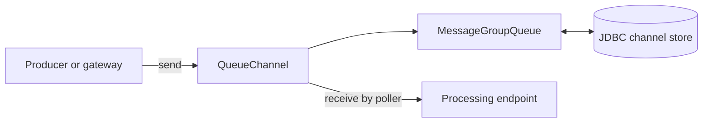
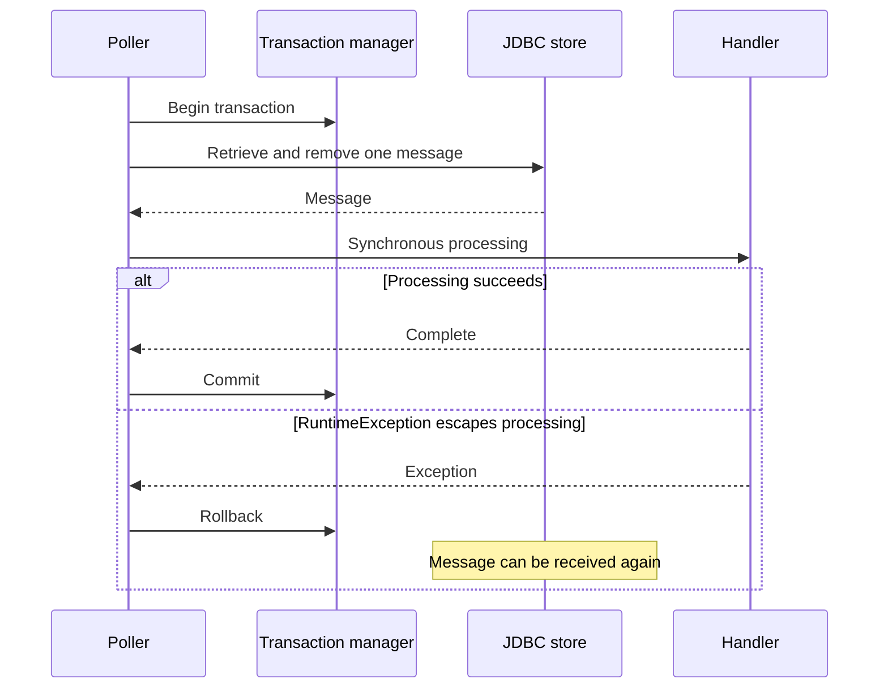

# PersistentQueueChannel

## 1. Purpose and Scope

In the `SPRING_INTEGRATION_CORE` module, a messaging flow is built from `Message`, `MessageChannel`, endpoints, and gateways. The **Message store** chapter adds the ability to retain state when a flow must buffer messages. This lesson focuses on **PersistentQueueChannel**: how to build a persistent message queue, connect it to endpoints using Java DSL, and determine what happens when processing fails.

After this lesson, you will be able to:

- Explain the relationship between `QueueChannel`, `MessageGroupQueue`, and the message store.
- Configure a JDBC queue while keeping the same identifier across restarts.
- Wrap message retrieval and synchronous processing inside a transaction.
- Distinguish message recovery, retries, and duplicate-execution prevention.
- Design tests for restarts, rollbacks, and successful processing.

The examples use Spring Integration 6.5 APIs and Java 17 or later. This is the API baseline for the examples; when adopting them in a project, use a compatible set of Spring versions managed by your project's BOM. The examples are plain Java configuration and do not depend on Spring Boot auto-configuration.

## 2. What Actually Is a PersistentQueueChannel?

In this lesson, **PersistentQueueChannel is a name for a `QueueChannel` backed by a persistent store**, not a class name to import from Spring Integration. The channel object in code is still `org.springframework.integration.channel.QueueChannel`.

The default configuration:

```java
QueueChannel orders = new QueueChannel(100);
```

holds messages in process memory. If the JVM stops abruptly, waiting messages may be lost. You can replace the storage layer with a persistent message store. On send, messages are written to the store; on receive, messages are retrieved and removed from the store according to the store's mechanism. [Persistent QueueChannel configuration documentation](https://docs.spring.io/spring-integration/reference/6.5/channel/configuration.html).

With JDBC, there are three layers to recognize:

| Component | Role in This Lesson's Configuration |
| --- | --- |
| `QueueChannel` | Provides message send and receive APIs; implements `PollableChannel` |
| `MessageGroupQueue` | Translates queue operations into operations on a message group in the store |
| `JdbcChannelMessageStore` | Saves and retrieves messages via JDBC using SQL suited to the database engine |

`MessageGroupQueue` accepts the store and a `groupId` in its constructor. To reuse the queue after a restart, you must pass the exact same `groupId`. [MessageGroupQueue 6.5 Javadoc](https://docs.spring.io/spring-integration/docs/6.5.0/api/org/springframework/integration/store/MessageGroupQueue.html).



The diagram depicts component responsibilities. At runtime, the poller calls `receive()` on the channel, and the channel delegates to the queue and store to fetch a message.

## 3. Why Do We Need a Persistent Queue?

Suppose an application accepts order-recording requests. The sender needs confirmation that the request was accepted, while the recording endpoint may pause temporarily for maintenance.

You can design:

```text
Accept request
    → validate format
    → durableOrders
    → poller
    → record order
```

A request committed into `durableOrders` remains in the database when the application is redeployed. The consumer can continue picking up pending requests after startup.

However, three questions must be distinguished:

1. **Has the request been saved?** This is the result of writing and committing to the store.
2. **If processing fails, is the request still available for reprocessing?** This depends on the transaction wrapping the receive operation.
3. **If reprocessed, does it create a second side effect?** This is a business idempotency problem.

Choosing a persistent store only answers part of the first question. The other two questions must be designed explicitly.

### 3.1. Distinguishing Common Options

| Option | Where Pending Data Resides | Direction for Use |
| --- | --- | --- |
| In-memory `QueueChannel` | JVM heap | Short-term buffering when risking loss of pending data is acceptable |
| `QueueChannel` with JDBC store | Database tables | Persistent buffering in an architecture already using JDBC |
| Message broker via adapter | Dedicated messaging system | When broker operational capabilities and transport guarantees are required |

A queue table in a database still needs planning for capacity, throughput, and recovery. Replacing RAM with JDBC does not automatically grant all capabilities of a broker.

## 4. Message Lifecycle and Transaction Boundaries

### 4.1. The Send Path

```text
Producer creates Message
    → channel.send(message)
    → store writes data
    → write transaction commits
    → message becomes durable pending data
```

If `send()` participates in an already-open transaction, returning `true` does not mean that transaction has committed. When the outer transaction rolls back, the newly inserted record is also rolled back if the store participates in that transaction.

Therefore, when an ingestion API replies “accepted,” the API's contract should align with commit time. For example, the service completes the request-writing transaction before the HTTP layer produces the acceptance response.

### 4.2. The Receive Path

With a transaction-supporting store, the poller should start a transaction **before receiving**:

```text
BEGIN
    receive and remove message from queue
    perform synchronous processing
COMMIT if successful
ROLLBACK if failed per transaction rules
```

Rollback restores the message removal from the queue so the message can be received again. Attaching `@Transactional` only to a business method called after `receive()` is not enough to cover the preceding receive operation. [Transaction Support](https://docs.spring.io/spring-integration/reference/6.5/transactions.html).



The table below analyzes scenarios for the JDBC example sharing the same `DataSource` and transaction manager:

| Scenario | Expected Outcome |
| --- | --- |
| Producer rolls back before commit | New message does not become committed pending data |
| Message committed, application stops before consumer receives | Message remains waiting in the database with data intact |
| Consumer receives inside transaction, then handler throws `RuntimeException` | Message retrieval and JDBC changes in the same transaction roll back |
| Handler completes and transaction commits | Message leaves the queue; business changes in the same transaction are saved |
| Consumer receives outside transaction, then process stops | Gap exists where the message was removed yet business work did not finish |

Durability here also depends on the database's storage and recovery configuration. A queue cannot recover data from a database that has been deleted.

## 5. JDBC/H2 Example with Fixed Identifiers

### 5.1. Libraries and Runtime Prerequisites

The example requires the following dependencies from a compatible Spring version set:

| Dependency | Purpose |
| --- | --- |
| `org.springframework.integration:spring-integration-core` | Channels, endpoints, Java DSL, and Integration infrastructure |
| `org.springframework.integration:spring-integration-jdbc` | `JdbcChannelMessageStore` and query providers |
| `org.springframework:spring-jdbc` | `JdbcTemplate`, `DataSourceTransactionManager`, schema initialization utilities |
| `com.h2database:h2` | H2 driver for practice |
| `org.junit.jupiter:junit-jupiter` | Required only when implementing the test examples |

H2 in the example uses file storage. A `jdbc:h2:mem:...` URL is only suitable for in-memory testing; it does not demonstrate retaining messages across JVM termination.

The Java snippets below are placed in the same practice package. The database must be initialized before opening the application context.

### 5.2. Configuring the Store and Channel

```java
import javax.sql.DataSource;

import org.springframework.context.annotation.Bean;
import org.springframework.context.annotation.Configuration;
import org.springframework.integration.channel.QueueChannel;
import org.springframework.integration.config.EnableIntegration;
import org.springframework.integration.jdbc.store.JdbcChannelMessageStore;
import org.springframework.integration.jdbc.store.channel.H2ChannelMessageStoreQueryProvider;
import org.springframework.integration.store.MessageGroupQueue;
import org.springframework.jdbc.core.JdbcTemplate;
import org.springframework.jdbc.datasource.DataSourceTransactionManager;
import org.springframework.jdbc.datasource.DriverManagerDataSource;
import org.springframework.transaction.PlatformTransactionManager;

@Configuration
@EnableIntegration
public class DurableQueueConfig {

    public static final String GROUP_ID = "orders.v1";
    public static final String REGION = "spring-integration-core-demo";

    @Bean
    public DataSource dataSource() {
        DriverManagerDataSource ds = new DriverManagerDataSource();
        ds.setDriverClassName("org.h2.Driver");
        ds.setUrl("jdbc:h2:file:./data/si-orders");
        ds.setUsername("sa");
        ds.setPassword("");
        return ds;
    }

    @Bean
    public JdbcTemplate jdbcTemplate(DataSource dataSource) {
        return new JdbcTemplate(dataSource);
    }

    @Bean
    public PlatformTransactionManager queueTxManager(DataSource dataSource) {
        return new DataSourceTransactionManager(dataSource);
    }

    @Bean
    public JdbcChannelMessageStore channelStore(DataSource dataSource) {
        JdbcChannelMessageStore store = new JdbcChannelMessageStore(dataSource);
        store.setChannelMessageStoreQueryProvider(
                new H2ChannelMessageStoreQueryProvider());
        store.setRegion(REGION);
        return store;
    }

    @Bean
    public QueueChannel durableOrders(JdbcChannelMessageStore channelStore) {
        return new QueueChannel(new MessageGroupQueue(channelStore, GROUP_ID));
    }
}
```

`JdbcChannelMessageStore` is an implementation specialized for message channels; do not use it to replace the full store of an aggregator. The query provider property must match the database management system. When switching to PostgreSQL, you must change the `DataSource`, DDL, and corresponding query provider. [JdbcChannelMessageStore 6.5 Javadoc](https://docs.spring.io/spring-integration/docs/6.5.0/api/org/springframework/integration/jdbc/store/JdbcChannelMessageStore.html).

`DriverManagerDataSource` keeps the example concise; real applications typically use a connection pool. An H2 file at a relative path is resolved against the process's working directory. Two runs launched from two different directories can open two different database files.

### 5.3. Initializing the Schema Exactly Once

In the `spring-integration-jdbc` 6.5 JAR, the H2 script is located at:

```text
org/springframework/integration/jdbc/schema-h2.sql
```

The script contains the `INT_CHANNEL_MESSAGE` table and sequence serving the channel store, alongside tables for other JDBC components. Use the script matching your library version; do not shrink the schema down to a few arbitrary columns. [H2 Schema in Spring Integration 6.5.0 source](https://raw.githubusercontent.com/spring-projects/spring-integration/v6.5.0/spring-integration-jdbc/src/main/resources/org/springframework/integration/jdbc/schema-h2.sql).

You can run the following snippet in a separate initialization `main` program before opening the context for the first time:

```java
import javax.sql.DataSource;

import org.springframework.core.io.ClassPathResource;
import org.springframework.jdbc.core.JdbcTemplate;
import org.springframework.jdbc.datasource.init.ResourceDatabasePopulator;

// Run against a fresh practice database without the schema yet.
DataSource ds = new DurableQueueConfig().dataSource();

ResourceDatabasePopulator initializer = new ResourceDatabasePopulator(
        new ClassPathResource(
                "org/springframework/integration/jdbc/schema-h2.sql"));
initializer.execute(ds);

new JdbcTemplate(ds).execute("""
        CREATE TABLE ORDER_RECEIPT (
            EVENT_KEY VARCHAR(100) PRIMARY KEY,
            ORDER_ID VARCHAR(100) NOT NULL
        )
        """);
```

This is a bootstrap step for a fresh practice database, not code to re-run on every restart. For long-lived deployments, manage DDL with migrations and preserve pending data. Do not run drop scripts during a restart procedure to test durability.

### 5.4. Endpoint with a Transactional Poller

```java
import org.springframework.beans.factory.annotation.Qualifier;
import org.springframework.context.annotation.Bean;
import org.springframework.context.annotation.Configuration;
import org.springframework.integration.channel.QueueChannel;
import org.springframework.integration.dsl.IntegrationFlow;
import org.springframework.integration.dsl.Pollers;
import org.springframework.jdbc.core.JdbcTemplate;
import org.springframework.transaction.PlatformTransactionManager;

@Configuration
public class OrderConsumerConfig {

    @Bean
    public IntegrationFlow orderFlow(
            @Qualifier("durableOrders") QueueChannel orders,
            @Qualifier("queueTxManager") PlatformTransactionManager txManager,
            JdbcTemplate jdbc) {

        return IntegrationFlow.from(orders)
                .handle(String.class, (orderId, headers) -> {
                    String eventKey = (String) headers.get("eventKey");
                    if (eventKey == null || eventKey.isBlank()) {
                        throw new IllegalArgumentException("Missing eventKey");
                    }
                    if (orderId.isBlank()) {
                        throw new IllegalArgumentException("Missing orderId");
                    }

                    // H2 syntax: re-recording the same eventKey does not insert a new row.
                    jdbc.update("""
                            MERGE INTO ORDER_RECEIPT (EVENT_KEY, ORDER_ID)
                            KEY (EVENT_KEY) VALUES (?, ?)
                            """, eventKey, orderId);
                    return null; // End-of-flow handler, does not produce a reply.
                }, endpoint -> endpoint
                        .id("orderConsumer")
                        .poller(Pollers.fixedDelay(500)
                                .receiveTimeout(0)
                                .maxMessagesPerPoll(1)
                                .transactional(txManager)))
                .get();
    }
}
```

Meaning of the poller settings:

- `fixedDelay(500)`: sets the delay interval between executions of the polling task.
- `receiveTimeout(0)`: does not wait for a message when the queue is empty on that poll.
- `maxMessagesPerPoll(1)`: limits to one message per poll in the example.
- `transactional(txManager)`: applies transaction advice to the polling task.

These options are in the [PollerSpec 6.5 Javadoc](https://docs.spring.io/spring-integration/docs/6.5.0/api/org/springframework/integration/dsl/PollerSpec.html). When using plain Spring, open the context with both `DurableQueueConfig` and `OrderConsumerConfig` to have the consumer active.

The store and `JdbcTemplate` in the example share the same `DataSource`, so message retrieval and the `MERGE` statement participate in the same transaction. `DataSourceTransactionManager` binds a connection to the current thread; `JdbcTemplate` uses the matching connection retrieval mechanism to join the transaction. [DataSourceTransactionManager Javadoc](https://docs.spring.io/spring-framework/docs/6.2.0/javadoc-api/org/springframework/jdbc/datasource/DataSourceTransactionManager.html).

`MERGE ... KEY` is H2 syntax for this lab. It illustrates that resending the same `eventKey` and the same `orderId` leaves only one record. If the same key were reused for a different order, this statement could overwrite the old record. Real business logic must define clear key rules and reject content conflicts; do not view `MERGE` as a complete idempotency solution for every system.

### 5.5. Sending a Message

The following snippet runs against an already-open context:

```java
import org.springframework.integration.channel.QueueChannel;
import org.springframework.messaging.Message;
import org.springframework.messaging.support.MessageBuilder;

QueueChannel orders = context.getBean("durableOrders", QueueChannel.class);

Message<String> message = MessageBuilder.withPayload("ORDER-1001")
        .setHeader("eventKey", "evt-order-1001-created")
        .setHeader("schemaVersion", 1)
        .build();

if (!orders.send(message)) {
    throw new IllegalStateException("Failed to accept request");
}
```

`eventKey` is a stable business key for an event. When the producer retries sending the same event, it must reuse this key. Generating a new UUID for each retry causes duplicate-detection mechanisms to treat each attempt as a distinct event.

For flows that do not need an immediate business reply, a one-way gateway is also appropriate. An interface with a `void` method can hide the messaging API from the caller. If adding `@MessagingGateway` in plain Spring configuration, enable `@IntegrationComponentScan` for the package containing the interface. [MessagingGateway 6.5 Javadoc](https://docs.spring.io/spring-integration/docs/6.5.0/api/org/springframework/integration/annotation/MessagingGateway.html).

## 6. XML and Java DSL Variants

XML can declare the channel as follows, assuming `channelStore` and `queueTxManager` beans already exist:

```xml
<int:channel id="durableOrders">
    <int:queue message-store="channelStore"/>
</int:channel>

<int:service-activator input-channel="durableOrders"
                       ref="orderHandler"
                       method="handle">
    <int:poller fixed-delay="500"
                receive-timeout="0"
                max-messages-per-poll="1">
        <int:transactional transaction-manager="queueTxManager"/>
    </int:poller>
</int:service-activator>
```

This is a configuration fragment to place inside an XML document with the `int` namespace declared; it is not a standalone XML file. With namespace configuration, the channel name forms part of the stored group identifier. Renaming the channel can prevent the application from reading the old data group.

Do not set both `capacity` and `message-store` attributes on `<int:queue>`. This rule is stated in [persistent QueueChannel configuration](https://docs.spring.io/spring-integration/reference/6.5/channel/configuration.html).

Java DSL has an overload that declares the store and group ID directly:

```java
// Alternative variant; do not declare duplicate beans alongside the main example.
return IntegrationFlow
        .from("incomingOrders")
        .channel(org.springframework.integration.dsl.MessageChannels.queue(
                "durableOrders", channelStore, "orders.v1"))
        .get();
```

This flow only illustrates a producer putting data into the queue; an endpoint with a poller is still required to consume it. The corresponding overload is in the [MessageChannels 6.5 Javadoc](https://docs.spring.io/spring-integration/docs/6.5.0/api/org/springframework/integration/dsl/MessageChannels.html).

## 7. Queue Identity and Serialization

### 7.1. Values That Must Remain Stable

When reopening the queue, you must access the same physical data and the same logical space:

| Value | If Changed Unintentionally |
| --- | --- |
| Database or connection schema | Application accesses a different dataset |
| Table prefix | SQL points to a different set of tables |
| `region` | Old messages belong to a different logical partition |
| `groupId` | New queue does not read messages belonging to the old group |
| Channel name when using config deriving group from channel | May change the group being used |

Multiple queues can share one store as long as they have distinct group IDs to separate data. Applications sharing the same channel names can separate data using `region`. [JDBC Message Store: partitioning stores](https://docs.spring.io/spring-integration/reference/6.5/jdbc/message-store.html).

In the Java example, `GROUP_ID` is passed directly, so renaming the bean method does not automatically change this constant. Conversely, generating a group ID via `UUID.randomUUID()` on every run prevents the new queue from reading the old backlog.

### 7.2. Messages Must Remain Readable After Deployment

The store must convert messages into a storable form and reconstruct them later. Do not place process-bound objects such as connections, streams, HTTP requests, or callbacks inside messages meant to persist across restarts.

The data contract should consist of a clear payload, event key, data version, and headers genuinely needed for processing. In the example, `String`, `Integer`, and simple header values reduce coupling to business classes.

Store implementations have different serialization strategies; do not generalize one store's behavior to all other stores. In particular, do not rely on non-serializable headers always being retained or dropped in the exact same way. [Message Store: serialization notes](https://docs.spring.io/spring-integration/reference/6.5/message-store.html).

In `JdbcChannelMessageStore` 6.5, the default configuration uses Java serialization, and the deserialization converter maintains an allowlist of permitted classes. If using custom DTOs, ensure the DTO and related data are serializable, new versions can read old data, and the necessary classes are permitted, for example:

```java
store.addAllowedPatterns("vn.example.integration.OrderCommand");
```

Do not open all classes with a wildcard just to bypass a configuration error. The API for extending the allowlist and points to swap serializer/deserializer are in [JdbcChannelMessageStore 6.5.0 source](https://raw.githubusercontent.com/spring-projects/spring-integration/v6.5.0/spring-integration-jdbc/src/main/java/org/springframework/integration/jdbc/store/JdbcChannelMessageStore.java).

A request/reply gateway may use a temporary reply channel bound to the waiting call. Persisting the request to a database does not make that call and waiting thread survive a restart. For long-running tasks, save results keyed by `eventKey` or correlation ID so the caller can query or receive a notification later.

## 8. Processing Guarantees and External Side Effects

### 8.1. Reprocessing Capability Does Not Equal Exactly-Once

Consider a handler performing:

```text
Call charge API successfully
    → process stops before JDBC transaction commits
    → transaction rolls back
    → message reappears
    → charge API is called again
```

This is a design failure-mode analysis: a JDBC transaction does not control undoing an already-completed HTTP call. Because the handler can receive the message again, side effects require an idempotency key or a dedicated coordination workflow.

If business updates and the queue reside in the same database transaction, they can commit atomically within that scope. That still does not make operations outside the database exactly-once.

For the order domain, you can choose:

- Record `eventKey` and update order status in the same transaction.
- Require the payment service to support an idempotency key, resending the same key on retry.
- Write outbound requests to an outbox inside the business transaction, with a relay process and matching deduplication strategy.

These are additional design choices for the specific problem, not built-in behaviors automatically enabled by `QueueChannel`.

### 8.2. Keep the Atomic Portion on the Same Thread

If a synchronous handler hands off to an `ExecutorChannel`, creates a `CompletableFuture`, or forwards to another queue and returns, the current transaction does not automatically follow work running on another thread. In that case, redefine commit points and persistence boundaries at every handoff. [Transaction boundaries in message flows](https://docs.spring.io/spring-integration/reference/6.5/transactions.html).

Even within a transaction, a handler catching an exception and returning normally can cause the poll to be treated as successful unless the transaction has been marked rollback-only. For errors that must be reprocessed, let an appropriate exception propagate out of the processing scope or explicitly trigger rollback per your chosen contract.

## 9. Retry, errorChannel, and Unprocessable Messages

When a consumer runs via a poller, processing errors happen decoupled from the earlier `send()` call. Infrastructure can emit an `ErrorMessage` to an error channel. A message's `errorChannel` header or the error channel configured on the poller can affect where errors go; verify the active configuration. [Error Handling](https://docs.spring.io/spring-integration/reference/6.5/error-handling.html).

Three mechanisms should be examined separately:

| Mechanism | What It Solves |
| --- | --- |
| Rolling back the receive | Leaves the message available to be received again |
| Retry | Decides when and how many times to attempt processing |
| Quarantine or dead-letter | Holds unprocessable messages for inspection and controlled recovery |

A malformed message can roll back repeatedly. If it is always picked up first, throughput of other messages can suffer. `maxMessagesPerPoll(1)` only limits how many messages are polled at once, not the maximum number of retries.

The main example intentionally throws when `eventKey` is missing to demonstrate rollback. Before using this as a real operational flow, add a classification policy:

- Transient errors: retry with appropriate backoff and limits.
- Data errors unfixable by retrying: save the payload and error details to a quarantine store.
- Storage infrastructure errors: monitor and restore connectivity, avoiding returning acceptance when storage failed.

Sending an `ErrorMessage` to `errorChannel` does not automatically move the original message to a persistent queue. If removing from the source queue and moving to quarantine must be atomic, both operations must participate in an appropriate transaction. An error flow running after rollback or on another thread must not be assumed to run inside the original receive transaction.

If retry counts must survive restarts, persist them using designed persistent state. Do not assume an in-RAM counter or a header added by retry advice automatically reflects every re-poll from the store.

## 10. Combining with Core Endpoints

A persistent queue often sits between components studied in this module:

```text
Gateway → transformer → filter/router → durable queue → poller → handler
```

Queue placement determines which data has been durably accepted. You can validate formats and normalize payloads before the queue to reduce invalid messages that must be stored. Clarify how the caller learns that a request was rejected.

After the queue, a filter dropping a message without throwing an error may be a valid processing outcome, causing the receive transaction to commit. Therefore, if business rules require keeping dropped records, provide a storage branch for them; do not rely on rollback when no error occurs.

If the next endpoint is an aggregator, the queue successfully delivering a message to the aggregator does not mean the aggregator's group is durable. The aggregator needs an appropriate store for its own state. `JdbcChannelMessageStore` is optimized for queues, while `JdbcMessageStore` serves needs such as aggregators and claim checks. [Distinguishing JDBC message stores](https://docs.spring.io/spring-integration/reference/6.5/jdbc/message-store.html).

## 11. Testing Important Properties

The following examples are test code to implement in your practice project. They do not replace running tests against your project's actual dependencies and database.

### 11.1. Reopening the Channel and Reading the Backlog

Open only `DurableQueueConfig`, without `OrderConsumerConfig`, so the poller does not consume the message before the verification step:

```java
import org.junit.jupiter.api.Test;
import org.springframework.context.annotation.AnnotationConfigApplicationContext;
import org.springframework.integration.channel.QueueChannel;
import org.springframework.messaging.Message;
import org.springframework.messaging.support.MessageBuilder;

import static org.junit.jupiter.api.Assertions.*;

class DurableQueueReopenTest {

    @Test
    void readsCommittedMessageAfterContextReopens() {
        // Precondition: schema exists, queue is dedicated to this test and currently empty.
        try (var first = new AnnotationConfigApplicationContext(
                DurableQueueConfig.class)) {
            QueueChannel queue = first.getBean(
                    "durableOrders", QueueChannel.class);
            assertTrue(queue.send(MessageBuilder.withPayload("ORDER-REOPEN")
                    .setHeader("eventKey", "evt-reopen")
                    .build()));
        }

        try (var second = new AnnotationConfigApplicationContext(
                DurableQueueConfig.class)) {
            QueueChannel queue = second.getBean(
                    "durableOrders", QueueChannel.class);
            Message<?> restored = queue.receive(0);

            assertNotNull(restored);
            assertEquals("ORDER-REOPEN", restored.getPayload());
            assertEquals("evt-reopen", restored.getHeaders().get("eventKey"));
            assertNull(queue.receive(0));
        }
    }
}
```

This test verifies reopening the context and store with the same identifiers. To prove recovery across JVMs, run two separate process executions: the first process sends and exits; the second process opens the same database and receives. An abrupt stop after confirming commit tests crash scenarios more realistically than closing a context gracefully.

### 11.2. Rolling Back the Receive Operation

In an isolated test, still without starting the consumer, use `TransactionTemplate` to demonstrate the receive boundary:

```java
import org.springframework.transaction.PlatformTransactionManager;
import org.springframework.transaction.support.TransactionTemplate;

// context only registers DurableQueueConfig; dedicated queue is currently empty.
QueueChannel queue = context.getBean("durableOrders", QueueChannel.class);
PlatformTransactionManager tm = context.getBean(
        "queueTxManager", PlatformTransactionManager.class);
TransactionTemplate tx = new TransactionTemplate(tm);

assertTrue(queue.send(MessageBuilder.withPayload("ORDER-ROLLBACK")
        .setHeader("eventKey", "evt-rollback")
        .build()));

assertThrows(IllegalStateException.class, () ->
        tx.executeWithoutResult(status -> {
            Message<?> received = queue.receive(0);
            assertNotNull(received);
            throw new IllegalStateException("Simulating processing failure");
        }));

Message<?> availableAgain = tx.execute(status -> queue.receive(0));
assertNotNull(availableAgain);
assertEquals("ORDER-ROLLBACK", availableAgain.getPayload());
assertNull(queue.receive(0));
```

Imports for `QueueChannel`, `Message`, `MessageBuilder`, and JUnit assertions are the same as the previous example. `TransactionTemplate` executes the callback inside a transaction and supports marking rollback-only when needed. [Programmatic Transaction Management](https://docs.spring.io/spring-framework/reference/data-access/transaction/programmatic.html).

This test verifies the store and transaction manager; it does not verify that the DSL endpoint actually has transaction advice attached. Add an integration test opening both configurations, making the handler throw a controlled error, and verifying the message remains in the queue after rollback. When testing asynchronously, wait with a bounded timeout until the expected condition holds instead of assuming a fixed sleep is always enough.

### 11.3. Flow-Level Observations Required

| Scenario | Observation to Verify |
| --- | --- |
| Handler succeeds | Queue drains the message and business data is committed |
| Handler updates JDBC then throws | Message remains for reprocessing and business update did not commit |
| Same event resent | Business outcome obeys idempotency rules |
| Handed off to quarantine | Failed message remains in quarantine after restart as designed |
| Application version upgrade | Pending data from the older version can still be read and processed |

Use a database, region, or group dedicated to tests. Do not wipe shared queue data to create an empty test state. Before increasing consumer concurrency, add contention tests on the exact target database engine.

## 12. Capacity, Ordering, and Operational Observability

### 12.1. Backlog Is Data with a Cost

In our practical design, suppose an average of 80 messages arrive per second while consumers process only 60 messages per second. After 10 minutes:

```text
Backlog increase = (80 - 60) × 600 = 12,000 messages
```

This is an example load estimate, excluding bursts or retry time. If each message occupies roughly 4 KiB after serialization, message data alone is around 47 MiB, excluding indexes, transaction logs, and storage overhead.

Monitor queue depth, oldest message age, ingress/egress rates, rollback counts, and processing latency. A deep queue draining quickly differs from a small queue with a single request stuck for hours.

`MessageGroupQueue` has a constructor taking capacity, but the default lock in the implementation is an in-JVM lock. Such a limit does not automatically become an atomic quota across multiple processes. If backpressure or system-wide quotas are needed, design them explicitly at the ingestion point. [MessageGroupQueue 6.5.0 source](https://raw.githubusercontent.com/spring-projects/spring-integration/v6.5.0/spring-integration-core/src/main/java/org/springframework/integration/store/MessageGroupQueue.java).

### 12.2. Measuring Depth Without Consuming Messages

With this example, you can call:

```java
int waiting = channelStore.messageGroupSize(DurableQueueConfig.GROUP_ID);
```

Or inspect groups in a region with a read-only query:

```sql
SELECT REGION, GROUP_KEY, COUNT(*) AS WAITING_COUNT
FROM INT_CHANNEL_MESSAGE
WHERE REGION = 'spring-integration-core-demo'
GROUP BY REGION, GROUP_KEY;
```

`GROUP_KEY` in the table is an internal representation of the group key; do not assume it holds the literal string `orders.v1`. Never call `receive()` to measure queue depth because receiving is a destructive consumption operation.

### 12.3. Receive Order and Completion Order

A FIFO queue aims to poll messages in the store's storage order. When multiple consumers process in parallel, a message polled later can still finish earlier. If business rules require sequential processing per order, define corresponding partitioning keys or concurrency limits.

Adding threads does not necessarily increase throughput if the database is waiting on locks or the connection pool is exhausted. Start from a single-consumer configuration, measure processing time and SQL load, and then increase parallelism while testing against the target database.

## 13. Design Self-Check

Before considering a JDBC-queue flow ready for requirements, answer using observable behavior:

1. At what point relative to commit does the ingestion API return success?
2. After restart, does the application open the exact same database, region, and group ID?
3. Does the transaction start before `receive()` and cover all business work that must be atomic?
4. When retrying the same event, do side effects obey the idempotency key?
5. Where are permanently failing messages held and who can reprocess them?
6. When backlog grows, how does the system throttle ingestion or scale processing?

A `PersistentQueueChannel` configuration is sound when these answers align: data is saved before confirming acceptance, incomplete messages recover according to policy, and reprocessing never violates business rules.
