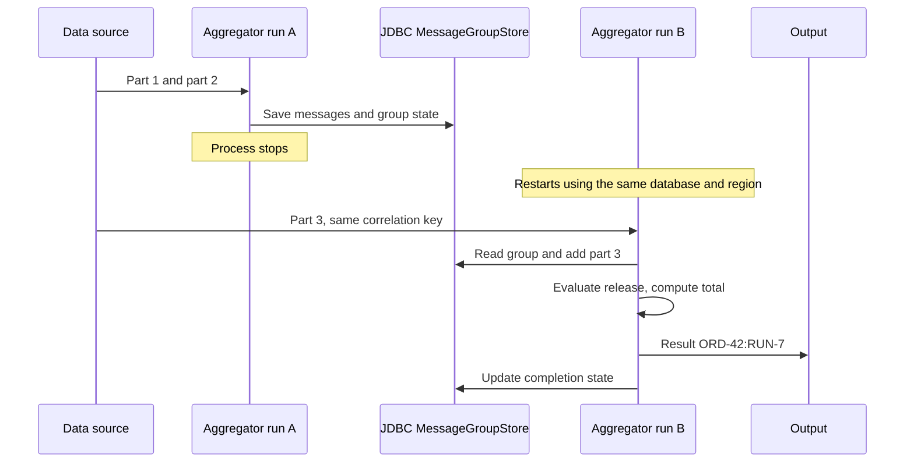
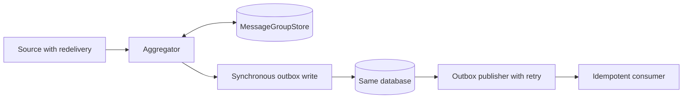

# Aggregator persistence

## 1. Purpose and Scope

In the **Message store** chapter of Spring Integration Core, this lesson presents how to persist aggregator state so a waiting message group can continue being processed after an application restarts.

After this lesson, you will be able to:

- Distinguish aggregator state, input queues, and output results.
- Configure `JdbcMessageStore` with Java DSL.
- Design correlation keys and release conditions that handle duplicate messages properly.
- Decide how to handle completed groups, incomplete groups, and late-arriving messages.
- Identify transaction boundaries, locks, and recovery behavior that must be tested.

The examples use **Java 17 or later and Spring Integration 6.5.x APIs**. Actual dependency versions should follow your project's BOM. The initial configuration pattern targets a single instance; later sections add transaction and multi-instance design.

## 2. Why Does an Aggregator Need Persistence?

Suppose an order entry is split into three parts:

| Business Key | Part | Amount |
| --- | --- | --- |
| `ORD-42:RUN-7` | 1/3 | 100000 |
| `ORD-42:RUN-7` | 2/3 | 200000 |
| `ORD-42:RUN-7` | 3/3 | 300000 |

The application receives parts 1 and 2 and then stops abruptly. After restarting, part 3 arrives. If the first two parts lived only in memory, the aggregator no longer has enough data to compute the total of 600000.

An aggregator's job is to collect messages, hold them in a store, check release readiness, and produce an aggregated result. A persistent store protects this retained state. Those roles are separated across `CorrelationStrategy`, `ReleaseStrategy`, and `MessageGroupProcessor`. [Aggregator Reference](https://docs.spring.io/spring-integration/reference/6.5/aggregator.html)



The diagram illustrates the logical flow. It does not claim that sending output and updating the database already happen inside the same transaction.

## 3. What Exactly Needs to Be Retained?

Group state is not just a list of payloads. Distinguish:

| Component | Role During Recovery |
| --- | --- |
| Correlation key | Finds the right group a new message belongs to |
| Messages in the group | Provides unaggregated input data |
| Complete flag | Distinguishes a waiting group from a finished group |
| Timestamp and last modified | Forms the basis for evaluating age or idle time |
| Sequence/condition info if present | Supports the corresponding release strategy |

Spring Integration has a dedicated metadata model for a message group, including message identities, timestamps, the complete flag, and sequence/condition info. You should not replace that entire model with a table storing only payloads and expect the aggregator to recover fully on its own. [MessageGroupMetadata API](https://docs.spring.io/spring-integration/docs/6.5.0/api/org/springframework/integration/store/MessageGroupMetadata.html)

A useful architectural reading:

```text
MessageChannel      -> delivers messages to the endpoint
Aggregator endpoint -> orchestrates correlation, release, and output
MessageGroupStore   -> holds group data and state
Downstream          -> receives, persists, or executes the result
```

If a message is lost before reaching the aggregator, the message group store has nothing to recover yet. If a result has left the aggregator and sits in an in-memory queue, group persistence does not protect that queue either.

## 4. Choosing the Store and Preparing the Database

For JDBC, the choice for this lesson is `org.springframework.integration.jdbc.store.JdbcMessageStore`. It serves correlating components such as aggregators. `JdbcChannelMessageStore` is specialized for message channels and is not an interchangeable option to pass into `.aggregate(a -> a.messageStore(...))`. [JdbcMessageStore API](https://docs.spring.io/spring-integration/docs/6.5.0/api/org/springframework/integration/jdbc/store/JdbcMessageStore.html)

Before running the example, the project needs:

1. Dependencies `spring-integration-core`, `spring-integration-jdbc`, Spring JDBC, and a JDBC driver.
2. A `DataSource` bean pointing to a database that retains data across runs.
3. Schema created via a migration matching the Spring Integration version.
4. Read, write, and update permissions on the message store tables.

In the `spring-integration-jdbc` JAR, `org/springframework/integration/jdbc/schema-*.sql` scripts provide the structure per database engine. Pick the matching script and manage schema changes alongside the application; do not re-run drop/create scripts on every restart. [Initializing JDBC Message Store](https://docs.spring.io/spring-integration/reference/6.5/jdbc/message-store.html)

To practice restarts, use PostgreSQL or file-mode H2. A database residing solely in process memory loses data when the process exits, even if the application selected the right store class.

## 5. Java DSL Example: Aggregating Order Parts

### 5.1. Data Contract

The example specifies:

- One group corresponds to a pair of `orderId` and `runId`.
- Neither identifier contains `:`, so key concatenation is unambiguous.
- Each part has an index from 1 to `expectedParts`.
- Every part in the group agrees on `expectedParts`.
- Resending the same part with equivalent data is allowed; conflicting data is rejected.
- Only complete results are emitted. Incomplete groups that expire go to the discard branch.

Using `runId` separates a new processing run from an earlier run of the same order. On redelivery after restart, the source must preserve `runId`; generating a new UUID on every reception would split one job into multiple groups.

### 5.2. Configuration and Illustrative Algorithm

This is a configuration to drop into an application that already has a `DataSource`. The records are placed inside the same class so the example is self-contained.

```java
package example.integration.orders;

import java.io.Serializable;
import java.math.BigDecimal;
import java.time.Duration;
import java.util.Objects;
import java.util.SortedMap;
import java.util.TreeMap;

import javax.sql.DataSource;

import org.springframework.beans.factory.annotation.Qualifier;
import org.springframework.context.annotation.Bean;
import org.springframework.context.annotation.Configuration;
import org.springframework.integration.channel.DirectChannel;
import org.springframework.integration.channel.QueueChannel;
import org.springframework.integration.config.EnableIntegration;
import org.springframework.integration.dsl.IntegrationFlow;
import org.springframework.integration.jdbc.store.JdbcMessageStore;
import org.springframework.integration.store.MessageGroup;
import org.springframework.messaging.Message;

@Configuration
@EnableIntegration
public class PersistentOrderAggregation {

    public record OrderPart(
            String orderId,
            String runId,
            int partNo,
            int expectedParts,
            BigDecimal amount) implements Serializable {

        public OrderPart {
            Objects.requireNonNull(orderId, "orderId");
            Objects.requireNonNull(runId, "runId");
            Objects.requireNonNull(amount, "amount");

            if (orderId.isBlank() || runId.isBlank()
                    || orderId.contains(":") || runId.contains(":")) {
                throw new IllegalArgumentException("Invalid business key");
            }

            if (expectedParts <= 0
                    || partNo < 1
                    || partNo > expectedParts) {
                throw new IllegalArgumentException("Invalid part numbering");
            }
        }
    }

    public record CompletedOrder(
            String orderId,
            String runId,
            int partCount,
            BigDecimal total) implements Serializable {
    }

    @Bean
    public DirectChannel orderParts() {
        return new DirectChannel();
    }

    @Bean
    public QueueChannel completedOrders() {
        return new QueueChannel();
    }

    @Bean
    public QueueChannel discardedOrderParts() {
        return new QueueChannel();
    }

    @Bean
    public JdbcMessageStore orderAggregationStore(DataSource dataSource) {
        JdbcMessageStore store = new JdbcMessageStore(dataSource);
        store.setRegion("order-parts-v1");
        return store;
    }

    @Bean
    public IntegrationFlow orderAggregationFlow(
            @Qualifier("orderParts") DirectChannel input,
            @Qualifier("completedOrders") QueueChannel output,
            @Qualifier("discardedOrderParts") QueueChannel discard,
            @Qualifier("orderAggregationStore") JdbcMessageStore store) {

        return IntegrationFlow.from(input)
                .aggregate(a -> a
                        .id("persistentOrderAggregator")
                        .messageStore(store)
                        .correlationStrategy(message ->
                                groupKey((OrderPart) message.getPayload()))
                        .releaseStrategy(PersistentOrderAggregation::ready)
                        .outputProcessor(PersistentOrderAggregation::summarize)
                        .expireGroupsUponCompletion(false)
                        .expireGroupsUponTimeout(false)
                        .sendPartialResultOnExpiry(false)
                        .minimumTimeoutForEmptyGroups(
                                Duration.ofDays(1).toMillis())
                        .groupTimeout(Duration.ofMinutes(2).toMillis())
                        .expireTimeout(Duration.ofMinutes(10).toMillis())
                        .expireDuration(Duration.ofSeconds(30))
                        .discardChannel(discard))
                .channel(output)
                .get();
    }

    public static String groupKey(OrderPart part) {
        return part.orderId() + ":" + part.runId();
    }

    private static SortedMap<Integer, OrderPart> uniqueParts(
            MessageGroup group) {

        SortedMap<Integer, OrderPart> parts = new TreeMap<>();
        Integer expected = null;

        for (Message<?> message : group.getMessages()) {
            OrderPart part = (OrderPart) message.getPayload();

            if (expected == null) {
                expected = part.expectedParts();
            }
            else if (expected.intValue() != part.expectedParts()) {
                throw new IllegalArgumentException(
                        "Conflicting expectedParts");
            }

            OrderPart previous = parts.putIfAbsent(part.partNo(), part);
            if (previous != null
                    && previous.amount().compareTo(part.amount()) != 0) {
                throw new IllegalArgumentException(
                        "Conflicting amount for part " + part.partNo());
            }
        }

        return parts;
    }

    private static boolean ready(MessageGroup group) {
        SortedMap<Integer, OrderPart> parts = uniqueParts(group);
        return !parts.isEmpty()
                && parts.size() == parts.get(parts.firstKey()).expectedParts();
    }

    private static CompletedOrder summarize(MessageGroup group) {
        SortedMap<Integer, OrderPart> parts = uniqueParts(group);
        OrderPart first = parts.get(parts.firstKey());

        BigDecimal total = parts.values().stream()
                .map(OrderPart::amount)
                .reduce(BigDecimal.ZERO, BigDecimal::add);

        return new CompletedOrder(
                first.orderId(), first.runId(), parts.size(), total);
    }
}
```

`messageStore(...)`, the strategies, timeouts, and discard branch configure the correlation endpoint; `outputProcessor(...)` creates the output payload from the released group. [CorrelationHandlerSpec API](https://docs.spring.io/spring-integration/docs/6.5.0/api/org/springframework/integration/dsl/CorrelationHandlerSpec.html), [AggregatorSpec API](https://docs.spring.io/spring-integration/docs/6.5.0/api/org/springframework/integration/dsl/AggregatorSpec.html)

There are three limitations to understand when using this sample:

- `completedOrders` and `discardedOrderParts` are in-memory queues for observing results in the lab. They must be replaced with persistent destinations in an end-to-end recovery design.
- The sample does not yet declare a transaction spanning message insertion, release, and result emission.
- Exceptions caused by conflicting data require a dedicated recovery policy. Without an appropriate transaction, do not assume the error-causing message was removed from the store.

The group-scanning algorithm was chosen for readability. It suits small groups in a hands-on lesson, not tens of thousands of parts.

## 6. Practicing Group Continuation After Restart

In a runner or test snippet with a Spring context, send the first two parts:

```java
import java.math.BigDecimal;

import org.springframework.integration.channel.DirectChannel;
import org.springframework.integration.support.MessageBuilder;

import example.integration.orders.PersistentOrderAggregation.OrderPart;

// context is the ApplicationContext of the running application.
DirectChannel input = context.getBean("orderParts", DirectChannel.class);

input.send(MessageBuilder.withPayload(
        new OrderPart("ORD-42", "RUN-7", 1, 3,
                new BigDecimal("100000"))).build());

input.send(MessageBuilder.withPayload(
        new OrderPart("ORD-42", "RUN-7", 2, 3,
                new BigDecimal("200000"))).build());
```

At this point there is no `CompletedOrder` yet. You can inspect state through the store:

```java
JdbcMessageStore store =
        context.getBean("orderAggregationStore", JdbcMessageStore.class);

MessageGroup group = store.getMessageGroup("ORD-42:RUN-7");

System.out.println(group.size());       // 2
System.out.println(group.isComplete()); // false
```

Continue as follows:

1. Stop the application after both send calls succeed.
2. Restart with the same database, schema, and region.
3. In this lab, restart sooner than the 10-minute purge threshold.
4. Send part 3 with the same `orderId`, `runId`, and `expectedParts`.
5. Read the result from the new context's output queue.

```java
input.send(MessageBuilder.withPayload(
        new OrderPart("ORD-42", "RUN-7", 3, 3,
                new BigDecimal("300000"))).build());

QueueChannel output =
        context.getBean("completedOrders", QueueChannel.class);

Message<?> result = output.receive(1000);
if (result == null) {
    throw new IllegalStateException("Expected completed order");
}

System.out.println(result.getPayload());
// CompletedOrder[orderId=ORD-42, runId=RUN-7,
//                partCount=3, total=600000]
```

The `context`, `input`, and `store` variables after restart must be obtained from the new context. Do not keep channel objects from the old run to simulate recovery.

This is a practice scenario and expected output; this lesson does not claim to have executed the snippets above in a live project environment.

## 7. Duplicates: Storing Messages Does Not Automatically Mean Correct Business Processing

Consider the sequence of parts `1, 2, 2`. If the release condition is `group.size() == 3`, the group could be treated as ready even though part 3 is missing.

The sample counts **distinct parts by partNo**, and sums amounts over the deduplicated set:

```text
Retained messages:   1, 2, 2
Distinct partNos:    1, 2
Required parts:      3
Decision:            not released yet
```

Counting distinct parts while still summing every message would create a different bug: the total amount would be added twice. Therefore both the release strategy and output processor call `uniqueParts(...)`.

Here, “duplicate” is defined by the business contract `orderId + runId + partNo`, not by whether two messages share the same `MessageHeaders.ID`. A redelivery can be wrapped in a new message.

Non-conflicting duplicates can still consume extra store capacity before the group completes. With heavy redelivery, you can add an idempotent receiver or an inbox with a unique constraint on the business key. Marking receipt and storing the part need a consistent boundary; marking success before saving the part can cause a retry to be dropped even though the data was never retained.

## 8. Complete, Expire, and Late-Arriving Messages

Distinguish **completing a group** from **completely deleting all traces of the group**:

| Configuration After Normal Release | Retained State | When Same Key Arrives Next |
| --- | --- | --- |
| `expireGroupsUponCompletion(false)` | Group is complete, usually with released messages removed | Late messages can be recognized and discarded |
| `expireGroupsUponCompletion(true)` | Group is deleted | Message can open a new group |

The default value is `false`. [AggregatingMessageHandler API](https://docs.spring.io/spring-integration/docs/6.5.0/api/org/springframework/integration/aggregator/AggregatingMessageHandler.html)

In the example, keeping metadata prevents a redelivery of `ORD-42:RUN-7` from accidentally producing a second result right after the first. A new entry must use `RUN-8`.

However, the completion marker only exists during the retention window. After metadata expires and is deleted, the aggregator can accept the same key as a new group. If business rules require duplicate protection longer than one day, retain a business ledger or unique key at the output for a matching duration.

`minimumTimeoutForEmptyGroups(...)` helps retain empty groups before cleanup, especially when completion-marker retention must outlast the wait time for incomplete groups. This is not a guarantee that metadata vanishes at an exact wall-clock instant; it still depends on cleanup mechanisms and schedules. [minimumTimeoutForEmptyGroups API](https://docs.spring.io/spring-integration/docs/6.5.0/api/org/springframework/integration/aggregator/AbstractCorrelatingMessageHandler.html#setMinimumTimeoutForEmptyGroups(long))

## 9. Timeouts and Orphaned Groups After Restart

### 9.1. Two Time Thresholds in the Example

| Setting | Meaning in the Lab |
| --- | --- |
| `groupTimeout(2 minutes)` | Schedules force-complete when an active group receives no more messages |
| `expireTimeout(10 minutes)` | Age threshold for evaluating old groups in the store |
| `expireDuration(30 seconds)` | Sweep interval for scanning old groups |
| `minimumTimeoutForEmptyGroups(1 day)` | Retains empty group markers for handling late-arriving messages |

A timeout scheduled in the JVM's scheduler is not a timer restored verbatim from the database. A group may still have data after restart without its old scheduled task, especially when no new messages arrive.

The `expireTimeout` mechanism enables purging old groups on startup; `expireDuration` adds a periodic sweep schedule. This handles orphaned groups rather than automatically restoring every pre-shutdown timeout instant. [expireTimeout and expireDuration API](https://docs.spring.io/spring-integration/docs/6.5.0/api/org/springframework/integration/aggregator/AbstractCorrelatingMessageHandler.html#setExpireTimeout(long))

Consequently, a group right after restart may wait differently than the original two-minute cadence. If an SLA requires a fixed business deadline, store the deadline in the data and design recovery around that deadline.

### 9.2. Decisions When a Group Is Incomplete

The sample sets `sendPartialResultOnExpiry(false)`, so it does not emit an incomplete order as a completed order. `expireGroupsUponTimeout(false)` keeps the ended state to handle messages arriving after timeout. Timeout and completion options are separate decisions. [expireGroupsUponTimeout API](https://docs.spring.io/spring-integration/docs/6.5.0/api/org/springframework/integration/aggregator/AbstractCorrelatingMessageHandler.html#setExpireGroupsUponTimeout(boolean))

You can design an alternative policy:

- Emit a partial result if business rules permit; the payload must explicitly represent the missing parts.
- Record a failure event or request data compensation.
- Allow reopening work under a new `runId` after an explicit decision.

If partial release is enabled, update both the output processor and downstream consumers. Flipping a flag does not automatically make `CompletedOrder` mean “incomplete.”

### 9.3. When Using MessageGroupStoreReaper

`MessageGroupStoreReaper` provides `run()` to invoke expiry on a schedule; merely creating the bean does not replace configuring a schedule. It is an alternative option when group cleanup must be driven externally. [MessageGroupStoreReaper API](https://docs.spring.io/spring-integration/docs/6.5.0/api/org/springframework/integration/store/MessageGroupStoreReaper.html)

The lab uses endpoint-managed purging. When choosing the reaper for another design, specify clearly which mechanism owns cleanup, whether timeout is measured by age or idle time, and which branch handles expiration.

## 10. Transactions: Protecting a Single Group Transition

`JdbcMessageStore` does not automatically create a transaction spanning every business step in a flow. One boundary often worth considering is:

```text
BEGIN
    save newly received part
    read/check group
    if complete: build result and write outbox
    update group state
COMMIT
```

For a synchronous flow over `DirectChannel`, you can open a transaction at the ingress using Spring transactions. Transactions are thread-bound; crossing an `ExecutorChannel` or a queue with a consumer on another thread creates a different boundary. [Transaction boundaries](https://docs.spring.io/spring-integration/reference/6.5/transactions.html)

The snippet below illustrates opening a transaction for a send call in the single-instance lab:

```java
import org.springframework.jdbc.datasource.DataSourceTransactionManager;
import org.springframework.transaction.support.TransactionTemplate;

TransactionTemplate tx = new TransactionTemplate(
        new DataSourceTransactionManager(dataSource));

tx.executeWithoutResult(status -> {
    boolean accepted = input.send(
            MessageBuilder.withPayload(part).build());

    if (!accepted) {
        throw new IllegalStateException("Message was not accepted");
    }
});
```

Here `dataSource` must be the data source used by the store; `part` is an already-constructed `OrderPart`. Do not catch and swallow exceptions inside the callback if you want the transaction to roll back.

The snippet only adds a JDBC boundary. The two in-memory queues in the sample still do not roll back like database records. For a consistent design, replace the output with a synchronous outbox write to the same database within the same transaction.

The DSL also offers `transactional(transactionManager, true)` to apply advice around `handleMessage()` and its downstream synchronous branch. Choose the transaction mechanism suited to your application's entry point. [ConsumerEndpointSpec API](https://docs.spring.io/spring-integration/docs/6.5.0/api/org/springframework/integration/dsl/ConsumerEndpointSpec.html)

### The Timeout Path Needs Its Own Transaction

Timeouts and purges run from a scheduler, not through the message-sending callback above. Advice on normal reception does not automatically cover every force-complete execution.

You can use `forceReleaseAdvice(...)` with a transaction interceptor for force-complete operations; if the discard branch writes critical data, it must also participate in an appropriate boundary. [forceReleaseAdvice API](https://docs.spring.io/spring-integration/docs/6.5.0/api/org/springframework/integration/dsl/CorrelationHandlerSpec.html#forceReleaseAdvice(org.aopalliance.aop.Advice...))

## 11. Persistence Does Not Create Output Exactly-Once by Itself

Suppose downstream is an HTTP charge API:

| Stopping Point | Risk Without Coordination |
| --- | --- |
| API charged, group state not yet committed | Retry may call charge API again |
| Group state ended, result sits only in in-memory queue | Restart may lose unconsumed result |
| Source ACKed before persisting the part | Source will not resend the lost part |
| Part saved but source not yet ACKed | Redelivery may bring a duplicate to the aggregator |

These scenarios analyze the example's boundaries: a database transaction cannot automatically roll back the effects of an HTTP API.

A practical design direction:



The message group and outbox must share the same transaction. Because the outbox publisher can replay events after errors, the consumer uses a stable `eventId`, such as `order-completed:ORD-42:RUN-7`, to recognize already-completed work.

A unique constraint on `eventId` protects creating the business result. Decide explicitly whether re-recording the same event is an idempotent success or an error to investigate; do not use “ignore all conflicts” to mask conflicting data.

## 12. Running Multiple Instances: Shared Store and Appropriate Locks

When two instances receive parts of the same group concurrently, each JVM's in-memory locks cannot coordinate them. With a shared message group store, `JdbcLockRegistry` provides a database-backed locking mechanism. [JDBC Lock Registry](https://docs.spring.io/spring-integration/reference/6.5/jdbc/lock-registry.html)

Illustrative beans:

```java
import org.springframework.integration.jdbc.lock.DefaultLockRepository;
import org.springframework.integration.jdbc.lock.JdbcLockRegistry;

@Bean
public DefaultLockRepository orderLockRepository(DataSource dataSource) {
    DefaultLockRepository repository = new DefaultLockRepository(dataSource);
    repository.setRegion("order-parts-v1-locks");
    return repository;
}

@Bean
public JdbcLockRegistry orderLocks(
        DefaultLockRepository orderLockRepository) {

    return new JdbcLockRegistry(orderLockRepository);
}
```

Then inject `JdbcLockRegistry orderLocks` into the flow bean and add:

```java
.aggregate(a -> a
        .messageStore(store)
        .lockRegistry(orderLocks)
        // Same correlation, release, and expiry configuration as the sample.
)
```

Since 6.5, `AbstractMessageGroupStore` also supports `setLockRegistry(...)` for internal operations requiring atomicity. You can configure the store with the chosen registry; store-level locks and locks coordinating the entire aggregator operation have different scopes. [AbstractMessageGroupStore.setLockRegistry API](https://docs.spring.io/spring-integration/docs/6.5.0/api/org/springframework/integration/store/AbstractMessageGroupStore.html#setLockRegistry(org.springframework.integration.support.locks.LockRegistry))

```java
// Add to the orderAggregationStore bean and add the orderLocks parameter.
store.setLockRegistry(orderLocks);
```

Prepare the lock table per the schema as well. Each process has its own repository/registry and its own client identity; share the same lock namespace across instances handling the same flow. Do not share a single `DefaultLockRepository` across multiple independent `JdbcLockRegistry` objects within the same application. [DefaultLockRepository API](https://docs.spring.io/spring-integration/docs/6.5.0/api/org/springframework/integration/jdbc/lock/DefaultLockRepository.html)

This adds lock configuration, not a blanket guarantee for every transaction combination. When a transaction is opened outside the endpoint, check whether the lock is held until commit or released earlier. Reception, timeout, and purge paths must all follow consistent rules. Lock TTL must also match processing duration and renewal mechanisms.

## 13. Region and Group Ownership

Two independent aggregators can share the same physical database, but they need separate data namespaces. For example:

```text
order aggregation:  region = order-parts-v1
invoice aggregation: region = invoice-parts-v1
```

Instances of the **same** aggregator use the same region to resume and share groups. Generating a region from a random UUID on every boot causes the application to look at a different dataset.

`JdbcMessageStore.setRegion(...)` is the store's logical data-partitioning mechanism. [JdbcMessageStore.setRegion API](https://docs.spring.io/spring-integration/docs/6.5.0/api/org/springframework/integration/jdbc/store/JdbcMessageStore.html#setRegion(java.lang.String))

Do not share the same store object across independent aggregators and assume a correlation key prefix alone makes every expiry callback safe. Endpoints may register different expired-group callbacks. With a reaper or purge, prefer a dedicated store bean and data region for each independent endpoint. [Managing MessageGroupStore and expiry callbacks](https://docs.spring.io/spring-integration/reference/aggregator.html)

## 14. Serialization, Headers, and New Version Deployments

With the JDBC store's default mechanism, payloads must be serializable; non-serializable headers may be dropped before saving. Channel objects in `replyChannel` or `errorChannel` are not durable addresses reusable after restart. A header channel registry supports some channel-reference representations, but an in-memory registry does not keep waiting requests alive across JVM termination. [Message Store: serialization and channel headers](https://docs.spring.io/spring-integration/reference/6.5/message-store.html)

Therefore, a flow waiting for parts across restarts should have:

- Business keys stored in persistent data.
- A stable output destination reconfigured after restart.
- A business-layer status lookup or callback/event delivery mechanism.

Do not leave a synchronous HTTP gateway call waiting for hours expecting the waiting thread and temporary reply channel to survive a restart.

When deploying model changes, account for older-version data still in the store. In the example, changing the package or structure of `OrderPart` can affect reading waiting groups. Options include maintaining compatibility, draining/completing groups before deploy, or planned data migration.

If choosing a custom serializer, test round-tripping the entire required message. Testing payload JSON alone does not prove headers and business state were restored properly.

## 15. Processing Errors Differ from Business Discard

A late part discarded per policy is a different situation from an unreachable database or an output processor throwing an error.

Through a `DirectChannel`, errors can propagate back to the thread calling `send()`. With a poller or scheduler, error handling must follow asynchronous mechanisms and corresponding error handlers. [Error Handling](https://docs.spring.io/spring-integration/reference/error-handling.html)

For the sample:

| Symptom | Handling Direction to Design |
| --- | --- |
| Conflicting part data | Quarantine data, repair or rerun per business decision |
| Transient JDBC failure | Roll back when transactional, bounded retry, and redelivery |
| Group wait timeout | Record missing parts, discard, or request supplement |
| Error during timeout handling | Monitor scheduler and configure appropriate error handler |
| Cannot deserialize old group | Restore compatibility or migrate; do not retry endlessly |

`discardedOrderParts` in the lab helps observe the rejected branch. In a real system, consume this branch and persist enough reason metadata for investigation. Having a channel named “discard” does not automatically guarantee rejected data is durably stored.

## 16. Recovery Test Plan

These are scenarios to implement when adopting the configuration in a project, not already-executed test results:

| Scenario | How to Trigger | Expectation |
| --- | --- | --- |
| Normal group completion | Send 1, 2, 3 | One result, total 600000 |
| Out of order | Send 3, 1, 2 | Group still completes, same total |
| Valid duplicate | Send 1, 2, 2 then 3 | Does not release at 1, 2, 2; total is not doubled |
| Conflicting data | Same partNo with different amount | Fails and follows recovery policy |
| Restart while waiting | Run A sends 1, 2; Run B sends 3 | Accurately recovers the two earlier parts |
| Late arrival after complete | Resend part 1 before metadata cleanup | Goes to discard branch, creates no second result |
| Missing final part | Wait for timeout | Does not emit an incomplete CompletedOrder |
| Orphaned group | Restart, send no new message | Purge schedule handles per expiry policy |
| Rollback | Induce downstream error in JDBC transaction/outbox design | Data is not left half-committed |
| Multi-instance contention | Two processes receive same group | Does not produce two business effects for same eventId |
| New model deployment | Read group written by earlier version | Deserializes and resumes properly, or blocks per migration plan |

A meaningful restart test must close context A and open context B or run two separate processes while preserving the database. Recreating the same beans with `SimpleMessageStore`, or dropping the schema before context B, does not verify recovery from old data.

For process failures at tricky boundaries, insert controlled failure points before commit, after commit, and after sending output. Separate expectations of the lab configuration from expectations of a design with an outbox added.

## 17. Capacity, Performance, and Observability

Suppose 2,000 groups are open with an average of 20 parts per group, and each serialized message is around 4 KiB. Message data alone is roughly:

```text
2000 × 20 × 4 KiB ≈ 156 MiB
```

This figure excludes metadata, indexes, replicas, transaction logs, and storage overhead. If parts are continuously resent, storage can grow even though the number of unique business parts stays constant.

The sample algorithm reads the entire group on every release check. With n parts arriving one by one, inspections can scale as 1 + 2 + ... + n, not counting database overhead. For large groups, measure query counts and read volume; consider metadata/conditions or aggregating in smaller batches with appropriate consistency guarantees.

Useful metrics:

- Number of open groups, age of oldest group, and missing part counts.
- Number of completed groups retaining metadata and cleanup rate.
- Counts of timeouts, discards, duplicates, and conflicting data.
- Store write latency, lock wait time, and outbox depth.
- Number of output events handled idempotently after redelivery.

Logs should include `orderId`, `runId`, `partNo`, and flow name. Avoid using individual business keys as metric labels because cardinality can grow without bound.

## 18. Practice Exercises

1. Use a database that retains data across runs and execute the send-two-parts-then-restart scenario.
2. Resend part 2 in a new message to test the difference between message identity and business identity.
3. Let an incomplete group expire; identify where the discarded messages are stored.
4. Replace the output queue with an outbox write inside the same JDBC transaction as group processing.
5. Run two instances sharing the store and locks; fail right before commit and observe redelivery.
6. Design completion-marker retention time according to real source delays and the business deduplication window.

For each exercise, state explicitly which database holds the group, where the transaction ends, what happens to the source ACK, and which key lets downstream recognize that a result was already processed.
