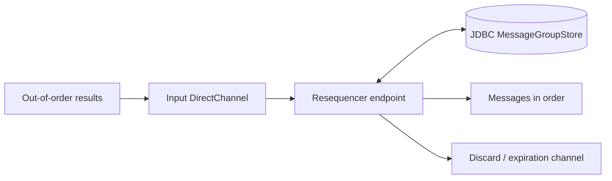

# Resequencer persistence

## Lesson Objectives

In the **Message store** chapter of **SPRING_INTEGRATION_CORE**, this lesson focuses on persisting the state of a resequencer: an endpoint that holds out-of-order messages and releases them in sequence order. Learners will connect the concepts of `Message`, `MessageChannel`, endpoints, and Java DSL to a real requirement: an application restarts and still continues the sequence currently being processed.

After this lesson, you will be able to:

- Identify what data must survive a restart, including released sequence progress.
- Configure `JdbcMessageStore` for a resequencer using Java DSL.
- Distinguish releasing a contiguous segment from handling an expired group.
- Design transactions, error handling, and recovery tests suited to an integration flow.

The examples use **Spring Integration 6.5.x** APIs, aligned with the 6.5.10 documentation and source code. This is an illustrative baseline so class and method names remain consistent; actual library versions must follow your application's BOM or dependency management.

## 1. Why Does a Resequencer Need Persistence?

Suppose a shipment processing run produces four result parts, numbered `1` to `4`. Workers run in parallel, so results may arrive in this order:

```text
Arrival order:   3, 1, 4, 2
Required order:  1, 2, 3, 4
Correlation:     shipment:SHP-42:run-7
```

The resequencer groups messages by correlation key and decides when they can be released. With the default strategy, ordering metadata resides in the `CORRELATION_ID`, `SEQUENCE_NUMBER`, and `SEQUENCE_SIZE` headers. The output remains individual messages rather than a single combined message like an aggregator. See [Resequencer](https://docs.spring.io/spring-integration/reference/6.5/resequencer.html).

If the endpoint holds part `3` in memory and the JVM stops, that part does not automatically reappear in the next run. An upstream broker may have already acknowledged delivery of part `3`, so you cannot blindly rely on the broker resending it.

Persistence places the buffer and group state in storage that outlives the process. When the new application instance receives the missing part, the resequencer has the basis to resume processing the old group.



The diagram has two output paths because the problem also covers late-arriving parts, incomplete groups, and communication errors. Writing messages to a database solves only part of recovery.

## 2. What State Must Be Persisted?

Storing payloads alone is not enough. Look at a group from the perspective of a newly started process:

| Component | Meaning When Resuming Processing |
| --- | --- |
| Correlation key | Matches a new part to the right previous run |
| Pending messages | Holds parts already received but not yet released |
| Sequence headers | Knows position and sequence size |
| Last released sequence number | Knows which part is needed next |
| Group completion flag | Distinguishes an open group from a closed group |
| Created and updated timestamps | Supports expiration policies and group cleanup |

For example, before the application stops:

```text
Released:                1
Remaining in group:      3
Last released sequence:  1
Next part needed:        2
```

If after restart part `3` is still present while progress becomes `0`, the endpoint could wait for part `1` even though part `1` was already forwarded downstream. Therefore, release progress is business state of the resequencer.

In the partial-release branch, `ResequencingMessageHandler` updates progress via `setLastReleasedSequenceNumberForGroup(...)` and removes released messages from the group. When reading the group, `JdbcMessageStore` restores this value from metadata. See [ResequencingMessageHandler](https://github.com/spring-projects/spring-integration/blob/v6.5.10/spring-integration-core/src/main/java/org/springframework/integration/aggregator/ResequencingMessageHandler.java) and [JdbcMessageStore](https://github.com/spring-projects/spring-integration/blob/v6.5.10/spring-integration-jdbc/src/main/java/org/springframework/integration/jdbc/store/JdbcMessageStore.java).

From these mechanics, a design requirement follows: a custom store for a resequencer must implement the full `MessageGroupStore` contract, including metadata and group-update operations, rather than only message save/read operations.

### Scope of the Correlation Key

The key must remain stable across restarts and distinct across processing runs:

```text
shipment:SHP-42:run-7
shipment:SHP-42:run-8
```

Two runs may belong to the same shipment yet not the same sequence. If both share one key, part `2` of the new run could collide with state from the old run.

Similarly, generating a random correlation key every time a part arrives prevents parts from ever meeting. Carry the run identifier from the source or derive it using a recoverable rule.

## 3. Two Release Modes and Their Impact on State

### 3.1. Waiting for the Entire Sequence

With `releasePartialSequences(false)`, a group with expected size `4` waits until the entire valid sequence arrives. Assuming non-duplicate inputs and consistent headers:

| Arriving Message | Held Parts | Released |
| --- | --- | --- |
| 3 | 3 | Not released yet |
| 1 | 1, 3 | Not released yet |
| 4 | 1, 3, 4 | Not released yet |
| 2 | Full 1, 2, 3, 4 | 1, 2, 3, 4 |

This mode suits cases where the consumer should only start once all results have been gathered. In return, a single missing part can hold back the entire group.

### 3.2. Releasing Contiguous Segments Immediately

With `releasePartialSequences(true)`, the resequencer can emit contiguous segments starting right after the last released position:

| Arriving Message | Released in This Turn | Still Waiting | Released Progress |
| --- | --- | --- | --- |
| 3 | Not released yet | 3 | 0 |
| 1 | 1 | 3 | 1 |
| 4 | Not released yet | 3, 4 | 1 |
| 2 | 2, 3, 4 | No waiting messages left | 4 |

The deciding factor is contiguity. Having parts `3` and `4` is not enough to jump past missing part `2`. The default logic combines `SequenceSizeReleaseStrategy` to inspect the starting point and `ResequencingMessageGroupProcessor` to extract the releasable segment. See [release strategy](https://github.com/spring-projects/spring-integration/blob/v6.5.10/spring-integration-core/src/main/java/org/springframework/integration/aggregator/SequenceSizeReleaseStrategy.java) and [group processor](https://github.com/spring-projects/spring-integration/blob/v6.5.10/spring-integration-core/src/main/java/org/springframework/integration/aggregator/ResequencingMessageGroupProcessor.java).

After a partial release, the group may contain zero messages yet still hold essential progress. Never infer `group.size() == 0` means the group can be deleted immediately.

### 3.3. Partial Sequence Release Differs from Expiry Release

Two options answer two different moments in time:

| Option | Question It Answers |
| --- | --- |
| `releasePartialSequences` | During normal flow execution, release contiguous segments immediately? |
| `sendPartialResultOnExpiry` | When the group is forced to end, attempt to send whatever result can still be produced? |

Enabling partial sequence release does not automatically permit emitting incomplete results on timeout. In this lesson's example, enable the first option and disable the second to observe the two behaviors separately.

Also do not arbitrarily replace the release strategy with `group -> group.size() >= 2`: part count does not prove a contiguous sequence. With 6.5.x APIs, enabling partial sequences also requires a strategy compatible with `SequenceSizeReleaseStrategy`. Correlation and release settings are on [CorrelationHandlerSpec](https://github.com/spring-projects/spring-integration/blob/v6.5.10/spring-integration-core/src/main/java/org/springframework/integration/dsl/CorrelationHandlerSpec.java).

## 4. Normalizing Messages Before Storing

A simple input contract might require:

- Correlation key is non-empty and stays constant for one processing run.
- `SEQUENCE_NUMBER` is an integer starting from `1`.
- `SEQUENCE_SIZE` is a positive integer, consistent across the group.
- Sequence number does not exceed sequence size.
- Each position represents the same business part if resent.

The helper below creates sample data with a `String` payload, avoiding process-dependent objects inside the message:

```java
import org.springframework.integration.IntegrationMessageHeaderAccessor;
import org.springframework.messaging.Message;
import org.springframework.messaging.support.MessageBuilder;

public final class LessonMessages {

    private LessonMessages() {
    }

    public static Message<String> part(String correlationKey,
                                       int number,
                                       int size) {
        if (correlationKey == null || correlationKey.isBlank()) {
            throw new IllegalArgumentException("Correlation key is required");
        }
        if (size < 1 || number < 1 || number > size) {
            throw new IllegalArgumentException("Invalid sequence");
        }

        return MessageBuilder.withPayload("part-" + number)
                .setHeader(
                        IntegrationMessageHeaderAccessor.CORRELATION_ID,
                        correlationKey)
                .setHeader(
                        IntegrationMessageHeaderAccessor.SEQUENCE_NUMBER,
                        number)
                .setHeader(
                        IntegrationMessageHeaderAccessor.SEQUENCE_SIZE,
                        size)
                .build();
    }
}
```

In an application, a transformer can map source data to a DTO; a filter validates invariants; a router sends invalid messages to a separate handling channel before entering the resequencer. This is a flow-organization suggestion for the example, not something the resequencer performs automatically on your behalf.

If a filter drops part `2` while the remaining parts still declare `SEQUENCE_SIZE = 4`, the group will have a real gap. Do not mechanically rewrite the size to `3`: redefine the ordering contract or mark the run failed.

## 5. Choosing a JDBC Store and Preparing the Database

A resequencer requires a `MessageGroupStore`. In the JDBC example, use `JdbcMessageStore` to store groups. `JdbcChannelMessageStore` is meant for persistent message channels and does not directly substitute for this endpoint's store. Using JDBC on an upstream `QueueChannel` also does not automatically make the resequencer's internal buffer persistent. See [JDBC Message Store](https://docs.spring.io/spring-integration/reference/6.5/jdbc/message-store.html).

The standalone example below assumes the application already has:

| Component | Purpose |
| --- | --- |
| `spring-integration-core` | Endpoints, channels, and Java DSL |
| `spring-integration-jdbc` | JDBC message store |
| `DataSource` and JDBC driver | Persistent database connectivity |
| Spring JDBC and transaction support | Schema initialization, transaction management |
| JUnit Jupiter, H2 in test environment | Running context-reopening scenarios |

Versions must align under the application's dependency management. The example does not assume the repository uses a specific Spring Boot version.

### Schema Must Exist Before the Endpoint Runs

In the `spring-integration-jdbc` JAR, sample scripts are located at:

```text
org/springframework/integration/jdbc/schema-h2.sql
org/springframework/integration/jdbc/schema-postgresql.sql
```

Use the script matching your database and library version to create the initial schema; manage changes via migrations in operational environments. Do not run table drop/create scripts on every application startup.

With the default prefix, JDBC group-related tables include `INT_MESSAGE`, `INT_MESSAGE_GROUP`, and `INT_GROUP_TO_MESSAGE`. You can inspect metadata with a read-only query:

```sql
SELECT GROUP_KEY,
       REGION,
       COMPLETE,
       LAST_RELEASED_SEQUENCE,
       CREATED_DATE,
       UPDATED_DATE
FROM INT_MESSAGE_GROUP
WHERE REGION = 'si-core.resequencer.shipment.v1';
```

`GROUP_KEY` in the store may be a transformed value rather than the verbatim business correlation key. Use the store's API to look up by application key; do not manually update internal tables to “push” a group forward.

### Keeping the Storage Namespace Stable

After a restart, the application must point to the exact same database, schema, table prefix, and `region` as before. Changing any of those values can leave old state intact in the database while the new flow cannot see it.

In the example, `region` is fixed by functional role rather than by pod name. Unrelated endpoints should have separate storage regions to avoid mixing groups that share correlation keys.

## 6. Java DSL Configuration with Persistence and Transactions

The following configuration targets **a single application instance**. Two output `QueueChannel` beans make results easy to observe in the lab; they store messages in memory. The persisted scope in the example is the resequencer's groups.

```java
import java.time.Duration;

import javax.sql.DataSource;

import org.springframework.context.annotation.Bean;
import org.springframework.context.annotation.Configuration;
import org.springframework.integration.channel.DirectChannel;
import org.springframework.integration.channel.QueueChannel;
import org.springframework.integration.config.EnableIntegration;
import org.springframework.integration.dsl.IntegrationFlow;
import org.springframework.integration.jdbc.store.JdbcMessageStore;
import org.springframework.integration.transaction.TransactionInterceptorBuilder;
import org.springframework.jdbc.datasource.DataSourceTransactionManager;
import org.springframework.transaction.PlatformTransactionManager;
import org.springframework.transaction.interceptor.TransactionInterceptor;

@Configuration
@EnableIntegration
public class PersistentResequencerConfig {

    @Bean
    public PlatformTransactionManager resequencerTransactionManager(
            DataSource dataSource) {
        return new DataSourceTransactionManager(dataSource);
    }

    @Bean
    public JdbcMessageStore resequencerStore(DataSource dataSource) {
        JdbcMessageStore store = new JdbcMessageStore(dataSource);
        store.setRegion("si-core.resequencer.shipment.v1");
        store.setTimeoutOnIdle(true);
        return store;
    }

    @Bean
    public DirectChannel resequenceInput() {
        return new DirectChannel();
    }

    @Bean
    public QueueChannel orderedOutput() {
        return new QueueChannel();
    }

    @Bean
    public QueueChannel resequenceDiscard() {
        return new QueueChannel();
    }

    @Bean
    public TransactionInterceptor expiryTransactionAdvice(
            PlatformTransactionManager resequencerTransactionManager) {
        return new TransactionInterceptorBuilder()
                .transactionManager(resequencerTransactionManager)
                .build();
    }

    @Bean
    public IntegrationFlow persistentResequencerFlow(
            JdbcMessageStore resequencerStore,
            PlatformTransactionManager resequencerTransactionManager,
            TransactionInterceptor expiryTransactionAdvice) {

        return IntegrationFlow.from("resequenceInput")
                .resequence(r -> r
                                .messageStore(resequencerStore)
                                .releasePartialSequences(true)
                                .groupTimeout(60_000L)
                                .sendPartialResultOnExpiry(false)
                                .expireGroupsUponTimeout(false)
                                .discardChannel("resequenceDiscard")
                                .expireTimeout(300_000L)
                                .expireDuration(Duration.ofSeconds(30))
                                .forceReleaseAdvice(expiryTransactionAdvice),
                        e -> e.transactional(
                                resequencerTransactionManager))
                .channel("orderedOutput")
                .get();
    }
}
```

This shows how to attach a store to the endpoint using Java DSL lambdas; corresponding DSL patterns are described at [Aggregators and Resequencers](https://docs.spring.io/spring-integration/reference/6.5/dsl/java-aggregators.html). The endpoint's `transactional(...)` method adds transaction advice to the handler; see [ConsumerEndpointSpec](https://github.com/spring-projects/spring-integration/blob/v6.5.10/spring-integration-core/src/main/java/org/springframework/integration/dsl/ConsumerEndpointSpec.java).

The parameters serve distinct roles:

| Configuration | Role in the Example |
| --- | --- |
| `messageStore(...)` | Replaces the default buffer with the JDBC group store |
| `releasePartialSequences(true)` | Allows releasing contiguous segments during normal processing |
| `groupTimeout(60_000L)` | Sets the wait time for a task to end a waiting group |
| `sendPartialResultOnExpiry(false)` | Selects the discard path if the group expires without meeting release conditions |
| `expireGroupsUponTimeout(false)` | Retains closed group metadata after the corresponding timeout path |
| `expireTimeout(300_000L)` | Threshold for reviewing old groups still in the store |
| `expireDuration(...)` | Interval for executing the review scan |
| `forceReleaseAdvice(...)` | Dedicated transaction for force-completion operations |

The values of one minute, five minutes, and thirty seconds only illustrate the mechanisms. In deployment, choose them based on valid source latency and incomplete-sequence handling policies.

`setTimeoutOnIdle(true)` makes store-sweep expiration rely on the most recent update timestamp when set. By default, the store sweep relies on age since group creation. This is a store setting, distinct from scheduling `groupTimeout` when messages are processed. See [AbstractMessageGroupStore](https://github.com/spring-projects/spring-integration/blob/v6.5.10/spring-integration-core/src/main/java/org/springframework/integration/store/AbstractMessageGroupStore.java).

## 7. Testing Sequence Continuation After Reopening the Context

A test using two stores within the same context does not prove the endpoint's restart path. The scenario below closes the first context, creates a second context over the same file-based H2 database, and then sends the missing part.

Place `LessonMessages` and `PersistentResequencerConfig` from the previous examples in the same package as the test. The test requires JUnit Jupiter and H2 on the test classpath.

```java
import java.nio.file.Path;

import javax.sql.DataSource;

import org.junit.jupiter.api.Test;
import org.junit.jupiter.api.io.TempDir;

import org.springframework.context.annotation.AnnotationConfigApplicationContext;
import org.springframework.core.io.ClassPathResource;
import org.springframework.integration.channel.DirectChannel;
import org.springframework.integration.channel.QueueChannel;
import org.springframework.integration.jdbc.store.JdbcMessageStore;
import org.springframework.integration.store.MessageGroup;
import org.springframework.jdbc.datasource.DriverManagerDataSource;
import org.springframework.jdbc.datasource.init.ResourceDatabasePopulator;
import org.springframework.messaging.Message;

import static org.junit.jupiter.api.Assertions.*;

class PersistentResequencerRestartTest {

    @TempDir
    Path databaseDirectory;

    @Test
    void continuesWithPersistedBufferAndProgress() {
        String databasePath = databaseDirectory
                .resolve("resequence-db")
                .toAbsolutePath()
                .toString()
                .replace('\\', '/');

        DataSource dataSource = new DriverManagerDataSource(
                "jdbc:h2:file:" + databasePath, "sa", "");

        // Create schema only once for the test's fresh database.
        new ResourceDatabasePopulator(new ClassPathResource(
                "org/springframework/integration/jdbc/schema-h2.sql"))
                .execute(dataSource);

        String key = "shipment:SHP-42:run-7";

        try (var first = openContext(dataSource)) {
            DirectChannel input =
                    first.getBean("resequenceInput", DirectChannel.class);
            QueueChannel output =
                    first.getBean("orderedOutput", QueueChannel.class);
            JdbcMessageStore store =
                    first.getBean(JdbcMessageStore.class);

            assertTrue(input.send(LessonMessages.part(key, 1, 4)));
            assertEquals("part-1", takePayload(output));

            assertTrue(input.send(LessonMessages.part(key, 3, 4)));
            assertNull(output.receive(0));

            MessageGroup group = store.getMessageGroup(key);
            assertEquals(1, group.size());
            assertEquals(1,
                    group.getLastReleasedMessageSequenceNumber());
        }

        try (var second = openContext(dataSource)) {
            DirectChannel input =
                    second.getBean("resequenceInput", DirectChannel.class);
            QueueChannel output =
                    second.getBean("orderedOutput", QueueChannel.class);
            JdbcMessageStore store =
                    second.getBean(JdbcMessageStore.class);

            // Confirm state is present before sending a new part.
            MessageGroup restored = store.getMessageGroup(key);
            assertEquals(1, restored.size());
            assertEquals(1,
                    restored.getLastReleasedMessageSequenceNumber());

            assertTrue(input.send(LessonMessages.part(key, 2, 4)));
            assertEquals("part-2", takePayload(output));
            assertEquals("part-3", takePayload(output));

            assertTrue(input.send(LessonMessages.part(key, 4, 4)));
            assertEquals("part-4", takePayload(output));
            assertNull(output.receive(0));
        }
    }

    private static AnnotationConfigApplicationContext openContext(
            DataSource dataSource) {
        var context = new AnnotationConfigApplicationContext();
        context.registerBean("dataSource", DataSource.class,
                () -> dataSource);
        context.register(PersistentResequencerConfig.class);
        context.refresh();
        return context;
    }

    private static Object takePayload(QueueChannel output) {
        Message<?> message = output.receive(1_000);
        assertNotNull(message, "Expected a resequenced message");
        return message.getPayload();
    }
}
```

The test verifies two things simultaneously: part `3` remains in the store and progress `1` is restored. After receiving part `2`, the endpoint emits `2, 3` without needing to receive part `1` again.

This is an application-context-level restart test with an orderly shutdown. It does not simulate a process killed mid-transaction, database connection loss, or a consumer causing a side effect and then failing. Those scenarios require dedicated, targeted integration tests.

## 8. Which Parts of the Flow Does the Transaction Protect?

Operations to store the group, update progress, and delete released parts need appropriate transaction boundaries. A handler can run synchronously on a `DirectChannel` inside the current transaction; when crossing to another thread, that boundary must be re-evaluated. The [Transaction Support](https://docs.spring.io/spring-integration/reference/6.5/transactions.html) documentation explains how transactions bind to execution flows.

In the configuration above:

1. The endpoint's transaction protects JDBC operations during a normal message-processing turn.
2. `forceReleaseAdvice` protects the force-completion turn invoked from the timeout schedule or sweep mechanism.
3. The output `QueueChannel` remains an in-memory resource and does not participate in JDBC rollback.

That third point is vital when reading test results. If part `2` is placed onto the queue and the database then rolls back, the consumer may have already seen part `2` while the store stays in its prior state. Conversely, after the database commits and before the consumer reads the queue, a JVM crash can lose the part sitting in the queue.

### Analyzing Failure Windows

The table below is a design deduction from the example, not a default delivery guarantee of the framework:

| Failure Point | What Must Be Examined |
| --- | --- |
| Before committing a new part to the store | Will the source resend that part? |
| After committing the buffer, before receiving the missing part | Does the store survive restarts and still point to the right region? |
| After emitting some parts, before committing progress | Does the consumer handle duplicates safely? |
| After committing progress while output sits in RAM | Is there a persistent delivery path downstream? |
| After consumer executes side effect and throws an error | Is there an idempotency key or business transaction? |

Therefore, resequencer persistence does not imply end-to-end `exactly-once` processing. When the delivery boundary must be protected, design a persistent output or an outbox in the same database combined with a consumer that can safely receive redeliveries.

A business identifier such as `eventId` is usually more useful for idempotency than relying solely on the technical ID of a new `Message` generated on retry. Define clearly which side effect corresponds to a given `eventId` and where deduplication state is stored.

### Input Acknowledgement Is Also a Boundary

A successful `send(...)` only carries the semantics of the current execution path. With a broker, acknowledgement timing must coordinate with durable storage; with an in-memory queue ahead of the resequencer, parts not yet received by the endpoint can still be lost if the JVM stops.

Recovery design should map both the input acknowledgement point and the output commit point. This is how gaps between components are uncovered, rather than merely checking that the database contains a row.

## 9. Restarts, Timeouts, and Abandoned Groups

### 9.1. Having Data Does Not Mean a Waiting Task Exists

A group store saves group data; a scheduled task in the JVM is separate state. After a restart, do not assume every old `groupTimeout` schedule is restored from the database.

A group may still hold part `3` yet never receive part `2`. In that case, a mechanism to scan old groups independently of new message arrivals is required.

In 6.5.x, configuring `expireTimeout` together with `expireDuration` enables the endpoint to process old groups at startup and periodically. That is why the example uses both per-group timeout and orphan-group scanning. See [Managing Expired Groups](https://docs.spring.io/spring-integration/reference/6.5/aggregator.html) and [AbstractCorrelatingMessageHandler](https://github.com/spring-projects/spring-integration/blob/v6.5.10/spring-integration-core/src/main/java/org/springframework/integration/aggregator/AbstractCorrelatingMessageHandler.java).

Actual execution timing also depends on scan intervals, scheduler load, and lock durations. Do not interpret `expireTimeout = 300_000` as a guarantee that a task always runs at millisecond `300_000`.

### 9.2. Expiration Does Not Fabricate Missing Parts

In the example, when an incomplete group is forced to end and is not allowed by the release strategy to emit, remaining messages follow the discard policy because `sendPartialResultOnExpiry(false)` is set.

The discard path needs a consumer and a way to record enough data for investigation or recovery. The illustrative in-memory queue is not a persistent failure store. You can replace it with a database-writing flow or appropriate forwarding infrastructure, and test errors directly along that path.

If business rules allow emitting incomplete results, specify precisely how the consumer interprets missing positions. Do not treat enabling `sendPartialResultOnExpiry(true)` as a way to reconstruct lost parts.

### 9.3. Closed Groups and Late-Arriving Messages

The `expireGroupsUponTimeout(false)` flag preserves metadata of a group closed after timeout so late-arriving parts can be rejected. If all traces are deleted, the same correlation key can open a new group. This behavior is described in [Resequencer Timeout Configuration](https://docs.spring.io/spring-integration/reference/6.5/resequencer.html).

From this arise two separate business decisions:

- How long to keep traces to identify late-arriving parts?
- When a rerun is genuinely desired, use a new run key or restore the old run through a controlled process?

Do not assume every group after a normal release retains the exact same kind of trace. Full-sequence completion and partial-release paths may clean up state differently; test the exact mode in use. Also ensure group-cleanup tasks do not delete progress for sequences still permitted to continue.

## 10. Multiple Instances: Shared Database Requires Coordinated Locks

A shared database lets instances see the same data. It does not turn the entire sequence of reading the group, adding a part, evaluating release, and updating progress into a single atomic operation.

`DefaultLockRegistry` uses local locks. When multiple instances process the same correlation key against a shared store, an appropriate coordination mechanism is needed; `JdbcLockRegistry` is an option Spring Integration provides for this case. See [JDBC Lock Registry](https://docs.spring.io/spring-integration/reference/6.5/jdbc/lock-registry.html).

Example bean additions:

```java
import javax.sql.DataSource;

import org.springframework.context.annotation.Bean;
import org.springframework.integration.jdbc.lock.DefaultLockRepository;
import org.springframework.integration.jdbc.lock.JdbcLockRegistry;

// Place these beans in the application's @Configuration class.
@Bean
public DefaultLockRepository resequencerLockRepository(
        DataSource dataSource) {
    DefaultLockRepository repository =
            new DefaultLockRepository(dataSource);
    repository.setRegion("si-core-resequence-locks");
    return repository;
}

@Bean
public JdbcLockRegistry resequencerLockRegistry(
        DefaultLockRepository resequencerLockRepository) {
    return new JdbcLockRegistry(resequencerLockRepository);
}
```

Then pass the registry into the flow-building method and add `.lockRegistry(resequencerLockRegistry)` inside the resequencer's `r -> ...` lambda.

Instances coordinating on the same group must use the same lock namespace; each process needs a distinct owner identity. The lock schema must be created before use. Lock TTL and renewal mechanisms must align with actual processing durations.

Coordinated locks do not replace transactions or idempotency. If the step after the resequencer hands messages to a parallel executor, the order of starting or completing side effects can still differ from the release order. If business rules require ordered processing per shipment, preserve that rule in downstream consumers as well.

## 11. Serialization, Gateways, and Errors

### 11.1. Payloads Must Be Readable Again After Restart

The default JDBC store relies on serialization; payloads must be compatible, while non-serializable headers may be dropped before saving. Do not put connections, streams, or objects tied to an open request into messages meant to persist long-term. See [Message Store and Serialization](https://docs.spring.io/spring-integration/reference/6.5/message-store.html).

For business DTOs, test reading data created by the previous application version. Changing class names, data types, or serializer rules may only fail when reading an old group, even though new groups still work.

The example uses `String` to focus on resequencer mechanics. It does not replace designing a long-term data format for a multi-version deployment.

### 11.2. Do Not Extend Request Lifetimes with Persistence

A synchronous gateway may create a temporary reply channel tied to the current call. A JVM restart loses the waiting call; saving messages cannot resurrect that caller.

When sequence wait time can exceed a request's lifetime, a suitable design for the example is returning a processing identifier and then notifying results asynchronously or exposing status queries. Specifying a stable output channel as in the configuration avoids relying on temporary reply paths.

`HeaderChannelRegistry` helps map channel headers in some serialization scenarios, but it must not be mistaken for reviving a finished thread or HTTP request.

### 11.3. Distinguishing Discard from Exceptions

`discardChannel` handles messages dropped by group policy. Exceptions can originate from JDBC, serializers, or consumers, and require the flow's corresponding error-handling mechanism.

For example, with `DirectChannel`, exceptions can propagate back to the caller of `send(...)`. With background tasks, monitor errors on the configured scheduler or poller. Do not assume every error automatically turns into a message on the discard channel.

Retries must also preserve the same correlation key and business identifier. Creating a new sequence on every retry can hide storage errors by scattering parts across multiple groups.

## 12. Test Scenarios and Observability to Have

Beyond the context-reopening test above, add scenarios aligned with the real contract:

| Scenario | What Must Be Checked |
| --- | --- |
| All received but out of order | Output follows sequence numbers within each group |
| Two correlation keys interleaved | Parts do not mix between the two groups |
| Restart before first release | Pending messages remain intact |
| Restart after a partial release | Both buffer and progress are restored |
| No new parts after restart | Sweep mechanism eventually handles the old group |
| One part arrives twice | Duplicate-position and idempotency behavior match contract |
| Timeout followed by missing part arriving | Discard path and trace retention behave properly |
| Consumer fails after receiving one part | Do not assume rollback revokes side effects |
| Database outage | No premature acknowledgement and no bogus progress advance |
| Two instances receive same group | Coordinated locks protect group operations |
| Application upgrade while groups wait | Old data remains deserializable |

Useful metrics for the shipment example include waiting group count, buffered message count, oldest group age, expiration count, discarded message count, and latency from arrival to release.

Logs should contain the correlation key, sequence number, and business identifier so parts can be traced across restarts. Avoid logging entire payloads if unnecessary for investigation.

Distinguish retained message count from group record count: an empty group can still hold progress or group-closure markers. Tracking only total message count misses continuously growing metadata.

For performance, measure parts per group and gap dispersion. A resequencer fits relatively short sequences with small gaps; very large groups or heavily missing positions require separate architectural and sorting/query-cost evaluation.

## 13. Common Design Mistakes

| Practice | Consequence in This Lesson's Scenario | Direction to Adjust |
| --- | --- | --- |
| Using an in-memory database to prove process restart | Data can be lost with the JVM | Use an out-of-process database or file-based H2 when testing |
| Re-initializing schema on the second run | Wipes the state to be tested | Create schema once, preserve data between runs |
| Attaching store to a queue while skipping the resequencer | Waiting groups may still live in RAM | Attach `MessageGroupStore` directly to the endpoint |
| Varying region by pod | New instance cannot see old groups | Use a stable functional namespace |
| Deleting every group with size 0 | Can lose progress or trace markers | Clean up according to lifecycle and retention policy |
| Reusing the same key for a different run | Mixes parts or hits old state | Add a run identifier |
| Checking order only at the output channel | Parallel consumers can still finish out of order | Check business side effects as well |
| Assuming persistence eliminates all duplicate messages | Retries can duplicate side effects | Design idempotency where side effects occur |

When deploying a persistent resequencer, specify four points explicitly: **where state is stored, when progress is committed, how abandoned groups are handled, and whether the consumer safely handles redelivery**. These decisions bind the message store to the entire integration flow and yield a testable recovery scenario.
