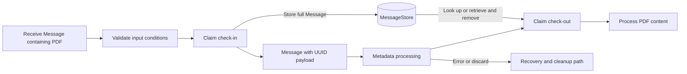

# Claim check pattern

## 1. Purpose and Context

In the **Message store** chapter of the **SPRING_INTEGRATION_CORE** module, Claim Check helps design a flow segment that only needs metadata yet would otherwise carry a large payload. The full message is stored in a repository; the flow continues with a reference key and retrieves the data when reaching a step that needs to process the content.

After this lesson, you will be able to:

- Identify where check-in and check-out belong in an `IntegrationFlow`.
- Distinguish the claim check token, `MessageHeaders.ID`, and business identifiers.
- Configure it with Java DSL, choose a `MessageStore`, and select a removal policy.
- Design error paths, retries, and data cleanup when a message never reaches check-out.
- Write tests for payload, headers, and data lifecycle inside the store.

The Java examples use Java 17 and Spring Integration 6.5.0 APIs as an illustrative baseline. Real projects should manage dependency versions via their active BOM. This lesson focuses on core mechanics; brokers, object storage, and transactions are discussed where they directly impact flow correctness.

## 2. The Problem: Multiple Steps Only Need Information on the Envelope

Suppose a document-ingestion service receives a `Message<byte[]>` containing a 12 MiB PDF document. Its headers include:

| Business Header | Example Value | Purpose |
| --- | --- | --- |
| `documentId` | `DOC-2026-001` | Tracks one document in business logic |
| `tenantId` | `tenant-a` | Identifies the owning tenant |
| `department` | `FINANCE` | Selects the processing route |
| `documentType` | `PDF` | Selects the acceptance policy |
| `traceId` | `trace-001` | Correlates logs across steps |

Steps that determine routing, assign priority, and check tenant permissions may only need headers. Only the content-extraction step needs to read the byte array.

With Claim Check, the metadata-processing segment looks like:

```text
Message<byte[]> → check-in → Message<UUID> → metadata processing
                → check-out → Message<byte[]> → read PDF content
```

The idea of storing data in a store and passing a retrieval token is supported by Spring Integration via two transformers: incoming and outgoing claim check. [Claim Check Documentation](https://docs.spring.io/spring-integration/reference/claim-check.html).

In this example, the expected benefit lies in segments involving queues, serialization, logging, or crossing to another process. If all endpoints are connected via `DirectChannel` and simply pass the same object reference, measure before adding a store: traversing a channel does not implicitly create an extra copy of the PDF.

## 3. What Does Check-In Actually Store and Return?

Let the input message be `M0`:

```text
M0.payload       = document byte[]
M0.headers.id    = U0
M0.documentId    = DOC-2026-001
```

In the implementation aligned with Spring Integration 6.5.0, `ClaimCheckInTransformer` takes `U0` from the ID header, calls `store.addMessage(M0)`, and returns `U0` as the new payload. The store receives the **entire Message**, including both payload and headers. The claim ID is not a separate UUID generated specifically for the store operation. [ClaimCheckInTransformer 6.5.0 source code](https://raw.githubusercontent.com/spring-projects/spring-integration/v6.5.0/spring-integration-core/src/main/java/org/springframework/integration/transformer/ClaimCheckInTransformer.java).

After check-in, call the message traveling through the flow `M1`:

| Component | Role |
| --- | --- |
| `M0.headers.id = U0` | Lookup key for the data placed in the store |
| `M1.payload = U0` | Claim check that check-out expects to receive |
| `M1.headers.id` | ID of the traveling message; do not use instead of the claim payload |
| `documentId` | Business key, which can persist across multiple resends |
| `claimCheckId` if added by app | Copy of the claim ID in a header for reconciliation or cleanup |

A common mistake is passing `M1.headers.id` to the store instead of `M1.payload`. Treat the UUID payload as the contract for the flow segment between the two transformers.

If a retry constructs a new Message from the same business data, that message may receive a different ID. Therefore `documentId` remains necessary for deduplication or finding a record after a failure; the claim ID cannot replace a stable business key.

### Headers Remain Part of the Reference Message

Check-in does not automatically strip sensitive headers. If headers hold large data or personal information, shrinking the payload alone does not solve that issue.

In the metadata segment, keep short, well-typed values: strings, numbers, tenant IDs, and trace IDs. Avoid stuffing PDFs, large object graphs, or secrets into headers. Fields used for routing decisions must exist before check-in or be enriched from an appropriate metadata source.

## 4. Check-Out: Restoring Content and Merging Headers

`ClaimCheckOutTransformer` requires the payload to be a `UUID` object. It calls `getMessage(id)` when retaining data, or `removeMessage(id)` when removal is enabled. Not finding the message causes a transformation error. After retrieving the data, the transformer uses the stored message as a base and copies current headers on top; current business headers take precedence on name collisions. [ClaimCheckOutTransformer 6.5.0 source code](https://raw.githubusercontent.com/spring-projects/spring-integration/v6.5.0/spring-integration-core/src/main/java/org/springframework/integration/transformer/ClaimCheckOutTransformer.java).

Design example:

```text
At check-in:
  payload      = PDF
  department   = FINANCE
  documentId   = DOC-2026-001

Right before check-out:
  payload      = U0
  department   = AUDIT
  routingStage = REVIEWED

After check-out:
  payload      = saved PDF
  department   = AUDIT
  documentId   = DOC-2026-001
  routingStage = REVIEWED
```

This precedence is useful when the flow updates routing metadata. For `tenantId` or authorization metadata, control which endpoints are allowed to mutate headers to avoid trusting metadata supplied by untrusted sources.

Also distinguish “header absent” from “header intentionally removed.” Because check-out reconstructs the message from the stored copy, an old header can reappear if it was only removed from the reference message. When a header must be stripped from output, place a `headerFilter` after check-out or normalize the entire header set at the ingestion boundary.

Do not write tests assuming every technical header, ID, and timestamp remains identical after the transformation cycle. What matters is business content and the header policy declared by the application.

## 5. Boundary of Responsibilities in a Flow



Component roles:

| Spring Integration Component | Responsibility in the Design |
| --- | --- |
| `Message` | Carries payload and metadata of one step |
| `MessageChannel` | Connects endpoints; additionally determines synchronous, asynchronous, or buffered behavior |
| Check-in endpoint | Converts from full data to reference |
| Router, filter, header enricher | Processes the metadata segment under the chosen contract |
| Check-out endpoint | Converts back from reference to full data |
| `MessageStore` | Stores and serves messages by claim ID |
| Gateway | Exposes an interface to invoke the flow; timeout must fit the processing lifecycle |

Placing deterministic rejection checks before check-in reduces orphaned records. If a filter must run after check-in, the discard branch must know who owns ending the record's lifecycle.

A router in the metadata segment should read headers or the reference ID. A transformer expecting `byte[]` will fail if placed in the segment carrying a `UUID`.

## 6. Complete In-Memory Java DSL Example

### 6.1. Dependencies and Runtime Assumptions

The example requires:

- `org.springframework.integration:spring-integration-core`.
- JUnit Jupiter and AssertJ when running the test code in a later section.
- Spring Context with compatible dependency versions.

In a Spring Boot application, core dependencies can come from `spring-boot-starter-integration`. No separate Java DSL module is needed for this example.

The configuration below has an ingestion channel and a `QueueChannel` holding results for verification. Steps from input to check-out execute synchronously. The queue at the end serves only as a result receiver in this practice lesson.

### 6.2. Configuration

```java
package example.claimcheck;

import org.springframework.context.annotation.Bean;
import org.springframework.context.annotation.Configuration;
import org.springframework.integration.channel.DirectChannel;
import org.springframework.integration.channel.QueueChannel;
import org.springframework.integration.config.EnableIntegration;
import org.springframework.integration.dsl.IntegrationFlow;
import org.springframework.integration.store.MessageStore;
import org.springframework.integration.store.SimpleMessageStore;

@Configuration
@EnableIntegration
public class ClaimCheckFlowConfig {

    @Bean
    public MessageStore claimCheckStore() {
        return new SimpleMessageStore();
    }

    @Bean
    public DirectChannel documentsIn() {
        return new DirectChannel();
    }

    @Bean
    public QueueChannel processedDocuments() {
        return new QueueChannel(10);
    }

    @Bean
    public IntegrationFlow documentFlow(MessageStore claimCheckStore) {
        return IntegrationFlow.from("documentsIn")
                .<byte[]>filter(bytes -> bytes.length > 0)
                .claimCheckIn(claimCheckStore)
                .enrichHeaders(headers -> headers
                        .headerExpression("claimCheckId", "payload")
                        .header("processingStage", "METADATA_CHECKED"))
                .claimCheckOut(claimCheckStore, true)
                .channel("processedDocuments")
                .get();
    }
}
```

Java DSL offers `claimCheckIn(MessageStore)`, `claimCheckOut(MessageStore)`, and `claimCheckOut(MessageStore, boolean)` overloads; the check-out overload without a boolean keeps `removeMessage=false`. [Java DSL API 6.5.0](https://docs.spring.io/spring-integration/docs/6.5.0/api/org/springframework/integration/dsl/BaseIntegrationFlowDefinition.html).

The flow executes sequentially:

1. Reject empty byte arrays before creating data in the store.
2. Save the full message and replace the payload with its UUID.
3. Copy the UUID into `claimCheckId` while marking the metadata step.
4. Restore the payload and remove the stored copy.
5. Place the resulting message into `processedDocuments`.

`claimCheckId` and `processingStage` are custom headers defined by the example. The framework does not require these names.

The step setting `METADATA_CHECKED` only illustrates where header processing sits; an application should replace it with real validation or routing rules. Do not treat this label as meaning the document was business-approved.

### 6.3. Sending a Sample Message

The following snippet runs after a context has initialized the configuration above:

```java
byte[] pdf = new byte[] { 37, 80, 68, 70, 45 };

Message<byte[]> request = MessageBuilder.withPayload(pdf)
        .setHeader("documentId", "DOC-2026-001")
        .setHeader("tenantId", "tenant-a")
        .setHeader("department", "FINANCE")
        .build();

DirectChannel input =
        context.getBean("documentsIn", DirectChannel.class);
QueueChannel output =
        context.getBean("processedDocuments", QueueChannel.class);

input.send(request);
Message<?> result = output.receive(1_000);
```

Additional imports for the send snippet: `org.springframework.messaging.Message` and `org.springframework.messaging.support.MessageBuilder`. The `context` variable is a Spring application context containing `ClaimCheckFlowConfig`.

The five-byte array is simulated data, not a valid PDF file. The example checks payload preservation, not PDF format parsing.

For a valid input, the result should have the same payload bytes, `documentId` preserved, `processingStage` present, and `claimCheckId` holding the UUID. Because removal at check-out is enabled, looking up that UUID in the store will find no data left.

If an empty array is sent, the default filter drops the message so nothing appears on the output. With a request-reply contract, design a rejection reply or explicit error path so callers do not simply wait until timeout.

### 6.4. Limitations of the Minimal Example

`SimpleMessageStore` holds data in process memory, which is suitable for demonstration; it does not provide durability across restarts. [Message Store](https://docs.spring.io/spring-integration/reference/message-store.html).

The configuration also lacks throttling when the output queue fills up. When expanding into a service, define timeouts, maximum load, and how result-send errors are handled. Notably, data in the store is already removed at check-out before downstream endpoints finish their work.

## 7. Choosing Removal Timing by Business Lifecycle

The `removeMessage` option only controls check-out's action. Choose based on who still needs the data and where replay can occur.

| Option | Appropriate When | Additional Work the App Must Handle |
| --- | --- | --- |
| `false` | Re-reading, retrying from claim ID, or multiple branches reading is needed | Define completion milestone and cleanup |
| `true` | This read is the final retrieval by design | Accept or compensate for post-check-out failure risks |
| Keep on read, remove separately after success | Retries are needed without losing original data prematurely | Coordinate completion state, idempotency, and removal |

Not deleting after retrieval can cause the store to grow unboundedly, which is especially dangerous on the heap. The documentation refers to the retrieve-and-remove option as **Claim Once**, with the default value of `remove-message` being `false`. [Claim Once](https://docs.spring.io/spring-integration/reference/claim-check.html#claim-once).

### 7.1. Deleting on Read Does Not Guarantee Exactly-Once Processing

Consider the event sequence:

```text
1. Check-out retrieves and removes document U0.
2. Handler calls payment system or records result.
3. Handler encounters an error.
4. Replay mechanism resends claim ID U0.
5. Store no longer has the document.
```

Retrieval and removal occur before all business work succeeds. Therefore, you cannot deduce end-to-end exactly-once semantics from setting the flag to `true`.

If a JDBC transaction spans both the removal and business data updates in the same resource, rollback can help restore state. However, an external HTTP call or an independent broker does not automatically join that transaction just because the flow has a `MessageStore`.

When business flows require replay by claim ID, keep data at check-out and delete it after a durably recorded completion milestone. When the business operation succeeded yet cleanup failed, retries must recognize the already-processed document to avoid duplicate side effects.

### 7.2. Multiple Branches Reading the Same Claim

Suppose two branches, audit and extraction, both receive `U0`. If one branch deletes the data upon reading, the other branch may fail.

The design needs one of these approaches:

- Both branches read only; one coordinator deletes after all required branches finish.
- Restore the data before branching, if payload transfer cost is acceptable.
- Maintain a reader counter or per-branch completion state managed by the application.

Do not rely on an execution order commonly observed on a developer machine to guarantee which branch reads first. If exclusivity across multiple consumers is needed, evaluate transactions and concurrency properties of the specific store.

## 8. Using JDBC When Persistence Is Required

To swap the store in the example, add `org.springframework.integration:spring-integration-jdbc` and the database driver. **Replace** the existing `claimCheckStore` bean with the following bean; do not declare two beans with the same name simultaneously.

```java
import javax.sql.DataSource;

import org.springframework.context.annotation.Bean;
import org.springframework.integration.jdbc.store.JdbcMessageStore;
import org.springframework.integration.store.MessageStore;

@Bean
public MessageStore claimCheckStore(DataSource dataSource) {
    JdbcMessageStore store = new JdbcMessageStore(dataSource);
    store.setRegion("document-claim-check");
    return store;
}
```

This bean assumes a `DataSource` and schema compatible with your library version already exist. Spring Integration provides `schema-*.sql` scripts in the JDBC module; `JdbcMessageStore` serves claim checks, whereas `JdbcChannelMessageStore` is specifically designed for message channels. [JDBC Message Store](https://docs.spring.io/spring-integration/reference/jdbc/message-store.html).

`setRegion` partitions the store's logical storage space. Instances that need to read the same claim IDs must agree on region, schema, and database. It does not replace database access-control mechanisms. [JdbcMessageStore API](https://docs.spring.io/spring-integration/api/org/springframework/integration/jdbc/store/JdbcMessageStore.html).

### 8.1. Only Serializable Data Truly Crosses the Storage Boundary

A persistent store introduces a serialization boundary. With default JDBC, payloads must work with Java serialization; some non-serializable headers will be dropped. The documentation also notes that object-valued `replyChannel` and `errorChannel` headers require attention when saving or restoring messages. [Message Store Serialization Limits](https://docs.spring.io/spring-integration/reference/message-store.html).

Decisions to clarify for the document example:

- Use `byte[]` or a stable document representation instead of an open `InputStream`.
- Do not store JDBC connections, HTTP requests, or processing beans inside payloads.
- Define how old data is read when deploying a new model version.
- Specify which headers truly need persistence and which are reconstructed after reading.
- If using a custom serializer, test both the stored message and the application reading it.

A flow running with `SimpleMessageStore` does not prove payloads serialize into JDBC. Testing with a real store must include restarting or opening a fresh reader context.

### 8.2. Persistence Alone Does Not Make the Whole Flow Durable

After check-in writes to the database, the UUID must still reach the next processor. If the process stops between those two steps, data can exist in the store with no remaining job holding the claim ID.

Conversely, if the receiver observes the ID before the data-saving transaction commits, check-out may report missing data.

When delivery guarantees are required, design commit ordering, replay paths, and reconciliation mechanisms. One option is writing the data and an outbox record in the same database transaction, then publishing the reference from the outbox. This is an application-level design addition, not automatic behavior of the transformer.

## 9. Passing Claim IDs Across Brokers or Other Services

Two instances each having a bean named `claimCheckStore` does not mean they share data. If each instance uses its own `SimpleMessageStore`, a consumer receiving a UUID from another instance still will not find the payload.

To pass references across process boundaries, agree on:

| Item to Align | Example Decision |
| --- | --- |
| Data store | Same database, schema, and region |
| Claim ID representation | `UUID` internally, UUID string on the wire |
| Propagated headers | `documentId`, `tenantId`, necessary routing metadata |
| Data retention period | Longer than allowed queuing and replay duration |
| Access control | Consumer may only retrieve documents within granted scope |
| Backward-read compatibility | Compatible serializers and models |

### Converting a String Back to UUID

If an adapter receives the ID as a string, convert the type intentionally before check-out:

```java
.<String, java.util.UUID>transform(java.util.UUID::fromString)
.claimCheckOut(claimCheckStore, false)
```

This snippet is inserted into an `IntegrationFlow` receiving a `String`. It is inappropriate when the actual payload is already a UUID or still a JSON envelope; parse the envelope and verify the contract first.

A UUID-formatted claim ID does not mean the caller is authorized to fetch the data. If exposed in a public API, the access layer must verify user, tenant, and document ownership.

### When Documents Are Too Large for MessageStore

Consider a dedicated design: payloads live in object storage while messages carry the key, checksum, and metadata. This still applies the Claim Check idea, though the built-in transformers do not natively understand object keys or URLs.

A custom design requires storage/retrieval endpoints, integrity verification, and corresponding cleanup. Do not pass a URL string into `ClaimCheckOutTransformer` expecting it to download a file; this transformer's contract is `UUID` and `MessageStore`.

## 10. Error Handling by Failure Location

| Failure Location | Consequence to Consider | Handling Direction |
| --- | --- | --- |
| Store write fails | No valid claim exists yet to proceed | Halt flow, retry appropriate infrastructure errors |
| Stored in store but UUID forwarding fails | Orphaned records may remain | Replay or reconcile incomplete jobs |
| Filter drops after check-in | Data remains without reaching check-out | Use a discard flow with a cleanup policy |
| Check-out receives wrong payload type | Violates segment contract | Normalize type, fix mapping; avoid infinite retries |
| UUID not found | Wrong store, already deleted, expired, or lost data | Classify root cause before deciding to replay |
| Handler fails after check-out with removal | Replay via UUID no longer has data | Re-examine removal timing or recovery source |
| Cleanup fails after business success | Data continues consuming space | Retry cleanup separately without repeating business work |

Missing messages in the store should not be replaced with an empty payload just to “keep the flow running.” That turns a storage incident into corrupted business data and erases the root cause.

### 10.1. Synchronous and Asynchronous Flows Have Different Error Paths

In the example's `DirectChannel` flow, errors can propagate back to the caller through the call stack. With asynchronous tasks or pollers, the framework routes an `ErrorMessage` to the appropriate error channel. Do not assume every synchronous error automatically lands in the `errorChannel` bean. [Error Handling](https://docs.spring.io/spring-integration/reference/error-handling.html).

Therefore, when testing:

- Synchronous flow: check the exception received by the send call or gateway.
- Asynchronous flow: check the error flow and recovery work after the error is published.
- Broker: additionally check acknowledgement, redelivery, and dead-letter behavior of the actual adapter.

An `ErrorMessage` does not automatically delete or restore claim data. The error handler must still decide whether to retain, retry, move to manual review, or terminate the record.

### 10.2. Where Retries Start Determines What Data Must Be Kept

If retries wrap only the handler after check-out, retry attempts can reuse the already-restored message without hitting the store again. If a broker redelivers the UUID to the entire flow segment, check-out will run again.

These two retry scopes require different data-retention policies. When reviewing configuration, map retry placement relative to check-out rather than looking only at attempt counts.

Do not log the entire payload in error logs for debugging convenience. Prefer fields useful for reconciliation: `documentId`, claim UUID, endpoint, error category, and attempt count; control tenant information per system policy.

## 11. Cleanup, Retention, and Operational Observability

### 11.1. Assigning Ownership for Ending a Record's Lifecycle

You can use an application-managed state model:

```text
STORED → REFERENCE_SENT → PROCESSING → SUCCEEDED → DELETED
                            │
                            └→ RETRY_PENDING or MANUAL_REVIEW
```

These are application-designed states, not built-in states inside `MessageStore`. They help answer why a document remains in the store and whether it is eligible for deletion.

Example rules:

- `SUCCEEDED`: eligible for deletion after the required retention window.
- `RETRY_PENDING`: retain data for remaining permitted attempts.
- `MANUAL_REVIEW`: delete only upon case-resolution decision.
- `STORED` for too long without a dispatched reference: requires reconciliation or replay.

Choose TTL based on job lifetime, not only normal processing time. If a broker can redeliver after one day while data is deleted after one hour, the system creates unusable claim IDs on its own.

The base `MessageStore` provides add, get, and remove operations by UUID; message counting is an optional capability depending on implementation. It does not define a uniform TTL mechanism across all backends. [MessageStore API](https://docs.spring.io/spring-integration/api/org/springframework/integration/store/MessageStore.html).

Data cleanup mechanisms should be based on the specific backend and business state. Do not blindly apply aggregator message-group expiration rules to standalone messages stored via claim check.

### 11.2. Monitoring Both Data and References

Useful metrics:

| Category | What to Observe | Question Answered |
| --- | --- | --- |
| Capacity | Record count, total bytes, growth rate | Is the store accumulating? |
| Lifecycle | Age of incomplete jobs | Are any records stuck? |
| Performance | Check-in and check-out latency | Is the store slowing down the flow? |
| Correctness | Claim-not-found counts | Is data deleted too early or routed to the wrong store? |
| Recovery | Retries, failed cleanups, manual-review backlog | Is the recovery path working? |

Measuring record age usually requires metadata or a separate tracking table. Do not assume every implementation provides an API listing all messages with expiration timestamps.

### 11.3. Estimating Capacity Before Choosing a Store

A design estimate is:

```text
Concurrent stored messages ≈ check-in rate × average retention time

Payload volume ≈ concurrent stored messages × average size
```

Suppose the application receives 200 messages/second, retains them for 30 seconds on average, and each payload is 2 MiB:

```text
Message count ≈ 200 × 30 = 6,000
Payload ≈ 6,000 × 2 MiB = 12,000 MiB ≈ 11.72 GiB
```

This figure excludes headers, indexes, serialization overhead, and data held for retries. If retention increases due to slow downstream services, capacity grows accordingly.

With `SimpleMessageStore`, shrinking messages in channels does not mean heap has been freed: payloads still sit in the store. With JDBC, costs shift to the database, network, and serialization; measure end-to-end before concluding the system is faster.

## 12. Testing Core Behavior

The following tests use JUnit Jupiter, AssertJ, and the configuration from section 6. They illustrate contracts to verify; this lesson does not ship a separate build project.

```java
package example.claimcheck;

import java.util.UUID;

import org.junit.jupiter.api.Test;

import org.springframework.context.annotation.AnnotationConfigApplicationContext;
import org.springframework.integration.channel.DirectChannel;
import org.springframework.integration.channel.QueueChannel;
import org.springframework.integration.store.SimpleMessageStore;
import org.springframework.integration.store.MessageStore;
import org.springframework.integration.transformer.ClaimCheckInTransformer;
import org.springframework.integration.transformer.ClaimCheckOutTransformer;
import org.springframework.integration.transformer.MessageTransformationException;
import org.springframework.messaging.Message;
import org.springframework.messaging.support.MessageBuilder;

import static org.assertj.core.api.Assertions.assertThat;
import static org.assertj.core.api.Assertions.assertThatThrownBy;

class ClaimCheckFlowTest {

    @Test
    void flowRestoresPayloadAndRemovesStoredMessage() {
        try (var context = new AnnotationConfigApplicationContext(
                ClaimCheckFlowConfig.class)) {

            var input = context.getBean(
                    "documentsIn", DirectChannel.class);
            var output = context.getBean(
                    "processedDocuments", QueueChannel.class);
            var store = context.getBean(
                    "claimCheckStore", MessageStore.class);

            byte[] pdf = { 37, 80, 68, 70, 45 };
            Message<byte[]> request = MessageBuilder.withPayload(pdf)
                    .setHeader("documentId", "DOC-2026-001")
                    .build();

            assertThat(input.send(request)).isTrue();

            Message<?> result = output.receive(1_000);
            assertThat(result).isNotNull();
            assertThat(result.getPayload()).isInstanceOf(byte[].class);
            assertThat((byte[]) result.getPayload()).containsExactly(pdf);
            assertThat(result.getHeaders().get("documentId"))
                    .isEqualTo("DOC-2026-001");
            assertThat(result.getHeaders().get("processingStage"))
                    .isEqualTo("METADATA_CHECKED");

            UUID claimId = result.getHeaders().get(
                    "claimCheckId", UUID.class);
            assertThat(claimId).isEqualTo(request.getHeaders().getId());
            assertThat(store.getMessage(claimId)).isNull();
        }
    }

    @Test
    void defaultCheckoutKeepsDataAndCurrentBusinessHeaderWins() {
        var store = new SimpleMessageStore();
        var checkIn = new ClaimCheckInTransformer(store);
        var checkOut = new ClaimCheckOutTransformer(store);

        Message<String> original = MessageBuilder.withPayload("PDF-CONTENT")
                .setHeader("department", "FINANCE")
                .build();

        Message<?> reference = checkIn.transform(original);
        assertThat(reference.getPayload())
                .isEqualTo(original.getHeaders().getId());
        UUID claimId = (UUID) reference.getPayload();

        Message<?> routedReference = MessageBuilder.fromMessage(reference)
                .setHeader("department", "AUDIT")
                .build();

        Message<?> firstRead = checkOut.transform(routedReference);
        Message<?> secondRead = checkOut.transform(routedReference);

        assertThat(firstRead.getPayload()).isEqualTo("PDF-CONTENT");
        assertThat(secondRead.getPayload()).isEqualTo("PDF-CONTENT");
        assertThat(firstRead.getHeaders().get("department"))
                .isEqualTo("AUDIT");
        assertThat(store.getMessage(claimId)).isNotNull();
    }

    @Test
    void removingCheckoutMakesReplayOfTheSameClaimFail() {
        var store = new SimpleMessageStore();
        var checkIn = new ClaimCheckInTransformer(store);
        var checkOut = new ClaimCheckOutTransformer(store);
        checkOut.setRemoveMessage(true);

        Message<?> reference = checkIn.transform(
                MessageBuilder.withPayload("PDF-CONTENT").build());
        UUID claimId = (UUID) reference.getPayload();

        assertThat(checkOut.transform(reference).getPayload())
                .isEqualTo("PDF-CONTENT");
        assertThat(store.getMessage(claimId)).isNull();

        assertThatThrownBy(() -> checkOut.transform(reference))
                .isInstanceOf(MessageTransformationException.class);
    }

    @Test
    void unknownClaimAndStringPayloadAreRejected() {
        var store = new SimpleMessageStore();
        var checkOut = new ClaimCheckOutTransformer(store);

        Message<UUID> unknown = MessageBuilder
                .withPayload(UUID.randomUUID())
                .build();
        Message<String> wrongType = MessageBuilder
                .withPayload(UUID.randomUUID().toString())
                .build();

        assertThatThrownBy(() -> checkOut.transform(unknown))
                .isInstanceOf(MessageTransformationException.class);
        assertThatThrownBy(() -> checkOut.transform(wrongType))
                .isInstanceOf(MessageTransformationException.class);
    }
}
```

The tests assert the outer `MessageTransformationException` at the transformer boundary. This pattern of checking missing claims also appears in the official test suite. [ClaimCheckTransformerTests 6.5.0](https://raw.githubusercontent.com/spring-projects/spring-integration/v6.5.0/spring-integration-core/src/test/java/org/springframework/integration/transformer/ClaimCheckTransformerTests.java).

Four tests protect distinct behaviors:

1. The DSL flow restores the payload and propagates headers.
2. Default check-out allows re-reading while prioritizing current business headers.
3. Enabling removal invalidates the claim ID after the first retrieval.
4. Both unstored UUIDs and unconverted strings are rejected.

When switching to JDBC, add dedicated integration tests: write with a first context, close the context, open a second context pointing to the same database/region, and read back. Also test failures after check-out inside the intended transaction boundary, rather than proving only that save and read succeed.

## 13. Common Design Mistakes

| Misconception | Consequence | Adjustment |
| --- | --- | --- |
| Claim check automatically reduces all memory | Heap still grows when an in-memory store holds payloads | Measure actual retained volume and choose an appropriate backend |
| The traveling UUID is always the current ID header | Looks up the wrong key | Maintain the UUID payload contract |
| Having the same bean name means sharing the store | Consumers on another instance cannot fetch data | Use a shared backend and shared namespace |
| `removeMessage=true` guarantees exactly-once | Business errors after check-out cannot be replayed | Design deletion milestones, idempotency, and transactions |
| A post-check-in filter simply drops messages | Records can linger indefinitely | Wire the discard flow to cleanup |
| Any header removed from the reference disappears permanently | Old headers can return upon restoration | Filter or normalize after check-out |
| Simply retry all missing-UUID errors | Permanent errors create infinite loops | Distinguish wrong store, expired, deleted, and transient errors |
| Store has a universal TTL across all implementations | Data is not cleaned up as expected | Choose and test a concrete expiration mechanism |
| In-memory tests sufficiently represent JDBC | Serialization and restart bugs are missed | Test against a real persistent backend |

## 14. Applying to the Document Flow

A good practice sequence is keeping the in-memory example intact, then changing one factor intentionally at a time:

1. Send a message with `documentId` and confirm the claim payload is the message's ID at check-in.
2. Add a step updating a business header between check-in and check-out; observe headers after restoration.
3. Switch check-out to `false`, read the same UUID twice, and then delete intentionally to see cleanup responsibility.
4. Add a filter after check-in and a discard branch; specify clearly whether that branch retains or removes data.
5. Replace the store with JDBC, preserve the UUID contract, and test across two application context lifecycles.
6. Simulate a downstream error after check-out; decide whether application retries start from the claim ID or the restored payload.

A complete design must answer three questions: where data lives while only the UUID travels through the flow, who still needs to read that data, and which event authorizes deletion. When those three answers are clear, Java DSL is simply how you express the chosen boundaries.
