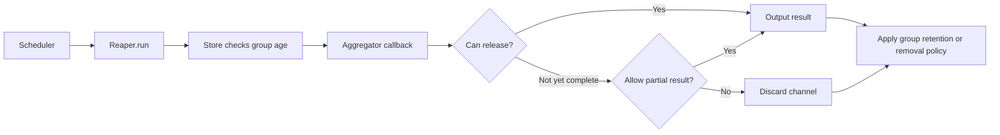

# Message expiration

Message expiration is the policy that decides when a message or a group of messages has waited too long and must transition to another handling path. In the **Message store** chapter of Spring Integration Core, this topic connects directly to the state of aggregators and resequencers, freeing data, and how late-arriving messages are treated.

A complete expiration policy must answer four questions: which object expires, what point in time is used as the origin, which component detects it, and where the outcome is routed. Merely declaring a timeout number is not enough to answer all four questions.

After this lesson, you will be able to design expiration deadlines for message groups, configure `MessageGroupStoreReaper` in Java, distinguish expiration from gateway timeouts, and build an expired-message handling path in an integration flow.

## 1. Identifying What Actually Expires

In a messaging flow, several time concepts coexist:

| Concept | Affected Target | Question to Answer |
| --- | --- | --- |
| Business deadline | A request or a message | At this point in time, is business processing still permitted? |
| Group expiration | A `MessageGroup` in the store | Has the group waited too long to continue collecting data? |
| Completed group retention time | Empty group metadata | How long must the correlation key be remembered to detect late-arriving messages? |
| Channel send or receive timeout | A `send` or `receive` call | At most how long can the calling thread wait for this operation? |
| Gateway reply timeout | Caller waiting for a reply | At most how long does the caller wait for the result? |
| Broker or storage TTL | Message/key/record per that system's mechanism | When does the storage component delete or move the data? |

For example, a gateway timing out after 5 seconds does not mean the group held by an aggregator will be deleted after 5 seconds. The group still needs its own policy. Similarly, the timeout of a `QueueChannel.receive(...)` call only limits the receive wait time for that single call.

The message store provides a place to hold state for components that buffer messages. An aggregator holds groups in a store; a queue holds messages until a consumer receives them. Therefore, choose an expiration mechanism matching the component using the store. The [Message Store documentation](https://docs.spring.io/spring-integration/reference/message-store.html) describes this storage role and distinguishes stores serving channels from stores used for message groups.

**There is no general rule that every message entering Spring Integration automatically expires after a TTL.** If an application adds a custom header such as `expiresAt`, a filter, handler, or adapter must be configured to enforce that header.

## 2. The Problem: An Order Missing One Piece of Data

Suppose an order requires three pieces of data from integration branches:

- Inventory check result.
- Payment verification result.
- Shipping option check result.

Each message carries an `orderId` header. The aggregator uses this header to group the three parts together. In the example, messages have already been validated and deduplicated ahead of the aggregator.

Operational rules chosen for this lab:

| Scenario | Policy |
| --- | --- |
| All three parts arrive | Emit one aggregated result to `completedOrders` |
| Still incomplete after 30 seconds from group creation | Route already-received messages to `expiredOrders` |
| Group is completed or expired | Retain empty group metadata to block late-arriving messages |
| Metadata is at least 5 minutes old based on the group's update timestamp | Allow the group cleanup mechanism to delete metadata |
| Technical error occurs in the group cleanup task | Route error to `expirationErrors` |

The 30-second and 5-minute intervals serve different purposes. The first limits waiting for data. The second keeps a trace of the correlation key after the outcome has been decided.

In a real system, the “all three parts” condition should check for three distinct result types. The `group.size() == 3` condition below only illustrates expiration on already-deduplicated inputs; it does not replace checking the identity of each branch.

## 3. Choosing the Reference Timestamp: Group Age or Idle Time

### 3.1. Expiration by Group Age

For stores extending `AbstractMessageGroupStore`, `timeoutOnIdle` defaults to `false`: expiration checks use the group's creation timestamp. When `setTimeoutOnIdle(true)` is enabled, checks switch to the group's last modification timestamp if available. This is a store configuration, not a uniform default applied across all storage products. [AbstractMessageGroupStore Javadoc](https://docs.spring.io/spring-integration/api/org/springframework/integration/store/AbstractMessageGroupStore.html#setTimeoutOnIdle(boolean)).

You can model the age eligibility condition as follows:

```text
reference time = group creation time                             // timeoutOnIdle = false
reference time = last modified time, if the store tracks it      // timeoutOnIdle = true

eligible for expiry when: now - reference time >= timeout
```

`MessageGroup.getTimestamp()` is the group's timestamp. It is not the business deadline of individual messages and does not replace event timestamps from source systems.

### 3.2. Two Policies Produce Different Outcomes

Suppose a group starts at second 0, another message arrives at second 20, and the timeout is 30 seconds:

| Policy | Roughly When Is the Group Eligible for Expiry? | Business Meaning |
| --- | --- | --- |
| By group age | Second 30 | Wait at most a fixed window from when collection began |
| By idle time | Second 50 | Wait an additional window after the last update |

If messages keep arriving every 20 seconds, an idle-time policy can keep extending the deadline. For an order requiring an overall hard deadline, consider an explicit deadline or a group-age limit.

This is a business choice: a sensor reporting in batches may suit an idle window; a booking request that must finish within a committed SLA usually requires an absolute deadline.

### 3.3. When Using `groupTimeout`

The aggregator also has a `.groupTimeout(30_000L)` mechanism. With a fixed value, the force-complete task is rescheduled whenever a new message arrives while the group has not yet released. This mechanism acts per group, unlike a reaper scanning the entire store. [Aggregator documentation, group timeout section](https://docs.spring.io/spring-integration/reference/aggregator.html).

The following Java DSL snippet is an **alternative approach** to the reaper in the main example:

```java
.aggregate(a -> a
    .correlationStrategy(m -> m.getHeaders().get("orderId"))
    .releaseStrategy(group -> group.size() == 3)
    .groupTimeout(30_000L)
    .sendPartialResultOnExpiry(false)
    .expireGroupsUponTimeout(false)
    .discardChannel("expiredOrders"))
```

With this approach, ensure the handler has an active scheduler. Do not blindly interpret it as “30 seconds from the first message.” If you need a deadline measured from group creation time, choose a group-age reaper or a timeout expression matching that requirement.

## 4. How Does the Reaper Detect Expiration?

`MessageGroupStore` has two important APIs:

```java
void registerMessageGroupExpiryCallback(MessageGroupCallback callback);

int expireMessageGroups(long timeout);
```

Calling `expireMessageGroups(timeout)` finds groups meeting the time threshold and invokes registered callbacks. The callback decides how to handle the group; scanning does not by itself define business behavior such as “delete,” “return partial result,” or “compensate.” The aggregator registers a callback to connect this process to the handler's group processing. [MessageGroupStore Javadoc](https://docs.spring.io/spring-integration/api/org/springframework/integration/store/MessageGroupStore.html).

`MessageGroupStoreReaper` is a `Runnable` wrapping that operation. Configuring `setTimeout(30_000L)` sets the threshold, while a scheduler must invoke `run()` on a schedule. Creating a reaper bean alone does not create a periodic schedule. The reaper's timeout value is in milliseconds. [MessageGroupStoreReaper Javadoc](https://docs.spring.io/spring-integration/api/org/springframework/integration/store/MessageGroupStoreReaper.html).



In the diagram, `discard` is the handling path for messages that no longer participate in the expected result. The application can still record them, emit an expiration event, or trigger investigation.

### Latency of the Sweep Task

Suppose a group becomes eligible at second 32, while the reaper runs at seconds 30, 35, and 40. The group is typically detected at second 35. With a sweep interval `R`, detection time can be estimated as:

```text
eligibility time <= detection time
detection time ≈ eligibility time + at most one scan interval
```

This estimate assumes the scheduler runs steadily and tasks are not backed up. If the database is slow, the scheduler lacks threads, the previous run took long, or the application pauses, latency can be higher. With `fixedDelay`, the pause is measured after the previous run finishes, so task execution duration also affects the interval between runs.

The reaper fits detecting and handling lingering groups. A deadline that must be enforced right before a business operation still needs to be checked where that operation executes.

## 5. Distinguishing Release, Complete, and Remove

When designing expiration, separate three events:

- **Release:** emit a result from the messages currently in the group.
- **Complete:** mark the group as having ended this collection cycle.
- **Full remove/expire:** delete both the group and its metadata from the store.

With an aggregator, a group may be complete and contain no messages while its metadata still exists. This metadata lets the handler recognize messages with the same correlation key as late-arriving. When the metadata is deleted, a new message with the same key can start a new group.

Options to specify explicitly in configuration:

| Property | Default | Main Effect |
| --- | --- | --- |
| `sendPartialResultOnExpiry` | `false` | When a group is forced to end and the release strategy still does not permit release, chooses emitting a partial result vs. discard |
| `expireGroupsUponCompletion` | `false` | Chooses completely removing the group after normal release |
| `expireGroupsUponTimeout` | `true` | Chooses completely removing the group on the timeout path |
| `minimumTimeoutForEmptyGroups` | Must be chosen per requirements | Sets the minimum retention interval from the update timestamp for empty groups before cleaning up metadata |

Defaults and semantics of completed groups are described in [AbstractCorrelatingMessageHandler Javadoc](https://docs.spring.io/spring-integration/docs/6.5.0/api/org/springframework/integration/aggregator/AbstractCorrelatingMessageHandler.html) and [AggregatingMessageHandler 6.5.0 source code](https://github.com/spring-projects/spring-integration/blob/v6.5.0/spring-integration-core/src/main/java/org/springframework/integration/aggregator/AggregatingMessageHandler.java).

One detail to note: when a timeout occurs, the handler still consults the release strategy again. If the strategy permits release at that moment, keeping/deleting the group may take the normal completion branch. Therefore, configure both expiration flags according to your desired policy rather than assuming every reaper run is a discard.

Metadata retention has a natural boundary: once metadata is cleaned up, the store no longer remembers that the key already finished. If the business rule is “each order may be completed only once,” add durable order state or a persistent idempotency mechanism.

## 6. Java DSL Configuration: Expiring After 30 Seconds of Group Age

The example below uses Spring Integration 6.5.x APIs and Java 17 or later. Java DSL resides in `org.springframework.integration:spring-integration-core`; tests use JUnit Jupiter. Dependency versions should be managed by the application's BOM.

`SimpleMessageStore` and the `QueueChannel` beans here store data in memory, which suits hands-on practice. In a deployment requiring recovery after restart, choose a store and expired-message destination with appropriate persistence.

### 6.1. Flow and Store

```java
import org.springframework.context.annotation.Bean;
import org.springframework.context.annotation.Configuration;
import org.springframework.integration.channel.DirectChannel;
import org.springframework.integration.channel.QueueChannel;
import org.springframework.integration.config.EnableIntegration;
import org.springframework.integration.dsl.IntegrationFlow;
import org.springframework.integration.store.MessageGroupStoreReaper;
import org.springframework.integration.store.SimpleMessageStore;

@Configuration
@EnableIntegration
public class OrderExpirationFlowConfig {

    @Bean
    public DirectChannel orderParts() {
        return new DirectChannel();
    }

    @Bean
    public QueueChannel completedOrders() {
        return new QueueChannel();
    }

    @Bean
    public QueueChannel expiredOrders() {
        return new QueueChannel();
    }

    @Bean
    public SimpleMessageStore orderStore() {
        SimpleMessageStore store = new SimpleMessageStore();
        store.setTimeoutOnIdle(false);
        return store;
    }

    @Bean
    public IntegrationFlow collectOrderParts(SimpleMessageStore orderStore) {
        return IntegrationFlow.from("orderParts")
            .aggregate(a -> a
                .messageStore(orderStore)
                .correlationStrategy(m -> m.getHeaders().get("orderId"))
                .releaseStrategy(group -> group.size() == 3)
                .sendPartialResultOnExpiry(false)
                .discardIndividuallyOnExpiry(true)
                .expireGroupsUponCompletion(false)
                .expireGroupsUponTimeout(false)
                .minimumTimeoutForEmptyGroups(300_000L)
                .discardChannel("expiredOrders"))
            .channel("completedOrders")
            .get();
    }

    @Bean
    public MessageGroupStoreReaper orderReaper(SimpleMessageStore orderStore) {
        MessageGroupStoreReaper reaper = new MessageGroupStoreReaper(orderStore);
        reaper.setTimeout(30_000L);
        reaper.setExpireOnDestroy(false);
        return reaper;
    }
}
```

Group configuration methods such as `messageStore`, `minimumTimeoutForEmptyGroups`, `expireGroupsUponTimeout`, and `discardIndividuallyOnExpiry` are in [CorrelationHandlerSpec 6.5.0 Javadoc](https://docs.spring.io/spring-integration/docs/6.5.0/api/org/springframework/integration/dsl/CorrelationHandlerSpec.html).

Points to read from the configuration:

- `orderId` is the business key used for grouping; producers must supply a valid value.
- `timeoutOnIdle(false)` selects group age, so a second arriving part does not extend the wait deadline.
- `sendPartialResultOnExpiry(false)` selects the discard path when fewer than three parts are present.
- `discardIndividuallyOnExpiry(true)` sends each original message to `expiredOrders`; consumers do not receive a single combined message for the expired group.
- Both `expireGroupsUpon...` flags are `false` to retain metadata after completion.
- `minimumTimeoutForEmptyGroups(300_000L)` gives empty groups a minimum retention window to detect late-arriving messages.

`setExpireOnDestroy(false)` only disables triggering expiry when the **reaper bean** is destroyed. Do not use this property to infer that all other endpoints lack their own lifecycle behavior when the application shuts down.

`expiredOrders` is an application-named channel. In the example, it is not yet a persistent dead-letter queue. A consumer or monitoring tool must receive messages from the queue; merely pushing into an unbounded in-memory queue without reading shifts the backlog into that queue.

### 6.2. Scheduler Running the Reaper and Publishing Errors

Separating the scheduler from the flow configuration helps test the expiration path without waiting 30 seconds.

```java
import org.springframework.beans.factory.annotation.Qualifier;
import org.springframework.context.annotation.Bean;
import org.springframework.context.annotation.Configuration;
import org.springframework.context.annotation.Import;
import org.springframework.integration.channel.MessagePublishingErrorHandler;
import org.springframework.integration.channel.QueueChannel;
import org.springframework.integration.store.MessageGroupStoreReaper;
import org.springframework.scheduling.annotation.EnableScheduling;
import org.springframework.scheduling.annotation.Scheduled;
import org.springframework.scheduling.concurrent.ThreadPoolTaskScheduler;

@Configuration
@EnableScheduling
@Import(OrderExpirationFlowConfig.class)
public class OrderExpirationSchedulingConfig {

    private final MessageGroupStoreReaper orderReaper;

    public OrderExpirationSchedulingConfig(MessageGroupStoreReaper orderReaper) {
        this.orderReaper = orderReaper;
    }

    @Bean
    public QueueChannel expirationErrors() {
        return new QueueChannel();
    }

    @Bean
    public ThreadPoolTaskScheduler expirationTaskScheduler(
            @Qualifier("expirationErrors") QueueChannel errorChannel) {
        MessagePublishingErrorHandler errorHandler =
            new MessagePublishingErrorHandler();
        errorHandler.setDefaultErrorChannel(errorChannel);

        ThreadPoolTaskScheduler scheduler = new ThreadPoolTaskScheduler();
        scheduler.setPoolSize(2);
        scheduler.setThreadNamePrefix("order-expiry-");
        scheduler.setErrorHandler(errorHandler);
        return scheduler;
    }

    @Scheduled(
        fixedDelay = 5_000L,
        initialDelay = 5_000L,
        scheduler = "expirationTaskScheduler"
    )
    public void sweepExpiredOrderGroups() {
        orderReaper.run();
    }
}
```

Load `OrderExpirationSchedulingConfig` when running the application. The flow remains responsible for group processing, while the `@Scheduled`-annotated method triggers sweeps. The scheduler bean's lifecycle is managed by Spring; there is no need to call `initialize()` manually in this example. `fixedDelay` semantics and scheduler selection are covered in [Task Execution and Scheduling documentation](https://docs.spring.io/spring-framework/reference/integration/scheduling.html).

`MessagePublishingErrorHandler` turns exceptions into an `ErrorMessage` sent over a message channel. The example picks `expirationErrors` as the default channel; the application must read this channel to log or handle errors. [MessagePublishingErrorHandler Javadoc](https://docs.spring.io/spring-integration/api/org/springframework/integration/channel/MessagePublishingErrorHandler.html).

Do not put the 30-second data wait deadline into `@Scheduled(fixedDelay = ...)` while ignoring `setTimeout`. The two numbers configure two distinct jobs: the group age threshold and the frequency of detecting eligible groups.
