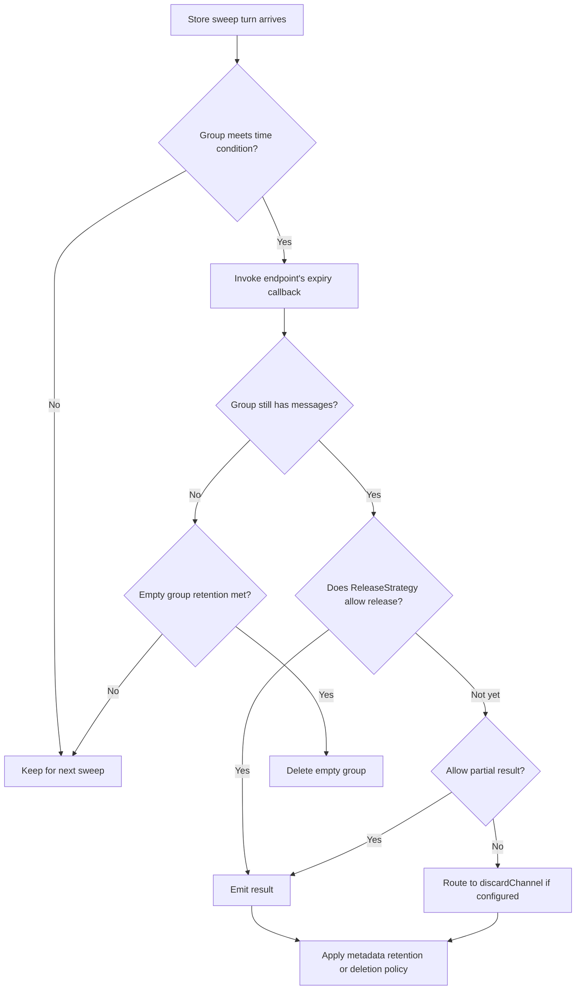

# Message store cleanup

In the **Message store** chapter of the `SPRING_INTEGRATION_CORE` module, cleanup is the process of ending the lifecycle of data retained by endpoints. A messaging flow using `Message`, `MessageChannel`, gateways, and aggregators must define when data is accepted, when results are emitted, and when stored state may be discarded.

This lesson focuses on the aggregator's `MessageGroupStore`: cleaning up incomplete groups, retaining and then deleting completed group metadata, and handling leftover groups in a persistent store after an application restarts. Java DSL examples use Spring Integration **6.5** as the API baseline; timing values are illustrative choices for the lesson.

## 1. Why Is a Cleanup Policy Needed?

Suppose a service aggregates three data parts of a batch. Each message carries a `batchId` header; the aggregator waits for all three parts before emitting one result.

In practice, any of the following can happen:

- Two parts arrive, while the third is lost or never sent by upstream.
- A batch finishes processing, yet upstream resends one part.
- The application stops after saving partial data, then restarts.
- Millions of new `batchId` values appear every day, causing metadata of old batches to accumulate.

The message store addresses the need of buffered components to hold data. With a persistent store, data can survive restarts; with an in-memory store, data consumes process resources. Choosing a storage backend does not by itself define a policy for terminating groups that never receive all parts. [Spring Integration — Message Store](https://docs.spring.io/spring-integration/reference/message-store.html).

A policy for the batch example might be:

| Scenario | Illustrative Business Policy |
| --- | --- |
| All three parts arrive | Emit result immediately |
| Incomplete after 30 seconds from group creation | Route existing data to the incomplete-batch handling branch |
| Late message arrives after batch closes | Route to the inspection branch during metadata retention |
| Metadata unchanged for at least 60 seconds | Allow removing the group's trace |
| Message arrives after metadata was deleted | Handle via business deduplication rules or treat as a new group |

The 30-second and 60-second thresholds serve two distinct goals. The first limits how long to wait for data; the second limits how long to keep a trace for recognizing late-arriving messages.

## 2. What Data Is Being Cleaned Up?

`MessageGroup` represents a set of messages sharing one correlation key. Beyond messages, a group has an identifier, completion status, and timestamps such as `timestamp` and `lastModified`. Therefore, “no payloads left in the group” and “no group left in the store” are two different states. [Javadoc — MessageGroup](https://docs.spring.io/spring-integration/docs/current/api/org/springframework/integration/store/MessageGroup.html).

Distinguish three operations:

| Operation | What Happens | Meaning for the Flow |
| --- | --- | --- |
| Release | Aggregator creates and sends the result | Ends collection step per release policy |
| Complete and keep empty group | Messages are removed from the group while completion metadata remains | Can recognize subsequent messages belonging to the closed group |
| Remove group | Deletes the group and related state per implementation | Store no longer retains a trace to recognize the old group |

On the aggregator, `expireGroupsUponCompletion(false)` keeps an empty group after normal release; `true` deletes the group entirely. This is a trade-off between metadata storage and the window for recognizing late-arriving messages. [AggregatingMessageHandler 6.5.0 source code](https://raw.githubusercontent.com/spring-projects/spring-integration/v6.5.0/spring-integration-core/src/main/java/org/springframework/integration/aggregator/AggregatingMessageHandler.java).

You can think of retained metadata as a “closed marker.” It helps over a finite window, but does not replace a business deduplication ledger for events that may be replayed days later.

## 3. Decision Flow When a Group Expires

`expireMessageGroups(timeout)` selects groups meeting the time criterion and invokes registered expiry callbacks. The callback decides how to handle the group. Thus, this method name is not synonymous with directly deleting all old data. [Javadoc — MessageGroupStore](https://docs.spring.io/spring-integration/docs/current/api/org/springframework/integration/store/MessageGroupStore.html).

With an aggregator, the callback goes through forced completion. High-level flow:



During forced completion, the release strategy is consulted again. If release is still not possible, configuration decides between emitting a partial result or discarding. Consequently, a cleanup sweep can emit additional messages on the output or discard branch. [AbstractCorrelatingMessageHandler 6.5.0 source code — forceComplete](https://raw.githubusercontent.com/spring-projects/spring-integration/v6.5.0/spring-integration-core/src/main/java/org/springframework/integration/aggregator/AbstractCorrelatingMessageHandler.java).

In business design, treat timeout as an event with an explicit outcome: the incomplete batch is saved for investigation, emitted as a provisional result, or canceled according to defined rules.

## 4. Distinguishing Group Age, Idle Time, and Scan Schedule

### 4.1. Group Age and Idle Time

With `AbstractMessageGroupStore`, default timeout calculation is based on group creation time. `setTimeoutOnIdle(true)` switches the criterion to `lastModified` when that timestamp is available. This is a setting on the store, not the aggregator's `groupTimeout` property. [AbstractMessageGroupStore 6.5.0 source code](https://raw.githubusercontent.com/spring-projects/spring-integration/v6.5.0/spring-integration-core/src/main/java/org/springframework/integration/store/AbstractMessageGroupStore.java).

Example setting a 30-second threshold:

| Event | Time |
| --- | --- |
| Group created from first message | 10:00:00 |
| Subsequent update arrives | 10:00:20 |
| Reaches 30 seconds age since creation | 10:00:30 |
| Reaches 30 seconds idle if no further updates | 10:00:50 |

If the requirement is “each batch may wait at most 30 seconds from opening,” choose group age. If the requirement is “wait until upstream has been silent for 30 seconds,” choose idle time.

The second option can keep a group alive long-term if data trickles in continuously. That is why business requirements should explicitly state when the clock starts.

### 4.2. Timeout and Scan Interval

`MessageGroupStoreReaper` is a `Runnable`. Declaring the bean does not create a schedule calling `run()`; there must be a scheduler or active caller. The reaper must be running per its lifecycle and configured with an appropriate timeout. [Javadoc — MessageGroupStoreReaper](https://docs.spring.io/spring-integration/docs/current/api/org/springframework/integration/store/MessageGroupStoreReaper.html).

Suppose:

- `T` is the 30-second age threshold.
- `P` is the 5-second pause between sweeps.
- One sweep takes negligible time compared to `P`.

Under light load, a group is typically examined roughly between `T` and `T + P`. This is a planning estimate, not a deadline guarantee. With `fixedDelay`, the gap between two start times also includes the previous run's duration. Lock contention, slow databases, or a busy scheduler all increase latency.

Setting a short timeout while scanning only once an hour will not meet a requirement to handle groups within tens of seconds.

## 5. Settings That Must Be Decided Together

Names in the Java DSL column are used when configuring the aggregator:

| Configuration | Question to Answer |
| --- | --- |
| `expireGroupsUponCompletion(boolean)` | After normal release, delete metadata immediately as well? |
| `expireGroupsUponTimeout(boolean)` | On forced completion due to timeout, delete the group completely? |
| `sendPartialResultOnExpiry(boolean)` | Should an incomplete group be emitted as a partial result? |
| `discardChannel(...)` | Where do rejected data items go? |
| `minimumTimeoutForEmptyGroups(long)` | At least how long must an empty group remain unchanged before deletion? |
| `groupTimeout(long)` | Is per-group scheduling needed after an interval with no new messages? |

These methods belong to `AggregatorSpec` or its parent class `CorrelationHandlerSpec`. Specifically, the DSL name is `minimumTimeoutForEmptyGroups`; the corresponding XML attribute is named `empty-group-min-timeout`. [Javadoc — AggregatorSpec](https://docs.spring.io/spring-integration/docs/current/api/org/springframework/integration/dsl/AggregatorSpec.html), [Javadoc — CorrelationHandlerSpec](https://docs.spring.io/spring-integration/docs/current/api/org/springframework/integration/dsl/CorrelationHandlerSpec.html).

In the API baseline used in this lesson:

- `expireGroupsUponCompletion` defaults to `false`.
- The aggregator's `expireGroupsUponTimeout` defaults to `true`.
- `sendPartialResultOnExpiry` defaults to `false`.

Explicitly specify key choices in your application configuration. Notably, forced completion can still perform a normal release if the release strategy changes its decision; when retaining groups after timeout, the completion policy must also be reviewed. Avoid treating the two expiry flags as two completely independent delete switches. [Spring Integration — Expiring Groups](https://docs.spring.io/spring-integration/reference/aggregator.html).

## 6. Java DSL Example: Cleaning Up Incomplete Batches and Retaining Metadata Temporarily

### 6.1. Assumptions of the Example

The application already has the `org.springframework.integration:spring-integration-core` dependency with an appropriately managed project version, along with standard Spring configuration. Load `MessageStoreCleanupConfig` into the application context.

Data rules:

- Payload is a string representing one data part.
- The `batchId` header is required to have a value.
- Each batch has exactly three valid and distinct messages before release.
- Checking duplicate data or missing headers happens in an upstream validation step.

The `group.size() == 3` condition only serves the example. It does not prove three distinct business parts were received if upstream can send duplicates.

The example uses `SimpleMessageStore` to observe mechanics in a single process. This is an in-memory implementation and does not provide data recovery after process loss. [Javadoc — SimpleMessageStore](https://docs.spring.io/spring-integration/docs/current/api/org/springframework/integration/store/SimpleMessageStore.html).

### 6.2. Complete Configuration

```java
import org.springframework.beans.factory.BeanFactory;
import org.springframework.beans.factory.annotation.Qualifier;
import org.springframework.context.annotation.Bean;
import org.springframework.context.annotation.Configuration;
import org.springframework.integration.channel.DirectChannel;
import org.springframework.integration.channel.MessagePublishingErrorHandler;
import org.springframework.integration.channel.QueueChannel;
import org.springframework.integration.config.EnableIntegration;
import org.springframework.integration.dsl.IntegrationFlow;
import org.springframework.integration.store.MessageGroupStoreReaper;
import org.springframework.integration.store.SimpleMessageStore;
import org.springframework.scheduling.annotation.EnableScheduling;
import org.springframework.scheduling.annotation.Scheduled;
import org.springframework.scheduling.concurrent.ThreadPoolTaskScheduler;

@Configuration
@EnableIntegration
@EnableScheduling
public class MessageStoreCleanupConfig {

    @Bean
    public SimpleMessageStore batchStore() {
        SimpleMessageStore store = new SimpleMessageStore();
        store.setTimeoutOnIdle(false);
        return store;
    }

    @Bean
    public DirectChannel batchesInput() {
        return new DirectChannel();
    }

    @Bean
    public QueueChannel batchesOutput() {
        return new QueueChannel(100);
    }

    @Bean
    public QueueChannel batchesDiscard() {
        return new QueueChannel(100);
    }

    @Bean
    public ThreadPoolTaskScheduler taskScheduler(BeanFactory beanFactory) {
        MessagePublishingErrorHandler errorHandler =
                new MessagePublishingErrorHandler();
        errorHandler.setBeanFactory(beanFactory);

        ThreadPoolTaskScheduler scheduler = new ThreadPoolTaskScheduler();
        scheduler.setPoolSize(2);
        scheduler.setThreadNamePrefix("batch-cleanup-");
        scheduler.setErrorHandler(errorHandler);
        return scheduler;
    }

    @Bean
    public IntegrationFlow batchesFlow(
            DirectChannel batchesInput,
            SimpleMessageStore batchStore,
            @Qualifier("batchesOutput") QueueChannel batchesOutput,
            @Qualifier("batchesDiscard") QueueChannel batchesDiscard) {

        return IntegrationFlow.from(batchesInput)
                .aggregate(aggregator -> aggregator
                        .messageStore(batchStore)
                        .correlationExpression("headers['batchId']")
                        .releaseStrategy(group -> group.size() == 3)
                        .expireGroupsUponCompletion(false)
                        .expireGroupsUponTimeout(false)
                        .sendPartialResultOnExpiry(false)
                        .discardIndividuallyOnExpiry(true)
                        .discardChannel(batchesDiscard)
                        .minimumTimeoutForEmptyGroups(60_000)
                        .sendTimeout(1_000))
                .channel(batchesOutput)
                .get();
    }

    @Bean
    public MessageGroupStoreReaper batchReaper(
            SimpleMessageStore batchStore) {

        MessageGroupStoreReaper reaper =
                new MessageGroupStoreReaper(batchStore);
        reaper.setTimeout(30_000);
        reaper.setExpireOnDestroy(false);
        return reaper;
    }

    @Bean
    public CleanupJob cleanupJob(MessageGroupStoreReaper batchReaper) {
        return new CleanupJob(batchReaper);
    }

    public static final class CleanupJob {

        private final MessageGroupStoreReaper reaper;

        public CleanupJob(MessageGroupStoreReaper reaper) {
            this.reaper = reaper;
        }

        @Scheduled(initialDelay = 5_000, fixedDelay = 5_000)
        public void cleanup() {
            this.reaper.run();
        }
    }
}
```

Both output queues are capped at 100 elements for observation in a learning environment. For longer runs, active consumers must read regularly. `sendTimeout(1_000)` limits how long the handler waits to send when a queue is full; at that point sending can fail and must be handled as a delivery error.

`discardIndividuallyOnExpiry(true)` specifies sending each rejected message individually to the discard channel. This API exists since 6.5; if you want to receive the entire group in a single message, look at the `false` option and adjust the consumer accordingly. [CorrelationHandlerSpec 6.5.0 source code](https://raw.githubusercontent.com/spring-projects/spring-integration/v6.5.0/spring-integration-core/src/main/java/org/springframework/integration/dsl/CorrelationHandlerSpec.java).

### 6.3. Observing Normal Release and Late-Arriving Messages

The snippet below is placed in code that already has `context` as a running application context with the configuration class above loaded:

```java
import java.util.List;

import org.springframework.integration.channel.QueueChannel;
import org.springframework.messaging.Message;
import org.springframework.messaging.MessageChannel;
import org.springframework.messaging.support.MessageBuilder;

// context is the running application context.
MessageChannel input = context.getBean(
        "batchesInput", MessageChannel.class);
QueueChannel output = context.getBean(
        "batchesOutput", QueueChannel.class);
QueueChannel discard = context.getBean(
        "batchesDiscard", QueueChannel.class);

for (String part : List.of("part-1", "part-2", "part-3")) {
    boolean sent = input.send(MessageBuilder.withPayload(part)
            .setHeader("batchId", "BATCH-100")
            .build());
    if (!sent) {
        throw new IllegalStateException("Failed to send input data");
    }
}

Message<?> result = output.receive(1_000);
if (result == null) {
    throw new IllegalStateException("Aggregated result not received");
}
System.out.println(result.getPayload());

input.send(MessageBuilder.withPayload("late-part")
        .setHeader("batchId", "BATCH-100")
        .build());

Message<?> late = discard.receive(1_000);
System.out.println(late == null ? "No discarded data"
        : late.getPayload());
```

Executed sequentially before metadata is cleaned up, you will observe one aggregated result and `late-part` on the discard channel. When asserting the aggregated payload, compare elements; do not build business logic relying on order unless sorting rules are explicitly designed.

To observe timeout, send one message for `BATCH-200` and let the scheduler run:

```java
input.send(MessageBuilder.withPayload("only-part")
        .setHeader("batchId", "BATCH-200")
        .build());
```

After the group reaches 30 seconds of age and a sweep processes successfully, `only-part` is routed to the discard channel. The group does not produce an aggregated result because the example disallows partial results. Completion metadata is retained and considered for deletion once it reaches 60 seconds without modification.

Do not close the application context right after the last send if you are practicing observing the scheduled task.

### 6.4. Why Is a Reaper Still Needed When Empty Group Retention Is Set?

`minimumTimeoutForEmptyGroups` is not a universal sweep schedule for every group. The aggregator has a mechanism to schedule empty-group deletion on certain release paths; the reaper also helps inspect old groups in the store, including data retained across restarts. When using both, treat the retention period as a time sufficiency condition, while actual deletion timing depends on the processing path and active tasks. [Javadoc 6.5 — AbstractCorrelatingMessageHandler](https://docs.spring.io/spring-integration/docs/6.5.x/api/org/springframework/integration/aggregator/AbstractCorrelatingMessageHandler.html).

## 7. When to Use `groupTimeout` or Orphan Group Purging?

`groupTimeout(30_000)` schedules forced completion per group when no new message arrives within that interval. The reaper sweeps the store periodically against a threshold. Thus, replacing the reaper with `groupTimeout` can shift the example's timing semantics from “group age” to “wait since the latest message.” [Javadoc — AbstractCorrelatingMessageHandler](https://docs.spring.io/spring-integration/docs/current/api/org/springframework/integration/aggregator/AbstractCorrelatingMessageHandler.html).

A separate problem arises with persistent stores: group data remains in the store, yet tasks scheduled before process termination do not automatically become persistent schedules.

When you want per-group timeouts, you can choose the endpoint's old-group purge mechanism. The example below is an **alternative configuration approach** to the cleanup in section 6:

```java
import java.time.Duration;

.aggregate(aggregator -> aggregator
        .messageStore(batchStore)
        .correlationExpression("headers['batchId']")
        .releaseStrategy(group -> group.size() == 3)
        .groupTimeout(30_000)
        .expireTimeout(300_000)
        .expireDuration(Duration.ofSeconds(30))
        .expireGroupsUponCompletion(false)
        .expireGroupsUponTimeout(false)
        .minimumTimeoutForEmptyGroups(60_000)
        .sendPartialResultOnExpiry(false)
        .discardChannel(batchesDiscard))
```

Here, `expireTimeout` sets the threshold for old groups needing purging; `expireDuration` sets the execution interval. The endpoint provides `purgeOrphanedGroups()` and uses forced completion when purging. Release/discard policies must still be fully configured. [Javadoc — purgeOrphanedGroups and expireTimeout](https://docs.spring.io/spring-integration/docs/current/api/org/springframework/integration/aggregator/AbstractCorrelatingMessageHandler.html).

The five-minute threshold in the alternative example is a safety margin chosen by the designer. It must be based on valid processing time and desired recovery time. Do not enable multiple sweep schedules with different thresholds just to “make sure cleanup runs”; first determine which schedule owns waiting groups, empty groups, and post-restart leftover groups.

## 8. Persistent Stores and Data Boundaries to Protect

### 8.1. Choosing the Right Store Type

With JDBC, `JdbcMessageStore` fits aggregators; `JdbcChannelMessageStore` is optimized for message channels. The two components have different intended uses. Do not use an aggregator's reaper as an arbitrary tool to clean up a queue's backlog. [Spring Integration — JDBC Message Store](https://docs.spring.io/spring-integration/reference/jdbc/message-store.html).

For a queue, a waiting message may still be valid work. For an aggregator, an incomplete group may also still be within its valid wait window. Deletion decisions must be tied to the endpoint owning the data.

If using claim check or storing standalone messages, define when a reference is no longer used and which processing path is responsible for removing the corresponding data. Do not assume `MessageGroupStore` expiry covers every form of message storage.

### 8.2. Each Endpoint Needs Its Own Group Scope

A store instance using expiry callbacks should not be shared across multiple independent aggregators/resequencers. If one endpoint's callback is invoked for another endpoint's group, results may be emitted or discarded under the wrong policy. Create separate store beans per endpoint and verify how data is physically partitioned in the backend. [AbstractMessageGroupStore 6.5.0 source code — registering expiry callbacks](https://raw.githubusercontent.com/spring-projects/spring-integration/v6.5.0/spring-integration-core/src/main/java/org/springframework/integration/store/AbstractMessageGroupStore.java).

For example, two beans pointing to the same database can still see the same data without proper partitioning. Depending on the backend, separate by region, namespace, table, or another supported mechanism. Prefixed correlation keys avoid name collisions, yet are insufficient if sweep operations still see all groups from both flows.

### 8.3. Avoid Deleting Active Data Directly

A SQL delete by timestamp column can strip payloads from groups without executing release, discard, or metadata updates along the same lifecycle. Therefore, for data actively used by the application, prefer the endpoint's APIs and policies.

If maintenance of leftover data outside the normal lifecycle is necessary, establish a dedicated procedure: identify ownership scope, pause or isolate relevant writers, archive data to retain, execute in batches, and verify references remain consistent. This is an operational maintenance activity that must be designed specifically for the schema and backend.

## 9. Cleanup Errors, Transactions, and Recoverability

### 9.1. Distinguishing Discard from Technical Errors

| Scenario Category | Example | Handling Path to Design |
| --- | --- | --- |
| Data insufficient per policy | Batch has only two parts when wait expires | Discard or partial result with explicit status |
| Delivery failure | Discard queue full, database connection lost | Error flow, alerting, and retry policy |
| Business-invalid input | Three messages arrived but with the same part code | Validation and bad-data handling before finalizing batch |

`discardChannel` does not automatically become a persistent error store. If incomplete-batch data must be recovered after a failure, a consumer must write it to durable storage along with `batchId`, part code, and processing reason.

### 9.2. Errors on the Scheduler Do Not Return to the Initial Call

A message may be sent through a gateway or channel initially, while cleanup runs later on a scheduler thread. Errors during cleanup cannot be thrown back into the already-finished call. An error flow must be designed for this asynchronous execution path. [Spring Integration — Error Handling](https://docs.spring.io/spring-integration/reference/error-handling.html).

The configuration in section 6 attaches `MessagePublishingErrorHandler` to the scheduler to publish `ErrorMessage` to the resolved error channel. In production, a consumer must monitor the error channel with a delivery-error handling policy rather than relying merely on an `errorChannel` bean existing. [MessagePublishingErrorHandler 6.5.0 source code](https://raw.githubusercontent.com/spring-projects/spring-integration/v6.5.0/spring-integration-core/src/main/java/org/springframework/integration/channel/MessagePublishingErrorHandler.java).

### 9.3. Cleanup Has Its Own Transaction Boundary

The ingress call's transaction has usually finished before the scheduler runs. If forced completion needs a transaction, Java DSL offers `forceReleaseAdvice(...)` to attach advice to that operation. Conceptual example, assuming an appropriate `transactionManager` is already configured:

```java
import org.springframework.transaction.interceptor.TransactionInterceptor;

// Add to the aggregator configuration needing a transaction during forced completion.
.forceReleaseAdvice(new TransactionInterceptor(
        transactionManager,
        new org.springframework.transaction.interceptor
                .MatchAlwaysTransactionAttributeSource()))
```

Advice for forced completion does not replace transaction configuration on normal receive and release paths. Thread boundaries and participating resources determine the actual transaction scope. [Spring Integration — Transaction Support](https://docs.spring.io/spring-integration/reference/transactions.html), [Javadoc — forceReleaseAdvice](https://docs.spring.io/spring-integration/docs/current/api/org/springframework/integration/dsl/CorrelationHandlerSpec.html).

When results are sent to HTTP or resources outside the database transaction, rolling back the store does not undo side effects that already occurred in external systems. Include an idempotency key on the result-handling side or use an outbox pattern when state updates and event emission must be durably coupled.

### 9.4. Shutdown and Multiple Instances

In the example, `setExpireOnDestroy(false)` intentionally enforces the policy “stopping the application does not force all groups to expire.” Enabling expiry on destroy can turn a routine deployment into a mass group-termination event. `SimpleMessageStore` still loses data when the process dies; for recovery, choose a persistent store. [MessageGroupStoreReaper 6.5.0 source code](https://raw.githubusercontent.com/spring-projects/spring-integration/v6.5.0/spring-integration-core/src/main/java/org/springframework/integration/store/MessageGroupStoreReaper.java).

With multiple instances, decide who is allowed to scan a partition, which lock protects group operations, and how duplicate side effects are avoided. Locks in one JVM do not automatically synchronize with another JVM. You can designate a single instance for cleanup or design a distributed coordination mechanism; the choice must be verified against the system's backend and topology.

## 10. Choosing Retention and Monitoring Capacity

Metadata retention time should derive from upstream delays and replay capabilities. For example, if upstream can retry for 15 minutes, a 60-second trace fails to block all resends within that window.

Capacity estimation can be split into two parts:

```text
Pending messages ≈
    incoming messages per second × average wait time

Empty group metadata ≈
    closed groups per second × average metadata retention time
```

If 200 groups close every second and traces are kept for 15 minutes:

```text
200 × 15 × 60 = 180,000 empty groups
```

This is a steady-state estimate for budgeting, excluding bursts, indexes, serialization overhead, and cleanup latency.

Useful measurements:

| Measurement | Question the Measurement Helps Answer |
| --- | --- |
| Open group count and max group age | Are any groups stuck past valid limits? |
| Total messages in groups | Are payloads accumulating? |
| Empty group count | Is metadata being cleaned up per policy? |
| Timed-out group count and late-arriving message count | Is upstream missing data or resending heavily? |
| Sweep duration, errors, and last successful run | Is cleanup keeping up with incoming volume? |
| Depth of output/discard queues | Is cleanup creating backpressure on consumers? |

In small admin code, you can read counts from the store. With large stores, measure the cost of statistical operations before calling them frequently: a counting method is not implicitly constant-time.

Do not use `batchId` as a metric label per batch when cardinality is very large. Record batch identifiers in structured logs or traces for investigation.

## 11. Testing All Branches of the Cleanup Lifecycle

Tests should verify business outcomes and store state. Asserting only that the scheduler invoked `run()` does not prove data was processed properly.

| Test Case | Input Data | What to Verify |
| --- | --- | --- |
| Normal release | Three valid parts with same `batchId` | One result containing all three parts; group no longer holds payloads |
| Trace retention | Send an extra part before retention expires | No second result; message goes to discard |
| Timeout disallowing partial | Only one or two parts | No output; parts routed to right branch; metadata per policy |
| Timeout allowing partial | One or two parts, partial enabled | Output has available parts and marks incomplete result clearly |
| Empty group removal | Metadata unchanged long enough | Group is deleted; group count decreases accordingly |
| Message after metadata deletion | Resend old correlation key | Verify new-group creation behavior and business deduplication layer |
| Cleanup while receiving messages | Message arrives near sweep execution | No duplicate emission, no lost data, no stuck lock |
| Restart with persistent store | Old group remains in backend | Reaper or purge finds the group even with no new messages |
| Downstream failure | Consumer throws or queue is full | Error flow receives error; recovery/retry state matches design |
| Two instances handling same scope | Concurrent sends and sweeps | Coordination and idempotency protect outcomes |

You can separately test “does the reaper trigger the callback and does the callback remove the group” with a unit test without needing a real scheduler:

```java
import static org.junit.jupiter.api.Assertions.assertEquals;

import org.junit.jupiter.api.Test;
import org.springframework.integration.store.MessageGroupStoreReaper;
import org.springframework.integration.store.SimpleMessageStore;
import org.springframework.messaging.support.MessageBuilder;

class MessageStoreCleanupTest {

    @Test
    void reaperInvokesCallbackThatRemovesGroup() {
        SimpleMessageStore store = new SimpleMessageStore();
        store.registerMessageGroupExpiryCallback((messageStore, group) ->
                messageStore.removeMessageGroup(group.getGroupId()));

        store.addMessageToGroup("TEST-1",
                MessageBuilder.withPayload("part-1").build());
        assertEquals(1, store.getMessageGroupCount());

        MessageGroupStoreReaper reaper = new MessageGroupStoreReaper(store);
        reaper.setTimeout(0);
        reaper.start();
        try {
            reaper.run();
            assertEquals(0, store.getMessageGroupCount());
        }
        finally {
            reaper.stop();
        }
    }
}
```

This test uses timeout 0 **only on an isolated test store** so it does not have to wait for time to elapse. It tests a custom callback, not full aggregator policy. Do not register this direct-deleting callback onto an aggregator's store that needs release/discard behavior.

For retention tests, decouple scheduled tasks from the sweep action, prepare groups with suitable timestamps via backend-supported fixtures, and then invoke the task explicitly. When real-time waiting is unavoidable, use bounded waits with clear observable conditions; avoid relying on a long fixed sleep.

Restart verification requires integration tests against the actual persistent implementation to be used. Rerunning a context containing `SimpleMessageStore` only proves a fresh in-memory store was created, not data recoverability.

## 12. Common Design Mistakes

| Symptom | Cause to Examine | Direction to Adjust |
| --- | --- | --- |
| Group count rises while message count drops | Completed group metadata is kept too long | Define retention and empty-group cleanup path |
| Reaper declared yet no cleanup happens | Missing call schedule, lifecycle not started, or wrong timeout | Check schedule, running status, and explicit configuration |
| Batch closes while data is still arriving | Using group age for an idle-based requirement | Choose the right reference timestamp |
| Group keeps receiving data so it never expires | Idle timeout keeps getting pushed back | Consider whether an overall hard deadline is needed for the batch |
| Late message creates an extra result | Metadata was deleted before the replay window ended | Adjust retention and business deduplication |
| After restart, groups remain forever | Relying solely on timeout schedules from the old process | Use a reaper or purge with a clear scope |
| Cleanup backs up queues | Slow or stopped consumers | Monitor queues, set send timeouts, and handle errors |
| Another flow's groups get processed | Store or backend scope is shared | Separate ownership and scan scope |
| Tables cleaned up yet results lost | Direct deletion or side effects outside same transaction | Redesign lifecycle, transactions, and idempotency |

A complete cleanup design must answer four questions: which groups belong to the endpoint, which threshold makes them overdue, where leftover data goes, and how long metadata is kept. Those answers determine Spring Integration configuration and test criteria.
