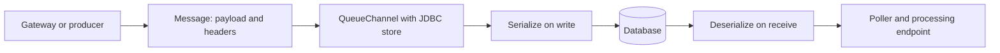

# Message serialization

## 1. Purpose and Context

In the **Message store** chapter of **SPRING_INTEGRATION_CORE**, serialization is the step that converts a message's state into a storable form, while deserialization reconstructs the message from that form. This is an essential boundary to understand when connecting `Message`, `MessageChannel`, endpoints, and gateways into a flow capable of resuming processing after interruptions.

After this lesson, you will be able to:

- Distinguish a message residing in memory from a message encoded for storage.
- Design payloads and headers suited to a persistent message store.
- Recognize failures caused by object graphs, temporary reply channels, and data version changes.
- Configure a Java DSL example using a JDBC-backed `QueueChannel`.
- Build tests for writing, reading, restarting, and recovering when a message cannot be decoded.

The main examples use **Java 17 and Spring Integration 6.5 APIs**. The configuration snippets assume Spring libraries from a compatible version set. The built-in JSON section is explicitly noted as targeting **Spring Integration 7.0 or later**, not an API available out of the box in 6.5.

## 2. Where Does the Serialization Boundary Sit?

Consider a scenario where an ordering service accepts a request, puts it into a queue, and then an endpoint polls it for processing:



With a direct synchronous channel, endpoints can operate on Java objects inside the same process without hitting an encoding boundary. Once a message enters a persistent store, its content must be self-contained enough to be reconstructed on a later read.

A message in memory may be valid for a handler yet invalid for a store. For instance, a handler can read an open `InputStream`; the store cannot preserve the stream's read position, OS resource handle, and lifecycle merely by keeping a Java reference.

Spring Integration describes the message store as a mechanism supporting components that buffer messages, such as queues and aggregators. How payloads, headers, and group state are represented depends on the chosen implementation. [Message Store Documentation](https://docs.spring.io/spring-integration/reference/6.5/message-store.html).

Separate three questions:

| Question | What to Verify |
|---|---|
| Can it be written? | Do the payload and headers have a representation compatible with the serializer? |
| Can it be read back? | Does the reader have compatible classes, data types, configuration, and version? |
| Does downstream processing still work? | Are routing, correlation, transaction guarantees, and side effects still correct? |

Serialization solves data representation. End-to-end flow recoverability still depends on transactions, retry mechanisms, idempotency, and how endpoints are organized.

## 3. There Is No Single Serialization Rule for Every Store

| Choice | What to Understand |
|---|---|
| `SimpleMessageStore` | Uses memory; passing messages through it does not prove ability to write and read via a persistent storage format. |
| `JdbcMessageStore` | Suits storing messages and message groups, such as for aggregators or claim check. |
| `JdbcChannelMessageStore` | Specialized for message channels; does not directly substitute for an aggregator's store. |
| Redis, MongoDB, or other store implementations | Check the conversion and type-mapping mechanism of the exact implementation; do not infer from JDBC behavior. |

In the JDBC branch, the documentation distinguishes `JdbcMessageStore` from `JdbcChannelMessageStore` and requires preparing the corresponding schema before use. The channel store's query provider must match the database management system. [JDBC Message Store](https://docs.spring.io/spring-integration/reference/6.5/jdbc/message-store.html).

For example, a test using only `SimpleMessageStore` may succeed with a payload containing a service bean. That result is not evidence for moving that exact payload into a JDBC store.

Also distinguish **message content** from **coordination metadata**. Group key, region, queue ordering, or group completion status may be stored using store-specific structures. Writing JSON for the payload does not mean you have reimplemented the framework's entire group storage protocol.

## 4. Java Serialization: Inspect the Entire Object Graph

### 4.1. Payloads Must Be Representable

When using Java serialization, a payload implementing `Serializable` is only the first step. Objects reachable through serialized fields must also be compatible.

The following example has a problem:

```java
import java.io.InputStream;
import java.io.Serializable;

public final class ImportRequest implements Serializable {
    private static final long serialVersionUID = 1L;

    private final String importId;
    private final InputStream content;

    public ImportRequest(String importId, InputStream content) {
        this.importId = importId;
        this.content = content;
    }
}
```

Marking `ImportRequest` as `Serializable` does not make `InputStream` storable data. When the serializer reaches an object that does not support serialization, Java can throw `NotSerializableException`. [Java 17 Serializable Contract](https://docs.oracle.com/en/java/javase/17/docs/api/java.base/java/io/Serializable.html).

A better design depending on the data:

- Small content: read into `byte[]` and close the stream before the storage boundary.
- Large content: store the file in durable storage, then place `objectKey`, checksum, and required metadata in the payload.
- Business data: map to a DTO containing only the values needed by the consumer.

With the file-reference approach, ensure the file still exists when the consumer reads it. If saving the file and writing the message are two separate operations, handle the case where one succeeds and the other fails.

Marking the `content` field `transient` only omits it from the serialized form. The consumer will not automatically receive the stream contents after deserialization. Use `transient` only when the omitted value can be reconstructed or is no longer needed.

### 4.2. The Outer Class Does Not Speak for Every Inner Element

Suppose a header has type `ArrayList`:

```java
var details = new java.util.ArrayList<Object>();
details.add("source-A");
details.add(new Object());
```

The list is serializable, yet the `new Object()` element is not. Checking only:

```java
headerValue instanceof java.io.Serializable
```

does not prove the entire header content can be written.

In message design, define rules for allowed value types rather than treating `Map<String, Object>` as a strict contract. For instance, `tenantId` is always a `String` and `schemaVersion` is always an integer.

### 4.3. Headers May Be Dropped Before Writing

With `JdbcMessageStore`'s default mechanism, the documentation states that non-serializable headers are dropped before the serialization step. Therefore, **a successful write does not prove every header was preserved**. [Message Store Serialization Limits](https://docs.spring.io/spring-integration/reference/6.5/message-store.html).

Two situations must be distinguished:

1. A header has a directly non-serializable value: it may be dropped by the store's mechanism.
2. A header is a serializable container holding a non-serializable nested object: serialization can still fail.

Do not rely on this behavior as a data-validation mechanism across all stores. Normalize messages before storing and explicitly test the exact headers needed by the rest of the flow.

## 5. Designing the Payload and Header Contract

### 5.1. Payloads as Self-Contained Business Data

A simple order payload:

```java
package com.example.integration.message;

import java.io.Serializable;
import java.util.Objects;

public record OrderCreated(
        String orderId,
        long totalMinor,
        String currency
) implements Serializable {

    public OrderCreated {
        Objects.requireNonNull(orderId, "orderId");
        Objects.requireNonNull(currency, "currency");
        if (orderId.isBlank()) {
            throw new IllegalArgumentException("orderId must not be blank");
        }
        if (totalMinor < 0) {
            throw new IllegalArgumentException("totalMinor must be non-negative");
        }
    }
}
```

Place this class in `OrderCreated.java`. The code uses a record to reduce boilerplate; do not put JPA entities, proxies, data sources, or services into the payload.

`totalMinor` represents the number of minor currency units per contract convention. For example, `12500` with `USD` corresponds to `125.00 USD`. Consumers must know the convention per currency; do not assume every currency has two decimal places.

A record does not make arbitrary data safe to serialize. If you change a component to `List<SomeType>`, you must still evaluate the type and values of every element.

### 5.2. Classifying Headers by Purpose

| Header or Data Group | Representation to Consider | Reason |
|---|---|---|
| `eventId` | Unique string identifier of the event | Used for tracing and duplicate prevention |
| `tenantId` | String | Selects the right business scope |
| `schemaVersion` | Integer or clearly specified version string | Selects reader or conversion step |
| Correlation and sequence | Values compatible with correlation/release strategies | Preserves grouping and ordering capability |
| `contentType` | Type or string understood by the target converter | Prevents losing format info |
| `replyChannel`, `errorChannel` | Stable channel name or appropriate registry mechanism | Avoids direct dependency on runtime objects |
| HTTP request, session, connection | Map needed values into a small DTO or metadata | Avoid storing entire request-handling infrastructure |
| Bean, executor, transaction context | Re-obtain from application context at the consumer | Their lifecycle belongs to the application process |

This is a design policy for the example, not a mandatory Spring Integration list.

`eventId` and `MessageHeaders.ID` serve two different roles. A flow may create new messages when transforming or enriching. Maintaining a separate `eventId` helps recognize the same business event across those steps.

`MessageHeaders.ID` and `TIMESTAMP` are special headers. Do not use `setHeader("id", ...)` to arbitrarily reassign them when reconstructing messages. With a custom codec, specify clearly how identifiers are preserved or mapped, then verify via round-trip tests.

### 5.3. Normalizing Before the Storage Boundary

A realistic flow should include a step converting input into the storage contract:

```text
HTTP/JMS/file input
    -> transformer creates DTO
    -> normalize required headers
    -> filter validates contract
    -> persistent channel or aggregator
    -> consumer
```

The transformer handles data mapping. The filter can reject messages missing `eventId`, having unsupported versions, or exceeding payload limits. A router after reading can pick the processing branch by event type or `tenantId`.

If choosing an allowlist of headers to keep, include headers needed by downstream EIPs in that list. Accidentally stripping correlation or sequence headers can leave an aggregator waiting forever even though every payload deserialized successfully.

## 6. Reply Channels, Error Channels, and Gateway Limits

### 6.1. Channel Objects Are Not Persistent Addresses

A `MessageChannel` reference points to a live object inside an application context. Even if an object could be turned into bytes, the reconstructed instance is not automatically the channel bean the flow needs.

For example, a synchronous gateway can create a temporary reply channel to wait for results:

```text
waiting gateway
    -> message with temporary replyChannel
    -> persistent queue
    -> consumer runs later
```

After the process restarts, the waiting Java call has already terminated. Recovering the request data does not restore the gateway caller thread's stack.

### 6.2. HeaderChannelRegistry Solves Mapping Within an Appropriate Lifecycle

A header enricher can convert `replyChannel` and `errorChannel` from channel objects into strings managed by `HeaderChannelRegistry`. The registry retains the mapping so the framework can look up the channel again when sending replies or errors. [Header Channel Registry](https://docs.spring.io/spring-integration/reference/6.5/content-enrichment.html).

An illustrative XML configuration snippet:

```xml
<int:header-enricher input-channel="beforeStore"
                     output-channel="persistentInput"
                     xmlns:int="http://www.springframework.org/schema/integration">
    <int:header-channels-to-string/>
</int:header-enricher>
```

This snippet illustrates one component inside a Spring XML configuration, not an entire application context.

Mapping retention time must fit the wait duration. The default registry holds state in memory: do not assume a string generated from a temporary channel will resolve after a restart or on another JVM.

### 6.3. Long-Running Business Replies Need Their Own Contract

For tasks that may run after a restart or wait many minutes, consider:

1. Producer sends a command with `requestId` or `eventId`.
2. Consumer processes and emits the result to a stably configured reply channel or destination.
3. Receiver queries results or matches responses by correlation ID.

A stable channel bean name only resolves within its corresponding application context. When producer and consumer live in separate processes, there must be a transport or reply address both sides understand; a bean name by itself does not create inter-process connectivity.

For one-way requests, a gateway with a `void` method fits better than holding a synchronous call across long queue wait times.

## 7. Java DSL Example with a JDBC-Backed QueueChannel

### 7.1. Example Prerequisites

You need `spring-integration-core`, `spring-integration-jdbc`, `spring-jdbc`, the H2 driver, and compatible Spring dependencies. If using Spring Boot, let the appropriate BOM manage version alignment rather than mixing Spring versions ad hoc.

The example below assumes:

- `DataSource` is already declared by the application.
- Spring Integration's H2 schema was created before the context starts.
- The database persists independently of consumer lifecycle if testing restarts.
- Payload is `OrderCreated` from section 5.
- Producers send only normalized headers.

The sample script resides in the JAR at `org/springframework/integration/jdbc/schema-h2.sql`. In environments that must retain data, manage the schema via migrations; do not re-run table drop/create scripts on every restart.

### 7.2. Declaring Store, Channel, and Consumer

```java
package com.example.integration.config;

import javax.sql.DataSource;

import com.example.integration.message.OrderCreated;
import org.springframework.context.annotation.Bean;
import org.springframework.context.annotation.Configuration;
import org.springframework.integration.channel.QueueChannel;
import org.springframework.integration.config.EnableIntegration;
import org.springframework.integration.dsl.IntegrationFlow;
import org.springframework.integration.dsl.Pollers;
import org.springframework.integration.jdbc.store.JdbcChannelMessageStore;
import org.springframework.integration.jdbc.store.channel.H2ChannelMessageStoreQueryProvider;
import org.springframework.integration.store.MessageGroupQueue;
import org.springframework.jdbc.datasource.DataSourceTransactionManager;
import org.springframework.transaction.PlatformTransactionManager;

@Configuration
@EnableIntegration
public class DurableOrderFlowConfiguration {

    @Bean
    JdbcChannelMessageStore orderChannelStore(DataSource dataSource) {
        JdbcChannelMessageStore store =
                new JdbcChannelMessageStore(dataSource);
        store.setChannelMessageStoreQueryProvider(
                new H2ChannelMessageStoreQueryProvider());
        store.setRegion("orders");
        return store;
    }

    @Bean
    QueueChannel durableOrders(JdbcChannelMessageStore orderChannelStore) {
        MessageGroupQueue queue =
                new MessageGroupQueue(orderChannelStore, "order-created");
        return new QueueChannel(queue);
    }

    @Bean
    PlatformTransactionManager integrationTransactionManager(
            DataSource dataSource) {
        return new DataSourceTransactionManager(dataSource);
    }

    @Bean
    IntegrationFlow orderConsumer(
            PlatformTransactionManager integrationTransactionManager) {
        return IntegrationFlow.from("durableOrders")
                .handle(OrderCreated.class, (order, headers) -> {
                    System.out.printf(
                            "eventId=%s orderId=%s totalMinor=%d%n",
                            headers.get("eventId"),
                            order.orderId(),
                            order.totalMinor());
                    return null;
                }, endpoint -> endpoint.poller(
                        Pollers.fixedDelay(1000)
                                .maxMessagesPerPoll(1)
                                .transactional(
                                        integrationTransactionManager)))
                .get();
    }
}
```

The handler returns `null` because the example ends processing here. When replacing with real business logic, you can connect downstream endpoints or emit result events per the application's contract.

`MessageGroupQueue` needs a stable group ID so the same logical queue is recognized across startups. Changing `"order-created"` randomly on each run causes the consumer to look at a different group. [MessageGroupQueue 6.5 API](https://docs.spring.io/spring-integration/docs/6.5.0/api/org/springframework/integration/store/MessageGroupQueue.html).

`transactional(...)` attaches transaction advice to the polling task. Pass a transaction manager managing the same datasource as the store. [PollerSpec 6.5 API](https://docs.spring.io/spring-integration/docs/6.5.0/api/org/springframework/integration/dsl/PollerSpec.html).

### 7.3. Producer Sending a Message

Place the following snippet in a producer method with the `durableOrders` bean injected:

```java
import java.util.UUID;

import com.example.integration.message.OrderCreated;
import org.springframework.messaging.Message;
import org.springframework.messaging.support.MessageBuilder;

// durableOrders is the QueueChannel bean from the configuration above.
OrderCreated payload = new OrderCreated("ORD-1001", 12500, "USD");

Message<OrderCreated> message = MessageBuilder.withPayload(payload)
        .setHeader("eventId", UUID.randomUUID().toString())
        .setHeader("tenantId", "tenant-a")
        .setHeader("schemaVersion", 1)
        .build();

boolean accepted = durableOrders.send(message);
if (!accepted) {
    throw new IllegalStateException("Message was not accepted");
}
```

`accepted` does not mean the order has been processed. If the send occurs inside an outer transaction, durability also depends on whether that transaction commits.

To observe writing and reading separately, stop the consumer, send a message, and verify the write transaction committed. Then start the consumer again with the same database, region, and group ID. Do not use in-memory H2 and shut down the whole database when concluding data must survive a restart.

### 7.4. Transactions Do Not Cover Every Side Effect

In the example, a transaction can cover polling the message from the JDBC queue and synchronous processing on the same thread. If switching to an executor-backed channel or launching asynchronous tasks, redefine transaction boundaries. [Transaction Support](https://docs.spring.io/spring-integration/reference/6.5/transactions.html).

An HTTP call to an external system does not automatically roll back with a JDBC transaction. If HTTP succeeds and then the queue-reading transaction rolls back, the message can be processed again and invoke HTTP a second time.

Therefore, the consumer needs idempotency keyed by `eventId` or a business key when side effects must not repeat. Successful serialization does not create an end-to-end exactly-once guarantee for the entire system.

## 8. Testing with the Actual Storage Implementation

### 8.1. Round-Trip Tests Must Check Both Content and Metadata

A meaningful test must go through the store's write and read operations, not only invoke a payload serializer in isolation.

The example below uses JUnit 5, Spring Test, and H2. Place it in `JdbcStoreSerializationTest.java`, in the same package as `OrderCreated` from section 5. The in-memory database here only tests mapping and serialization; it does not prove recoverability after process termination.

```java
package com.example.integration.message;

import java.io.NotSerializableException;
import java.util.ArrayList;
import java.util.UUID;

import javax.sql.DataSource;

import org.junit.jupiter.api.Test;
import org.springframework.beans.factory.annotation.Autowired;
import org.springframework.context.annotation.Bean;
import org.springframework.context.annotation.Configuration;
import org.springframework.integration.jdbc.store.JdbcMessageStore;
import org.springframework.jdbc.datasource.embedded.EmbeddedDatabase;
import org.springframework.jdbc.datasource.embedded.EmbeddedDatabaseBuilder;
import org.springframework.jdbc.datasource.embedded.EmbeddedDatabaseType;
import org.springframework.messaging.Message;
import org.springframework.messaging.support.MessageBuilder;
import org.springframework.test.context.junit.jupiter.SpringJUnitConfig;

import static org.junit.jupiter.api.Assertions.*;

@SpringJUnitConfig(JdbcStoreSerializationTest.Config.class)
class JdbcStoreSerializationTest {

    @Autowired
    JdbcMessageStore store;

    @Test
    void restoresPayloadAndRequiredHeaders() {
        String eventId = UUID.randomUUID().toString();
        OrderCreated payload =
                new OrderCreated("ORD-2001", 12500, "USD");

        Message<OrderCreated> original =
                MessageBuilder.withPayload(payload)
                        .setHeader("eventId", eventId)
                        .setHeader("tenantId", "tenant-a")
                        .setHeader("schemaVersion", 1)
                        .setHeader("runtimeOnly", new Object())
                        .build();

        UUID messageId = original.getHeaders().getId();
        assertNotNull(messageId);

        store.addMessage(original);
        Message<?> restored = store.getMessage(messageId);

        assertNotNull(restored);
        assertEquals(payload, restored.getPayload());
        assertEquals(eventId, restored.getHeaders().get("eventId"));
        assertEquals("tenant-a", restored.getHeaders().get("tenantId"));
        assertEquals(1, restored.getHeaders().get("schemaVersion"));
        assertEquals(messageId, restored.getHeaders().getId());
        assertEquals(
                original.getHeaders().getTimestamp(),
                restored.getHeaders().getTimestamp());

        // Behavior of default JdbcMessageStore in the example.
        assertNull(restored.getHeaders().get("runtimeOnly"));
    }

    @Test
    void rejectsSerializableContainerWithNonSerializableElement() {
        ArrayList<Object> nested = new ArrayList<>();
        nested.add("value");
        nested.add(new Object());

        Message<OrderCreated> message =
                MessageBuilder.withPayload(
                                new OrderCreated("ORD-2002", 100, "USD"))
                        .setHeader("nested", nested)
                        .build();

        RuntimeException failure = assertThrows(
                RuntimeException.class,
                () -> store.addMessage(message));

        Throwable root = failure;
        while (root.getCause() != null) {
            root = root.getCause();
        }
        assertInstanceOf(NotSerializableException.class, root);
    }

    @Configuration
    static class Config {

        @Bean(destroyMethod = "shutdown")
        EmbeddedDatabase dataSource() {
            return new EmbeddedDatabaseBuilder()
                    .generateUniqueName(true)
                    .setType(EmbeddedDatabaseType.H2)
                    .addScript(
                            "org/springframework/integration/jdbc/schema-h2.sql")
                    .build();
        }

        @Bean
        JdbcMessageStore store(DataSource dataSource) {
            return new JdbcMessageStore(dataSource);
        }
    }
}
```

The two tests demonstrate two different outcomes: a directly non-serializable header is dropped, whereas a container holding a non-serializable nested element causes the write operation to fail.

This is a test example for learners to adopt in a suitable project. Having the snippet in this lesson does not mean it has already been executed in your project environment.

### 8.2. Restart Tests Must Recreate the Context

Integration test scenario for the queue in section 7:

1. Create the schema in a database preserved across two application context creations.
2. Create context A with the consumer not yet running.
3. Send a message, wait for the write transaction to commit, and close context A.
4. Create context B with the same datasource, region, and group ID.
5. Receive the message via the new consumer and verify payload, `eventId`, and required headers.
6. Confirm the message is consumed once in the error-free success scenario.

Step 6 only confirms that specific test scenario; do not generalize it to exactly-once across all situations.

Include a case where the group ID is changed intentionally: the new consumer does not see the old message via the new logical queue. This experiment distinguishes lost data from a configuration looking at another partition or group.

### 8.3. Risk-Based Extended Tests

| Scenario | Outcome to Verify |
|---|---|
| Producer writes non-serializable payload | Send fails clearly; never reports acceptance succeeded |
| Correlation or sequence headers needed by aggregator | Values and types are preserved on read |
| Handler throws inside JDBC queue read transaction | Message can be received again after rollback per transaction config |
| Message carries named channel | Target bean resolves inside consumer context |
| Message uses temporary channel via registry | Works within supported lifecycle; do not assume recovery after restart |
| New reader encounters old-version data | Reads or upcasts properly; unsupported data is clearly identified |
| Stored data is corrupted | Enough info exists to identify record and appropriate quarantine mechanism |
| Payload near size limit | Write, read, and latency still meet application goals |

For an aggregator, also test group reconstruction and release conditions. Reading back individual payloads while losing correlation IDs can still prevent the flow from completing.

## 9. Customizing Serializers and Choosing JSON

### 9.1. Serializer and Deserializer Are a Paired Contract

`JdbcMessageStore` exposes `setSerializer(...)` and `setDeserializer(...)`. The data type encoded here is the **message**, not only the payload. [JdbcMessageStore 6.5 API](https://docs.spring.io/spring-integration/docs/6.5.0/api/org/springframework/integration/jdbc/store/JdbcMessageStore.html).

The snippet below shows the extension point inside a `@Configuration` class:

```java
import javax.sql.DataSource;

import org.springframework.beans.factory.annotation.Qualifier;
import org.springframework.context.annotation.Bean;
import org.springframework.core.serializer.Deserializer;
import org.springframework.core.serializer.Serializer;
import org.springframework.integration.jdbc.store.JdbcMessageStore;
import org.springframework.messaging.Message;

@Bean
JdbcMessageStore customMessageStore(
        DataSource dataSource,
        @Qualifier("storedMessageWriter")
        Serializer<Message<?>> writer,
        @Qualifier("storedMessageReader")
        Deserializer<Message<?>> reader) {

    JdbcMessageStore store = new JdbcMessageStore(dataSource);
    store.setSerializer(writer);
    store.setDeserializer(reader);
    return store;
}
```

The application must supply both `storedMessageWriter` and `storedMessageReader` beans. This snippet is not a complete JSON codec.

A custom codec must define:

- Encoding and envelope structure.
- How payload types, numbers, timestamps, and null values are represented.
- Which headers are saved, which values are normalized, and which values are rejected.
- How message ID, timestamp, and correlation are preserved or mapped.
- Behavior when a version or event type is unsupported.
- Size limits and errors thrown when data is invalid.

You must also test the store's own pre-serialization handling. Plugging in a JSON writer does not automatically guarantee every runtime object in headers will be retained.

For `JdbcChannelMessageStore`, extension points differ from the generic store. Its API provides `setPreparedStatementSetter(...)`, `setMessageRowMapper(...)`, and `setDeserializer(...)`; do not copy `setSerializer(...)` calls from the generic store to the channel store. [JdbcChannelMessageStore 6.5 API](https://docs.spring.io/spring-integration/docs/6.5.0/api/org/springframework/integration/jdbc/store/JdbcChannelMessageStore.html).

### 9.2. A Versioned Envelope Is a Design Option

Example of an application-defined storage structure:

```json
{
  "schemaVersion": 1,
  "eventType": "order.created",
  "eventId": "evt-9e6b70b4",
  "payload": {
    "orderId": "ORD-3001",
    "totalMinor": 12500,
    "currency": "USD"
  },
  "headers": {
    "tenantId": "tenant-a",
    "correlationId": "checkout-109"
  }
}
```

This is an illustrative application envelope, not Spring Integration's default JSON schema and not the entire store record.

`eventType` is a stable business name. The reader can map `order.created` along with `schemaVersion` to a known DTO using an allowlist. This avoids coupling the data contract directly to Java package names.

If the envelope is used to reconstruct `Message<?>`, add a policy for framework-required headers that the JSON example omitted. Correctly reading back a POJO does not prove the queue, gateway, or aggregator operates properly.

### 9.3. Built-In JSON for Channel Store Since 7.0

Spring Integration 7.0 adds the `JsonChannelMessageStorePreparedStatementSetter` and `JsonMessageRowMapper` pair for `JdbcChannelMessageStore`. The default schema with a binary column cannot be used as-is for this option; a column type suited to JSON content is required. [JDBC Channel Message Store JSON Serialization](https://docs.spring.io/spring-integration/reference/7.0/jdbc/message-store-json.html).

For applications already on 7.0 or later, you can configure both components as follows:

```java
import org.springframework.integration.jdbc.store.channel.JsonChannelMessageStorePreparedStatementSetter;
import org.springframework.integration.jdbc.store.channel.JsonMessageRowMapper;

// store already has a datasource and query provider matching the database.
// MESSAGE_CONTENT schema has been prepared for JSON content.
store.setPreparedStatementSetter(
        new JsonChannelMessageStorePreparedStatementSetter());
store.setMessageRowMapper(
        new JsonMessageRowMapper("com.example.integration.message"));
```

`JsonMessageRowMapper` uses a trusted packages list to control which classes are reconstructed. Writer and reader must configure compatible mappings. [JsonMessageRowMapper API](https://docs.spring.io/spring-integration/docs/current/api/org/springframework/integration/jdbc/store/channel/JsonMessageRowMapper.html).

Do not assume changing the column type converts old Java-serialized records into JSON. Old binary content must be read by an old reader and rewritten in the new format, or drained completely before switching.

During transition, maintain a way to distinguish formats or separate storage locations per migration plan. If a JSON reader encounters Java serialization bytes, merely both being “data in the database” will not make them understand each other.

### 9.4. Choosing a Format Based on Data Lifecycle

| Criterion | Java Serialization | Application-Managed JSON Envelope |
|---|---|---|
| Coupling to Java code | Depends on class identity and serialization rules | Can use schema and event types independent of class names |
| Data inspectability | Usually requires binary decoding tools | Easy to inspect structure, yet still requires access controls |
| Version changes | Must evaluate class compatibility | Must define fields, defaults, and migration |
| Polyglot support | Not a convenient choice | Better suited when type contracts are clearly defined |
| Implementation effort | Convenient for simple Java DTOs | Requires mapping design and contract testing |
| Safety on read | Must restrict classes and graph limits | Must validate types, sizes, and content |

This comparison table guides selection; it does not claim JSON is always faster or always safer. Measure on real payloads and your system's real storage lifecycle.

## 10. Data Compatibility Across Deployments

A persistent queue connects yesterday's producer with today's consumer. Consequently, data types sitting in the database are also part of the deployment contract.

With ordinary `Serializable` classes, `serialVersionUID` helps determine serialization version compatibility. Declaring a fixed UID does not make every structural change compatible; renaming classes, changing field types, or altering data semantics still requires evaluation. Record rules differ from ordinary classes, so do not mechanically apply ordinary-class UID guidelines to the record in the example. [Java Serialization Versioning Specification](https://docs.oracle.com/en/java/javase/17/docs/specs/serialization/version.html).

Examples of business changes requiring decisions:

| Change | Real-World Issue |
|---|---|
| Adding `salesChannel` | Old messages lack the value; reader needs a default or compatibility branch |
| Changing `totalMinor` to decimal `amount` | Not just a field rename; both unit and data type changed |
| Moving DTO package | Data containing old class names may no longer be readable |
| Changing an enum | Old consumer may not recognize values written by new producer |
| Changing correlation ID semantics | Data still parses yet may be grouped into the wrong group |

A controlled upgrade process:

1. Save real sample messages from the currently running version in a test dataset.
2. Have the new reader read the old samples and verify business semantics.
3. For rolling deployments, also test the reverse direction where an old reader encounters data written by a new producer.
4. Choose to maintain compatibility, upcast, migrate, or drain the backlog first.
5. Keep a rollback plan matching formats the previous version can still read.

`schemaVersion` helps select how to read; it does not perform migration by itself. An upcaster must be implemented and tested—for instance, transforming a v1 envelope missing `salesChannel` into the current internal structure with a business-accepted value.

## 11. Handling Errors at the Right Stage

### 11.1. Distinguishing Write, Read, and Business Errors

| Stage | Possible Symptoms | Handling Direction |
|---|---|---|
| Input normalization | Missing ID, wrong version, payload exceeds limit | Reject before accepting into the queue |
| Serialize on send | `NotSerializableException` or wrapper exception | Trace path to offending object, fix contract |
| Database write | Connection failure or constraint violation | Apply transactions and retries for transient errors |
| Deserialize on receive | Missing class, bad format, disallowed class | Identify version, reader config, and affected record |
| Handler after read | Business rule violated or external service failed | Apply error flow and retry policy by error category |
| Send reply or error | Cannot resolve channel | Check channel name, registry, and call lifecycle |

Surface exceptions may be Spring exceptions wrapping the root cause. Logs should preserve the cause chain and necessary identifiers rather than logging only the outermost exception name.

### 11.2. Deserialization Failures Can Happen Before a Message Exists

If the store cannot reconstruct the message yet, the business handler has not received a payload. You cannot assume the error flow will have a complete `failedMessage` to route to a dead-letter channel.

Design the ability to identify the record via store metadata readable independently of the broken content. When forced to quarantine data, keep the original or a controllable copy for investigation and replay.

A poison message at the head of a queue can keep failing on every poll. Increasing retry counts cannot fix a missing class name or unsupported format.

### 11.3. Retries and Quarantine Must Stay Consistent

Minimum classification:

- Transient errors, e.g., database interruption: retry with appropriate backoff.
- Contract errors, e.g., unsupported event type: transform, quarantine, or reject per process.
- Business errors after read: decide retries based on recoverability and side effects.

Moving a failed message to quarantine and removing it from the queue must be designed to avoid data loss if the process stops between the two steps.

Do not delete an arbitrary row directly from the store and consider the issue resolved: a generic message store and aggregator may still have group links or metadata that must stay consistent. Use APIs and operational procedures that understand the implementation's structure.

Serialization errors in a synchronous send flow usually return to the caller of the send operation. Declaring an `errorChannel` bean does not automatically guarantee every producer error enters that channel. Conversely, errors occurring inside a polling task must be handled by the poller's error mechanism.

## 12. Controlling Deserialization and Stored Data

Data in the database still requires a trust boundary. If any party can write arbitrary bytes into the serialized column, the consumer should not freely instantiate arbitrary Java objects from that content.

Java provides serialization filters to restrict classes, sizes, and object graph complexity when reading. Configuration must fit the entire real message and payload. [Java Serialization Filtering](https://docs.oracle.com/en/java/javase/17/core/serialization-filtering1.html).

Spring Integration 6.5 provides `AllowListDeserializingConverter` and allowed-pattern configuration APIs for JDBC stores. When using an allowlist, account for envelope classes, headers, and nested types used, not only the business DTO. [AllowListDeserializingConverter 6.5 API](https://docs.spring.io/spring-integration/docs/6.5.0/api/org/springframework/integration/support/converter/AllowListDeserializingConverter.html).

An appropriate application policy should combine:

- Allow only payload and header types belonging to the contract.
- Enforce message size limits before writing, as well as resource limits when reading.
- Restrict direct write permissions on store tables.
- Avoid putting tokens, passwords, and unnecessary information into messages.
- Log by ID and error category; access sensitive content only via controlled procedures.

With JSON, do not enable arbitrary class instantiation just to silence mapping errors. Map by allowed event type or configure narrow trusted packages matching the reader's exact needs.

Binary serialization is also not security encryption. If stored content must be protected, apply appropriate data-protection measures; do not rely on binary data being hard to read by eye.

## 13. Size, Performance, and Backlog Capacity

Message storage costs include serialization, content size, database operations, indexes, and deserialization. A small payload carrying many large headers can still produce a large record.

An initial estimate:

```text
backlog content volume
    ≈ incoming messages per second
      × potential backlog duration
      × average serialized size
```

For example, `100 messages/second × 7,200 seconds × 4 KiB` yields roughly **2.75 GiB** of content, excluding indexes, metadata, transaction logs, and headroom.

To make decisions, measure:

| Metric | Purpose |
|---|---|
| Average and p95 serialized size | Detect abnormal payloads or headers |
| Write and read duration | Identify whether serialization or database dominates |
| Age of oldest message | Assess whether consumer keeps up with producer |
| Error count by version or event type | Spot contract errors after deployment |
| Backlog growth rate | Estimate recovery time and capacity |

Avoid optimizing by stripping headers that the flow needs. For very large content, consider claim check: store the content in another store while the message carries a reference key and metadata. In return, manage lifetime, integrity, and access permissions for the out-of-store content.

If compressing data, both writer and reader must recognize the compression format. Decompressed size limits are just as important as pre-decompression record size.

## 14. Practicing on an Order Flow

Execute the following steps in a test project using the aligned version set:

1. Create `OrderCreated` and the schema for your chosen database.
2. Create a JDBC queue with a fixed region and group ID as in section 7.
3. Send a message containing only the payload and the `eventId`, `tenantId`, and `schemaVersion` headers.
4. Stop and recreate the consumer context; confirm committed messages continue processing.
5. Add a header containing `new Object()` and observe the outcome across a round trip.
6. Replace it with a list containing `new Object()` to observe the object-graph error.
7. Have the handler throw an exception before completing the transaction, then verify redelivery.
8. Use two envelope or DTO versions to test your upgrade plan.

The desired outcome is a storage contract you can describe clearly: payload type, header set, format, version, backward-read capability, and handling for unsupported data.

When bringing this flow into an application, keep the normalization step before the store, test round trips with the real implementation, and decide the reply model right from gateway design. Those three choices connect data storage to the correct behavior of downstream endpoints.
