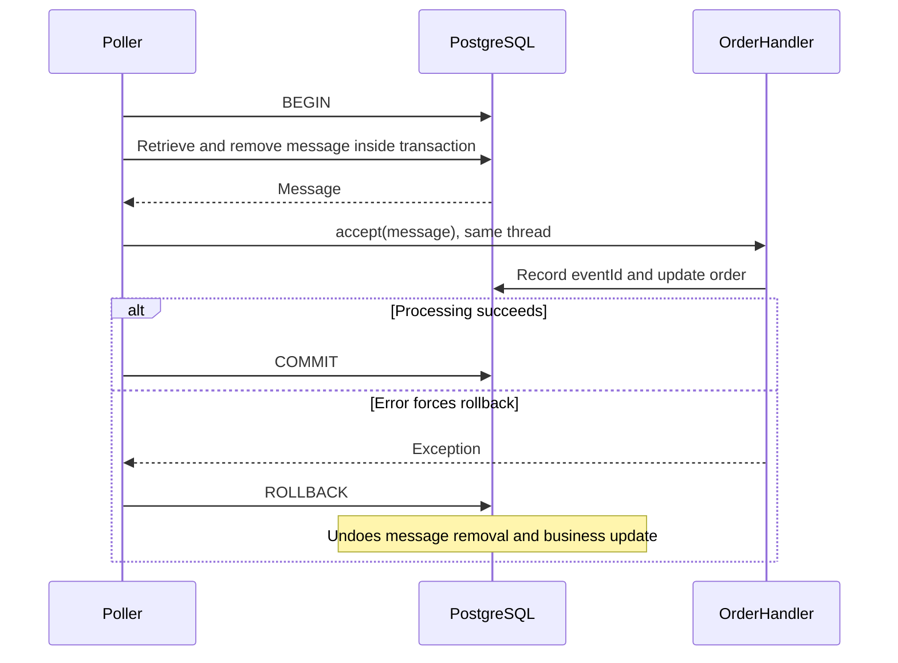

# Choosing a message store by failure model

## 1. Starting from What Must Remain True After a Failure

In the **Message store** chapter of the **SPRING_INTEGRATION_CORE** module, choosing where to store messages ties directly to how flows are designed with `Message`, `MessageChannel`, endpoints, gateways, and Java DSL. A transformer can recompute its output from its input, but an aggregator waiting for two missing parts must retain the parts already received. A `QueueChannel` may accept a message successfully while the service activator has not yet had a chance to process it.

A **failure model** is the set of failures a design commits to tolerating, paired with assumptions about which components remain operational. For instance, “survives abrupt JVM termination, provided the database stays intact and committed transactions are not lost” is far more concrete than “use a persistent store.”

This lesson helps you:

- Distinguish data durability, atomicity, recoverability, and duplicate-processing prevention.
- Choose appropriate implementations for queues and for aggregator message groups.
- Define transaction boundaries between polling messages and applying business effects.
- Design fault-injection tests to verify the exact commitments you made.

The Java examples use APIs aligned with Spring Integration 6.5. Real projects should use compatible Spring versions managed by a BOM or Spring Boot; do not copy individual versions into a project running a different dependency set.

### Running Scenario

A system receives `OrderApproved` events, buffers them, and updates an order status table. The development team sets out hypothetical requirements:

1. After confirming durable acceptance, the event must survive JVM termination.
2. If the business update fails, the job must remain retriable.
3. The source may resend the same event when it does not receive a response.
4. Other flows need to group multiple events by `orderId`.
5. When the store is unreachable, the system must clearly indicate acceptance did not succeed.

These requirements drive multiple separate decisions: store type, transaction manager, event identity, how the source is acknowledged, and how recovery works. Swapping a single store bean does not solve the whole problem.

## 2. Identifying the Exact State That Needs Storage

In Spring Integration, distinguish the following responsibilities:

| Component | Related State or Responsibility |
| --- | --- |
| `Message` | Payload and headers needed for subsequent processing |
| `QueueChannel` | Messages waiting for a consumer to poll |
| Aggregator | Messages belonging to the same group and group state |
| `MessageStore` | Store and retrieve individual messages |
| `MessageGroupStore` | Manage messages by group, suited to stateful group components |
| `ChannelMessageStore` | Contract specialized for message queue operations |

`QueueChannel` uses an in-memory queue by default. An aggregator also keeps in-memory state by default. When persistence is needed, configure the store on the exact component holding state. Notably, serialized data includes both payload and headers; not every object inside headers can be usefully restored in another JVM. See [Message Store](https://docs.spring.io/spring-integration/reference/message-store.html).

Do not assume two classes whose names both contain `MessageStore` are interchangeable. For example, a store optimized for queues may not provide all group operations an aggregator needs. Check the interfaces and intended purpose of an implementation before benchmarking performance.

A flow may need two stores:

```text
Source -> QueueChannel with queue store
       -> transformer/router/filter
       -> aggregator with group store
       -> service activator
```

The queue store protects the wait time ahead of the consumer; the aggregator store protects the wait time until all group members arrive. If only one is configured, the other buffer still carries its own failure model.

## 3. Translating Requirements into a Failure Table

A useful failure model states the failure point, remaining state, and how processing resumes.

| Failure | Observable Risk | Design Condition to Verify |
| --- | --- | --- |
| JVM dies while message sits in RAM | Buffered item is lost | Use an out-of-JVM store if source cannot replay |
| JVM dies after enqueue committed | Consumer has not processed yet | Restart must use the exact store and queue identifier |
| Handler throws after polling message | Message was already removed from queue | Receive operation must sit inside a rollback-capable transaction |
| Database committed yet client timed out | Sender does not know whether write succeeded | Resend with the same business ID and process idempotently |
| External HTTP succeeded, local transaction rolled back | Retry may invoke HTTP a second time | Target supports idempotency or reconciliation mechanism exists |
| Store loses connectivity | Cannot write or poll messages | Bounded timeouts, timely source acknowledgement, load control |
| Storage is full | New writes fail, backlog grows | Capacity monitoring, rejection or ingestion throttling |
| Failover to replica missing recent writes | Writes acknowledged by prior node may be lost | Replication and failover policy aligned with RPO |
| Two instances update same aggregator group | Group state can suffer concurrent races | Coordinated locks and transactions across all instances |
| Deploy new payload version | Cannot read old messages still in store | Versioned data contract and compatibility testing |
| Accidental region wipe or old backup restore | Lost state or replaying old work | Controlled restore, reconciliation, retention, and replay procedures |

No single “persistent = safe” claim replaces this table. JVM termination, database power loss, and loss of an entire storage region are three distinct failure scopes.

### RPO and RTO Must Be Scoped to Failure Domains

- **RPO**: the amount of recent data near a failure event that can tolerably be lost. It can be expressed in time or event count, as long as it is measurable.
- **RTO**: the maximum acceptable time to restore the committed level of service.

For example, “RPO = 0 on application restart” does not mean “RPO = 0 on total database loss.” The second scope requires examining durable write settings, replicas, backups, and restore procedures.

## 4. Four Properties to Evaluate Independently

### 4.1. Durability: Does Data Survive or Disappear?

Durability answers whether acknowledged data remains after a defined failure. With an out-of-process store, an application restart may not lose data; however, if the store itself loses data, the application loses the corresponding state as well.

Even with an RDBMS, durability still depends on configuration and the storage stack. PostgreSQL documentation explains that power-loss guarantees involve data actually flushing through cache layers to non-volatile storage. Thus, “committed” must be interpreted within a concrete durability configuration. See [PostgreSQL Reliability](https://www.postgresql.org/docs/current/wal-reliability.html).

### 4.2. Atomicity: Which Operations Succeed or Fail Together?

For a queue, the key question is whether receiving the message and updating business state share the same transaction.

```text
BEGIN
  poll and remove message from JDBC queue
  record processed event marker
  update business data on the same DataSource
COMMIT
```

If these operations share a transaction and an error forces a rollback, both the message removal and the business updates are undone. If you place a transaction only on a business method called after the message was already polled outside a transaction, business rollback does not return the message to the queue.

### 4.3. Delivery and Business Effects: How Many Times Can a Message Be Processed?

- With a destructive receive and no recovery on failure, work can be lost before finishing.
- With rollback followed by retry, a message can enter the handler multiple times before completing.
- With a source resending after timeout, the same business event can exist across multiple distinct `Message` instances.

Designs tolerating resends need a stable `eventId` from the source. `MessageHeaders.ID` should not be used instead of a business identifier: reconstructing a message on resend can assign a new technical ID.

A local transaction paired with a unique constraint can protect effects within the same database. That is not proof that every end-to-end effect—including HTTP, email, or another database—executes only once.

### 4.4. Recoverability: If Data Survives, Can Processing Continue?

Recoverability also requires:

- Queues or groups have stable identifiers across restarts.
- New application versions can read old data.
- Correlation, routing, and release settings still understand waiting messages.
- Permanently failing jobs have a dedicated handling path.
- Backlogs can drain within the required timeframe.

Specifically, renaming a bean, region, or group ID can make the application see a new empty queue while old data sits untouched in the store.

## 5. Comparing Options by Need

| Option | Suitable Need | Assumptions to Clarify |
| --- | --- | --- |
| In-memory queue, `SimpleMessageStore` for group state | Prototyping, reproducible data, losing buffered items acceptable | Source can replay or business tolerates loss |
| `JdbcChannelMessageStore` | Queue needing receive tied to a JDBC transaction | Schema, query provider, shared `DataSource`, and transaction boundary |
| `JdbcMessageStore` | Aggregator or general per-message storage | Group lifecycle, multi-instance locks, data compatibility |
| `RedisChannelMessageStore` | Queue using Redis | Persistence, failover, and gap between receive and processing |
| `RedisMessageStore` | Group storage on Redis | Serialization format and group update coordination |
| `MongoDbChannelMessageStore` / `MongoDbMessageStore` | Queue / groups in a MongoDB-based system | Mapping, write concern, sessions, and actual transaction participation |

This table guides architectural choices, not an absolute ranking of speed or reliability.

### JDBC: Advantageous When a Clear Local Transaction Boundary Is Needed

Spring Integration distinguishes `JdbcMessageStore` for needs like aggregators and claim check from `JdbcChannelMessageStore` dedicated to channels. A channel store needs a `ChannelMessageStoreQueryProvider` matching the database; schemas must be prepared from scripts matching the library version. The documentation also recommends considering JMS or AMQP when the primary need is messaging-queue infrastructure. See [JDBC Message Store](https://docs.spring.io/spring-integration/reference/6.5/jdbc/message-store.html).

In this lesson's order scenario, JDBC is attractive because the queue and business tables can participate in one local transaction. If each consumer must hold a transaction open while waiting several seconds for an external API, that benefit comes with long connection and lock hold times. In that case, rethink how work is split.

### Redis: Evaluate Both Persistence and Receive Semantics

`RedisChannelMessageStore` uses Redis lists, pushing on send and popping on receive. It is designed for queues; Redis channel stores do not provide the full `MessageGroupStore` contract needed as an aggregator's group store. See [Redis Channel Message Stores](https://docs.spring.io/spring-integration/reference/6.5/redis.html#redis-channel-message-stores).

If an element is popped successfully and the JVM dies before business work finishes, Redis persistence does not automatically put that element back. Verify your design's recovery mechanism; do not infer broker-like acknowledgement or redelivery features from the store's name alone.

Redis offers different persistence policies. Snapshots can miss changes since the last snapshot; AOF with `appendfsync everysec` still has roughly a one-second data-loss window in documented failure cases. Failover policies must be evaluated as well. See [Redis persistence](https://redis.io/docs/latest/operate/oss_and_stack/management/persistence/).

Redis transactions also do not have SQL transaction rollback semantics. Putting `@Transactional` on a method does not prove Redis store operations participate in the same transaction as JDBC updates. See [Spring Data Redis Transactions](https://docs.spring.io/spring-data/redis/reference/redis/transactions.html).

### MongoDB: Verify Both Mapping and Transaction Scope

`MongoDbMessageStore` serves message and group storage; `MongoDbChannelMessageStore` is optimized for queues. Implementations differ in mapping or serialization behavior and must be tested against real payloads and headers. See [MongoDB Message Store](https://docs.spring.io/spring-integration/reference/6.5/mongodb.html#mongodb-message-store).

MongoDB provides single-document atomicity and supports multi-document transactions depending on deployment conditions. Database transaction support does not prove the store, handler, and related operations actually share one transaction/session. Test against the real deployment configuration. See [MongoDB Transactions](https://www.mongodb.com/docs/manual/core/transactions/).

### Distributed Memory Does Not Automatically Equal Persistence

When considering a distributed-memory store, separate two failure scopes: a single application node dying vs. the entire storage cluster restarting. Keeping extra copies in RAM helps with some failures, but surviving total RAM loss requires a configured and verified persistence mechanism.

## 6. Process for Choosing a Store

### Step 1: Name the Data That Must Not Be Lost

Be concrete: “accepted message,” “received group member,” or “completed business effect.” These three items exist at different points in time.

A consumer may finish processing while the message remains in the queue because the transaction has not committed. Conversely, the message may have left the queue while the external side effect has not happened yet.

### Step 2: Identify the Recovery Source

If the store is lost, where can data be replayed from? A flow with a full-history upstream source has different options than an unrecoverable webhook. Replay capability must account for history retention, stable identifiers, and avoiding duplicate side effects.

### Step 3: Define the Atomic Unit

Explicitly draw the resources that must commit together:

```text
JDBC queue + deduplication table + business table
```

or:

```text
Redis queue + partner API + JDBC business table
```

The second case spans multiple independent systems. Design retries, idempotency, and reconciliation for each gap instead of assuming a single annotation wraps everything.

### Step 4: Eliminate Candidates That Do Not Meet the Contract

If groups must recover across restarts, eliminate configurations keeping groups solely in RAM. If you need a store for an aggregator, eliminate implementations offering only queue operations. If rolling back message retrieval is required, eliminate configurations where tests show receive cannot be undone.

### Step 5: Evaluate Operational Cost and Performance

Compare against expected payloads, backlog size, and consumer counts. Measure write, poll, and commit latencies, lock contention, database resources, and recovery times. Existing infrastructure is an operational advantage; it does not substitute for failure-model evidence.

### Step 6: Record the Decision Alongside Its Validity Conditions

Example: “Choose JDBC for the queue because atomicity with business tables on the same `DataSource` is required. Committed to tolerating application crashes after enqueue commit; database-loss incidents are covered by a separate data-recovery procedure. HTTP side effects will use an idempotency key and be verified independently.”

## 7. Java DSL Example: JDBC Queue and Business Update in One Transaction

### 7.1. Prerequisites to Apply the Example

The example uses PostgreSQL and assumes:

- A `DataSource` bean pointing to PostgreSQL exists; both the queue and business tables use this bean.
- `spring-integration-core`, `spring-integration-jdbc`, Spring JDBC/transaction, and the PostgreSQL driver are present with compatible versions.
- The channel store schema was created with the matching DDL from the active Spring Integration JDBC dependency.
- Only one transaction manager is declared below; projects with multiple managers must disambiguate using qualifiers.
- The handler runs synchronously on the poller thread without switching to an `ExecutorChannel` or spawning threads.
- Each `eventId` immutably represents exactly one event and one order.

The DDL below is only for the **illustrative business tables**, not a replacement for the framework's message store DDL:

```sql
create table order_projection (
    order_id varchar(100) primary key,
    status varchar(32) not null
);

create table processed_order_event (
    event_id varchar(100) primary key,
    order_id varchar(100) not null,
    processed_at timestamptz not null default current_timestamp
);

insert into order_projection(order_id, status)
values ('ORD-1001', 'NEW');
```

### 7.2. Configuring the Store, Channel, and Poller

```java
import javax.sql.DataSource;

import org.springframework.context.annotation.Bean;
import org.springframework.context.annotation.Configuration;
import org.springframework.integration.channel.QueueChannel;
import org.springframework.integration.config.EnableIntegration;
import org.springframework.integration.dsl.IntegrationFlow;
import org.springframework.integration.dsl.Pollers;
import org.springframework.integration.jdbc.store.JdbcChannelMessageStore;
import org.springframework.integration.jdbc.store.channel
        .PostgresChannelMessageStoreQueryProvider;
import org.springframework.integration.store.MessageGroupQueue;
import org.springframework.jdbc.core.JdbcTemplate;
import org.springframework.jdbc.datasource.DataSourceTransactionManager;
import org.springframework.messaging.Message;
import org.springframework.transaction.PlatformTransactionManager;

@Configuration
@EnableIntegration
public class DurableOrderFlow {

    @Bean
    public PlatformTransactionManager integrationTransactionManager(
            DataSource dataSource) {
        return new DataSourceTransactionManager(dataSource);
    }

    @Bean
    public JdbcChannelMessageStore orderChannelStore(DataSource dataSource) {
        JdbcChannelMessageStore store = new JdbcChannelMessageStore(dataSource);
        store.setChannelMessageStoreQueryProvider(
                new PostgresChannelMessageStoreQueryProvider());
        store.setRegion("orders.vi.lab.v1");
        return store;
    }

    @Bean
    public QueueChannel pendingOrders(JdbcChannelMessageStore orderChannelStore) {
        MessageGroupQueue queue = new MessageGroupQueue(
                orderChannelStore, "pending-orders.v1");
        return new QueueChannel(queue);
    }

    @Bean
    public OrderHandler orderHandler(DataSource dataSource) {
        return new OrderHandler(new JdbcTemplate(dataSource));
    }

    @Bean
    public IntegrationFlow orderWorker(
            QueueChannel pendingOrders,
            OrderHandler orderHandler,
            PlatformTransactionManager integrationTransactionManager) {

        return IntegrationFlow.from(pendingOrders)
                .handle(orderHandler, "accept", endpoint -> endpoint
                        .id("orderConsumer")
                        .poller(Pollers.fixedDelay(500)
                                .maxMessagesPerPoll(1)
                                .transactional(integrationTransactionManager)))
                .get();
    }

    public static class OrderHandler {

        private final JdbcTemplate jdbc;

        public OrderHandler(JdbcTemplate jdbc) {
            this.jdbc = jdbc;
        }

        public void accept(Message<String> message) {
            String eventId = message.getHeaders().get("eventId", String.class);
            String orderId = message.getPayload();

            if (eventId == null || eventId.isBlank() || orderId.isBlank()) {
                throw new IllegalArgumentException("Missing eventId or orderId");
            }

            int inserted = jdbc.update("""
                    insert into processed_order_event(event_id, order_id)
                    values (?, ?)
                    on conflict (event_id) do nothing
                    """, eventId, orderId);

            if (inserted == 0) {
                return;
            }

            int updated = jdbc.update("""
                    update order_projection
                    set status = 'READY'
                    where order_id = ?
                    """, orderId);

            if (updated != 1) {
                throw new IllegalStateException("Order not found: " + orderId);
            }
        }
    }
}
```

`MessageGroupQueue` connects the queue to the store using a group ID. The ID must remain stable to keep using the queue after restarts; here it is `pending-orders.v1`. See [MessageGroupQueue API](https://docs.spring.io/spring-integration/docs/6.5.0/api/org/springframework/integration/store/MessageGroupQueue.html).

`Pollers.transactional(...)` wraps a transaction around the polling task. `maxMessagesPerPoll(1)` is chosen so each illustrative turn polls only one message; it is not a cap on the total messages stored. See [PollerSpec API](https://docs.spring.io/spring-integration/docs/6.5.0/api/org/springframework/integration/dsl/PollerSpec.html).

### 7.3. Sending Messages and Defining the Acceptance Point

The following snippet runs on the producer side, with `pendingOrders` and `integrationTransactionManager` injected from the configuration above:

```java
import org.springframework.integration.channel.QueueChannel;
import org.springframework.messaging.support.MessageBuilder;
import org.springframework.transaction.PlatformTransactionManager;
import org.springframework.transaction.support.TransactionTemplate;

public class OrderIngress {

    private final QueueChannel pendingOrders;
    private final TransactionTemplate transactions;

    public OrderIngress(QueueChannel pendingOrders,
            PlatformTransactionManager integrationTransactionManager) {
        this.pendingOrders = pendingOrders;
        this.transactions = new TransactionTemplate(integrationTransactionManager);
    }

    public void enqueue(String eventId, String orderId) {
        transactions.executeWithoutResult(status -> {
            boolean accepted = pendingOrders.send(MessageBuilder
                    .withPayload(orderId)
                    .setHeader("eventId", eventId)
                    .build());

            if (!accepted) {
                throw new IllegalStateException("Queue did not accept message");
            }
        });
    }
}
```

This is an illustrative class to register/inject at the calling layer. When invoked outside any outer transaction, `enqueue` returns normally only after the template's transaction completes. If an outer transaction already exists, default configuration joins that transaction; the actual commit time rests with the outer transaction owner.

Therefore, durable acknowledgement to the source must be tied to the **actual commit**, not merely to `send` returning `true`. If the client loses the response after commit and resends the same `eventId`, the `processed_order_event` table protects the business update in the example.

### 7.4. Why Can Rollback Return a Message?



A persistent store supporting transactions only retains the message when the receive itself executes inside the transaction. This point is described in [Persistent QueueChannel Configuration](https://docs.spring.io/spring-integration/reference/6.5/channel/configuration.html#channel-configuration-queuechannel).

In the example, writing the deduplication marker and updating status commit together with message retrieval. If updating the order fails, the deduplication marker also rolls back, allowing the next attempt to redo the work.

If the deduplication marker were saved first in an independent transaction and business logic then failed, the next attempt could skip unfinished work. Conversely, if the marker were recorded only after a non-rollbackable side effect, JVM death before writing the marker could cause a repeated side effect.

### 7.5. Limits to Keep Explicit

- The example demonstrates effects inside a single PostgreSQL database; it does not send emails or call partner APIs.
- An immutable `eventId` is part of the contract. If the same ID could carry different contents, detect conflicts rather than ignoring unconditionally.
- There is no permanent-failure handling mechanism in this snippet; a missing-order error will continue rolling back until data is fixed or a quarantine policy is added.
- No backlog limit is implemented in the example. Ingestion limits and capacity must be designed separately.
- Avoid switching threads between receive and processing if relying on this local transaction. A poller transaction does not automatically propagate to an asynchronous task. See [Transaction Boundaries](https://docs.spring.io/spring-integration/reference/6.5/transactions.html#transaction-boundaries).

## 8. Aggregators Need a Different Failure Model Than Queues

Queues hold independent waiting jobs. Aggregators hold a set of members and the state of a group. Therefore, store selection criteria for an aggregator also include group lifecycle and release conditions.

For example, group `ORD-1001` needs three types of info: order, payment, and inventory. After receiving two types, the application restarts. Desired recovery conditions are:

1. The two durably written members can still be retrieved.
2. `orderId` still serves as the correlation key for the exact old group.
3. When the missing member arrives, the release strategy recognizes all three types.
4. Resending one member does not cause the group to be treated as complete merely due to duplicate count.
5. Result emission and group state updates have a clear recovery policy.

Under a failure model allowing resends, the release strategy must inspect the set of business identifiers or member types. A simple `size() == 3` condition can mistake three copies for three distinct members. This is a correlation/release design decision, not a feature automatically added by the store.

When multiple instances manipulate the same group concurrently, default in-RAM locks cannot coordinate across JVMs. Spring Integration requires a shared lock registry when sharing a `MessageGroupStore` across servers. Also design expiry and late-message handling; deleting all group traces immediately upon release can let a resent part start a new group. See [Aggregator: Lock Registry and Group Lifecycle](https://docs.spring.io/spring-integration/reference/6.5/aggregator.html#aggregator-lock-registry).

### Persistent State and Running Schedules Are Two Different Things

Persisting a group does not mean in-memory timeout schedules automatically survive restarts. The design must verify how overdue groups are re-detected, such as a sweep/reaper mechanism matched to the store and the aggregator's expiry policy.

If a group holds two of three members indefinitely, a persistent store will keep that incomplete group across many restarts. To prevent accumulation, specify wait deadlines, expiration actions, and how long completed group markers are kept for late-arriving messages.

A useful commitment is: “Incomplete groups recover across restarts; overdue groups are found and handled within a defined sweep interval.” This commitment is measurable by tests.

## 9. Error Handling, Retries, and Poison Messages

### 9.1. Distinguishing Error Notification from Retaining Work

An `ErrorMessage` on `errorChannel` routes errors to an observation or handling point. It does not by itself prove the original message remains in the queue or will be rerun. Check where the exception arises relative to the transaction boundary. Spring Integration also distinguishes errors in synchronous flows from errors in asynchronous flows. See [Error Handling](https://docs.spring.io/spring-integration/reference/6.5/error-handling.html).

If a handler catches an exception, logs it, and returns normally, the poller may consider processing successful and commit the message removal. To roll back, the error must propagate out or the transaction must be marked rollback-only by design.

### 9.2. Retries Must Have a Stop Condition

A transient deadlock and a malformed payload require two different policies. If every error rolls back and immediately re-reads, a permanently failing message can consume most processing turns.

The policy should specify explicitly:

- Which error categories are retriable and which require quarantine.
- Backoff, processing deadline, and maximum attempt limit.
- Where retry counts are persisted across restarts.
- Quarantine location, owner or resolution process, and how to replay using the original ID.

If you increment a counter inside the transaction that rolls back, the increment is undone too. If you only increment a header on an object in RAM, the next poll can read the old version from the store. Verify where attempt counters are actually stored and when they commit.

### 9.3. Quarantine Must Also Avoid Data-Loss Gaps

Moving a message from the main queue to quarantine involves at least two state changes. If both reside in the same database and same transaction, you can design writing the quarantine record and completing the receive in a single commit.

If quarantine is another system, consider failures between the two steps. You can use an intermediary design like an outbox to record the handoff intent in the local transaction, then dispatch with retries and deduplication. Never delete the original job merely because an error log line was written.

## 10. Details That Commonly Break Recovery

### Payloads and Headers Must Have a Storage Contract

A message with a string payload can still fail if a header holds a non-serializable object or something meaningless after restart. Keep data needed for later processing: `eventId`, `orderId`, business timestamp, event type, data version, and correlation key.

Do not rely on connections, sessions, or JVM object references to resume processing after recovery. For backlog items present during a deployment, test both the new version reading old data and application rollback capability if required.

### Synchronous Gateways Have the Lifetime of the Caller

A gateway call may wait for a reply inside the calling process's RAM. Persisting a request in a queue does not extend the caller's life after that process has died. Spring Integration documentation notes the limits of temporary reply channels when messages cross a persistent store. See [Message Store: Payloads and Headers](https://docs.spring.io/spring-integration/reference/message-store.html).

If work must survive restarts, an architectural option is returning an acceptance token after commit, processing in the background, and allowing status lookups by that token. Persisting results and updating acceptance status become part of the recovery contract.

### Store Identifiers Must Be Stable and Clearly Partitioned

In the JDBC example, `orders.vi.lab.v1` and `pending-orders.v1` are configuration values with data semantics. Generating a random UUID as the group ID at startup makes the new queue blind to old data.

Separating environments, tenants, or applications helps prevent consumers from reading the wrong data. When intentionally changing a region or queue identifier, plan how the old backlog is drained and verify post-migration.

### Filters and Routers Decide a Message's Fate

A filter dropping a message without throwing an error may be a successful transaction outcome. A router forwarding a message to another channel also raises durability questions at the destination. Clearly define the outcomes “completed,” “validly dropped,” “quarantined,” and “needs retry” before using them in a store-backed flow.

If downstream endpoints simply put work onto a RAM queue and return, the preceding transaction may commit even though the new work lacks equivalent durability.

## 11. Testing the Failure Model with Fault-Injection Points

Testing aims to verify business commitments, not merely calling store APIs successfully. The steps below are a practice plan; they have not been executed within the scope of this article.

| Test | Fault-Injection Point | Observable Criterion |
| --- | --- | --- |
| Enqueue rollback | Write message then force producer transaction rollback | No committed message exists for consumer to process |
| Restart while waiting | Stop consumer, commit enqueue, terminate process | New process with same store and ID reads the event |
| Receive rollback | Receive message inside transaction then throw error | Event can be received again after rollback |
| Error after business update | Throw error before poller commits | Queue, deduplication marker, and business table all roll back |
| Resend after timeout | Send two messages with the same `eventId` | Single valid business effect within designed scope |
| Store connection loss | Sever connection during write/poll | Never reports durable acceptance when commit is uncertain |
| Group recoverability | Write two members, restart, send missing member | Old group completes with the right member set |
| Concurrent group processing on two nodes | Send same correlation key concurrently | No double release due to missing coordination |
| Old data version | Create backlog with prior application version | New version reads and processes per compatibility contract |
| Poison message | Invalid payload across multiple attempts | Quarantined cleanly; flow does not retry endlessly |
| Large backlog | Load expected post-outage backlog | Latency and catch-up time meet targets |

### Minimal Practice for Rollback-Capable Receive

1. Use a real test database and stop the `orderConsumer` endpoint so it does not race for the message.
2. Send an event via `OrderIngress.enqueue` and let the producer transaction commit.
3. Open a `TransactionTemplate` with the same manager; call `pendingOrders.receive(0)`.
4. Verify the message is present, then throw a `RuntimeException` before the transaction finishes.
5. After rollback, open a new transaction and receive the message again.
6. Verify `eventId` and business payload match the original event.

Do not let the test method's own transaction wrap both the enqueue step and the intentional rollback step: if the message never committed, the test does not represent recovering durably accepted work.

For restart tests, separate two processes or two application runs while keeping the same database, region, and group ID. Recreating a bean within the same process does not adequately verify RAM loss from process termination. Power loss or store failover requires a separate test suite; application restarts cannot substitute for those tests.

A reconciliation check should track the set of `eventId` values accepted, completed, waiting, and quarantined. For aggregators, include members currently held inside groups. Seeing an empty queue alone does not prove every event achieved the right outcome.

## 12. Capacity and Recovery Time Are Also Store Selection Criteria

Assume the following numbers are inputs to a sizing exercise, not benchmark results:

- Ingress rate: 500 messages/second.
- Consumer stops processing for 120 seconds while producer keeps accepting.
- Average serialized message size: 2 KB.
- After recovery, consumer sustains 900 messages/second while source continues sending 500 messages/second.

Backlog generated during the pause:

```text
500 × 120 = 60,000 messages
```

Message data volume is roughly 120 MB assuming 1 KB equals 1,000 bytes. That covers message payloads alone; the database also needs capacity for indexes, metadata, transaction logs, quarantined records, and headroom.

Backlog drain rate after recovery:

```text
900 - 500 = 400 messages/second
```

Approximate catch-up time:

```text
60,000 / 400 = 150 seconds
```

This assumes steady throughput and no additional errors. If the consumer can only sustain 450 messages/second, the backlog continues growing even though the store loses zero messages. Depending on the system's RTO definition, catch-up time may need to include detection, startup, and reconnection time.

Useful measurements include pending message count, oldest message age, incomplete/overdue group count, commit latency, rollback rate, retry count, quarantined message count, lock wait time, and storage usage. Collection methods depend on the implementation and monitoring stack; do not assume every metric exists out of the box under a single name.

Notably, re-benchmark performance while consumers drain a large backlog. Benchmarking an almost-empty queue can miss query costs, contention, and impact on business workloads sharing the same database.

## 13. Decision Template for the Order Scenario

A verifiable decision for the chapter's opening scenario looks like this:

| Aspect | Decision and Conditions |
| --- | --- |
| Data to preserve | Events acknowledged after enqueue commit |
| Queue store | `JdbcChannelMessageStore` on PostgreSQL |
| Reason | Can coordinate receive and business update under the same local transaction |
| Transactions | Poller, deduplication marker, and business table share `DataSource` and manager |
| Recovery | Keep region, group ID, and message contract unchanged across restarts |
| Deduplication | Stable `eventId`, unique constraint; mark in the same business transaction |
| Aggregator | Dedicated group store matching contract, clear correlation/release; lock coordination for multi-instance |
| When store fails to write | Do not acknowledge durable acceptance; source retries with same ID |
| External side effects | Design idempotency, outbox, or reconciliation per target |
| Committed failure scope | Application crash with committed database stays durable; database loss has its own RPO/RTO policy |
| Required evidence | Results of rollback, restart, resend, version compatibility, and backlog-drain tests |

If requirements shift toward cross-application queues with routing, acknowledgements, redelivery, and dead-lettering managed by messaging infrastructure, evaluate JMS or AMQP as an architectural option. If only a short-lived aggregation group is needed and the source can fully replay, an in-RAM store may fit a simpler failure model.

Lock down your choice in one sentence covering all three parts: **which state must survive, which failures are tolerated, and which mechanism guards the gaps between storing, polling, processing, and acknowledging**. Then use fault-injection points to turn that sentence into operational evidence.
