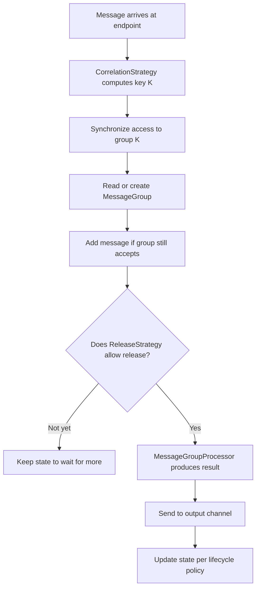

# CorrelationStrategy

## 1. Correlation in a Stateful Message Flow

In Spring Integration Core, `CorrelationStrategy` determines which messages belong to the same processing group. This is the foundational decision of stateful endpoints such as aggregators and resequencers: before waiting for enough results or reordering messages, the endpoint must know which group a message belongs to.

Consider an order processing system. The payment branch emits a `PAYMENT` result, and the inventory branch emits a `STOCK` result. The results can arrive interleaved:

```text
PAYMENT for tenant-A / order-42 / run-1
STOCK   for tenant-B / order-42 / run-1
STOCK   for tenant-A / order-42 / run-1
PAYMENT for tenant-B / order-42 / run-1
```

If grouping is done only by `order-42`, the system could combine one customer's payment with another customer's inventory. If every message has its own random key, results that should be combined always end up in separate groups.

This lesson belongs to the **Correlation and state** chapter of the `SPRING_INTEGRATION_CORE` module and focuses on how to choose, implement, and test correlation keys in Java DSL flows. After studying it, you should be able to:

- Explain the `getCorrelationKey(Message<?>)` contract.
- Distinguish between a correlation key, a message identifier, and a release condition.
- Choose among headers, payload, SpEL, and Java-implemented strategies.
- Design keys for multi-tenancy, retries, and multiple business runs.
- Recognize the impact of keys on state, late messages, and operability.

The Java examples use Java 17 syntax and the Java DSL API available in Spring Integration 6.5. The project needs `spring-integration-core`; the library version should be managed by the project's dependency management. The test examples use JUnit Jupiter. This content assumes basic familiarity with `Message`, `MessageChannel`, and aggregators.

## 2. The CorrelationStrategy Contract

The interface resides in the `org.springframework.integration.aggregator` package:

```java
import org.springframework.messaging.Message;

@FunctionalInterface
public interface CorrelationStrategy {

    Object getCorrelationKey(Message<?> message);
}
```

The input is the entire `Message<?>`, so the strategy can read both payload and headers. The output is an object representing the group, typically a `String`, `UUID`, or an immutable value object. Since this is a functional interface, it can be implemented with a lambda or method reference. When a valid key cannot be found, an application-written strategy should throw an exception instead of returning `null`. See the [CorrelationStrategy contract](https://docs.spring.io/spring-integration/docs/6.5.0/api/org/springframework/integration/aggregator/CorrelationStrategy.html).

The desired rule can be described as a function `K`:

```text
K(message) = business group identifier

Same business group      => keys must be equal.
Different business group => keys must be distinguishable.
```

"Equal" here must follow `equals()` and `hashCode()`, not object reference identity. Two different messages can completely legitimately have two separately created key objects with the same value.

```java
record OrderRunKey(String tenantId, String orderId, String runId) {
}

var first = new OrderRunKey("tenant-A", "order-42", "run-1");
var second = new OrderRunKey("tenant-A", "order-42", "run-1");

assert first != second;
assert first.equals(second);
assert first.hashCode() == second.hashCode();
```

This is only the requirement for key equality. When using a persistent store or a distributed lock, you must also check how the implementation represents, converts, and restores keys; an object that works properly in memory is not automatically suitable for every store.

A strategy should perform a short and deterministic calculation. Avoid making HTTP calls, querying volatile data, or updating business state inside `getCorrelationKey()`. A retry must continue computing the same key if it still belongs to the same processing run.

## 3. Where Does Correlation Stand in the Processing Pipeline?

The following diagram is a conceptual model for the normal path of an aggregator, omitting timeout, discard, and error branches:



The [AbstractCorrelatingMessageHandler source code in version 6.5.0](https://github.com/spring-projects/spring-integration/blob/v6.5.0/spring-integration-core/src/main/java/org/springframework/integration/aggregator/AbstractCorrelatingMessageHandler.java) shows that the key is computed before the endpoint performs the lock-protected group processing. Therefore, a shared strategy must be safe when called concurrently by multiple threads; the group lock does not protect a self-managed `HashMap` inside the strategy.

The components have distinct responsibilities:

| Component | Decision or data it manages |
| --- | --- |
| `CorrelationStrategy` | Which group does the message belong to? |
| `ReleaseStrategy` | Is the current group ready to emit its result? |
| `MessageGroupStore` | Stores the messages and state of the group. |
| `MessageGroupProcessor` | What result is produced from the released group? |
| `LockRegistry` | Coordinates update access to the group within the scope supported by the registry. |

For example, the key `(tenant-A, order-42, run-1)` only identifies where to store results. It does not say that both `PAYMENT` and `STOCK` have arrived.

Similarly, choosing the right group does not create business ordering. An aggregator combines results; a resequencer uses sequence information to re-emit messages in order. See [Resequencer](https://docs.spring.io/spring-integration/reference/resequencer.html).

## 4. Distinguishing Common Identifiers

| Value | Meaning in the order example | Should it be used automatically as a group key? |
| --- | --- | --- |
| `MessageHeaders.ID` | Identifier of a single Spring message. | Usually no, because parts of an order have different message IDs. |
| `eventId` | Business event identifier to recognize redeliveries or duplicates. | Usually used for idempotency, not for combining different events. |
| `orderId` | Order identifier. | Sufficient only when there are no tenant or run distinctions. |
| `runId` | A single business processing run of an order. | A useful component of a composite key. |
| `correlationId` | Spring Integration correlation header. | Suitable when upstream has already created the right group semantics. |
| `traceId` | Links activities for observability. | Use only if the business contract genuinely matches the trace boundary. |
| `sequenceNumber` | Position of a part within a sequence. | Should not be included in the key for the entire sequence. |
| `sequenceSize` | Declared size of the sequence. | Usually serves release logic, not group identification. |

A correlation key defines the **grouping boundary**. An idempotency key determines **whether an item has already been processed**. An order group may contain multiple `eventId` values but only one `OrderRunKey`.

You must also distinguish the key value from the header named `correlationId`. When configuring a strategy that reads `payload.key()` or a custom header, the value returned by the strategy determines the group. Do not assume that the `correlationId` header always equals the actual key, or that the strategy will automatically update that header.

## 5. Designing Keys from Business Boundaries

### 5.1. Choosing the Dimensions to Distinguish

For the problem at hand, use the key:

```text
OrderRunKey = (tenantId, orderId, runId)
```

Meaning of each field:

- `tenantId` isolates data across customers or organizations.
- `orderId` identifies the business entity.
- `runId` separates different processing runs of the same order.

Both the payment branch and the inventory branch must receive the same `runId` from the start of the run. If each branch generates its own `runId`, they cannot be correlated together.

| First result | Second result | Expected behavior |
| --- | --- | --- |
| A / 42 / R1 / PAYMENT | A / 42 / R1 / STOCK | Same group. |
| A / 42 / R1 / PAYMENT | B / 42 / R1 / STOCK | Different groups because of different tenants. |
| A / 42 / R1 / PAYMENT | A / 42 / R2 / STOCK | Different groups because of different runs. |
| A / 42 / R1 / PAYMENT | A / 43 / R1 / STOCK | Different groups because of different orders. |

`PAYMENT` and `STOCK` are the types of items to wait for, not components of the group key. Putting the branch type into the key creates two separate groups, each missing a branch.

### 5.2. Distinguishing Technical Retries from a New Run

A retry due to a network timeout or broker redelivery still belongs to `run-1` if it is continuing the same piece of work. Creating a new key on every retry leaves behind groups missing results.

Conversely, when a user intentionally re-runs the entire workflow after a completed run, the system can create `run-2`. That is a business decision at the entry point and must be propagated across all branches.

In particular, an initiation request resent due to a client retry also needs an identification rule. If every received request generates a new run, a downstream aggregator cannot tell on its own that those runs actually originated from a repeated request.

### 5.3. Avoiding Ambiguous String Keys

Simple concatenation like this can cause collisions:

```text
tenant = "ab", order = "c"  => "abc"
tenant = "a",  order = "bc" => "abc"
```

Using a delimiter also requires an escaping rule if the data itself can contain that delimiter. In Java, a `record` with immutable fields clearly expresses the structure. When transferring over HTTP, a broker, or persistence storage, you need a stable encoding, such as a JSON object or a string with an agreed-upon format.

Do not use an entire JPA entity, a mutable list, or an object with default reference-identity equality as a key. Merely modifying a field that participates in `hashCode()` after placing the key into a storage structure can break the ability to look up the group again.

Normalization rules must be decided by the business domain. Do not arbitrarily `trim()`, change letter case, or convert all IDs to numbers if those operations could collapse two valid identifiers into one.

## 6. Ways to Configure CorrelationStrategy

### 6.1. Default: Using the correlationId Header

If no custom strategy is specified, the aggregator uses `HeaderAttributeCorrelationStrategy` reading the `IntegrationMessageHeaderAccessor.CORRELATION_ID` header. In a split–process–aggregate sequence, the splitter can populate the `correlationId`, `sequenceNumber`, and `sequenceSize` headers to link the parts. See [Aggregator](https://docs.spring.io/spring-integration/reference/aggregator.html) and [Splitter](https://docs.spring.io/spring-integration/reference/splitter.html).

How to express the default strategy in Java:

```java
import org.springframework.integration.IntegrationMessageHeaderAccessor;
import org.springframework.integration.aggregator.CorrelationStrategy;
import org.springframework.integration.aggregator.HeaderAttributeCorrelationStrategy;

CorrelationStrategy byDefaultHeader =
        new HeaderAttributeCorrelationStrategy(
                IntegrationMessageHeaderAccessor.CORRELATION_ID);
```

A manually created message does not automatically have all correlation and sequence headers. The following example provides only the group key:

```java
import org.springframework.integration.IntegrationMessageHeaderAccessor;
import org.springframework.messaging.support.MessageBuilder;

var message = MessageBuilder.withPayload("payment-result")
        .setHeader(IntegrationMessageHeaderAccessor.CORRELATION_ID, "run-42")
        .build();
```

You must still ensure an appropriate release condition. Adding `correlationId` alone is not enough for a sequence-based release strategy to know how many parts the group needs to wait for.

### 6.2. Using a Custom Header

If upstream has normalized the key into the `orderRunKey` header:

```java
CorrelationStrategy byBusinessHeader =
        new HeaderAttributeCorrelationStrategy("orderRunKey");
```

When attached to an aggregator in Java DSL:

```java
.aggregate(a -> a
        .correlationStrategy(byBusinessHeader)
        .releaseStrategy(group -> group.size() == 2))
```

The snippet above only illustrates configuration, assuming each group has exactly two valid messages and no duplicates. If both messages are payment results, `size() == 2` still returns `true`. The complete example later in this lesson uses the branch type to decide release.

The [HeaderAttributeCorrelationStrategy](https://docs.spring.io/spring-integration/api/org/springframework/integration/aggregator/HeaderAttributeCorrelationStrategy.html) class only retrieves the value from the configured header; requirements such as non-empty strings, valid data types, or mandatory tenants must be validated by the application.

### 6.3. Using SpEL for Short Expressions

If the header has already been validated before the endpoint:

```java
.aggregate(a -> a
        .correlationExpression("headers['orderRunKey']")
        .releaseStrategy(group -> group.size() == 2))
```

In this correlation expression, the root object is the message, so `headers` or `payload` can be accessed. `correlationExpression(...)` configures an `ExpressionEvaluatingCorrelationStrategy`; see the [CorrelationHandlerSpec API](https://docs.spring.io/spring-integration/docs/6.5.0/api/org/springframework/integration/dsl/CorrelationHandlerSpec.html).

SpEL is suitable when the rule is short and clear. If the expression starts containing multiple fallback branches, string normalization, and combining multiple fields, switching to Java makes data validation and unit testing much easier.

Do not use a fallback like `headers['orderRunKey'] ?: 'UNKNOWN'` to hide missing data. All malformed messages will be grouped together into the same `UNKNOWN` group.

### 6.4. Using a POJO Method

You can delegate key selection to an object:

```java
public final class OrderCorrelationRules {

    public Object selectKey(org.springframework.messaging.Message<?> message) {
        Object key = message.getHeaders().get("orderRunKey");
        if (key == null) {
            throw new IllegalArgumentException("Missing orderRunKey");
        }
        return key;
    }
}
```

Attach the method to the DSL using the overload:

```java
var rules = new OrderCorrelationRules();

.aggregate(a -> a
        .correlationStrategy(rules, "selectKey")
        .releaseStrategy(group -> group.size() == 2))
```

The framework uses the `MethodInvokingCorrelationStrategy` adapter to invoke the object's method. This approach is useful when reusing a business bean; see [MethodInvokingCorrelationStrategy](https://docs.spring.io/spring-integration/api/org/springframework/integration/aggregator/MethodInvokingCorrelationStrategy.html).

The `.aggregate(...)` snippet above is chained onto a flow, not a standalone Java statement after declaring `rules`.

## 7. Complete Example: Grouping Two Branches by Tenant, Order, and Run

This example collects results from two branches, `PAYMENT` and `STOCK`. A group is released once both types have been seen, regardless of arrival order.

Design decisions for the example:

- The key lives in an immutable payload.
- The strategy only accepts a `BranchResult` payload and returns `result.key()`.
- Release checks the set of branch types, so two `PAYMENT` results do not complete the group.
- Output contains the collected results; it does not interpret branch statuses as "order succeeded."
- Completed groups retain metadata to recognize late messages within the current store lifecycle.

Place the following configuration in an application with a Spring context and Spring Integration Core:

```java
package example.integration.correlation;

import java.io.Serializable;
import java.util.Comparator;
import java.util.EnumSet;
import java.util.List;
import java.util.Objects;

import org.springframework.context.annotation.Bean;
import org.springframework.context.annotation.Configuration;
import org.springframework.integration.aggregator.CorrelationStrategy;
import org.springframework.integration.channel.DirectChannel;
import org.springframework.integration.channel.QueueChannel;
import org.springframework.integration.config.EnableIntegration;
import org.springframework.integration.dsl.IntegrationFlow;
import org.springframework.integration.store.MessageGroup;

@Configuration
@EnableIntegration
public class CorrelationFlowConfig {

    public enum PartType {
        PAYMENT, STOCK
    }

    public record OrderRunKey(
            String tenantId,
            String orderId,
            String runId) implements Serializable {

        public OrderRunKey {
            requireText(tenantId, "tenantId");
            requireText(orderId, "orderId");
            requireText(runId, "runId");
        }
    }

    public record BranchResult(
            OrderRunKey key,
            PartType partType,
            String eventId,
            String value) implements Serializable {

        public BranchResult {
            Objects.requireNonNull(key, "key");
            Objects.requireNonNull(partType, "partType");
            requireText(eventId, "eventId");
            Objects.requireNonNull(value, "value");
        }
    }

    public record OrderRunCollected(
            OrderRunKey key,
            List<BranchResult> results) {

        public OrderRunCollected {
            Objects.requireNonNull(key, "key");
            results = List.copyOf(results);
        }
    }

    @Bean
    public DirectChannel orderPartsInput() {
        return new DirectChannel();
    }

    @Bean
    public QueueChannel orderRunsOutput() {
        return new QueueChannel();
    }

    @Bean
    public QueueChannel orderPartsDiscard() {
        return new QueueChannel();
    }

    @Bean
    public CorrelationStrategy orderRunCorrelationStrategy() {
        return message -> {
            if (!(message.getPayload() instanceof BranchResult result)) {
                throw new IllegalArgumentException(
                        "Expected BranchResult payload");
            }
            return result.key();
        };
    }

    @Bean
    public IntegrationFlow orderRunFlow(
            CorrelationStrategy orderRunCorrelationStrategy) {

        return IntegrationFlow.from(orderPartsInput())
                .aggregate(a -> a
                        .correlationStrategy(orderRunCorrelationStrategy)
                        .releaseStrategy(CorrelationFlowConfig::hasBothParts)
                        .outputProcessor(CorrelationFlowConfig::collectParts)
                        .expireGroupsUponCompletion(false)
                        .discardChannel(orderPartsDiscard()))
                .channel(orderRunsOutput())
                .get();
    }

    private static boolean hasBothParts(MessageGroup group) {
        EnumSet<PartType> received = EnumSet.noneOf(PartType.class);

        for (var message : group.getMessages()) {
            BranchResult part = (BranchResult) message.getPayload();
            received.add(part.partType());
        }

        return received.contains(PartType.PAYMENT)
                && received.contains(PartType.STOCK);
    }

    private static OrderRunCollected collectParts(MessageGroup group) {
        List<BranchResult> parts = group.getMessages().stream()
                .map(message -> (BranchResult) message.getPayload())
                .sorted(Comparator.comparing(BranchResult::partType)
                        .thenComparing(BranchResult::eventId))
                .toList();

        return new OrderRunCollected(parts.get(0).key(), parts);
    }

    private static void requireText(String value, String field) {
        if (value == null || value.isBlank()) {
            throw new IllegalArgumentException(field + " must not be blank");
        }
    }
}
```

`outputProcessor(...)` accepts a `MessageGroupProcessor` to produce a result from the group; `expireGroupsUponCompletion(...)` is an aggregator configuration option. These methods are described in the [AggregatorSpec API](https://docs.spring.io/spring-integration/docs/6.5.0/api/org/springframework/integration/dsl/AggregatorSpec.html).

### 7.1. Running the Example in a Spring Context

The following snippet can be placed in a runner method. Nested types of `CorrelationFlowConfig` are referenced by their qualified names so the declaration source is clear:

```java
import org.springframework.context.annotation.AnnotationConfigApplicationContext;
import org.springframework.integration.channel.DirectChannel;
import org.springframework.integration.channel.QueueChannel;
import org.springframework.messaging.support.MessageBuilder;

try (var context =
        new AnnotationConfigApplicationContext(CorrelationFlowConfig.class)) {

    DirectChannel input =
            context.getBean("orderPartsInput", DirectChannel.class);
    QueueChannel output =
            context.getBean("orderRunsOutput", QueueChannel.class);

    var key = new CorrelationFlowConfig.OrderRunKey(
            "tenant-A", "order-42", "run-1");

    input.send(MessageBuilder.withPayload(
            new CorrelationFlowConfig.BranchResult(
                    key,
                    CorrelationFlowConfig.PartType.PAYMENT,
                    "payment-event-1",
                    "AUTHORIZED"))
            .build());

    if (output.receive(0) != null) {
        throw new AssertionError("Group must still wait for STOCK");
    }

    input.send(MessageBuilder.withPayload(
            new CorrelationFlowConfig.BranchResult(
                    key,
                    CorrelationFlowConfig.PartType.STOCK,
                    "stock-event-1",
                    "RESERVED"))
            .build());

    var reply = output.receive(1000);
    if (reply == null) {
        throw new AssertionError("Expected collected result");
    }

    var collected =
            (CorrelationFlowConfig.OrderRunCollected) reply.getPayload();

    System.out.println(collected.key());
    System.out.println(collected.results().size()); // 2
}
```

Because the input is a `DirectChannel`, processing and sending the result to the output queue occur on the thread calling `send()`. A queue at the output allows observing results via `receive()` without creating an additional consumer.

### 7.2. Intentional Limitations of the Example

This flow demonstrates grouping, not an entire order placement workflow:

- `hasBothParts()` does not check whether `value` indicates success or failure. Both branches responding does not imply business success.
- `eventId` is carried to identify the event, but there is no idempotent receiver step yet.
- If two different payment events arrive before inventory replies, both may appear in the output. The example does not automatically pick "the latest one."
- No timeout is configured for incomplete groups, and there is no metadata cleanup job.
- The state in this configuration resides in memory; restarting the application does not preserve existing groups.
- The output and discard queues need appropriate consumers or polling mechanisms in a real application.

There are no sequence headers in the example because release is already defined by branch type. Messages arriving after a group completes are handled according to the completed-group policy instead of participating in a second result.

## 8. Observing Interleaved Messages and Duplicates

Assume all events below share `run-1`:

| Step | Incoming message | Expected state or result |
| --- | --- | --- |
| 1 | A / 42 / PAYMENT / event-P1 | Group A-42 waits for STOCK. |
| 2 | B / 42 / STOCK / event-S2 | Group B-42 waits for PAYMENT. |
| 3 | A / 42 / PAYMENT / event-P3 | Group A-42 still waits for STOCK. |
| 4 | A / 42 / STOCK / event-S4 | Releases A-42; output contains A's collected results. |
| 5 | B / 42 / PAYMENT / event-P5 | Releases B-42. |
| 6 | A / 42 / STOCK / event-S6 | Arrives after completion; routed to discard per example configuration. |

Step 3 shows that checking branch types is stricter than checking `group.size() == 2`. However, step 4 also shows that correlation and release do not replace idempotency.

Before handling duplicates in a real system, define what constitutes a duplicate:

1. The same `eventId` redelivered.
2. The same `OrderRunKey` and branch type, but with a new `eventId`.
3. A valid adjustment result replacing a previous result.

These three situations may require three different rules. For instance, dropping a redelivery in case 1 makes sense, whereas dropping every adjustment result in case 3 could lose business updates.

Do not fix duplicates by changing the correlation key. Changing the key sends data to a different group and can leave both groups incomplete.

## 9. Preserving Keys Across Transformers, Routers, Filters, and Transports

### Transformer

A transformer that changes the payload must preserve enough information for downstream strategies to compute the right key. In the example, transforming `BranchResult` into a plain string before the aggregator will cause the strategy to reject that payload.

If the system has multiple payload shapes, you can normalize the key into a custom header at the flow boundary. Afterward, every transformer must uphold the contract of keeping or reconstructing that header.

Pay special attention to code that manually builds `new GenericMessage<>(newPayload)`: if required headers are not copied over, metadata from the previous message is no longer present in the newly constructed message.

### Router

A router chooses the branch path; it does not implicitly generate a shared run identifier for all results. Create `runId` before branching and propagate it back in every response.

When receiving results from two independent systems, mandate that they return the same set of identifiers or add a mapping step to translate them to the same internal key.

### Filter

If a filter drops the `STOCK` branch while release still requires `STOCK`, the group will wait forever if there is no timeout.

You must define the business meaning of filtering out a message: emit a result like `STOCK_SKIPPED`, change the set of branches to wait for, or terminate the group via a timeout path. Keeping the correlation key accurate alone does not solve a missing part.

### Splitter and Nested Sequences

A splitter can create a new correlation scope for the parts it produces. When there are multiple split–aggregate layers, determine which aggregator closes which layer's group. Do not arbitrarily overwrite framework sequence headers.

Using a custom header such as `businessRunKey` helps distinguish the business boundary from the boundary of a single split. Test each layer's sequence behavior separately if you need to preserve the default split–aggregate mechanism.

### Gateway and Transport

A gateway defines the entry boundary into a flow, but it does not automatically determine business keys for independent callback events. A request–reply gateway also needs an appropriate timeout if the result depends on multiple asynchronous branches.

Across HTTP, Kafka, AMQP, or another service, Java header objects are not preserved automatically. The transport contract must specify field names, data types, and mapping rules. For example, if the sender uses `Long 42` while the receiver returns `String "42"`, the two values are not equal in Java.

In practice, choose a canonical representation at the system boundary and validate the data before letting it into the aggregator. Do not let self-declared tenant data become a key directly if it has not been verified against the access context.

## 10. Missing Keys and Error Paths

Do not return `null`, a random key, or a constant `UNKNOWN` when a message lacks identifiers:

| Incorrect handling | Possible consequence |
| --- | --- |
| Returning `null` | The endpoint cannot determine the group and reports an error. |
| Generating a new UUID per malformed message | Creates many groups that will never have all parts. |
| Returning `UNKNOWN` | Mistakenly mixes all keyless messages into one group. |
| Using `message.getHeaders().getId()` as a fallback | Splits apart individual parts that belong together. |
| Adding unlimited retries | Repeats the data error without ever producing a valid key. |

In the full example, the `OrderRunKey` constructor blocks blank fields and the strategy blocks wrong payload types. If reading from a header, you can validate similarly:

```java
import org.springframework.integration.aggregator.CorrelationStrategy;

CorrelationStrategy checkedHeaderStrategy = message -> {
    Object value = message.getHeaders().get("orderRunKey");

    if (!(value instanceof CorrelationFlowConfig.OrderRunKey key)) {
        throw new IllegalArgumentException(
                "orderRunKey must be an OrderRunKey");
    }

    return key;
};
```

Separate two kinds of paths:

- **Validation errors or key-computation errors:** message processing errors occurring before the message can be added to a group.
- **Aggregator discard:** applies to situations such as a message arriving for an already completed group or a group evicted on timeout as configured.

Therefore, setting `discardChannel` does not turn every missing-key error into a discarded message.

With `DirectChannel`, exceptions propagate up the call stack to the caller. In flows with an executor, poller, or asynchronous message producer, routing errors to `errorChannel` depends on that component's error-handling mechanism. Do not assume that declaring an `errorChannel` header will always catch exceptions from a synchronous `send()` call. See [Error Handling](https://docs.spring.io/spring-integration/reference/error-handling.html).

For data that cannot be fixed by retrying, provide a validation branch that routes to an invalid-data handling channel. Retain the event identifier, source, and reason so it can be repaired and replayed into the right run.

## 11. How Correlation Keys Determine State Lifecycle

### 11.1. Completed Groups and Late Messages

For a typical aggregator, `expireGroupsUponCompletion(false)` keeps the completed state after the group has been released. Late messages with the same key can be recognized and routed to discard. If set to `true`, the entire group is deleted; later messages with the same key can initialize a new group.

This is a business choice, not merely a memory optimization:

- Keeping metadata is appropriate when you want to block old results from coming back within a period of time.
- Deleting metadata must be paired with rules on duplicates, replays, and whether groups may reopen.
- To process a new run, use a new `runId` rather than relying on old group deletion.

In the example, keeping metadata without cleanup will cause the number of completed groups to grow over time. When metadata is cleaned up or an application using an in-memory store restarts, the ability to recognize old messages from that state disappears as well.

### 11.2. Groups Missing Results

You can add the following lines to the example's `aggregate` configuration:

```java
.groupTimeout(30_000L)
.sendPartialResultOnExpiry(false)
.expireGroupsUponTimeout(false)
```

`groupTimeout(30_000L)` is the idle wait period with no new messages for the group in this configuration; it is not an absolute deadline measured from the start of the business process. A new message that does not trigger group release can cause the timeout schedule to reset.

`sendPartialResultOnExpiry(false)` avoids emitting an incomplete result as if it were a normal result. `expireGroupsUponTimeout(false)` keeps metadata after a group finishes due to timeout to limit late messages from immediately reopening the group. See the timeout and lifecycle section in the [Aggregator guide](https://docs.spring.io/spring-integration/reference/aggregator.html).

If the business accepts partial results, design an output type that clearly indicates the missing state. Enabling `sendPartialResultOnExpiry(true)` requires `outputProcessor` to handle incomplete groups; the processor must not assume all parts are present.

Gateway or HTTP client timeouts do not automatically delete waiting groups inside the aggregator either. These are separate lifecycles and must be configured toward the same business goal.

### 11.3. Sizing State Retention to the Redelivery Window

For instance, a broker might redeliver old events for several hours while group metadata is kept for only a few minutes: a very late event can still create a new group after metadata has been purged.

Therefore, align the following:

- Maximum wait time for branches.
- Retention period for completed state.
- Redelivery or replay window of the source.
- How intentional replays are handled: ignore, use a new run, or build a separate flow.

If the requirement is "this event must never be applied twice," keeping aggregator metadata for a short period alone is not enough. You need idempotency mechanisms or data constraints suited to that requirement.

## 12. Persistent State, Multiple Instances, and Key Cost

### Persistent Store

In-memory state is suitable for observing the example, but it does not preserve groups across restarts. Spring Integration provides persistent message stores; choosing a store requires accounting for payload data, headers, and serialization requirements. See [Message Store](https://docs.spring.io/spring-integration/reference/message-store.html).

`OrderRunKey` and `BranchResult` in the example implement `Serializable`, but that alone is not a complete persistence configuration. You still need to select the store, data namespace, transactions, serializer, and compatibility rules for application upgrades.

If you change the key schema from `(tenantId, orderId)` to `(tenantId, orderId, runId)` while groups are open, new messages may land on a different key and fail to continue the existing state. A transition plan is needed, such as draining old groups before switching or maintaining two processing paths by contract version.

If multiple endpoints share one store, verify the store's namespace or region mechanism. Do not assume the aggregator bean name is always included in the group key. You can dedicate separate stores or add a workflow-type identifier to the key contract when isolation is required.

### Multiple Instances

Sharing a database does not automatically ensure that all group updates are properly coordinated. You must verify synchronization across instances, the capabilities of the store, and a locking mechanism with the same scope as the shared state.

If two instances store halves of the same group in two separate in-memory stores, neither instance sees all results. If they share a store but have differing keys or namespaces due to configuration drift, the same problem occurs.

Correct keys and persistence also do not guarantee exactly-once side effects. Cases where an external service has already been called before the application stops prior to transaction completion still require separate retry and idempotency designs.

### Cardinality and Oversized Groups

An overly broad key, such as using only `tenantId`, funnels unrelated work into one group. Consequences can include wrong results, huge groups, and update contention.

An overly narrow key, such as including `eventId`, creates a separate group for each part. Consequences include many incomplete groups and excessive retained state.

For a steady-state system, you can make an initial estimate:

```text
Pending groups ≈ new runs per second × average wait time
```

This is an estimate assuming relatively steady load, not a full capacity formula. You must also factor in messages per group, payload size, completed-group metadata, and traffic spikes.

The release strategy in the example iterates over messages to identify branch types. For a small group this is straightforward; with tens of thousands of parts, re-scanning the entire group on every arrival can become expensive. When optimizing, preserve the exact business rule rather than switching to message counting just for speed.

## 13. Testing the Correlation Contract

Test both the strategy in isolation and the behavior of the full flow. Merely proving two keys are equal is not enough to catch premature releases or mixed state across runs.

### 13.1. Unit Tests for the Strategy

Place the following test in the same package as `CorrelationFlowConfig`. The test does not start a Spring context:

```java
package example.integration.correlation;

import org.junit.jupiter.api.Test;
import org.springframework.messaging.support.MessageBuilder;

import static org.junit.jupiter.api.Assertions.*;

class OrderRunCorrelationStrategyTest {

    private final org.springframework.integration.aggregator.CorrelationStrategy
            strategy =
            new CorrelationFlowConfig().orderRunCorrelationStrategy();

    @Test
    void separatesTenantAndRunButCombinesDifferentParts() {
        Object payment = keyOf(
                "tenant-A", "order-42", "run-1",
                CorrelationFlowConfig.PartType.PAYMENT);

        Object stock = keyOf(
                "tenant-A", "order-42", "run-1",
                CorrelationFlowConfig.PartType.STOCK);

        assertEquals(payment, stock);

        assertNotEquals(payment, keyOf(
                "tenant-B", "order-42", "run-1",
                CorrelationFlowConfig.PartType.STOCK));

        assertNotEquals(payment, keyOf(
                "tenant-A", "order-42", "run-2",
                CorrelationFlowConfig.PartType.STOCK));

        assertNotEquals(payment, keyOf(
                "tenant-A", "order-43", "run-1",
                CorrelationFlowConfig.PartType.STOCK));
    }

    @Test
    void rejectsPayloadWithoutTheRequiredContract() {
        var message = MessageBuilder.withPayload("invalid").build();

        assertThrows(IllegalArgumentException.class,
                () -> strategy.getCorrelationKey(message));
    }

    @Test
    void rejectsBlankKeyComponent() {
        assertThrows(IllegalArgumentException.class,
                () -> new CorrelationFlowConfig.OrderRunKey(
                        "tenant-A", "order-42", " "));
    }

    private Object keyOf(
            String tenantId,
            String orderId,
            String runId,
            CorrelationFlowConfig.PartType type) {

        var key = new CorrelationFlowConfig.OrderRunKey(
                tenantId, orderId, runId);

        var part = new CorrelationFlowConfig.BranchResult(
                key, type, "event-" + type.name(), "OK");

        return strategy.getCorrelationKey(
                MessageBuilder.withPayload(part).build());
    }
}
```

`assertEquals` in the first test verifies that two keys have the same value even when branch types differ. `assertNotEquals` verifies isolation boundaries; do not assert that hash codes of all distinct keys must differ, since hash collisions are valid under the Java contract.

### 13.2. Integration Test for Interleaved Messages

This test creates a fresh context for each run, avoiding reusing completed groups from other tests:

```java
package example.integration.correlation;

import org.junit.jupiter.api.Test;
import org.springframework.context.annotation.AnnotationConfigApplicationContext;
import org.springframework.integration.channel.DirectChannel;
import org.springframework.integration.channel.QueueChannel;
import org.springframework.messaging.support.MessageBuilder;

import static org.junit.jupiter.api.Assertions.*;

class OrderCorrelationFlowTest {

    @Test
    void releasesOnlyTheMatchingTenantAndDiscardsLateMessages() {
        try (var context =
                new AnnotationConfigApplicationContext(
                        CorrelationFlowConfig.class)) {

            var input = context.getBean(
                    "orderPartsInput", DirectChannel.class);
            var output = context.getBean(
                    "orderRunsOutput", QueueChannel.class);
            var discard = context.getBean(
                    "orderPartsDiscard", QueueChannel.class);

            var a = new CorrelationFlowConfig.OrderRunKey(
                    "tenant-A", "order-42", "run-1");
            var b = new CorrelationFlowConfig.OrderRunKey(
                    "tenant-B", "order-42", "run-1");

            send(input, a,
                    CorrelationFlowConfig.PartType.PAYMENT, "p-A");
            send(input, b,
                    CorrelationFlowConfig.PartType.STOCK, "s-B");

            assertNull(output.receive(0));

            send(input, a,
                    CorrelationFlowConfig.PartType.STOCK, "s-A");

            var first = output.receive(1000);
            assertNotNull(first);

            var collectedA =
                    (CorrelationFlowConfig.OrderRunCollected)
                            first.getPayload();

            assertEquals(a, collectedA.key());
            assertEquals(2, collectedA.results().size());
            assertTrue(collectedA.results().stream()
                    .allMatch(part -> part.key().equals(a)));
            assertNull(output.receive(0));

            send(input, b,
                    CorrelationFlowConfig.PartType.PAYMENT, "p-B");

            var second = output.receive(1000);
            assertNotNull(second);
            assertEquals(b,
                    ((CorrelationFlowConfig.OrderRunCollected)
                            second.getPayload()).key());

            send(input, a,
                    CorrelationFlowConfig.PartType.STOCK, "late-s-A");

            assertNotNull(discard.receive(1000));
            assertNull(output.receive(0));
        }
    }

    private static void send(
            DirectChannel input,
            CorrelationFlowConfig.OrderRunKey key,
            CorrelationFlowConfig.PartType type,
            String eventId) {

        var part = new CorrelationFlowConfig.BranchResult(
                key, type, eventId, "OK");

        assertTrue(input.send(
                MessageBuilder.withPayload(part).build()));
    }
}
```

The `receive(0)` checks are appropriate here because the input path to the aggregator runs synchronously over `DirectChannel`. When replacing it with an executor or broker, use a bounded wait suited to asynchronous flows rather than a fixed sleep to guess when processing finishes.

Scenarios to add when applying this to a real system:

| Scenario | What to prove |
| --- | --- |
| Two PAYMENT messages arrive before STOCK | Does not release before STOCK arrives. |
| Same order but different run | Two independent groups. |
| Retried event | Duplicate policy works according to the chosen contract. |
| Missing or wrong-typed header after transport | Message is rejected or goes to the invalid-data branch. |
| One branch never arrives | Timeout does not emit a false complete result. |
| Message arrives after metadata cleanup | Behavior of reopening a new group or rejecting is clearly defined. |
| Restart while a group is open | Result matches the chosen store type. |
| Two instances process the same key | No mis-grouping or duplicate emission from race conditions. |

The test code above is an example to adapt into an appropriate project; it does not replace running tests with your project's actual dependencies and infrastructure.

## 14. Diagnosing Issues from Symptoms

| Symptom | Questions to check |
| --- | --- |
| Groups never complete | Do both branches compute the same key and data type? Is a filter dropping a part? |
| Two customers' data got merged | Does the key include the right tenant or ownership scope? |
| Re-running an order produces no output | Is it reusing the key of an already completed group? |
| One order emits multiple results | Was the group deleted early, did a retry generate a new run, or was metadata lost after restart? |
| Memory keeps growing | Are too many groups missing branches, or is completed metadata not being cleaned up? |
| Fails only with multiple instances | Do the store, lock, and namespace share the same scope? |
| Releases while still missing a branch | Is message count being used instead of the required set of parts? |
| Logged correlationId differs from actual group | Is the strategy reading the payload or a custom header? |

When logging, clearly record the flow name, `eventId`, computed group key, and branch type. Avoid logging only the `correlationId` header when the strategy uses a different source.

Useful metrics include the number of open groups, group age, wait time to release, and discarded message count. Do not use individual `orderId` or `runId` values as metric labels if that creates unbounded cardinality; keep detailed identifiers in logs or traces instead.

## 15. Design Takeaways

A good `CorrelationStrategy` accurately represents the boundary of the work to be grouped, returns a stable key, and detects invalid data early.

In the order example, the tuple `(tenantId, orderId, runId)` properly isolates customers and runs, while `PAYMENT`/`STOCK` serve the release decision. `eventId` serves event identification and duplicate handling. Each identifier plays its own distinct role.

Once you have chosen a key, pair it with a release contract, timeout policy, state retention, persistence, and interleaved behavior tests. That is how you turn a small `Message<?> -> Object` function into an operable stateful integration flow.
