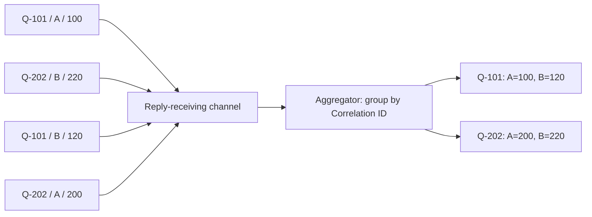

# Correlation ID

## 1. The Problem: Which Reply Belongs to Which Request?

A quote comparison service sends each request to two providers, A and B. Two customers request quotes almost simultaneously. Replies arrive in the following order:

```text
Request Q-101 → A returns 100
Request Q-202 → B returns 220
Request Q-101 → B returns 120
Request Q-202 → A returns 200
```

If the system simply pairs every two consecutive replies, it will build a quote containing data from two different customers. Arrival order does not represent business relationships; sharing the same thread, the same channel, or arriving closely in time does not prove messages belong to the same request either.

**A Correlation ID is a value that identifies a relationship among messages within a defined processing scope.** In the example above, the two replies for Q-101 carry the same key; the two replies for Q-202 carry a different key.



Within Spring Integration Core, you need to understand both uses: maintaining linkage to track a conversation and supplying a key to stateful endpoints, typically an aggregator. Those two uses can rely on different headers.

After this lesson, you will be able to choose correlation keys, set and read headers via API, preserve keys across a flow, recognize the effect of splitters, and test grouping when replies arrive interleaved.

## 2. Correlation ID in the Message Model

Spring Integration uses the constant `IntegrationMessageHeaderAccessor.CORRELATION_ID`, whose header name is `correlationId`. The value has type `Object`; `String` and `UUID` are two commonly convenient choices. `MessageHeaders.ID` identifies a specific message, whereas a Correlation ID links multiple messages. A message's header map cannot be mutated directly. See the [Message model and standard headers](https://docs.spring.io/spring-integration/reference/message.html).

Example relationships among identifiers:

| Identifier | Example | Meaning in the quote flow |
| --- | --- | --- |
| Message ID | `m-01`, `m-02` | Two distinct reply messages; labels here are shortened for readability |
| Correlation ID | `quote:T1:Q-101:run-1` | Two replies belonging to the same quote request run |
| Business ID | `Q-101` | The business entity being quoted |
| Event ID | `provider-A-event-888` | A specific event, which may be redelivered multiple times |
| Trace ID | A value managed by the tracing system | Links spans for execution observability |
| Reply channel | `quoteResults` | Destination receiving the result |

These rows can be related, yet they do not replace one another. Order Q-101 may be quoted multiple times; each run needs its own reply group. A redelivered event can still belong to the same exchange. A trace can span multiple subgroups.

In particular, **Correlation ID is not a signal that "enough replies have arrived."** Inside an aggregator, `CorrelationStrategy` selects the group, while `ReleaseStrategy` decides when to emit the result. By default, an aggregator reads the key from the `correlationId` header and uses a sequence-size-based release strategy. See [correlation and release principles](https://docs.spring.io/spring-integration/reference/aggregator.html).

## 3. Choosing Keys by Conversation Boundaries

### 3.1. Identifying What Must Match

For the quote service, define a group by:

```text
tenant + operation + business request + business execution run
```

An illustrative contract:

```text
quote:tenant-01:Q-101:run-1
quote:tenant-01:Q-101:run-2
quote:tenant-02:Q-101:run-1
```

These three keys differ because the three processing runs must remain independent. This is a design choice for the example; Spring Integration does not enforce this string structure.

In practice, you can generate a random UUID for the exchange and store tenant, business ID, and operation in separate headers. That avoids string parsing and reduces the risk of ambiguous concatenation boundaries. If you use a composite key, define delimiter escaping rules or use a structured encoding.

### 3.2. Distinguishing Retries from a New Request

| Scenario | Recommended policy for the example |
| --- | --- |
| Same reply redelivered because broker did not receive ack | Keep the same Correlation ID and Event ID |
| Re-calling one provider within the same active quote run | Keep the Correlation ID; handle duplicates per provider/event |
| Customer intentionally requests a fresh quote | Create a new execution run and a new Correlation ID |
| Reply from an old run arrives after a new run has started | Keep the old key so it does not merge into the new group |

Do not generate a new UUID in every transformer or upon receiving each reply. If A and B each generate their own key, the aggregator only sees two incomplete groups.

Conversely, a fixed value such as `quote` merges every request into the same group. Using only the customer ID is also too broad if a customer sends multiple concurrent requests.

### 3.3. Using Stable Values and Consistent Types

A key must have proper `equals()` and `hashCode()` implementations and must not mutate while the group exists. Both sides must agree on the type: a `UUID` and its string representation are not equal in Java.

When implementing a custom `CorrelationStrategy`, return a deterministic key or raise a clear error when one cannot be determined. Do not use `null` as a catch-all group for keyless messages. The API contract is documented at [CorrelationStrategy](https://docs.spring.io/spring-integration/api/org/springframework/integration/aggregator/CorrelationStrategy.html).

## 4. Creating, Reading, and Preserving Correlation ID

### 4.1. Creating Once at the Start of the Exchange

The snippet below demonstrates creating a request; it is not a full flow configuration yet:

```java
import java.util.UUID;

import org.springframework.integration.IntegrationMessageHeaderAccessor;
import org.springframework.messaging.Message;
import org.springframework.messaging.support.MessageBuilder;

String conversationId = UUID.randomUUID().toString();

Message<String> request = MessageBuilder
        .withPayload("Quote request Q-101")
        .setHeader("businessCorrelationId", conversationId)
        .setHeader("quoteRequestId", "Q-101")
        .setHeader(IntegrationMessageHeaderAccessor.CORRELATION_ID,
                conversationId)
        .build();

Object groupKey = request.getHeaders().get(
        IntegrationMessageHeaderAccessor.CORRELATION_ID);

IntegrationMessageHeaderAccessor accessor =
        new IntegrationMessageHeaderAccessor(request);

Object sameGroupKey = accessor.getCorrelationId();
```

In this example, `businessCorrelationId` is application-managed to identify the overall exchange. The standard `correlationId` header initially equals that value so replies can be correlated directly. When a flow contains a splitter, the two values may diverge as explained in section 6.

If the contract specifies that the header must be a string, you can read it via `get(CORRELATION_ID, String.class)`. Before using it, check for missing or mistyped values at the entry boundary.

### 4.2. Creating a New Message from an Existing Message

A custom transformer can lose metadata if it builds a message solely from the new payload. When you need to retain headers within the same internal processing flow, you can write:

```java
import org.springframework.messaging.Message;
import org.springframework.messaging.support.MessageBuilder;

public final class TextNormalizer {

    public Message<String> normalize(Message<String> input) {
        return MessageBuilder
                .withPayload(input.getPayload().trim())
                .copyHeaders(input.getHeaders())
                .build();
    }
}
```

`copyHeaders()` copies metadata without overwriting the reserved `id` and `timestamp` headers. Do not rely on Message ID to maintain identity across steps that construct new messages. Builder operations are described in [MessageBuilder](https://docs.spring.io/spring-framework/docs/current/javadoc-api/org/springframework/messaging/support/MessageBuilder.html).

This is an example of copying within the same application. At boundaries sending to external systems, explicitly select which fields to transmit rather than forwarding every internal header.

When a framework transformer returns a plain payload, the endpoint propagates headers from the request message. When returning a `Message` directly, actively verify the resulting header contract; creating a new message does not automatically prove the Correlation ID was preserved properly. See [transformer configuration and behavior](https://docs.spring.io/spring-integration/reference/transformer.html).

### 4.3. Enriching Headers Without Overwriting Arbitrarily

A header enricher is suitable when you need to initialize a key if the header does not yet exist. The standalone DSL snippet below uses the standard header:

```java
// Chained snippet inside an IntegrationFlow.
.enrichHeaders(headers -> headers
        .correlationIdFunction(
                message -> java.util.UUID.randomUUID().toString(),
                false))
```

The `false` argument expresses a policy not to overwrite an existing header. Place this step at the start of a valid exchange. If a reply that ought to carry a key from the request is missing it, generating a new key at the reply intake point masks a protocol bug and creates orphan groups. See the [correlationIdFunction API](https://docs.spring.io/spring-integration/api/org/springframework/integration/dsl/HeaderEnricherSpec.html).

## 5. Propagating Keys Across Endpoints, Channels, and Protocols

A Correlation ID is data read per a contract, not a mechanism that automatically coordinates all components. The table below serves as a design guide for the quote flow:

| Component / Boundary | What to keep clear |
| --- | --- |
| MessageChannel | Messages from multiple requests can share one channel; a channel does not define the exchange |
| Transformer | Payload type may change, but the key must still identify the same request |
| Router | Selecting a branch does not replace identifying the group at the convergence point |
| Filter | If part of a sequence is dropped, revisit the group completion condition |
| Gateway | Map arguments and headers per contract; do not infer that reply channel is the Correlation ID |
| Outbound adapter | Encode the key into the field agreed upon by the protocol and partner |
| Inbound adapter | Read the external field, validate it, and map it back to the internal header |

Example contract between the application and a provider:

```text
Internal request:
  correlationId = "quote:T1:Q-101:run-1"

Outbound partner request:
  requestCorrelation = "quote:T1:Q-101:run-1"

Partner response:
  requestCorrelation = "quote:T1:Q-101:run-1"

Internal reply message:
  correlationId = "quote:T1:Q-101:run-1"
```

The name `requestCorrelation` here is an illustrative contract, not a standard header in HTTP, JMS, or AMQP. Exact mapper configuration depends on the adapter. Simply setting a header in Java does not guarantee the partner receives it or echoes it back.

For a reply-receiving gateway, you can declare explicit mappings:

```java
package example.integration.correlation;

import org.springframework.integration.annotation.MessagingGateway;
import org.springframework.messaging.handler.annotation.Header;

import example.integration.correlation.QuoteCorrelationConfig.QuoteReply;

import static org.springframework.integration.IntegrationMessageHeaderAccessor.*;

@MessagingGateway(defaultRequestChannel = "quoteReplies")
public interface QuoteReplyGateway {

    void accept(
            QuoteReply reply,
            @Header(CORRELATION_ID) String correlationId,
            @Header(SEQUENCE_NUMBER) int sequenceNumber,
            @Header(SEQUENCE_SIZE) int sequenceSize);
}
```

This interface uses the model in section 7. For Spring to create the gateway proxy, enable `@IntegrationComponentScan` for the package containing the interface, or register the gateway via equivalent configuration. The `void` method only submits each reply into the flow; the aggregated result is received on a separate channel. Gateway registration and header mapping are described in [Messaging Gateways](https://docs.spring.io/spring-integration/reference/gateway.html).

## 6. Splitter Correlation ID Has Its Own Scope

### 6.1. From One Message to a Sequence

When `applySequence` is enabled, a splitter adds metadata to the generated parts: `correlationId`, `sequenceNumber`, `sequenceSize`. For collections with a known size, this metadata supports reassembly. For an iterator/stream whose size is unknown, do not assume a sequence-count release strategy will always work. See [Splitter and sequence metadata](https://docs.spring.io/spring-integration/reference/splitter.html).

In the standard splitter implementation, the split layer's key is derived from the input message's Message ID rather than simply keeping a previously assigned business Correlation ID. You can inspect the child message preparation method directly in [AbstractMessageSplitter](https://raw.githubusercontent.com/spring-projects/spring-integration/v6.4.0/spring-integration-core/src/main/java/org/springframework/integration/splitter/AbstractMessageSplitter.java).

Symbolic example:

```text
Before split:
  id                    = M-ROOT
  businessCorrelationId = C-QUOTE
  correlationId         = C-QUOTE
  payload               = [item-A, item-B]

After split:
  message A:
    id                    = M-A
    businessCorrelationId = C-QUOTE
    correlationId         = M-ROOT
    sequenceNumber        = 1
    sequenceSize          = 2

  message B:
    id                    = M-B
    businessCorrelationId = C-QUOTE
    correlationId         = M-ROOT
    sequenceNumber        = 2
    sequenceSize          = 2
```

`M-ROOT`, `M-A`, and `M-B` are merely readable labels for Message IDs. The outcome shows two boundaries: the whole quote conversation is C-QUOTE; the reassembly group for this split is M-ROOT.

### 6.2. Why Not Force Every Layer to Share One Header?

Consider the flow:

```text
order
  → split by package
  → split each package by item
  → aggregate item results into a package
  → aggregate package results into an order
```

If every message at every layer were forced to carry the same order-level `correlationId`, the inner aggregator could mix items from different packages. A separate business header tracks the overall order, while sequence metadata accurately represents the group at each layer.

Spring Integration supports saving nested correlations and restoring metadata upon exiting an aggregate layer. The `popSequence` property controls popping the processed layer's metadata; the default is `true`. Do not disable it solely to retain a value for logging. See the [setPopSequence API](https://docs.spring.io/spring-integration/api/org/springframework/integration/aggregator/AbstractCorrelatingMessageHandler.html#setPopSequence(boolean)).

With a publish-subscribe channel or recipient list router creating branches that must be reassembled by sequence, explicitly enable `applySequence`; do not assume they always share the same default as a splitter. See [sequence notes before an aggregator](https://docs.spring.io/spring-integration/reference/aggregator.html).

## 7. Java DSL Example: Correlating Two Quotes by Key

### 7.1. Contract and Scope of the Example

The example uses Java 17, the Spring Integration 6.x Java DSL API, and JUnit Jupiter for tests. The project needs `spring-integration-core` with compatible Spring dependencies and JUnit Jupiter. Exact versions should be managed by your project's BOM/dependency management.

This is a standalone Spring configuration and does not require Spring Boot. Replies are simulated to focus on correlation; no provider outbound adapters are included yet.

| Data | Convention |
| --- | --- |
| Payload | `QuoteReply(provider, amount)` |
| `correlationId` | Non-blank string, unique per quote run |
| `sequenceNumber` | A is 1, B is 2 |
| `sequenceSize` | Always 2 |
| Delivery in example | Each provider sends exactly one valid reply before group completion |
| Amount unit | Thousands of VND, integer used to keep the example concise |

The flow uses a filter to separate keyless messages before the aggregator. This filter checks key presence under the string contract; it does not yet validate every payload, sequence, or authorization condition.

### 7.2. Full Configuration

Place the following code in `QuoteCorrelationConfig.java`:

```java
package example.integration.correlation;

import java.util.Map;
import java.util.stream.Collectors;

import org.springframework.context.annotation.Bean;
import org.springframework.context.annotation.Configuration;
import org.springframework.integration.channel.DirectChannel;
import org.springframework.integration.channel.QueueChannel;
import org.springframework.integration.config.EnableIntegration;
import org.springframework.integration.dsl.IntegrationFlow;
import org.springframework.integration.store.SimpleMessageStore;
import org.springframework.messaging.Message;

import static org.springframework.integration.IntegrationMessageHeaderAccessor
        .CORRELATION_ID;

@Configuration
@EnableIntegration
public class QuoteCorrelationConfig {

    public record QuoteReply(String provider, long amount) {
    }

    public record QuoteSummary(
            String correlationId,
            Map<String, Long> amounts) {
    }

    @Bean
    public DirectChannel quoteReplies() {
        return new DirectChannel();
    }

    @Bean
    public QueueChannel quoteResults() {
        return new QueueChannel();
    }

    @Bean
    public QueueChannel invalidQuoteReplies() {
        return new QueueChannel();
    }

    @Bean
    public QueueChannel discardedQuoteReplies() {
        return new QueueChannel();
    }

    @Bean
    public SimpleMessageStore quoteGroupStore() {
        return new SimpleMessageStore();
    }

    @Bean
    public IntegrationFlow quoteRepliesFlow() {
        return IntegrationFlow.from(quoteReplies())
                .filter(
                        "headers['correlationId'] instanceof T(java.lang.String)"
                                + " and !headers['correlationId'].isBlank()",
                        filter -> filter.discardChannel(invalidQuoteReplies()))
                .aggregate(aggregator -> aggregator
                        .messageStore(quoteGroupStore())
                        .outputProcessor(group -> {
                            Message<?> first = group.getOne();
                            String key = first.getHeaders()
                                    .get(CORRELATION_ID, String.class);

                            Map<String, Long> amounts = group.getMessages()
                                    .stream()
                                    .map(message ->
                                            (QuoteReply) message.getPayload())
                                    .collect(Collectors.toUnmodifiableMap(
                                            QuoteReply::provider,
                                            QuoteReply::amount));

                            return new QuoteSummary(key, amounts);
                        })
                        .groupTimeout(30_000)
                        .sendPartialResultOnExpiry(false)
                        .expireGroupsUponCompletion(false)
                        .expireGroupsUponTimeout(false)
                        .discardChannel(discardedQuoteReplies()))
                .channel(quoteResults())
                .get();
    }
}
```

`@Configuration` here keeps the default proxy mode so calls between `@Bean` methods reference the same channel/store beans. If you switch to `proxyBeanMethods = false`, change to dependency injection instead of keeping direct method calls.

### 7.3. Reading the Configuration by Responsibility

The flow does not declare a `correlationStrategy`, so it uses the standard header to group messages. It does not declare a `releaseStrategy`, so it uses the default sequence mechanism. `outputProcessor` only creates the output data from the released group; it does not choose the group. Output-building APIs are documented in [AggregatorSpec](https://docs.spring.io/spring-integration/api/org/springframework/integration/dsl/AggregatorSpec.html).

`QuoteSummary` stores the key inside the payload so the result contract does not depend on whether sequence headers are kept, removed, or restored after aggregation. In this example, the receiver reads `summary.correlationId()`.

`groupTimeout(30_000)` is the wait duration when the group cannot release yet, reset upon the most recent arriving message. `sendPartialResultOnExpiry(false)` chooses to discard incomplete groups rather than publishing them as a complete quote. Both `expireGroupsUpon...` flags are set to `false` to retain markers of closed groups and route late replies to the discard channel. This is the example's policy. See [timeouts and group lifecycle](https://docs.spring.io/spring-integration/reference/aggregator.html#aggregator-and-group-timeout).

An in-memory store and retaining closed groups are suitable for demonstration. For long-running production execution, you need a metadata cleanup policy and resource bounds; when recovery across restarts is needed, you need a persistent store. Do not treat this configuration as a guarantee of business completion after arbitrary failures.

## 8. Testing Correlation with Interleaved Replies

A test that sends all Q-101 data first and only then sends Q-202 easily misses shared-key bugs. The crucial case is leaving both groups open concurrently and sending interleaved replies.

Place the following code in `QuoteCorrelationTest.java`, in the same package as the configuration:

```java
package example.integration.correlation;

import java.util.Map;

import org.junit.jupiter.api.Test;
import org.springframework.context.annotation.AnnotationConfigApplicationContext;
import org.springframework.integration.channel.QueueChannel;
import org.springframework.messaging.Message;
import org.springframework.messaging.MessageChannel;
import org.springframework.messaging.support.MessageBuilder;

import example.integration.correlation.QuoteCorrelationConfig.QuoteReply;
import example.integration.correlation.QuoteCorrelationConfig.QuoteSummary;

import static org.junit.jupiter.api.Assertions.*;
import static org.springframework.integration.IntegrationMessageHeaderAccessor.*;

class QuoteCorrelationTest {

    @Test
    void interleavedRepliesRemainInSeparateGroups() {
        try (var context = new AnnotationConfigApplicationContext(
                QuoteCorrelationConfig.class)) {

            MessageChannel input = context.getBean(
                    "quoteReplies", MessageChannel.class);
            QueueChannel output = context.getBean(
                    "quoteResults", QueueChannel.class);

            assertTrue(input.send(reply("Q-101-run-1", "A", 100, 1)));
            assertTrue(input.send(reply("Q-202-run-1", "B", 220, 2)));
            assertNull(output.receive(0));

            assertTrue(input.send(reply("Q-101-run-1", "B", 120, 2)));
            QuoteSummary first = summary(output.receive(0));
            assertEquals("Q-101-run-1", first.correlationId());
            assertEquals(Map.of("A", 100L, "B", 120L), first.amounts());
            assertNull(output.receive(0));

            assertTrue(input.send(reply("Q-202-run-1", "A", 200, 1)));
            QuoteSummary second = summary(output.receive(0));
            assertEquals("Q-202-run-1", second.correlationId());
            assertEquals(Map.of("A", 200L, "B", 220L), second.amounts());
            assertNull(output.receive(0));
        }
    }

    @Test
    void missingCorrelationIdIsRejectedBeforeAggregation() {
        try (var context = new AnnotationConfigApplicationContext(
                QuoteCorrelationConfig.class)) {

            MessageChannel input = context.getBean(
                    "quoteReplies", MessageChannel.class);
            QueueChannel invalid = context.getBean(
                    "invalidQuoteReplies", QueueChannel.class);
            QueueChannel output = context.getBean(
                    "quoteResults", QueueChannel.class);

            Message<QuoteReply> malformed = MessageBuilder
                    .withPayload(new QuoteReply("A", 100))
                    .setHeader(SEQUENCE_NUMBER, 1)
                    .setHeader(SEQUENCE_SIZE, 2)
                    .build();

            assertTrue(input.send(malformed));
            assertNotNull(invalid.receive(0));
            assertNull(output.receive(0));
        }
    }

    @Test
    void lateReplyDoesNotStartAnotherGroupWhileCompletionIsRetained() {
        try (var context = new AnnotationConfigApplicationContext(
                QuoteCorrelationConfig.class)) {

            MessageChannel input = context.getBean(
                    "quoteReplies", MessageChannel.class);
            QueueChannel output = context.getBean(
                    "quoteResults", QueueChannel.class);
            QueueChannel discarded = context.getBean(
                    "discardedQuoteReplies", QueueChannel.class);

            assertTrue(input.send(reply("Q-101-run-1", "A", 100, 1)));
            assertTrue(input.send(reply("Q-101-run-1", "B", 120, 2)));
            assertNotNull(output.receive(0));

            assertTrue(input.send(reply("Q-101-run-1", "A", 100, 1)));
            assertNotNull(discarded.receive(0));
            assertNull(output.receive(0));
        }
    }

    private static Message<QuoteReply> reply(
            String correlationId,
            String provider,
            long amount,
            int sequenceNumber) {

        return MessageBuilder
                .withPayload(new QuoteReply(provider, amount))
                .setHeader(CORRELATION_ID, correlationId)
                .setHeader(SEQUENCE_NUMBER, sequenceNumber)
                .setHeader(SEQUENCE_SIZE, 2)
                .build();
    }

    private static QuoteSummary summary(Message<?> message) {
        assertNotNull(message);
        return assertInstanceOf(QuoteSummary.class, message.getPayload());
    }
}
```

The reply intake path in this configuration uses a `DirectChannel`, so filter and aggregate steps execute synchronously on the sending thread. `receive(0)` checks the queue immediately after `send()` returns; it does not wait for the group timeout timer. When switching to asynchronous processing, use a bounded wait or appropriate synchronization condition instead of adding arbitrary `Thread.sleep()` calls.

The three test cases verify three distinct properties: no group mixing, rejecting keyless messages, and blocking late replies while completion markers remain. They do not test persistence, timeouts, duplicates prior to completion, or external adapters.

A `send()` returning `true` means the channel accepted the send according to its mechanism; in the missing-key case, the message still goes to the filter's discard channel. Do not treat that return value as proof that a valid quote was produced.

## 9. Using a Business Header as the Grouping Key

Some flows need to group by `quoteRequestCorrelation` while the `correlationId` header serves another internal sequence. You can configure the aggregator to read the business header:

```java
import org.springframework.integration.aggregator
        .HeaderAttributeCorrelationStrategy;

// Alternative configuration snippet inside an IntegrationFlow.
.aggregate(aggregator -> aggregator
        .correlationStrategy(new HeaderAttributeCorrelationStrategy(
                "quoteRequestCorrelation"))
        .releaseStrategy(group -> group.getMessages().stream()
                .map(message -> ((QuoteCorrelationConfig.QuoteReply)
                        message.getPayload()).provider())
                .collect(java.util.stream.Collectors.toSet())
                .containsAll(java.util.Set.of("A", "B"))))
```

This is a standalone variant to illustrate two strategies, not a mandatory addition to section 7's configuration. Before the aggregator, verify that the `quoteRequestCorrelation` header has a valid value and that the payload matches the contract. `HeaderAttributeCorrelationStrategy` reads the key from the configured header name; see the [header-based strategy API](https://docs.spring.io/spring-integration/api/org/springframework/integration/aggregator/HeaderAttributeCorrelationStrategy.html).

In this variant, the release condition requires both A and B. It does not conclude "enough" merely because two messages arrived. However, releasing by provider set is **not deduplication yet**: the group can still hold multiple A replies. If you keep section 7's `outputProcessor`, you must handle duplicate replies beforehand or define how to select the valid reply, because `toUnmodifiableMap()` fails on duplicate keys.

Choosing a business key must also ensure you do not accidentally merge sub-sequences sharing the same business ID. Only switch strategies after clearly defining the new group boundaries and completion condition.

## 10. Correlation Does Not Solve Every State Problem

### 10.1. Duplicates and Invalid Sequences

`SimpleSequenceSizeReleaseStrategy` compares the number of messages in the group against `sequenceSize`; it does not check for duplicate `sequenceNumber` values. Thus, two A replies with different Message IDs can make the group reach size 2 even without B. See [SimpleSequenceSizeReleaseStrategy](https://docs.spring.io/spring-integration/api/org/springframework/integration/aggregator/SimpleSequenceSizeReleaseStrategy.html).

Under the quote contract, address these concerns separately:

| Concern | Information needed |
| --- | --- |
| Which exchange does the reply belong to? | Correlation ID |
| Is this a redelivery of the same event? | Event ID and received state |
| Have all required sources arrived? | Expected provider list and release strategy |
| Which of two different A replies should win? | Version, effective timestamp, or business rule |
| Will the generated result be written twice? | Idempotency constraint at the result sink |

Do not deduplicate by Correlation ID alone: two valid replies from A and B inherently share that value.

### 10.2. Timeouts and Late Replies

Suppose A has replied, while B loses connectivity. The group still needs a time-based exit path and a way to handle the missing part. For the quote domain, you can choose to fail the whole run or publish a partial result with an explicit status; those two policies yield different outputs.

If you delete all traces after closing a group, a late reply carrying the same key can start a new group. If you keep completion markers forever, metadata grows unboundedly. Therefore, retention design must cover the reply acceptance window, redelivery window, and replay policy.

In section 7's example, group markers are kept in the store to demonstrate blocking late replies. When adding cleanup for completed groups, re-test behavior after cleanup occurs rather than assuming late-reply blocking lasts forever.

### 10.3. Persistence and Multiple Instances

Headers only carry the identifier; pending data waiting to be aggregated lives in the message group store. An in-memory store does not retain groups across process restarts. Selecting a persistent store must fit your payload/header types and flow recovery strategy. See [Message Store](https://docs.spring.io/spring-integration/reference/message-store.html).

If two instances process the same exchange while each has its own private store, they can each hold different incomplete halves. A deployment design must clearly define processing partitioning or shared state. When multiple instances update groups concurrently, an appropriate locking mechanism is needed; the `lockRegistry` API provides synchronization by group ID. See [CorrelationHandlerSpec.lockRegistry](https://docs.spring.io/spring-integration/api/org/springframework/integration/dsl/CorrelationHandlerSpec.html#lockRegistry(org.springframework.integration.support.locks.LockRegistry)).

These are additional decisions surrounding state. They do not change the principle that the same group must be identified by the same stable key.

## 11. Correlation in Error Handling and Flow Observability

### 11.1. Finding the Key from a Failed Message

An error represented as an `ErrorMessage` is a separate message. Do not assume `ErrorMessage.getHeaders().getId()` is the failed message's ID, or that the `correlationId` header is always copied onto the error message.

When the error payload is a `MessagingException`, you can obtain the failed message via `getFailedMessage()`. Some error paths also provide `ErrorMessage.getOriginalMessage()`. Handle the case where no original message is present. Then read the key from the right message to log, route to an error channel, or report failure status.

In synchronous flows on a `DirectChannel`, exceptions can be thrown back to the sender. In asynchronous processing, configure an appropriate error path. Do not assume every exception automatically becomes a message on the global `errorChannel`. See [Error Handling](https://docs.spring.io/spring-integration/reference/error-handling.html).

### 11.2. Logging Enough to Trace a Group

A log entry can include:

```text
stage=quote-reply-received
businessCorrelationId=quote:T1:Q-101:run-1
groupCorrelationId=quote:T1:Q-101:run-1
messageId=...
provider=A
sequenceNumber=1
sequenceSize=2
eventId=provider-A-event-888
```

After a split layer, `groupCorrelationId` can differ from `businessCorrelationId`; logging both helps explain the relationship. Also log group opened, released, timed-out, and late-discard events when lifecycle investigation is needed.

Do not put individual Correlation IDs into metric labels because every request creates a new value. Metrics should count open groups, timed-out groups, or discarded replies; specific IDs belong in searchable logs or traces.

At external inputs, validate the key's length, format, and tenant scope against the contract. A correlation string sent by a partner is not proof of authentication or authorization to read results.

## 12. Diagnosing Common Errors

| Symptom | Hypothesis to check | Fix per contract |
| --- | --- | --- |
| Groups never complete | Each reply generates a new key | Propagate the key from the same request |
| Results mix multiple requests | Static key or overly broad business ID | Add tenant/run scope, or use a dedicated conversation ID |
| Messages rejected before aggregator | Missing/wrong-typed header | Inspect mapper and reply intake contract |
| Looks like same UUID but different groups | One side is `UUID`, the other is `String` | Normalize types at the boundary |
| Correlation ID changes after splitter | Observing the split layer's sequence key | Keep business correlation in a separate header |
| Count reached but B is missing | Duplicate A with a new Message ID | Deduplicate and release by required sources |
| Group incomplete after filter | Filter drops a message while `sequenceSize` stays the same | Change release strategy or emit a compensating result per design |
| Late reply creates a new group | Group marker was deleted | Adjust retention, per-run key, and late-reply policy |
| Restart loses progress | Store is in memory | Choose persistence and a recovery plan |
| Gateway times out despite right key | Reply path or timeout misconfigured | Separately verify reply contract and gateway configuration |

Investigate using a concrete exchange: trace the business key from input, inspect the group key immediately before the aggregator, verify reply counts/sources, and then inspect the group-closing event. This separates key-propagation bugs from release-condition or state-management bugs.

## 13. Extended Practice

Starting from section 7's configuration, perform these exercises in order:

1. Send two replies with the same Business ID but two Correlation IDs from different runs; verify they do not produce a combined result.
2. Send two A replies with different Message IDs before B arrives; observe the limitation of count-based release, then add a rule to detect duplicate events.
3. Send only A, use a shorter timeout in a test configuration, and wait with a bounded timeout for the discard; verify no complete result appears on `quoteResults`.
4. Insert a payload-transforming transformer before the aggregate step while preserving the header contract; check the key before and after transformation.
5. Create a separate split–aggregate flow, set `businessCorrelationId` before splitting, and observe both key types simultaneously.

For extensions involving timers or multiple threads, test with bounded waits and separate test timings from production timings. The goal is to prove the relationship between messages and group lifecycles rather than merely asserting that some result was emitted.
