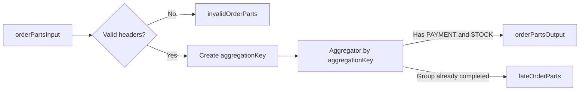

# Correlation key expression

## 1. What Problem Does a Correlation Expression Solve?

In the **Correlation and state** chapter of the **SPRING_INTEGRATION_CORE** module, a correlation key expression is an expression that determines which state group a message belongs to. When many messages travel across `MessageChannel`s, arrive from multiple sources, or appear interleaved, an aggregator needs to know which messages must wait for one another to produce a combined result.

For example, an order processing flow receives two kinds of results: `PAYMENT` and `STOCK`. The payment result for order `O-42` must be combined with the inventory result for that exact order, for the same tenant and the same processing attempt. If the expression uses only `orderId`, two tenants with colliding order IDs could be grouped together by mistake.

This lesson focuses on designing expressions and group keys; the examples use `Message`, headers, filters, header enrichers, aggregators, and Java DSL to connect correlation rules to a concrete integration flow. After this lesson, you will be able to:

- Choose input data and output types for a correlation expression.
- Distinguish correlation from release, message identity, and duplicate prevention.
- Configure expressions using Java DSL or XML.
- Design grouping keys with clear tenant and processing-attempt scopes.
- Define behavior for missing keys, late messages, or application restarts.
- Write tests proving that messages meant to be combined are grouped correctly and independent groups are never mixed.

## 2. Model: From One Message to One Group Key

A correlation expression can be modeled as follows:

```text
E: Message<?> -> correlationKey

message A --E--> key K --+
                        +--> group K --> check release --> result
message B --E--> key K --+

message C --E--> key L -----> group L --> keep waiting
```

`E` executes on **each individual incoming Message**, not on the entire group. The returned value is the key used to look up or create a group within the endpoint's storage scope.

The `CorrelationStrategy` contract is defined by the method `Object getCorrelationKey(Message<?> message)`. A strategy that cannot determine a valid key should throw an exception; do not design a flow around a `null` key. See the [CorrelationStrategy contract](https://docs.spring.io/spring-integration/api/org/springframework/integration/aggregator/CorrelationStrategy.html).

A good key contract must satisfy the following design conditions:

| Condition | Meaning in the order flow |
| --- | --- |
| Complete | Every valid message yields a determinable key |
| Consistent | PAYMENT and STOCK from the same processing attempt produce the same key |
| Isolated | Different tenants, orders, or attempts produce different keys |
| Stable | A retry of the same event does not generate a new key |
| Comparable | `equals()` and `hashCode()` accurately reflect group identity |
| Store-compatible | Key type, length, and encoding are compatible with the chosen store |

Do not use `hashCode()` as the group key itself: two different keys can have the same hash. Nor should you use a mutable object and modify fields participating in `equals()` or `hashCode()` after it has been used as a key.

### 2.1. Identifiers Commonly Confused

| Value | Identifies | Suitable as a group key? |
| --- | --- | --- |
| `headers['id']` | One specific Message | Usually no; every Message has its own ID |
| `headers['correlationId']` | Correlation relationship established by the flow | Yes, when that relationship matches the needed group |
| `orderId` | Business order | Maybe, but tenant and attempt must also be considered |
| `eventId` | Event used for deduplication | Usually used to prevent duplicates inside the group |
| `traceId` | Observability scope of distributed tracing | Use only if a contract proves it matches the group scope |
| `aggregationKey` | Application-defined business header | Yes, if properly created and preserved |

The name `aggregationKey` in this lesson is an optional application header, not a mandatory Spring Integration header name. A gateway or adapter cannot infer a business key merely from receiving a request.

## 3. What Object Is the Expression Evaluated Against?

For a correlation expression, the root object is the Message being processed. Therefore, you can access `payload`, `headers`, or use `#root` to refer explicitly to that Message. Spring Integration also supports referencing beans in expressions; see [SpEL in Spring Integration](https://docs.spring.io/spring-integration/reference/spel.html).

| Expression | Data assumption | Expected value |
| --- | --- | --- |
| `headers['orderId']` | Header already contains the order ID | `"O-42"` |
| `#root.headers['aggregationKey']` | Header already contains the normalized key | Composite key string |
| `payload.orderId` | Payload has a readable `orderId` property | Order ID from JavaBean |
| `payload['orderId']` | Payload is a `Map` | Value for key `orderId` |
| `@orderPartPolicy.keyFor(#root)` | Bean has a method accepting `Message` | Key according to business rules |

If the payload is a JavaBean, `payload.orderId` usually relies on the `getOrderId()` getter. If the payload is a JSON string, do not assume `payload.orderId` parses JSON automatically. Convert the payload to a DTO/Map or configure an appropriate JSON accessor before using the expression.

### 3.1. Three Kinds of Expressions, Three Responsibilities

| Configuration | Question to answer | Context to understand |
| --- | --- | --- |
| Correlation expression | Which group does this Message belong to? | A single `Message<?>` |
| Release expression | Is the group ready to emit a result? | A `MessageGroup` |
| Output processor | What shape does the group result take? | The messages selected for aggregation |

In the XML example, `correlation-strategy-expression="headers['orderId']"` selects the group from the Message header, while `release-strategy-expression="size() == 2"` checks the MessageGroup size. The two expressions do not share the same root object. Keep this in mind when reading [aggregator configuration](https://docs.spring.io/spring-integration/reference/aggregator.html).

A correct correlation expression can still be paired with a flawed release strategy. For instance, two duplicate PAYMENT messages share the same key, yet they do not prove that STOCK has arrived.

### 3.2. Expression Strings vs. Literal Strings

In Java DSL:

```java
.correlationExpression("headers['orderId']")
```

The double quotes belong to Java syntax. The text inside is SpEL reading the header.

By contrast:

```java
.correlationExpression("'orderId'")
```

The second expression returns the constant string `orderId` for every Message. Every message entering the endpoint uses that exact same key.

Do not wrap expressions as `"#{headers['orderId']}"` out of habit from writing Spring bean expressions. The `correlationExpression(...)` API takes the raw SpEL expression directly.

## 4. Basic Configuration in Java DSL and XML

### 4.1. Java DSL

The following configuration assumes Messages already carry a valid `aggregationKey` header and each group has exactly two distinct messages:

```java
@Bean
IntegrationFlow aggregatePairs() {
    return IntegrationFlow.from("partsInput")
            .aggregate(a -> a
                    .correlationExpression("headers['aggregationKey']")
                    .releaseExpression("size() == 2"))
            .channel("pairsOutput")
            .get();
}
```

In `AggregatorSpec`, the method name is `correlationExpression(...)`. This API configures an `ExpressionEvaluatingCorrelationStrategy`; there is no mandatory step to define a strategy bean yourself just to read a header. See [CorrelationHandlerSpec](https://docs.spring.io/spring-integration/api/org/springframework/integration/dsl/CorrelationHandlerSpec.html).

`size() == 2` here is only an illustrative condition when the input contract guarantees completeness and no duplicates. The hands-on section later uses result type to determine release.

### 4.2. XML

The corresponding configuration using the `int` namespace:

```xml
<beans xmlns="http://www.springframework.org/schema/beans"
       xmlns:xsi="http://www.w3.org/2001/XMLSchema-instance"
       xmlns:int="http://www.springframework.org/schema/integration"
       xsi:schemaLocation="
         http://www.springframework.org/schema/beans
         https://www.springframework.org/schema/beans/spring-beans.xsd
         http://www.springframework.org/schema/integration
         https://www.springframework.org/schema/integration/spring-integration.xsd">

    <int:channel id="partsInput"/>

    <int:aggregator id="aggregatePairs"
                    input-channel="partsInput"
                    output-channel="pairsOutput"
                    correlation-strategy-expression="headers['aggregationKey']"
                    release-strategy-expression="size() == 2"/>

    <int:channel id="pairsOutput">
        <int:queue/>
    </int:channel>
</beans>
```

Choose one way to configure correlation for the endpoint: an expression or a referenced strategy. Do not specify both `correlation-strategy` and `correlation-strategy-expression` in XML.

### 4.3. When to Use the Default?

If no custom correlation strategy is configured, the aggregator uses the `IntegrationMessageHeaderAccessor.CORRELATION_ID` header, named `correlationId`. Splitter flows typically create correlation and sequence headers so parts can be reassembled. The default release depends on sequence information; merely sharing a correlation ID is not enough to guarantee the group will release. These default mechanisms are described in the [aggregator documentation](https://docs.spring.io/spring-integration/reference/aggregator.html).

When constructing Messages manually from independent sources, decide explicitly:

- Use the splitter sequence contract if the Messages genuinely belong to the same split operation.
- Use a business key and custom release strategy if you are combining independent business events.

For flows with nested splitters or multiple aggregation stages, track the correlation scope at each stage. An order key may be too broad for an inner subgroup representing a specific batch or processing attempt.

## 5. Designing Group Keys by Business Scope

Suppose a group must represent precisely the triple:

```text
(tenantId, orderId, attemptId)
```

Here `attemptId` is the ID of **one business processing attempt**, issued by the orchestrating source and passed to both PAYMENT and STOCK. Transport retries of the same event must preserve this ID. If each producer generates a random `attemptId`, the two results will never meet.

### 5.1. Why orderId Alone Is Insufficient

| Message | tenantId | orderId | attemptId | partType |
| --- | --- | --- | --- | --- |
| m1 | T-A | O-42 | A-1 | PAYMENT |
| m2 | T-B | O-42 | A-1 | STOCK |
| m3 | T-A | O-42 | A-2 | STOCK |
| m4 | T-A | O-42 | A-1 | STOCK |

Desired design outcome:

- `m1` and `m4` belong to the same group.
- `m2` is separated because of a different tenant.
- `m3` is separated because of a different processing attempt.

If `headers['orderId']` is used, all four Messages produce key `O-42`. If only tenant is added, `m1` can still be combined with `m3`.

### 5.2. Delimiters Can Cause Collisions

The short string concatenation expression:

```text
headers['tenantId'] + ':' + headers['orderId']
```

is safe only when the data contract forbids or escapes the delimiter. If values are allowed to contain `:`:

```text
tenantId = "a:b", orderId = "c"   -> "a:b:c"
tenantId = "a",   orderId = "b:c" -> "a:b:c"
```

Two distinct identifiers produce the same string. This is an encoding collision even though `String.equals()` works completely fine.

An encoding with unambiguous boundaries prefixes each component with its length:

```text
encode(x) = length(x) + ":" + x

key = "order-parts:v1:"
      + encode(tenantId)
      + encode(orderId)
      + encode(attemptId)
```

Example:

```text
("T-A", "O-42", "A-1")
-> order-parts:v1:3:T-A4:O-423:A-1
```

This convention is a design choice for the example, not a format required by Spring Integration. If multiple languages must construct keys together, specify exact length measurement and character encoding; Java's `String.length()` counts UTF-16 code units. For the example in this lesson, a single Java bean is responsible for creating the key.

### 5.3. Normalization Can Alter Identity

Do not automatically call `trim()` or convert to lowercase without a business rule. `O-42` and `o-42` could be two distinct codes. Converting UUIDs to strings or numbers to strings must also be performed consistently across all sources.

An easily verifiable contract is: all three components are non-blank Strings issued by an authoritative source and kept unchanged throughout a single processing attempt.

## 6. Complete Example: Combining PAYMENT and STOCK

The example targets Java 17+ and a project containing `spring-integration-core` and compatible Spring dependencies. This configuration can be used directly in a Spring application; Spring Boot is not required to create an `ApplicationContext`.

Processing flow:



### 6.1. Bean Containing the Input Contract and Key Creation Rules

```java
package example.correlation;

import org.springframework.messaging.Message;

public class OrderPartPolicy {

    public boolean isValid(Message<?> message) {
        return hasTextHeader(message, "tenantId")
                && hasTextHeader(message, "orderId")
                && hasTextHeader(message, "attemptId")
                && isExpectedPart(message.getHeaders().get("partType"));
    }

    public String keyFor(Message<?> message) {
        if (!isValid(message)) {
            throw new IllegalArgumentException("Invalid order-part headers");
        }

        String tenantId = message.getHeaders().get("tenantId", String.class);
        String orderId = message.getHeaders().get("orderId", String.class);
        String attemptId = message.getHeaders().get("attemptId", String.class);

        return "order-parts:v1:"
                + segment(tenantId)
                + segment(orderId)
                + segment(attemptId);
    }

    private boolean hasTextHeader(Message<?> message, String name) {
        Object value = message.getHeaders().get(name);
        return value instanceof String text && !text.isBlank();
    }

    private boolean isExpectedPart(Object value) {
        return "PAYMENT".equals(value) || "STOCK".equals(value);
    }

    private String segment(String value) {
        return value.length() + ":" + value;
    }
}
```

`keyFor(...)` re-validates the contract so that when called directly from another place, it does not silently generate keys for incomplete data. In the example, the filter routes invalid data to a separate channel before creating state.

`tenantId` must be authenticated at the system boundary. A header having the right type and being non-blank does not prove the sender is authorized to submit data for that tenant.

### 6.2. Java DSL

```java
package example.correlation;

import java.util.Set;
import java.util.stream.Collectors;

import org.springframework.context.annotation.Bean;
import org.springframework.context.annotation.Configuration;
import org.springframework.integration.channel.DirectChannel;
import org.springframework.integration.channel.QueueChannel;
import org.springframework.integration.config.EnableIntegration;
import org.springframework.integration.dsl.IntegrationFlow;

@Configuration
@EnableIntegration
public class CorrelationKeyConfig {

    @Bean
    public DirectChannel orderPartsInput() {
        return new DirectChannel();
    }

    @Bean
    public QueueChannel orderPartsOutput() {
        return new QueueChannel();
    }

    @Bean
    public QueueChannel invalidOrderParts() {
        return new QueueChannel();
    }

    @Bean
    public QueueChannel lateOrderParts() {
        return new QueueChannel();
    }

    @Bean
    public OrderPartPolicy orderPartPolicy() {
        return new OrderPartPolicy();
    }

    @Bean
    public IntegrationFlow orderPartsFlow() {
        return IntegrationFlow.from("orderPartsInput")
                .filter("@orderPartPolicy.isValid(#root)",
                        f -> f.discardChannel("invalidOrderParts"))
                .enrichHeaders(h -> h.headerExpression(
                        "aggregationKey",
                        "@orderPartPolicy.keyFor(#root)",
                        true))
                .aggregate(a -> a
                        .correlationExpression("headers['aggregationKey']")
                        .releaseStrategy(group -> group.getMessages().stream()
                                .map(message -> message.getHeaders()
                                        .get("partType", String.class))
                                .collect(Collectors.toSet())
                                .containsAll(Set.of("PAYMENT", "STOCK")))
                        .expireGroupsUponCompletion(false)
                        .discardChannel("lateOrderParts"))
                .channel("orderPartsOutput")
                .get();
    }
}
```

Points to read together:

1. The filter validates the contract before the aggregator receives the Message.
2. The header enricher recomputes `aggregationKey` from the validated components.
3. The `true` parameter allows overwriting an existing `aggregationKey`, avoiding keeping a wrong key sent by an external source. The meaning of this parameter is documented in [HeaderEnricherSpec](https://docs.spring.io/spring-integration/api/org/springframework/integration/dsl/HeaderEnricherSpec.html).
4. The correlation expression simply reads the prepared key, making the header observable immediately before the aggregator.
5. The release strategy waits for both result types; two PAYMENT messages cannot substitute for PAYMENT and STOCK.
6. The configuration retains completed-group markers so later Messages with the same key go to `lateOrderParts`. If groups are deleted on completion, the same key can start a new group; this is the behavior of [expireGroupsUponCompletion](https://docs.spring.io/spring-integration/api/org/springframework/integration/dsl/AggregatorSpec.html).

In this configuration, the aggregation result uses the default processor. Once two distinct results arrive, the output payload is a list of their payloads; do not rely on the order of PAYMENT/STOCK inside that list. If the business needs an aggregated DTO with fixed fields, add a custom output processor.

This is an example focused on keys and group boundaries. It does not yet configure timeouts, persistent storage, queue capacity limits, or event deduplication. Those parts must be defined before using the flow under real operational load.

### 6.3. Progression of Messages

Sending `m1`, `m2`, `m3`, `m4` from the table in section 5 in order:

| Step | Group updated | Result types in group | Output |
| --- | --- | --- | --- |
| m1 | T-A / O-42 / A-1 | PAYMENT | None yet |
| m2 | T-B / O-42 / A-1 | STOCK | None yet |
| m3 | T-A / O-42 / A-2 | STOCK | None yet |
| m4 | T-A / O-42 / A-1 | PAYMENT, STOCK | One aggregated result |

The remaining two groups are still missing components. Another PAYMENT for `T-A/O-42/A-1` after that group completes goes to `lateOrderParts` while completion markers remain.

If PAYMENT is delivered twice before STOCK arrives, the release strategy still waits for STOCK. However, when STOCK arrives, the output list may contain both PAYMENT messages. To ensure each type appears exactly once in the output, add deduplication or an appropriate output rule; a correlation expression does not provide that guarantee.

## 7. Choosing an Expression or a Java Strategy?

For a rule that reads a single header, an expression is concise and easy to scan:

```java
.correlationExpression("headers['aggregationKey']")
```

When validation, versioning, or key encoding is needed, you can use a bean like the example above. Another option is to omit the header enrichment step and call the bean directly inside the correlation expression:

```java
.correlationExpression("@orderPartPolicy.keyFor(#root)")
```

This removes one step from the flow, though it does not pre-populate the key on a header for inspection.

If the team wants compile-time type checking, you can configure the strategy via a method reference in a bean receiving the policy as a parameter:

```java
@Bean
IntegrationFlow typedCorrelationFlow(OrderPartPolicy policy) {
    return IntegrationFlow.from("typedPartsInput")
            .aggregate(a -> a
                    .correlationStrategy(policy::keyFor)
                    .releaseExpression("size() == 2"))
            .channel("typedPartsOutput")
            .get();
}
```

This snippet only illustrates replacing a correlation expression with a strategy; it assumes inputs are already validated and there are exactly two messages to combine. It is an alternative flow for reference, not a mandatory addition to section 6's configuration.

Whichever option you choose, the key-computation function should be fast and side-effect-free. Avoid HTTP calls or querying mutable data to compute keys per Message. If a lookup returns different results between PAYMENT and STOCK, they can enter two different groups despite belonging to the same processing attempt.

## 8. Missing Keys, Wrong Keys, and Error Handling Boundaries

### 8.1. Do Not Use a Shared Default Key to Mask Missing Data

An expression such as:

```text
headers['orderId'] ?: 'UNKNOWN'
```

pushes every Message missing an order ID into the same `UNKNOWN` group. A fallback lets the expression return a value while breaking business boundaries.

Similarly, returning an empty string or generating a new UUID at the aggregator does not solve missing data: an empty string merges invalid records together, whereas a new UUID scatters related parts.

Options must align with the input contract:

- Filter invalid Messages to a data-inspection channel.
- Validate and throw an exception if the caller must fix the data.
- Enrich metadata before the aggregator when a reliable deterministic source exists.

In section 6's example, `invalidOrderParts` is a discard channel configured on the filter, not an automatic `errorChannel`.

### 8.2. SpEL Exceptions Differ from Filter Discards

Expression syntax errors usually appear when the configuration is parsed. Property access or type errors may only surface when a specific Message is evaluated. Returning `null` from an expression does not create a valid business group either.

With `DirectChannel` and direct `send(...)` calls, processing runs on the sender's thread; handler exceptions typically propagate back to the caller. Do not assume every expression error automatically becomes an `ErrorMessage` on the global `errorChannel`. Asynchronous flows, pollers, and messaging gateways have their own error-routing mechanisms; see [Error Handling](https://docs.spring.io/spring-integration/reference/error-handling.html).

When recording errors, retain enough context to identify the endpoint, missing field, and key version. If an outer retry layer is added, permanent data errors must be classified to avoid futile repeated retries.

## 9. Group Keys and State Lifecycle

The expression determines group identity, whereas group lifetime is a separate decision. If STOCK never arrives, picking the right key still will not complete the group on its own.

### 9.1. Decisions That Must Accompany It

| Decision | Question to answer |
| --- | --- |
| Release | Which result types prove the business has sufficient data? |
| Timeout | How long to wait, from what point, and how to handle incomplete groups? |
| Completion | How long to retain completion markers to recognize late messages? |
| Key reuse | Does a new processing attempt get a new `attemptId` or reuse the old key? |
| Retry | Does redelivering the same event preserve tenant/order/attempt? |
| Recovery | After a restart, where are pending groups and completion markers stored? |

You can add `groupTimeout(...)` and a policy to emit partial results or discard, but read the endpoint's timer semantics carefully. Do not infer from a timeout number that it is an absolute business deadline. You also need a group and completion-marker cleanup policy aligned with the redelivery window.

### 9.2. Storing State and Multi-Instance Deployment

By default, `SimpleMessageStore` stores state in memory. If groups must survive restarts, choose a persistent `MessageGroupStore` and verify how the store persists payloads, headers, and keys; implementations differ in serialization mechanisms. See [Message Store](https://docs.spring.io/spring-integration/reference/message-store.html).

A key with a valid `equals()` inside the JVM is not enough to conclude every store saves and retrieves it as expected. Test round trips with the actual implementation, especially when using custom key objects.

If multiple instances update the same store concurrently, the design must coordinate cross-instance locking, transactions, and redelivery policies. A correlation expression does not create an exactly-once guarantee on its own.

The `order-parts:v1:` prefix in the example distinguishes key contracts. When upgrading to `v2`, plan for pending `v1` groups. Changing the expression while state is active can split a single processing attempt across old and new key formats.

If two endpoints share a store, decide explicitly whether they share a group namespace. Choose separate stores or distinct key namespaces when they represent two independent business workflows; key collisions between two endpoints can turn into state conflicts.

## 10. Testing Correlation Expressions

Tests should verify **business boundaries**, not just prove SpEL can read a header. The snippets below are illustrative code to put into a learning project; they are not pre-existing test run results.

### 10.1. Testing the Expression and Data Pairs

The following JUnit Jupiter example uses Spring's `Message` API and the expression-evaluating strategy:

```java
package example.correlation;

import org.junit.jupiter.api.Test;
import org.springframework.integration.aggregator.ExpressionEvaluatingCorrelationStrategy;
import org.springframework.messaging.Message;
import org.springframework.messaging.support.MessageBuilder;

import static org.junit.jupiter.api.Assertions.*;

class CorrelationExpressionTest {

    private final OrderPartPolicy policy = new OrderPartPolicy();

    private final ExpressionEvaluatingCorrelationStrategy strategy =
            new ExpressionEvaluatingCorrelationStrategy(
                    "headers['aggregationKey']");

    @Test
    void relatedPartsHaveSameKeyButOtherScopesDoNot() {
        Object payment = key("T-A", "O-42", "A-1", "PAYMENT");
        Object stock = key("T-A", "O-42", "A-1", "STOCK");

        assertEquals(payment, stock);
        assertNotEquals(payment, key("T-B", "O-42", "A-1", "STOCK"));
        assertNotEquals(payment, key("T-A", "O-42", "A-2", "STOCK"));
        assertNotEquals(payment, key("T-A", "O-43", "A-1", "STOCK"));
    }

    @Test
    void separatorsInsideValuesDoNotCreateSameKey() {
        assertNotEquals(
                key("a:b", "c", "A-1", "PAYMENT"),
                key("a", "b:c", "A-1", "STOCK"));
    }

    @Test
    void missingBusinessIdentityIsRejected() {
        Message<String> invalid = MessageBuilder.withPayload("payment-ok")
                .setHeader("orderId", "O-42")
                .setHeader("attemptId", "A-1")
                .setHeader("partType", "PAYMENT")
                .build();

        assertFalse(policy.isValid(invalid));
        assertThrows(IllegalArgumentException.class,
                () -> policy.keyFor(invalid));
    }

    private Object key(
            String tenant, String order, String attempt, String part) {

        Message<String> source = MessageBuilder.withPayload(part)
                .setHeader("tenantId", tenant)
                .setHeader("orderId", order)
                .setHeader("attemptId", attempt)
                .setHeader("partType", part)
                .build();

        Message<?> prepared = MessageBuilder.fromMessage(source)
                .setHeader("aggregationKey", policy.keyFor(source))
                .build();

        return strategy.getCorrelationKey(prepared);
    }
}
```

`ExpressionEvaluatingCorrelationStrategy` is the implementation used to evaluate expressions on Messages; the constructor accepting an expression string is described in the [strategy API](https://docs.spring.io/spring-integration/api/org/springframework/integration/aggregator/ExpressionEvaluatingCorrelationStrategy.html).

### 10.2. Testing the Flow with Interleaved Data

This test reuses the two classes from section 6. Each test creates a fresh `ApplicationContext` so incomplete groups do not affect other tests.

```java
package example.correlation;

import java.util.List;

import org.junit.jupiter.api.Test;
import org.springframework.context.annotation.AnnotationConfigApplicationContext;
import org.springframework.integration.channel.QueueChannel;
import org.springframework.messaging.Message;
import org.springframework.messaging.MessageChannel;
import org.springframework.messaging.support.MessageBuilder;

import static org.junit.jupiter.api.Assertions.*;

class CorrelationKeyFlowTest {

    @Test
    void interleavedMessagesReleaseOnlyTheirOwnGroup() {
        try (var context =
                     new AnnotationConfigApplicationContext(
                             CorrelationKeyConfig.class)) {

            MessageChannel input =
                    context.getBean("orderPartsInput", MessageChannel.class);
            QueueChannel output =
                    context.getBean("orderPartsOutput", QueueChannel.class);
            QueueChannel late =
                    context.getBean("lateOrderParts", QueueChannel.class);
            QueueChannel invalid =
                    context.getBean("invalidOrderParts", QueueChannel.class);

            assertTrue(input.send(part("T-A", "A-1", "PAYMENT", "a-payment")));
            assertTrue(input.send(part("T-B", "A-1", "STOCK", "b-stock")));
            assertTrue(input.send(part("T-A", "A-2", "STOCK", "a2-stock")));
            assertNull(output.receive(0));

            assertTrue(input.send(part("T-A", "A-1", "STOCK", "a-stock")));

            Message<?> result = output.receive(0);
            assertNotNull(result);
            List<?> payloads = assertInstanceOf(List.class, result.getPayload());
            assertEquals(2, payloads.size());
            assertTrue(payloads.containsAll(List.of("a-payment", "a-stock")));
            assertNull(output.receive(0));

            assertTrue(input.send(
                    part("T-A", "A-1", "PAYMENT", "late-a-payment")));
            assertNotNull(late.receive(0));
            assertNull(output.receive(0));

            assertTrue(input.send(MessageBuilder.withPayload("bad").build()));
            assertNotNull(invalid.receive(0));
        }
    }

    private Message<String> part(
            String tenant, String attempt, String type, String payload) {

        return MessageBuilder.withPayload(payload)
                .setHeader("tenantId", tenant)
                .setHeader("orderId", "O-42")
                .setHeader("attemptId", attempt)
                .setHeader("partType", type)
                .build();
    }
}
```

`receive(0)` is suitable here because the input is a `DirectChannel` and processing is synchronous. When replacing it with an executor or poller, tests must use bounded waits suited to an asynchronous model; do not copy these timing assumptions verbatim to another flow.

Additional scenarios to test when implementing the corresponding mechanisms:

| Scenario | What to prove |
| --- | --- |
| PAYMENT redelivered before STOCK | Does not release just because two Messages of the same type arrived |
| Incoming `aggregationKey` header set incorrectly | Header enricher recomputes key from validated identities |
| Value is `Long` in source A, `String` in source B | Type contract rejects it or normalizes consistently |
| STOCK is never received | Group is handled per the chosen timeout policy |
| Restart after PAYMENT | Persistent store restores the group and accepts subsequent STOCK |
| Completion markers cleaned up, then old Message arrives | Group reopening or replay blocking matches design |
| Key version changed while groups are pending | Does not split one processing attempt across two formats |

## 11. Diagnosing Errors from Group Symptoms

| Symptom | Key-related possibility | Investigation direction |
| --- | --- | --- |
| Many single-Message groups | Using message ID, new UUID, or inconsistent `attemptId` | Compare key values and types of two Messages that should combine |
| Output contains another tenant's data | Missing tenant in key or unvalidated header | Cross-check tenant source and key generation rules |
| Old PAYMENT combined with new STOCK | Missing processing-attempt identifier | Trace where `attemptId` is issued and propagated |
| All Messages enter one huge group | Literal expression or shared fallback | Check quotation marks and missing-data handling |
| Logs show all events arrived, yet group is incomplete | Type mismatch, whitespace, or key version mismatch | Log components and version right before the aggregator |
| New Message discarded despite right order ID | Key matches an already completed group | Check `attemptId` and completion-marker retention duration |
| Groups fail only after restart | Key or header not persisted/restored as expected | Check store, serializer, and type contract |

A useful observation point is immediately after the header enricher: endpoint, key version, validated tenant and attempt, Message type, and computed key. If the key contains sensitive data, log a masked value or fingerprint conforming to your logging policy.

Do not use correlation keys as unbounded metric labels because the number of keys can be very large. Aggregate metrics such as pending group count, group age, missing-metadata Messages, and late Messages are far easier to operate.

An overly broad key causes independent events to contend on the same group. An overly narrow key scatters data that should combine into many incomplete groups. Thus, key quality affects both business correctness and the amount of state retained.

## 12. Application Rules

A good correlation key expression is a concise representation of a well-defined identity contract. Start from the question "which Messages must wait for one another within exactly one processing attempt?", determine the identity components, validate them at intake, and only then choose the expression.

In the illustrative flow, that contract is `tenantId + orderId + attemptId` with an unambiguous encoding. The filter protects incoming data, the header enricher builds the key for observability, the aggregator groups by key, and the release strategy waits for both PAYMENT and STOCK. Timeouts, state persistence, deduplication, and late-message handling are then designed as distinct parts of the same integration flow.
