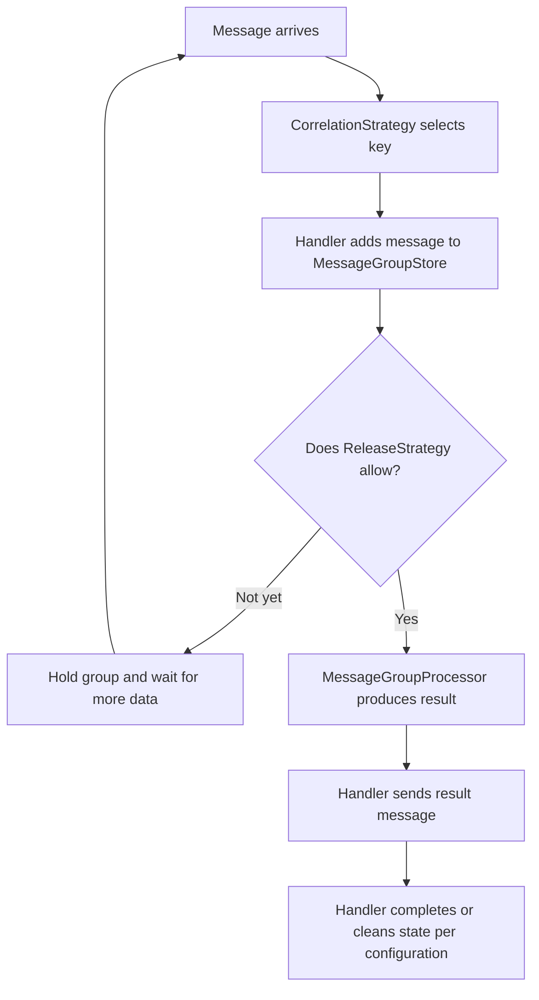

# MessageGroupProcessor

## 1. Objective and Scope

In the **Correlation and state** chapter of the **SPRING_INTEGRATION_CORE** module, `MessageGroupProcessor` is the extension point that transforms a group of related messages into the result the flow should emit. For an aggregator, the result is typically a single aggregated message: multiple order lines become one summary, multiple service replies become one decision, or multiple data fragments become one document.

After this lesson, you will be able to:

- Distinguish the responsibilities of a correlation strategy, release strategy, message store, and group processor.
- Implement a processor with a clear input contract, output contract, and header policy.
- Wire a processor into an aggregator using Java DSL.
- Explain the impact of duplicate messages, late messages, timeouts, and state retention.
- Design tests for both the aggregation algorithm and the integration flow.

You need familiarity with `Message<T>`, payload, headers, `MessageChannel`, Spring beans, and the structure of an `IntegrationFlow`. The examples use **Java 17 or later** and the **Spring Integration 6.5.x** API; these are illustrative baselines, not assertions about your project's versions. The code snippets are meant for practice inside an application having the `org.springframework.integration:spring-integration-core` dependency; this lesson does not require creating extra build configuration.

## 2. Where the Processor Fits in a Stateful Flow

An aggregation flow must answer four distinct questions:

| Question | Responsible component | Order example |
| --- | --- | --- |
| Which group does the message belong to? | `CorrelationStrategy` | Same tenant, order ID, and revision |
| When is the group ready for processing? | `ReleaseStrategy` | All distinct line numbers have arrived |
| Where are waiting messages held? | `MessageGroupStore` | In-memory store or persistent store |
| From the current group, what result is produced? | `MessageGroupProcessor` | A summary and total amount |

The handler coordinates these components; the processor focuses on transforming the group as a whole. The coordination contract is defined in the [AbstractCorrelatingMessageHandler API](https://docs.spring.io/spring-integration/docs/6.5.0/api/org/springframework/integration/aggregator/AbstractCorrelatingMessageHandler.html).



The diagram describes the normal processing path. Timeout is a separate completion trigger; it is covered later.

In the order example, putting the total calculation inside the release strategy causes the aggregation algorithm to run every time a new line arrives. Waiting for all lines inside the processor using a loop or `sleep` ties up the processing thread for too long. Let the release strategy decide readiness, and let the processor compute the result from the data handed to it.

## 3. The MessageGroupProcessor Contract

The interface has a single functional method:

```java
Object processMessageGroup(MessageGroup group);
```

The input is a `MessageGroup`, not an individual `Message<?>`. The `Object` return type allows an implementation to return a payload, a `Message<?>`, or another result form suited to the handler using it. It can be implemented via a class, lambda, or method reference. A processor is also used in a resequencer context, so how outputs are emitted must be understood alongside the specific handler. See the [MessageGroupProcessor contract](https://docs.spring.io/spring-integration/docs/6.5.0/api/org/springframework/integration/aggregator/MessageGroupProcessor.html).

A minimal lambda, assuming every payload is a `BigDecimal`:

```java
import java.math.BigDecimal;
import org.springframework.integration.aggregator.MessageGroupProcessor;

MessageGroupProcessor sumProcessor = group ->
        group.getMessages().stream()
                .map(message -> (BigDecimal) message.getPayload())
                .reduce(BigDecimal.ZERO, BigDecimal::add);
```

This snippet illustrates only the algorithm. It does not validate payload types, currency, or data completeness. Returning zero for an empty group is also a business choice to weigh, not an unconditionally right behavior.

### Reading MessageGroup Properly

| API | Usage inside the processor |
| --- | --- |
| `getGroupId()` | Identifies the group in logs; do not blindly cast to `String` |
| `getMessages()` | Reads current messages to build the result |
| `size()` | Counts physical messages in the group |
| `getOne()` | Retrieves a representative message after checking the group is non-empty |
| `getTimestamp()`, `getLastModified()` | Observes group creation and modification timestamps |

`getOne()` does not represent "business line number 1." Nor does `size()` count unique business lines. The APIs and mutability of a group are described in [MessageGroup](https://docs.spring.io/spring-integration/docs/6.5.0/api/org/springframework/integration/store/MessageGroup.html).

In this lesson, the processor only reads the group, builds local collections, and returns a new result. It does not call `clear()`, `complete()`, or mutate the group's collection. This keeps lifecycle management in the handler and makes the algorithm independently testable.

## 4. Return Types and Number of Output Messages

Do not infer the number of emitted messages from the Java type name alone:

| Processor and return value | Meaning in an aggregator |
| --- | --- |
| `DefaultAggregatingMessageGroupProcessor` | Collects payloads into a collection in one message |
| Processor returning a DTO | The DTO is the payload of the result message |
| Processor returning `Message<DTO>` | Processor explicitly builds both payload and headers of the result |
| Custom processor returning `Collection<Message<?>>` on 6.5.x | The collection is placed inside the payload of a single message |
| `SimpleMessageGroupProcessor` | Uses the aggregator as a barrier, then releases each message in the group |

The default behavior is described in [DefaultAggregatingMessageGroupProcessor](https://docs.spring.io/spring-integration/docs/6.5.0/api/org/springframework/integration/aggregator/DefaultAggregatingMessageGroupProcessor.html); the barrier case has its own implementation in [SimpleMessageGroupProcessor](https://docs.spring.io/spring-integration/docs/6.5.0/api/org/springframework/integration/aggregator/SimpleMessageGroupProcessor.html).

Take note of versions: since **6.0**, a collection of messages returned by a custom processor is no longer split automatically into multiple outputs; since **6.5**, a plain processor can return a collection payload directly. When backward compatibility with older versions or header aggregation is needed, extend `AbstractAggregatingMessageGroupProcessor` or explicitly return a `Message`. These changes are noted in the [Aggregator 6.5 documentation](https://docs.spring.io/spring-integration/reference/6.5/aggregator.html).

The main example below returns `Message<Summary>`, so the output contract is expressed directly in code.

## 5. Problem Statement: Aggregating Order Lines

Suppose the system receives line-processing results from a source that may redeliver data. An order has three lines, yet arrival order might be `3, 3, 1, 2`.

Business contract for the example:

- The group key is `(tenantId, orderId, revision)`. Two tenants may use the same order ID.
- Each message carries `expectedLines`, line `number`, line amount, and currency.
- Valid line numbers lie in `1..expectedLines`.
- A repeated message with the same line number and same amount is counted only once.
- Same line number with a different amount is a data conflict.
- All lines in a group must agree on key, expected line count, and currency.
- Only complete summaries are produced; incomplete data on timeout goes to the discard branch.

| Incoming data | Business lines present | Result emitted? |
| --- | --- | --- |
| Line 3: 30000 VND | 3 | Not yet |
| Redelivery of line 3: 30000 VND | 3 | Not yet |
| Line 1: 100000 VND | 1, 3 | Not yet |
| Line 2: 70000 VND | 1, 2, 3 | Yes, total 200000 VND |

If `group.size() == 3` were used, the first three messages would already satisfy the condition even though line 2 has not arrived. This is why the release strategy and processor must share an understanding of business line identity.

`revision` represents a snapshot of order data. An adjustment must use a new revision; do not mix lines from old and new revisions and implicitly pick the latest arrival.

## 6. Implementing the Processor and Group Validation Rules

Classes in the example share the `demo.integration` package. The first class holds the data model, group reading rules, and aggregation algorithm:

```java
package demo.integration;

import java.math.BigDecimal;
import java.util.Currency;
import java.util.List;
import java.util.Objects;
import java.util.TreeMap;

import org.springframework.integration.aggregator.MessageGroupProcessor;
import org.springframework.integration.store.MessageGroup;
import org.springframework.messaging.Message;
import org.springframework.messaging.support.MessageBuilder;

public final class OrderGroupProcessor implements MessageGroupProcessor {

    public record OrderKey(String tenantId, String orderId, long revision) {
        public OrderKey {
            Objects.requireNonNull(tenantId, "tenantId");
            Objects.requireNonNull(orderId, "orderId");
            if (tenantId.isBlank() || orderId.isBlank() || revision < 0) {
                throw new IllegalArgumentException("Invalid order key");
            }
        }
    }

    public record Line(
            OrderKey key,
            int number,
            int expectedLines,
            BigDecimal amount,
            Currency currency) {

        public Line {
            Objects.requireNonNull(key, "key");
            Objects.requireNonNull(amount, "amount");
            Objects.requireNonNull(currency, "currency");
            if (expectedLines <= 0 || number < 1 || number > expectedLines) {
                throw new IllegalArgumentException("Invalid line number");
            }
            if (amount.signum() < 0) {
                throw new IllegalArgumentException("Negative line amount");
            }
        }
    }

    public record Summary(
            OrderKey key,
            List<Integer> lineNumbers,
            BigDecimal total,
            Currency currency) {

        public Summary {
            lineNumbers = List.copyOf(lineNumbers);
        }
    }

    private record Snapshot(
            OrderKey key,
            int expectedLines,
            Currency currency,
            List<Line> lines) {

        boolean complete() {
            return lines.size() == expectedLines;
        }
    }

    public static boolean canRelease(MessageGroup group) {
        return group.size() > 0 && snapshot(group).complete();
    }

    @Override
    public Message<Summary> processMessageGroup(MessageGroup group) {
        Snapshot snapshot = snapshot(group);
        if (!snapshot.complete()) {
            throw new IllegalStateException("Incomplete order group");
        }

        BigDecimal total = snapshot.lines().stream()
                .map(Line::amount)
                .reduce(BigDecimal.ZERO, BigDecimal::add);

        List<Integer> numbers = snapshot.lines().stream()
                .map(Line::number)
                .toList();

        Summary summary = new Summary(
                snapshot.key(), numbers, total, snapshot.currency());

        return MessageBuilder.withPayload(summary)
                .setHeader("tenantId", snapshot.key().tenantId())
                .setHeader("orderId", snapshot.key().orderId())
                .setHeader("revision", snapshot.key().revision())
                .setHeader("aggregatedLineCount", numbers.size())
                .build();
    }

    private static Snapshot snapshot(MessageGroup group) {
        if (group.size() == 0) {
            throw new IllegalArgumentException("Empty order group");
        }

        Line first = asLine(group.getOne());
        TreeMap<Integer, Line> unique = new TreeMap<>();

        for (Message<?> message : group.getMessages()) {
            Line line = asLine(message);

            if (!line.key().equals(first.key())
                    || line.expectedLines() != first.expectedLines()
                    || !line.currency().equals(first.currency())) {
                throw new IllegalStateException("Inconsistent order group");
            }

            Line previous = unique.putIfAbsent(line.number(), line);
            if (previous != null
                    && previous.amount().compareTo(line.amount()) != 0) {
                throw new IllegalStateException(
                        "Conflicting amount for line " + line.number());
            }
        }

        return new Snapshot(
                first.key(),
                first.expectedLines(),
                first.currency(),
                List.copyOf(unique.values()));
    }

    private static Line asLine(Message<?> message) {
        if (!(message.getPayload() instanceof Line line)) {
            throw new IllegalArgumentException("Expected Line payload");
        }
        return line;
    }
}
```

### Why Organize It This Way?

`snapshot()` is a shared rule for both the release strategy and the processor. If one side counts unique lines while the other sums all physical messages, the flow could still emit a wrong total. Sharing the rule keeps both steps consistent.

`TreeMap` both deduplicates by line number and produces output in ascending order. This order is chosen by the business domain and does not depend on message arrival order or the internal collection order of the store.

With distinct line numbers in `1..expectedLines`, having exactly `expectedLines` elements means all line numbers are present. That condition would no longer hold if line identifiers were arbitrary strings; in that case you would need to know the expected set of identifiers or use a different completion protocol.

`BigDecimal.compareTo()` treats `30000` and `30000.00` as the same monetary value. The example only sums pre-computed line amounts; tax rules, currency conversion, and rounding policies must be defined separately if required by your domain.

All mutable structures are local variables. There is no `currentOrder`, `runningTotal`, or shared map across invocations. A single processor bean can therefore process different groups without accidentally mixing state.

The records do not implement `Serializable`, because the example uses an in-memory store. When switching to a persistent store, design serialization for keys, payloads, and headers according to the chosen store.

## 7. Wiring into a Flow with Java DSL

```java
package demo.integration;

import org.springframework.context.annotation.Bean;
import org.springframework.context.annotation.Configuration;
import org.springframework.integration.channel.DirectChannel;
import org.springframework.integration.channel.QueueChannel;
import org.springframework.integration.config.EnableIntegration;
import org.springframework.integration.dsl.IntegrationFlow;
import org.springframework.integration.store.SimpleMessageStore;

@Configuration
@EnableIntegration
public class OrderAggregationConfig {

    @Bean
    public DirectChannel orderLinesInput() {
        return new DirectChannel();
    }

    @Bean
    public QueueChannel orderSummaryOutput() {
        return new QueueChannel();
    }

    @Bean
    public QueueChannel orderDiscardChannel() {
        return new QueueChannel();
    }

    @Bean
    public SimpleMessageStore orderGroupStore() {
        return new SimpleMessageStore();
    }

    @Bean
    public OrderGroupProcessor orderGroupProcessor() {
        return new OrderGroupProcessor();
    }

    @Bean
    public IntegrationFlow orderAggregationFlow(
            OrderGroupProcessor processor,
            SimpleMessageStore orderGroupStore) {

        return IntegrationFlow.from("orderLinesInput")
                .aggregate(aggregator -> aggregator
                        .messageStore(orderGroupStore)
                        .correlationStrategy(message ->
                                ((OrderGroupProcessor.Line)
                                        message.getPayload()).key())
                        .releaseStrategy(OrderGroupProcessor::canRelease)
                        .outputProcessor(processor)
                        .groupTimeout(30_000)
                        .sendPartialResultOnExpiry(false)
                        .expireGroupsUponCompletion(false)
                        .expireGroupsUponTimeout(false)
                        .discardChannel("orderDiscardChannel"))
                .channel("orderSummaryOutput")
                .get();
    }
}
```

`.outputProcessor(processor)` selects the result-building algorithm; `.channel("orderSummaryOutput")` selects where the result goes. These two decisions are independent. The processor-wiring API is documented at [AggregatorSpec.outputProcessor](https://docs.spring.io/spring-integration/docs/6.5.0/api/org/springframework/integration/dsl/AggregatorSpec.html).

The example uses a correlation strategy that extracts the key from the payload, so setting the `correlationId` header is unnecessary. It also uses a custom release strategy, so it does not depend on a splitter's `sequenceSize`. When using the default strategies in another flow, you must supply the corresponding headers.

The store, timeout, and discard options belong to [CorrelationHandlerSpec](https://docs.spring.io/spring-integration/docs/6.5.0/api/org/springframework/integration/dsl/CorrelationHandlerSpec.html). The two flags `expireGroupsUponCompletion(false)` and `expireGroupsUponTimeout(false)` are set intentionally to retain markers of completed groups; their implications are explained in the state section.

At intake, the example assumes only properly constructed `Line` objects arrive. With an adapter receiving JSON or external data, place a transformation and schema validation step before the aggregator. Casting inside the correlation strategy will fail on a wrong payload type; that is an input error to handle, not a "group incomplete" signal.

## 8. Running the Flow and Observing the Result

You can run the following snippet in the same application with Spring Integration on the classpath:

```java
package demo.integration;

import java.math.BigDecimal;
import java.util.Currency;
import java.util.Objects;

import org.springframework.context.annotation.AnnotationConfigApplicationContext;
import org.springframework.messaging.Message;
import org.springframework.messaging.MessageChannel;
import org.springframework.messaging.PollableChannel;
import org.springframework.messaging.support.MessageBuilder;

public final class OrderAggregationDemo {

    public static void main(String[] args) {
        try (var context = new AnnotationConfigApplicationContext(
                OrderAggregationConfig.class)) {

            MessageChannel input = context.getBean(
                    "orderLinesInput", MessageChannel.class);
            PollableChannel output = context.getBean(
                    "orderSummaryOutput", PollableChannel.class);

            var key = new OrderGroupProcessor.OrderKey(
                    "tenant-a", "ORD-42", 1);
            Currency vnd = Currency.getInstance("VND");

            input.send(message(key, 3, "30000", vnd));
            input.send(message(key, 3, "30000.00", vnd));
            input.send(message(key, 1, "100000", vnd));

            if (output.receive(0) != null) {
                throw new AssertionError("Released before line 2 arrived");
            }

            input.send(message(key, 2, "70000", vnd));

            Message<?> reply = Objects.requireNonNull(output.receive(1_000));
            var summary = (OrderGroupProcessor.Summary) reply.getPayload();

            System.out.println(summary.key());
            System.out.println(summary.lineNumbers());
            System.out.println(summary.total() + " " + summary.currency());
            System.out.println(reply.getHeaders().get("aggregatedLineCount"));
        }
    }

    private static Message<OrderGroupProcessor.Line> message(
            OrderGroupProcessor.OrderKey key,
            int number,
            String amount,
            Currency currency) {

        return MessageBuilder.withPayload(
                new OrderGroupProcessor.Line(
                        key, number, 3, new BigDecimal(amount), currency))
                .build();
    }
}
```

Expected business output:

```text
OrderKey[tenantId=tenant-a, orderId=ORD-42, revision=1]
[1, 2, 3]
200000 VND
3
```

Each `MessageBuilder` call creates a new message. The two line-3 messages still carry the same business identity; the algorithm does not rely on message ID to detect that they represent the same line.

A `true` return value from `input.send(...)` indicates the send operation was accepted by the channel and handler in use. It does not mean an order already has a summary. In the example, output data appears only after line 2 is received.

The flow uses a fixed output channel. If replaced by a request/reply gateway, design explicitly which request waits for the final reply, the gateway timeout, and how `replyChannel` is preserved or selected. Having every per-line call wait for a single aggregated result can cause calls to time out before the group completes.

## 9. Result Headers Are Part of the Contract

The main processor explicitly returns a `Message<Summary>` with business headers: tenant, order ID, revision, and aggregated line count. There is no blanket copying of all headers from an arbitrary line.

Define a policy for each kind of header:

| Header type | Decision required |
| --- | --- |
| Order and tenant identifiers | Must be consistent across lines and appear in the result |
| Currency | Must be consistent; never pick one arbitrarily |
| Trace or per-branch request IDs | Pick parent trace or record source list per observability convention |
| `replyChannel`, `errorChannel` | Keep or select according to the overall flow's routing model |
| Sequence headers | Respect splitter/aggregator context, especially in nested flows |

If you want the framework to aggregate headers, extend `AbstractAggregatingMessageGroupProcessor` and implement `aggregatePayloads(MessageGroup, Map<String, Object>)`. By default, headers with conflicting values are dropped; a message lacking a header is not automatically treated as a conflict. You can customize this via `setHeadersFunction(...)`. See [AbstractAggregatingMessageGroupProcessor](https://docs.spring.io/spring-integration/docs/6.5.0/api/org/springframework/integration/aggregator/AbstractAggregatingMessageGroupProcessor.html).

A minimal processor purely to illustrate producing a list payload:

```java
package demo.integration;

import java.util.Map;

import org.springframework.integration.aggregator.AbstractAggregatingMessageGroupProcessor;
import org.springframework.integration.store.MessageGroup;

public final class PayloadListProcessor
        extends AbstractAggregatingMessageGroupProcessor {

    @Override
    protected Object aggregatePayloads(
            MessageGroup group, Map<String, Object> defaultHeaders) {

        return group.getMessages().stream()
                .map(message -> message.getPayload())
                .toList();
    }
}
```

This class does not replace the deduplication or order validation rules from the main example. It illustrates how the base class constructs a message wrapping a collection payload.

When a custom processor already returns a `Message`, do not expect `headersFunction` to populate missing headers automatically: the delegate treats that message as already built by the processor. This behavior is described in [DelegatingMessageGroupProcessor](https://docs.spring.io/spring-integration/docs/6.5.0/api/org/springframework/integration/aggregator/DelegatingMessageGroupProcessor.html).

## 10. State, Late Messages, and Key Reuse

### State Lives in the Store and Handler

`SimpleMessageStore` is an in-memory store suitable for running the example. Restarting the process loses pending groups and completed-group markers. The no-arg constructor also sets no capacity limit. See [SimpleMessageStore](https://docs.spring.io/spring-integration/docs/6.5.0/api/org/springframework/integration/store/SimpleMessageStore.html).

For crash recovery requirements, choose a persistent store. Whether payloads, headers, and keys can be serialized depends on the implementation. Switching stores also does not automatically fix routing to a temporary reply channel of a lost process. See [Message Store](https://docs.spring.io/spring-integration/reference/message-store.html).

In the example, do not add a second group map inside `OrderGroupProcessor`. If that map does not share the exact lifecycle and transactions of the store, the two places can diverge after retries or restarts.

### Completing a Group Differs from Deleting Group Markers

With `expireGroupsUponCompletion(false)`, the aggregator completes the group and removes processed messages while retaining the completed-group marker. Late messages with the same key are recognized for discarding. If set to `true`, the group is deleted completely and a message with the same key can start a new group. See [lifecycle in AggregatingMessageHandler](https://docs.spring.io/spring-integration/docs/6.5.0/api/org/springframework/integration/aggregator/AggregatingMessageHandler.html).

This leads to concrete business decisions:

- Re-sending a line for `ORD-42/revision=1` after the order completes: treated as late data.
- Adjusting an order: use `revision=2`, creating a group with a different identity.
- Cleaning up completed markers after a retention period: accept that messages older than that period could reopen a group unless another replay-prevention mechanism exists.

The example intentionally omits completed-marker cleanup so late-arrival behavior is easy to observe. In a long-running system, set marker retention according to your actual redelivery window; keeping every key forever grows metadata even after payloads are removed.

### In-Group Deduplication Is Not End-to-End Idempotency

The processor ignores repeated copies of the same line within the active group. This does not guarantee the summary is written to the target system only once.

For example, the target system may have saved the summary before the connection dropped prior to the sender knowing the operation succeeded. On retry, the same result may be sent again. One option is to use `(tenantId, orderId, revision)` as a unique key in the target table or as an idempotency key for the write operation.

Do not use `MessageHeaders.ID` of the output message as a durable business identifier: recreating the message can produce a different ID. Protecting write operations must be tied to the identity of the business result.

## 11. Timeouts, Missing Data, and Errors

### Group Timeout Is Not Computation Timeout

In the configuration above, `groupTimeout(30_000)` waits roughly 30 seconds without a new message for an unreleased group. A new message can reset the wait schedule; this is not inherently a hard 30-second deadline from when the first line arrived.

On timeout, the handler re-evaluates the release strategy. If the group is still not ready, `sendPartialResultOnExpiry(false)` discards the data instead of producing a partial summary. `expireGroupsUponTimeout(false)` retains markers of groups completed by timeout. See [Aggregator timeout configuration](https://docs.spring.io/spring-integration/reference/6.5/aggregator.html#aggregator-and-group-timeout).

In the order example, if only lines 1 and 3 arrive:

1. No `Summary` is emitted.
2. Discarded data goes to `orderDiscardChannel`.
3. If line 2 arrives later with the same key while the marker is still retained, it does not resurrect that order.
4. To reprocess, use an explicit business workflow: issue a new revision or perform controlled recovery.

Enabling `sendPartialResultOnExpiry(true)` alone does not make the current processor support missing data. It still throws when `Snapshot` is incomplete. If partial results are needed, change the contract to a type that clearly distinguishes status, such as `PartialSummary` with the list of missing lines; the target system must understand and handle that type.

### Data Conflicts Are Errors, Not Timeout Discards

Inside `snapshot()`, mismatched currencies, mismatched expected line counts, or two conflicting amounts for one line all throw exceptions. The aggregator's discard branch does not automatically serve as the destination for every exception.

With `DirectChannel`, processing errors occur on the caller's thread and propagate back to the sender, possibly wrapped in a framework exception. With pollers or asynchronous processing, check how `ErrorMessage` is produced and configure the corresponding error handler. An `errorChannel` header does not automatically turn synchronous calls into asynchronous error handling. See [Error Handling](https://docs.spring.io/spring-integration/reference/error-handling.html).

One point to understand in the example: the handler already adds the message to the group before the release strategy inspects the entire group. Therefore, when a conflict is detected, do not assume the offending message is automatically removed from the store or that the whole group rolled back. Rollback behavior depends on transactions and the store.

In real applications, distinguish:

| Case | Handling to design |
| --- | --- |
| Payload fails schema validation | Reject or route to an inspection channel before the aggregator |
| One line has two conflicting values | Quarantine the batch and investigate the data source |
| Missing lines past timeout | Discard, record incomplete batch, and decide on reprocessing |
| Temporary store or target system outage | Bounded retries, accounting for transactions and idempotency |
| Error during timeout scheduler execution | Monitor the scheduler's error handler |

Retrying a group with conflicting data indefinitely cannot make two amounts consistent. Likewise, returning `null` to hide errors does not produce a manageable business result.

## 12. Testing the Algorithm and the Flow

### Testing the Processor Without Starting Spring

`SimpleMessageGroup` can be constructed directly to test the algorithm; constructors and adding messages are described in the [SimpleMessageGroup API](https://docs.spring.io/spring-integration/docs/6.5.0/api/org/springframework/integration/store/SimpleMessageGroup.html).

Example using JUnit Jupiter:

```java
package demo.integration;

import java.math.BigDecimal;
import java.util.Currency;
import java.util.List;

import org.junit.jupiter.api.Test;
import org.springframework.integration.store.SimpleMessageGroup;
import org.springframework.messaging.Message;
import org.springframework.messaging.support.MessageBuilder;

import static org.junit.jupiter.api.Assertions.*;

class OrderGroupProcessorTest {

    private final OrderGroupProcessor processor = new OrderGroupProcessor();
    private final OrderGroupProcessor.OrderKey key =
            new OrderGroupProcessor.OrderKey("tenant-a", "ORD-42", 1);

    @Test
    void repeatedLineDoesNotReleaseEarlyOrIncreaseTotal() {
        var group = new SimpleMessageGroup(key);
        group.add(line(2, "70000"));
        group.add(line(2, "70000.00"));

        assertFalse(OrderGroupProcessor.canRelease(group));

        group.add(line(1, "100000"));
        assertTrue(OrderGroupProcessor.canRelease(group));

        var result = processor.processMessageGroup(group);
        var summary = result.getPayload();

        assertEquals(List.of(1, 2), summary.lineNumbers());
        assertEquals(0, summary.total().compareTo(new BigDecimal("170000")));
        assertEquals(2, result.getHeaders().get("aggregatedLineCount"));
        assertEquals(3, group.size());
    }

    @Test
    void conflictingAmountsFailInsteadOfChoosingAnArbitraryWinner() {
        var group = new SimpleMessageGroup(key);
        group.add(line(1, "100000"));
        group.add(line(1, "110000"));

        assertThrows(IllegalStateException.class,
                () -> OrderGroupProcessor.canRelease(group));
    }

    @Test
    void incompleteGroupCannotProduceACompleteSummary() {
        var group = new SimpleMessageGroup(key);
        group.add(line(1, "100000"));

        assertThrows(IllegalStateException.class,
                () -> processor.processMessageGroup(group));
    }

    private Message<OrderGroupProcessor.Line> line(int number, String amount) {
        return MessageBuilder.withPayload(new OrderGroupProcessor.Line(
                        key,
                        number,
                        2,
                        new BigDecimal(amount),
                        Currency.getInstance("VND")))
                .build();
    }
}
```

In the first test, the group still holds three messages after the processor is invoked directly. This assertion shows that the processor does not clean up state itself. Whether the handler cleans up state as configured must be tested at the flow level.

### Scenarios That Must Be Verified at the Integration Level

| Scenario | What to confirm |
| --- | --- |
| All lines present but arriving out of order | Single summary emitted, sorted list of line numbers |
| Duplicates before group completion | Does not release early, total does not increase |
| Two tenants with the same `orderId` | Results do not mix data |
| Two revisions of the same order | Two independent groups |
| Message arrives after completion | Follows the late-message policy |
| One line missing until timeout | No complete summary emitted; discard data present |
| Currency mismatch or expected-lines conflict | Error observed on the right handling path |
| Multiple threads sending to the same key | Consistent result, no unexpected double aggregation |
| Result written and then a retry occurs | Target system handles duplicates via idempotency key |
| Restart while groups are pending | Recovery behavior matches the chosen store |

Timeout tests should configure a test-specific wait interval and receive from channels with a bounded wait. Avoid simply sleeping a fixed duration and assuming the scheduler already ran. When re-testing within the same Spring context, use distinct order keys or explicitly clean state, since the example retains completed-group markers.

The test snippets above are hands-on guidance; they are not reports that tests have been run in a repository.

## 13. Performance and Concurrency

Scanning the group in `snapshot()` is easy to read, though it has a cost. With `m` physical messages and `u` unique line numbers, building a `TreeMap` once takes roughly `O(m log u)` time and `O(u)` local memory. The release strategy re-runs this scan on every new message; total cost for a large group can grow nearly quadratically with incoming message count.

Before using this for large batches, evaluate:

- Maximum line count and acceptable redelivery count per order.
- Number of concurrently open groups, payload size, and retention duration.
- Cost of loading an entire group if using an out-of-process store.
- Drain rate of the output channel and discard branch.
- How long a group remains locked during aggregation.

Duplicates ignored during summation still occupy space in the store until the group completes. Deduplication inside the processor does not replace traffic shaping or an idempotent receiver at intake.

A processor should perform a bounded calculation on group data. Slow HTTP calls, sending emails, or writing to multiple systems directly inside the processor make retries and side-effect control harder. You can emit an immutable result first, then use downstream endpoints for tasks that have their own retry and idempotency policies.

The handler locks by group ID; the DSL lets you configure a `lockRegistry`. With multiple processes sharing a store, design locks and transactions to fit the deployment model. An in-memory lock inside one process does not coordinate with locks in another process. Configuration APIs are listed in [CorrelationHandlerSpec.lockRegistry](https://docs.spring.io/spring-integration/docs/6.5.0/api/org/springframework/integration/dsl/CorrelationHandlerSpec.html).

## 14. Choosing the Right Extension Approach

| Need | Approach |
| --- | --- |
| Only need a collection of payloads | Start with the default processor |
| Simple transformation, inputs already validated | Lambda or `outputExpression` is suitable |
| Domain rules with deduplication and consistency checks | Class implementing `MessageGroupProcessor` |
| Need framework header aggregation and custom payload | Extend `AbstractAggregatingMessageGroupProcessor` |
| Wait for group completion then release each original message | `SimpleMessageGroupProcessor` |
| Re-emit messages in sequence order | Look into resequencer and resequencing processors |

When building a custom processor, nail down three contracts first: how a group is identified, what constitutes sufficient data, and what a valid result contains. Then place each rule in the right component, explicitly validate headers, and design the state lifecycle. With this separation, the order aggregation algorithm stays small and easy to test while the Java DSL clearly shows how the flow waits, emits results, handles timeouts, and processes late messages.
