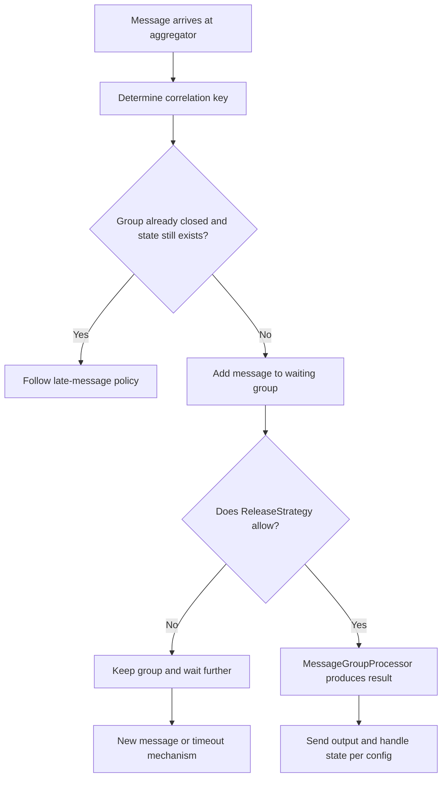

# ReleaseStrategy

> **Module:** SPRING_INTEGRATION_CORE  
> **Chapter:** Correlation and state

In Spring Integration, an aggregator can receive multiple messages belonging to the same business operation at different times. `ReleaseStrategy` decides **when a group's current state permits proceeding with aggregation**. That decision must reflect the data the business genuinely requires.

This lesson uses a flow combining completion signals for an order to explain the strategy contract, how to configure it in Java DSL, its relationship with timeouts and state, and how to test out-of-order arrivals, duplicates, and late messages.

## 1. Objectives and Prerequisites

After this lesson, you will be able to:

- Distinguish the responsibilities of `CorrelationStrategy`, `ReleaseStrategy`, and `MessageGroupProcessor`.
- Choose release conditions based on sequence, count, or a set of business conditions.
- Write a strategy that can be invoked repeatedly without causing side effects.
- Configure an aggregator not to emit a success result when only partial data has arrived.
- Design tests for incomplete groups, complete groups, and timeout/discard paths.

You need familiarity with `Message<?>` containing payload and headers, `MessageChannel` transporting messages, endpoints processing messages, and aggregators holding related messages inside a `MessageGroup`. The examples use Java 17+ syntax and Java DSL from `spring-integration-core`; no HTTP, Kafka, or AMQP adapters are needed to understand the mechanism.

## 2. From Correlation to Release

Suppose confirming an order requires three positive signals:

1. `PAYMENT`: payment has been approved.
2. `INVENTORY`: stock has been reserved.
3. `DELIVERY`: delivery arrangement has been prepared.

Signals for order `ORD-701` share one group, while signals for `ORD-702` belong to another. Upon receiving `PAYMENT` twice and `INVENTORY` once, the system still lacks `DELIVERY`, even though three messages have arrived.

| Component | Question to answer | Example in the order flow |
| --- | --- | --- |
| `CorrelationStrategy` | Which group does the message belong to? | Group key is `orderId`. |
| `MessageGroupStore` | Where is group state held? | Holds signals awaiting aggregation. |
| `ReleaseStrategy` | Is the current group ready? | Have all three required signal types arrived? |
| `MessageGroupProcessor` | What result is produced from the released group? | Creates `ReadyOrder`. |
| Timeout and cleanup policy | How long does an incomplete group wait, and how long is state kept? | Routes incomplete groups to discard; retains closed-group markers for an appropriate duration. |

The `ReleaseStrategy` contract accepts a `MessageGroup` and returns a boolean; it is a functional interface so it can be implemented via a class, lambda, or method reference. [ReleaseStrategy API](https://docs.spring.io/spring-integration/api/org/springframework/integration/aggregator/ReleaseStrategy.html)

```java
import org.springframework.integration.aggregator.ReleaseStrategy;
import org.springframework.integration.store.MessageGroup;

public final class ThreeMessagesReleaseStrategy implements ReleaseStrategy {
    @Override
    public boolean canRelease(MessageGroup group) {
        return group.size() >= 3;
    }
}
```

The example above expresses only a count threshold. It works if the input contract guarantees any three messages suffice, yet it does not satisfy the order problem.

`false` means do not release yet under the condition being evaluated. It does not mean the message is rejected, is not an exception, and is not a request to redeliver the message. `true` permits the aggregator to proceed to produce output; this boolean by itself does not confirm that downstream business transactions succeeded.

## 3. Progression of a Group

The diagram below shows the normal processing branch conceptually, not a commitment to transaction order or internal operations of specific store types:



A group can be evaluated multiple times. Never write a strategy assuming it runs only once when data becomes sufficient. Timeout-related callbacks can also trigger another evaluation without a new message arriving.

For `ORD-701`, an expected progression is:

| Arrival | Signal type | Types seen so far | Allow release? |
| --- | --- | --- | --- |
| 1 | `INVENTORY` | `INVENTORY` | No |
| 2 | `PAYMENT` | `INVENTORY`, `PAYMENT` | No |
| 3 | Resent `PAYMENT` | `INVENTORY`, `PAYMENT` | No |
| 4 | `DELIVERY` | `INVENTORY`, `PAYMENT`, `DELIVERY` | Yes |

A rule based on the set of signal types clearly expresses data completeness independently of arrival order.

## 4. Ways to Define a Release Condition

### 4.1. Based on a Flow-Generated Sequence

A splitter can break one message into multiple parts and attach sequence metadata. Common headers include `correlationId`, `sequenceNumber`, and `sequenceSize`. When using the default sequence-size strategy, the flow must maintain this header contract across intermediate steps.

`SimpleSequenceSizeReleaseStrategy` compares group size against the expected `sequenceSize`; it does not detect duplicate sequence numbers and does not support releasing partial sequences. Thus, checking size is not equivalent to confirming all distinct parts have arrived. [SimpleSequenceSizeReleaseStrategy API](https://docs.spring.io/spring-integration/api/org/springframework/integration/aggregator/SimpleSequenceSizeReleaseStrategy.html)

Example illustrating creating one part of a sequence:

```java
import org.springframework.integration.IntegrationMessageHeaderAccessor;
import org.springframework.messaging.Message;
import org.springframework.messaging.support.MessageBuilder;

Message<String> firstPart = MessageBuilder.withPayload("part-A")
        .setHeader(IntegrationMessageHeaderAccessor.CORRELATION_ID, "batch-701")
        .setHeader(IntegrationMessageHeaderAccessor.SEQUENCE_NUMBER, 1)
        .setHeader(IntegrationMessageHeaderAccessor.SEQUENCE_SIZE, 3)
        .build();
```

Part `1/3` only describes one member. Receiving the part with `sequenceNumber = 3` must not be treated as proof that parts 1 and 2 have arrived. In flows allowing reordering, the last part can arrive first.

When combining events from three independent systems, there may be no common splitter knowing the sequence ahead of time. In such cases, an explicit business condition is usually clearer than manually attaching `sequenceSize = 3` to every message.

### 4.2. Based on Count

Java DSL allows expressing concise rules via lambdas or SpEL:

```java
// Two equivalent choices for an example considering only a count threshold.
// Pick one option when configuring the aggregator.
.releaseStrategy(group -> group.size() >= 50)

// Or:
.releaseExpression("size() >= 50")
```

These are abbreviated configuration snippets, not two standalone Java statements. `releaseExpression` is evaluated against the `MessageGroup`. [CorrelationHandlerSpec API](https://docs.spring.io/spring-integration/api/org/springframework/integration/dsl/CorrelationHandlerSpec.html)

A `>=` threshold avoids missing cases where size has exceeded the target, but it does not solve duplicates. Changing `== 3` to `>= 3` still does not turn three `PAYMENT` messages into three distinct conditions.

### 4.3. Based on a Set of Required Components

For each group, let:

- `R`: set of required signal types.
- `S(G)`: set of signal types observed in group `G`.

The release condition is:

```text
R ⊆ S(G)
```

In this example, `R = {PAYMENT, INVENTORY, DELIVERY}`. A repeated signal type does not expand `S(G)`. The rule still yields the same result when message order changes.

### 4.4. Based on an End Marker or Quorum

| Choice | Required data contract | Common pitfall |
| --- | --- | --- |
| End marker | Marker represents a meaningful boundary, such as expected part count or a validated watermark. | Marker arriving early due to parallel processing does not prove prior parts arrived. |
| Quorum | Identities of voting sources and minimum distinct sources needed for consensus. | Counting messages instead of distinct sources lets retries form a false quorum. |
| Set of required steps | Known valid steps of each business session. | Mixing two execution sessions of the same order makes the group look complete. |
| Total volume | Clear unit of measurement, deduplicated data, and overflow handling. | Duplicate messages get added twice into the total. |

There is no single release strategy right for every flow. Before picking an expression, write it out as a business sentence: "Allow proceeding once which evidence has arrived, belonging to which exact session?"

## 5. Properties to Maintain When Writing a Strategy

### 5.1. Read State, Minimize Side Effects

`canRelease()` should inspect the group and compute a decision. Do not call payment APIs, send emails, record order success, or delete messages yourself inside this method.

The reason lies in the invocation contract: the same group may be evaluated multiple times. If every evaluation performs business actions, a condition check becomes a source of duplicate side effects.

Unsuitable example:

```java
// Illustrates a design flaw; do not use in real flows.
public boolean canRelease(MessageGroup group) {
    paymentClient.capture(group.getGroupId());
    return group.size() >= 3;
}
```

Capturing payment belongs in a business-processing endpoint with proper idempotency and error handling. The strategy only answers whether the group qualifies to move forward.

### 5.2. Do Not Keep a Shared Counter Across All Groups

Avoid member fields like `int received` incremented on every strategy invocation. One bean can serve many groups, multiple execution threads, and multiple evaluations of the same data. Invocation count is not unique business message count.

In the example below, the entire observed set is built in a local variable. In multi-instance deployments, the decision must still rest on consistent group state rather than one instance's local cache.

### 5.3. Rules Should Be Easy to Reason About as Data Grows

The rule "all required steps present" has a helpful property: adding another valid positive signal does not undo a condition already met. By contrast, "the latest message is `DELIVERY`" depends on arrival order and can flip results just from a retry.

However, completeness does not equate to correctness for every business rule. If order-cancellation or confirmation-revocation events exist, you need a dedicated state model and precedence rules. The example in this lesson accepts only positive completion signals; do not use the same model to infer how cancellations or compensations work.

## 6. Complete Example in Java DSL

### 6.1. Conventions of the Example

Each `CheckoutEvent` contains `orderId`, the completed step type, and a business `eventId`. Each order has only one checkout session in the example. Data is grouped by `orderId`, released once all three step types are present, and produces a `ReadyOrder` with an immutable set of steps.

Groups missing data after an idle interval are sent to discard rather than turned into a `ReadyOrder`. Completed groups retain metadata to recognize late messages while state still exists.

Place the configuration code in package `vn.example.integration`. The application needs `spring-integration-core` and an initialized Spring environment; the test examples later use JUnit Jupiter and Spring Test. Dependency versions should follow your project's dependency management.

```java
package vn.example.integration;

import java.util.EnumSet;
import java.util.Objects;
import java.util.Set;

import org.springframework.context.annotation.Bean;
import org.springframework.context.annotation.Configuration;
import org.springframework.integration.aggregator.ReleaseStrategy;
import org.springframework.integration.channel.DirectChannel;
import org.springframework.integration.channel.QueueChannel;
import org.springframework.integration.config.EnableIntegration;
import org.springframework.integration.dsl.IntegrationFlow;
import org.springframework.integration.store.MessageGroup;
import org.springframework.messaging.Message;

@Configuration
@EnableIntegration
public class CheckoutAggregationConfig {

    private static final Set<Step> REQUIRED =
            Set.of(Step.PAYMENT, Step.INVENTORY, Step.DELIVERY);

    public enum Step {
        PAYMENT, INVENTORY, DELIVERY
    }

    public record CheckoutEvent(String orderId, Step step, String eventId) {
        public CheckoutEvent {
            Objects.requireNonNull(orderId, "orderId");
            Objects.requireNonNull(step, "step");
            Objects.requireNonNull(eventId, "eventId");
            if (orderId.isBlank() || eventId.isBlank()) {
                throw new IllegalArgumentException(
                        "orderId and eventId must not be blank");
            }
        }
    }

    public record ReadyOrder(String orderId, Set<Step> completedSteps) {
        public ReadyOrder {
            Objects.requireNonNull(orderId, "orderId");
            completedSteps = Set.copyOf(completedSteps);
        }
    }

    public static final class RequiredStepsReleaseStrategy
            implements ReleaseStrategy {

        @Override
        public boolean canRelease(MessageGroup group) {
            if (group.size() == 0) {
                return false;
            }

            EnumSet<Step> observed = EnumSet.noneOf(Step.class);
            String orderId = null;

            for (Message<?> message : group.getMessages()) {
                CheckoutEvent event = requireEvent(message);
                if (orderId == null) {
                    orderId = event.orderId();
                } else if (!orderId.equals(event.orderId())) {
                    throw new IllegalArgumentException(
                            "Group contains multiple orderIds");
                }
                observed.add(event.step());
            }

            return observed.containsAll(REQUIRED);
        }
    }

    @Bean
    public ReleaseStrategy checkoutReleaseStrategy() {
        return new RequiredStepsReleaseStrategy();
    }

    @Bean
    public DirectChannel checkoutEvents() {
        return new DirectChannel();
    }

    @Bean
    public QueueChannel readyOrders() {
        return new QueueChannel();
    }

    @Bean
    public QueueChannel discardedCheckoutEvents() {
        return new QueueChannel();
    }

    @Bean
    public IntegrationFlow checkoutFlow(
            ReleaseStrategy checkoutReleaseStrategy) {
        return IntegrationFlow.from("checkoutEvents")
                .aggregate(aggregator -> aggregator
                        .correlationStrategy(message ->
                                requireEvent(message).orderId())
                        .releaseStrategy(checkoutReleaseStrategy)
                        .outputProcessor(CheckoutAggregationConfig::toReadyOrder)
                        .groupTimeout(30_000L)
                        .sendPartialResultOnExpiry(false)
                        .expireGroupsUponCompletion(false)
                        .expireGroupsUponTimeout(false)
                        .discardChannel("discardedCheckoutEvents"))
                .channel("readyOrders")
                .get();
    }

    private static CheckoutEvent requireEvent(Message<?> message) {
        if (!(message.getPayload() instanceof CheckoutEvent event)) {
            throw new IllegalArgumentException(
                    "Payload must be CheckoutEvent");
        }
        return event;
    }

    private static ReadyOrder toReadyOrder(MessageGroup group) {
        EnumSet<Step> completed = EnumSet.noneOf(Step.class);
        String orderId = null;

        for (Message<?> message : group.getMessages()) {
            CheckoutEvent event = requireEvent(message);
            if (orderId == null) {
                orderId = event.orderId();
            } else if (!orderId.equals(event.orderId())) {
                throw new IllegalStateException("Mismatched correlation in group");
            }
            completed.add(event.step());
        }

        if (orderId == null || !completed.containsAll(REQUIRED)) {
            throw new IllegalStateException(
                    "Cannot create ReadyOrder from incomplete steps");
        }

        return new ReadyOrder(orderId, completed);
    }
}
```

`releaseStrategy(...)` decides when to proceed, while `outputProcessor(...)` constructs the result payload. These two responsibilities are separate configuration points on the aggregator. [AggregatorSpec API](https://docs.spring.io/spring-integration/api/org/springframework/integration/dsl/AggregatorSpec.html)

### 6.2. Intentional Design Decisions in the Configuration

- **Counting step types:** `EnumSet` ensures multiple `PAYMENT` messages contribute only one condition.
- **Validating correlation:** if the strategy receives a group mixing two orders, it fails rather than producing a plausible-looking result.
- **No sequence headers needed:** both correlation and release are explicitly configured from the payload.
- **No releasing incomplete data on expiry:** `sendPartialResultOnExpiry(false)` preserves a strict meaning for successful output.
- **Dedicated discard channel:** messages taking the discard path have a place to be observed and handled.
- **Retaining closed-group markers:** both `expireGroupsUpon...` options are set to `false` to avoid deleting groups immediately at those boundaries.

`eventId` is kept in the model to illustrate business event identity. The strategy does not yet use it to deduplicate state. Tracking the set of step types only prevents retries of the same step from tricking the completeness decision; repeated messages can still occupy space in the store.

`toReadyOrder()` retains an extra invariant check. If the configuration is later changed to pass incomplete groups to the output processor, creating `ReadyOrder` will fail explicitly. This is a safeguard in the example, not a substitute for proper timeout design.

### 6.3. How to Use Channels and Gateways

The flow starts at `checkoutEvents`, a `DirectChannel`. You can send a `Message<CheckoutEvent>` directly for practice, or place a gateway in front of that channel so callers use a business interface.

Because one result is produced from multiple events, a one-way input API is usually clearer than forcing every send to wait for a `ReadyOrder`. If using a request/reply gateway, specify which call receives the result, how long the reply channel exists, and the caller's wait timeout. Increasing the gateway timeout does not make an incomplete group complete.

The output `QueueChannel` lets tests actively pull results. In a real application, these channels need appropriate consumers; if using a queue, a poller is needed for the queue-reading endpoint. The example's queues are unbounded and are not a complete production configuration.

## 7. Timeouts: Waiting Condition vs. Expiration Policy

A data-driven `ReleaseStrategy` does not schedule wakeups on its own. A strategy returning `false` can keep a group waiting indefinitely if no more messages arrive and no expiration mechanism exists.

With `groupTimeout`, forced completion re-evaluates the release condition. If the condition is still not met, `sendPartialResultOnExpiry` decides whether to aggregate what is currently present or discard. Do not assume that `false` from a strategy blocks every path that produces partial output. [Spring Integration: Aggregator and Group Timeout](https://docs.spring.io/spring-integration/reference/aggregator.html#aggregator-and-group-timeout)

In the example, the business policy is:

| State at evaluation | Desired outcome |
| --- | --- |
| All of `PAYMENT`, `INVENTORY`, `DELIVERY` present | Produce one `ReadyOrder`. |
| Only `PAYMENT` and `INVENTORY` at timeout | No `ReadyOrder`; group messages go to discard. |
| Message arrives after group closed and state still exists | Follows late-message policy, does not re-complete the same session. |

### 7.1. Idle Period vs. Absolute Deadline

`groupTimeout(30_000L)` expresses a wait interval tied to message-arrival progress on the group; a new message can reset the timeout schedule. It does not express the requirement "the order must finish within 30 seconds of the first signal."

Suppose one message arrives every 20 seconds; the group can keep waiting past 30 seconds from creation. If an absolute deadline is required, compute the expiration time from a fixed anchor. The handler has separate configuration points for timeout, timeout evaluation, and handling force-completed groups. [AbstractCorrelatingMessageHandler API](https://docs.spring.io/spring-integration/api/org/springframework/integration/aggregator/AbstractCorrelatingMessageHandler.html)

Example replacing `.groupTimeout(30_000L)` with an expression based on group creation timestamp:

```java
.groupTimeoutExpression("new java.util.Date(timestamp + 30000L)")
```

These are two alternative choices in the example, not two clocks configured simultaneously. For an SLA measured from when a business event originated, the consumer's group-creation timestamp is still insufficient: you must propagate and check a consistent business deadline.

### 7.2. Partial Output Must Have a Semantically Accurate Type

If the business genuinely permits returning partial results, define a dedicated type such as `CheckoutProgress(orderId, completedSteps, missingSteps, timedOut)`. Downstream can explicitly check the missing status.

Do not enable partial output and continue emitting payloads named `ReadyOrder` for groups missing `DELIVERY`. Changing this policy requires updating the output processor, output channel contract, and tests together.

## 8. State, Late Messages, and Correlation Key Lifecycle

### 8.1. Completion Differs from Deleting All Traces

An aggregator can complete a group, remove aggregated messages, and retain metadata of the closed group. Whether the whole group is deleted depends on settings like `expireGroupsUponCompletion`. [AggregatingMessageHandler API](https://docs.spring.io/spring-integration/api/org/springframework/integration/aggregator/AggregatingMessageHandler.html)

Retaining metadata helps distinguish late messages from messages starting a new group. If state is deleted too early, three subsequent retries could form another group with the same key and trigger an extra result.

The example chooses to retain metadata to illustrate this behavior. However, that is not an indefinite storage strategy. A separate cleanup policy is needed, such as a reaper suited to your store and late-message acceptance window. Do not immediately flip on group deletion just to save memory without assessing key-reopening risks.

### 8.2. Group Keys Must Describe the Right Business Session

`orderId` suffices under the example's single-session assumption. If the same order can be checked out again, supports multiple tenants, or has multiple workflow versions, the key should include the necessary dimensions:

```text
correlation key = tenantId + orderId + checkoutAttempt
```

Use a structured key type or unambiguous encoding rather than ad-hoc string concatenation that might collide on delimiters.

Similarly, if one store serves multiple aggregators, separate the key space of each flow. Do not let groups from a stock-reservation flow accidentally share keys with groups from a reconciliation flow.

### 8.3. Business Deduplication and Downstream Idempotency

At least three concepts must be kept distinct:

| Concept | Example | Limitation |
| --- | --- | --- |
| Message identity | `id` header of a Spring message. | Redelivered copies may carry different message IDs. |
| Event identity | `eventId` issued by the business source. | Needs a stable policy when the source retries. |
| Result identity | `orderId` and `checkoutAttempt` of the confirmation. | Downstream must guard against duplicate effects by result key. |

A step-set strategy protects the "all components present" condition. It does not guarantee each event is stored only once and does not create an end-to-end exactly-once guarantee for the entire system.

If the step after aggregation confirms an order or writes to a ledger, use an idempotency key corresponding to the business session. Reading a complete group and sending the result to an external system still have separate error, retry, and transaction boundaries to design.

### 8.4. Stores and Multi-Instance Deployments

An in-memory store is convenient for exercises, yet incomplete state can be lost when the process stops. With a persistent store, pay attention to persisting payloads, headers, and recovering data after restarts. [Spring Integration: Message Store](https://docs.spring.io/spring-integration/reference/message-store.html)

In multi-instance deployments, a shared store alone does not resolve every concurrent update race on the same group. The design must account for per-group locking, transactions, processing partitioning, and store consistency. The strategy in the example has no shared counters, yet that does not replace cross-process state coordination.

## 9. Processing Errors Differ from Incomplete Groups

Distinguish three situations:

- **Group validly missing steps:** strategy returns `false` and keeps waiting per timeout policy.
- **Group violates contract:** invalid payload or mixed `orderId`; the example throws an exception.
- **Group expires incomplete:** follows the configured expiry/discard branch.

`discardChannel` does not automatically become the receiver for every aggregator exception. It is a separate path from the `errorChannel` mechanism.

With `DirectChannel`, exceptions in a synchronous processing chain typically propagate back to the sender. In asynchronous tasks supporting Spring Integration's error mechanism, errors may be wrapped in an `ErrorMessage` and routed to the corresponding error channel. [Spring Integration: Error Handling](https://docs.spring.io/spring-integration/reference/error-handling.html)

Therefore, when sending a wrong-typed payload into `checkoutEvents`, do not expect a message on `discardedCheckoutEvents`. The example flow has no filter routing malformed payloads to discard; the error originates from input validation.

At operational boundaries, classify data errors, store errors, and output-delivery errors separately. Retrying a malformed payload usually will not make it valid; retrying transient infrastructure errors can help, though duplicate business effects must still be guarded against.

## 10. Testing the Strategy with Small Groups

You do not need to boot the entire application to test data-completeness conditions. You can construct a `SimpleMessageGroup`, add messages, and invoke the strategy directly. `getMessages()` and `size()` let you inspect group contents at evaluation time. [SimpleMessageGroup API](https://docs.spring.io/spring-integration/api/org/springframework/integration/store/SimpleMessageGroup.html)

Place the following example in the same package as the configuration:

```java
package vn.example.integration;

import org.junit.jupiter.api.Test;
import org.springframework.integration.store.SimpleMessageGroup;
import org.springframework.messaging.support.MessageBuilder;

import vn.example.integration.CheckoutAggregationConfig.CheckoutEvent;
import vn.example.integration.CheckoutAggregationConfig.RequiredStepsReleaseStrategy;
import vn.example.integration.CheckoutAggregationConfig.Step;

import static org.junit.jupiter.api.Assertions.assertFalse;
import static org.junit.jupiter.api.Assertions.assertTrue;

class RequiredStepsReleaseStrategyTest {

    private final RequiredStepsReleaseStrategy strategy =
            new RequiredStepsReleaseStrategy();

    @Test
    void repeatedStepDoesNotMakeTheGroupComplete() {
        SimpleMessageGroup group = new SimpleMessageGroup("ORD-701");
        assertFalse(strategy.canRelease(group));

        add(group, Step.PAYMENT, "evt-pay-1");
        add(group, Step.PAYMENT, "evt-pay-retry");
        add(group, Step.INVENTORY, "evt-stock-1");

        // Three messages, but only two step types so far.
        assertFalse(strategy.canRelease(group));
        assertFalse(strategy.canRelease(group));

        add(group, Step.DELIVERY, "evt-delivery-1");
        assertTrue(strategy.canRelease(group));
        assertTrue(strategy.canRelease(group));
    }

    @Test
    void completionDoesNotRequireArrivalOrder() {
        SimpleMessageGroup group = new SimpleMessageGroup("ORD-701");

        add(group, Step.DELIVERY, "evt-delivery-1");
        assertFalse(strategy.canRelease(group));
        add(group, Step.INVENTORY, "evt-stock-1");
        assertFalse(strategy.canRelease(group));
        add(group, Step.PAYMENT, "evt-pay-1");
        assertTrue(strategy.canRelease(group));
    }

    private static void add(
            SimpleMessageGroup group, Step step, String eventId) {
        group.add(MessageBuilder.withPayload(
                new CheckoutEvent("ORD-701", step, eventId)).build());
    }
}
```

Calling the strategy twice consecutively on the same group is a useful check for this example: the outcome does not depend on invocation count. The test case with three messages yet missing one step type directly catches count-based design bugs.

## 11. Testing the Flow and State Boundaries

Strategy unit tests do not verify correlation, the output processor, or late messages. The snippet below uses Spring Test with the configuration above to test the synchronous processing path:

```java
package vn.example.integration;

import java.util.Set;

import org.junit.jupiter.api.Test;
import org.springframework.beans.factory.annotation.Autowired;
import org.springframework.beans.factory.annotation.Qualifier;
import org.springframework.integration.channel.DirectChannel;
import org.springframework.integration.channel.QueueChannel;
import org.springframework.messaging.Message;
import org.springframework.messaging.support.MessageBuilder;
import org.springframework.test.context.junit.jupiter.SpringJUnitConfig;

import vn.example.integration.CheckoutAggregationConfig.CheckoutEvent;
import vn.example.integration.CheckoutAggregationConfig.ReadyOrder;
import vn.example.integration.CheckoutAggregationConfig.Step;

import static org.junit.jupiter.api.Assertions.*;

@SpringJUnitConfig(CheckoutAggregationConfig.class)
class CheckoutFlowTest {

    @Autowired
    @Qualifier("checkoutEvents")
    DirectChannel input;

    @Autowired
    @Qualifier("readyOrders")
    QueueChannel output;

    @Autowired
    @Qualifier("discardedCheckoutEvents")
    QueueChannel discarded;

    @Test
    void emitsOnceAfterAllStepsAndDiscardsLateMessages() {
        send(Step.DELIVERY, "delivery-1");
        send(Step.PAYMENT, "payment-1");
        send(Step.PAYMENT, "payment-retry");
        assertNull(output.receive(0));

        send(Step.INVENTORY, "inventory-1");

        Message<?> result = output.receive(1_000);
        assertNotNull(result);
        ReadyOrder ready = assertInstanceOf(ReadyOrder.class, result.getPayload());
        assertEquals("ORD-701", ready.orderId());
        assertEquals(Set.of(Step.PAYMENT, Step.INVENTORY, Step.DELIVERY),
                ready.completedSteps());
        assertNull(output.receive(0));

        send(Step.DELIVERY, "late-delivery");
        assertNull(output.receive(0));

        Message<?> late = discarded.receive(1_000);
        assertNotNull(late);
        CheckoutEvent event =
                assertInstanceOf(CheckoutEvent.class, late.getPayload());
        assertEquals("late-delivery", event.eventId());
    }

    private void send(Step step, String eventId) {
        assertTrue(input.send(MessageBuilder.withPayload(
                new CheckoutEvent("ORD-701", step, eventId)).build()));
    }
}
```

`receive(0)` is appropriate to assert no result exists yet in the `DirectChannel` example because the preceding send already completed synchronously. When replacing the input with an asynchronous channel, use bounded waits or observation synchronization; an immediate check could run before the message is processed.

Extended test cases should focus on contracts:

| Test case | Data or trigger | What to assert |
| --- | --- | --- |
| Two interleaved orders | Send steps of `ORD-701` and `ORD-702` interleaved. | Each result contains data for only one order. |
| Out-of-order arrivals | Permute the order of the three required steps. | Every permutation releases once the step set is complete. |
| Timeout missing a step | Send only `PAYMENT`; configure a short test-specific timeout. | No `ReadyOrder`; discard observed. |
| Idle timeout | Send another message before the wait period elapses. | Schedule-reset behavior matches chosen policy. |
| Invalid data in group | Construct a group mixing two `orderId`s when calling strategy directly. | Clear error raised, does not return complete. |
| Cleanup then replay | Delete state per policy and resend the event set. | Business idempotency mechanism protects the outcome after group state is gone. |
| Store recovery | Stop and restart with a pending group in a persistent store. | Received conditions are not lost; group is not stuck forever. |

For timeouts, avoid testing with a single long fixed sleep and guessing the outcome. Use a short timeout in test configuration and bounded waits on observed channels. When testing state lifecycle, use a fresh correlation key or fresh context so markers from earlier cases do not affect later ones.

The test snippets in this lesson are templates to integrate into a project; they are not claims that tests have been executed in that project's repository.

## 12. Performance and Observability

A strategy scanning every message has a cost dependent on group size. For a group growing from 1 to `n` messages, re-scanning after each addition can yield roughly total inspections of:

```text
1 + 2 + ... + n = n(n + 1) / 2
```

The three-step example has a small number of types, yet stored message counts can still grow if a source retries continuously. Per-step counters or compact state can optimize this, provided they stay consistent with the store and group lifecycle. An external cache outside the store, unrecovered after restart, can make decisions faster yet wrong.

Before optimizing, observe:

- Number of open groups and age of the oldest group.
- Number of messages held per group, especially groups with many repeated signals.
- Time from the first signal until the step set is complete.
- Timed-out group count, discarded message count, and which step types are commonly missing.
- Strategy execution time and output processing time.

These are domain-recommended indicators, not a list of built-in metric names. Avoid using `orderId` as a high-cardinality metric label; keep it in controlled logs or traces. When logging timeouts, information like "missing `DELIVERY`" is far more useful than merely logging "group incomplete."

## 13. Common Design Mistakes

| Mistake | Consequence | Fix |
| --- | --- | --- |
| Using `group.size() == 3` for three distinct steps. | Duplicates falsely satisfy count, or group exceeds threshold and never matches. | Count business condition sets or deduplicate per contract. |
| Releasing upon receiving the final sequence number. | Earlier parts may not have arrived yet. | Check completeness of the part set or a watermark contract. |
| Checking time only inside `canRelease()`. | With no new messages, nothing wakes up the check. | Configure a timeout or expiration sweep mechanism. |
| Enabling partial output for a type signifying full completion. | Downstream acts on business workflows with missing data. | Separate a partial result type and its handling rules. |
| Deleting state right after release without replay protection. | Late messages can reopen a group with the same key. | Design state retention and idempotency per business session. |
| Retaining every group's state forever. | Store size grows continuously. | Clean up based on late-message window and audit policy. |
| Performing external side effects inside the strategy. | Re-evaluation can trigger duplicate business actions. | Move side effects into an endpoint with clear recovery mechanics. |
| Expecting every error to go to `discardChannel`. | Misses synchronous or infrastructure exceptions. | Distinguish discards, error flows, and caller-propagated errors. |

## 14. Practice Exercises

### Exercise 1: Add Another Required Condition

Add `FRAUD_CHECK` to the model. Update the required step set and tests so the old three steps do not yet produce `ReadyOrder`, and all four steps together produce the result.

**What to prove:** the release condition describes the business's step set rather than hardcoded numbers scattered in code.

### Exercise 2: Support Multiple Checkout Attempts

Add `checkoutAttempt` to events and results. Update the correlation key so events from two attempts on the same order never mix.

**What to prove:** a `PAYMENT` from attempt 1 cannot combine with `INVENTORY` and `DELIVERY` from attempt 2 to produce a result.

### Exercise 3: Revisit Expiration Policy

Write requirements for two products: one accepts only complete results; the other permits displaying partial progress upon expiration. Specify the output type, channel, and corresponding downstream conditions before changing configuration.

**What to prove:** timeout is a business decision with an explicit data representation.

### Exercise 4: Probe State Boundaries

Simulate the moment group metadata has been cleaned up and old events are replayed. Design an idempotency key for the result-writing endpoint.

**What to prove:** protection via aggregator state has a finite validity window; business side effects require a deduplication contract aligned with their own lifecycle.

## 15. Self-Check

1. Why can three messages still fail to satisfy three conditions?
2. When `canRelease()` returns `false`, is the new message automatically discarded?
3. What is the difference between `releaseStrategy(...)` and `outputProcessor(...)`?
4. Why does the last marker arriving first not prove a group is complete?
5. Will a strategy that only checks the clock release a group on its own when no more messages arrive?
6. Why should `sendPartialResultOnExpiry` be reviewed when the output type implies full success?
7. If one order has two checkout sessions, how must the correlation key change?
8. Does counting distinct `Step` values deduplicate all messages in the store?
9. If group metadata is deleted, what prevents a replay from triggering business side effects again?
10. With a `DirectChannel` input, does an exception necessarily appear on `discardChannel`?

A design that can clearly answer these questions has tied the release decision to the data contract, waiting policy, and state lifecycle of the flow.
