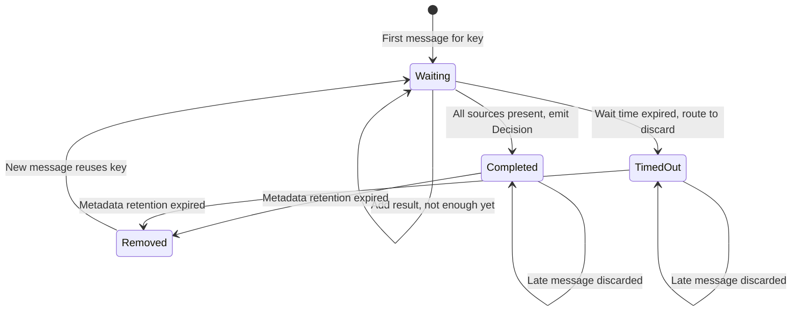

# Stateful endpoint

## 1. Objective and Scope

In the **Correlation and state** chapter of the **SPRING_INTEGRATION_CORE** module, a stateful endpoint is a processing point that must remember information across multiple message arrivals to make a decision. This lesson connects `Message`, `MessageChannel`, endpoints, and Java DSL to the problem of coordinating multiple asynchronous results.

After this lesson, you will be able to:

- Identify whether state belongs to a message, endpoint, store, or business system.
- Design correlation keys and completion conditions for a conversation.
- Configure an aggregator with Java DSL and observe state before and after release.
- Explain the impacts of timeouts, persistent storage, concurrency, and retries.
- Build test scenarios covering the state lifecycle.

The examples use **Java 17 and the Spring Integration 6.5 API** as baselines. A hands-on project needs `spring-integration-core` and compatible Spring libraries managed by the project's dependency management. The examples store state in memory for easy observation; the production deployment section points out additional decisions required when running multiple instances.

## 2. When Is an Endpoint Stateful?

### 2.1. Does the Decision Depend on Previous Messages?

A transformer that uppercases currency codes can process each message independently:

```text
output = transform(currentMessage)
```

An endpoint waiting for order validation results needs both the current message and previously received information:

```text
(nextState, optionalOutput) = handle(currentMessage, currentState)
```

For instance, receiving an `ADDRESS` result may produce no output yet if `PAYMENT` has not arrived. With the same `ADDRESS` payload, once the group already holds `PAYMENT` and `STOCK`, the endpoint can immediately emit a decision.

| Component or behavior | Retained information | Implication for state |
| --- | --- | --- |
| Transformer normalizing a payload | Local variables in one invocation | Can be designed statelessly |
| Router choosing a branch from current message header | Header on the message | No need to remember prior messages |
| Aggregator waiting for enough results | Messages in the same group and group metadata | Stateful per conversation |
| Resequencer waiting for missing messages | Message group and position in sequence | Stateful to preserve order |
| Service activator writing an order to a database | Business state in the database | Must also consider the invoked service's contract |
| Buffered channel | Messages waiting to be received | Has transport state, distinct from business aggregation state |

A resequencer holds and emits messages in order; an aggregator produces an aggregated result from a group. The two patterns serve different goals even though both require state across multiple arrivals. See [Resequencer in Spring Integration](https://docs.spring.io/spring-integration/reference/resequencer.html).

### 2.2. Singleton Does Not Mean Stateful

A singleton bean can hold only immutable configuration and process every message independently. Conversely, a handler with no internal `Map` still implements a stateful pattern if it coordinates state inside a shared store.

Do not judge by counting class fields. Determine **what information must persist after one processing invocation finishes** and **whether subsequent invocations need that information**.

A poller only defines how messages are fetched on a schedule. Using a poller, gateway, or asynchronous channel does not by itself determine whether an endpoint holds business state. Similarly, a `Message` object having immutable headers does not automatically make its payload or referenced objects immutable.

## 3. Problem Statement: Waiting for Three Order Check Results

Suppose each order processing run requires three confirmation sources:

- `PAYMENT`: payment verification status.
- `STOCK`: inventory verification status.
- `ADDRESS`: address verification status.

The endpoint emits a `Decision` only once all three sources have arrived. The order is approved when all results pass. A failing check result is still valid business data and participates in aggregation.

The group key is designed as follows:

```text
OrderKey = (tenantId, orderId, attempt)
```

`tenantId` separates customers sharing the system. `attempt` separates re-verification runs of the same order. For example, `("shop-a", "O-42", 1)` and `("shop-a", "O-42", 2)` are two distinct conversations.

Input contract for the example:

1. Each message contains a `CheckResult` with a complete key and a source from the known set.
2. Within the same key, a redelivery of the same source represents the same result; a corrected result must use a new processing attempt.
3. Arrival order carries no business meaning.
4. Redeliveries must not count as a new source.
5. If one source is missing for too long, the endpoint routes waiting data to the expiry handling branch.
6. After completion, late messages for the same key are routed to the discard branch while completion metadata is retained.

These rules are design choices for the example. In another application, the set of sources may vary by order type; in that case, store or look up the expected source set under a consistent contract.

### Why Not Release with `group.size() == 3`?

The sequence `PAYMENT, PAYMENT, STOCK` can contain three messages yet only two sources. Counting messages does not prove sufficient business evidence has arrived.

The right condition for the example is:

```text
receivedSources contains all of {PAYMENT, STOCK, ADDRESS}
```

This condition prevents premature release due to redeliveries. It does not remove redeliveries from the store yet; storage and deduplication are two responsibilities to keep separate.

## 4. State Contract of an Endpoint

### 4.1. Separation of Responsibilities

For an aggregator, separate four parts:

| Part | Question answered | Choice in the example |
| --- | --- | --- |
| `CorrelationStrategy` | Which group does the message belong to? | Extract `OrderKey` from payload |
| `MessageGroupStore` | Where is group state held? | `SimpleMessageStore` |
| `ReleaseStrategy` | Is the group ready for processing? | All three distinct sources present |
| `MessageGroupProcessor` | What output is created when the group releases? | A `Decision` |

Group state is managed through `MessageGroupStore`; strategies can simply read inputs and return decisions. This model avoids having a business bean manually maintain multiple waiting lists. See the [Aggregator model](https://docs.spring.io/spring-integration/reference/6.5/aggregator.html).

### 4.2. Lifecycles to Distinguish



The diagram assumes metadata is retained after completion or timeout. Transitioning to `Removed` requires a configured cleanup policy; it does not happen merely because the diagram has an arrow.

**Completed** means the conversation has ended. **Removed** means the store no longer holds evidence of that conversation. If the entire group is deleted, a later message with the same key can open a new group.

Thus, retention does more than save resources. It also defines the window during which the system recognizes already-processed conversations.

## 5. Complete Java DSL Example

### 5.1. Configuration and Data Model

The following listing is illustrative content for `demo.OrderChecksConfig`. Result channels are `QueueChannel`s so the practice program can actively pull and observe outputs. The example needs no poller because it declares no automatic consumer reading these queues.

```java
package demo;

import java.io.Serializable;
import java.util.List;
import java.util.Set;
import java.util.stream.Collectors;

import org.springframework.context.annotation.Bean;
import org.springframework.context.annotation.Configuration;
import org.springframework.integration.channel.DirectChannel;
import org.springframework.integration.channel.QueueChannel;
import org.springframework.integration.config.EnableIntegration;
import org.springframework.integration.dsl.IntegrationFlow;
import org.springframework.integration.store.MessageGroup;
import org.springframework.integration.store.SimpleMessageStore;

@Configuration
@EnableIntegration
public class OrderChecksConfig {

    private static final Set<String> REQUIRED_SOURCES =
            Set.of("PAYMENT", "STOCK", "ADDRESS");

    public record OrderKey(
            String tenantId,
            String orderId,
            long attempt
    ) implements Serializable {
    }

    public record CheckResult(
            OrderKey key,
            String source,
            boolean passed
    ) implements Serializable {
    }

    public record Decision(
            OrderKey key,
            boolean approved
    ) implements Serializable {
    }

    @Bean
    public DirectChannel checkResultsInput() {
        return new DirectChannel();
    }

    @Bean
    public QueueChannel decisions() {
        return new QueueChannel();
    }

    @Bean
    public QueueChannel invalidChecks() {
        return new QueueChannel();
    }

    @Bean
    public QueueChannel lateOrExpiredChecks() {
        return new QueueChannel();
    }

    @Bean
    public SimpleMessageStore orderCheckStore() {
        return new SimpleMessageStore();
    }

    @Bean
    public IntegrationFlow orderChecks(
            SimpleMessageStore orderCheckStore) {

        return IntegrationFlow.from("checkResultsInput")
                .<CheckResult>filter(
                        OrderChecksConfig::isValid,
                        filter -> filter.discardChannel("invalidChecks"))
                .aggregate(aggregator -> aggregator
                        .messageStore(orderCheckStore)
                        .correlationStrategy(message ->
                                ((CheckResult) message.getPayload()).key())
                        .releaseStrategy(OrderChecksConfig::hasAllSources)
                        .outputProcessor(OrderChecksConfig::toDecision)
                        .groupTimeout(30_000L)
                        .sendPartialResultOnExpiry(false)
                        .expireGroupsUponCompletion(false)
                        .expireGroupsUponTimeout(false)
                        .discardChannel("lateOrExpiredChecks"))
                .channel("decisions")
                .get();
    }

    private static boolean isValid(CheckResult result) {
        OrderKey key = result.key();
        return key != null
                && key.tenantId() != null
                && !key.tenantId().isBlank()
                && key.orderId() != null
                && !key.orderId().isBlank()
                && key.attempt() > 0
                && result.source() != null
                && REQUIRED_SOURCES.contains(result.source());
    }

    private static boolean hasAllSources(MessageGroup group) {
        Set<String> receivedSources = group.getMessages().stream()
                .map(message -> (CheckResult) message.getPayload())
                .map(CheckResult::source)
                .collect(Collectors.toSet());

        return receivedSources.containsAll(REQUIRED_SOURCES);
    }

    private static Decision toDecision(MessageGroup group) {
        List<CheckResult> results = group.getMessages().stream()
                .map(message -> (CheckResult) message.getPayload())
                .toList();

        OrderKey key = results.get(0).key();
        boolean approved = results.stream()
                .allMatch(CheckResult::passed);

        return new Decision(key, approved);
    }
}
```

`@EnableIntegration` registers Spring Integration infrastructure for the example's application context. Having records implement `Serializable` prepares for the persistence discussion; `SimpleMessageStore` remains an in-memory store.

The filter assumes payloads are of type `CheckResult`. A wrong-typed payload violates the data-type contract and can cause conversion or processing errors rather than being routed by `isValid` to `invalidChecks`. At the system boundary, use a transformer or schema validation step to construct the proper input model.

The DSL APIs used here are documented in [AggregatorSpec](https://docs.spring.io/spring-integration/docs/6.5.0/api/org/springframework/integration/dsl/AggregatorSpec.html) and [CorrelationHandlerSpec](https://docs.spring.io/spring-integration/docs/6.5.0/api/org/springframework/integration/dsl/CorrelationHandlerSpec.html).

### 5.2. Points to Read Carefully in the Configuration

`correlationStrategy` returns a record whose `equals()` and `hashCode()` depend on the key components. Never use a key object with fields that can be mutated after being added to a group.

`hasAllSources` uses a local set. The function holds no state across calls. Two concurrently running groups do not share a "current order" variable.

`toDecision` is invoked when the group satisfies the release condition in the normal flow. Because the configuration does not emit partial results on expiry, the example does not call the processor to produce a decision from an incomplete group on the timeout branch.

Both `expireGroupsUponCompletion(false)` and `expireGroupsUponTimeout(false)` flags reflect the intent to retain markers of closed groups. This learning example does not configure a metadata cleanup policy or consumers for the queues; long-running systems need both.

### 5.3. Sending Interleaved Results and Observing State

The following listing illustrates `demo.OrderChecksDemo`, using the same records from the configuration above.

```java
package demo;

import demo.OrderChecksConfig.CheckResult;
import demo.OrderChecksConfig.Decision;
import demo.OrderChecksConfig.OrderKey;

import org.springframework.context.annotation.AnnotationConfigApplicationContext;
import org.springframework.integration.channel.QueueChannel;
import org.springframework.messaging.Message;
import org.springframework.messaging.MessageChannel;
import org.springframework.messaging.support.MessageBuilder;

public class OrderChecksDemo {

    public static void main(String[] args) {
        try (var context =
                     new AnnotationConfigApplicationContext(
                             OrderChecksConfig.class)) {

            MessageChannel input = context.getBean(
                    "checkResultsInput", MessageChannel.class);
            QueueChannel decisions = context.getBean(
                    "decisions", QueueChannel.class);
            QueueChannel late = context.getBean(
                    "lateOrExpiredChecks", QueueChannel.class);

            OrderKey first = new OrderKey("shop-a", "O-42", 1);
            OrderKey second = new OrderKey("shop-a", "O-43", 1);

            send(input, first, "PAYMENT", true);
            send(input, second, "STOCK", true);
            send(input, first, "PAYMENT", true); // Redelivery.
            send(input, first, "STOCK", true);

            require(decisions.receive(0) == null,
                    "Must not release before ADDRESS arrives");

            send(input, first, "ADDRESS", true);

            Message<?> firstMessage = decisions.receive(1_000);
            require(firstMessage != null, "Missing result for O-42");
            require(firstMessage.getPayload().equals(
                            new Decision(first, true)),
                    "Wrong decision for O-42");

            send(input, first, "ADDRESS", true); // Arrives after completion.
            require(late.receive(1_000) != null,
                    "Late message must go to discard");
            require(decisions.receive(0) == null,
                    "Must not emit another Decision for O-42");

            send(input, second, "PAYMENT", true);
            send(input, second, "ADDRESS", false);

            Message<?> secondMessage = decisions.receive(1_000);
            require(secondMessage != null, "Missing result for O-43");
            require(secondMessage.getPayload().equals(
                            new Decision(second, false)),
                    "One failing source must yield approved=false");

            System.out.println(firstMessage.getPayload());
            System.out.println(secondMessage.getPayload());
        }
    }

    private static void send(
            MessageChannel input,
            OrderKey key,
            String source,
            boolean passed) {

        boolean sent = input.send(MessageBuilder
                .withPayload(new CheckResult(key, source, passed))
                .build());

        require(sent, "Failed to send message");
    }

    private static void require(boolean condition, String message) {
        if (!condition) {
            throw new IllegalStateException(message);
        }
    }
}
```

Expected business output:

```text
Decision[key=OrderKey[tenantId=shop-a, orderId=O-42, attempt=1], approved=true]
Decision[key=OrderKey[tenantId=shop-a, orderId=O-43, attempt=1], approved=false]
```

In this example, sending to `DirectChannel` executes the handler directly on the sending thread. The `receive(1_000)` waits are limits for polling results from the queue, not the lifetime of a group.

Key progression:

| Arrival | Group | Sources present | Output |
| --- | --- | --- | --- |
| `O-42/PAYMENT` | O-42, attempt 1 | PAYMENT | None yet |
| `O-43/STOCK` | O-43, attempt 1 | STOCK | None yet |
| `O-42/PAYMENT` redelivery | O-42, attempt 1 | PAYMENT | None yet |
| `O-42/STOCK` | O-42, attempt 1 | PAYMENT, STOCK | None yet |
| `O-42/ADDRESS` | O-42, attempt 1 | All three sources | Decision for O-42 |
| `O-42/ADDRESS` late | Closed group | Does not reopen while metadata exists | Discard |
| `O-43/PAYMENT`, then `ADDRESS=false` | O-43, attempt 1 | All three sources | Decision rejecting O-43 |

No gateway waiting for a reply per `CheckResult` is needed: the first two messages of a group inherently do not produce a `Decision`. A synchronous gateway has its own reply timeout; that timeout does not replace group-closing policies. If an API needs immediate acknowledgment of receipt, design an acknowledgment and a mechanism to retrieve the decision later by conversation key.

## 6. Timeout, Completion, and Retention

### 6.1. Idle Wait Timeout Differs from Conversation Deadline

In the configuration above, `groupTimeout(30_000L)` is a wait duration that resets when a new message enters an unreleased group. If redelivered messages keep arriving before the wait expires, the group's total lifetime can exceed 30 seconds.

Example:

```text
t=0s   PAYMENT enters group
t=20s  STOCK enters group, wait timer resets
t=40s  PAYMENT redelivered, wait timer resets again
```

If the business requirement is "at most 30 seconds from group creation," you can replace `groupTimeout(...)` with a deadline expression:

```java
.groupTimeoutExpression(
        "timestamp + 30000 - T(System).currentTimeMillis()")
```

This is an alternative configuration option; do not specify both options at once. In the expression, `timestamp` is when the `MessageGroup` was created; distinguish that from when the event originated in the source system.

The timeout schedule still depends on scheduler execution capacity. Do not treat it as an exact real-time clock.

### 6.2. Where Do Incomplete Groups Go?

With `sendPartialResultOnExpiry(false)`, groups that have not met the condition do not produce a `Decision` on timeout. Discarded data is routed to `lateOrExpiredChecks`. This branch needs a consumer to record, alert, or coordinate compensation.

Never interpret a timeout as proof that payment failed. It only proves the endpoint did not gather sufficient data within the chosen wait policy. If the system needs an "undetermined" or "reconciliation required" result, model that state explicitly.

In the example, the discard channel receives both expired data and messages arriving after group completion. If operations need to distinguish the two causes, add metadata or appropriate observability; do not infer the cause from channel name alone.

### 6.3. How Long Should Metadata Be Retained?

A reference policy:

| Information type | Purpose of retention | Decision guideline |
| --- | --- | --- |
| Waiting group messages | Gather enough data to aggregate | Bounded by timeout/deadline |
| Closed group metadata | Prevent late messages from reopening group | Based on source redelivery window |
| Business result audit trail | Lookup, reconciliation, idempotency | Per business requirements |
| Discarded data | Investigation and reprocessing | Per incident response window |

If a source can redeliver for 24 hours, retaining group markers for one minute is usually insufficient to block reprocessing across that entire window.

`minimumTimeoutForEmptyGroups` can help clean up empty groups retained after release. With a reaper, account for both the scan interval and the reaper timeout. Read the lifecycle and expiration sections in [AbstractCorrelatingMessageHandler](https://docs.spring.io/spring-integration/docs/6.5.0/api/org/springframework/integration/aggregator/AbstractCorrelatingMessageHandler.html).

Once a key has been deleted, the next redelivery can create a new group. Therefore, aggregator retention must align with idempotency policies and business keys.

## 7. Where Is State Stored and How Is It Recovered?

### 7.1. In-Memory vs. Persistent Stores

`SimpleMessageStore` fits hands-on exercises: concise configuration and easy inspection. In-memory state is not a recovery mechanism after process loss.

| Scenario | In-memory store | Properly configured persistent store |
| --- | --- | --- |
| Process crashes unexpectedly | Held state is lost | Previously committed state can be read back |
| Multiple instances need access to one group | Each JVM has separate state | Can share data |
| Large payloads and many groups | Increases heap pressure | Shifts part of the load to the datastore |
| Upgrading payload model | No old data after restart | Must account for compatibility of stored data |

Messages and headers must fit the store's serialization strategy. Do not put database connections, open streams, or service objects into payloads expecting them to restore intact. See [Message Store](https://docs.spring.io/spring-integration/reference/6.5/message-store.html).

For JDBC, use `JdbcMessageStore` for aggregator state. `JdbcChannelMessageStore` serves channel message persistence and has a different contract. You need the `spring-integration-jdbc` dependency, a `DataSource`, and the corresponding schema before using it. See [JDBC Message Store](https://docs.spring.io/spring-integration/reference/6.5/jdbc/message-store.html).

### 7.2. Switching to JDBC Is a Configuration Change

The snippet below replaces the example's store bean rather than running alongside the `SimpleMessageStore` bean:

```java
import javax.sql.DataSource;

import org.springframework.context.annotation.Bean;
import org.springframework.integration.jdbc.store.JdbcMessageStore;
import org.springframework.integration.store.MessageGroupStore;

@Bean
public MessageGroupStore orderCheckStore(DataSource dataSource) {
    return new JdbcMessageStore(dataSource);
}
```

At the same time, change the parameter type of `orderChecks` to `MessageGroupStore`, keeping the `.messageStore(orderCheckStore)` call. This snippet illustrates the store change; schema, transactions, and locking still must be configured for your environment.

A new application context does not restore scheduler tasks automatically merely because the database holds pending groups. Establish a policy to recognize stale groups after restarts, such as the correlating handler's orphan-group purge or a scheduled reaper.

Purging must know which groups are genuinely overdue. If multiple instances share a store, do not treat every group created by another instance as abandoned.

### 7.3. State Store Differs from Business Result Store

The aggregator holds check results to coordinate a single decision. The order database stores the official decision and statuses such as `APPROVED`, `REJECTED`, `REVIEW_REQUIRED`.

A released group does not prove the decision was written successfully to every target system. Define commit boundaries and observable statuses at every step.

If a physical store serves multiple endpoints, use separate partitions or namespaces. In particular, do not arbitrarily share one `MessageGroupStore` instance across multiple correlating handlers with expiration enabled: one handler's callback can affect another handler's groups. Use dedicated stores per endpoint or partitioning supported by the implementation.

## 8. Concurrency and Multi-Instance Deployment

### 8.1. State Must Be Tied to the Group

An error-prone way to hold state manually:

```java
// Illustrates a design flaw, do not use.
private String currentOrder;
private final List<CheckResult> received = new java.util.ArrayList<>();

public void accept(CheckResult result) {
    currentOrder = result.key().orderId();
    received.add(result);
}
```

When messages for O-42 and O-43 arrive interleaved, the list mixes them even on a single thread. With multiple threads, unsynchronized concurrent access also occurs.

Replacing `ArrayList` with a thread-safe collection does not fix the lack of per-key isolation. Replacing it with `ConcurrentHashMap` does not automatically make the sequence "add message, check completeness, emit output, close group" an atomic operation either.

### 8.2. Synchronization Within One JVM and Across Multiple JVMs

An aggregator uses a `LockRegistry` keyed by correlation key to protect group operations. The default in-memory lock does not coordinate across different JVMs. When multiple instances update the same group in a shared store, a suitable shared lock registry is required. See [Aggregator Lock Registry](https://docs.spring.io/spring-integration/reference/7.0/aggregator.html#aggregator-lock-registry).

Different groups can be processed concurrently depending on execution infrastructure; a hot group can still become a bottleneck. Therefore, choosing an overly broad key such as "current date" for all orders can reduce scalability.

When aggregators call downstream sequentially on the same thread while holding the lock during emission, consider lock acquisition ordering. You can evaluate separating execution boundaries or `releaseLockBeforeSend` after analyzing effects on ordering and transactions.

### 8.3. Choosing Message Distribution by System Contract

There are two common architectural approaches:

- **Key-affinity partitioning:** messages for one conversation go to the same consumer. Specify what happens when a consumer dies or partitions are rebalanced.
- **Multiple consumers sharing state:** share the group store and corresponding locking mechanism. Account for datastore latency, lock contention, and cleanup work.

Neither choice provides complete resilience on its own. Affinity does not replace persistent storage; a persistent store does not replace synchronization when multiple writers exist.

## 9. Errors, Retries, and Business Correctness

### 9.1. Distinguishing Business Branches from Technical Errors

| Event | Interpretation in the example | Handling direction |
| --- | --- | --- |
| `ADDRESS=false` | Valid check that failed | Aggregated into `approved=false` |
| Missing tenant or invalid source | Data violates contract | `invalidChecks` |
| One source missing until wait timeout | Conversation lacks sufficient data | Discard/reconciliation branch |
| Store unreachable | Infrastructure failure | Bounded retries or recovery |
| Downstream decision write fails | Result not finalized in target system | Idempotency and redelivery policy |

In synchronous flows over `DirectChannel`, exceptions can propagate back to the sender. When processing runs via an executor or scheduler, configure an error-publishing mechanism appropriate to the asynchronous boundary. Do not assume simply declaring an `errorChannel` bean routes every exception there automatically. For custom schedulers, consider `MessagePublishingErrorHandler`. See [Error Handling](https://docs.spring.io/spring-integration/reference/6.5/error-handling.html).

### 9.2. Retries Can Re-Emit the Result Too

Consider this scenario:

```text
1. Aggregator creates Decision.
2. Target system receives and saves Decision.
3. Sender does not receive success confirmation.
4. Recovery mechanism resends Decision.
```

You cannot decide the final outcome solely from "the send failed." The target system should identify the command by a stable business key, such as `OrderKey` combined with operation type, and apply effects under an idempotent contract.

On the intake side, `MessageHeaders.ID` typically identifies a single message instance. A business event recreated as a new message can have a new ID. Therefore, distinguish:

- **Correlation key:** identifies the conversation.
- **Event identity:** identifies the event to deduplicate.
- **Operation identity:** identifies the output effect to avoid executing twice.

The example uses a set of sources to protect the release condition, yet has not implemented a dedicated deduplication store. A heavy redelivery stream can still grow held message counts and prolong idle wait times.

### 9.3. Persistence Does Not Create Exactly-Once by Itself

Saving state to a database does not automatically combine receiving a message, updating a group, and calling an external API into a single transaction.

When a decision must reach another system, consider:

1. Writing the business result and an outbox record in the same local transaction.
2. Delivering the outbox record with a retry-capable mechanism.
3. Having the receiver process idempotently by operation identity.
4. Reconciling unconfirmed records.

These are design suggestions, not behaviors provided automatically by the example. Nor does the aggregator execute compensating steps such as refunding or releasing stock; those belong to business workflows modeled separately.

## 10. Testing Along the State Lifecycle

The demo tests the basic in-memory flow. When applying this to a project, expand testing based on observable behavior rather than internal method invocation counts.

| Scenario | Input data | What to prove |
| --- | --- | --- |
| Missing sources | PAYMENT, STOCK | No Decision yet |
| All sources, out of order | ADDRESS, STOCK, PAYMENT | Exact expected Decision emitted |
| Interleaved groups | Messages for O-42 and O-43 | Results never mix |
| Same orderId, different tenant | Two tenants with O-42 | Two isolated conversations |
| Same orderId, different attempt | Attempt 1 and attempt 2 | States of the two attempts do not mix |
| Redelivery before completion | PAYMENT, PAYMENT, STOCK | Does not release because ADDRESS is missing |
| One source fails | All three sources, STOCK=false | Decision has approved=false |
| Late arrival after completion | Extra ADDRESS with closed key | Goes to discard while metadata remains |
| Timeout | Only PAYMENT, wait time expires | No complete Decision emitted |
| After metadata is deleted | Full replay of an old key | Recognize risk of creating a new group and result |
| Restart with persistent store | Save incomplete group, restart | Can continue or handle expiry per policy |
| Two concurrent writers | Two instances receive the same key | No wrong result from concurrent updates |

For timeout tests, use a small test-dedicated timeout configuration and bounded waits. Do not use an arbitrary `sleep` as proof that the group finished on time.

For restart tests, close the application context and create a new context pointing to the same datastore. Simply reusing the same `SimpleMessageStore` object in a test does not prove data survives JVM loss.

For the timeout branch, do not assume the discarded message count equals the timed-out group count. Discard granularity depends on configuration; inspect keys and contents to confirm the target group was identified.

## 11. Observability and Resource Management

State that is not lost yet never cleaned up is still an operational bug. Useful signals include:

- Number of open groups and age of the oldest group.
- Number of messages held inside groups.
- Completion rate, timeout rate, and late-message rate.
- Number of closed-group metadata entries still retained.
- Store operation latency and lock wait time.
- Depth of output, discard, and error queues.

Interpret these numbers together. Few groups that are each huge can still cause memory pressure. Many open groups consistently missing one source can indicate an outage in an upstream branch.

In logs, include `tenantId`, `orderId`, and `attempt` to investigate individual conversations. For metrics, avoid using every `orderId` as a label because cardinality grows with business traffic.

An initial estimate for waiting groups:

```text
open groups ≈ new conversations per second × average wait time
```

For example, 200 conversations/second with a 15-second average wait corresponds to roughly 3,000 open groups in steady state. This is a planning estimate and does not yet include closed metadata, redeliveries, large payloads, or abnormal groups that never complete.

Replacing the example's unbounded queues with bounded-capacity queues is only one part of load management. Also define full-queue behavior, send timeouts, consumer throughput, and recovery paths. Do not clean up or mutate a `MessageGroup`'s collection directly while the aggregator is using it.

## 12. Consolidation Exercises

### Exercise 1: Prove Isolated Correlation

Create two `OrderKey`s with the same `orderId` but different `tenantId`s. Send `PAYMENT` and `STOCK` for the first tenant, and `ADDRESS` for the second tenant.

Expected outcome: neither group has all sources yet; no `Decision` is emitted. Then supply the missing parts for each group and verify the keys on both decisions.

### Exercise 2: Observe Timeout

Use a dedicated practice configuration with a short wait duration, send only one `PAYMENT` result, and wait with a bounded timeout on `lateOrExpiredChecks`.

Expected outcome: expired data appears on the discard branch; no approval decision appears from the incomplete group. Keep the context active throughout the wait so the scheduler can execute.

### Exercise 3: Define the Replay Prevention Window

Model a source that can redeliver for two hours. Choose retention for closed metadata, decide where to store operation identity, and describe what happens when a replay arrives after the retention period.

Success criterion: distinguish blocking group reopening from blocking duplicate business side effects at the target system.

### Exercise 4: Vary Business Conditions

Suppose digital orders require only `PAYMENT` and `ADDRESS`, while physical goods also require `STOCK`. Design where the expected source set is stored and how to ensure all messages with the same key see one rule version.

Success criterion: do not use a shared "current order type" variable; specify how to handle two messages with the same key carrying conflicting expectations.

After these exercises, you should be able to explain for any specific key: where its state resides, which messages are still missing, when the group closes, how long completion evidence is kept, and what happens when the system must reprocess.
