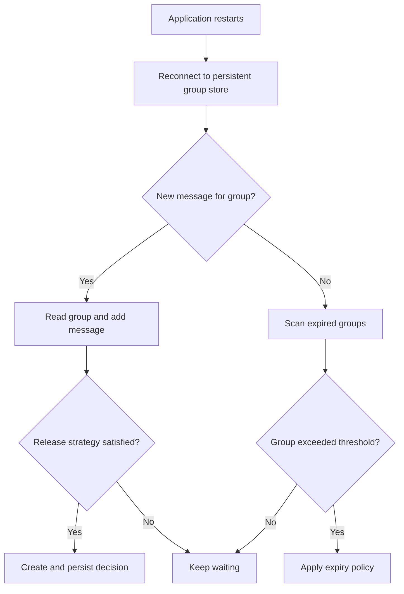

# State recovery after restart

## Lesson Objectives

In the **Correlation and state** chapter of the **SPRING_INTEGRATION_CORE** module, this lesson explains how to resume a stateful message flow after a process stops and restarts. The focus is on the aggregator, where multiple `Message`s sharing a correlation key are held while awaiting a release decision.

After this lesson, you will be able to:

- Identify which data must live outside the JVM for the flow to recover.
- Configure a persistent `MessageGroupStore` with JDBC and keep correlation keys stable across runs.
- Handle incomplete groups and expired groups after a restart.
- Place transaction boundaries across message intake, group updates, and result persistence.
- Design restart tests that distinguish data loss, duplicate processing, and unforwarded results.

Prerequisites include `Message`, `MessageChannel`, aggregators, correlation strategies, release strategies, and Java DSL. The examples use APIs available in Spring Integration 6.5, Java 17+, and PostgreSQL; Spring dependencies must be managed by a compatible project BOM.

## 1. What Problems Does a Restart Pose?

An order review service waits for three check results:

- `PAYMENT`: payment check.
- `STOCK`: inventory check.
- `FRAUD`: fraud check.

Each result contains `orderId`, `attempt`, `checkType`, and `passed`. All three check types for the same review attempt form one group. Only when all three types arrive does the service emit the final decision.

Suppose the service received `PAYMENT` and `STOCK` for `ORD-9001|1`, and then stopped before `FRAUD` arrived:

```text
Before stopping:
  ORD-9001|1 -> {PAYMENT, STOCK}
  Release condition not met yet

After restarting:
  If old group is lost:
    FRAUD -> {FRAUD}                 -> keeps waiting incorrectly

  If old group is reloaded:
    FRAUD -> {PAYMENT, STOCK, FRAUD} -> produces decision
```

**State recovery** means re-establishing enough facts for the flow to continue under its business contract. Recreating beans from configuration only restores flow structure; accumulated data needs a dedicated mechanism.

Distinguish two scenarios:

| Scenario | What can be relied upon | What still needs handling |
| --- | --- | --- |
| Graceful shutdown | Can stop taking new work and wait for in-flight work | Some groups are still waiting for messages that have not arrived |
| JVM killed, power loss | Only data durably committed by the storage system | Uncommitted transactions, in-flight messages, unsent acks, in-RAM timeout schedules |

A shutdown hook supports orderly stopping, yet it does not prove recovery capability when a process dies abruptly.

## 2. Mapping the State That Needs Recovery

Do not ask only "was the payload saved?" An integration flow can hold several kinds of state with different owners:

| State category | Example | Suitable storage |
| --- | --- | --- |
| Messages buffered before an endpoint | Unpolled messages | Durable broker or channel with a persistent store |
| Group members and metadata | Two received results, completion flag, update timestamp | Persistent `MessageGroupStore` |
| Deduplication markers | Business event already accepted | Business key store with atomic operations or persistent metadata store |
| Results waiting to be forwarded | Decision created but not yet published | Outbox or durable queue |
| External system state | Payment transaction already executed | Target system and operation idempotency key |
| In-JVM resources | Threads, local locks, scheduler tasks, temporary reply channels | Recreated; not treated as persisted business data |

In Spring Integration, `MessageStore` supports persisting messages, while `MessageGroupStore` serves group members and group state. The default in-memory store does not protect data when the JVM disappears. See [Message Store](https://docs.spring.io/spring-integration/reference/7.0/message-store.html).

A common confusion is `MetadataStore`: this is a key–value contract for metadata, not a replacement for the store holding `Message`s awaiting aggregation. `JdbcMetadataStore` is an option for metadata that must survive restarts; it requires transaction management to honor the implementation's contract properly. See [JdbcMetadataStore](https://docs.spring.io/spring-integration/api/org/springframework/integration/jdbc/metadata/JdbcMetadataStore.html).

### When Is Replay Alone Enough?

If the event source can replay history completely, you can rebuild some state from history. However, you must know the exact replay offset and avoid re-executing side effects that already completed.

In the order-review example, replaying from the beginning can reconstruct the set of check results. It cannot answer on its own whether the final decision was already applied by the receiving system. Therefore, recovery design must cover intake, intermediate state, and output together.

## 3. Recovering Groups Based on Stable Identifiers

For a new aggregator to resume an old group, runs must use the same identity contract:

```text
Logical group is identified by:
  data store + namespace/region + correlation key

Example:
  database = integration_lab
  region   = order-checks-v1
  key      = ORD-9001|1
```

Here `attempt` is a business review attempt, not the broker redelivery count for the same event. Redelivery during review attempt 1 must still use `attempt = 1`.

Practical rules:

1. **Reuse the same database and region.** If every boot generates a random region, old data remains in the database while the new endpoint looks at a different partition.
2. **Do not derive correlation keys from boot time or a new message UUID.** A replayed event must find the exact prior group.
3. **Isolate business rounds.** If an order is legitimately reviewed again, use `attempt = 2` so it does not merge into attempt 1's group.
4. **Partition by required context.** Multi-tenant systems typically also need `tenantId`; aggregators serving different purposes need separate namespaces.
5. **Preserve deployment compatibility.** Changing key formatting, payload package, or serializer can prevent a new version from continuing old version data.

For JDBC, `JdbcMessageStore.setRegion(...)` logically partitions data within shared tables. This value must be an intentional and stable configuration. See [JdbcMessageStore](https://docs.spring.io/spring-integration/api/org/springframework/integration/jdbc/store/JdbcMessageStore.html).

Do not arbitrarily share the same store instance across multiple aggregators that have expiry callbacks. One endpoint could mistakenly process another endpoint's groups. When sharing a database, use dedicated store instances and regions per purpose. Group ownership rules are described in [managing state in an Aggregator](https://docs.spring.io/spring-integration/reference/7.0/aggregator.html#_managing_state_in_an_aggregator_messagegroupstore).

## 4. Data Recovery Differs from Execution Recovery

Upon restart, an aggregator does not resume from the Java line executing before shutdown. A new endpoint is created and uses the configured store to access the relevant groups.

There are three common continuation paths:



Retaining groups in the database does not mean every group is automatically re-emitted at boot. For groups not yet expired and receiving no new message, the system may keep waiting. If the business needs to actively resume an interrupted step, define a corresponding reconciliation or replay mechanism.

A testable design should have explicit expected states: waiting group, completed group, expired group needing reconciliation, and result awaiting publication.

## 5. Example: JDBC Aggregator and Outbox Result Persistence

The example below demonstrates two processes running sequentially against the same PostgreSQL instance. Only one instance is active at a time; test calls run sequentially. Multi-replica configuration is discussed separately later.

The processing flow is:

```text
Adapter or caller code
       |
       v
CheckIngress.accept(...)       <- starts JDBC transaction
       |
       v
checksInput: DirectChannel
       |
       v
Aggregator + JdbcMessageStore
       |
       +-- all three check types --> decisions --> INSERT order_decision_outbox
       |
       +-- expired / late message --> checksReview --> INSERT order_check_review
```

`DirectChannel` dispatches on the same thread, so JDBC operations on the synchronous path join the transaction opened at ingress. Standard transaction context does not automatically follow onto a new thread when switching to an `ExecutorChannel` or a polling consumer downstream. See [Transaction Boundaries](https://docs.spring.io/spring-integration/reference/7.0/transactions.html#_transaction_boundaries).

### 5.1. Preparing Dependencies and Schema

In a Spring Boot project with a compatible BOM, the following dependencies are needed. This is an illustrative declaration for a practice project:

```xml
<dependencies>
    <dependency>
        <groupId>org.springframework.boot</groupId>
        <artifactId>spring-boot-starter-integration</artifactId>
    </dependency>
    <dependency>
        <groupId>org.springframework.boot</groupId>
        <artifactId>spring-boot-starter-jdbc</artifactId>
    </dependency>
    <dependency>
        <groupId>org.springframework.integration</groupId>
        <artifactId>spring-integration-jdbc</artifactId>
    </dependency>
    <dependency>
        <groupId>org.postgresql</groupId>
        <artifactId>postgresql</artifactId>
        <scope>runtime</scope>
    </dependency>
</dependencies>
```

Configure `DataSource` to point to a PostgreSQL instance existing outside the application lifecycle. When practicing with containers, persist the database volume across runs.

Create the PostgreSQL Spring Integration schema from the script packaged inside `spring-integration-jdbc`, under package `org/springframework/integration/jdbc`. Apply it through migrations matching your library version; do not run drop-and-recreate scripts on every boot. `JdbcMessageStore` is for groups; `JdbcChannelMessageStore` is the specialized option when a channel backing store is needed. See [JDBC Message Store](https://docs.spring.io/spring-integration/reference/7.0/jdbc/message-store.html).

Create two additional business tables for the example:

```sql
CREATE TABLE order_decision_outbox (
    event_key    VARCHAR(200) PRIMARY KEY,
    order_id     VARCHAR(100) NOT NULL,
    attempt      INTEGER NOT NULL,
    approved     BOOLEAN NOT NULL,
    created_at   TIMESTAMPTZ NOT NULL DEFAULT CURRENT_TIMESTAMP,
    published_at TIMESTAMPTZ
);

CREATE TABLE order_check_review (
    review_key   VARCHAR(200) PRIMARY KEY,
    group_key    VARCHAR(120) NOT NULL,
    check_type   VARCHAR(20) NOT NULL,
    passed       BOOLEAN NOT NULL,
    noted_at     TIMESTAMPTZ NOT NULL DEFAULT CURRENT_TIMESTAMP
);
```

Here the outbox stores a minimal decision event containing the order, attempt, and result. A relay reads unpublished records and forwards them to the receiving system; the relay itself is outside this aggregator configuration snippet.

### 5.2. Payload with an Explicit Contract

Place the types below in the example's package, with each public type in its own file in a practice project:

```java
package example.recovery;

import java.io.Serial;
import java.io.Serializable;
import java.util.Set;

public record CheckResult(
        String orderId,
        int attempt,
        String checkType,
        boolean passed) implements Serializable {

    @Serial
    private static final long serialVersionUID = 1L;

    public CheckResult {
        if (orderId == null || orderId.length() > 100
                || !orderId.matches("[A-Z0-9-]+")) {
            throw new IllegalArgumentException("Invalid orderId");
        }
        if (attempt < 1) {
            throw new IllegalArgumentException("Invalid attempt");
        }
        if (checkType == null
                || !Set.of("PAYMENT", "STOCK", "FRAUD").contains(checkType)) {
            throw new IllegalArgumentException("Invalid checkType");
        }
    }

    public String correlationKey() {
        return orderId + "|" + attempt;
    }
}
```

```java
package example.recovery;

public record Decision(String orderId, int attempt, boolean approved) {

    public String eventKey() {
        return "decision:" + orderId + "|" + attempt;
    }
}
```

The example's contract is that the result for a `(orderId, attempt, checkType)` triple is immutable. If a source corrects a check result, it needs a business workflow or a new review attempt. Two events with the same key but conflicting contents must be detected for reconciliation rather than treated as normal retries.

`Serializable` makes the payload compatible with the JDBC store's default serialization mechanism. Do not put connections, HTTP requests, streams, or Spring beans into payloads. Non-serializable headers may be dropped before persistence; store data required for recovery as values with an explicit contract. See [Message Store serialization constraints](https://docs.spring.io/spring-integration/reference/7.0/message-store.html).

### 5.3. Java DSL Configuration

```java
package example.recovery;

import java.time.Duration;
import java.util.Set;
import java.util.stream.Collectors;
import javax.sql.DataSource;

import org.springframework.context.annotation.Bean;
import org.springframework.context.annotation.Configuration;
import org.springframework.integration.channel.DirectChannel;
import org.springframework.integration.dsl.IntegrationFlow;
import org.springframework.integration.jdbc.store.JdbcMessageStore;
import org.springframework.integration.store.MessageGroup;
import org.springframework.integration.transaction.TransactionInterceptorBuilder;
import org.springframework.jdbc.core.JdbcTemplate;
import org.springframework.jdbc.datasource.DataSourceTransactionManager;
import org.springframework.messaging.MessageHandler;
import org.springframework.transaction.PlatformTransactionManager;
import org.springframework.transaction.annotation.EnableTransactionManagement;

@Configuration
@EnableTransactionManagement
public class RecoveryFlowConfig {

    private static final Set<String> REQUIRED =
            Set.of("PAYMENT", "STOCK", "FRAUD");

    @Bean
    public PlatformTransactionManager integrationTransactionManager(
            DataSource dataSource) {
        return new DataSourceTransactionManager(dataSource);
    }

    @Bean
    public JdbcMessageStore orderChecksStore(DataSource dataSource) {
        JdbcMessageStore store = new JdbcMessageStore(dataSource);
        store.setRegion("order-checks-v1");
        store.setTimeoutOnIdle(true);
        return store;
    }

    @Bean
    public DirectChannel checksInput() {
        return new DirectChannel();
    }

    @Bean
    public DirectChannel decisions() {
        return new DirectChannel();
    }

    @Bean
    public DirectChannel checksReview() {
        return new DirectChannel();
    }

    @Bean
    public IntegrationFlow collectChecks(
            JdbcMessageStore orderChecksStore,
            PlatformTransactionManager integrationTransactionManager) {

        return IntegrationFlow.from("checksInput")
                .aggregate(a -> a
                        .id("orderChecksAggregator")
                        .phase(100)
                        .messageStore(orderChecksStore)
                        .correlationStrategy(message ->
                                ((CheckResult) message.getPayload())
                                        .correlationKey())
                        .releaseStrategy(RecoveryFlowConfig::hasAllChecks)
                        .outputProcessor(RecoveryFlowConfig::makeDecision)
                        .groupTimeout(120_000L)
                        .expireTimeout(120_000L)
                        .expireDuration(Duration.ofSeconds(15))
                        .expireGroupsUponCompletion(false)
                        .expireGroupsUponTimeout(false)
                        .minimumTimeoutForEmptyGroups(86_400_000L)
                        .sendPartialResultOnExpiry(false)
                        .discardIndividuallyOnExpiry(true)
                        .discardChannel("checksReview")
                        .forceReleaseAdvice(
                                new TransactionInterceptorBuilder()
                                        .transactionManager(
                                                integrationTransactionManager)
                                        .build()))
                .channel("decisions")
                .get();
    }

    @Bean
    public IntegrationFlow persistDecision(JdbcTemplate jdbcTemplate) {
        return IntegrationFlow.from("decisions")
                .handle((MessageHandler) message -> {
                    Decision decision = (Decision) message.getPayload();
                    jdbcTemplate.update("""
                            INSERT INTO order_decision_outbox
                                (event_key, order_id, attempt, approved)
                            VALUES (?, ?, ?, ?)
                            ON CONFLICT (event_key) DO NOTHING
                            """,
                            decision.eventKey(),
                            decision.orderId(),
                            decision.attempt(),
                            decision.approved());
                }, endpoint -> endpoint.phase(0))
                .get();
    }

    @Bean
    public IntegrationFlow persistReview(JdbcTemplate jdbcTemplate) {
        return IntegrationFlow.from("checksReview")
                .handle((MessageHandler) message -> {
                    CheckResult result = (CheckResult) message.getPayload();
                    jdbcTemplate.update("""
                            INSERT INTO order_check_review
                                (review_key, group_key, check_type, passed)
                            VALUES (?, ?, ?, ?)
                            ON CONFLICT (review_key) DO NOTHING
                            """,
                            "review:" + result.correlationKey()
                                    + ":" + result.checkType(),
                            result.correlationKey(),
                            result.checkType(),
                            result.passed());
                }, endpoint -> endpoint.phase(0))
                .get();
    }

    private static boolean hasAllChecks(MessageGroup group) {
        Set<String> actual = group.getMessages().stream()
                .map(message ->
                        ((CheckResult) message.getPayload()).checkType())
                .collect(Collectors.toSet());
        return actual.equals(REQUIRED);
    }

    private static Decision makeDecision(MessageGroup group) {
        CheckResult first = (CheckResult) group.getMessages()
                .iterator().next().getPayload();

        boolean approved = group.getMessages().stream()
                .map(message -> (CheckResult) message.getPayload())
                .allMatch(CheckResult::passed);

        return new Decision(first.orderId(), first.attempt(), approved);
    }
}
```

The release strategy checks for **all three distinct types**, so two copies of `PAYMENT` and one `STOCK` do not form a complete set. Even so, using a set of check types only protects the release condition; it does not remove duplicate messages from the store and does not detect every content conflict.

Both database-writing consumers have a lower `phase` than the aggregator so they are ready before the aggregator starts and processes stale expired groups. This configuration also shuts down output consumers after the aggregator when stopping in phase order.

The methods `expireTimeout`, `expireDuration`, and `forceReleaseAdvice` belong to the correlation handler's DSL. The last advice applies to the `forceComplete()` path; the transaction for the normal intake path is opened at ingress below. See [CorrelationHandlerSpec](https://docs.spring.io/spring-integration/docs/6.5.0/api/org/springframework/integration/dsl/CorrelationHandlerSpec.html).

### 5.4. Opening the Transaction at Intake

```java
package example.recovery;

import org.springframework.beans.factory.annotation.Qualifier;
import org.springframework.messaging.MessageChannel;
import org.springframework.messaging.support.MessageBuilder;
import org.springframework.stereotype.Service;
import org.springframework.transaction.annotation.Transactional;

@Service
public class CheckIngress {

    private final MessageChannel input;

    public CheckIngress(
            @Qualifier("checksInput") MessageChannel input) {
        this.input = input;
    }

    @Transactional("integrationTransactionManager")
    public void accept(CheckResult result) {
        boolean sent = input.send(
                MessageBuilder.withPayload(result).build());
        if (!sent) {
            throw new IllegalStateException("Cannot deliver check result");
        }
    }
}
```

Invoke `accept()` through a Spring-managed bean so the transaction proxy takes effect. In a Spring Boot example, place this configuration and classes within component scan scope; `DataSource` and `JdbcTemplate` are provided by the application's JDBC configuration.

With the same `DataSource`, the normal transaction covers adding the message, evaluating/processing the group, and inserting into the outbox when complete. JDBC exceptions must propagate so the transaction rolls back. If an error handler catches an exception and returns normally, review the contract because callers may assume the message was durably accepted.

If the source is a broker, acknowledge via the adapter's mechanism only after processing commits successfully. Broker ack and database commit do not automatically become one atomic transaction merely because a method has `@Transactional`. Design for the broker to redeliver when the database committed yet the ack never reached the broker.

## 6. Timeouts After Restart: Data Remains, Schedules Are Lost

A timeout task scheduled inside the JVM is not persisted recovery state. After a restart, if a group receives no additional messages, you cannot rely solely on the next arrival to recreate the schedule.

The configuration example uses two complementary mechanisms:

| Setting | Role in the example |
| --- | --- |
| `groupTimeout(120_000)` | Forces handling of groups receiving no new messages during the wait period while the endpoint is running |
| `expireTimeout(120_000)` | Threshold for finding stale groups in the persistent store |
| `expireDuration(15 seconds)` | Runs the periodic scan again |
| `setTimeoutOnIdle(true)` | Store expiry checks idle time since last update rather than only age since group creation |

The correlation handler supports scanning stale groups at startup and periodically if configured. This mechanism invokes the force-completion path and then applies the release/discard policy; it does not restore individual old `ScheduledFuture` instances. See [orphan group recovery in AbstractCorrelatingMessageHandler](https://docs.spring.io/spring-integration/docs/6.5.0/api/org/springframework/integration/aggregator/AbstractCorrelatingMessageHandler.html).

Time based on group age and time based on last update are two different contracts. In the example, the store sets `timeoutOnIdle = true` so scanning aligns closely with the idle wait policy. This API and its default value are described in [AbstractMessageGroupStore](https://docs.spring.io/spring-integration/docs/6.5.0/api/org/springframework/integration/store/AbstractMessageGroupStore.html).

Example timeline:

```text
10:00:00 receive PAYMENT
10:00:10 receive STOCK
10:00:20 process stops

If restarted at 10:00:50:
  Group has not exceeded 120 seconds without update.
  FRAUD arrives in time -> group completes.

If restarted at 10:05:00:
  Group has exceeded the threshold.
  Scan can move pending parts to review immediately on startup.
```

Application downtime still counts toward elapsed time. If the business wants to pause the clock during downtime, that must be modeled as an explicit rule of its own.

Periodic scanning does not guarantee processing to the exact millisecond of a deadline. Delay also depends on scan interval, scheduler load, query duration, and lock acquisition. Node clocks must also stay synchronized when decisions rely on timestamps.

### Another Option: MessageGroupStoreReaper

You can use `MessageGroupStoreReaper` to scan the same kind of store. This is a `Runnable`; a scheduler must actually invoke `run()`, rather than just declaring the bean and assuming it runs periodically.

```java
MessageGroupStoreReaper reaper =
        new MessageGroupStoreReaper(orderChecksStore);
reaper.setTimeout(120_000L);
reaper.setExpireOnDestroy(false);

// Register with the application scheduler to invoke reaper.run() periodically.
```

The snippet above illustrates the API and does not replace full scheduler configuration. `setExpireOnDestroy(false)` avoids proactively expiring groups when the context closes if the goal is to keep waiting groups for the next run. See [MessageGroupStoreReaper](https://docs.spring.io/spring-integration/api/org/springframework/integration/store/MessageGroupStoreReaper.html).

Usually choose one primary scan mechanism and monitor its execution. Do not add both a reaper and another purge schedule just to scan more often without clearly defining timing contracts and group ownership.

## 7. Completion, Expiration, and Late-Message Policies

In the example, a decision is valid only when all three check types are present. Therefore, groups missing data on expiration go to review instead of emitting a decision as if complete.

Intentional settings chosen:

| Option | Example value | Meaning to preserve during recovery |
| --- | --- | --- |
| `sendPartialResultOnExpiry` | `false` | Do not emit a partial result for groups missing release conditions |
| `expireGroupsUponCompletion` | `false` | Retain completed-group markers to block late messages |
| `expireGroupsUponTimeout` | `false` | Retain metadata per policy after timeout instead of immediately deleting the whole group |
| `minimumTimeoutForEmptyGroups` | 24 hours | Sets minimum retention for empty groups used to recognize late messages |
| `discardIndividuallyOnExpiry` | `true` | Review branch receives each message of the expired group |

After a group completes, payloads may have been removed from the group while completion metadata remains. This metadata is often called a **tombstone**: a marker indicating the correlation key has finished. Deleting the group entirely erases that marker; an old message with the same key can open a new group.

This is a trade-off between keeping history and storage size. The 24-hour mark is only an illustrative choice and must be tuned to your actual redelivery/replay window. Cleaning up empty groups also depends on scan and timeout mechanisms; do not treat this as a guarantee of deletion at exactly 24 hours.

Retaining tombstones and deleting groups are two distinct aggregator behaviors; see [Aggregator: completion and expiry](https://docs.spring.io/spring-integration/reference/7.0/aggregator.html). When tombstones must outlive the group retention window, persist business state with a unique key separately.

One detail in the example is that `checksReview` can receive both parts of expired groups and messages arriving after group completion. The `order_check_review` table only records "needs review" and does not infer the cause on its own. To distinguish timeouts from late arrivals, add context on the appropriate handling path or use an explicit audit model.

## 8. Persistence Does Not Automatically Mean Exactly-Once

Consider three failure windows:

| Point where process stops | Possible outcome | How to design for recovery |
| --- | --- | --- |
| After input ack, before group commit | Source does not redeliver, yet state is missing | Acknowledge per contract only after commit; ensure source supports retries |
| After group/outbox commit, before ack | Input event is redelivered | Use a stable business key and intentional duplicate handling |
| After output publish, before updating `published_at` | Relay resends the same event | Receiver handles idempotently by `event_key` |

To record a decision, the example uses a unique key:

```text
decision:ORD-9001|1
```

If creating the same decision repeats, the database stores at most one outbox row for that key. This does not guarantee the relay sends only once. The relay must reuse `event_key` on retry, and the receiver must guard side effects using this key.

`ON CONFLICT DO NOTHING` fits the example's immutable-result contract. If the same key could arrive with a different result, never silently ignore the conflict: compare, raise an error, or route to reconciliation.

### Boundaries to Protect

The normal completion path should keep these operations in the same transaction when they target the same database:

```text
BEGIN
  save incoming message to group
  evaluate release condition
  write decision to outbox if data is complete
  update/clean up group state accordingly
COMMIT
```

The timeout path running from the scheduler also needs its own transaction, because it does not pass through `CheckIngress.accept()`. That is why the example configures `forceReleaseAdvice` with a transaction interceptor rather than assuming the ingress annotation covers every execution path. The builder API is described in [TransactionInterceptorBuilder](https://docs.spring.io/spring-integration/docs/6.5.0/api/org/springframework/integration/transaction/TransactionInterceptorBuilder.html).

If the output is an HTTP call, a JDBC transaction cannot roll back side effects already performed by the HTTP server. Separating decision recording from outbound delivery via an outbox helps identify pending work to forward after a restart.

If an asynchronous channel is added between the aggregator and the outbox write, redesign this boundary. Leaving `@Transactional` at the start of the flow alone is insufficient.

## 9. Multiple Instances and Rolling Restarts

Sharing a database solves where state lives, yet it does not by itself solve concurrent update rights on the same group.

Scenario:

```text
Instance A receives STOCK for ORD-9001|1
Instance B receives FRAUD for ORD-9001|1

Both access the same group in the same database.
```

By default, an aggregator uses in-memory locks. Those locks do not synchronize two JVMs. For groups shared across multiple instances, you need an appropriate distributed locking mechanism or a partition assignment giving each key a single owner.

Spring Integration provides `JdbcLockRegistry`, backed by `DefaultLockRepository`, for endpoints sharing a `MessageGroupStore`. Instances must use the same lock namespace for the same group; owner/client identifiers of each instance must be distinct. See [JDBC Lock Registry](https://docs.spring.io/spring-integration/reference/7.0/jdbc/lock-registry.html).

When scaling the example, check the entire update lifecycle: lock scope, transaction commit timing, lock timeout/TTL, and node behavior after losing ownership. Never assume merely adding a lock table eliminates all races. Also verify serialization compatibility between two versions running together during a rolling deployment.

A distributed lock is an execution-coordination mechanism, not proof a message was processed. After a node dies and the lock is reclaimed, another node still needs committed state, a replay policy, and idempotent output to continue safely.

## 10. Testing Recovery with Two Real Runs

Re-testing inside the same `ApplicationContext` only proves grouping; it does not prove data survives a restart.

### 10.1. Incomplete Group Continues Successfully

Use an external database, preserving schema and volume:

1. Start process A.
2. Through the `CheckIngress` bean, send sequentially:

```java
ingress.accept(new CheckResult("ORD-9001", 1, "PAYMENT", true));
ingress.accept(new CheckResult("ORD-9001", 1, "STOCK", true));
```

3. Wait for both calls to return successfully and commit their transactions.
4. Confirm `orderChecksStore.getMessageGroup("ORD-9001|1").size()` is `2`; the outbox table has no decision for this order yet.
5. Stop process A, then start process B with the same database, region, and payload types. Do this quickly enough that the group has not exceeded 120 seconds since last update.
6. Before sending anything else, reload the group and confirm two messages are still present.
7. Send:

```java
ingress.accept(new CheckResult("ORD-9001", 1, "FRAUD", true));
```

8. Confirm the outbox table has exactly one decision:

```sql
SELECT event_key, order_id, attempt, approved
FROM order_decision_outbox
WHERE event_key = 'decision:ORD-9001|1';
```

Expected output:

```text
event_key             | order_id | attempt | approved
decision:ORD-9001|1   | ORD-9001 | 1       | true
```

Also inspect completion metadata, not just the message count remaining in the group. An empty yet completed group is a different state from a group that never existed.

### 10.2. Orphan Group Is Still Processed Without New Messages

For another order, such as `ORD-9002`:

1. Send only `PAYMENT` and `STOCK`, wait for commit, then stop.
2. Let idle time exceed 120 seconds.
3. Restart without sending `FRAUD`.
4. Wait for startup scan or a periodic scan pass.
5. Confirm missing parts are recorded in `order_check_review`, and no complete decision appears in the outbox.

This test catches configurations that rely only on new messages arriving or keep timers solely in RAM.

### 10.3. Failure Scenarios to Test Separately

| Test | Observation criteria |
| --- | --- |
| Duplicate of one type before group is complete | Does not release just from having three messages while missing a type |
| Redelivery after group completion and restart | Does not create an extra outbox row for the same `event_key`; handles late message per policy |
| Inject failure during outbox INSERT | Exception reaches caller; transaction does not let the group finish without a decision record |
| Kill process after commit but before ack | Source is allowed to redeliver; business outcome remains consistent |
| Kill relay after publish before marking published | May publish twice; receiver does not apply side effects a second time |
| Force-kill after committing two parts | After restart, reads back the exact committed parts without relying on shutdown hooks |

Use bounded wait conditions instead of fixed sleeps when automating. Each test should use its own correlation key so tombstones and data from an earlier run do not interfere. In restart tests, do not let a test utility wipe the database between two contexts/processes.

The steps above are practice scenarios and verification criteria; the configuration snippets in this lesson do not include a full runnable application, broker adapter, or executed test suite.

## 11. Failures Where State Remains Yet the Flow Does Not Recover

| Symptom | Cause to check | Remediation direction |
| --- | --- | --- |
| Group is always empty after restart | Using RAM store, ephemeral database, or lost volume | Check actual configuration and data storage location |
| Group exists in DB, yet endpoint does not see it | Region, datasource, or correlation key derivation changed | Compare identity contract between the two runs |
| Stale group sits in store forever | No new messages and no active scan mechanism | Check startup purge or reaper scheduler |
| Cannot deserialize payload | Incompatible Java class/serializer change | Deploy version able to read old data or tested migration |
| Gateway receives no reply after restart | Old caller and temporary reply channel are gone | Use asynchronous interaction with durable IDs and result sinks |
| Group completes without a decision | Transaction boundary split or result went to RAM channel | Write outbox within the right transaction |
| Two side effects at target system | Retry/redelivery not guarded by business key | Use a stable idempotency key where side effects execute |
| Two replicas release the same group | Only local locks or wrong lock scope | Check cross-node coordination and commit timing |
| Old group turns into a new group | Tombstone deleted or key reused | Adjust retention and include business attempt in key |

With a gateway, even if the channel header is changed to a persistable name, the waiting thread from the prior run does not come back to life. In-RAM callbacks or registries do not become durable via serialization. When an operation must survive restarts, callers usually need a job ID to poll or receive result events later.

## 12. Operational Recovery Procedure

A startup sequence can be organized into these steps:

1. **Verify the storage.** Right datasource, schema, region, and readable payload version.
2. **Prepare result and review paths.** They must be operational before allowing expired groups to be processed.
3. **Enable recovery mechanisms.** Start endpoints, scan schedules, and lock coordination if multiple nodes run.
4. **Reopen inputs in the right order.** Monitor backlog, recovery throughput, and database pressure.
5. **Reconcile outputs.** Relay resumes unconfirmed outbox records and receivers reprocess under the same keys.
6. **Monitor anomalies.** Investigate overly old groups, deserialization errors, lock errors, review-write failures, or stuck outbox rows.

At minimum, observe pending group count, oldest group age, expired group count, late message count, duplicate event count, last successful scan timestamp, and outbox lag. Logs should include correlation key, attempt, and event key to stitch traces across two processes.

When encountering suspect data, pause or isolate the specific affected flow and inspect business state before intervening. Never directly delete internal rows to "make it run again": doing so can erase tombstones or break relationships between groups and messages.

Recovery capability is proven when the system resumes committed work, handles incomplete work explicitly, and keeps redeliveries under control. A persistent store is the foundation; the identity contract, expiry, transactions, and durable output determine whether the resumed flow behaves correctly.
