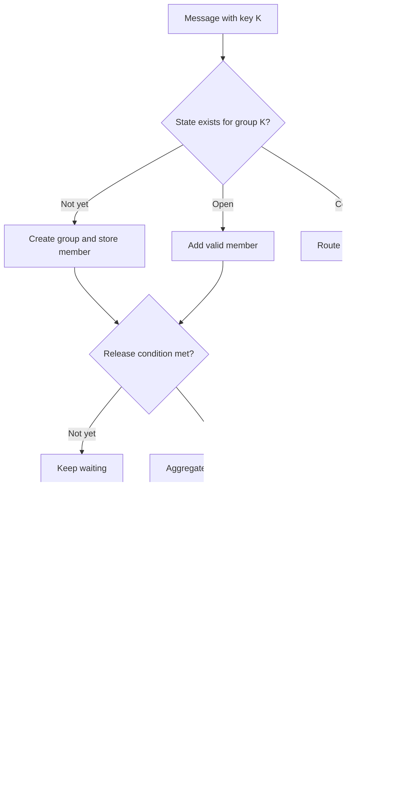

# Duplicate correlation key

## 1. Lesson Objectives

In the **Correlation and state** chapter of **SPRING_INTEGRATION_CORE**, this lesson explains how to recognize and handle multiple messages sharing the same correlation key. The topic ties directly to flow design using `Message`, `MessageChannel`, filters, aggregators, and Java DSL: the correlation key governs which data may share state.

After this lesson, you will be able to:

- Distinguish valid shared correlation keys from duplicate messages and key collisions across requests.
- Design keys scoped by tenant, request, and business execution round.
- Combine correlation strategies, release conditions, and deduplication without accidentally dropping valid group members.
- Explain the impact of completed groups, late messages, timeouts, and state cleanup policies.
- Identify test cases needed for retries, restarts, or multiple instances.

The running example is a quote aggregation service. Each request needs results from two partners `A` and `B`; the same request can be executed again in a new quote round.

## 2. Is Having the Same Correlation Key an Error?

### 2.1. Valid Case: Multiple Members of One Group

Let `K(m)` be the correlation key of message `m`. If two messages belong to the same aggregation run, we want:

```text
K(reply from A) = K(reply from B)
```

An aggregator uses a correlation strategy to determine the group. By default, Spring Integration takes the key from the `IntegrationMessageHeaderAccessor.CORRELATION_ID` header; another strategy can be supplied. [Spring Integration: Aggregator](https://docs.spring.io/spring-integration/reference/aggregator.html).

Example:

| Message | Tenant | Request | Round | Partner | Meaning |
| --- | --- | --- | --- | --- | --- |
| m1 | shop-vn | req-42 | round-1 | A | First member |
| m2 | shop-vn | req-42 | round-1 | B | Second member |
| m3 | shop-vn | req-42 | round-2 | A | Belongs to a different aggregation run |

`m1` and `m2` must share the same key. `m3` must have a different key if `round-2` is a new business execution run.

### 2.2. Four "Duplicate" Cases to Distinguish

| Scenario | Group key | Event identity | Handling |
| --- | --- | --- | --- |
| Two partners answer the same request | Same | Different | Accept both |
| Broker redelivers an event | Same | Same | Apply idempotency |
| Two independent requests are merged together | Same due to flawed design | Usually different | Fix key scope |
| Reply arrives after group completion | Matches old group key | May be old or new | Apply late-message policy |

The phrase **duplicate correlation key** during troubleshooting is not enough to conclude duplicate data exists. You must determine whether the two messages genuinely belong to the same aggregation run.

Nor is it the name of a generic exception every aggregator throws when encountering an existing key. Adding multiple messages to the same group is normal aggregator operation.

### 2.3. Identities That Should Not Be Conflated

- **Correlation key** answers: "Which aggregation run does this message belong to?"
- **Event ID or idempotency key** answers: "Has this event already been accepted/processed?"
- **Partner ID or part ID** answers: "Which member of the group is this?"
- **Message ID** identifies a technical `Message`; do not rely on it as a substitute for business event identity when messages are recreated.

One reply can be wrapped into two different `Message` instances after retries. If `eventId` stays unchanged, the application has a basis to recognize it as the same event even though the technical message was recreated.

## 3. How Key Collisions Corrupt Data

Suppose the correlation strategy returns only `requestId`:

```java
.correlationStrategy(message ->
        ((PartnerReply) message.getPayload()).key().requestId())
```

This configuration is valid only if `requestId` is already unique across the entire relevant state scope and is never reused across independent rounds. In multi-tenant systems, that assumption rarely holds.

Consider this arrival order:

```text
1. shop-vn / req-42 / round-1 / A
2. shop-us / req-42 / round-1 / B
```

If the key is only `req-42` and the release condition is "have A and B," the aggregator can produce a quote combining two different customers. Even a release condition checking exact member count cannot fix selecting the wrong group.

Another bug appears when the key includes only tenant and request:

```text
1. shop-vn / req-42 / round-1 / A
2. shop-vn / req-42 / round-2 / B
```

Two quote rounds get mixed. If the earlier round's group already completed and state remains, valid replies from the next round can even be treated as late.

Therefore, a group key must represent **one business aggregation run**, rather than merely an entity such as an order or customer.

## 4. Designing Correlation Keys

### 4.1. Define Scope Before Choosing Data Types

For the quote example, the key contract is:

```text
CorrelationKey = (tenantId, requestId, roundId)

A transport retry due to network failure:
    keep all three components unchanged.

A new quote attempt:
    keep tenantId, requestId;
    generate a new roundId once at business initiation.
```

Do not generate a new `roundId` at each partner. Partners must receive and echo back the same round identifier supplied by the initiator.

If `requestId` is already unique per aggregation run, `roundId` may be unnecessary. Adding any component must stem from the business contract, not from throwing as many fields together as possible.

### 4.2. Four Required Properties

1. **Stable:** retrying the same event still resolves to the same key.
2. **Isolated:** two independent aggregation runs have distinct keys.
3. **Immutable:** the key value does not change after the message enters the flow.
4. **Deterministic:** all instances produce the same representation for the same identity.

Blank keys or missing required components should be caught at message intake. Assigning every missing key to `"UNKNOWN"` merges malformed data into one shared group.

A custom key object needs value-based `equals()` and `hashCode()`; a Java `record` fits this model well. Never use `hashCode()` itself as a business identifier: two distinct values can have the same hash.

### 4.3. Distinguishing Group Keys from Deduplication Keys

Example:

```text
Group key:
    (shop-vn, req-42, round-1)

Event deduplication key:
    (quote-events-v1, shop-vn, req-42, round-1, A, event-a-7)
```

If deduplication relied solely on the group key, accepting A's reply first would cause B's reply to be dropped. The group could never complete.

If a fresh random UUID were used as the group key for every reply, A and B would land in separate groups. Again, the group could never complete.

When encoding multiple components into a string, avoid ambiguous concatenation. For example, `("ab", "c")` and `("a", "bc")` must not both turn into `"abc"`. Use structured data types, canonical JSON, or length-prefixed encoding per component.

## 5. Release Conditions Must Count the Right Thing

Suppose we are waiting for two partners:

```text
A(event-1), A(event-1 redelivered)
```

The condition `group.size() == 2` sees two messages even though B has not arrived at all. If both copies are kept as separate messages, this condition can release the group prematurely.

`SimpleSequenceSizeReleaseStrategy` compares message count against `sequenceSize` and does not check for duplicate `sequenceNumber` values. Hence, do not assume sequence headers automatically guarantee member uniqueness. [Javadoc: SimpleSequenceSizeReleaseStrategy](https://docs.spring.io/spring-integration/api/org/springframework/integration/aggregator/SimpleSequenceSizeReleaseStrategy.html).

For the "wait for A and B" contract, a condition closer to the business domain is:

```text
received partnerId set = {A, B}
```

That condition prevents two replies from A from substituting for B. However, it does not solve everything:

- Two different requests accidentally sharing a key can still complete `{A, B}`.
- Two distinct events from A can contain two conflicting prices.
- After the group emits a result, another set of copies can recreate the group if state was already deleted.

A sound design requires the right group key, clear event identity, and a state lifecycle policy together.

## 6. Java DSL Example: Separating Groups and Filtering Redelivered Events

The example below uses Java 17 and the Spring Integration 6.5 API. The application needs `spring-integration-core` and compatible Spring libraries; if using Spring Boot, let Boot's dependency management manage versions.

Contract of the example:

- Each round requires one final quote from A and one from B.
- `eventId` is issued by the source and preserved when redelivering the same event.
- One `eventId` must not represent multiple different contents.
- Prices use the same currency already normalized before this flow.
- This is a single-JVM model using in-memory stores to observe behavior.

### 6.1. Configuration and Data Model

```java
import java.io.Serializable;
import java.math.BigDecimal;
import java.util.Map;
import java.util.Objects;
import java.util.Set;
import java.util.TreeMap;
import java.util.stream.Collectors;

import org.springframework.context.annotation.Bean;
import org.springframework.context.annotation.Configuration;
import org.springframework.integration.channel.DirectChannel;
import org.springframework.integration.channel.QueueChannel;
import org.springframework.integration.config.EnableIntegration;
import org.springframework.integration.dsl.IntegrationFlow;
import org.springframework.integration.metadata.ConcurrentMetadataStore;
import org.springframework.integration.metadata.SimpleMetadataStore;
import org.springframework.integration.selector.MetadataStoreSelector;
import org.springframework.integration.store.MessageGroup;
import org.springframework.integration.store.MessageGroupStore;
import org.springframework.integration.store.SimpleMessageStore;
import org.springframework.messaging.Message;

@Configuration
@EnableIntegration
public class DuplicateCorrelationConfig {

    private static final Set<String> EXPECTED_PARTNERS = Set.of("A", "B");

    public record RequestKey(
            String tenantId,
            String requestId,
            String roundId) implements Serializable {

        public RequestKey {
            requireText(tenantId, "tenantId");
            requireText(requestId, "requestId");
            requireText(roundId, "roundId");
        }
    }

    public record PartnerReply(
            RequestKey key,
            String partnerId,
            String eventId,
            BigDecimal price) implements Serializable {

        public PartnerReply {
            Objects.requireNonNull(key, "key");
            requireText(partnerId, "partnerId");
            requireText(eventId, "eventId");
            Objects.requireNonNull(price, "price");

            if (!EXPECTED_PARTNERS.contains(partnerId)) {
                throw new IllegalArgumentException("Invalid partner");
            }
            if (price.signum() < 0) {
                throw new IllegalArgumentException("Price must not be negative");
            }
        }
    }

    public record QuoteResult(
            RequestKey key,
            Map<String, BigDecimal> prices) implements Serializable {
    }

    @Bean
    public DirectChannel replyInput() {
        return new DirectChannel();
    }

    @Bean
    public QueueChannel completedQuotes() {
        return new QueueChannel();
    }

    @Bean
    public QueueChannel duplicateReplies() {
        return new QueueChannel();
    }

    @Bean
    public QueueChannel lateOrExpiredReplies() {
        return new QueueChannel();
    }

    @Bean
    public MessageGroupStore quoteGroupStore() {
        return new SimpleMessageStore();
    }

    @Bean
    public ConcurrentMetadataStore seenQuoteEvents() {
        return new SimpleMetadataStore();
    }

    @Bean
    public MetadataStoreSelector quoteEventSelector() {
        return new MetadataStoreSelector(
                message -> eventKey(asReply(message)),
                message -> "seen",
                seenQuoteEvents());
    }

    @Bean
    public IntegrationFlow quoteFlow() {
        MetadataStoreSelector selector = quoteEventSelector();

        return IntegrationFlow.from(replyInput())
                .filter(
                        Message.class,
                        message -> selector.accept(message),
                        endpoint -> endpoint
                                .discardChannel("duplicateReplies"))
                .aggregate(aggregator -> aggregator
                        .correlationStrategy(message -> asReply(message).key())
                        .releaseStrategy(group -> group.getMessages().stream()
                                .map(DuplicateCorrelationConfig::asReply)
                                .map(PartnerReply::partnerId)
                                .collect(Collectors.toSet())
                                .equals(EXPECTED_PARTNERS))
                        .outputProcessor(DuplicateCorrelationConfig::combine)
                        .messageStore(quoteGroupStore())
                        .expireGroupsUponCompletion(false)
                        .expireGroupsUponTimeout(false)
                        .groupTimeout(30_000)
                        .sendPartialResultOnExpiry(false)
                        .discardChannel("lateOrExpiredReplies"))
                .channel(completedQuotes())
                .get();
    }

    private static PartnerReply asReply(Message<?> message) {
        if (message.getPayload() instanceof PartnerReply reply) {
            return reply;
        }
        throw new IllegalArgumentException("Payload must be PartnerReply");
    }

    private static String eventKey(PartnerReply reply) {
        RequestKey key = reply.key();
        return "quote-events-v1/"
                + encode(key.tenantId())
                + encode(key.requestId())
                + encode(key.roundId())
                + encode(reply.partnerId())
                + encode(reply.eventId());
    }

    private static String encode(String value) {
        return value.length() + ":" + value;
    }

    private static QuoteResult combine(MessageGroup group) {
        RequestKey key = null;
        Map<String, BigDecimal> prices = new TreeMap<>();

        for (Message<?> message : group.getMessages()) {
            PartnerReply reply = asReply(message);

            if (key == null) {
                key = reply.key();
            }
            else if (!key.equals(reply.key())) {
                throw new IllegalStateException("Group contains inconsistent keys");
            }

            BigDecimal previous = prices.putIfAbsent(
                    reply.partnerId(), reply.price());

            if (previous != null
                    && previous.compareTo(reply.price()) != 0) {
                throw new IllegalStateException(
                        "Conflicting prices from same partner in one round");
            }
        }

        if (key == null || !prices.keySet().equals(EXPECTED_PARTNERS)) {
            throw new IllegalStateException("Group is missing partners");
        }

        return new QuoteResult(key, Map.copyOf(prices));
    }

    private static void requireText(String value, String field) {
        if (value == null || value.isBlank()) {
            throw new IllegalArgumentException(field + " must not be blank");
        }
    }
}
```

Calls between `@Bean` methods here go through the default `@Configuration` proxy mechanism. If you switch to `proxyBeanMethods = false`, pass dependencies as bean method parameters so you do not accidentally create extra stores and channels.

### 6.2. Key Decisions in the Configuration

**Filter on the full message.** `Message.class` gives the selector access to the message rather than just the payload. The DSL API provides the corresponding overload for `filter`. [Javadoc: BaseIntegrationFlowDefinition.filter](https://docs.spring.io/spring-integration/docs/6.5.0/api/org/springframework/integration/dsl/BaseIntegrationFlowDefinition.html).

**Deduplicate by event.** `MetadataStoreSelector` puts the key into `ConcurrentMetadataStore` via `putIfAbsent`; new keys are accepted, while existing keys are rejected under the default configuration without `compareValues`. [Javadoc: MetadataStoreSelector](https://docs.spring.io/spring-integration/api/org/springframework/integration/selector/MetadataStoreSelector.html).

**Isolate business rounds.** The correlation strategy returns `RequestKey`. Different tenants or different rounds produce different keys. `quoteGroupStore` is dedicated to this quote aggregator.

**Release by partner set.** Two distinct events from A cannot complete the group when B has not arrived.

**Detect conflicts during aggregation.** If two distinct events from the same partner carry different prices, `combine` fails when the group releases. This is an illustrative business policy; a real system might pick the latest version, provided version ordering is explicitly defined.

**Separate two discard paths.** `duplicateReplies` receives events already seen at the filter. `lateOrExpiredReplies` receives messages rejected by the aggregator due to group state or timeout. The two paths have distinct causes even if they share a monitoring system.

### 6.3. Limitations of the Pattern

`SimpleMessageStore` and `SimpleMetadataStore` keep state in memory. The message store and deduplication store serve two separate purposes; persistent stores are an option when recovery after failures is needed. [Spring Integration: Message Store](https://docs.spring.io/spring-integration/reference/message-store.html).

The queues in the example are for observing output. When building a service, attach appropriate consumers to process or record messages on the duplicate and late/expired branches.

The sample does not yet implement a coordinated transaction between marking an event seen and updating the group. Therefore, do not treat this filter as an exactly-once business guarantee. The retry and recovery section below analyzes this point.

The sample also intentionally does not purge `seen` keys or completed empty groups yet. Add a retention policy when applying this to a long-running system.

## 7. Tracing a Concrete Message Sequence

You can use the following class in the same package as the configuration to send messages manually. This is illustrative practice code, not an executed test suite.

```java
import java.math.BigDecimal;
import java.util.Objects;

import org.springframework.context.annotation.AnnotationConfigApplicationContext;
import org.springframework.integration.channel.QueueChannel;
import org.springframework.messaging.Message;
import org.springframework.messaging.MessageChannel;
import org.springframework.messaging.support.MessageBuilder;

public class QuoteFlowDemo {

    public static void main(String[] args) {
        try (var context = new AnnotationConfigApplicationContext(
                DuplicateCorrelationConfig.class)) {

            MessageChannel input = context.getBean(
                    "replyInput", MessageChannel.class);
            QueueChannel output = context.getBean(
                    "completedQuotes", QueueChannel.class);
            QueueChannel duplicates = context.getBean(
                    "duplicateReplies", QueueChannel.class);
            QueueChannel late = context.getBean(
                    "lateOrExpiredReplies", QueueChannel.class);

            var r1 = new DuplicateCorrelationConfig.RequestKey(
                    "shop-vn", "req-42", "round-1");
            var r2 = new DuplicateCorrelationConfig.RequestKey(
                    "shop-vn", "req-42", "round-2");

            send(input, r1, "A", "event-a-1", "100");
            send(input, r1, "A", "event-a-1", "100");
            send(input, r2, "A", "event-a-2", "105");
            send(input, r1, "B", "event-b-1", "110");
            send(input, r2, "B", "event-b-2", "115");
            send(input, r1, "A", "event-a-late", "100");

            printOne("Round 1 result", output);
            printOne("Round 2 result", output);
            printOne("Redelivered event", duplicates);
            printOne("Late reply", late);
        }
    }

    private static void send(
            MessageChannel input,
            DuplicateCorrelationConfig.RequestKey key,
            String partnerId,
            String eventId,
            String price) {

        var reply = new DuplicateCorrelationConfig.PartnerReply(
                key, partnerId, eventId, new BigDecimal(price));

        input.send(MessageBuilder.withPayload(reply).build());
    }

    private static void printOne(String label, QueueChannel channel) {
        Message<?> message = Objects.requireNonNull(
                channel.receive(0), "Missing message: " + label);
        System.out.println(label + ": " + message.getPayload());
    }
}
```

Expected progression when sending sequentially before timeout:

| Step | Message | Outcome |
| --- | --- | --- |
| 1 | round-1, A, event-a-1 | Creates round 1 group, waits for B |
| 2 | Redelivery of step 1 event | Goes to `duplicateReplies`, no member added |
| 3 | round-2, A, event-a-2 | Creates separate round 2 group |
| 4 | round-1, B, event-b-1 | Emits round 1 result with A=100, B=110 |
| 5 | round-2, B, event-b-2 | Emits round 2 result with A=105, B=115 |
| 6 | round-1, A, event-a-late | Passes filter as new event, yet goes to `lateOrExpiredReplies` because group completed |

Steps 2 and 6 demonstrate two independent checking layers: a copy can be blocked before the aggregator; a fresh event can still arrive too late for its group.

The display order of entries in the result `Map` is not a contract to assert. What matters is the right round key and the right price for each partner.

## 8. Group Lifecycle Determines Key Reusability

### 8.1. Completion Differs from State Deletion

For an aggregator, `expireGroupsUponCompletion(false)` retains completed-group markers to handle late messages. If set to `true`, the group is deleted after completion; new messages with the same key can open a new group. [Javadoc: AggregatingMessageHandler](https://docs.spring.io/spring-integration/api/org/springframework/integration/aggregator/AggregatingMessageHandler.html).

The two policies can be visualized with a diagram:



Example consequence of the policy above:

```text
T0: A1 and B1 cause group K to emit a result.
T1: State K is deleted.
T2: Broker redelivers A1.
T3: Broker redelivers B1.

If no deduplication layer remains active:
    T2 creates a new group;
    T3 can emit the result a second time.
```

Thus, enabling group deletion on completion is not how you solve key collisions between two quote rounds. It allows key reuse, yet does not distinguish old replies from new-round replies.

### 8.2. Timeouts Have Their Own Policy

`groupTimeout(30_000)` in the example is the idle interval with no new messages entering an unreleased group, not a fixed business deadline measured from when the user started the request. [Spring Integration: Aggregator, Group Timeout](https://docs.spring.io/spring-integration/reference/aggregator.html#aggregator-group-timeout).

If duplicate copies are already blocked by the filter, they do not reach the aggregator to affect the group's wait timer. Keep this consequence in mind when analyzing retry logs.

`expireGroupsUponTimeout` controls deleting groups on timeout; the default is `true`. The example explicitly sets `false` to avoid immediately deleting markers on the timeout branch. [Javadoc: setExpireGroupsUponTimeout](https://docs.spring.io/spring-integration/docs/6.5.0/api/org/springframework/integration/aggregator/AbstractCorrelatingMessageHandler.html#setExpireGroupsUponTimeout(boolean)).

Because `sendPartialResultOnExpiry(false)` is set, the sample does not emit a partner-missing quote as a successful result. Timed-out group messages go to the configured discard branch. The application should translate that situation into an appropriate business status, such as "partner response timed out."

An absolute business deadline should be carried in data such as `expiresAt` and checked upon receiving replies. A single endpoint timeout does not replace full request state.

### 8.3. How Long Should Markers Be Retained?

There are at least three distinct lifetimes:

| State type | Role | Basis for choosing duration |
| --- | --- | --- |
| Waiting group | Hold replies until release | Business wait window |
| Completed-group marker | Prevent late messages from reopening group | Late-arrival lag, replay policy |
| Seen event key | Recognize redeliveries of the same event | Redelivery/retry window and replay scope |

Suppose a design assumes retries can occur for 10 minutes with up to 2 minutes additional lag. Keeping markers for 30 seconds will not cover that assumed 12-minute window. This is derived from operational requirements, not a Spring Integration default.

The DSL provides `minimumTimeoutForEmptyGroups(...)` for minimum retention of empty groups; coordinate group cleanup and the scheduler. Do not treat this value as a universal TTL for every kind of state. [Javadoc: CorrelationHandlerSpec](https://docs.spring.io/spring-integration/docs/6.5.0/api/org/springframework/integration/dsl/CorrelationHandlerSpec.html#minimumTimeoutForEmptyGroups(long)).

If using `MessageGroupStoreReaper`, apply cleanup only within the store scope matching the endpoint. For a system needing replays after multiple days, use a persistent business ledger rather than merely extending in-memory group retention.

Deleting groups and deleting deduplication keys are two separate jobs. A message-group cleanup mechanism does not automatically clean up `ConcurrentMetadataStore`.

## 9. Retries, Mid-Flight Failures, and Ensuring Idempotency

### 9.1. Marking "Seen" Does Not Mean "Finished Processing"

In the sample, the selector writes `seen` before the message enters the aggregator. Consider this sequence:

```text
1. Selector puts event key E into the metadata store.
2. Process fails before E is added to the group.
3. Source resends E.
4. Selector sees E already exists and rejects it.
```

If `seen` persists while the group addition was never recorded, the group can stay missing a member forever. The same happens if the output processor fails after the event was marked.

With two in-memory stores, a restart loses both; however, upgrading only one store to a persistent type lets the two sides drift out of sync. Never upgrade stores piecemeal without considering consistency between them.

A recovery design must answer clearly:

- At what point is an event durably accepted?
- At what point has an event contributed to the group?
- On failure, which source will resend or recover the missing work?
- What protects result emission and final business side effects?

Implementation directions include a shared transaction when stores share the same transactional boundary, a durable inbox tracking processing state, or a safely re-runnable recovery mechanism. If results must go to another system alongside database updates, consider an outbox.

Never automatically delete a `seen` key on every exception. Downstream side effects may already have occurred; deleting the key and blindly re-running can produce duplicate results.

### 9.2. Same eventId with Different Content

Suppose we receive:

```text
E1: round-1, A, event-7, price=100
E2: round-1, A, event-7, price=150
```

The current filter drops E2 because of the same event identity. It does not detect that the source changed content under the same `eventId`.

If this violation must be detected, store a fingerprint of normalized business content alongside the event key:

```text
Key does not exist:
    record fingerprint and accept within the chosen transaction boundary.

Key exists, same fingerprint:
    duplicate with identical content.

Key exists, different fingerprint:
    event identity conflict, route to error handling.
```

The fingerprint should derive from stable business fields, excluding intake timestamps or regenerated message IDs. Use atomic store compare-and-set operations or appropriate transactions to prevent race conditions.

### 9.3. IdempotentReceiverInterceptor Is Another Option

Besides the illustrative filter, Spring Integration offers `IdempotentReceiverInterceptor` to attach idempotency behavior to an endpoint. Without configuring it to discard or throw on rejection, duplicate messages may continue to the handler with the `duplicateMessage=true` header. Thus, merely attaching the interceptor does not mean duplicates are blocked. [Spring Integration: Idempotent Receiver](https://docs.spring.io/spring-integration/reference/handler-advice/idempotent-receiver.html).

Choosing a filter or an advice does not remove the need to design event keys, persistent state, and failure recovery.

## 10. Multiple Instances and State Storage Scope

In a multi-instance application, a valid key can still be processed incorrectly if state is fragmented.

For example, A reaches instance 1 and B reaches instance 2. If each instance has its own `SimpleMessageStore`, both see only half a group. Matching keys do not magically merge two separate memory spaces.

Address these together:

- **Message group store:** instances must see shared group state, or use a routing strategy pinning an entire group to one owner with clear failover recovery.
- **Metadata store:** if deduplicating cluster-wide, recording seen events must also have cluster-wide scope.
- **Concurrency locks:** when sharing a store across servers, use an appropriate shared lock registry to synchronize group updates. The aggregator's default lock is in-memory. [Spring Integration: Aggregator, Lock Registry](https://docs.spring.io/spring-integration/reference/aggregator.html#aggregator-lock-registry).
- **Key formatting:** application versions must agree on how tenant, request, and round are normalized.
- **State cleanup:** instances must obey the same retention rules and store management ownership.

A distributed lock only serializes updates. If two unrelated requests already map to the same key, a lock cannot recognize or separate them.

Also distinguish **endpoint key spaces**. Two aggregators for different workflows sharing one physical store can collide if both generate key `req-42`. Use separate stores or namespaces; do not share data regions for expiry sweeps when endpoints could affect each other's groups.

In the example, `quoteGroupStore` is dedicated to the quote flow; the `quote-events-v1/` prefix is dedicated to metadata keys. If a persistent store needs to serialize `RequestKey` objects, configure and test the appropriate serializer. Having a record implement `Serializable` does not replace per-backend configuration.

## 11. Diagnosing Duplicate Correlation Keys

### 11.1. Collecting the Right Data

When logging a message at intake and before the aggregator, include fields such as:

```text
flow=quote-aggregation
tenantId=shop-vn
requestId=req-42
roundId=round-1
partnerId=A
eventId=event-a-1
resolvedCorrelationKey=(shop-vn,req-42,round-1)
instanceId=quote-02
decision=accepted | duplicate | late | expired | conflict
```

You can add message ID to trace individual deliveries. Avoid logging full payloads unnecessarily; comparing identifier fields is usually enough to isolate mis-grouping.

### 11.2. Isolation Workflow

1. **Compare business identity.** Do the two messages truly share tenant, request, and round?
2. **Compare event and member.** Same event, same partner, or two different partners?
3. **Inspect the resolved key.** Do not look only at input fields; inspect the exact value produced by the correlation strategy.
4. **Check group state.** Is the group waiting, completed, timed out, or already deleted?
5. **Check store and instance.** Did both messages land in the same state scope?
6. **Inspect release and output processor.** Are they counting messages, counting unique members, or picking versions?
7. **Correlate errors and retries.** Was an event marked seen before a failing downstream step?

Common symptoms:

| Symptom | Hypothesis to check |
| --- | --- |
| Group reaches message count yet misses B | Counting duplicate copies of A as independent members |
| Output contains data from two tenants | Key omits tenant or source assigned wrong tenant |
| New round gets routed to late branch | Reused key from an earlier round |
| Each instance waits for a different partner | Local stores or routing splits the group |
| Duplicate results emitted after a period | Completion marker or metadata was purged |
| Retries are dropped yet group remains incomplete | Marked `seen` before a failing step |
| Many unrelated requests share `UNKNOWN` | Default fallback merging keyless messages |

Useful metrics include open group count, oldest group age, duplicate/late/expired rates, content conflict count, and group completion duration. Do not put individual request IDs into metric labels if that creates huge time-series cardinality; keep those details in logs or traces.

## 12. Practice and Testing Scenarios

When testing this flow, observe successful outputs, the duplicate branch, the late/expired branch, and group store state together.

| Input scenario | What to verify |
| --- | --- |
| A then B for the same round | Single result containing exactly both partners |
| B then A for the same round | Outcome does not depend on arrival order |
| A redelivered with same `eventId` before B arrives | Does not release early; copy goes to duplicate branch |
| A sends two distinct `eventId`s with same price | Does not release without B; result contains one price for A |
| A sends two distinct `eventId`s with different prices, then B | Conflict detected per output processor policy |
| Same `requestId` but different tenant | Groups do not mix |
| Same tenant/request but different round | Two independent groups |
| New event arrives after group completion | Goes to late branch while marker remains active |
| Only A arrives, never B | Times out per policy; does not emit a successful quote missing B |
| Purge markers then replay old data | Verify which mechanism still prevents reopening and re-emitting |
| Two threads send the same event concurrently | Accepted once under metadata store's atomic operation |
| Failure after recording `seen`, before adding to group | Way to recover the event without losing its contribution |
| Restart or instance failover | State matches chosen store type and recovery guarantees |

For timeout tests, use bounded waits and proper synchronization. Do not rely on a long sleep and assume state must be right.

Three hands-on exercises:

1. Replace the group key with `requestId` and send two tenants with the same request. Observe how data can get mixed; then restore the full key.
2. Change the release condition to `group.size() == 2`, remove the filter, and send two new messages from A. Explain why message count does not represent how many partners replied.
3. Choose an assumed retry window for your system. Separately design waiting-group duration, completion-marker retention, and event-key retention; specify desired behavior for replays outside that window.

When evaluating your solution, check three invariants:

```text
A group contains data for only one business aggregation run.

A redelivered event must not count as a new contribution.

State cleanup must not silently break guarantees
regarding late replies, replays, and deduplication.
```

Good correlation design starts by accurately defining "one aggregation run." From there, choose the right key, release condition, deduplication mechanism, and state retention lifetimes.
