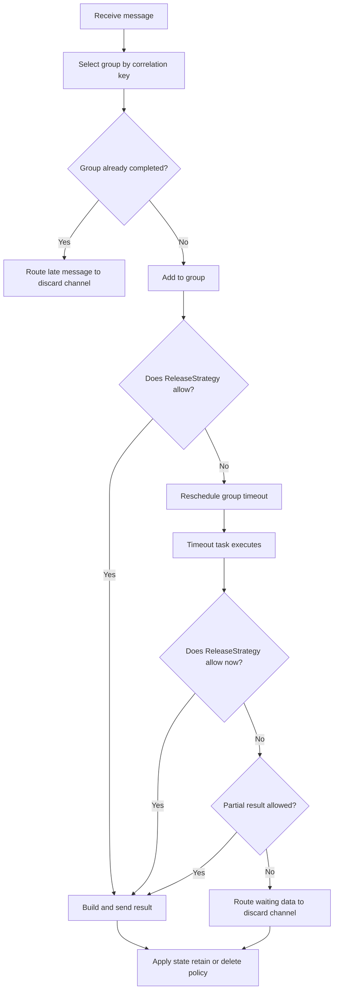

# Group timeout

## 1. Objectives and Context

In the **Correlation and state** chapter of **SPRING_INTEGRATION_CORE**, group timeout addresses a core design question: how long is a message group that has not yet met the release condition allowed to wait?

After this lesson, you will be able to:

- Explain why an aggregator needs both a completion condition and a wait time limit.
- Distinguish a timeout measured from the last received message from a fixed group deadline.
- Configure Java DSL to emit partial results or route messages to a discard channel.
- Choose a group state retention policy to handle late messages.
- Design test scenarios for timeouts, correlation, and state lifecycle.

This lesson uses core Spring Integration components: `Message`, `MessageChannel`, the aggregator endpoint, `MessageGroupStore`, and Java DSL. You should already know that a message consists of a payload and headers, as well as the role of a correlation key in placing messages into the same group.

## 2. Why Can a Group Wait Forever?

Suppose a service collects quotes from three sources: `KHO`, `GIA`, and `VAN_CHUYEN`. Each request has its own `requestId`. The aggregator collects replies sharing the same `requestId` and produces a combined result.

The normal completion condition is: **replies have arrived from all three sources**.

If `VAN_CHUYEN` is interrupted, the other two replies are sitting in the store while the completion condition remains false. No new message is guaranteed to arrive to flip that decision. The group keeps holding state, and the caller still has no final result.

Group timeout adds a bounded exit path: after the configured wait period, the framework actively evaluates completing the group. The business domain must decide whether to accept the two available quotes or route them to another handling flow.

Two reasonable policies for two different products:

| Business case | When one source is missing after deadline |
| --- | --- |
| Price reference screen | Display available data, marked as incomplete |
| Checkout requiring full cost breakdown | Route to missing-data handling; do not treat as a valid quote |

A timeout only creates an opportunity to stop waiting; whether that means success or failure is defined by the business contract.

## 3. Timing Model of Group Timeout

### 3.1. Per-Group Idle Timeout

With `.groupTimeout(1500L)`, the value is interpreted in milliseconds. When a new message is accepted into the group and the release strategy does not allow emission yet, the timeout task is rescheduled. Therefore, this is a limit on the idle period after the group's latest arrival, not a fixed window starting from the first message. [Aggregator reference](https://docs.spring.io/spring-integration/reference/7.0/aggregator.html).

Example for the same group `REQ-101`, 1.5-second timeout:

| Relative time | Event | Scheduled timeout check |
| --- | --- | --- |
| `t = 0.0 s` | Receive `KHO`; sources incomplete | `t = 1.5 s` |
| `t = 0.8 s` | Receive `GIA`; still incomplete | Rescheduled to `t = 2.3 s` |
| `t = 1.5 s` | No new event | Not timed out under new schedule |
| `t ≈ 2.3 s` | Still missing `VAN_CHUYEN` | Execute timeout handling |

Group `REQ-202` has its own schedule. A message for `REQ-202` does not extend the wait time of `REQ-101`.

This is a processing-time model at the aggregator. Timestamps attached to payloads by source systems do not automatically turn this configuration into an event-time window.

### 3.2. Decision Flow at Expiration

When the timeout task runs, the release strategy is consulted again. If normal release still cannot occur, `sendPartialResultOnExpiry` decides whether to emit a partial result or discard waiting messages. [Group timeout mechanism](https://docs.spring.io/spring-integration/reference/aggregator.html#aggregator-and-group-timeout).



The diagram shows the logical path when operations succeed; result-sending errors must be handled separately. With a positive numeric configuration, the timeout task typically runs on a scheduler thread, whereas arrival-triggered release can execute immediately on the thread sending through a `DirectChannel`.

Scheduled times are not hard real-time guarantees. Busy scheduler threads, group lock contention, or a slow downstream component can delay results past the expected mark.

## 4. Three Configuration Decisions to Keep Separate

### 4.1. Allow Partial Results?

| Configuration | On timeout when release strategy still returns `false` |
| --- | --- |
| `sendPartialResultOnExpiry(true)` | Invokes the group processor with current messages and sends the result to the output flow |
| `sendPartialResultOnExpiry(false)` | Does not build a partial aggregated result; discards waiting data, optionally sending to `discardChannel` |

If choosing the discard branch, configure an explicit receiving channel so there is a place to monitor or recover data. Do not assume a timeout automatically raises a business exception.

The partial-result branch uses the exact same group processor. Hence, `outputProcessor` must handle both complete and incomplete groups. Hardcoding access to the third element of a two-element list will fail on the timeout path.

### 4.2. Delete the Entire Group After Timeout?

`expireGroupsUponTimeout(true)` deletes the entire group when timeout handling completes. If the same correlation key appears afterward, the message can open a new group.

Setting `expireGroupsUponTimeout(false)` alongside retaining groups upon completion keeps completed metadata to block late messages. In this example, both flags are set to `false` so state retention behaves consistently across normal completion and timeout branches. [Correlation handler API](https://docs.spring.io/spring-integration/api/org/springframework/integration/dsl/CorrelationHandlerSpec.html).

### 4.3. Delete the Group After Normal Release?

`expireGroupsUponCompletion` controls deleting the group after release. When set to `false`, the aggregator can remove processed messages while keeping completed-group metadata. That metadata helps recognize that the same correlation key must not reopen immediately. [Group lifecycle in AggregatingMessageHandler](https://raw.githubusercontent.com/spring-projects/spring-integration/v7.0.0/spring-integration-core/src/main/java/org/springframework/integration/aggregator/AggregatingMessageHandler.java).

Configure both flags intentionally:

| Example goal | `expireGroupsUponCompletion` | `expireGroupsUponTimeout` |
| --- | --- | --- |
| Keep completion marker after both full release and timeout | `false` | `false` |
| Allow the same key to open a new group after ending | `true` | `true` |

If the business requires different policies for the two exit paths, describe and test each path explicitly. Do not infer the entire lifecycle from a single property name.

Retaining metadata does not mean keeping every payload indefinitely. Even so, metadata count grows with the number of groups; define a separate cleanup policy matching your late-message acceptance window.

## 5. Java DSL Example: Quote Aggregation with Partial Results

### 5.1. Data Contract

Each reply carries:

- `requestId`: unique identifier of one quote-collection run.
- `source`: one of three known sources.
- `amount`: monetary amount expressed in an agreed smallest unit, such as VND.

The emitted result contains a map of quotes, the set of missing sources, and a `complete` flag. That flag reflects data completeness; it does not assert which technical trigger caused emission.

The example assumes inputs have already been type-checked, `requestId` is non-blank, and amounts are valid. The filter in the flow merely illustrates dropping out-of-contract sources.

The application needs `spring-integration-core`. If using Spring Boot, use the version chosen by your project's dependency management. The code uses Java 17+ for `record`s, along with Java DSL `IntegrationFlow.from(...)`.

### 5.2. Complete Configuration

```java
import java.util.HashSet;
import java.util.Map;
import java.util.Set;
import java.util.stream.Collectors;

import org.springframework.context.annotation.Bean;
import org.springframework.context.annotation.Configuration;
import org.springframework.integration.channel.DirectChannel;
import org.springframework.integration.channel.QueueChannel;
import org.springframework.integration.config.EnableIntegration;
import org.springframework.integration.dsl.IntegrationFlow;
import org.springframework.integration.store.MessageGroup;
import org.springframework.integration.store.SimpleMessageStore;

@Configuration
@EnableIntegration
public class GroupTimeoutConfig {

    private static final Set<String> EXPECTED_SOURCES =
            Set.of("KHO", "GIA", "VAN_CHUYEN");

    public record QuotePart(
            String requestId,
            String source,
            long amount) {
    }

    public record QuoteBundle(
            String requestId,
            Map<String, Long> amounts,
            Set<String> missingSources,
            boolean complete) {
    }

    @Bean
    public DirectChannel quoteParts() {
        return new DirectChannel();
    }

    @Bean
    public QueueChannel quoteResults() {
        return new QueueChannel();
    }

    @Bean
    public QueueChannel quoteDiscarded() {
        return new QueueChannel();
    }

    @Bean
    public SimpleMessageStore quoteStore() {
        return new SimpleMessageStore();
    }

    @Bean
    public IntegrationFlow quoteFlow() {
        return IntegrationFlow.from(quoteParts())
                .<QuotePart>filter(
                        part -> EXPECTED_SOURCES.contains(part.source()),
                        spec -> spec.discardChannel(quoteDiscarded()))
                .aggregate(spec -> spec
                        .messageStore(quoteStore())
                        .correlationStrategy(message ->
                                ((QuotePart) message.getPayload()).requestId())
                        .releaseStrategy(GroupTimeoutConfig::hasAllSources)
                        .groupTimeout(1500L)
                        .sendPartialResultOnExpiry(true)
                        .expireGroupsUponCompletion(false)
                        .expireGroupsUponTimeout(false)
                        .discardChannel(quoteDiscarded())
                        .outputProcessor(GroupTimeoutConfig::toBundle))
                .channel(quoteResults())
                .get();
    }

    private static boolean hasAllSources(MessageGroup group) {
        Set<String> received = group.getMessages().stream()
                .map(message -> (QuotePart) message.getPayload())
                .map(QuotePart::source)
                .collect(Collectors.toSet());

        return received.containsAll(EXPECTED_SOURCES);
    }

    private static QuoteBundle toBundle(MessageGroup group) {
        Map<String, Long> amounts = group.getMessages().stream()
                .map(message -> (QuotePart) message.getPayload())
                .collect(Collectors.toMap(
                        QuotePart::source,
                        QuotePart::amount,
                        Long::min));

        Set<String> missing = new HashSet<>(EXPECTED_SOURCES);
        missing.removeAll(amounts.keySet());

        QuotePart first = (QuotePart) group.getOne().getPayload();
        return new QuoteBundle(
                first.requestId(),
                Map.copyOf(amounts),
                Set.copyOf(missing),
                missing.isEmpty());
    }
}
```

Decisions in the example serve specific purposes:

1. Correlation reads from the payload, so it does not depend on the `correlationId` header. If you remove this strategy, do not assume the aggregator will automatically know `requestId`.
2. Release relies on the set of distinct sources. Three replies all from `KHO` cannot pass for three different sources.
3. If one source sends multiple prices within the same request, the example keeps the lowest price via `Long::min`. This is an intentional illustrative rule; a product must choose rules fitting real data.
4. The result includes `missingSources`, because returning only a shorter map makes it harder for receivers to know which data is missing.
5. Both expiration flags set to `false` keep completion markers so late messages do not spontaneously generate a second result while metadata remains.
6. `QueueChannel` serves as the place to observe results in this lesson. Real applications must have consumers and proper capacity bounds.

`outputProcessor` is the hook creating the business payload from `MessageGroup`; `expireGroupsUponCompletion` is an aggregator-specific option. [AggregatorSpec API](https://docs.spring.io/spring-integration/api/org/springframework/integration/dsl/AggregatorSpec.html).

### 5.3. Sending Two Sources and Observing Timeout

The following class can be placed in the same package as `GroupTimeoutConfig` in a practice project with the appropriate dependencies:

```java
import org.springframework.context.annotation.AnnotationConfigApplicationContext;
import org.springframework.integration.channel.DirectChannel;
import org.springframework.integration.channel.QueueChannel;
import org.springframework.messaging.Message;
import org.springframework.messaging.support.MessageBuilder;

public class GroupTimeoutDemo {

    public static void main(String[] args) {
        try (var context = new AnnotationConfigApplicationContext(
                GroupTimeoutConfig.class)) {

            DirectChannel input = context.getBean(
                    "quoteParts", DirectChannel.class);
            QueueChannel output = context.getBean(
                    "quoteResults", QueueChannel.class);
            QueueChannel discarded = context.getBean(
                    "quoteDiscarded", QueueChannel.class);

            input.send(MessageBuilder.withPayload(
                    new GroupTimeoutConfig.QuotePart(
                            "REQ-101", "KHO", 120_000L)).build());
            input.send(MessageBuilder.withPayload(
                    new GroupTimeoutConfig.QuotePart(
                            "REQ-101", "GIA", 118_000L)).build());

            Message<?> resultMessage = output.receive(5000L);
            if (resultMessage == null) {
                throw new IllegalStateException("Result not received in demo");
            }

            var result = (GroupTimeoutConfig.QuoteBundle)
                    resultMessage.getPayload();
            System.out.println(result);

            input.send(MessageBuilder.withPayload(
                    new GroupTimeoutConfig.QuotePart(
                            "REQ-101", "VAN_CHUYEN", 25_000L)).build());

            Message<?> lateMessage = discarded.receive(1000L);
            System.out.println("Late message received: "
                    + (lateMessage != null));
        }
    }
}
```

Expected behavior when the scheduler operates normally:

- After about 1.5 seconds of silence for `REQ-101`, output has `complete=false` and `missingSources` contains `VAN_CHUYEN`.
- The `amounts` map contains both `KHO` and `GIA` keys; iteration order is not part of the example's contract.
- The `VAN_CHUYEN` reply sent after receiving the result enters `quoteDiscarded`, because completed-group metadata still exists.

`receive(5000L)` is only the demo's wait limit on the result channel. It does not change the aggregator's 1,500-millisecond timeout.

To test the discard path, change only that business option in the illustrative configuration to `.sendPartialResultOnExpiry(false)`. When a source is missing, do not expect a `QuoteBundle` on `quoteResults`; observe waiting messages on `quoteDiscarded` instead. With default per-message discarding, two waiting inputs yield two messages on the discard channel.

## 6. Fixed Deadlines and Dynamic Timeouts

### 6.1. When an Idle Period Does Not Meet Requirements

A group receiving a message every second can continuously push back a 1.5-second timeout. If the contract requires returning a result within roughly four seconds from group creation, using only a last-arrival timeout is not enough.

There are two independent questions:

- Has it been too long without any new reply?
- Has the total lifetime of this collection run exceeded its budget?

You can pick one of the two or apply both.

### 6.2. Using a `Date` Anchored to Group Creation Time

Replace `.groupTimeout(1500L)` in the flow with:

```java
.groupTimeoutExpression("new java.util.Date(timestamp + 4000L)")
```

`timestamp` is a property of `MessageGroup`, not a header on an individual message. Returning a `Date` denotes an absolute point in time; a positive number denotes a delay from evaluation time. When new inputs arrive, the expression above still computes the same group-creation timestamp plus four seconds. [groupTimeoutExpression API](https://docs.spring.io/spring-integration/api/org/springframework/integration/dsl/CorrelationHandlerSpec.html#groupTimeoutExpression(java.lang.String)).

Reused group metadata can cause group creation time to differ from the first message time of a new business run. Thus, if every request run has its own deadline, use a distinct correlation key per run or pass an explicit business deadline.

### 6.3. Combining Idle Wait with Maximum Age

Another option is replacing the timeout with a function:

```java
.groupTimeout(group -> new java.util.Date(
        Math.min(
                System.currentTimeMillis() + 1500L,
                group.getTimestamp() + 4000L)))
```

This is the example's policy: take the earlier of 1.5 seconds from the current evaluation and four seconds from group creation. It works well when you want to finish quickly on silence while still capping extensions caused by trickle messages.

Illustrative trace for a group starting at `t=0`:

| Latest arrival | By idle period | By max age | Chosen deadline |
| --- | --- | --- | --- |
| `t=0.0 s` | `1.5 s` | `4.0 s` | `1.5 s` |
| `t=1.0 s` | `2.5 s` | `4.0 s` | `2.5 s` |
| `t=2.0 s` | `3.5 s` | `4.0 s` | `3.5 s` |
| `t=3.0 s` | `4.5 s` | `4.0 s` | `4.0 s` |

When an absolute timestamp is already in the past, treat it as work to execute promptly rather than expecting the scheduler to turn back time. If you must reject any data past a business deadline, validate the deadline on the message intake path; the scheduler alone does not enforce that.

### 6.4. Meaning of `null` and `0`

You can configure conditionally:

```java
.groupTimeoutExpression("size() >= 2 ? 1500L : null")
```

Here, a group holding only one message does not get a timeout scheduled by this expression. If a second message never arrives, that group needs another cleanup mechanism.

- `null`: do not schedule force-complete for this evaluation.
- `0`: force-complete immediately on the current thread.
- Positive number: delay in milliseconds.
- `Date`: absolute point in time.

Do not use negative numbers as an arbitrary convention for "wait forever"; use `null` when the intent is not to schedule. These behaviors can be seen in the handler's scheduling logic. [AbstractCorrelatingMessageHandler source](https://raw.githubusercontent.com/spring-projects/spring-integration/v7.0.0/spring-integration-core/src/main/java/org/springframework/integration/aggregator/AbstractCorrelatingMessageHandler.java).

Choose only one timeout configuration method per endpoint. Do not chain multiple `groupTimeout` and `groupTimeoutExpression` calls expecting the framework to merge limits automatically; write the combination explicitly in one function as shown above.

## 7. Late Messages, Duplicates, and State

### 7.1. Correlation Key Must Represent Exactly One Processing Run

If you use only order ID `ORDER-88`, a second quote attempt can collide with the first attempt's completion metadata. A more suitable correlation key can include:

```text
merchantId + orderId + quoteAttemptId
```

Keep the same key across all branches of one collection run. A new attempt uses a new `quoteAttemptId`; a technical redelivery of the same reply still keeps an appropriate business identifier to detect duplicates.

### 7.2. Dropping Metadata Early Can Open a New Group

Scenario traced when choosing to delete groups after timeout:

1. `REQ-101` receives two sources and then times out.
2. A partial result has already been sent to the receiver.
3. Group state is deleted completely.
4. The remaining reply with key `REQ-101` arrives late and opens a new group.
5. The new group can later time out, producing another result tied to the same request.

If the product allows only one final result, add an appropriate safeguard: retain completion markers for a protection window, persist terminal state at the business layer, or apply idempotency when receiving results. Timeouts do not provide exactly-once guarantees on their own.

### 7.3. A Duplicate Reply Can Still Affect Wait Time

The example's release strategy counts distinct sources, avoiding premature release from three messages of the same source. However, a duplicate reply accepted into the group can still cause an idle-period timeout to reschedule.

If producers retry frequently, place an idempotent filter step before the aggregator using a key combining `requestId` and reply identity. Decide upfront whether two different quotes from the same source are a valid update or duplicate data; never collapse those two meanings into one technical rule.

### 7.4. Retaining Metadata Needs a Time Bound

`SimpleMessageStore` in this lesson is an in-memory store; do not expect state to survive restarts. This choice is for illustrating single-process behavior. [SimpleMessageStore API](https://docs.spring.io/spring-integration/api/org/springframework/integration/store/SimpleMessageStore.html).

The example intentionally does not clean up metadata yet so late-message blocking can be observed. In a long-running system, choose a protection window aligned with the maximum retry duration and delay the business accepts, then clean up completed empty groups. Once metadata is cleaned up, the aggregator's ability to recognize old keys ends as well; if longer protection is required, business state must take over that responsibility.

## 8. Group Timeout vs. Reaper and Other Timeouts

### 8.1. Group Timeout vs. MessageGroupStoreReaper

`MessageGroupStoreReaper` is a `Runnable` component with a `run()` method that performs expiration on a store. Declaring the bean does not replace scheduling periodic `run()` invocations. [MessageGroupStoreReaper API](https://docs.spring.io/spring-integration/api/org/springframework/integration/store/MessageGroupStoreReaper.html).

| Aspect | Group timeout | Reaper |
| --- | --- | --- |
| Trigger mechanism | Scheduled per active group | Scans the store on an external schedule |
| Typical use case | Waiting group stays idle too long | Stale groups or metadata needing cleanup review |
| Things to watch | Rescheduling on arrival, delayed scheduler | Expiration threshold and interval between scans |

Design example: the threshold is 60 seconds, and the scan job runs every 10 seconds. A group reaching the threshold right after a scan pass may wait nearly another 10 seconds to be examined, plus processing time. Do not use scan intervals as a precise deadline for user-facing responses.

When using a reaper, check the store's timestamp policy, expiration flags, and empty-group retention time. Do not configure a reaper so it accidentally deletes completion markers earlier than the lag window the business wants to block.

### 8.2. Commonly Confused Timeouts

| Concept | Scope | Closes aggregator group automatically on expiry? |
| --- | --- | --- |
| Group timeout | One correlation group at the endpoint | Yes, triggers completion handling per config |
| Gateway reply timeout | How long the caller waits for a reply | Not automatically |
| `receive(timeout)` on `QueueChannel` | One pull wait for a message | No |
| Send timeout | One send into a potentially blocking channel | Not a group-age limiting mechanism |
| Message TTL or expiration header | Per-message lifetime per consuming component | Must not be assumed to be group timeout |
| Empty metadata retention time | Window for recognizing finished groups | Does not replace initial data-wait timeout |

A gateway stopping its wait does not mean background work was canceled. If the group is allowed to emit a result after the caller walks away, provide a durable result sink or a status the caller can query later.

## 9. Schedulers, Errors, and Restarts

### 9.1. The Timeout Path Can Throw Errors on Another Thread

For arrival-driven release over a `DirectChannel`, errors can propagate back to the sending thread. When a scheduler fires a timeout later, a `try/catch` around the original send cannot catch exceptions raised at that later moment.

If you supply your own `TaskScheduler`, configure `MessagePublishingErrorHandler` when task errors should be routed to the `errorChannel` flow. Merely having a scheduler bean does not guarantee errors are published to the expected channel. [Error Handling in Spring Integration](https://docs.spring.io/spring-integration/reference/error-handling.html).

Distinguish two outcomes:

- Missing source under time policy: an expected business scenario, representable as `complete=false`.
- Group processor throwing, output channel rejecting, or serializer failing: a processing failure needing its own error path and monitoring.

Do not convert every infrastructure failure into a "partial quote," as that can hide result-emission bugs.

### 9.2. Do Not Let Slow Work Monopolize the Scheduler

If timeout results travel over a `DirectChannel` to a handler making a slow external call, the scheduler thread can stay blocked for that entire operation. Under higher load, other groups are affected too.

One design option is placing slow work behind an appropriate asynchronous boundary, with bounded queues and explicit error paths. Adding this boundary requires revisiting acknowledgments, recovery, and idempotency; switching channels does not automatically create an atomic transaction across the whole flow.

### 9.3. A Persistent Store Does Not Mean a Persistent Timer

A pending task inside a scheduler belongs to the running process. Saving messages to a database does not mean all scheduled timer tasks are saved to resume automatically after the application restarts.

When moving the example to a persistent store, design an orphan-group handling path: check old groups on startup, schedule scans, or use purge mechanisms supported by the endpoint. Also test stopping the application mid-way between saving state and emitting results.

If multiple instances can touch the same group, coordinate processing ownership and locks appropriate to the store. A valid correlation key does not replace state-access synchronization.

## 10. Behavior-Driven Test Design

The table below lists test criteria for the example, not executed run results:

| Scenario | Data and actions | Behavior to prove |
| --- | --- | --- |
| All three sources | Send three valid sources with same key before deadline | One result with `complete=true`, no missing sources |
| One missing source | Send only `KHO`, `GIA` | After timeout, partial result emitted missing `VAN_CHUYEN` |
| Group isolation | Send interleaved sources for two keys | Data never mixes between the two requests |
| Duplicate source | Send three messages all from `KHO` | Does not release as a three-source complete group |
| Late arrival | Wait for partial result, then send last source | Goes to discard while metadata is retained |
| Partial results disabled | Configure `sendPartialResultOnExpiry(false)` | No partial bundle; waiting data goes to discard |
| Group age cap | Send continuously, using a fixed deadline | Deadline is not pushed back per arrival |
| No input at all | No messages reach aggregator for a key | No group spontaneously created just from waiting |
| Recovery | Stop and restart with a persistent store | Old group handled per chosen recovery policy |

The JUnit 5 example below tests the missing-source case using the configuration presented above:

```java
import static org.junit.jupiter.api.Assertions.assertEquals;
import static org.junit.jupiter.api.Assertions.assertFalse;
import static org.junit.jupiter.api.Assertions.assertNotNull;
import static org.junit.jupiter.api.Assertions.assertTrue;

import java.util.Set;

import org.junit.jupiter.api.Test;
import org.springframework.context.annotation.AnnotationConfigApplicationContext;
import org.springframework.integration.channel.DirectChannel;
import org.springframework.integration.channel.QueueChannel;
import org.springframework.messaging.Message;
import org.springframework.messaging.support.MessageBuilder;

class GroupTimeoutTest {

    @Test
    void emitsPartialBundleWhenOneSourceIsMissing() {
        try (var context = new AnnotationConfigApplicationContext(
                GroupTimeoutConfig.class)) {

            DirectChannel input = context.getBean(
                    "quoteParts", DirectChannel.class);
            QueueChannel output = context.getBean(
                    "quoteResults", QueueChannel.class);

            assertTrue(input.send(MessageBuilder.withPayload(
                    new GroupTimeoutConfig.QuotePart(
                            "REQ-TEST", "KHO", 120_000L)).build()));
            assertTrue(input.send(MessageBuilder.withPayload(
                    new GroupTimeoutConfig.QuotePart(
                            "REQ-TEST", "GIA", 118_000L)).build()));

            Message<?> message = output.receive(5000L);
            assertNotNull(message);

            var result = (GroupTimeoutConfig.QuoteBundle)
                    message.getPayload();
            assertEquals("REQ-TEST", result.requestId());
            assertFalse(result.complete());
            assertEquals(Set.of("VAN_CHUYEN"), result.missingSources());
            assertEquals(Set.of("KHO", "GIA"), result.amounts().keySet());
        }
    }
}
```

Waiting directly on the output channel lets the test synchronize on an observable event. Never use `Thread.sleep(1500)` and assume the scheduler definitely ran right at that moment.

The test above verifies result shape within a wait window wider than the timeout; it does not directly prove the rescheduling mechanism. To test rescheduling, use a controllable scheduler, recording canceled old tasks and new task timestamps. For real-time tests, allow reasonable buffers and avoid sending messages right on the deadline edge.

An easily missed case is **receiving no messages at all**. Group timeout applies only once a group exists. If all downstream services stay silent from the start, the aggregator does not automatically know a `requestId` is waiting; to emit a "no sources responded" result, register requests upfront or use an external deadline mechanism.

## 11. Choosing Timeouts by Business Need

Start from the time budget of the whole request. Illustrative example of an interface having roughly three seconds to respond:

| Stage | Assumed budget |
| --- | --- |
| Request intake and dispatch | 200 ms |
| Data collection | 1,800 ms |
| Result processing and return | 500 ms |
| Buffer | 500 ms |

These are illustrative design numbers, not general recommended values. If the requirement caps total collection time at 1,800 ms, use a corresponding deadline; an idle timeout of 1,800 ms can still be pushed back repeatedly.

In production, observe:

- Ratio of complete vs. partial results, broken down by missing source.
- Actual group wait duration and lag between scheduled time and task execution start.
- Number of open groups, retained completed metadata count, and cleanup rate.
- Late or duplicate message counts.
- Errors while building or sending results.

Avoid using full `requestId`s as metric labels with unbounded cardinality; keep detailed identifiers in logs or traces. If timeout rates rise, distinguish slow sources from an overloaded scheduler or downstream before increasing wait limits.

## 12. Self-Guided Practice

Carry out these steps in order in a dedicated practice project:

1. Run the flow with all three sources to observe normal release.
2. Omit `VAN_CHUYEN` and verify `missingSources` on the partial result.
3. Switch to disallowing partial results, then count messages on the discard channel.
4. Send a late message with metadata retention enabled; then try group deletion and compare group-reopening behavior.
5. Send replies from the same source at steady intervals to observe the difference between idle timeout and fixed deadline.
6. Write down the late-message protection window your product requires, along with the matching state cleanup mechanism.

The goal is an explicit contract for each group: data sufficiency condition, when to stop waiting, result shape when incomplete, and how data arriving after the group ends is handled.
