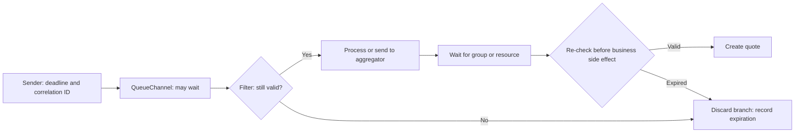

# Discard expired message — Discarding Expired Messages

## 1. Objectives and Context

In the **Correlation and state** chapter of **SPRING_INTEGRATION_CORE**, "discard expired message" refers to detecting messages whose processing value has expired and removing them from the business flow. The discard action may route to an audit branch, store for reconciliation, or terminate processing per a defined policy.

After this lesson, you will be able to:

- Express processing deadlines using the `expirationDate` header and filter with `UnexpiredMessageSelector`.
- Place filters in the right positions in a Java DSL flow, especially after channel wait times.
- Distinguish a single message's expiration, a group's timeout, and group metadata retention duration.
- Handle late messages, technical errors, and retry scenarios without accidentally extending deadlines.
- Design tests for timestamps, discard branches, and state after a group ends.

Running example: a quote system must combine replies from three sources—**price**, **inventory**, and **shipping**. Users accept quotes only within five seconds. A reply arriving past the deadline can no longer be used to produce a quote, even if its content is completely valid.

Examples use Java 17+, Spring Integration Core, and Java DSL with APIs available in Spring Integration 6.x. Illustrative tests use JUnit Jupiter. The application needs the `org.springframework.integration:spring-integration-core` dependency and version management compatible with your Spring Framework or Spring Boot BOM.

## 2. Identifying Exactly What Expires

Do not use a single "timeout" value to solve every lifecycle.

| Concept | Question to answer | Common mechanism |
| --- | --- | --- |
| Message expiration | Is this reply still valid to the business when processed? | `expirationDate` header and filter |
| Group timeout | Have we waited long enough without receiving all parts? | `groupTimeout` or group expiration mechanism |
| State retention time | How long must we remember a finished group to block late messages? | Metadata in `MessageGroupStore` and cleanup policy |
| Reply wait timeout | How long will the caller wait for the result? | Gateway config or caller's wait mechanism |
| Broker TTL | How long does the broker keep an unconsumed message? | Broker and adapter configuration and semantics |

These are independent policy layers. In the quote design, a caller stopping its wait does not automatically prove every downstream step was canceled. Similarly, attaching an expiration header does not create a background process scanning and deleting messages across every channel.

A single message can expire while its group is still waiting. Conversely, a group can time out because one source failed to reply, even though already-received messages still have time left on their own deadlines.

### Timeline Example

Suppose all replies for request `Q-81:attempt-1` share a common deadline `D = t0 + 5 seconds`:

| Timestamp | Event | Desired decision |
| --- | --- | --- |
| `t0` | Send quote request | Attach shared deadline and request attempt ID |
| `t0 + 1 second` | Receive price reply | Add to group |
| `t0 + 2 seconds` | Receive inventory reply | Add to group |
| `t0 + 5 seconds` | Business deadline reached | Do not build a new quote from overdue results |
| `t0 + 7 seconds` | Receive shipping reply | Route to expired-message branch |

If the aggregator uses only `groupTimeout(5000)`, the timeout resets whenever a new message arrives for an unreleased group. After the reply at `t0 + 2 seconds`, the timeout task can be rescheduled to roughly `t0 + 7 seconds`. Thus the timeout does not act as the absolute deadline `t0 + 5 seconds`. This difference is described in the [aggregator timeout mechanism](https://docs.spring.io/spring-integration/reference/aggregator.html#aggregator-and-group-timeout).

## 3. Contract of the expirationDate Header

Spring Integration provides the constant `IntegrationMessageHeaderAccessor.EXPIRATION_DATE`. The corresponding accessor reads the value as a `Long`; applications should use the constant rather than typing the header name manually. See [IntegrationMessageHeaderAccessor](https://docs.spring.io/spring-integration/api/org/springframework/integration/IntegrationMessageHeaderAccessor.html).

Conventions used in this lesson:

- The value is an **absolute timestamp**, measured in milliseconds since the Unix epoch.
- `5000L` means five thousand milliseconds after the Unix epoch; it does not mean "five seconds remaining."
- Given deadline `D` and evaluation time `t`, accept only when `t < D`.
- When `t == D`, the message has already expired.

Creating a message with a five-second lifetime:

```java
import java.time.Clock;

import org.springframework.integration.IntegrationMessageHeaderAccessor;
import org.springframework.messaging.Message;
import org.springframework.messaging.support.MessageBuilder;

Clock clock = Clock.systemUTC();
long deadline = Math.addExact(clock.millis(), 5_000L);

Message<String> request = MessageBuilder.withPayload("Get quote for order O-81")
        .setHeader(IntegrationMessageHeaderAccessor.CORRELATION_ID, "Q-81:attempt-1")
        .setHeader(IntegrationMessageHeaderAccessor.EXPIRATION_DATE, deadline)
        .build();
```

The deadline should be established at the boundary where the business request is accepted, then propagated across all relevant branches. If the request must finish within five seconds of intake, individual services must not grant another five seconds upon receiving the message.

At HTTP, JSON, or broker boundaries, normalize data types. A string `"1790000000000"`, an `Instant` object, and a `Long` integer are not the same header contract. Type mismatches must be handled as invalid input data; do not blindly count them among expired messages.

### Behavior of UnexpiredMessageSelector

`UnexpiredMessageSelector` accepts a message if the deadline is still in the future; **if the expiration header is missing, the message is accepted**. The selector uses the system clock when checking. This is the behavior of the [built-in selector](https://docs.spring.io/spring-integration/docs/current/api/org/springframework/integration/selector/UnexpiredMessageSelector.html) and its [implementation source](https://raw.githubusercontent.com/spring-projects/spring-integration/main/spring-integration-core/src/main/java/org/springframework/integration/selector/UnexpiredMessageSelector.java).

Therefore, decide your missing-deadline policy upfront:

| Policy | When appropriate? | Implementation approach |
| --- | --- | --- |
| Allow no expiration | Some message types truly never expire | Use built-in selector |
| Require expiration | Every quote reply must belong to a processing window | Validate at intake or use a custom selector |
| Assign default expiration | System has a clear convention for sources omitting deadlines | Assign once at the intake boundary |

If the sender is untrusted, the intake boundary must also enforce a maximum allowed deadline. A deadline set too far in the future can keep old messages alive longer than business policy permits.

## 4. Designing Filter Flows After Waiting Points

`UnexpiredMessageSelector` only returns a decision; `MessageFilter` is the endpoint that enforces it. The filter forwards accepted messages to the next step and sends rejected messages to `discardChannel` if configured. See [Message Filter](https://docs.spring.io/spring-integration/reference/filter.html).



Filter placement determines which stage it protects:

1. Filtering before a queue reduces invalid data entering the buffer.
2. Filtering after a queue catches messages that expired while waiting.
3. Checking after the aggregator or right before calling an external service protects the step that produces business side effects.

Checking only at the first step misses messages that expire in the queue, in the message store, or while waiting on another resource. Checking only at the final step can waste resources on messages that were already expired from the start.

A filter does not recall an already-sent HTTP request and does not roll back a committed change. If the requirement is "never record a quote after the deadline," the write step must enforce that condition at the update point alongside appropriate consistency and idempotency policies.

## 5. Complete Java DSL Example: QueueChannel and Discard Branch

The following configuration illustrates one processing boundary: messages are pulled from `quoteInbox` and only then checked for expiration. Two output queues let you observe results without integrating external systems yet.

```java
import org.springframework.context.annotation.Bean;
import org.springframework.context.annotation.Configuration;
import org.springframework.integration.channel.QueueChannel;
import org.springframework.integration.config.EnableIntegration;
import org.springframework.integration.dsl.IntegrationFlow;
import org.springframework.integration.dsl.Pollers;
import org.springframework.integration.selector.UnexpiredMessageSelector;

@Configuration
@EnableIntegration
public class ExpiredQuoteFlowConfig {

    @Bean
    public QueueChannel quoteInbox() {
        return new QueueChannel(100);
    }

    @Bean
    public QueueChannel acceptedQuotes() {
        return new QueueChannel();
    }

    @Bean
    public QueueChannel expiredQuotes() {
        return new QueueChannel();
    }

    @Bean
    public IntegrationFlow discardExpiredQuotesFlow() {
        return IntegrationFlow.from(quoteInbox())
                .filter(new UnexpiredMessageSelector(), endpoint -> endpoint
                        .poller(Pollers.fixedDelay(100).maxMessagesPerPoll(50))
                        .discardChannel(expiredQuotes())
                        .throwExceptionOnRejection(false))
                .channel(acceptedQuotes())
                .get();
    }
}
```

Key points to understand:

- `quoteInbox` is a pollable channel, so the first endpoint needs a poller.
- Expiration is checked when the endpoint processes the message, after the message leaves the queue.
- `throwExceptionOnRejection(false)` expresses that expiration is an expected business outcome.
- `expiredQuotes` receives the rejected message; the filter does not replace the payload with an exception.
- `acceptedQuotes` only proves the message was unexpired at the filter, not that business processing finished.
- The two unbounded output queues serve only the example; production flows need consumers and capacity policies.

`discardChannel`, `throwExceptionOnRejection`, and endpoint configuration options are provided via [FilterEndpointSpec](https://docs.spring.io/spring-integration/api/org/springframework/integration/dsl/FilterEndpointSpec.html).

Sending an already-expired reply:

```java
Message<String> lateQuote = MessageBuilder.withPayload("Old price: 120000")
        .setHeader(IntegrationMessageHeaderAccessor.CORRELATION_ID, "Q-81:attempt-1")
        .setHeader(
                IntegrationMessageHeaderAccessor.EXPIRATION_DATE,
                System.currentTimeMillis() - 60_000L)
        .build();

boolean enqueued = quoteInbox.send(lateQuote, 1_000L);
```

In the snippet above, `quoteInbox` is the `QueueChannel` bean injected or retrieved from the application context. `enqueued == true` means the message was accepted into the queue. The decision to route it to `acceptedQuotes` or `expiredQuotes` happens afterward.

## 6. Discards, Errors, and Caller Replies

Clearly define the contract for each branch:

| Branch | Typical data | Purpose |
| --- | --- | --- |
| `expiredQuotes` | Original expired message | Counting, auditing, reconciliation |
| `errorChannel` | `ErrorMessage` containing processing error | Monitoring and handling technical errors |
| Gateway reply | Result per call contract | Replying to caller with business outcome |

An expired message does not automatically turn into an `ErrorMessage`. If `throwExceptionOnRejection(true)` is enabled, the filter can throw `MessageRejectedException`. If a discard channel is also set, the message is sent to discard first and then the exception is still thrown; avoid that combination if your system retries every exception. This behavior is implemented in [MessageFilter](https://raw.githubusercontent.com/spring-projects/spring-integration/v6.5.0/spring-integration-core/src/main/java/org/springframework/integration/filter/MessageFilter.java).

With synchronous processing on `DirectChannel`, exceptions typically return to the calling thread. With poller-based processing, exceptions must be handled in the corresponding asynchronous error mechanism; do not expect an earlier `send()` call to catch errors raised later. See [Error Handling](https://docs.spring.io/spring-integration/reference/error-handling.html).

When a gateway waits for a reply, routing a message to an independent discard channel does not automatically send a reply to the gateway. For a quote API, design an explicit outcome such as `QUOTE_EXPIRED` or an expired status on a queryable channel; the caller must know how to receive that outcome. A reply wait timeout only bounds how long the caller waits.

When working with a broker, filter rejection does not automatically determine ACK, NACK, or requeue either. That behavior depends on the adapter, transaction, and listener configuration. Check your connector's contract before attaching retries or dead-letter routing to an expiration branch.

## 7. Combining with an Aggregator: Message Expiration and Group Expiration

A filter before an aggregator only inspects messages passing through it. It does not re-scan messages already sitting inside `MessageGroupStore` as time passes.

Consequences in the quote example:

1. Valid price and inventory replies are stored in the group.
2. The shipping reply arrives past the deadline and is dropped by the filter.
3. The group missing the shipping part will never satisfy the release condition.
4. A group-termination mechanism is needed to release held parts.
5. Even if all three parts arrive in time, if the post-aggregator task runs too late, an output deadline check is still needed.

Key options play distinct roles:

| Option | Role |
| --- | --- |
| `groupTimeout(...)` | Schedules processing for a waiting group |
| `sendPartialResultOnExpiry(false)` | When the group times out without releasing, do not emit partial results |
| `discardChannel(...)` | Receives discarded data from the correlating endpoint |
| `expireGroupsUponCompletion(false)` | Retain metadata after normal completion |
| `expireGroupsUponTimeout(false)` | Retain metadata after ending due to timeout |
| `minimumTimeoutForEmptyGroups(...)` | Sets minimum threshold before deleting empty group metadata |

Java DSL method names can be checked in [CorrelationHandlerSpec](https://docs.spring.io/spring-integration/api/org/springframework/integration/dsl/CorrelationHandlerSpec.html). The two `expireGroupsUpon...` flags control group deletion; they do not represent per-message deadlines.

The configuration snippet below can be **added to `ExpiredQuoteFlowConfig`** from the previous section. Add imports for `org.springframework.integration.channel.DirectChannel` and `org.springframework.integration.store.SimpleMessageStore`.

```java
@Bean
public DirectChannel quoteParts() {
    return new DirectChannel();
}

@Bean
public QueueChannel rejectedQuoteGroups() {
    return new QueueChannel();
}

@Bean
public QueueChannel completeQuoteGroups() {
    return new QueueChannel();
}

@Bean
public SimpleMessageStore quoteGroupStore() {
    return new SimpleMessageStore();
}

@Bean
public IntegrationFlow collectQuotePartsFlow() {
    return IntegrationFlow.from(quoteParts())
            .filter(new UnexpiredMessageSelector(), endpoint -> endpoint
                    .discardChannel(expiredQuotes())
                    .throwExceptionOnRejection(false))
            .aggregate(aggregator -> aggregator
                    .messageStore(quoteGroupStore())
                    .groupTimeout(5_000L)
                    .sendPartialResultOnExpiry(false)
                    .expireGroupsUponCompletion(false)
                    .expireGroupsUponTimeout(false)
                    .minimumTimeoutForEmptyGroups(60_000L)
                    .discardChannel(rejectedQuoteGroups()))
            .channel(completeQuoteGroups())
            .get();
}
```

Inputs for the example use the default sequence contract:

- All three parts of one request share the same `CORRELATION_ID`.
- Each part carries an appropriate `SEQUENCE_NUMBER` and `SEQUENCE_SIZE = 3`.
- All parts share one business deadline.
- The sender or a step before the aggregator handles duplicates per business contract; correlation does not replace idempotency.

Example creating the first reply part:

```java
Message<String> pricePart = MessageBuilder.withPayload("price=120000")
        .setHeader(IntegrationMessageHeaderAccessor.CORRELATION_ID, "Q-81:attempt-1")
        .setHeader(IntegrationMessageHeaderAccessor.SEQUENCE_NUMBER, 1)
        .setHeader(IntegrationMessageHeaderAccessor.SEQUENCE_SIZE, 3)
        .setHeader(IntegrationMessageHeaderAccessor.EXPIRATION_DATE, deadline)
        .build();
```

This aggregator example uses a timeout when no new part arrives for five seconds. It demonstrates group cleanup and blocking late messages; it does not yet enforce the quote's absolute deadline on its own.

To terminate a group by a shared deadline, use a timeout expression computed from the deadline and current time. Handle past deadlines explicitly; do not arbitrarily pass negative values because scheduling semantics can differ from "expire immediately." Even when scheduled by deadline, checking right before business side effects remains necessary because a scheduler can run late.

Additionally, when a timeout fires, the release strategy can be re-evaluated before the framework selects the expiry branch. Therefore `sendPartialResultOnExpiry(false)` must not be interpreted as "every timeout task execution always forces a discard."

## 8. Retaining State to Block Late Messages

Consider two situations:

- A group already combined all parts and emitted a quote; a duplicate copy of a reply part arrives later.
- A group already timed out; a very slow reply source delivers its result.

In both cases, receiving the same correlation key again must not accidentally open a new quote round.

States to distinguish:

```text
Open group
    ├── all parts present → completed → retain finished metadata
    └── timed out → discard → retain finished metadata

Message with same key arrives during metadata retention
    └── rejected instead of creating a new group

Metadata deleted
    └── endpoint no longer has old trace to block via group state
```

Retaining metadata is like keeping a "finished marker." Deleting the entire group frees resources, yet removes that marker at the same time. If a subsequent message still passes the intake filter, it can create a new group.

In the example configuration:

- Messages past their deadline are blocked at the filter and go to `expiredQuotes`.
- Unexpired messages belonging to a finished group reach the aggregator and go to `rejectedQuoteGroups`.
- Parts remaining when a group times out also go to `rejectedQuoteGroups` per the discard configuration.

Therefore, **never label every message on the aggregator's discard channel as an "individually expired message."** They may have been rejected because the group already completed or because the whole group timed out.

Use a correlation key containing a request-attempt identifier, such as `orderId + ":" + attemptId`. A new quote request for the same order must have a new attempt ID; using only `orderId` lets old metadata block valid new work.

With multiple instances or restart recovery needs, the in-memory `SimpleMessageStore` example is insufficient. Choose a persistent store, routing, or locking compatible with your deployment model and group recovery mechanism. Never assume persisted data automatically restores every in-memory timeout task.

## 9. Cleaning Up State with MessageGroupStoreReaper

Keeping metadata forever can make the message store grow continuously. You need a bounded state cleanup policy that is still long enough to cover source delays and redeliveries.

`MessageGroupStoreReaper` is a `Runnable` component that asks the store to expire eligible groups. Merely declaring the bean does not replace scheduling periodic `run()` calls. The API has a constructor accepting the store and a timeout property in milliseconds; see [MessageGroupStoreReaper](https://docs.spring.io/spring-integration/api/org/springframework/integration/store/MessageGroupStoreReaper.html).

Example added to the aggregator configuration above:

```java
// Add @EnableScheduling to the configuration class.
// Imports:
// org.springframework.integration.store.MessageGroupStoreReaper
// org.springframework.scheduling.annotation.EnableScheduling
// org.springframework.scheduling.annotation.Scheduled

@Bean
public MessageGroupStoreReaper quoteGroupReaper() {
    MessageGroupStoreReaper reaper =
            new MessageGroupStoreReaper(quoteGroupStore());
    reaper.setTimeout(120_000L);
    return reaper;
}

@Scheduled(fixedDelay = 10_000L)
public void reapQuoteGroups() {
    quoteGroupReaper().run();
}
```

Here `groupTimeout` handles waiting groups under normal conditions. The reaper supplements cleanup of sufficiently old groups; `minimumTimeoutForEmptyGroups` protects a minimum metadata retention interval. Actual deletion time depends on store selection criteria, group modification timestamps, configured thresholds, and scan intervals. Do not interpret `60_000L` as a promise to "delete at exactly 60 seconds."

Operational decisions to specify:

- What is the maximum delay or redelivery window of the source?
- After a restart, does the system still need to block replies for old requests?
- Do new requests carry a correlation key distinct from old requests?
- Once metadata has been deleted, which deadline or business state store continues blocking stale results?
- How do the scheduler and discard branch handle logging, audit-writing, or message-sending failures?

A store used for expiry callbacks should be dedicated to a single correlating endpoint by design; do not arbitrarily share one store instance across multiple aggregators and let one reaper process groups across all of them.

With a custom scan schedule, actively handle task exceptions. To convert errors into `ErrorMessage`s, configure an appropriate error-publishing mechanism; a `@Scheduled` method does not automatically route errors to `errorChannel`.

## 10. Testing Deadlines Without Depending on Thread.sleep

The built-in selector reads system time. When testing it, use timestamps far from the present for the "expired" and "unexpired" cases. To test exact boundary behavior at `t == D`, write a small selector allowing `Clock` injection.

This is an application choice to make both the timing policy and missing-header policy explicit:

```java
import java.time.Clock;
import java.util.Objects;

import org.springframework.integration.IntegrationMessageHeaderAccessor;
import org.springframework.integration.core.MessageSelector;
import org.springframework.messaging.Message;

public final class DeadlineSelector implements MessageSelector {

    private final Clock clock;
    private final boolean requireDeadline;

    public DeadlineSelector(Clock clock, boolean requireDeadline) {
        this.clock = Objects.requireNonNull(clock);
        this.requireDeadline = requireDeadline;
    }

    @Override
    public boolean accept(Message<?> message) {
        Object raw = message.getHeaders().get(
                IntegrationMessageHeaderAccessor.EXPIRATION_DATE);

        if (raw == null) {
            return !requireDeadline;
        }
        if (!(raw instanceof Long deadline)) {
            throw new IllegalArgumentException(
                    "expirationDate must be a Long representing epoch millis");
        }
        return clock.millis() < deadline;
    }
}
```

To use it in Java DSL, replace `new UnexpiredMessageSelector()` with `new DeadlineSelector(clock, true)`, injecting `clock` as a configuration dependency. Setting `requireDeadline = true` rejects messages lacking a deadline; if you need to classify "missing deadline" separately, validate and route before the filter.

JUnit Jupiter example for the mandatory-deadline policy:

```java
import java.time.Clock;
import java.time.Instant;
import java.time.ZoneOffset;

import org.junit.jupiter.api.Test;
import org.springframework.integration.IntegrationMessageHeaderAccessor;
import org.springframework.messaging.Message;
import org.springframework.messaging.support.MessageBuilder;

import static org.junit.jupiter.api.Assertions.*;

class DeadlineSelectorTest {

    private static final long NOW =
            Instant.parse("2026-11-19T03:00:00Z").toEpochMilli();

    private final DeadlineSelector selector = new DeadlineSelector(
            Clock.fixed(Instant.ofEpochMilli(NOW), ZoneOffset.UTC), true);

    @Test
    void acceptsOnlyBeforeDeadline() {
        assertTrue(selector.accept(message(NOW + 1L)));
        assertFalse(selector.accept(message(NOW)));
        assertFalse(selector.accept(message(NOW - 1L)));
    }

    @Test
    void rejectsMissingDeadlineWhenRequired() {
        Message<String> message = MessageBuilder.withPayload("quote").build();
        assertFalse(selector.accept(message));
    }

    @Test
    void treatsInvalidTypeAsInvalidInput() {
        Message<String> invalid = MessageBuilder.withPayload("quote")
                .setHeader(
                        IntegrationMessageHeaderAccessor.EXPIRATION_DATE,
                        "2026-11-19T03:00:00Z")
                .build();

        assertThrows(IllegalArgumentException.class,
                () -> selector.accept(invalid));
    }

    private Message<String> message(long deadline) {
        return MessageBuilder.withPayload("quote")
                .setHeader(
                        IntegrationMessageHeaderAccessor.EXPIRATION_DATE,
                        deadline)
                .build();
    }
}
```

The test above verifies the **custom selector policy**. It does not prove queues, pollers, or the aggregator are wired correctly.

### Testing the Discard Branch in a Real Configuration

The following test starts section 5's configuration, sends a definitely expired message, and waits on the discard branch using `receive(timeout)`:

```java
import org.junit.jupiter.api.Test;
import org.springframework.context.annotation.AnnotationConfigApplicationContext;
import org.springframework.integration.IntegrationMessageHeaderAccessor;
import org.springframework.integration.channel.QueueChannel;
import org.springframework.messaging.Message;
import org.springframework.messaging.support.MessageBuilder;

import static org.junit.jupiter.api.Assertions.*;

class ExpiredQuoteFlowTest {

    @Test
    void expiredQuoteGoesToDiscardChannel() {
        try (var context = new AnnotationConfigApplicationContext(
                ExpiredQuoteFlowConfig.class)) {

            QueueChannel inbox =
                    context.getBean("quoteInbox", QueueChannel.class);
            QueueChannel accepted =
                    context.getBean("acceptedQuotes", QueueChannel.class);
            QueueChannel expired =
                    context.getBean("expiredQuotes", QueueChannel.class);

            Message<String> input = MessageBuilder.withPayload("old quote")
                    .setHeader(
                            IntegrationMessageHeaderAccessor.EXPIRATION_DATE,
                            System.currentTimeMillis() - 60_000L)
                    .build();

            assertTrue(inbox.send(input, 1_000L));

            Message<?> discarded = expired.receive(2_000L);
            assertNotNull(discarded);
            assertEquals(input.getHeaders().getId(),
                    discarded.getHeaders().getId());
            assertNull(accepted.receive(0L));
        }
    }
}
```

`receive(2_000L)` is a wait limit for asynchronous execution, not how the expired message is created. The deadline was already in the past before sending, so the test needs no `Thread.sleep` to alter the outcome.

Additional integration scenarios to cover:

| Scenario | Outcome to verify |
| --- | --- |
| Message with deadline far in the future | Reaches processing branch, not discard |
| Missing deadline with built-in selector | Accepted per default contract |
| Valid when sent, yet expired when polled | Dropped after the queue |
| Group missing one part | Timeout does not emit partial quote if policy forbids it |
| Valid message arrives after group finished | Rejected by aggregator thanks to metadata |
| Metadata already cleaned up | Can no longer rely on group markers; verify deadline and business state |
| Resending the same message | Deadline stays unchanged, no extra lifetime granted |

To test messages expiring inside a queue using a `Clock`-backed selector, keep the endpoint stopped, put the message into the queue, advance the test clock past the deadline, and only then start the endpoint. This verifies filter placement accurately without real-time waiting.

## 11. Retries, Clocks, and System Observability

### Do Not Extend Lifetimes on Retry

Retrying an old message must preserve the original business deadline. Each retry attempt can compute:

```text
remainingBudget = deadline - currentTime
```

If the budget is exhausted, route to the expired outcome. If too little budget remains for another call, policy can fail fast or tighten that call's timeout. Never reset `expirationDate = now + 5000` on every retry.

When a user intentionally initiates a new request, that is a brand-new request with a fresh deadline and correlation key. Distinguish this from the system automatically redelivering a message from an earlier run.

### Clock Synchronization

Absolute deadlines are compared against the processing node's clock. Clock skew between machines can cause a receiver to reject early or accept late relative to the sender's intent.

The design should include time synchronization and an explicit convention on permissible skew. If a tolerance margin is applied, treat it as part of the business contract. `Clock` helps test policies; it does not synchronize clocks across machines on its own.

### Recording Enough to Explain Decisions

The discard branch should capture necessary context:

| Attribute | Operational value |
| --- | --- |
| Message ID | Look up the specific delivery/run |
| Correlation key and attempt ID | Identify group, distinguish request attempts |
| Deadline and rejection timestamp | Measure lateness relative to deadline |
| Deciding endpoint | Know whether message expired after queue or after grouping |
| Reason | Distinguish `MESSAGE_EXPIRED`, `GROUP_TIMEOUT`, `LATE_AFTER_COMPLETION` |

These reason codes are suggested application conventions, not headers added automatically by filters or aggregators. If one discard channel receives multiple causes, add cause identification at the decision point or separate branches appropriately.

You can monitor expired message counts, timed-out group counts, late replies, and retained state size. Do not use individual correlation IDs as metric labels since label cardinality can grow unboundedly; keep detailed identifiers in logs or traces.

The audit branch also needs consumers, storage bounds, and error handling. Routing messages to an in-memory queue does not create durable storage guarantees for reconciliation.

## 12. Common Mistakes and Fixes

| Mistake | Consequence | Fix |
| --- | --- | --- |
| Setting `expirationDate = 5000L` | Message has long been expired | Compute epoch millis of the deadline |
| Using strings or seconds | Wrong type or wrong expiration timestamp | Normalize to `Long` milliseconds at intake |
| Only attaching the header | Messages keep flowing through steps that never check expiration | Add filters at processing boundaries that need protection |
| Filtering only before a queue | Messages expiring while queued are still used | Check after the queue |
| Using `groupTimeout` as an absolute deadline | Group can keep waiting past business deadline | Use an independent deadline and matching group termination schedule |
| Filtering out one part without cleaning the group | Aggregator holds remaining parts indefinitely | Add group termination and state cleanup |
| Deleting metadata immediately and relying solely on correlation | Late messages can open a new group | Retain finished markers long enough, use attempt IDs, and check deadlines |
| Keeping metadata forever | Store grows unboundedly | Establish retention policies and cleanup jobs |
| Routing expired messages into infinite retries | Increases load without restoring business value | Terminate per expiration policy |
| Extending deadlines inside every service | Requests outlive initial contract | Propagate deadline end-to-end |
| Treating discard as a gateway reply | Caller may still wait until timeout | Design an explicit reply contract |

## 13. Design Walkthrough

For the flow collecting three quote parts within five seconds, implement in sequence:

1. At intake, establish the shared deadline and correlation key for each request attempt.
2. Propagate the deadline across the price, inventory, and shipping branches.
3. Filter out expired replies after boundaries where waiting can occur.
4. Group by correlation key; define completeness, partial, and duplicate policies.
5. Terminate groups waiting too long; retain enough metadata to recognize late replies.
6. Check the deadline right before persisting or emitting the final quote.
7. Record discard reasons and clean up state per retention policy.
8. Separately test timing decisions, channel routing, and group lifecycles.

A complete policy must answer: when is a message still valid, under what condition does a group end, how long are completion markers retained, and how does the caller receive an expiration result. When these four answers align, a Spring Integration flow can discard stale data while keeping correlation, state, and observability under control.
