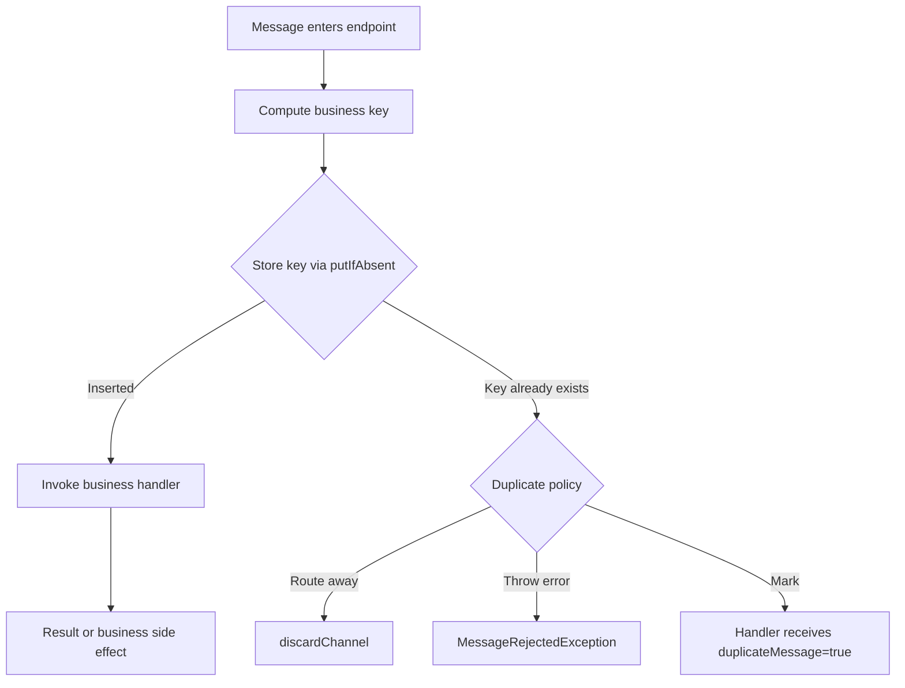

# Idempotent receiver

## 1. Objectives and Context

In the **Correlation and state** chapter of the **SPRING_INTEGRATION_CORE** module, this lesson presents how to design the message-receiving side so that redelivering the same request does not create additional business side effects. The content connects `Message`, `MessageChannel`, endpoints, and Java DSL to a stateful enterprise integration pattern: **Idempotent Receiver**.

After this lesson, you will be able to:

- Distinguish a message delivered multiple times from a business operation executed multiple times.
- Design deduplication keys scoped by event, tenant, and consumer.
- Attach `IdempotentReceiverInterceptor` to an endpoint using Java DSL.
- Choose how to handle duplicates: discard, route to another branch, or proceed with a marker flag.
- Explain why storing a deduplication key does not automatically mean the business operation succeeded.
- Design persistent state storage, transaction boundaries, and failure-scenario tests.

You should know how to build an `IntegrationFlow`, use `DirectChannel`, read payloads/headers, and invoke a service activator. Examples use Java 17+ and Spring Integration 6.x+ APIs; library versions should align with your application's BOM. PostgreSQL SQL snippets are noted in their respective sections.

## 2. Why Does the Receiving Side Need Idempotency?

Suppose a sales service emits an `OrderPlaced` event, while a reporting service adds the order amount to total revenue. An event carrying 500,000 VND must be added only once.

Common scenario:

1. The consumer receives event `evt-1001` and updates the report successfully.
2. The connection drops before the sender or broker receives acknowledgment.
3. Event `evt-1001` is redelivered.
4. If the consumer adds 500,000 VND again, the report becomes inflated incorrectly.

Retries are necessary to recover from transient failures, yet retries also introduce redeliveries. A consumer cannot infer that a message is new merely because it just arrived.

**Idempotency** means executing the same operation again produces no further change to business state after the first successful execution. Given state `s`, message `m`, and handler function `F`, the goal can be expressed as:

```text
F(F(s, m), m) = F(s, m)
```

The formula considers only the business side effect being protected. The system can still write extra logs or increment a delivery-attempt counter when receiving duplicates.

| Operation | When receiving the same request again | Notes |
| --- | --- | --- |
| Setting order status to `CONFIRMED` | Status remains `CONFIRMED` | Can be idempotent if no other side effects accompany it |
| Adding an amount to total revenue | Total increases further | Must be protected against redelivery |
| Sending confirmation email | User may receive two emails | Needs a lock on the email-sending effect or provider-side support |
| Inserting row with unique business key | Second insert may be rejected | Must handle conflict into an appropriate business outcome |

An idempotent consumer does not stop the broker from redelivering messages. The goal is to control the effect of those deliveries within the designed state and time boundaries.

## 3. Distinguishing Correlation, Identity, and Deduplication Keys

Correlation answers: **Which messages belong to the same workflow or group?** A deduplication key answers: **Has this specific operation already been accepted or completed by this consumer?**

For example, order `order-42` has three events:

```text
OrderPlaced        eventId=evt-1001, correlationId=order-42
PaymentCaptured    eventId=evt-1002, correlationId=order-42
ShipmentCreated    eventId=evt-1003, correlationId=order-42
```

If `correlationId=order-42` alone were used as the key for the entire flow, the two subsequent valid events would be treated as duplicates.

| Value | Role | What to verify before using for deduplication |
| --- | --- | --- |
| Spring Message `id` header | Identifies the message object | When reconstructing messages, the ID may differ even though the business event is unchanged |
| `correlationId` header | Groups messages | One group typically contains multiple valid messages |
| `orderId` | Order identifier | One order has multiple operations and multiple events |
| Producer-issued `eventId` | Identifies one event | Producer must keep it unchanged across retries and redeliveries |
| Command idempotency key | Identifies one execution request | Client must reuse it when resending the same request |
| Content hash | Data fingerprint | Needs normalization rules; identical data can still be two valid operations |

### 3.1. Keys Must Include Consumer Scope

A key structure could look like:

```text
<consumer>:<key-schema-version>:<tenantId>:<eventId>

orders-projection:v1:tenant-a:evt-1001
email-confirmation:v1:tenant-a:evt-1001
```

The same event can both update reports and send emails. Each side effect has its own deduplication scope. Sharing one key between two consumers would let the first consumer block the other from running.

`v1` denotes the key-generation schema version. Changing to `v2` makes old keys stop matching; therefore this is a data change requiring a migration plan, not an arbitrary rename at deployment.

Key components must be encoded unambiguously. The lesson example allows only letters, digits, `_`, and `-`, so `:` works safely as a delimiter. For free-form IDs, use escaping or length-prefixed encoding per component.

### 3.2. Same Key with Different Content

The desired contract is: one `eventId` always represents the same immutable business content. If a producer replays `evt-1001` with a changed amount, that is a conflict requiring investigation.

When conflict detection is required, also store a fingerprint of the normalized business payload. When the key exists, compare fingerprints to distinguish valid redeliveries from inconsistent data. Do not include headers that change across deliveries, such as intake timestamps, in the fingerprint.

Using only the default key-existence selector does not automatically enforce this payload comparison rule. The system must add explicit logic if that is a business requirement.

## 4. Mechanism in Spring Integration

Three core components work together:

| Component | Responsibility |
| --- | --- |
| `IdempotentReceiverInterceptor` | Applies the deduplication decision around endpoint handler invocation |
| `MetadataStoreSelector` | Computes the key and decides message acceptance based on metadata |
| `ConcurrentMetadataStore` | Provides atomic update operations for key state |

For the default key-existence selector, the critical operation is `putIfAbsent(key, value)`: insert the value only if the key does not yet exist. A `null` return means this call inserted the key; a non-null old value means the key already existed. The interface also provides conditional replacement. See the [ConcurrentMetadataStore contract](https://docs.spring.io/spring-integration/api/org/springframework/integration/metadata/ConcurrentMetadataStore.html).



Do not replace the atomic operation with a two-step `get` then `put`:

```text
Worker A: get(key) -> absent
Worker B: get(key) -> absent
Worker A: execute business logic
Worker B: execute business logic
```

Both workers observe the old state and both execute the operation. Local Java locks cannot protect two separate JVMs either; instances must agree on a shared backend and key space.

### 4.1. Duplicates Are Not Dropped by Default

Behavior must be chosen explicitly:

| Interceptor configuration | When selector rejects the message |
| --- | --- |
| No discard channel, throw-exception flag is `false` | Continues to handler with header `duplicateMessage=true` |
| Has discard channel, throw-exception flag is `false` | Routes to discard channel; target handler is not invoked |
| No discard channel, throw-exception flag is `true` | Throws `MessageRejectedException`; target handler is not invoked |
| Both discard channel and throw-exception flag `true` | Sends to discard channel and still throws if sending finishes |

To drop duplicates silently, use `nullChannel`. If choosing to continue into the handler, the handler itself must read the flag and protect business side effects. These modes are defined in [IdempotentReceiverInterceptor Javadoc](https://docs.spring.io/spring-integration/api/org/springframework/integration/handler/advice/IdempotentReceiverInterceptor.html).

Do not treat every redelivery as an error needing retry. If the first delivery already completed, repeatedly throwing errors on duplicates can create pointless redelivery loops.

### 4.2. The Selector Records State Before the Handler

With `MetadataStoreSelector`, an acceptance decision simultaneously puts the value into the store. The key can exist before the handler finishes running. This detail is in the [MetadataStoreSelector contract](https://docs.spring.io/spring-integration/api/org/springframework/integration/selector/MetadataStoreSelector.html).

Therefore, interpret key meaning according to the actual design. In an in-memory store independent of business transactions, a key usually proves only **processing claim**, not **business completion**.

## 5. Complete Example: Blocking Duplicates at an Endpoint with Java DSL

### 5.1. Scope of the Example

The example uses:

- `DirectChannel` as synchronous input.
- `SimpleMetadataStore` keeping keys in memory.
- `QueueChannel` holding duplicates so they can be observed in practice.
- An in-memory recorder representing business side effects.

Needs the `org.springframework.integration:spring-integration-core` dependency. The test section below also needs JUnit Jupiter. Java DSL is included in the core library of the versions stated at the top.

This configuration teaches the deduplication mechanism within a single process. `SimpleMetadataStore` loses state when the application context restarts; choosing a persistent store is covered later. See [Metadata Store](https://docs.spring.io/spring-integration/reference/meta-data-store.html).

### 5.2. Configuration

Place the following content in a Java class when practicing in a learning project:

```java
package demo;

import java.math.BigDecimal;
import java.util.List;
import java.util.Objects;
import java.util.concurrent.CopyOnWriteArrayList;

import org.springframework.beans.factory.annotation.Qualifier;
import org.springframework.context.annotation.Bean;
import org.springframework.context.annotation.Configuration;
import org.springframework.integration.channel.DirectChannel;
import org.springframework.integration.channel.QueueChannel;
import org.springframework.integration.config.EnableIntegration;
import org.springframework.integration.dsl.IntegrationFlow;
import org.springframework.integration.handler.advice.IdempotentReceiverInterceptor;
import org.springframework.integration.metadata.ConcurrentMetadataStore;
import org.springframework.integration.metadata.SimpleMetadataStore;
import org.springframework.integration.selector.MetadataStoreSelector;
import org.springframework.messaging.MessageChannel;

@Configuration
@EnableIntegration
public class IdempotentReceiverLessonConfiguration {

    public record OrderPlaced(
            String tenantId,
            String eventId,
            String orderId,
            BigDecimal amount) {

        public OrderPlaced {
            tenantId = requireToken(tenantId);
            eventId = requireToken(eventId);
            orderId = requireToken(orderId);
            Objects.requireNonNull(amount, "amount");
            if (amount.signum() <= 0) {
                throw new IllegalArgumentException("amount must be positive");
            }
        }
    }

    private static String requireToken(String value) {
        if (value == null || !value.matches("[A-Za-z0-9_-]+")) {
            throw new IllegalArgumentException("Invalid ID: " + value);
        }
        return value;
    }

    @Bean
    public MessageChannel orderEventsInput() {
        return new DirectChannel();
    }

    @Bean
    public QueueChannel orderDuplicates() {
        return new QueueChannel();
    }

    @Bean
    public ConcurrentMetadataStore seenOrderEvents() {
        return new SimpleMetadataStore();
    }

    @Bean
    public IdempotentReceiverInterceptor orderIdempotentAdvice(
            ConcurrentMetadataStore seenOrderEvents,
            @Qualifier("orderDuplicates") MessageChannel duplicates) {

        MetadataStoreSelector selector = new MetadataStoreSelector(
                message -> {
                    OrderPlaced event = (OrderPlaced) message.getPayload();
                    return "orders-projection:v1:"
                            + event.tenantId() + ":" + event.eventId();
                },
                seenOrderEvents);

        IdempotentReceiverInterceptor advice =
                new IdempotentReceiverInterceptor(selector);
        advice.setDiscardChannel(duplicates);
        advice.setThrowExceptionOnRejection(false);
        return advice;
    }

    @Bean
    public OrderRecorder orderRecorder() {
        return new OrderRecorder();
    }

    @Bean
    public IntegrationFlow orderFlow(
            OrderRecorder recorder,
            IdempotentReceiverInterceptor orderIdempotentAdvice) {

        return IntegrationFlow.from("orderEventsInput")
                .handle(OrderPlaced.class, (event, headers) -> {
                    recorder.record(event);
                    return null;
                }, endpoint -> endpoint.advice(orderIdempotentAdvice))
                .get();
    }

    public static class OrderRecorder {

        private final List<OrderPlaced> recorded =
                new CopyOnWriteArrayList<>();

        public void record(OrderPlaced event) {
            recorded.add(event);
        }

        public List<OrderPlaced> snapshot() {
            return List.copyOf(recorded);
        }
    }
}
```

`OrderPlaced` validates required fields before any key-claiming operation runs. When ingesting JSON or external messages, place corresponding conversion and validation steps before the endpoint performing business side effects.

Calling `endpoint.advice(...)` attaches the interceptor to the order-handling endpoint. This is how handler advice is configured in Java DSL; you can compare with the example in [Idempotent Receiver EIP](https://docs.spring.io/spring-integration/reference/7.0/handler-advice/idempotent-receiver.html).

The handler returns `null` because this is a one-way intake flow. There is no promise to send a reply to a request-reply gateway.

### 5.3. Progression When Sending Messages

| Incoming message | Computed key | Outcome |
| --- | --- | --- |
| `tenant-a`, `evt-1001`, `order-42` | `orders-projection:v1:tenant-a:evt-1001` | Inserts key and invokes recorder |
| Redelivery of event above as a new Spring Message | Unchanged | Goes to `orderDuplicates` |
| `tenant-a`, `evt-1002`, `order-43` | Key has `evt-1002` | Processed |
| `tenant-b`, `evt-1001`, `order-42` | Key has `tenant-b` | Processed within a separate tenant scope |

`headers.id` is not part of the key, so reconstructing the Spring Message does not lose duplicate detection.

The `QueueChannel` in the example uses an in-memory queue with a very large default capacity and no automatic consumer. In production, attach a consumer for the duplicate branch or an intentional discard policy. If bounding capacity, also define full-queue behavior and send timeouts. See [Message Channel Implementations](https://docs.spring.io/spring-integration/reference/channel/implementations.html).

## 6. Persisting State Across Restarts and Multiple Instances

Choose the backend according to the boundary you need to protect:

| Storage approach | Survives restart | Multiple instances | Design points needed |
| --- | --- | --- | --- |
| Per-JVM `SimpleMetadataStore` | No | State not shared | Suitable for demos and local experiments |
| Shared persistent store | Per backend config | Can coordinate | Atomicity, durability, key space, recovery |
| `JdbcMetadataStore` in same database | Yes once committed | Yes | Schema, region, and transactions |
| Business inbox in database | Yes once committed | Via unique constraint | Synchronizes event recording with business update |

An in-memory yet thread-safe store only coordinates threads accessing the same memory space. Two `SimpleMetadataStore` instances on two JVMs can still both accept the same event.

### 6.1. Switching to a JDBC Store

In the JDBC variant, replace the `seenOrderEvents` bean with:

```java
import javax.sql.DataSource;

import org.springframework.context.annotation.Bean;
import org.springframework.integration.jdbc.metadata.JdbcMetadataStore;
import org.springframework.integration.metadata.ConcurrentMetadataStore;

@Bean
public ConcurrentMetadataStore seenOrderEvents(DataSource dataSource) {
    JdbcMetadataStore store = new JdbcMetadataStore(dataSource);
    store.setRegion("orders-projection-v1");
    return store;
}
```

Add `spring-integration-jdbc`, a JDBC driver, and a `DataSource`. Initialize the schema using the database-appropriate script provided by Spring Integration; declaring the bean does not replace migrations. Instances of the same consumer must share the same table and region. The [JDBC Metadata Store documentation](https://docs.spring.io/spring-integration/reference/jdbc/metadata-store.html) describes the schema and multi-instance sharing.

Replacing the store alone is not enough to guarantee metadata and business updates commit together. The transaction must start **before the selector writes the key**, cover the business update, and use resources managed by the corresponding transaction manager. With `JdbcMetadataStore`, transactional inserts become visible only after commit; a rollback removes that transaction's addition. See [JDBC Metadata Store transaction rules](https://docs.spring.io/spring-integration/reference/jdbc/metadata-store.html).

Putting `@Transactional` only on a service invoked after the selector can start the service's transaction too late. With pollers, configure transactions at the poll boundary; with other intakes, design the corresponding boundary. Never infer transaction boundaries merely from line ordering in the DSL.

## 7. Failure Window Between Claiming the Key and Business Completion

Consider the in-memory configuration in section 5:

```text
T1: selector inserts key evt-1001 successfully
T2: handler begins processing
T3: handler throws before persisting business result
T4: message is redelivered
T5: selector finds old key -> routes redelivery to duplicate branch
```

As a result, the business operation may never have succeeded even once, yet the redelivery is blocked. The interceptor does not turn in-memory state into something transactional with your database, nor does it confirm outcomes of external APIs.

The reverse direction also carries risk:

```text
T1: external payment gateway call succeeds
T2: process crashes before saving completion state
T3: process recovers and receives request again
T4: calls payment gateway a second time
```

A local transaction cannot roll back money already debited in another system. To protect that side effect, the receiving payment API must support the same idempotency key or provide a result reconciliation mechanism.

| Solution | Condition to be effective |
| --- | --- |
| Key and data update in one transaction | Both operations use resources participating in the same transaction |
| Inbox with unique key | Inbox record and business update commit or roll back together |
| External API accepts idempotency key | Provider honors the deduplication contract and sufficient key retention |
| Outbox for publishing downstream events | Business data and outbox commit together; downstream consumers still handle redeliveries |
| `PROCESSING`/`DONE` state with leases | Requires owner tokens, expiration, recovery, and stale-worker fencing |

### 7.1. Do Not Delete the Key on Every Exception

A timeout does not tell you for sure whether the external side already executed the business action. Deleting the key and re-running can double an already-applied side effect.

Moreover, once a lease expires, another worker may have claimed the key. The old worker unconditionally deleting the key corrupts the new worker's state. If choosing a lease model, implement owner tokens, conditional updates, and fencing suited to the target resource.

Therefore, error handling must rely on determinable outcomes: not executed, committed, in progress, or unknown. Unknown states typically require status queries, reconciliation, or controlled intervention.

## 8. Business Variant: Transactional Inbox with PostgreSQL

When every side effect to protect lives inside the same database, an inbox can serve as completion proof. The example below updates accepted order counts and gross totals per tenant.

This is an **alternative to the in-memory advice path in section 5**. Do not place an interceptor using `SimpleMetadataStore` in front of this approach, because an in-memory key could still block a retry after a rollback. When practicing, activate only one business consumer for the same input.

### 8.1. Illustrative Schema

```sql
CREATE TABLE consumer_inbox (
    consumer_name VARCHAR(100) NOT NULL,
    tenant_id     VARCHAR(100) NOT NULL,
    event_id      VARCHAR(100) NOT NULL,
    received_at   TIMESTAMPTZ NOT NULL DEFAULT CURRENT_TIMESTAMP,
    PRIMARY KEY (consumer_name, tenant_id, event_id)
);

CREATE TABLE order_totals (
    tenant_id       VARCHAR(100) PRIMARY KEY,
    accepted_orders BIGINT NOT NULL,
    gross_amount    NUMERIC(19, 2) NOT NULL
);
```

The inbox primary key prevents two transactions from both committing the same key. We use `ON CONFLICT DO NOTHING` to handle existing keys instead of catching every unique-constraint exception. Statement semantics are described in [PostgreSQL INSERT](https://www.postgresql.org/docs/current/sql-insert.html).

### 8.2. Inserting Inbox and Updating Totals in One Transaction

The service below reuses `OrderPlaced` from section 5. The injected `JdbcTemplate` and transaction manager must point to the same `DataSource`.

```java
package demo;

import demo.IdempotentReceiverLessonConfiguration.OrderPlaced;

import org.springframework.jdbc.core.JdbcTemplate;
import org.springframework.transaction.PlatformTransactionManager;
import org.springframework.transaction.support.TransactionTemplate;

public class TransactionalOrderReceiver {

    private final JdbcTemplate jdbc;
    private final TransactionTemplate transactions;

    public TransactionalOrderReceiver(
            JdbcTemplate jdbc,
            PlatformTransactionManager jdbcTransactionManager) {
        this.jdbc = jdbc;
        this.transactions = new TransactionTemplate(jdbcTransactionManager);
    }

    public void accept(OrderPlaced event) {
        transactions.executeWithoutResult(status -> {
            int inserted = jdbc.update("""
                    INSERT INTO consumer_inbox
                        (consumer_name, tenant_id, event_id)
                    VALUES (?, ?, ?)
                    ON CONFLICT (consumer_name, tenant_id, event_id)
                    DO NOTHING
                    """,
                    "orders-projection-v1",
                    event.tenantId(),
                    event.eventId());

            if (inserted == 0) {
                return;
            }

            jdbc.update("""
                    INSERT INTO order_totals
                        (tenant_id, accepted_orders, gross_amount)
                    VALUES (?, 1, ?)
                    ON CONFLICT (tenant_id) DO UPDATE
                    SET accepted_orders = order_totals.accepted_orders + 1,
                        gross_amount = order_totals.gross_amount
                            + EXCLUDED.gross_amount
                    """,
                    event.tenantId(),
                    event.amount());
        });
    }
}
```

The integration flow for this approach invokes `receiver.accept(event)` inside its handler. No separate standalone deduplication selector is needed upfront; the service transaction starts before the inbox insert statement.

This design assumes each `eventId` represents an immutable `OrderPlaced`, amounts share one reporting currency, and scale fits `NUMERIC(19, 2)`. In multi-currency systems, the aggregate key must also include currency code. If detecting same-key/different-payload conflicts is needed, extend the inbox with a fingerprint and conflict check.

Progression to understand:

- Inbox insert succeeds and totals update succeeds: transaction commits both.
- Totals update fails: exception escapes, transaction rolls back the inbox row too.
- Redelivery after rollback: can insert into inbox again and attempt processing.
- Redelivery after commit: inserts zero inbox rows, so totals are not added again.
- Two instances receive the same key: unique constraint and transaction arbitrate insertion; add an appropriate retry policy if lock or serialization errors occur.

A broker consumer must acknowledge success only after the required transaction commits. If the process stops after commit yet before acknowledgment, the redelivery is caught by the inbox. The example code does not configure a broker or acknowledgment mechanism; that belongs to the actual inbound adapter.

Do not swallow every exception and return normally: doing so can cause the intake layer to acknowledge an operation that rolled back. Nor should you put a payment HTTP call into the example assuming a database rollback can undo HTTP.

## 9. Duplicates in Gateways, Routers, Filters, and Aggregators

### 9.1. Request-Reply Gateway

The discard branch skips invoking the business handler, so the normal reply path may never execute. If a request-reply gateway is waiting for a result, merely dropping duplicates can leave the caller waiting until timeout.

Define the reply contract:

- For one-way commands: valid duplicates may be accepted without producing extra side effects.
- For requests requiring a result: store and return the committed result, or return a specified business status.
- For in-flight requests: return an in-progress status or provide key-based polling.

Storing only a "key seen" flag is not enough to reconstruct a response. If the exact prior result must be returned, the result and completion state are also part of the idempotency data to manage.

### 9.2. Filter and Router

Place validation/filtering for malformed data before claiming the business deduplication key when appropriate. If a key is recorded before rejecting malformed data, a corrected resubmission could be treated as a duplicate; producers also need an explicit contract on fixing data and issuing new IDs.

A router can send one event to consumers with different side effects. Each consumer needs its own key namespace. Avoid inferring "consumer B processed it" from "consumer A processed it."

### 9.3. Aggregator

An aggregator uses correlation to group messages; that mechanism does not automatically drop redeliveries of individual members. If each element arrives twice and aggregation sums amounts, the total can be wrong.

Identify element identity such as `(batchId, itemId)` or a stable event ID, and protect group updates accordingly. Be careful not to deduplicate the entire group under a single key before the remaining valid elements arrive.

For example, `groupId=batch-7` has `item-1`, `item-2`, `item-3`: the correlation key is `batch-7`, whereas each element's deduplication key must distinguish all three items.

## 10. Version Comparison Does Not Replace Every Deduplication Mechanism

`MetadataStoreSelector` supports `compareValues` to compare old and new values. This example is suitable only when every message is a **full snapshot** and business rules permit dropping stale snapshots:

```java
MetadataStoreSelector selector = new MetadataStoreSelector(
        message -> "customer-snapshot:"
                + message.getHeaders().get("customerId", String.class),
        message -> Long.toString(
                message.getHeaders().get("snapshotVersion", Long.class)),
        store);

selector.setCompareValues((oldValue, newValue) ->
        Long.parseLong(newValue) > Long.parseLong(oldValue));
```

This configuration snippet assumes `customerId` already carries appropriate tenant/namespace scoping and both headers have been type- and value-checked. The first parameter is the old value; accepting a new value updates the corresponding state. See [MetadataStoreSelector.setCompareValues](https://docs.spring.io/spring-integration/api/org/springframework/integration/selector/MetadataStoreSelector.html).

Suppose version 12 arrives before version 11:

- If both are full snapshots and the rule is keep-latest, dropping version 11 can be right.
- If version 11 is "add 100" and version 12 is "subtract 20," dropping version 11 loses a valid change.

The selector does not automatically guarantee handler completion ordering. Two accepted versions can execute concurrently and write results out of order. Applying snapshots still requires version-conditional updates at the business resource or corresponding serialization.

## 11. Testing Duplicate Detection

### 11.1. Testing the In-Memory Configuration

The JUnit snippet below creates an application context for section 5's configuration. Two Spring Messages with different IDs yet the same event must produce only one recorder entry.

```java
package demo;

import java.math.BigDecimal;

import demo.IdempotentReceiverLessonConfiguration.OrderPlaced;
import demo.IdempotentReceiverLessonConfiguration.OrderRecorder;
import org.junit.jupiter.api.Test;
import org.springframework.context.annotation.AnnotationConfigApplicationContext;
import org.springframework.integration.channel.QueueChannel;
import org.springframework.messaging.Message;
import org.springframework.messaging.MessageChannel;
import org.springframework.messaging.support.MessageBuilder;

import static org.junit.jupiter.api.Assertions.*;

class IdempotentReceiverLessonTest {

    @Test
    void sameEventWithNewMessageIdIsNotAppliedTwice() {
        try (var context = new AnnotationConfigApplicationContext(
                IdempotentReceiverLessonConfiguration.class)) {

            MessageChannel input = context.getBean(
                    "orderEventsInput", MessageChannel.class);
            QueueChannel duplicates = context.getBean(
                    "orderDuplicates", QueueChannel.class);
            OrderRecorder recorder = context.getBean(OrderRecorder.class);

            OrderPlaced event = new OrderPlaced(
                    "tenant-a", "evt-1001", "order-42",
                    new BigDecimal("500000.00"));

            Message<OrderPlaced> first =
                    MessageBuilder.withPayload(event).build();
            Message<OrderPlaced> replay =
                    MessageBuilder.withPayload(event).build();

            assertNotEquals(first.getHeaders().getId(),
                    replay.getHeaders().getId());

            assertTrue(input.send(first));
            assertTrue(input.send(replay));

            assertEquals(1, recorder.snapshot().size());
            Message<?> discarded = duplicates.receive(0);
            assertNotNull(discarded);
            assertEquals(event, discarded.getPayload());
            assertNull(duplicates.receive(0));

            input.send(MessageBuilder.withPayload(new OrderPlaced(
                    "tenant-a", "evt-1002", "order-43",
                    new BigDecimal("100000.00"))).build());

            assertEquals(2, recorder.snapshot().size());
        }
    }
}
```

A successful `send()` for the duplicate only proves the intake flow and branch-routing policy succeeded. It does not mean the business handler was invoked a second time.

### 11.2. Scenarios to Verify in Deployment

| Scenario | Observable outcome |
| --- | --- |
| Resend same event in a new Message | One business side effect; second copy enters duplicate branch |
| Two distinct events | Both processed |
| Same event ID, different tenant | Not falsely blocked if tenant is an independent scope |
| Missing or invalid key | Intentionally rejected before causing side effects |
| Same key, different payload | Conflict policy applied if designed |
| Multiple threads send concurrently | Only one claims the same key in the shared store |
| Two application instances | Verified against real backend, not just one Java object |
| Restart after successful run | Persistent store still recognizes redelivery |
| Handler fails after in-memory selector inserts key | Observe key remains; confirm demo configuration's limit |
| Inbox inserted yet business update fails | Both roll back; redelivery still gets a chance to run |
| Committed yet unacknowledged | Redelivery does not add business effect again |
| Request-reply receives duplicate | Returns response per contract without waiting forever |

For JDBC/inbox, use the target database when verifying transactions, isolation, and lock contention. An in-memory fake store cannot prove SQL correctness or rollback behavior.

## 12. Key Retention Lifetimes and Operations

### 12.1. Key Retention Is Part of the Contract

If keys are deleted after 24 hours while messages can be replayed from archives after a week, that replay can trigger a new side effect. Account for retries, dead-letter replays, backup restores, and manual resends.

You can estimate retained key count with:

```text
Key count ≈ new events per second × retention seconds
```

At 100 events/second and 7 days:

```text
100 × 7 × 24 × 60 × 60 = 60,480,000 keys
```

Actual storage also includes indexes, key strings, metadata, and backend overhead. Do not rely on payload size as the sole estimate.

The metadata store interface does not mean every backend automatically expires keys. Specify how timestamps are stored, the cleanup mechanism, and how key deletion affects replays. When using an inbox, inbox cleanup must also respect the possible event-replay window.

### 12.2. Monitoring Business Outcomes and State

Useful metrics include new event count, redelivery count, payload conflicts, store access latency, store errors, and duplicate-branch depth. If designing custom `PROCESSING`/`DONE` states, also track overdue in-progress keys.

Record keys or event IDs in structured logs to investigate individual cases. Avoid turning individual IDs into metric labels since cardinality can grow unboundedly.

When the store is unreachable, whether to continue or halt must follow business rules. For effects like debiting funds, proceeding without protection can cause duplicate transactions; for some idempotently reconstructible data, a different policy may fit. Configure and test this decision before incidents occur.

## 13. Common Design Mistakes

| Mistake | Consequence | Fix |
| --- | --- | --- |
| Using a new Message ID on every receipt | Redeliveries look like new events | Keep stable event ID from producer |
| Using correlation ID for the whole workflow | Blocks distinct events in the same group | Distinguish group identity from operation identity |
| Omitting tenant or consumer namespace | Falsely blocks valid data | Define explicit key scopes |
| Creating interceptor without attaching to endpoint | Flow remains unprotected | Configure advice on the target handler |
| Forgetting to choose duplicate policy | Handler may still run with duplicate flag | Use discard or handle the flag per contract |
| `get` then `put` to check key | Race condition | Use atomic operations or unique constraints |
| Each instance has its own in-memory store | Multiple instances process the same event | Use shared backend and same namespace |
| Assuming key presence means completion | Loses retry ability after failures | Tie state to outcome and transactions |
| Deleting key on timeout with unknown outcome | Doubles external side effects | Query outcome, use target idempotency key, reconcile |
| Starting transaction after selector | Metadata does not roll back with business work | Wrap transaction starting before claiming key |
| Using highest-version rule for delta events | Drops valid incremental changes | Choose strategy matching snapshot vs. delta semantics |
| Dropping duplicates in a gateway needing a reply | Caller times out | Persist or construct reply per contract |

## 14. Practice Exercises

1. Using section 5's configuration, send two Messages with different IDs but the same `eventId`; verify the recorder and duplicate branch.
2. Send the same `eventId` for two tenants to prove keys do not falsely block across scopes.
3. Make the handler fail after the selector claimed the key, then resend. Explain the observed state without adding automatic key deletion yet.
4. With the inbox approach, inject a failure in the `order_totals` update after the inbox insert statement. Verify rollback and resend the event.
5. Describe how to return the previous result if replacing the one-way flow with a request-reply gateway; list the additional data that must be persisted.

When choosing a design, make sure you can answer four questions: which operation does the key represent, where does state live, what commits alongside that state, and what result must a redelivery receive. Those four answers define the practical boundary of an idempotent receiver.
