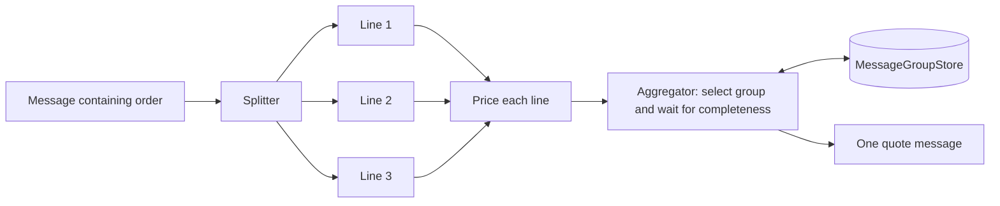

# Correlation in splitter-aggregator

## 1. Objectives and Context

In the **Correlation and state** chapter of `SPRING_INTEGRATION_CORE`, this lesson explains how to link child messages after splitting, process them independently, and reassemble them into the exact result of the original request. The focus is the contract among `Message`, sequence headers, `MessageChannel`, and the aggregator endpoint; Java DSL is used to express the processing flow.

After this lesson, you will be able to:

- Distinguish message identity, correlation keys, and business identifiers.
- Explain the role of `correlationId`, `sequenceNumber`, and `sequenceSize` in a splitter-aggregator pass.
- Build a flow that prices individual order lines and combines them into one quote.
- Choose group keys when handling multiple orders, multiple tenants, or multiple runs of the same order.
- Identify causes of stuck groups, mis-grouped data, or premature result emission.
- Propose policies for missing results, late results, and accumulated state.

You should already understand `Message<T>` structure, the difference between payload and headers, transformers, channels, and configuring an `IntegrationFlow`. The hands-on portion uses Java 17+ and the Java DSL API in Spring Integration 6.x/7.x; the main example runs in-memory inside a single process.

## 2. The Problem: Multiple Orders Traveling Through One Flow

Suppose the system receives two orders:

| Order | Lines to price | Result to emit |
| --- | --- | --- |
| `DH-101` | `L1`, `L2`, `L3` | One quote for `DH-101` |
| `DH-102` | `L1`, `L2` | One quote for `DH-102` |

A splitter separates each order into messages containing a single order line. A transformer or service activator prices each line. With varying processing latencies, results can arrive at the aggregator in this order:

```text
DH-101/L2 → DH-102/L1 → DH-101/L1 → DH-102/L2 → DH-101/L3
```

Combining whatever results arrive within a time window mixes the two orders. Grouping by `lineId` is also wrong because both orders have `L1`. Thus, every result must carry information identifying **which processing run** it belongs to, along with a basis to determine whether that run has collected all results.



The diagram shows logically independent parts. To execute them concurrently, add an execution boundary such as an executor or a queuing system. Declaring a splitter alone does not spawn extra Java threads.

## 3. Header Contract of a Split Operation

### 3.1. Values to Distinguish

| Value | Question it answers | Example |
| --- | --- | --- |
| `MessageHeaders.ID` | Which specific message instance is this? | UUID of one line result |
| `correlationId` | Which split group does this result belong to? | Key of the split of order `DH-101` |
| `sequenceNumber` | Which position is this within the split? | `2` |
| `sequenceSize` | How many parts are expected in this split? | `3` |
| Business header `orderId` | Which order does this data belong to? | `DH-101` |

In Java, the three sequence header constants are `IntegrationMessageHeaderAccessor.CORRELATION_ID`, `SEQUENCE_NUMBER`, and `SEQUENCE_SIZE`. Using constants or the accessor avoids typos in header names. See the [IntegrationMessageHeaderAccessor API](https://docs.spring.io/spring-integration/api/org/springframework/integration/IntegrationMessageHeaderAccessor.html).

With a standard splitter enabling `applySequence`, parts from the same split receive a shared correlation key; sequence numbering starts at `1`. When splitting a three-element `List`, the sequence size is `3`. Spring Integration enables sequence enrichment on splitters by default. See the [Splitter programming model](https://docs.spring.io/spring-integration/reference/splitter.html).

In the typical case, the correlation created by the splitter is based on the ID of the **message entering the splitter**. Since endpoints prior to the splitter may have created a new message, do not assume it equals the initial ID at the gateway. Nor should you overwrite `correlationId` with `orderId` just to make logs easier to read; keep a separate business header instead.

### 3.2. Tracing a Specific Group

Let the correlation key of `DH-101`'s split be `C101`, and `DH-102`'s be `C102`:

| Arrival order at aggregator | Payload | Correlation | Sequence | State after arrival |
| --- | --- | --- | --- | --- |
| 1 | Price for `DH-101/L2` | `C101` | `2/3` | `C101` has 1 part |
| 2 | Price for `DH-102/L1` | `C102` | `1/2` | `C102` has 1 part |
| 3 | Price for `DH-101/L1` | `C101` | `1/3` | `C101` has 2 parts |
| 4 | Price for `DH-102/L2` | `C102` | `2/2` | `C102` complete, emits quote `DH-102` |
| 5 | Price for `DH-101/L3` | `C101` | `3/3` | `C101` complete, emits quote `DH-101` |

An order that entered earlier can finish later. That is a valid outcome because the two groups are independent.

`sequenceNumber = sequenceSize` only says a message is the last by source order. If part `3/3` arrives first, `1/3` and `2/3` are still missing. Never use "saw the last part" as a substitute for "all parts have arrived."

## 4. Three Separate Aggregator Decisions

An aggregator must keep three decisions separate:

| Decision | Component | Applied to quoting |
| --- | --- | --- |
| Which group does the message belong to? | `CorrelationStrategy` | Group by the key of a split operation |
| Is the group allowed to emit yet? | `ReleaseStrategy` | Wait for all required results |
| What is the aggregated output? | `MessageGroupProcessor` | Build `OrderQuote` and sum amounts |

By default, an aggregator groups by the correlation header. Received messages are held in `MessageGroupStore` while awaiting release. Each strategy can be customized without replacing the entire endpoint. See [Aggregator](https://docs.spring.io/spring-integration/reference/aggregator.html).

For ordinary sequences, `SimpleSequenceSizeReleaseStrategy` compares the message count in the group with `sequenceSize`. This strategy does not check for duplicate `sequenceNumber` values; therefore, a flow capable of redeliveries needs separate deduplication design. See the [SimpleSequenceSizeReleaseStrategy API](https://docs.spring.io/spring-integration/api/org/springframework/integration/aggregator/SimpleSequenceSizeReleaseStrategy.html).

In the quote example, the input contract is defined as:

1. Each order line produces exactly one child message.
2. Each child message produces exactly one pricing result.
3. Every result preserves correlation and sequence metadata.
4. No line is silently dropped between splitter and aggregator.
5. One processing run never receives two results for the same line.

If condition 5 does not hold, message count no longer reliably represents completed lines. For example, `L1`, `L1`, `L2` is three messages yet still misses `L3`.

## 5. Java DSL Example: Split Order, Price Lines, Assemble Quote

### 5.1. Model and Complete Configuration

The example uses `spring-integration-core` and Spring Context on the classpath. When using Spring Boot, you can bring in the needed libraries via `spring-boot-starter-integration`; let your project's dependency management select compatible versions.

The single class below uses nested records to stay focused on the flow. `pricingInput` is a `DirectChannel`; `pricedOrders` and `pricingDiscards` are `QueueChannel`s so the learner can actively pull results.

```java
package example.correlation;

import java.math.BigDecimal;
import java.util.Comparator;
import java.util.List;
import java.util.Objects;

import org.springframework.context.annotation.AnnotationConfigApplicationContext;
import org.springframework.context.annotation.Bean;
import org.springframework.context.annotation.Configuration;
import org.springframework.integration.IntegrationMessageHeaderAccessor;
import org.springframework.integration.channel.DirectChannel;
import org.springframework.integration.channel.QueueChannel;
import org.springframework.integration.config.EnableIntegration;
import org.springframework.integration.dsl.IntegrationFlow;
import org.springframework.integration.store.MessageGroup;
import org.springframework.integration.store.SimpleMessageStore;
import org.springframework.integration.support.MessageBuilder;
import org.springframework.messaging.Message;
import org.springframework.messaging.MessageChannel;

@Configuration
@EnableIntegration
public class OrderPricingConfiguration {

    public record OrderLine(
            String lineId, BigDecimal unitPrice, int quantity) {
        public OrderLine {
            Objects.requireNonNull(lineId, "lineId");
            Objects.requireNonNull(unitPrice, "unitPrice");
            if (quantity <= 0 || unitPrice.signum() < 0) {
                throw new IllegalArgumentException("Invalid price or quantity");
            }
        }
    }

    public record PriceOrder(String orderId, List<OrderLine> lines) {
        public PriceOrder {
            if (orderId == null || orderId.isBlank()) {
                throw new IllegalArgumentException("orderId is required");
            }
            lines = List.copyOf(lines);
            if (lines.isEmpty()) {
                throw new IllegalArgumentException("At least one line is required");
            }
        }
    }

    public record PricedLine(String lineId, BigDecimal amount) {}

    public record OrderQuote(
            String orderId, List<PricedLine> lines, BigDecimal total) {}

    @Bean
    public MessageChannel pricingInput() {
        return new DirectChannel();
    }

    @Bean
    public QueueChannel pricedOrders() {
        return new QueueChannel();
    }

    @Bean
    public QueueChannel pricingDiscards() {
        return new QueueChannel();
    }

    @Bean
    public SimpleMessageStore pricingGroups() {
        return new SimpleMessageStore();
    }

    @Bean
    public IntegrationFlow pricingFlow(SimpleMessageStore pricingGroups) {
        return IntegrationFlow.from("pricingInput")
                .enrichHeaders(h -> h.headerFunction(
                        "orderId",
                        m -> ((PriceOrder) m.getPayload()).orderId()))
                .split(PriceOrder.class, PriceOrder::lines)
                .<OrderLine, PricedLine>transform(line -> new PricedLine(
                        line.lineId(),
                        line.unitPrice().multiply(
                                BigDecimal.valueOf(line.quantity()))))
                .aggregate(a -> a
                        .messageStore(pricingGroups)
                        .outputProcessor(OrderPricingConfiguration::toQuote)
                        .groupTimeout(5_000L)
                        .sendPartialResultOnExpiry(false)
                        .expireGroupsUponCompletion(false)
                        .expireGroupsUponTimeout(false)
                        .discardChannel("pricingDiscards"))
                .channel("pricedOrders")
                .get();
    }

    private static OrderQuote toQuote(MessageGroup group) {
        String orderId = group.getOne()
                .getHeaders().get("orderId", String.class);

        List<PricedLine> lines = group.getMessages().stream()
                .sorted(Comparator.comparingInt(
                        OrderPricingConfiguration::sequenceNumber))
                .map(message -> (PricedLine) message.getPayload())
                .toList();

        BigDecimal total = lines.stream()
                .map(PricedLine::amount)
                .reduce(BigDecimal.ZERO, BigDecimal::add);

        return new OrderQuote(orderId, List.copyOf(lines), total);
    }

    private static int sequenceNumber(Message<?> message) {
        return new IntegrationMessageHeaderAccessor(message)
                .getSequenceNumber();
    }

    public static void main(String[] args) {
        try (var context = new AnnotationConfigApplicationContext(
                OrderPricingConfiguration.class)) {
            MessageChannel input = context.getBean(
                    "pricingInput", MessageChannel.class);
            QueueChannel output = context.getBean(
                    "pricedOrders", QueueChannel.class);

            PriceOrder order = new PriceOrder("DH-101", List.of(
                    new OrderLine("L1", new BigDecimal("120000"), 2),
                    new OrderLine("L2", new BigDecimal("60000"), 1)));

            if (!input.send(MessageBuilder.withPayload(order).build())) {
                throw new IllegalStateException("Request was not accepted");
            }

            Message<?> reply = output.receive(2_000L);
            if (reply == null) {
                throw new IllegalStateException("No quote received");
            }

            OrderQuote quote = (OrderQuote) reply.getPayload();
            System.out.println(quote.orderId() + " total=" + quote.total());
        }
    }
}
```

Expected output of `main`:

```text
DH-101 total=300000
```

This is an example to run inside a project having the dependencies listed above. Practice snippets in this lesson do not replace your project's build configuration or test suite.

### 5.2. Explaining the Important Steps

The `orderId` header is added **before** splitting, because after the splitter the payload is only an `OrderLine`. That lets `toQuote` still retrieve the order ID even though child payloads do not contain it.

The splitter takes `List<OrderLine>` and creates two messages. Both results from the transformer carry the same correlation and sequences `1/2` and `2/2` respectively. The transformer returns a `PricedLine` POJO, letting the endpoint build the reply message and propagate headers appropriately.

Neither `.correlationStrategy(...)` nor `.releaseStrategy(...)` is declared in the example because the one-line/one-result contract matches the default mechanisms. `.outputProcessor(...)` constructs a single `OrderQuote` object; this is where summation runs. These customization points are provided in the [AggregatorSpec API](https://docs.spring.io/spring-integration/api/org/springframework/integration/dsl/AggregatorSpec.html).

`toQuote` explicitly sorts by `sequenceNumber`, so the line list in the quote follows the original order even if results arrive out of order. Summation does not require order, yet displaying a quote typically does. Do not assume the store's internal collection always preserves business order.

`List.copyOf(lines)` detaches the result list from the group's storage structure. Output carries business value data rather than exposing the store's internal collection to downstream steps.

The example runs synchronously over `DirectChannel`, so pricing runs directly inside the send call. Both output `QueueChannel`s are simply places holding messages to read; they do not spawn consumers automatically. In long-running applications, attach consumers for both successful results and discarded messages.

## 6. Preserving Correlation Across Endpoints

### 6.1. When Building Messages Yourself

Suppose a function takes `Message<OrderLine>` and constructs a result manually via:

```java
return MessageBuilder.withPayload(pricedLine).build();
```

This new message does not automatically carry headers from the input. Do not rest correlation correctness on assuming every manual send path or endpoint will restore them.

When you need to return a `Message<PricedLine>`, express the header-preservation contract explicitly:

```java
private static Message<PricedLine> price(Message<OrderLine> input) {
    OrderLine line = input.getPayload();
    PricedLine result = new PricedLine(
            line.lineId(),
            line.unitPrice().multiply(BigDecimal.valueOf(line.quantity())));

    return MessageBuilder.withPayload(result)
            .copyHeaders(input.getHeaders())
            .build();
}
```

This snippet reuses records from the previous example. Copying headers serves group linkage; it does not force the result message to reuse the input's `id` or `timestamp`. `withPayload` creates a builder for the new payload, and `copyHeaders` appends copyable headers. See [MessageBuilder](https://docs.spring.io/spring-integration/api/org/springframework/integration/support/MessageBuilder.html) and [BaseMessageBuilder](https://docs.spring.io/spring-integration/api/org/springframework/integration/support/BaseMessageBuilder.html).

### 6.2. When Crossing Transports or External Systems

In a design delegating pricing to another service, the request/reply contract should specify clearly:

- The processing-run key must go out and come back unchanged.
- Part identifiers must suffice to detect duplicate results.
- Expected part count or completion indicators must carry consistent semantics.
- Business headers such as `tenantId`, `orderId`, and `attemptId` must be mapped if used for grouping.

For instance, if the request sends `sequenceSize` as a number while the response returns it as a string, code reading the header as `Integer.class` can stop working. When reconstructing internal messages from responses, normalize types per the contract.

Do not assume serializing a payload to JSON automatically carries all Spring Message headers along. Payload and transport metadata must be designed together. Across a broker workflow, an envelope structure containing `attemptId`, `partId`, and `expectedParts` is often easier to state clearly in an inter-service contract.

## 7. Choosing Business-Based vs. Split-Based Correlation

### 7.1. When Splitter-Generated Correlation Fits

One request enters, splits into N parts, receives all N results, and finishes—this fits splitter-generated correlation well. Two requests carrying the same `orderId` that enter the splitter as two new messages usually belong to two separate splits.

Conversely, redelivering the exact parent message with the same ID can regenerate the same split key. Hence, to distinguish a fresh run from a redelivery, the system needs an explicit processing-attempt concept rather than relying solely on request arrival time.

### 7.2. When a Custom Key Is Needed

Suppose an aggregator receives results from multiple sources, where two tenants both use order ID `DH-101`. Or a user requests re-pricing an order after a price table changes. A key containing only `orderId` risks mixing both tenants and both calculation runs.

One design choice is:

```text
group key = (flow name, tenantId, orderId, attemptId)
```

`attemptId` is generated by the initiator **once for the entire run**, then propagated to every branch. If each branch generates its own `attemptId`, results land in separate groups.

In the aggregator configuration, you can replace key extraction with:

```java
// Place the record and helper inside the configuration class.
public record PricingGroupKey(
        String flow, String tenantId, String orderId, String attemptId) {}

private static String requiredTextHeader(Message<?> message, String name) {
    String value = message.getHeaders().get(name, String.class);
    if (value == null || value.isBlank()) {
        throw new IllegalArgumentException("Missing header: " + name);
    }
    return value;
}

// Add this to AggregatorSpec once inputs carry all required headers.
// .correlationStrategy(message -> new PricingGroupKey(
//         "order-pricing",
//         requiredTextHeader(message, "tenantId"),
//         requiredTextHeader(message, "orderId"),
//         requiredTextHeader(message, "attemptId")))
```

This is an alternative to the correlation strategy in the main example, not a mandate to add all three headers to every simple flow. The record provides field-based `equals()` and `hashCode()`, fitting the role of a value key. With a persistent store, also verify how the store represents keys and serializes data.

The correlation key decides group membership; it does not confirm the group is complete. If results arrive from multiple separate splits, each with its own `sequenceSize`, never reuse the default count strategy without knowing the total result count of the business group.

For example, a group waiting for `STOCK`, `PRICE`, and `SHIPPING` should complete once all **three distinct result types** arrive. Three `PRICE` replies do not equal having all three types.

## 8. State, Timeouts, and Late Results

### 8.1. Incomplete Groups Are State That Must Be Managed

An aggregator must remember received results, making it a stateful endpoint. `SimpleMessageStore` in the example is an in-memory store; incomplete state does not survive process termination. When restart recovery is required, choose a suitable persistent store such as JDBC, and account for payload and header serialization. See [Message Store](https://docs.spring.io/spring-integration/reference/message-store.html).

Suppose each order has 50 lines, each result takes roughly 2 KB, and 10,000 orders are pending. Payloads alone take roughly:

```text
50 × 2 KB × 10,000 ≈ 1 GB
```

That excludes object overhead, headers, indexes, and group structures. Thus, simply adding RAM does not solve the case where a line is permanently lost and a group never finishes.

### 8.2. Policy of the Quote Example

| Setting | Intent in the example |
| --- | --- |
| `groupTimeout(5_000L)` | Prevent incomplete groups from waiting forever when no new part arrives |
| `sendPartialResultOnExpiry(false)` | Do not emit a line-missing quote as if it were a normal result |
| `discardChannel("pricingDiscards")` | Provide a sink to handle discarded messages further |
| `expireGroupsUponCompletion(false)` | Retain markers of completed groups to catch late parts |
| `expireGroupsUponTimeout(false)` | Retain markers even for incomplete groups terminated by timeout |

A constant `groupTimeout` is a wait period reset whenever a new message arrives for an unreleased group. It does not create an overall deadline measured from the start of the request. Timeout, store, and locking options live in the [CorrelationHandlerSpec API](https://docs.spring.io/spring-integration/api/org/springframework/integration/dsl/CorrelationHandlerSpec.html).

In this domain, if `L3` has no result, the sum of `L1 + L2` is not the order total. Hence, the timeout branch should lead to failure tracking or re-pricing requests. `pricingDiscards` receives discarded messages without automatically turning them into a complete "quote failed" event; consumers must add context and business rules.

If a product allows returning partial results, use a result type that explicitly states the status, such as `PARTIAL`, received count, and expected count. Turning on partial emission alone is not enough for receivers to understand that data is missing.

### 8.3. Completion Differs from Deleting the Whole Group

In the `C101` example, after the quote is emitted, keeping a "completed" marker helps recognize that a late `L2` result still belongs to the old run. If the entire group were deleted immediately, that message could start a new group with the same key.

Conversely, keeping markers forever causes group counts to grow with every request ever executed. Choose a retention period aligned with your expected redelivery window. For instance, if an external service can redeliver for 15 minutes, purging markers after a few seconds is too early; keeping them forever causes state to grow without bound.

`MessageGroupStoreReaper` can be invoked periodically to expire groups per store configuration. Schedule its execution; having a reaper object alone does not mean a periodic scan job is running. See [MessageGroupStoreReaper API](https://docs.spring.io/spring-integration/api/org/springframework/integration/store/MessageGroupStoreReaper.html).

The main example retains state to demonstrate late messages and has not configured a cleanup schedule yet. When deploying a long-running service, specify incomplete-group age limits, closed-group retention durations, and post-discard actions.

### 8.4. With Multiple Instances

If parts of `C101` can land on two instances, two private in-memory stores create two separate incomplete groups. The design must route all parts of a group to the same processing owner or use shared state.

When multiple aggregators operate on shared state, a compatible per-group-ID locking mechanism is needed to prevent conflicting concurrent updates. Storage and locking configurations must go together; switching to a database alone does not prove the flow is safe across multiple instances. See configuration hooks in [AbstractCorrelatingMessageHandler](https://docs.spring.io/spring-integration/api/org/springframework/integration/aggregator/AbstractCorrelatingMessageHandler.html).

## 9. Scenarios That Easily Break the Splitter-Aggregator Contract

### 9.1. A Filter Drops One Part After the Splitter

An order has three lines, so each part carries `sequenceSize = 3`. If a filter drops `L2`, the aggregator receives only two parts. The filter working correctly does not change the initial promise that the group has three results.

Depending on the business domain, you can:

- Filter the list inside the payload **before splitting**, so the part count is computed on the list actually needing processing.
- Emit a representative outcome per line, such as `SUCCESS`, `REJECTED`, `FAILED`, so the aggregator knows every line finished.
- Replace the release condition with another provable completion contract alongside incomplete-group handling.

For quoting, a line rejected for an invalid quantity typically ought to fail the whole quote. Silently dropping a line and returning a lower total can mislead the buyer.

### 9.2. A Transformer Returns `null` or an Error Branch Produces No Outcome

If one branch emits no reply, the aggregator does not automatically know that branch failed. It only sees a group missing a part. In the example's synchronous flow, exceptions can propagate back to the sender; across asynchronous boundaries, design corresponding error-handling paths.

An `ErrorMessage` sent to `errorChannel` does not automatically become a `PricedLine` for the waiting group. If choosing to aggregate both successes and failures, transform errors into a unified business outcome type while preserving correlation and part identity.

If `L1` was already stored before `L2` failed, resending the whole order can repeat processing `L1`. Decide between per-part retries and whole-run retries, and whether side effects may repeat.

### 9.3. Duplicate Results Carrying New Message IDs

Suppose a sequence expects three parts, yet results arrive as:

```text
L1/sequence=1 → L1/sequence=1 → L2/sequence=2
```

If the redelivery is wrapped in a new message, do not expect the store to drop it merely because the payload looks identical. The group can hit the required count before `L3` even arrives.

A deduplication key can be `(attemptId, lineId)` or `(correlationId, sequenceNumber)` if the protocol guarantees their stability. Use an idempotent receiver or appropriate deduplication before the aggregator. The contract must also specify whether two results with the same part key but different prices keep one version or raise an error.

A strict release strategy can verify that sequence numbers cover `1..N` and all parts agree on `N`. However, merely checking while leaving duplicates in the group does not solve summation: the output processor would also have to avoid summing twice. For quoting, it is simpler to prevent duplicates from entering the group in the first place.

### 9.4. Splitter Yields an Empty Set or Unknown Size

An order with zero lines does not create a "size-0 group that self-completes." Zero child messages means the aggregator is never invoked for that split. The main example rejects empty orders right in the constructor for clear behavior.

For iterators or sources where the splitter cannot determine part count, `sequenceSize` may be `0`. In that case, do not rely on size-based waiting as you would for a `List`. A separate completion contract or suitable expiry policy is required; see the [Splitter Iterators section](https://docs.spring.io/spring-integration/reference/splitter.html#_iterators).

### 9.5. Nested Splitter-Aggregator Layers

For example, an order is split into packages, and each package is split into items. The inner aggregator must combine items into a package; only the outer layer combines packages into an order.

Spring Integration has a mechanism to push and restore sequence details for nested layers. When using standard components, preserve those headers across endpoints; `popSequence` relates to restoring prior layer metadata. If constructing headers or output messages manually, check carefully which layer's metadata is active. See the [popSequence API](https://docs.spring.io/spring-integration/api/org/springframework/integration/aggregator/AbstractCorrelatingMessageHandler.html#setPopSequence(boolean)).

Do not treat the item-layer correlation as a fixed group key for the entire order. A deeper split operation needs its own group context and then returns results to the right parent group.

## 10. Practicing Behavior Verification

### 10.1. Observing What Matters

At splitter output and aggregator input, observe the same set of fields:

```text
orderId=DH-101 attemptId=A7 correlationId=C101 sequence=2/3 partId=L2
```

This is a suggested log format; not every field is generated automatically by the example. The main example's logs can capture `orderId`, correlation, and sequence; `attemptId` and `partId` are added when the application contract uses them.

When debugging a missing-part group, compare the expected part list against parts actually received, then trace back to the endpoint that dropped or altered metadata. Looking only at total successful pricing-service requests does not tell you whether each group has enough results.

### 10.2. Cases to Test

| Input or failure | Expectation to prove |
| --- | --- |
| One order with two lines | One quote, right total, two lines in order |
| Two orders with interleaved results | Each quote contains only lines of its own order |
| Result `3/3` arrives first | Does not emit until remaining parts arrive |
| One part missing | Group follows timeout policy; does not emit a false complete quote |
| Two results with same part identity | Price is not summed twice |
| One part arrives after group closes | Handled per late-message policy |
| Same `orderId`, two `attemptId`s | Two calculation runs never mix |
| Empty order | Rejected or handled with explicit reply per contract |

The main example demonstrates the single-order case and a duplicate-free contract. The remaining cases are criteria for expanding design and tests, not claims that the minimal configuration already provides deduplication or distributed recovery.

To test out-of-order arrivals deterministically, isolate the aggregator in a test flow with its own input channel and send parts manually:

```java
import org.springframework.integration.support.MessageBuilder;
import org.springframework.messaging.Message;

// Payload can be PricedLine if reusing the example's output processor.
static <T> Message<T> part(
        String correlation, String orderId, int number, int size, T payload) {
    return MessageBuilder.withPayload(payload)
            .setCorrelationId(correlation)
            .setSequenceNumber(number)
            .setSequenceSize(size)
            .setHeader("orderId", orderId)
            .build();
}
```

Send part `3`, verify output is still empty; send part `1`, verify still no result; send part `2`, verify exactly one quote arrives. Do not send these child messages into `pricingInput`, because that channel expects `PriceOrder` and would run the splitter again.

For timeouts, use bounded message receives and inspect the discard branch. Separate test wait durations from business timeout configurations so one value is not mistaken for both roles.

### 10.3. Applied Exercise

Extend quoting so each line produces a `LineOutcome` containing `lineId`, status, and amount if successful. Enforce the rule that every line always produces an outcome, even when rejected. The final quote has status `COMPLETE` only when every outcome succeeds; if any line fails, return a status clearly reflecting that.

Before writing code, build a table for three lines: one succeeding, one rejected, and one redelivered. Identify the group key, deduplication key, and expected aggregated result. That table forces you to distinguish "finished processing every part" from "every part succeeded."

## 11. Key Takeaways

- Correlation tells which messages belong to the same group; business identity and processing-attempt identity serve different purposes.
- `sequenceNumber` denotes position, and `sequenceSize` denotes expected part count. Arrival of the last part does not prove all parts have arrived.
- A one-part/one-result contract makes default mechanisms behave cleanly. Filters, errors, duplicates, or unknown-size sources can break that contract.
- Accurate aggregation also depends on preserving metadata, deduplicating, ordering, and constructing the business result.
- Group state needs policies for completion, expiration, late messages, and cleanup; gateway wait timeout is a separate decision.
- When verifying a flow, actively test interleaved and out-of-order results rather than testing only parts arriving in source order.
