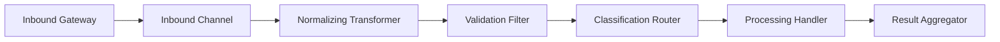
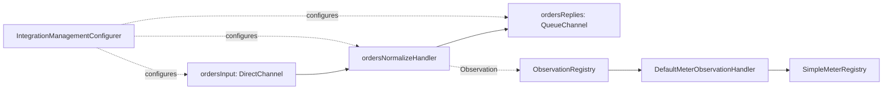

# IntegrationManagement: Observing and Managing Spring Integration Components

## 1. Objectives and Scope

In the **System management** chapter of the **SPRING_INTEGRATION_CORE** module, this lesson covers how to monitor a message flow at the channel and handler levels using `IntegrationManagement`. The concepts build directly on the core components used to design flows: `Message`, `MessageChannel`, endpoints, gateways, and Java DSL.

After completing this lesson, you will be able to:

- Explain the roles of `IntegrationManagement` and `@EnableIntegrationManagement`.
- Configure logging, metrics, and Observation appropriately for your goals.
- Name components consistently so you can locate measurements and isolate issues.
- Interpret measurement results without confusing message-sending operations with business outcomes.
- Distinguish observability from endpoint lifecycle control, JMX, and error handling.

The examples use **Java 17 or higher, Spring Integration 6.5, and Micrometer**. The versions in the Maven example serve as a fixed reference baseline to keep API usage consistent. When adding this code to an existing project, use the versions managed by your project's BOM.

## 2. Operations Challenge: The Flow Is Running, Yet the System Is Slow

An order-intake flow might be organized as follows:



When response times rise, knowing that the application is still up is not enough. Operators need to determine:

- Has the message reached the inbound channel yet?
- Which handler is taking the most time?
- Is the failure occurring during transformation or in a downstream service?
- Are messages piling up in a queue?
- Is a message discarded by a filter expected behavior or anomalous input data?

`IntegrationManagement` provides the foundation for Spring Integration components to participate in a unified management mechanism. Observation data still needs to be interpreted according to the structure and business rules of each flow.

For example, a filter rejecting an order without an address might be a valid processing branch. You should not assume every discarded message corresponds to an exception, or that every successful handler invocation corresponds to a saved order.

## 3. What Is IntegrationManagement?

`org.springframework.integration.support.management.IntegrationManagement` is the foundational interface for managed components. It extends `NamedComponent` and `DisposableBean`; many framework channels, handlers, message sources, and gateways implement this contract.

Notable API groups include:

| Group | Representative APIs | Purpose |
| --- | --- | --- |
| Logging | `setLoggingEnabled(boolean)`, `isLoggingEnabled()` | Controls component logging within the flow |
| Management identity | `setManagedName(String)`, `setManagedType(String)` | Provides a name and type for management purposes |
| Metrics | `registerMetricsCaptor(MetricsCaptor)` | Receives the metrics captor |
| Observation | `registerObservationRegistry(ObservationRegistry)`, `isObserved()` | Participates in the observation mechanism |
| Configuration overrides | `getOverrides()` | Informs the infrastructure which settings were configured directly |

These are infrastructure APIs. In typical applications, prefer annotations and configuration beans rather than manually calling registration methods on individual components. The API list and implementing classes are described in the [IntegrationManagement 6.5 Javadoc](https://docs.spring.io/spring-integration/docs/6.5.0/api/org/springframework/integration/support/management/IntegrationManagement.html).

### 3.1. Easily Confused Concepts

| Concept | Role |
| --- | --- |
| `IntegrationManagement` | Management contract on components |
| `@EnableIntegrationManagement` | Enables management configuration infrastructure in the application context |
| `IntegrationManagementConfigurer` | Applies configuration to eligible beans |
| `MeterRegistry` | Stores and exports Micrometer meters |
| `ObservationRegistry` | Coordinates Observation lifecycle and observation handlers |
| `Lifecycle` / `SmartLifecycle` | Contract for starting and stopping components |
| `IntegrationMBeanExporter` | Exports components over JMX when configured |

`IntegrationManagementConfigurer` is responsible for configuring logging, `MetricsCaptor`, and `ObservationRegistry` on beans that implement the management contract. That is why channels and handlers must reside in the Spring context to receive shared configuration. See the [IntegrationManagementConfigurer Javadoc](https://docs.spring.io/spring-integration/docs/6.5.0/api/org/springframework/integration/config/IntegrationManagementConfigurer.html).

## 4. Enabling Management and Selecting Observation Scope

Basic configuration:

```java
import org.springframework.context.annotation.Configuration;
import org.springframework.integration.config.EnableIntegration;
import org.springframework.integration.config.EnableIntegrationManagement;

@Configuration
@EnableIntegration
@EnableIntegrationManagement(
        defaultLoggingEnabled = "false",
        observationPatterns = {"orders*"}
)
public class IntegrationOperationsConfiguration {
}
```

`@EnableIntegrationManagement` creates the management infrastructure with a configurer bean named `integrationManagementConfigurer`. `defaultLoggingEnabled` has type `String`, which is why the example uses `"false"`.

`observationPatterns` defaults to empty. Therefore, having only the annotation and an `ObservationRegistry` does not mean every component is selected for Observation instrumentation. You can use `"*"` to select everything, or name patterns to limit the scope. See the [EnableIntegrationManagement Javadoc](https://docs.spring.io/spring-integration/docs/6.5.0/api/org/springframework/integration/config/EnableIntegrationManagement.html).

### 4.1. Component Name Patterns

Example:

```java
@EnableIntegrationManagement(
        observationPatterns = {"!ordersInternal*", "orders*"}
)
```

With this configuration:

| Component name | Pattern selection result |
| --- | --- |
| `ordersInput` | Selected |
| `ordersNormalizeHandler` | Selected |
| `ordersInternalAudit` | Excluded |
| `paymentsInput` | Not selected |

The rule is that **the first matching pattern determines the outcome**, including negated patterns starting with `!`. Therefore, place exclusion patterns before broader inclusion patterns. If `"orders*"` comes first, `ordersInternalAudit` already matches and the trailing exclusion pattern has no effect. This follows the rules of [PatternMatchUtils.smartMatch](https://docs.spring.io/spring-integration/docs/6.5.0/api/org/springframework/integration/support/utils/PatternMatchUtils.html).

Do not infer handler names solely from Java variable names. With Java DSL, the endpoint and the handler can be two separate beans. When predictable names are needed, declare channels and handlers as explicitly named beans as shown in the hands-on example later.

## 5. Logging, Metrics, and Observation

### 5.1. Logging in Message Flows

There are two conditions to check when expecting debug logs from a component:

1. The component allows logging through management configuration.
2. The logging framework, such as Logback, permits the corresponding log level.

`defaultLoggingEnabled = "true"` does not automatically raise the log level to DEBUG. Conversely, `"false"` can suppress normal flow logging even if the logger is set to DEBUG.

The default configuration does not override choices set directly on a bean. For example:

```java
@Bean
public DirectChannel ordersInput() {
    DirectChannel channel = new DirectChannel();
    channel.setLoggingEnabled(true);
    return channel;
}
```

This configuration is useful when you only need to inspect a single channel. You still must set the appropriate log level in the logging framework.

### 5.2. Two Paths for Generating Measurements

Distinguish between direct Micrometer metrics and metrics produced through Observation:

| Measurement approach | Primary configuration components | Example meter names |
| --- | --- | --- |
| Direct Spring Integration Micrometer metrics | `MeterRegistry`, metrics infrastructure | `spring.integration.send`, `spring.integration.receive` |
| Observation with metrics handler | `ObservationRegistry`, patterns, and `ObservationHandler` | `spring.integration.producer`, `spring.integration.handler`, `spring.integration.gateway` |

For components using Observation, creating meters for observed operations is delegated to the appropriate handler. You should not assume the same operation always produces both sets of timers. Gauges or meters from other components may still appear in the same registry.

Normal flow logging and exception logging must also be distinguished: disabling flow-level logging via management configuration does not mean disabling all exception logs. These mechanisms are described in [Metrics and Management](https://docs.spring.io/spring-integration/reference/6.5/metrics.html).

### 5.3. ObservationRegistry Needs an Active Handler

In a plain Spring context, you can wire Observation to metrics as follows:

```java
@Bean
public ObservationRegistry observationRegistry(MeterRegistry meterRegistry) {
    ObservationRegistry registry = ObservationRegistry.create();
    registry.observationConfig()
            .observationHandler(
                    new DefaultMeterObservationHandler(meterRegistry));
    return registry;
}
```

`DefaultMeterObservationHandler` translates the Observation lifecycle into measurements. A completed timer is recorded when the Observation stops; a long task timer with the `.active` suffix tracks ongoing operations.

A metrics handler does not produce tracing by itself. To send traces and spans to a tracing system, you need the appropriate handler, bridge, and tracing configuration. Therefore, `isObserved()` does not prove that traces have reached the backend. Nor does it prove the application is fully configured to export metrics. See [Micrometer Observation Components](https://docs.micrometer.io/micrometer/reference/observation/components.html).

## 6. Hands-On: Managing an Order Normalization Flow

### 6.1. Design and Runtime Prerequisites

The example consists of three main components:



The payload is an order code. The transformer trims leading and trailing whitespace, converts letters to uppercase, and rejects blank data. The output queue lets the program receive results explicitly.

Use a standalone Maven project with the following illustrative `pom.xml`. The code blocks represent content for learners to create in their own practice project.

```xml
<project xmlns="http://maven.apache.org/POM/4.0.0"
         xmlns:xsi="http://www.w3.org/2001/XMLSchema-instance"
         xsi:schemaLocation="http://maven.apache.org/POM/4.0.0 https://maven.apache.org/xsd/maven-4.0.0.xsd">
    <modelVersion>4.0.0</modelVersion>

    <parent>
        <groupId>org.springframework.boot</groupId>
        <artifactId>spring-boot-starter-parent</artifactId>
        <version>3.5.0</version>
        <relativePath/>
    </parent>

    <groupId>vn.example</groupId>
    <artifactId>integration-management-demo</artifactId>
    <version>1.0.0</version>

    <properties>
        <java.version>17</java.version>
    </properties>

    <dependencies>
        <dependency>
            <groupId>org.springframework.integration</groupId>
            <artifactId>spring-integration-core</artifactId>
        </dependency>
        <dependency>
            <groupId>io.micrometer</groupId>
            <artifactId>micrometer-core</artifactId>
        </dependency>
        <dependency>
            <groupId>io.micrometer</groupId>
            <artifactId>micrometer-observation</artifactId>
        </dependency>
    </dependencies>
</project>
```

Here, the Spring Boot parent manages dependency versions. The program creates an `AnnotationConfigApplicationContext` directly; it does not start Boot auto-configuration and does not require an HTTP server.

### 6.2. Complete Program

Place the following class in package `vn.example`, then run the `main` method from your IDE:

```java
package vn.example;

import java.util.Comparator;
import java.util.List;
import java.util.Locale;
import java.util.concurrent.TimeUnit;

import io.micrometer.core.instrument.MeterRegistry;
import io.micrometer.core.instrument.Timer;
import io.micrometer.core.instrument.observation.DefaultMeterObservationHandler;
import io.micrometer.core.instrument.simple.SimpleMeterRegistry;
import io.micrometer.observation.ObservationRegistry;

import org.springframework.context.annotation.AnnotationConfigApplicationContext;
import org.springframework.context.annotation.Bean;
import org.springframework.context.annotation.Configuration;
import org.springframework.integration.channel.DirectChannel;
import org.springframework.integration.channel.QueueChannel;
import org.springframework.integration.config.EnableIntegration;
import org.springframework.integration.config.EnableIntegrationManagement;
import org.springframework.integration.dsl.IntegrationFlow;
import org.springframework.integration.support.management.IntegrationManagement;
import org.springframework.integration.transformer.MessageTransformingHandler;
import org.springframework.messaging.Message;
import org.springframework.messaging.MessagingException;
import org.springframework.messaging.support.MessageBuilder;

public class IntegrationManagementDemo {

    public static void main(String[] args) {
        try (var context =
                     new AnnotationConfigApplicationContext(FlowConfiguration.class)) {

            DirectChannel input =
                    context.getBean("ordersInput", DirectChannel.class);
            QueueChannel replies =
                    context.getBean("ordersReplies", QueueChannel.class);
            MeterRegistry meterRegistry = context.getBean(MeterRegistry.class);

            context.getBeansOfType(IntegrationManagement.class)
                    .entrySet()
                    .stream()
                    .filter(entry -> entry.getKey().startsWith("orders"))
                    .sorted(Comparator.comparing(entry -> entry.getKey()))
                    .forEach(entry -> {
                        IntegrationManagement component = entry.getValue();
                        System.out.printf(
                                "%s: observed=%s, logging=%s%n",
                                entry.getKey(),
                                component.isObserved(),
                                component.isLoggingEnabled());
                    });

            for (String raw : List.of(" dh-001 ", "dh-002", " Dh-003 ")) {
                boolean accepted = input.send(
                        MessageBuilder.withPayload(raw)
                                .setHeader("sourceSystem", "web")
                                .build(),
                        1_000);

                if (!accepted) {
                    throw new IllegalStateException("Failed to send message");
                }

                Message<?> reply = replies.receive(1_000);
                if (reply == null) {
                    throw new IllegalStateException("No reply received");
                }
                System.out.println("Result: " + reply.getPayload());
            }

            try {
                input.send(MessageBuilder.withPayload("   ").build(), 1_000);
                throw new IllegalStateException("Blank input must be rejected");
            }
            catch (MessagingException exception) {
                System.out.println(
                        "Expected error: " + exception.getClass().getSimpleName());
            }

            meterRegistry.getMeters()
                    .stream()
                    .filter(meter -> meter.getId().getName()
                            .startsWith("spring.integration."))
                    .sorted(Comparator.comparing(
                            meter -> meter.getId().getName()
                                    + meter.getId().getTags()))
                    .forEach(meter -> {
                        System.out.println(meter.getId());

                        if (meter instanceof Timer timer) {
                            System.out.printf(
                                    "  count=%d, totalMs=%.3f%n",
                                    timer.count(),
                                    timer.totalTime(TimeUnit.MILLISECONDS));
                        }
                    });
        }
    }

    @Configuration
    @EnableIntegration
    @EnableIntegrationManagement(
            defaultLoggingEnabled = "false",
            observationPatterns = {"orders*"}
    )
    public static class FlowConfiguration {

        @Bean
        public MeterRegistry meterRegistry() {
            return new SimpleMeterRegistry();
        }

        @Bean
        public ObservationRegistry observationRegistry(MeterRegistry meterRegistry) {
            ObservationRegistry registry = ObservationRegistry.create();
            registry.observationConfig()
                    .observationHandler(
                            new DefaultMeterObservationHandler(meterRegistry));
            return registry;
        }

        @Bean
        public DirectChannel ordersInput() {
            return new DirectChannel();
        }

        @Bean
        public QueueChannel ordersReplies() {
            return new QueueChannel(8);
        }

        @Bean
        public MessageTransformingHandler ordersNormalizeHandler() {
            return new MessageTransformingHandler(message -> {
                if (!(message.getPayload() instanceof String raw)
                        || raw.isBlank()) {
                    throw new IllegalArgumentException(
                            "Order code must be a non-blank string");
                }

                return MessageBuilder
                        .withPayload(raw.strip().toUpperCase(Locale.ROOT))
                        .copyHeaders(message.getHeaders())
                        .build();
            });
        }

        @Bean
        public IntegrationFlow ordersFlow(
                DirectChannel ordersInput,
                MessageTransformingHandler ordersNormalizeHandler,
                QueueChannel ordersReplies) {

            return IntegrationFlow.from(ordersInput)
                    .handle(ordersNormalizeHandler,
                            endpoint -> endpoint.id("ordersNormalizeEndpoint"))
                    .channel(ordersReplies)
                    .get();
        }
    }
}
```

`MessageTransformingHandler` is a handler that receives a message, delegates transformation to a `Transformer`, and then sends the result to the output channel. The example uses a lambda to implement the transformer contract and uses `.handle(...)` to attach the named bean itself to the DSL. See the [MessageTransformingHandler Javadoc](https://docs.spring.io/spring-integration/docs/6.5.0/api/org/springframework/integration/transformer/MessageTransformingHandler.html).

### 6.3. Interpreting the Results

The first three payloads produce:

```text
Result: DH-001
Result: DH-002
Result: DH-003
```

Sending the whitespace-only string throws an exception in the `MessagingException` hierarchy after being wrapped by the framework. The exact exception class name and measured durations should not be treated as fixed output of the exercise.

The beans `ordersInput`, `ordersNormalizeHandler`, and `ordersReplies` match the observation pattern. Their regular logging is set to `false` by default. The name `ordersNormalizeEndpoint` identifies the endpoint connecting the handler to the channel.

When reading the registry, look for the `spring.integration.handler` timer with the component name tag corresponding to `ordersNormalizeHandler`. If metrics are split by error or other tags, you must sum the matching timers when counting total invocations. Do not read only the success-branch timer and conclude the handler was called only three times.

The failing message produces no normalized result in the queue. Observing an error also does not cause the framework to automatically fix the payload, retry, or route it to a dead-letter channel.

## 7. Reading Measurements Within the Right Boundaries

### 7.1. One Order Can Produce Multiple Measurements

In the example, a single send can pass through the inbound channel timer, the handler timer, and the outbound send timer. These are distinct measurement points within one processing pass.

Therefore:

- Do not sum the counts of all `spring.integration.*` meters to calculate total orders.
- Do not sum the durations of all timers to calculate end-to-end latency.
- When reporting throughput, choose one clearly defined entry point or business completion event.

Suppose an observation window records 100 calls at the inbound channel and 100 calls at the handler. The sum of both counts is 200 measured operations, while the flow may have received only 100 messages.

### 7.2. DirectChannel and QueueChannel Have Different Timing Meanings

`DirectChannel` invokes subscribers on the sender's thread. Consequently, `send()` duration can include synchronous processing in downstream steps rather than only message handoff overhead. See the [DirectChannel Javadoc](https://docs.spring.io/spring-integration/docs/6.5.0/api/org/springframework/integration/channel/DirectChannel.html).

With `QueueChannel`, a successful send may indicate only that the message was placed onto the queue. The consumer may process it later or fail on another thread.

You can think of the wait time for a request passing through a queue as consisting of:

```text
end-to-end time
  = pre-queue time
  + queue wait time
  + consumer processing time
  + reply time
```

This breakdown is intended for designing measurements. A single handler's timer does not automatically capture all terms in that expression.

If you need to measure from intake to business completion, explicitly define the start point, the end point, and how messages are correlated across steps.

### 7.3. Calculating Throughput and Average Duration

A `Timer` provides count and total time. The exported time unit depends on the backend; in Java, specify `TimeUnit` explicitly. See [Micrometer Timers](https://docs.micrometer.io/micrometer/reference/concepts/timers.html).

Given readings from the same timer over a 60-second interval:

| Metric | Start of interval | End of interval |
| --- | --- | --- |
| Count | 1,000 | 1,240 |
| Total processing time | 80 seconds | 92 seconds |

We get:

```text
operations in interval = 1,240 - 1,000 = 240
average throughput = 240 / 60 = 4 operations/second
average duration = (92 - 80) / 240 = 0.05 seconds = 50 ms
```

This calculation assumes the same tag set, the same process, and no metric resets during the interval. If restarts or multiple instances occur, use backend queries that handle counter resets and proper aggregation.

An average value of 50 ms does not prove every operation is fast. Some requests may still be very slow; percentiles or histograms must be configured and interpreted separately.

## 8. Customizing Measurement Scope and Observability Cost

### 8.1. Starting from a Naming Convention

A simple convention for an order flow:

| Role | Example |
| --- | --- |
| Inbound channel | `ordersInput` |
| Transformation handler | `ordersNormalizeHandler` |
| Endpoint hosting the handler | `ordersNormalizeEndpoint` |
| Result channel | `ordersReplies` |
| Error handling branch | `ordersErrors` |

Names that express responsibility are generally more useful than sequential numbers like `handler1`. When renaming a component, also review dashboards and patterns that depend on the old name.

Do not use order IDs or UUIDs as component names. Values that vary per message belong in correlation data within logs or traces as designed by the application.

### 8.2. Controlling Cardinality

Cardinality is the number of tag-value combinations that form distinct time series. The following examples illustrate design choices:

| Information | Recommended usage |
| --- | --- |
| Source group `web/mobile/batch` | Can be used as a bounded tag if genuinely needed |
| Outcome type `accepted/rejected` | Suitable for well-defined business metrics |
| `orderId`, email, UUID | Use for looking up individual events in appropriate logs/traces |
| Arbitrary exception message text | Avoid turning into an unbounded tag |

One million orders with one million `orderId` values do not improve aggregate dashboards. They cause the number of metric time series to explode, even though the flow only has a handful of components.

Ask before adding a tag: do you need to compare stable groups, or do you need to find one specific event? Those two needs usually lead to different observability storage mechanisms.

### 8.3. Using MeterFilter When Filtering Meters

Example of denying only producer-type meters for an internal channel in Observation mode:

```java
import io.micrometer.core.instrument.MeterRegistry;
import io.micrometer.core.instrument.config.MeterFilter;

public static void configureMeterFilters(MeterRegistry registry) {
    registry.config().meterFilter(MeterFilter.deny(id ->
            id.getName().startsWith("spring.integration.producer")
                    && "ordersInternalAudit".equals(
                            id.getTag("spring.integration.name"))));
}
```

Register filters before meters are created. For direct metrics, you must use the meter name and tag keys belonging to that measurement path.

`MeterFilter` can deny meters, transform meter IDs, or configure distribution statistics. Filtering meters does not replace selecting components via `observationPatterns`, nor does it disable tracing or message processing. See [Micrometer Meter Filters](https://docs.micrometer.io/micrometer/reference/concepts/meter-filters.html).

## 9. Observability Does Not Replace Error Handling or Endpoint Control

### 9.1. Exceptions, errorChannel, and Retries

In the example, the program calls `DirectChannel.send()` directly and processes synchronously. An exception from the transformer is returned to the caller as a messaging error.

If you change the structure to asynchronous processing, the producer may have already finished before the consumer encounters an error. In that case, you must design an error-handling path suited to the endpoint, executor, or poller in use.

Three responsibilities must be clearly separated:

| Responsibility | Example mechanisms |
| --- | --- |
| Recording failed operations | Observation, metrics, logs |
| Deciding whether to retry or compensate | Retry advice, business services, appropriate transaction mechanisms |
| Routing errors to a handling branch | `errorChannel`, error handler, configured dead-letter flow |

A meter recording an error does not prove the message reached `errorChannel`. Likewise, an ultimately successful retry may correspond to multiple prior handler invocations.

With an aggregator, you also need to monitor group completion rules, timeouts, and message group state. A handler processing each individual message successfully can still leave a group without enough conditions met to release.

### 9.2. Endpoints and Handlers Have Separate Lifecycles

In the DSL:

```java
.handle(ordersNormalizeHandler,
        endpoint -> endpoint.id("ordersNormalizeEndpoint"))
```

`ordersNormalizeHandler` performs the transformation; the endpoint connects the handler to the channel. `ConsumerEndpointSpec` supports lifecycle options such as `autoStartup`, `phase`, along with appropriate advice and poller configurations. See the [ConsumerEndpointSpec Javadoc](https://docs.spring.io/spring-integration/docs/6.5.0/api/org/springframework/integration/dsl/ConsumerEndpointSpec.html).

A separate snippet illustrating endpoint control in the context created in the hands-on section:

```java
import org.springframework.context.Lifecycle;

Lifecycle endpoint =
        context.getBean("ordersNormalizeEndpoint", Lifecycle.class);

endpoint.stop();
System.out.println("Running: " + endpoint.isRunning());

endpoint.start();
```

`EventDrivenConsumer` is the endpoint that connects a `MessageHandler` to a `SubscribableChannel` and provides start/stop control. See the [EventDrivenConsumer Javadoc](https://docs.spring.io/spring-integration/docs/6.5.0/api/org/springframework/integration/endpoint/EventDrivenConsumer.html).

Stopping an endpoint does not mean draining the entire queue or waiting for all business work in the system to finish. In an example with only one subscriber on a `DirectChannel`, stopping the endpoint and continuing to send can leave the channel with no subscriber to accept messages.

### 9.3. JMX as a Complementary Management Option

`@EnableIntegrationManagement` does not automatically export every component as an MBean. When JMX management is needed, Spring Integration provides `IntegrationMBeanExporter` and the `@EnableIntegrationMBeanExport` annotation; this feature is part of JMX support and requires the corresponding dependency.

Choose JMX when operational tools need to inspect attributes or invoke management operations through MBeans. Choose a metrics backend when you need history, charts, and time-series aggregation alerts. Both mechanisms can serve different needs within the same system. See [Spring Integration JMX Support](https://docs.spring.io/spring-integration/reference/6.5/jmx.html#mbean-exporter).

## 10. Integrating with Spring Boot Actuator

In a Spring Boot application run with `SpringApplication`, you can add:

```xml
<dependency>
    <groupId>org.springframework.boot</groupId>
    <artifactId>spring-boot-starter-actuator</artifactId>
</dependency>
<dependency>
    <groupId>io.micrometer</groupId>
    <artifactId>micrometer-registry-prometheus</artifactId>
</dependency>
```

If the application already has an HTTP server and you want to view meters over HTTP in a practice environment:

```yaml
management:
  endpoints:
    web:
      exposure:
        include: health,metrics,prometheus
```

Boot Actuator configures Micrometer infrastructure based on the dependencies present. Spring Integration provides metrics under the `spring.integration.` prefix. See [Spring Boot Metrics](https://docs.spring.io/spring-boot/3.5/reference/actuator/metrics.html#actuator.metrics.supported.spring-integration).

When moving from the plain Spring example to Boot, use the auto-configured registry to avoid splitting measurements into a separate `SimpleMeterRegistry`. Only add missing Observation configuration or handlers after checking what Boot's infrastructure already provides.

Endpoints you can use to inspect metrics:

```text
GET /actuator/metrics
GET /actuator/metrics/spring.integration.handler
GET /actuator/prometheus
```

The meter names and sets that appear depend on the measurement path in use, which components were actually invoked, and the registry configuration. The configuration block above does not automatically create an HTTP server for the plain Spring `main` program in section 6.

## 11. Troubleshooting Common Issues

| Symptom | Check first | Next step |
| --- | --- | --- |
| Expected meter is missing | Has a message passed through yet; which measurement path's meter name are you looking for? | Send sample data and list actual meter IDs |
| `isObserved()` is `false` | Registry, annotation, pattern, and component name | Verify the bean actually selected |
| `isObserved()` is `true` but dashboard is empty | Metrics handler, exporting registry, backend connectivity | Trace step by step from Observation to backend |
| No debug logs | Logging flag on the bean and log level | Adjust the specific component under investigation |
| Count is greater than number of orders | Are you summing multiple components or seeing retries? | Pick a single counting point and define the unit of measurement |
| `send()` succeeds but no result appears | Is the message in a queue, filter branch, or aggregator? | Inspect state and completion conditions at each step |
| Latency rises while handler stays fast | Is there queue wait time or group wait time? | Add queue-wait and end-to-end measurements |
| Exception does not reach error branch | Is the call path synchronous; who is responsible for forwarding errors? | Configure error handling for the actual endpoint |
| Stopping an endpoint breaks sends | Does the channel still have any subscribers? | Coordinate producer and consumer for maintenance design |

A practical diagnostic sequence:

1. Identify the component and operation boundary to inspect.
2. Confirm that messages actually reach that boundary.
3. Verify the management configuration on the exact bean.
4. Inspect meters in the application's registry.
5. Then verify metric export, queries, and dashboards.

This sequence helps separate instrumentation issues from problems transporting metrics outside the application.

## 12. Practice Exercises and Expected Outcomes

### Exercise 1: Narrowing the Observation Scope

Change the pattern to `{"ordersInput"}`, then run the program again.

Expected explanation: the inbound channel is selected for Observation; the handler is no longer selected under this pattern. If direct Micrometer meters appear for the remaining component, that is a different measurement path to identify by meter ID. Valid payloads are still normalized as before.

### Exercise 2: Changing the Asynchronous Boundary

Replace the inbound channel with a `QueueChannel`, add a consumer with an appropriate poller, and adjust the bean lookup in the program.

Observation: a successful send can happen before the transformer runs. Measure queue wait time and handler time separately, then explain why looking only at the producer-side timer can miss latency.

### Exercise 3: Inspecting the Error Branch

Send three valid messages and one blank message. Record the outputs, exception, and handler timers.

Expected outcome: three valid results, one error handling occurrence, and no normalized result for the blank message. The total count must be computed over the handler's own metric series rather than summing both channel and handler.

### Exercise 4: Distinguishing Technical and Business Outcomes

Add a filter that rejects order codes based on a business rule, with an explicit discard channel. Define the metric you want to report: incoming messages, discarded messages, or completed orders.

Explain the case where a handler or filter executes normally without producing output on the main branch. From there, choose the appropriate measurement point for each metric.

## 13. Key Takeaways

- `IntegrationManagement` is the component management contract; annotations and the configurer provide shared configuration.
- Observation requires the right component, registry, and handler; data reaching a backend also depends on export configuration.
- Channel, handler, and endpoint names should express responsibility and remain stable across deployments.
- Each meter measures a specific technical boundary. Business throughput and end-to-end duration must be defined separately.
- Logging, metrics, tracing, error handling, and endpoint lifecycles are related mechanisms with distinct responsibilities.

When designing a Spring Integration flow, define both the message path and the observation points together. An operable flow is one where anyone reading the metrics can connect every number to a specific operation and a clear business meaning.
