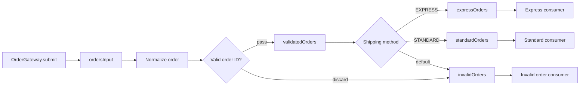

# IntegrationGraph: Observing Spring Integration Flow Structure

## 1. What Problem Does IntegrationGraph Solve?

In a Spring Integration application, a business request may pass through a gateway, multiple `MessageChannel` instances, transformers, filters, and routers before reaching the final handler. As the number of flows grows, looking at individual `@Bean` methods is no longer enough to quickly answer: "Where does this input go?" or "Which channel receives discarded messages?"

**Integration Graph** represents the integration components and their connection relationships in a running application. The central component is `IntegrationGraphServer`; the resulting data is a `Graph` object, typically exported as JSON for inspection or diagram rendering. This is a tool in the **System management** group within **SPRING_INTEGRATION_CORE**.

For example, an operations team needs to confirm that the express shipping branch has been deployed alongside the standard shipping branch. The graph helps verify the presence of the relevant channels, routers, and consumers. To know which branch a specific order took and how long it took, you need to combine logs, tracing, or metrics.

After this lesson, you will be able to:

- Read the three parts of a graph: `contentDescriptor`, `nodes`, and `links`.
- Relate the graph to gateways, channels, and endpoints declared with Java DSL.
- Register `IntegrationGraphServer` and retrieve the graph in Java or via Spring Boot Actuator.
- Distinguish between reading the graph and rebuilding the graph when application structure changes.
- Use the graph to verify wiring, while recognizing its limits when diagnosing errors and performance.

The examples use **Java 17, Spring Boot 3.5.x, and Spring Integration 6.5.x** as a reference baseline. Spring Integration dependencies should follow the version managed by Spring Boot. Do not treat this baseline as a requirement to upgrade existing applications.

## 2. The Graph Describes Structure; Metrics and Tracing Add Behavior

Distinguish between these operational questions:

| Question | Appropriate information source |
| --- | --- |
| Does `validatedOrders` connect to a router? | Integration Graph |
| Is the express shipping branch processing fewer messages than normal? | Metrics and business data |
| Which steps did order `A-101` pass through? | Logs with correlation ID or tracing |
| Is the consumer actually running after being stopped manually? | Endpoint lifecycle state |
| Which message groups is the aggregator currently holding? | Message store, aggregator management mechanisms, and related diagnostic data |

The graph represents components known to the framework in the application context. A node can still exist while its corresponding endpoint is stopped. A link also does not prove that any message has actually traversed that link.

In particular, do not infer that:

- A `DirectChannel` having a node means an active, healthy consumer is attached.
- A router having two branches means both branches have been used.
- An aggregator having an output means all message groups have met release conditions.
- Having `errorChannel` in the graph means every exception is routed there.
- Every temporary reply path of a gateway is drawn as a static connection.

A useful troubleshooting mindset is: **the graph helps you locate where to look; runtime execution data tells you what happened at that location**.

## 3. The Graph Data Model

### 3.1. Three Top-Level Sections

The `Graph` object provides `getContentDescriptor()`, `getNodes()`, and `getLinks()`. When serialized to JSON, these three datasets form the model that client tools parse or render. [Graph 6.5 API](https://docs.spring.io/spring-integration/docs/6.5.0/api/org/springframework/integration/graph/Graph.html)

The JSON snippet below is a **simplified illustrative model**, not a verbatim capture from the example application. IDs, endpoint names, and additional fields in actual output may differ.

```json
{
  "contentDescriptor": {
    "provider": "spring-integration",
    "providerVersion": "6.5.x",
    "providerFormatVersion": 1.2,
    "name": "order-routing-demo"
  },
  "nodes": [
    {
      "nodeId": 10,
      "name": "validatedOrders",
      "componentType": "channel",
      "properties": {}
    },
    {
      "nodeId": 11,
      "name": "shippingRouter",
      "componentType": "router",
      "properties": {}
    },
    {
      "nodeId": 12,
      "name": "expressOrders",
      "componentType": "channel",
      "properties": {}
    }
  ],
  "links": [
    { "from": 10, "to": 11, "type": "input" },
    { "from": 11, "to": 12, "type": "route" }
  ]
}
```

How to read the example: node `10` is the input channel of node `11`; node `11` has a routing branch to node `12`.

### 3.2. Descriptor: Identifying Source and Format

`contentDescriptor` identifies the application providing the graph:

| Field | Meaning |
| --- | --- |
| `provider` | Model provider, here Spring Integration |
| `providerVersion` | Framework version providing the data |
| `providerFormatVersion` | Graph format version |
| `name` | Application name configured for the graph |

The name can come from `spring.application.name` or be set via `setApplicationName(...)` on the server. Do not use `providerVersion` as the service's business version identifier; manage deployment versions using separate operational metadata.

### 3.3. Node: A Component in the Runtime Model

`IntegrationNode` has basic properties such as `nodeId`, `name`, `componentType`, and `properties`; the API also provides EIP type, EIP group, and `observed` state. `observed` indicates whether the component is instrumented with observation, not the health status of the component. [IntegrationNode 6.5 API](https://docs.spring.io/spring-integration/docs/6.5.0/api/org/springframework/integration/graph/IntegrationNode.html)

When reading a node, prioritize:

1. `name` to correlate with the bean name or component name in the application.
2. `componentType` to understand its technical role.
3. `integrationPatternType` if classification according to Enterprise Integration Patterns is needed.
4. Additional fields such as `input`, `output`, or `properties` when provided by that node type.

`nodeId` is an internal join key within a single graph. When comparing across two startups or two deployments, match by component name and role first; do not build dashboards assuming "the shipping router always has ID 11."

A single Java DSL step can create a handler, an endpoint, and an intermediate channel. Therefore, the node count does not necessarily equal the number of `transform()`, `filter()`, or `handle()` calls in the source code. A gateway with multiple methods can also generate multiple corresponding nodes.

### 3.4. Link: Directed Relationships

`LinkNode` contains `from`, `to`, and `type`. The first two values reference the `nodeId` of the source and target nodes. [LinkNode 6.5 API](https://docs.spring.io/spring-integration/docs/6.5.0/api/org/springframework/integration/graph/LinkNode.html)

Common link types:

| `type` | Interpretation direction |
| --- | --- |
| `input` | From a channel to the component receiving messages |
| `output` | From a producing or output-emitting component to a channel |
| `route` | From a router to a routed channel |
| `discard` | From a filtering/discarding component to its discard channel |
| `error` | From a component with graph-recognized error routing to an error channel |

For instance, a filter's `discard` leads to where rejected messages go. It does not equate to a processing error. For `error`, read only the links the framework actually emits; do not mentally add an edge from every handler to `errorChannel`. [Integration Graph Model](https://docs.spring.io/spring-integration/reference/6.5/graph.html)

## 4. Registering IntegrationGraphServer and Understanding Its Lifecycle

In a plain Spring application with Spring Integration infrastructure enabled, declare the server as a Spring bean:

```java
import org.springframework.context.annotation.Bean;
import org.springframework.context.annotation.Configuration;
import org.springframework.integration.graph.IntegrationGraphServer;

@Configuration
public class GraphConfiguration {

    @Bean
    public IntegrationGraphServer integrationGraphServer() {
        IntegrationGraphServer server = new IntegrationGraphServer();
        server.setApplicationName("order-routing-demo");
        return server;
    }
}
```

Letting Spring manage the bean allows the server to receive the application context and context refresh events. Simply calling `new IntegrationGraphServer()` inside a utility method and using it immediately lacks this lifecycle wiring.

The two main methods serve different purposes:

| Method | When to use |
| --- | --- |
| `getGraph()` | Read the currently cached graph |
| `rebuild()` | Rebuild the model from current components, update the cache, and return the new graph |

The server handles `ContextRefreshedEvent` for its enclosing context. When an application dynamically registers or removes flows afterward, you must explicitly rebuild the graph to reflect the new structure. [IntegrationGraphServer 6.5 API](https://docs.spring.io/spring-integration/docs/6.5.0/api/org/springframework/integration/graph/IntegrationGraphServer.html)

`rebuild()` does not restart endpoints, does not resend messages, and does not modify router configuration. It rebuilds the **observation model**. A Java variable holding an older `Graph` also does not automatically switch to the new object after the server updates its cache.

In Spring Boot with Actuator, auto-configuration can provide both the server and the endpoint when conditions are met. A user-declared server bean takes precedence because the auto-configuration is guarded by `@ConditionalOnMissingBean`. You do not need to create two servers for the same purpose. [IntegrationGraph Endpoint Auto-configuration](https://docs.spring.io/spring-boot/3.5/api/java/org/springframework/boot/actuate/autoconfigure/integration/IntegrationGraphEndpointAutoConfiguration.html)

## 5. Complete Example: Inspecting an Order Routing Flow

The following application receives an `Order` via a messaging gateway, normalizes the data, discards orders missing an ID, and routes by shipping method. The code snippets are illustrative content to place in a standalone Spring Boot project.

### 5.1. Business Flow to Observe



The diagram illustrates business intent. The actual graph may include additional intermediate channels and infrastructure components such as `nullChannel` or `errorLogger`.

### 5.2. Dependencies

In a project already using the Spring Boot 3.5.x parent or BOM, add the following dependencies to the `dependencies` section of `pom.xml`. Java DSL is included in Spring Integration Core, so no separate Java DSL artifact is needed.

```xml
<dependency>
    <groupId>org.springframework.boot</groupId>
    <artifactId>spring-boot-starter-integration</artifactId>
</dependency>

<dependency>
    <groupId>org.springframework.boot</groupId>
    <artifactId>spring-boot-starter-web</artifactId>
</dependency>

<dependency>
    <groupId>org.springframework.boot</groupId>
    <artifactId>spring-boot-starter-actuator</artifactId>
</dependency>

<dependency>
    <groupId>org.springframework.boot</groupId>
    <artifactId>spring-boot-starter-test</artifactId>
    <scope>test</scope>
</dependency>
```

Set `java.version` to `17` or use a JDK compatible with your project's Boot version. The example uses MVC to expose Actuator over HTTP; building the graph does not require the business flow itself to receive messages over HTTP.

### 5.3. Bootstrap Class, Payload, and Gateway

Place these classes under the same package `com.example.integrationgraph`.

```java
package com.example.integrationgraph;

import org.springframework.boot.SpringApplication;
import org.springframework.boot.autoconfigure.SpringBootApplication;
import org.springframework.integration.annotation.IntegrationComponentScan;

@SpringBootApplication
@IntegrationComponentScan
public class GraphDemoApplication {

    public static void main(String[] args) {
        SpringApplication.run(GraphDemoApplication.class, args);
    }
}
```

```java
package com.example.integrationgraph;

public record Order(String id, String shippingMethod) {
}
```

```java
package com.example.integrationgraph;

import org.springframework.integration.annotation.MessagingGateway;

@MessagingGateway(defaultRequestChannel = "ordersInput")
public interface OrderGateway {

    void submit(Order order);
}
```

`@IntegrationComponentScan` enables discovery of the gateway interface. `submit()` returns `void` because the example uses a one-way send operation rather than designing a request/reply chain returning a business result.

### 5.4. Java DSL Configuration

```java
package com.example.integrationgraph;

import java.util.Locale;

import org.slf4j.Logger;
import org.slf4j.LoggerFactory;
import org.springframework.boot.ApplicationRunner;
import org.springframework.context.annotation.Bean;
import org.springframework.context.annotation.Configuration;
import org.springframework.integration.channel.DirectChannel;
import org.springframework.integration.dsl.IntegrationFlow;
import org.springframework.integration.graph.IntegrationGraphServer;
import org.springframework.messaging.MessageChannel;

@Configuration
public class OrderFlows {

    private static final Logger log =
            LoggerFactory.getLogger(OrderFlows.class);

    @Bean
    public MessageChannel ordersInput() {
        return new DirectChannel();
    }

    @Bean
    public MessageChannel validatedOrders() {
        return new DirectChannel();
    }

    @Bean
    public MessageChannel expressOrders() {
        return new DirectChannel();
    }

    @Bean
    public MessageChannel standardOrders() {
        return new DirectChannel();
    }

    @Bean
    public MessageChannel invalidOrders() {
        return new DirectChannel();
    }

    @Bean
    public IntegrationGraphServer integrationGraphServer() {
        IntegrationGraphServer server = new IntegrationGraphServer();
        server.setApplicationName("order-routing-demo");
        return server;
    }

    @Bean
    public IntegrationFlow orderRoutingFlow() {
        return IntegrationFlow.from("ordersInput")
                .transform(Order.class, order -> new Order(
                        order.id() == null ? "" : order.id().trim(),
                        order.shippingMethod() == null
                                ? "STANDARD"
                                : order.shippingMethod().trim()
                                        .toUpperCase(Locale.ROOT)),
                        endpoint -> endpoint.id("normalizeOrder"))
                .filter(Order.class, order -> !order.id().isBlank(),
                        filter -> filter.id("validateOrder")
                                .discardChannel("invalidOrders"))
                .channel("validatedOrders")
                .route(Order.class, Order::shippingMethod,
                        router -> router.id("routeByShipping")
                                .channelMapping("EXPRESS", "expressOrders")
                                .channelMapping("STANDARD", "standardOrders")
                                .channelKeyFallback(false)
                                .defaultOutputChannel("invalidOrders"))
                .get();
    }

    @Bean
    public IntegrationFlow expressFlow() {
        return IntegrationFlow.from("expressOrders")
                .handle(message -> log.info("EXPRESS: {}",
                                message.getPayload()),
                        endpoint -> endpoint.id("expressConsumer"))
                .get();
    }

    @Bean
    public IntegrationFlow standardFlow() {
        return IntegrationFlow.from("standardOrders")
                .handle(message -> log.info("STANDARD: {}",
                                message.getPayload()),
                        endpoint -> endpoint.id("standardConsumer"))
                .get();
    }

    @Bean
    public IntegrationFlow invalidFlow() {
        return IntegrationFlow.from("invalidOrders")
                .handle(message -> log.info("INVALID: {}",
                                message.getPayload()),
                        endpoint -> endpoint.id("invalidConsumer"))
                .get();
    }

    @Bean
    public ApplicationRunner sendDemoOrders(OrderGateway gateway) {
        return args -> {
            gateway.submit(new Order("  A-101  ", " express "));
            gateway.submit(new Order("A-102", "STANDARD"));
            gateway.submit(new Order("   ", "STANDARD"));
            gateway.submit(new Order("A-103", "DRONE"));
        };
    }
}
```

Here:

- The transformer normalizes the order ID and shipping method.
- The filter sends orders without an ID to `invalidOrders` via the discard mechanism.
- The router uses explicit mappings for `EXPRESS` and `STANDARD`.
- `channelKeyFallback(false)` prevents an unmapped business value from being resolved as a channel name.
- `defaultOutputChannel("invalidOrders")` receives unsupported shipping methods.
- The terminal handlers simply receive messages and log them in this example.

The `RouterSpec` API provides the mapping and fallback options used in the configuration above. [RouterSpec 6.5 API](https://docs.spring.io/spring-integration/docs/6.5.0/api/org/springframework/integration/dsl/RouterSpec.html)

Expected business outcomes:

| Submitted data | Result after normalization | Receiving branch |
| --- | --- | --- |
| `"  A-101  ", " express "` | `A-101, EXPRESS` | `expressOrders` |
| `"A-102", "STANDARD"` | `A-102, STANDARD` | `standardOrders` |
| Whitespace-only order ID | Empty order ID | `invalidOrders` via filter |
| `"A-103", "DRONE"` | No matching mapping | `invalidOrders` via router's default output |

All channels in the example are `DirectChannel`. Handlers are invoked on the respective sending thread; having multiple channels does not automatically introduce asynchrony. If a handler throws an exception along this synchronous call path, the exception can propagate back to the gateway caller.

IDs such as `normalizeOrder` and `routeByShipping` help locate endpoints in the application. Node names may be derived from the handler attached to an endpoint and include suffixes generated by the DSL. When opening the graph for the first time, verify the actual names before writing dashboard filters.

## 6. Retrieving the Graph in Java

If you need to inspect the structure in an internal utility, you can inject the server and traverse the data directly. The following example is an additional `@Bean` method in the configuration class, with the corresponding imports:

```java
import org.springframework.boot.ApplicationRunner;
import org.springframework.context.annotation.Bean;
import org.springframework.integration.graph.Graph;
import org.springframework.integration.graph.IntegrationGraphServer;

@Bean
public ApplicationRunner inspectGraph(IntegrationGraphServer server) {
    return args -> {
        Graph graph = server.getGraph();

        System.out.println(graph.getContentDescriptor());

        graph.getNodes().forEach(node ->
                System.out.printf("%d | %s | %s%n",
                        node.getNodeId(),
                        node.getName(),
                        node.getComponentType()));

        graph.getLinks().forEach(link ->
                System.out.printf("%d -> %d [%s]%n",
                        link.getFrom(),
                        link.getTo(),
                        link.getType()));
    };
}
```

`ApplicationRunner` executes after the application context is initialized. This is more appropriate than trying to traverse the entire graph inside a configuration bean's constructor.

To interpret an edge, build a lookup table `nodeId -> node` and translate IDs to names. When building a UI, use distinct colors or line styles for `input`, `route`, `discard`, and `error` so viewers understand the meaning of each connection.

Do not use `Graph` as an API for mutating topology. To add flows dynamically, use the appropriate `IntegrationFlow` registration mechanism; to start or stop endpoints, use the appropriate lifecycle management mechanism.

## 7. Retrieving the Graph via Spring Boot Actuator

### 7.1. Access Configuration in a Practice Environment

In `application.yml` of the demo application:

```yaml
spring:
  application:
    name: order-routing-demo

management:
  endpoints:
    web:
      exposure:
        include: health,integrationgraph
```

The bean in `OrderFlows` already sets the same application name for the graph. You can omit `setApplicationName(...)` to use the name from the environment.

Whether an endpoint is created, permitted to be accessed, and exposed over HTTP are separate conditions. With the default practice configuration, `include` above opens HTTP exposure for the graph; additional access or security configuration in a project may still restrict operations.

### 7.2. Reading and Rebuilding

In a Windows terminal, use `curl.exe` to invoke the actual curl executable:

```powershell
curl.exe -i http://localhost:8080/actuator/integrationgraph

curl.exe -i -X POST http://localhost:8080/actuator/integrationgraph
```

With the default base path and port:

| Operation | HTTP | Expected result |
| --- | --- | --- |
| Read graph | `GET /actuator/integrationgraph` | `200` and graph JSON |
| Rebuild graph | `POST /actuator/integrationgraph` | `204 No Content` |
| Read after rebuild | `GET /actuator/integrationgraph` | JSON of the updated graph |

`POST` does not return the graph JSON in a successful response; the client must issue a subsequent `GET` if it wants to display the data. [Spring Boot Actuator: integrationgraph](https://docs.spring.io/spring-boot/3.5/api/rest/actuator/integrationgraph.html)

You can inspect node names and types in PowerShell without saving the response to a file:

```powershell
$graph = Invoke-RestMethod -Uri 'http://localhost:8080/actuator/integrationgraph'

$graph.nodes |
    Select-Object nodeId, name, componentType

$graph.links |
    Select-Object from, to, type
```

When deploying to an operational environment, protect the endpoint using your service's authentication and administrative authorization policies. Component names, expressions, or custom metadata can reveal internal structure. Do not put secrets, order payloads, or customer data into graph properties.

### 7.3. Distinguishing from IntegrationGraphController

Spring Integration also has its own controller, enabled with `@EnableIntegrationGraphController` when the HTTP module and corresponding web infrastructure are present. For example:

```java
import org.springframework.context.annotation.Configuration;
import org.springframework.integration.http.config.EnableIntegrationGraphController;

@Configuration
@EnableIntegrationGraphController(path = "/internal/integration")
public class GraphHttpConfiguration {
}
```

If you choose this approach, you need the `org.springframework.integration:spring-integration-http` dependency and compatible web configuration. The Boot Actuator example above does not require adding this controller.

The annotation allows customizing the path; the default path is `/integration`. [EnableIntegrationGraphController API](https://docs.spring.io/spring-integration/docs/6.5.0/api/org/springframework/integration/http/config/EnableIntegrationGraphController.html)

The two interfaces follow different HTTP conventions:

| Interface | Read | Rebuild |
| --- | --- | --- |
| Spring Boot Actuator | `GET /actuator/integrationgraph` | `POST /actuator/integrationgraph` |
| Standalone controller, path in example | `GET /internal/integration` | `GET /internal/integration/refresh` |

The standalone controller has a `refreshGraph()` method mapped to `GET /refresh` that returns `Graph`. Do not apply Actuator's `POST` convention to this controller. [IntegrationGraphController API](https://docs.spring.io/spring-integration/docs/6.5.0/api/org/springframework/integration/http/management/IntegrationGraphController.html)

For a Boot application that already has Actuator, choose one primary management interface to avoid having to configure and secure multiple equivalent access paths.

## 8. When Is a Rebuild Needed?

### 8.1. Unchanged Structure

If you simply send a thousand more orders through existing beans, you do not need `rebuild()` to "record a thousand paths." The graph does not store per-message history.

Likewise, do not call rebuild on every business request. Rebuilding traverses components; putting it on the critical processing path both misuses it and creates unnecessary management overhead.

### 8.2. Changes to Topology or Descriptive Data

Appropriate times to explicitly trigger a rebuild include:

- After registering a new dynamic flow.
- After removing a dynamic flow from the context.
- After mapping changes that need to be reflected in the model.
- When you need to re-capture custom properties computed at node build time.

Operational sequence:

```text
Complete supported component or configuration changes
    -> call server.rebuild() or the refresh endpoint
    -> fetch the new graph
    -> verify expected nodes and links
```

For routers with dynamically resolved destinations, the graph also depends on destinations the router already knows about and reporting limits. Do not treat a snapshot as a complete catalog of every business destination that might appear in the future. `dynamicChannelLimit` controls how many dynamic channels are retained for reporting purposes. [dynamicChannelLimit option](https://docs.spring.io/spring-integration/docs/6.5.0/api/org/springframework/integration/dsl/RouterSpec.html)

### 8.3. Rebuild and Lifecycle Are Separate Concerns

Stopping a consumer and then calling `rebuild()` does not make the consumer start running again. Conversely, seeing a consumer node after a rebuild does not prove the consumer is running.

If the application has parent/child contexts or a separate management context, confirm that the server is observing the intended context. Do not assume one server in one context automatically aggregates all components across every context and every other process.

One replica's graph also does not automatically become an aggregate graph for the entire service cluster. When aggregating across multiple replicas, preserve application identity, instance identity, and collection timestamp.

## 9. Adding Metadata to Support Operations

The `setAdditionalPropertiesCallback(...)` callback lets you add properties to `NamedComponent` instances. The example below **replaces the existing server bean method**, rather than declaring a second bean with the same name:

```java
import java.util.LinkedHashMap;
import java.util.Map;

import org.springframework.context.SmartLifecycle;
import org.springframework.context.annotation.Bean;
import org.springframework.integration.graph.IntegrationGraphServer;

@Bean
public IntegrationGraphServer integrationGraphServer() {
    IntegrationGraphServer server = new IntegrationGraphServer();
    server.setApplicationName("order-routing-demo");

    server.setAdditionalPropertiesCallback(component -> {
        Map<String, Object> properties = new LinkedHashMap<>();
        properties.put("module", "SPRING_INTEGRATION_CORE");
        properties.put("ownerTeam", "order-platform");

        if (component instanceof SmartLifecycle lifecycle) {
            properties.put("runningAtBuild", lifecycle.isRunning());
            properties.put("autoStartup", lifecycle.isAutoStartup());
        }

        return properties;
    });

    return server;
}
```

The two business attributes in the example help operators identify the scope and owning team. They do not alter how `Message` instances are sent or how `MessageChannel` instances are selected.

The boolean values computed by the callback represent data at node creation time. If an endpoint changes lifecycle state afterward, `runningAtBuild` does not automatically become a live value merely because a client calls `getGraph()`. To read current state, use lifecycle management APIs; to refresh the property snapshot, rebuild the graph. The callback is invoked during the server's node-building phase. [IntegrationGraphServer 6.5 Source](https://raw.githubusercontent.com/spring-projects/spring-integration/v6.5.0/spring-integration-core/src/main/java/org/springframework/integration/graph/IntegrationGraphServer.java)

Keep the callback short, low-cost, and returning serializable values. Do not make remote service calls or heavy data queries per node.

## 10. Metrics and Observation: Reading According to Version

Some older examples on the Internet show legacy statistics fields in the JSON. Legacy statistics were removed in Spring Integration 5.4; do not write tooling assuming every node has `stats`. [Notes on metrics in Integration Graph](https://docs.spring.io/spring-integration/reference/6.5/graph.html)

In systems using Micrometer, instrumentation capabilities, the meter registry, and management options determine which metrics data is available. Inspect the actual response of your running application before coding parsers for optional fields.

When diagnosing performance, combine perspectives:

- Graph: identify the channels and handlers forming the branch under investigation.
- Metrics: measure throughput, errors, processing time, or queue depth with the right tools.
- Tracing: follow a single request across components and process boundaries.
- Endpoint state: verify whether consumers are running and pollers are active.

For example, `expressOrders` still has all its edges to the consumer, yet throughput drops. From the graph, you know which consumer to inspect; then you verify running state, downstream errors, and processing-time metrics. Merely refreshing the graph will not fix the root cause.

## 11. Testing Structure with the Graph API

Graph tests are useful when a team wants to preserve critical wiring invariants, such as "the flow always has a channel for invalid orders" and "the filter still sends discards to the right channel."

The JUnit 5 example below uses the application and test dependencies above. It verifies the names of explicitly named channels and a discard edge, without coupling the entire graph to node ordering or specific ID numbers.

```java
package com.example.integrationgraph;

import java.util.Map;
import java.util.stream.Collectors;

import org.junit.jupiter.api.Test;
import org.springframework.beans.factory.annotation.Autowired;
import org.springframework.boot.test.context.SpringBootTest;
import org.springframework.integration.graph.Graph;
import org.springframework.integration.graph.IntegrationGraphServer;
import org.springframework.integration.graph.IntegrationNode;

import static org.assertj.core.api.Assertions.assertThat;

@SpringBootTest(webEnvironment = SpringBootTest.WebEnvironment.NONE)
class IntegrationGraphStructureTest {

    @Autowired
    private IntegrationGraphServer server;

    @Test
    void exposesOrderChannelsAndInvalidDiscardPath() {
        Graph graph = server.getGraph();

        Map<String, Integer> idsByName = graph.getNodes().stream()
                .collect(Collectors.toMap(
                        IntegrationNode::getName,
                        IntegrationNode::getNodeId));

        assertThat(idsByName).containsKeys(
                "ordersInput",
                "validatedOrders",
                "expressOrders",
                "standardOrders",
                "invalidOrders");

        int invalidChannelId = idsByName.get("invalidOrders");

        assertThat(graph.getLinks()).anySatisfy(link -> {
            assertThat(link.getTo()).isEqualTo(invalidChannelId);
            assertThat(link.getType().name())
                    .isEqualToIgnoringCase("discard");
        });
    }
}
```

The server bean is explicitly declared in `OrderFlows`, so the structural test does not need to start an HTTP server. This test verifies the wiring contract; separate behavioral tests are needed if you want to prove `EXPRESS` data actually reaches the right handler or that exceptions are handled properly.

With dynamically registered flows, test in order: register the flow, call `rebuild()`, verify the new structure, and clean up the flow according to the test lifecycle. Do not assert a fixed total node count if the number of infrastructure components can vary by configuration.

## 12. Diagnosing Common Scenarios

| Symptom | What to check | Evidence-based resolution |
| --- | --- | --- |
| `404` when calling the endpoint | HTTP exposure, base path, management port, endpoint creation conditions | Verify dependencies and Actuator config; use the right URL |
| `401` or `403` | Authentication, authorization; for `POST`, CSRF may also apply | Use the administrative access policy configured for the application |
| `405` on refresh | Are you calling Actuator or the standalone controller? | Use the HTTP method of the enabled interface |
| `POST` succeeds without JSON | Is the status code `204`? | Follow up with `GET` to retrieve the graph |
| Dynamic flow has not appeared | Graph cache predates flow registration | Rebuild after registration completes |
| Only a few infrastructure nodes appear | Flow was not scanned or server observes a different context | Check package scanning and the context holding the beans |
| Node name differs from endpoint name | Handler and DSL-generated components have separate names | Inspect the actual graph and correlate related bean names |
| Node exists but messages are not processed | Lifecycle, subscribers, poller, or handler errors | Combine runtime state, logs, and behavioral tests |
| Expected error edge is missing | Does the path actually publish an `ErrorMessage`? | Check sync/async model and error channel configuration |
| Client fails on missing stats fields | Client depends on an older example's schema | Separate required and optional fields; check source version |

In the example using `DirectChannel`, handler errors can propagate back to the sender. To design channel-based error handling, you must choose and configure an error-handling mechanism suited to the endpoint or asynchronous boundary. Merely declaring a bean named `errorChannel` does not replace that design.

## 13. Extended Practice

1. **Inspect the initial graph.** Run the example application, fetch the graph, and locate the five channels you named. Confirm there is a discard path to `invalidOrders`. Note the actual handler names instead of guessing them from `.id(...)`.
2. **Add another shipping type.** Create a channel and consumer for `PICKUP`, add the mapping, start the application, and inspect the new branch. Send a `PICKUP` order to verify behavior as well.
3. **Separate structural and state questions.** Stop a consumer using the lifecycle mechanism in a test environment. Compare the graph against endpoint state and the response when sending messages.
4. **Observe queues and pollers.** Replace one `DirectChannel` branch with a `QueueChannel` and configure a poller for that branch's consumer. Verify the graph still shows the connection, then use queue measurements to check backlog.
5. **Experiment with custom properties.** Add `ownerTeam` and `runningAtBuild`, change endpoint state, and compare results before and after rebuild to understand snapshot data.

Once finished, you should be able to explain whether each conclusion rests on the graph, runtime execution data, or management state. That is the foundation for using IntegrationGraph effectively when operating Spring Integration flows involving transformers, routers, filters, gateways, and aggregators.
