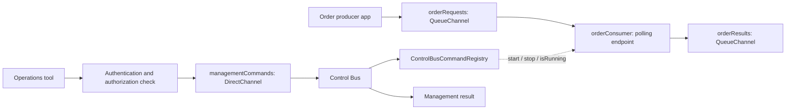

# Control Bus

In the **System management** chapter of the **SPRING_INTEGRATION_CORE** module, the Control Bus enables controlling integration components using the `Message` and `MessageChannel` model itself. Rather than letting an operations tool invoke every endpoint directly, we send a management message to a dedicated flow; that flow resolves the command and invokes an allowed operation on a Spring bean.

This lesson uses Java DSL and the command registry–based Control Bus of **Spring Integration 6.5.x**. Differences from the SpEL-based mechanism of older versions are noted separately to avoid mixing the two configuration approaches.

## 1. The Problem to Solve

A system receives orders into a queue, and a polling consumer picks up each order to send to a partner. During partner maintenance, the operations team needs to:

- Check whether the consumer is running or stopped.
- Stop pulling new orders while keeping unprocessed orders in the queue.
- Start the consumer once the partner is back online.
- Record who performed the action, the reason, and the outcome.

If every request required changing configuration and redeploying the application, operations would be slow and hard to automate. If `start()` or `stop()` calls were scattered across controllers and services, governance boundaries would also be hard to control.

The Control Bus provides a single entry point for management commands using the messaging model. Following the Enterprise Integration Patterns catalog, the business flow and management flow share the same messaging mechanism while using separate channels. [Source: EIP — Control Bus](https://www.enterpriseintegrationpatterns.com/patterns/messaging/ControlBus.html).

After this lesson, you will be able to design a management channel, invoke lifecycle commands, pass typed arguments, receive replies, and test the effect of commands on message flows.

## 2. Business Flow and Management Flow

The business flow carries data such as orders, invoices, or events. The management flow carries requests to inspect or alter the state of the components processing that data.



The `start`, `stop`, and `isRunning` arrows represent management invocations on the endpoint; they do not enqueue additional orders into `orderRequests`.

| Component | Role in the example |
| --- | --- |
| Management `Message<?>` | Carries command name, arguments, and metadata for replies or auditing |
| `managementCommands` | Entry point of the management flow |
| Control Bus endpoint | Receives the message and executes the management operation |
| `ControlBusCommandRegistry` | Resolves the command to an allowed method on a bean |
| `orderConsumer` | Business endpoint being controlled |
| `replyChannel` | Return path for results from methods with return values |

In this design, an order is never treated as a management command name. Nor does a request to stop the consumer pass through transformers or routers meant for orders.

Separating channels also preserves manageability when the business flow is congested. In a large system, also consider separating execution resources; two differently named channels sharing an exhausted thread pool can still slow down together.

## 3. Choosing the Right Model by Version

The Control Bus previously accepted SpEL expressions as payloads. Starting in 6.4, Spring Integration added the command registry; by 6.5, the legacy SpEL-expression-based Control Bus components were removed. [Source: 6.3–6.4 changes](https://docs.spring.io/spring-integration/reference/changes-6.3-6.4.html), [6.4–6.5 changes](https://docs.spring.io/spring-integration/reference/7.2/changes-6.4-6.5.html).

| Version line | What to recognize when reading documentation |
| --- | --- |
| 6.3 and earlier | Commonly shows SpEL payloads such as `@orderConsumer.stop()` |
| 6.4 | Registry introduced; Java DSL provides `controlBusOnRegistry()` to opt into the new model |
| 6.5 | Use `.controlBus()` with the command registry; `controlBusOnRegistry()` is deprecated |

The examples below target the **6.5.x** line, with payloads formatted as `orderConsumer.stop`, without an `@` prefix or function-call parentheses. Do not use examples from this lesson to assume an older Control Bus supports the same protocol automatically.

The registry still maintains an internal mapping mechanism for invoking methods. The key takeaway on the sender side is the contract of **command name and argument list**, rather than the ability to send an arbitrary expression.

## 4. Contract of a Management Message

### 4.1. Payload and Arguments

With the registry model, the payload is a `beanName.methodName` string. Arguments are placed in a `List<?>` under the `IntegrationMessageHeaderAccessor.CONTROL_BUS_ARGUMENTS` header; the type of each element participates in method selection. [Source: Spring Integration — Control Bus](https://docs.spring.io/spring-integration/reference/6.5/control-bus.html).

Illustrative example:

```java
Message<String> stopCommand = MessageBuilder
        .withPayload("orderConsumer.stop")
        .build();

Message<String> changeLimitCommand = MessageBuilder
        .withPayload("batchSettings.changeLimit")
        .setHeader(
                IntegrationMessageHeaderAccessor.CONTROL_BUS_ARGUMENTS,
                List.of(50))
        .build();
```

In the second example, `50` is an `Integer` passed to a method expecting `int`. The string `"50"` cannot be assumed equivalent by default. Especially when multiple methods share the same name, an argument list with the wrong types can prevent the registry from finding a matching method.

Prefer unambiguous operation names and simple data types. For example, `changeLimit(int)` is easier to operate than a group of overloaded `configure(...)` methods with closely related parameter types.

### 4.2. Which Methods Can Be Invoked?

The Control Bus does not turn the entire public API of every Spring bean into a management API. `ControlBusMethodFilter` restricts selectable methods to those related to `Lifecycle`, `Pausable`, certain thread executor/scheduler management methods, and methods annotated with `@ManagedAttribute` or `@ManagedOperation`. [Source: ControlBusMethodFilter Javadoc](https://docs.spring.io/spring-integration/docs/6.5.0/api/org/springframework/integration/support/management/ControlBusMethodFilter.html).

For custom managed beans, this lesson uses `@ManagedResource` on the class and management annotations on individual methods. The registry requires the bean to belong to a manageable category, such as implementing `Lifecycle` or being annotated with `@ManagedResource`. [Source: ControlBusCommandRegistry Javadoc](https://docs.spring.io/spring-integration/docs/6.5.0/api/org/springframework/integration/support/management/ControlBusCommandRegistry.html).

These annotations describe management capability. They do not authenticate callers or authorize end users on their own. In the example, you also do not need to set up a remote JMX connection to send commands over an internal channel.

### 4.3. Application-Level Metadata

Beyond framework-recognized headers, an operations system can define its own metadata:

| Data | Purpose | Where used |
| --- | --- | --- |
| `requestId` | Correlate requests with logs and results | Gateway or audit layer |
| `reason` | Record the reason for the operation | Request validation and audit layer |
| `targetInstance` | Identify the target node in a cluster | Management routing layer |
| `expiresAt` | Prevent expired commands from taking effect | Pre–Control Bus validation layer |

This is an application-defined contract. Merely adding these headers to a message does not automatically give the Control Bus auditing, deduplication, node routing, or expiration checks.

## 5. Complete Example with Java DSL

### 5.1. Environment and Expected Behavior

The example uses JDK 17 or higher, `spring-integration-core` 6.5.x, and compatible Spring dependencies managed by the project's dependency management. No broker, HTTP server, or database is needed.

All Java code below resides in an illustrative class named `ControlBusLesson`. When applying this to a real application, configuration, the runner program, and managed beans can be separated into distinct classes.

The application has three channels:

- `orderRequests`: queue of orders awaiting processing, capacity 100.
- `orderResults`: queue for practice exercise results, capacity 100.
- `managementCommands`: synchronous channel receiving management commands.

The `orderConsumer` endpoint is configured with `autoStartup(false)`. That lets the program place an order onto the queue before issuing the command to begin processing.

### 5.2. Configuration and Runner Program

```java
import java.util.List;
import java.util.concurrent.atomic.AtomicInteger;

import org.springframework.beans.factory.annotation.Qualifier;
import org.springframework.context.annotation.AnnotationConfigApplicationContext;
import org.springframework.context.annotation.Bean;
import org.springframework.context.annotation.Configuration;
import org.springframework.integration.IntegrationMessageHeaderAccessor;
import org.springframework.integration.annotation.EnableIntegration;
import org.springframework.integration.channel.DirectChannel;
import org.springframework.integration.channel.QueueChannel;
import org.springframework.integration.core.MessagingTemplate;
import org.springframework.integration.dsl.IntegrationFlow;
import org.springframework.integration.dsl.Pollers;
import org.springframework.jmx.export.annotation.ManagedAttribute;
import org.springframework.jmx.export.annotation.ManagedOperation;
import org.springframework.jmx.export.annotation.ManagedResource;
import org.springframework.messaging.Message;
import org.springframework.messaging.MessageChannel;
import org.springframework.messaging.support.GenericMessage;
import org.springframework.messaging.support.MessageBuilder;

@Configuration
@EnableIntegration
public class ControlBusLesson {

    @Bean
    public DirectChannel managementCommands() {
        return new DirectChannel();
    }

    @Bean
    public QueueChannel orderRequests() {
        return new QueueChannel(100);
    }

    @Bean
    public QueueChannel orderResults() {
        return new QueueChannel(100);
    }

    @Bean
    public IntegrationFlow controlBusFlow(
            DirectChannel managementCommands) {

        return IntegrationFlow.from(managementCommands)
                .controlBus()
                .get();
    }

    @Bean
    public IntegrationFlow orderProcessingFlow(
            @Qualifier("orderRequests") QueueChannel requests,
            @Qualifier("orderResults") QueueChannel results) {

        return IntegrationFlow.from(requests)
                .handle(String.class,
                        (orderId, headers) -> "processed:" + orderId,
                        endpoint -> endpoint
                                .id("orderConsumer")
                                .autoStartup(false)
                                .poller(Pollers.fixedDelay(100)
                                        .maxMessagesPerPoll(1)))
                .channel(results)
                .get();
    }

    @Bean
    public BatchSettings batchSettings() {
        return new BatchSettings();
    }

    @ManagedResource
    public static class BatchSettings {

        private final AtomicInteger limit = new AtomicInteger(25);

        @ManagedAttribute
        public int getLimit() {
            return this.limit.get();
        }

        @ManagedOperation
        public int changeLimit(int newLimit) {
            if (newLimit < 1 || newLimit > 200) {
                throw new IllegalArgumentException(
                        "Limit must be between 1 and 200");
            }
            this.limit.set(newLimit);
            return newLimit;
        }

        // Public method, but not exposed for management.
        public void resetInternal() {
            this.limit.set(25);
        }
    }

    static Message<String> command(String name, List<?> arguments) {
        return MessageBuilder.withPayload(name)
                .setHeader(
                        IntegrationMessageHeaderAccessor.CONTROL_BUS_ARGUMENTS,
                        arguments)
                .build();
    }

    static Object query(
            MessagingTemplate template,
            MessageChannel commands,
            String name,
            List<?> arguments) {

        Message<?> reply = template.sendAndReceive(
                commands, command(name, arguments));

        if (reply == null) {
            throw new IllegalStateException("No reply for " + name);
        }
        return reply.getPayload();
    }

    public static void main(String[] args) {
        try (var context = new AnnotationConfigApplicationContext(
                ControlBusLesson.class)) {

            MessageChannel commands = context.getBean(
                    "managementCommands", MessageChannel.class);
            QueueChannel requests = context.getBean(
                    "orderRequests", QueueChannel.class);
            QueueChannel results = context.getBean(
                    "orderResults", QueueChannel.class);

            MessagingTemplate template = new MessagingTemplate();
            template.setSendTimeout(2_000);
            template.setReceiveTimeout(2_000);

            System.out.println("running.before=" + query(
                    template, commands,
                    "orderConsumer.isRunning", List.of()));

            boolean accepted = requests.send(
                    new GenericMessage<>("ORD-1001"), 1_000);
            if (!accepted) {
                throw new IllegalStateException("Order queue is full");
            }

            System.out.println("queued=" + requests.getQueueSize());

            // start() returns void: one-way send, no reply payload expected.
            template.send(commands,
                    command("orderConsumer.start", List.of()));

            System.out.println("running.started=" + query(
                    template, commands,
                    "orderConsumer.isRunning", List.of()));

            Message<?> processed = results.receive(2_000);
            if (processed == null) {
                throw new IllegalStateException("Order was not processed");
            }
            System.out.println("result=" + processed.getPayload());

            template.send(commands,
                    command("orderConsumer.stop", List.of()));

            System.out.println("running.stopped=" + query(
                    template, commands,
                    "orderConsumer.isRunning", List.of()));

            System.out.println("limit.changed=" + query(
                    template, commands,
                    "batchSettings.changeLimit", List.of(50)));

            System.out.println("limit.current=" + query(
                    template, commands,
                    "batchSettings.getLimit", List.of()));
        }
    }
}
```

Ignoring context startup and shutdown logs, the expected output is:

```text
running.before=false
queued=1
running.started=true
result=processed:ORD-1001
running.stopped=false
limit.changed=50
limit.current=50
```

This output illustrates the example's behavior. The two-second timeout is a limit chosen for local practice; when moving to a real environment, select timeouts based on processing time and resources in that environment.

### 5.3. Why Does the Example Work?

`@EnableIntegration` registers integration infrastructure in the Spring context. Java DSL creates endpoints, links channels, and configures the poller. In the DSL, `.handle(...)` represents a service activator; the `IntegrationFlow` object describes how components are assembled. [Source: Java DSL Basics](https://docs.spring.io/spring-integration/reference/6.5/dsl/java-basics.html).

The specific choices in this exercise carry these meanings:

1. `.id("orderConsumer")` assigns a stable name to the endpoint to manage. That name is used in the example's commands.
2. `autoStartup(false)` keeps the consumer stopped when the context starts; the `start` command can still start it later.
3. `orderRequests` is a `QueueChannel`, so orders can wait while the consumer is not running.
4. The poller is configured directly on the queue's consumer. No default poller needs to be declared for this consumer.
5. Business results go into `orderResults`; management results return to the caller via the request–reply mechanism.

`BatchSettings` demonstrates a custom managed bean, with value validation directly inside the mutating operation. The `limit` field of this bean is **not wired into the poller** in the example. Calling `changeLimit(50)` does not change `maxMessagesPerPoll(1)` declared on `orderConsumer`.

To use that value in real business logic, the batch-processing component must actively read or apply it according to an explicit design contract. Changing a management field does not automatically reconfigure every endpoint.

## 6. One-Way Sends and Receiving Replies

### 6.1. Operations Returning `void`

Commands such as `orderConsumer.start` and `orderConsumer.stop` have no return payload from the lifecycle method. The example uses `MessagingTemplate.send(...)` for these commands.

Do not use the `query(...)` helper to invoke `stop`: that helper is written expecting a reply. Without a reply, it will fail with a timeout error even though the stop operation may have already executed.

If an external management API requires a reply for every command, build an orchestration layer that returns an explicit result, for example:

```json
{
  "requestId": "maint-20261119-001",
  "instance": "orders-worker-02",
  "target": "orderConsumer",
  "requestedState": "STOPPED",
  "observedRunning": false,
  "status": "SUCCEEDED"
}
```

This is an application-defined DTO format, not an automatic reply format from the Control Bus.

### 6.2. Methods with Return Values

`isRunning`, `getLimit`, and `changeLimit` in the example all return values. `MessagingTemplate.sendAndReceive(...)` creates a temporary reply path to receive the result message; you do not need to configure a fixed output channel on the example's Control Bus flow. [Source: MessagingTemplate Javadoc](https://docs.spring.io/spring-integration/docs/6.5.0/api/org/springframework/integration/core/MessagingTemplate.html).

If you do configure a fixed output channel on the Control Bus, design a receiver on that channel. Do not assume a request–reply call will simultaneously pick up results routed to another fixed channel.

When a method returns a value and the caller uses `send(...)` without a reply destination, an error may occur during reply delivery. By then, the target method may already have finished running. Therefore, a reply-delivery error alone is not enough to conclude the state did not change.

### 6.3. Meaning of Timeouts

In the example, the Control Bus is wired with a `DirectChannel`. The bean invocation runs on the sender's thread. Setting `receiveTimeout` does not provide a mechanism to forcibly interrupt a long-running synchronous method.

With asynchronous flows, a timeout only indicates that the caller did not receive a result in time. The command may be queued, currently executing, or already executed with a late reply. Before resending a state-changing command, query the state or check execution records.

## 7. Understanding Targets and Lifecycle State

### 7.1. Endpoint, Handler, and Entire Flow

A single flow can create multiple beans: channels, handlers, consumer endpoints, and supporting components. The `@Bean` method name of the flow is not necessarily the name of the specific endpoint you want to stop.

In this exercise:

- `orderProcessingFlow` is the business configuration flow.
- `orderConsumer` is the endpoint consuming from `orderRequests`.
- The commands in the program deliberately target `orderConsumer` as the scope of action.

Spring Integration also supports lifecycle management for an entire `IntegrationFlow`, by delegating to the components belonging to that flow. That scope is broader than stopping a single consumer. [Source: Java DSL Basics — flow lifecycle](https://docs.spring.io/spring-integration/reference/6.5/dsl/java-basics.html).

In a real application, document the target of each operation clearly: stopping an inbound source, stopping a single consumer, or stopping an entire flow. Assign stable names to endpoints that will be operated, instead of relying on auto-generated names.

### 7.2. What Does `isRunning()` Answer?

For the example, this value reports the lifecycle state of the consumer. It does not verify that:

- The external partner is responding properly.
- The queue has been drained of messages.
- No processing is still underway on other threads.
- All orders have been successfully recorded in the target system.

Combine lifecycle state with queue depth, in-flight task counts, error rates, and latency when assessing service readiness.

### 7.3. `stop()` Is Not a Data Retention Policy

In the lesson's configuration, stopping the consumer halts polling new messages from `orderRequests`. The queue remains a separate bean; producers can continue adding orders until capacity is reached.

The `QueueChannel` in this exercise stores data in memory. Stopping the consumer does not clear waiting items, yet shutting down or losing the process loses that data. If business requirements demand durability, design an appropriate message store or broker.

Do not assume every adapter behaves identically when stopped. For JMS, AMQP, Kafka, or other adapters, inspect separately how listener shutdown, acknowledgments, transactions, and in-flight messages are handled.

### 7.4. `pause` and `resume`

Only send these commands to components that actually support `Pausable`. Not every endpoint exposes the same set of operations, and pausing new intake does not necessarily mean all prior processing has completed.

An operations tool should display only the actions appropriate for each component type, rather than giving every bean the exact same start, stop, pause, and resume buttons.

## 8. Error Handling for Management Commands

### 8.1. Synchronous Errors

With `DirectChannel` in the example, exceptions from message handling propagate back to the caller. Merely adding an `errorChannel` header does not automatically redirect every synchronous exception into an error flow. [Source: Spring Integration — Error Handling](https://docs.spring.io/spring-integration/reference/6.5/error-handling.html).

Example of catching errors at the caller:

```java
try {
    Object result = ControlBusLesson.query(
            template,
            commands,
            "batchSettings.changeLimit",
            List.of(0));
    System.out.println(result);
}
catch (org.springframework.messaging.MessagingException exception) {
    System.err.println("Management command failed: "
            + exception.getMessage());
    // Inspect the exception cause chain when diagnosing.
}
```

The value `0` is rejected by `BatchSettings.changeLimit` itself before updating state. The operations application can map this error to a management outcome such as `INVALID_ARGUMENT`, while logging the request and rejection reason.

Do not rely on exact framework error message strings to drive control logic. Classify errors at the management boundary and preserve the root cause for diagnostics.

| Scenario | What to check | Appropriate handling |
| --- | --- | --- |
| Wrong bean or method name | Endpoint name, whether method is manageable | Fix command mapping; do not auto-retry the same invalid command |
| Wrong argument count or types | List in `CONTROL_BUS_ARGUMENTS` | Validate contract and convert types at the inbound boundary |
| Value rejected by target method | Rules such as the 1–200 range in the example | Return a meaningful error to the operator |
| Error during operation execution | Root cause and target state after error | Verify postconditions before retrying |
| Timeout waiting for result | How far the command got, target's current state | Reconcile request and query current state |

### 8.2. Asynchronous Errors

When replacing the management channel with a `QueueChannel` backed by a polling consumer, or using an `ExecutorChannel`, sender and handler can run on different threads. With standard Spring Integration error infrastructure, asynchronous errors are represented as an `ErrorMessage` sent to the message's `errorChannel` or the global error channel. Pollers also provide mechanisms to publish errors via an error channel. [Source: Error Handling — cross-thread processing](https://docs.spring.io/spring-integration/reference/6.5/error-handling.html).

When choosing this approach, add a result contract: the error receiver must correlate errors back to the original request, and the sender must know how to obtain the final outcome. Acceptance into a queue only confirms intake.

In a small management setup, `DirectChannel` is usually easier to understand and surfaces errors immediately. Switch to asynchronous execution only when you have specific needs for timing, scheduling, or resource isolation.

## 9. Running Maintenance While Preserving Message Processing Paths

Suppose partner maintenance is needed for ten minutes. There are two different goals:

| Goal | Design-level action |
| --- | --- |
| Accumulate orders to process after maintenance | Stop the processing consumer; ensure queue storage has sufficient capacity and durability |
| Finish existing orders before maintenance | Block new intake; keep the consumer running to drain the backlog |

If you want to drain the queue yet stop the consumer first, the backlog will stop progressing. Therefore, operational ordering must follow the operational goal.

An intentional maintenance procedure might include:

1. Identify the instance, endpoint, and maintenance reason; block conflicting state-change requests.
2. Capture initial state: lifecycle, backlog, active task count, and error rate.
3. If draining is required, stop accepting new messages at the source or ingress boundary.
4. Wait for backlog and active tasks to satisfy defined criteria, with an explicit deadline.
5. Stop the component needing maintenance; record the observed state after the command.
6. After maintenance, start the component and verify both lifecycle state and business outcomes.
7. Reopen intake, monitor backlog, and close the operation record.

The Control Bus is the mechanism for sending operations in this procedure. It does not by itself create the overall workflow, drain policy, or coordination across multiple services.

Spring Integration also offers an orderly shutdown mechanism with staged shutdown phases that allow in-flight messages to finish and release resources. When shutting down the whole system, evaluate this capability instead of cobbling together individual `stop` commands. [Source: Spring Integration — Orderly Shutdown](https://docs.spring.io/spring-integration/reference/6.5/shutdown.html).

## 10. Designing the Management Boundary

### 10.1. Operational APIs Should Have an Explicit Command Set

An admin UI might expose operational actions such as `STOP_ORDER_CONSUMER`, `START_ORDER_CONSUMER`, and `READ_ORDER_CONSUMER_STATE`. The backend layer behind the UI maps them to known Control Bus commands:

```text
STOP_ORDER_CONSUMER       -> orderConsumer.stop
START_ORDER_CONSUMER      -> orderConsumer.start
READ_ORDER_CONSUMER_STATE -> orderConsumer.isRunning
```

This allows bean renames to be absorbed in the internal mapping, and the allowed command set can be smaller than the full set of methods the framework permits for management.

At that boundary, authenticate callers, authorize by action and target, validate arguments, and write audit records. Do not trust a header like `operator=admin` if the client supplies it directly; the actor identity must come from the authenticated context.

This is a direct requirement of management functionality because commands can alter processing state. Spring Integration documentation also calls for securing the entry point where Control Bus messages are received. [Source: Control Bus — securing the entry point](https://docs.spring.io/spring-integration/reference/6.5/control-bus.html).

### 10.2. Preserving Recoverability

The management flow must remain operational while business endpoints are stopped. In the example, `controlBusFlow` and `orderProcessingFlow` are separate flows.

In real applications, also check shared dependencies. For example, stopping a scheduler that runs both business pollers and management consumers can prevent the restart command from being processed. Likewise, a command that stops the Control Bus flow itself must have a recovery path outside that flow.

### 10.3. Multiple Instances and Late Commands

An `orderConsumer.stop` command executed by a Control Bus looks up the bean in that Control Bus's application context. The command name does not automatically mean "stop all nodes."

If the system runs three instances, explicitly design:

- Whether to stop one specific node or the entire group.
- How requests are delivered to each node.
- How results are tracked individually per node.
- How to handle partial success if only two of three nodes succeed.

For instance, a stop command queued at 10:00 and processed at 10:20 can cause an outage if the system has already recovered. The receiving layer must validate expiration and desired state version before executing late commands.

### 10.4. Retries and Idempotency

State-setting operations like "transition to stopped" are usually easier to make safe for repeated calls than operations like "delete all data" or "increase limit by 10." Even so, never assume every `@ManagedOperation` method is idempotent.

For operations with significant side effects, you may need to store `requestId`, processing state, and outcome to detect duplicate calls. The Control Bus and a single channel do not provide exactly-once execution guarantees by themselves.

## 11. Testing Through the Management Channel

A good test sends the exact messages that an operations tool will send and observes the effect on the flow. Simply calling `endpoint.stop()` directly in a test bypasses Control Bus configuration, command names, and reply handling.

The following example uses JUnit Jupiter. The test class resides in the same package as `ControlBusLesson`, so it can reuse the example's `command` and `query` helpers. Each test creates its own context to avoid sharing lifecycle state.

```java
import java.util.List;

import org.junit.jupiter.api.Test;
import org.springframework.context.annotation.AnnotationConfigApplicationContext;
import org.springframework.integration.channel.QueueChannel;
import org.springframework.integration.core.MessagingTemplate;
import org.springframework.messaging.Message;
import org.springframework.messaging.MessageChannel;
import org.springframework.messaging.MessagingException;
import org.springframework.messaging.support.GenericMessage;

import static org.junit.jupiter.api.Assertions.*;

class ControlBusLessonTest {

    @Test
    void startsAndStopsConsumerThroughControlBus() {
        try (var context = new AnnotationConfigApplicationContext(
                ControlBusLesson.class)) {

            MessageChannel commands = context.getBean(
                    "managementCommands", MessageChannel.class);
            QueueChannel requests = context.getBean(
                    "orderRequests", QueueChannel.class);
            QueueChannel results = context.getBean(
                    "orderResults", QueueChannel.class);

            MessagingTemplate template = new MessagingTemplate();
            template.setSendTimeout(2_000);
            template.setReceiveTimeout(2_000);

            assertEquals(Boolean.FALSE, ControlBusLesson.query(
                    template, commands,
                    "orderConsumer.isRunning", List.of()));

            assertTrue(requests.send(
                    new GenericMessage<>("ORD-TEST-1"), 1_000));
            assertEquals(1, requests.getQueueSize());

            template.send(commands, ControlBusLesson.command(
                    "orderConsumer.start", List.of()));

            Message<?> result = results.receive(2_000);
            assertNotNull(result);
            assertEquals("processed:ORD-TEST-1", result.getPayload());

            template.send(commands, ControlBusLesson.command(
                    "orderConsumer.stop", List.of()));

            assertEquals(Boolean.FALSE, ControlBusLesson.query(
                    template, commands,
                    "orderConsumer.isRunning", List.of()));
        }
    }

    @Test
    void rejectsInvalidArgumentsAndUnexposedMethods() {
        try (var context = new AnnotationConfigApplicationContext(
                ControlBusLesson.class)) {

            MessageChannel commands = context.getBean(
                    "managementCommands", MessageChannel.class);
            ControlBusLesson.BatchSettings settings = context.getBean(
                    ControlBusLesson.BatchSettings.class);

            MessagingTemplate template = new MessagingTemplate();
            template.setReceiveTimeout(2_000);

            assertEquals(50, ControlBusLesson.query(
                    template, commands,
                    "batchSettings.changeLimit", List.of(50)));

            assertThrows(MessagingException.class,
                    () -> ControlBusLesson.query(
                            template, commands,
                            "batchSettings.changeLimit", List.of(0)));
            assertEquals(50, settings.getLimit());

            assertThrows(MessagingException.class,
                    () -> template.send(commands,
                            ControlBusLesson.command(
                                    "batchSettings.resetInternal",
                                    List.of())));
            assertEquals(50, settings.getLimit());
        }
    }
}
```

Waiting on `results.receive(2_000)` ties the test to an observable, bounded outcome. It avoids assuming that after a fixed `Thread.sleep(...)`, the poller has definitely finished processing.

Additional tests to add when developing a production operational feature:

| Case | What to verify |
| --- | --- |
| Endpoint stopped, queue has data | Data waits and gets processed after the start command |
| Command has wrong argument types | Rejected, target state unchanged |
| Caller lacks permission | Blocked before reaching the Control Bus |
| Late reply | Operations with side effects are not blindly resent |
| Multiple instances | Only selected node changes; result identifies the node |
| Expired or duplicate request | Orchestration layer enforces configured policy |
| Business endpoint stopped | Management channel still receives the restart command |

Spring Integration also provides the `spring-integration-test` and `spring-integration-test-support` modules when you need test context configuration, mocks, or integration component replacement. The simple example in this lesson uses a real context and does not require those utilities. [Source: Spring Integration — Testing support](https://docs.spring.io/spring-integration/reference/6.5/testing.html).

## 12. Extended Practice

To reinforce the lesson, you can extend the same demo application with these steps:

1. After stopping the consumer, send `ORD-1002` and confirm the order stays in `orderRequests`.
2. Restart the consumer, receive `processed:ORD-1002`, and verify the queue size has decreased.
3. Send `batchSettings.changeLimit` with `List.of("50")` to observe the difference between a string and an integer argument.
4. Wrap start/stop operations in a management service with a fixed command mapping, `requestId`, and postcondition checks.
5. Design an aggregated response for three instances where one instance fails to respond within the timeout.

Once completed, the implementation should clearly show the **requested command**, **scope of impact**, and **observed state**. Together, those three pieces of information turn controlling Spring Integration flows into a verifiable operational capability.
