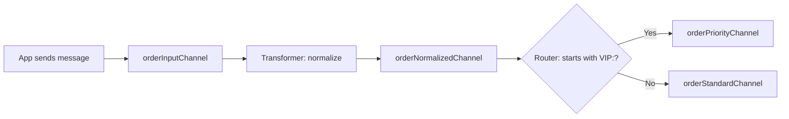
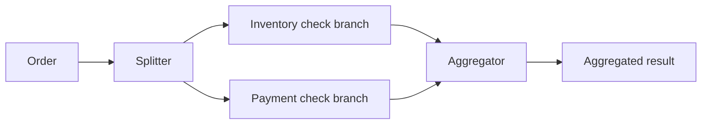

# Message History — Tracing Messages in Spring Integration

## 1. Objectives and Context

In the **SPRING_INTEGRATION_CORE** module, you design flows using `Message`, `MessageChannel`, endpoints, gateways, and Java DSL. When a message passes through a transformer, filter, or router, knowing its actual path helps explain why the outcome differs from expectations.

This lesson belongs to the **System management** chapter and focuses on **Message history**: metadata recording the tracked components a message has passed through. Spring Integration carries this information in the `history` header. [Message History Documentation](https://docs.spring.io/spring-integration/reference/6.5/message-history.html).

After this lesson, you will be able to:

- Enable history and select the scope of components to track.
- Read each entry's name, type, and timestamp.
- Build a Java DSL example to verify routing paths across two router branches.
- Use history together with exceptions to isolate failures.
- Handle history propagation when creating custom branches and choose appropriate observability tools in operations.

The examples use Java 17 and Spring Integration 6.5 APIs. Explanations of the history-appending mechanism apply to changes introduced in 6.3; do not carry over assumptions from earlier versions for this example.

Prerequisites: Spring beans, message structure, `DirectChannel`, `QueueChannel`, transformers, and routers. No broker or database is needed yet.

## 2. The Problem: A Priority Order Takes the Wrong Branch

Suppose the system receives an order string:

```text
"  vip:order-42  "
```

Business rules in the example:

1. Trim leading and trailing whitespace and convert the string to uppercase.
2. Strings starting with `VIP:` go to the priority branch.
3. Remaining strings go to the standard branch.
4. An empty string after normalization triggers an error.

Expected flow:



When an operator receives a report that "a priority order was processed as a standard order," the milestones needed are intake, post-normalization, and the selected branch. Those three checkpoints let you form concrete hypotheses: the data was not normalized, the routing condition was wrong, or the message being inspected belongs to a different submission.

In this lesson, each message also carries an application-assigned `orderId` to correlate with the order. That is the example's business key, separate from the history structure.

## 3. What Data Is Inside History?

The header holds a value of type `MessageHistory`, which implements `List<Properties>`. You can retrieve it via `MessageHistory.read(message)` or typed header lookup; be sure to handle the case where no history is present yet. [MessageHistory 6.5.0 API](https://docs.spring.io/spring-integration/docs/6.5.0/api/org/springframework/integration/history/MessageHistory.html).

Each entry typically contains the following properties:

| Property | Meaning | Example in lesson |
| --- | --- | --- |
| `name` | Name of the recorded component | `orderInputChannel` |
| `type` | Component type | `channel` |
| `timestamp` | Time the milestone was recorded, in milliseconds since the Unix epoch | `1805500000000` |

Values are read from `Properties` via `getProperty()`; the timestamp specifically needs parsing from string to number if you want to do arithmetic. The source code obtains the timestamp via `System.currentTimeMillis()`. [MessageHistory 6.5.0 Source](https://raw.githubusercontent.com/spring-projects/spring-integration/v6.5.0/spring-integration-core/src/main/java/org/springframework/integration/history/MessageHistory.java).

The table below shows illustrative data, not actual measured output:

| Order | name | type | timestamp |
| --- | --- | --- | --- |
| 1 | `orderInputChannel` | `channel` | `1805500000000` |
| 2 | `orderNormalizedChannel` | `channel` | `1805500000004` |
| 3 | `orderPriorityChannel` | `channel` | `1805500000006` |

From the table, you can read the sequence of observed milestones. To inspect the payload at each milestone, add dedicated observation points; this table does not store snapshots of order data.

Do not rely on the string formatting of `history.toString()` to parse data. In the 6.5.0 source code, that method joins component names with commas. When you need all properties, iterate over the entries. [MessageHistory.toString() Implementation](https://raw.githubusercontent.com/spring-projects/spring-integration/v6.5.0/spring-integration-core/src/main/java/org/springframework/integration/history/MessageHistory.java).

## 4. Enabling and Limiting Tracking Scope

Minimal configuration:

```java
import org.springframework.context.annotation.Configuration;
import org.springframework.integration.config.EnableIntegration;
import org.springframework.integration.config.EnableMessageHistory;

@Configuration
@EnableIntegration
@EnableMessageHistory
class HistoryConfiguration {
}
```

By default, the annotation selects every trackable Spring Integration component. You can pass multiple name patterns:

```java
@EnableMessageHistory({"order*Channel", "*Gateway"})
```

`order*Channel` selects names starting with `order` and ending with `Channel`; `*Gateway` selects names ending with `Gateway`. These are component name patterns, not filter conditions on `orderId` or payload. [EnableMessageHistory API](https://docs.spring.io/spring-integration/api/org/springframework/integration/config/EnableMessageHistory.html).

Place only one history configuration declaration in the application context as stated in the reference guide. In an XML-based application with the Spring Integration namespace declared, the equivalent configuration is:

```xml
<int:message-history tracked-components="order*Channel,*Gateway"/>
```

Those two forms are configuration options; the Java examples below use only the annotation. [Configuring Message History](https://docs.spring.io/spring-integration/reference/6.5/message-history.html).

An ordinary business bean does not automatically become a history milestone just because its name matches a pattern. The configurer works with components supporting `TrackableComponent`. Therefore, choose names of channels or integration components that actually participate in the flow. [MessageHistoryConfigurer Source](https://raw.githubusercontent.com/spring-projects/spring-integration/v6.5.0/spring-integration-core/src/main/java/org/springframework/integration/history/MessageHistoryConfigurer.java).

## 5. Complete Example with Java DSL

### 5.1. Dependencies and Organization

The example only requires `spring-integration-core` and its transitive dependencies. For a standalone Maven project, the illustrative dependency is pinned to 6.5.0 for a clear API baseline:

```xml
<dependency>
    <groupId>org.springframework.integration</groupId>
    <artifactId>spring-integration-core</artifactId>
    <version>6.5.0</version>
</dependency>
```

If your project already manages versions via Spring Boot or a BOM, use the compatible version set managed by your project. Do not mix in arbitrary Spring Framework versions to run the example.

The code below is placed in a Java file named `MessageHistoryDemo.java` with no package declaration so it is easy to try in a learning project. No Spring Boot, gateway, or poller is needed for the demo flow: the application sends directly to the channel and explicitly receives from the output queues.

### 5.2. Configuration and Test Runner Program

```java
import java.time.Instant;
import java.util.List;
import java.util.Locale;
import java.util.Properties;

import org.springframework.context.annotation.AnnotationConfigApplicationContext;
import org.springframework.context.annotation.Bean;
import org.springframework.context.annotation.Configuration;
import org.springframework.integration.channel.DirectChannel;
import org.springframework.integration.channel.QueueChannel;
import org.springframework.integration.config.EnableIntegration;
import org.springframework.integration.config.EnableMessageHistory;
import org.springframework.integration.dsl.IntegrationFlow;
import org.springframework.integration.history.MessageHistory;
import org.springframework.integration.support.MessageBuilder;
import org.springframework.messaging.Message;

public class MessageHistoryDemo {

    @Configuration
    @EnableIntegration
    @EnableMessageHistory("order*Channel")
    public static class FlowConfig {

        @Bean
        public DirectChannel orderInputChannel() {
            return new DirectChannel();
        }

        @Bean
        public DirectChannel orderNormalizedChannel() {
            return new DirectChannel();
        }

        @Bean
        public QueueChannel orderPriorityChannel() {
            return new QueueChannel(100);
        }

        @Bean
        public QueueChannel orderStandardChannel() {
            return new QueueChannel(100);
        }

        @Bean
        public IntegrationFlow orderFlow() {
            return IntegrationFlow.from("orderInputChannel")
                    .transform(String.class, payload -> {
                        String normalized =
                                payload.strip().toUpperCase(Locale.ROOT);
                        if (normalized.isEmpty()) {
                            throw new IllegalArgumentException(
                                    "Order content must not be empty");
                        }
                        return normalized;
                    }, endpoint -> endpoint.id("normalizeOrder"))
                    .channel("orderNormalizedChannel")
                    .<String, String>route(
                            payload -> payload.startsWith("VIP:")
                                    ? "priority" : "standard",
                            router -> router
                                    .id("routeOrder")
                                    .channelMapping(
                                            "priority", "orderPriorityChannel")
                                    .channelMapping(
                                            "standard", "orderStandardChannel"))
                    .get();
        }
    }

    public static List<String> historyNames(Message<?> message) {
        MessageHistory history = MessageHistory.read(message);
        if (history == null) {
            return List.of();
        }
        return history.stream()
                .map(entry -> entry.getProperty(MessageHistory.NAME_PROPERTY))
                .toList();
    }

    public static void printHistory(Message<?> message) {
        MessageHistory history = message.getHeaders().get(
                MessageHistory.HEADER_NAME, MessageHistory.class);

        if (history == null) {
            System.out.println("Message does not have history yet.");
            return;
        }

        for (Properties entry : history) {
            String name = entry.getProperty(MessageHistory.NAME_PROPERTY);
            String type = entry.getProperty(MessageHistory.TYPE_PROPERTY);
            long timestamp = Long.parseLong(
                    entry.getProperty(MessageHistory.TIMESTAMP_PROPERTY));
            System.out.printf("%s | %s | %s%n",
                    name, type, Instant.ofEpochMilli(timestamp));
        }
    }

    public static void main(String[] args) {
        try (var context =
                new AnnotationConfigApplicationContext(FlowConfig.class)) {
            DirectChannel input =
                    context.getBean("orderInputChannel", DirectChannel.class);
            QueueChannel priority =
                    context.getBean("orderPriorityChannel", QueueChannel.class);
            QueueChannel standard =
                    context.getBean("orderStandardChannel", QueueChannel.class);

            Message<String> request = MessageBuilder
                    .withPayload("  vip:order-42  ")
                    .setHeader("orderId", "ORDER-42")
                    .build();

            if (!input.send(request, 1000)) {
                throw new IllegalStateException("Failed to send message.");
            }

            Message<?> result = priority.receive(1000);
            if (result == null) {
                throw new IllegalStateException(
                        "No message received on priority branch.");
            }
            if (standard.receive(0) != null) {
                throw new IllegalStateException(
                        "Message appeared on unexpected branch.");
            }

            System.out.println("Payload: " + result.getPayload());
            System.out.println("orderId: " + result.getHeaders().get("orderId"));
            System.out.println("History: " + historyNames(result));
            printHistory(result);
        }
    }
}
```

The DSL uses `transform()` for the payload conversion step and `route()` with `channelMapping()` for the two destinations. These are Spring Integration's transformer and router configuration APIs. [Java DSL Transformers](https://docs.spring.io/spring-integration/reference/6.5/dsl/java-transformers.html), [Java DSL Message Routers](https://docs.spring.io/spring-integration/reference/6.5/dsl/java-routers.html).

`DirectChannel` passes processing along on the calling thread; `QueueChannel` buffers messages for a receiver to pull. Both output queues have capacity 100, sufficient for the test send; the program receives with a timeout so it does not wait indefinitely. [Message Channel Implementations](https://docs.spring.io/spring-integration/reference/6.5/channel/implementations.html).

Expected values from the example:

```text
Payload: VIP:ORDER-42
orderId: ORDER-42
History: [orderInputChannel, orderNormalizedChannel, orderPriorityChannel]
```

The timestamp lines printed by `printHistory()` depend on each run. Do not copy a fixed timestamp into test assertions.

### 5.3. Why Does the Example Track Only Channels?

The two endpoints are given IDs `normalizeOrder` and `routeOrder`, which do not match the `order*Channel` pattern. The lesson intentionally observes flow boundaries so the output contains three easy-to-verify names.

If you need to inspect endpoints, widen the pattern in a separate experiment and read the actual recorded component names. Avoid writing tests that depend on every DSL auto-generated name, because changing flow structure can change those names.

A natural extension in this exercise is adding `orderValidatedChannel` after a business validation step. The new milestone name then captures where the validation took place.

## 6. Verifying Paths with JUnit

The following test uses JUnit Jupiter in a project with test dependencies already configured. It boots the context directly, uses queues as observation points, and needs no broker. Spring Integration also provides testing support modules when you need to mock endpoints or replace flow components. [Testing support](https://docs.spring.io/spring-integration/reference/6.5/testing.html).

```java
import java.util.List;

import org.junit.jupiter.api.Test;
import org.springframework.context.annotation.AnnotationConfigApplicationContext;
import org.springframework.integration.channel.DirectChannel;
import org.springframework.integration.channel.QueueChannel;
import org.springframework.integration.history.MessageHistory;
import org.springframework.integration.support.MessageBuilder;
import org.springframework.messaging.Message;
import org.springframework.messaging.MessagingException;

import static org.junit.jupiter.api.Assertions.*;

class MessageHistoryDemoTest {

    @Test
    void recordsTheSelectedRouteForEachOrder() {
        try (var context = new AnnotationConfigApplicationContext(
                MessageHistoryDemo.FlowConfig.class)) {
            DirectChannel input =
                    context.getBean("orderInputChannel", DirectChannel.class);
            QueueChannel priority =
                    context.getBean("orderPriorityChannel", QueueChannel.class);
            QueueChannel standard =
                    context.getBean("orderStandardChannel", QueueChannel.class);

            assertTrue(input.send(MessageBuilder
                    .withPayload(" vip:order-42 ")
                    .setHeader("orderId", "ORDER-42")
                    .build(), 1000));

            Message<?> vip = priority.receive(1000);
            assertNotNull(vip);
            assertEquals("VIP:ORDER-42", vip.getPayload());
            assertEquals("ORDER-42", vip.getHeaders().get("orderId"));
            assertNotNull(MessageHistory.read(vip));
            assertEquals(List.of(
                    "orderInputChannel",
                    "orderNormalizedChannel",
                    "orderPriorityChannel"),
                    MessageHistoryDemo.historyNames(vip));
            assertNull(standard.receive(0));

            assertTrue(input.send(MessageBuilder
                    .withPayload(" order-43 ")
                    .setHeader("orderId", "ORDER-43")
                    .build(), 1000));

            Message<?> normal = standard.receive(1000);
            assertNotNull(normal);
            assertEquals("ORDER-43", normal.getPayload());
            assertEquals(List.of(
                    "orderInputChannel",
                    "orderNormalizedChannel",
                    "orderStandardChannel"),
                    MessageHistoryDemo.historyNames(normal));
            assertNull(priority.receive(0));
        }
    }

    @Test
    void rejectsBlankInputBeforeEitherOutputQueue() {
        try (var context = new AnnotationConfigApplicationContext(
                MessageHistoryDemo.FlowConfig.class)) {
            DirectChannel input =
                    context.getBean("orderInputChannel", DirectChannel.class);
            QueueChannel priority =
                    context.getBean("orderPriorityChannel", QueueChannel.class);
            QueueChannel standard =
                    context.getBean("orderStandardChannel", QueueChannel.class);

            Message<String> blank =
                    MessageBuilder.withPayload("   ").build();

            assertThrows(MessagingException.class,
                    () -> input.send(blank, 1000));
            assertNull(priority.receive(0));
            assertNull(standard.receive(0));
        }
    }
}
```

What matters most to assert is **correct payload and correct destination**. History adds supporting evidence of the path taken. If you only assert that a history header exists, a test can still miss a router sending to the wrong destination.

When adding a step outside the tracked scope, the list of three channels stays unchanged. When changing the observation policy or adding a channel whose name matches the pattern, update expectations to match the new design.

## 7. Reading History Without Over-Inferring

### 7.1. Observed Milestones vs. Business Outcomes

In the example, `orderPriorityChannel` is the final queue where the program pulls out the result. That name appearing does not prove inventory has been reserved, payment succeeded, or an email was sent. None of those actions exist in the flow yet.

If you later add a payment-processing consumer, create an observation point inside that consumer and record the necessary business outcome. Do not infer a "paid" state from the name of a channel preceding the payment step.

Similarly, when a message stops at a filter or goes to a discard flow, the absence of downstream milestones must be explained using the configuration and outcome at that location. Inspect history alongside error or rejection events, rather than treating the last entry as the sole conclusion.

### 7.2. Reading the Message at the Observation Point

To inspect results, the example reads the message received from the queue. Do not inspect the original `request` variable and conclude history is broken: on the first write, the framework may create a new message containing history. Since 6.3, subsequent writes append entries to the existing history container. [Message History Mechanism since 6.3](https://docs.spring.io/spring-integration/reference/6.5/message-history.html).

Consequently, a reference to a history object should not be treated as an immutable snapshot from the moment the reference was obtained. If you need to persist a diagnostic event, extract its fields into separate data right at the observation point.

### 7.3. Timestamps Are Not Exact Handler Execution Times

With the three illustrative timestamps above:

```text
1805500000004 - 1805500000000 = 4 ms
1805500000006 - 1805500000004 = 2 ms
```

This is the interval between two recorded milestones. In a design with queues, executors, or intervening tasks, that gap can include queuing wait and handoff overhead. The system wall clock is also not a monotonic clock for measuring durations.

Use these differences to choose where to investigate next. When you need handler latency, error rates, or duration percentiles, use proper metrics; Spring Integration provides Micrometer integration with timers and counters for components. [Metrics and Management](https://docs.spring.io/spring-integration/reference/6.5/metrics.html).

## 8. History, Message ID, and Correlation Keys

The `id` header identifies a single message instance; the standard `timestamp` header records when that instance was created. They can change when a message is rebuilt. The header map itself is read-only, though objects stored inside header values may still be mutable. [Messages and Message Headers](https://docs.spring.io/spring-integration/reference/6.5/message.html).

To diagnose an order across multiple submissions, store explicitly:

| Information | Question answered in the application |
| --- | --- |
| Application-defined `orderId` | Which order does this event belong to? |
| Application-defined `requestId` or submission ID | Which submission or attempt is this? |
| Message ID | Which message instance is being observed? |
| History | Which tracked milestones has the observed message passed through? |

The name `requestId` in the table is only a design suggestion, not a header automatically created by the example.

If an order has two submissions, sharing the same `orderId` is not enough to group them into the same processing run. When investigating, identify the submission ID first, then compare the path and errors for that specific run.

## 9. Branching, Splitters, and Aggregators

A real-world flow may create multiple child messages:



With this design, distinguish:

- The shared path prefix before splitting.
- Each child message's individual history after splitting.
- The aggregation event and final group result.

Do not use a single linear list at the output to implicitly represent everything that happened across parallel branches. If you need to investigate the entire group, record the group key, item key, and diagnostic data on each branch before aggregation.

Framework-managed branching components such as splitters, multi-destination routers, wire taps, and publish-subscribe channels handle cloning history for emitted messages under the 6.3+ mechanism. [Tracking history when branching](https://docs.spring.io/spring-integration/reference/message-history.html).

### 9.1. When the Application Creates Multiple Branches Manually

If you write a custom component sending the same input to multiple destinations, create a message per branch and use the builder method that clones history:

```java
import org.springframework.integration.support.MessageBuilder;
import org.springframework.messaging.Message;

class BranchMessages {

    static <T> Message<T> forBranch(Message<T> source, String branchName) {
        return MessageBuilder.fromMessage(source)
                .setHeader("branchName", branchName)
                .cloneMessageHistoryIfAny()
                .build();
    }
}
```

Each call to `forBranch(source, ...)` creates a message dedicated to one branch. Call it separately for each destination; do not create one copy and reuse it across all branches.

`cloneMessageHistoryIfAny()` copies the history header if present. This is a Spring Integration builder API; make sure to import `org.springframework.integration.support.MessageBuilder` when using this snippet. [AbstractIntegrationMessageBuilder API](https://docs.spring.io/spring-integration/docs/6.5.0/api/org/springframework/integration/support/AbstractIntegrationMessageBuilder.html).

Cloning history does not make a mutable payload independent. If two branches mutate the same business object, the application still needs to decide how to guard or copy that object.

### 9.2. Preparing Data for Aggregator Investigations

With the two "inventory" and "payment" branches, a diagnostic event can be structured like this:

```text
orderId=ORDER-42
groupKey=ORDER-42/REQUEST-7
branchName=inventory
path=[orderInputChannel, inventoryInputChannel, inventoryResultChannel]
outcome=RESERVED
```

This is an application-proposed format. The payment branch emits a similar event with `branchName=payment`. When an aggregator waits on a missing member, comparing those two events is more useful than looking for a "shared history" that the design never defined.

If a combined history for the entire group is needed, define a dedicated output structure and branch-merging rules. Those rules should preserve branch identity and group relationships, rather than merely sorting all timestamps into a single list.

## 10. Diagnosing Errors Using the Failed Message

### 10.1. Synchronous Errors

The main example uses `DirectChannel` on intake. If the transformer throws an exception, the send call receives the error within the same call stack. When adding polled queues or executors, errors can occur after the sender has already completed sending; in that case, appropriate asynchronous error handling is needed. [Error Handling](https://docs.spring.io/spring-integration/reference/6.5/error-handling.html).

To read history near the point of failure, look for `failedMessage` in `MessagingException`. The API lets an exception carry the message tied to the failure, though not every exception populates that field. [MessagingException API](https://docs.spring.io/spring-framework/docs/6.2.7/javadoc-api/org/springframework/messaging/MessagingException.html).

The helper below walks the cause chain:

```java
import org.springframework.messaging.Message;
import org.springframework.messaging.MessagingException;

class FailureDiagnostics {

    static Message<?> findFailedMessage(Throwable failure) {
        Throwable current = failure;
        while (current != null) {
            if (current instanceof MessagingException messagingFailure) {
                Message<?> failed = messagingFailure.getFailedMessage();
                if (failed != null) {
                    return failed;
                }
            }
            current = current.getCause();
        }
        return null;
    }

    static void inspect(Throwable failure) {
        Message<?> failed = findFailedMessage(failure);
        if (failed == null) {
            System.err.println("Unable to retrieve failed message.");
            return;
        }

        System.err.println("orderId=" + failed.getHeaders().get("orderId"));
        System.err.println("path=" + MessageHistoryDemo.historyNames(failed));
        System.err.println("exception=" + failure.getClass().getSimpleName());
    }
}
```

When sending the blank string in the example, the transformer fails before forwarding to `orderNormalizedChannel`. With a scope tracking only channels, the failed message's expected path stops at `orderInputChannel`. Combine that with the "empty content" cause to isolate the normalization step.

Do not conclude the transformer succeeded simply because a milestone appears before it.

### 10.2. Asynchronous Errors and ErrorMessage

When the framework's error-handling mechanism publishes a failure, the exception is the payload of an `ErrorMessage`. The error destination can come from the request's `errorChannel` header, or the global `errorChannel` when no dedicated destination is set. This does not automatically turn every exception from a synchronous send into an error message. [Error-handling rules](https://docs.spring.io/spring-integration/reference/6.5/error-handling.html).

In a consumer dedicated to `ErrorMessage`, you can pass the payload to the helper above:

```java
import org.springframework.messaging.support.ErrorMessage;

class ErrorConsumer {

    public void inspect(ErrorMessage errorMessage) {
        FailureDiagnostics.inspect(errorMessage.getPayload());
    }
}
```

This method must be wired into an error flow when applied; it does not register a consumer by itself.

Separate two pieces of data when investigating: the failed message's history shows the business path prior to failure; the error message's history, if present, describes the path of the error-handling flow itself. Those two questions serve two different diagnostic steps.

## 11. Saving Diagnostic Snapshots and Crossing System Boundaries

### 11.1. Extracting Data at Important Boundaries

To save a path at a point in time, copy the names into an independent list like `historyNames()` in the example. If types and timestamps are also needed, copy each value into an application record or data object.

An operational record might contain:

```text
orderId=ORDER-42
requestId=REQUEST-7
stage=priority-accepted
path=[orderInputChannel, orderNormalizedChannel, orderPriorityChannel]
result=QUEUED
```

`result=QUEUED` is decided by the application at the observation point. Only use states like `PAID`, `SHIPPED`, or similar where the corresponding business action has actually been confirmed.

Do not edit history entries to "correct" an observed path. When additional business context is needed, create a separate field or event so readers understand the origin of the data.

### 11.2. Across HTTP or a Broker

In a multi-process system, check the specific adapters, header mappers, and serialization mechanisms in use before expecting history to survive intact.

One design approach is to propagate compact correlation keys like `orderId`, `requestId`, and a system-wide tracing context, while keeping detailed component milestones in internal observability systems. If transmitting history is required, define a schema, size limits, and access permissions for that data.

Component names can also expose internal processing structure. Select only the fields truly needed when returning diagnostic data to external systems.

## 12. Choosing the Right Observability Tool

| Tool or data | Question it answers in an order system |
| --- | --- |
| Message history | Which milestones in the flow did the observed message pass through? |
| Logs with `orderId` and submission ID | At that milestone, what decision did the application make? |
| Metrics | Which branch has unusual throughput, error rate, or processing time? |
| Distributed tracing | Which services or remote operations were involved in a single request? |
| Application-persisted audit events | Which business actions were confirmed and need long-term lookup? |
| Message store | Where are buffered messages or message groups held by stateful components? |

Message store is another capability in Spring Integration, serving components that buffer messages such as queues, aggregators, and delayers. Choosing a durable store is a separate configuration decision. [Message Store](https://docs.spring.io/spring-integration/reference/6.5/message-store.html).

In the lesson's order design, you can use metrics to spot a slow priority branch, find a specific request in logs, and then inspect that request's history to see which milestones it traversed. If you need to prove an order was delivered, query the business event persisted for the delivery action.

## 13. Managing Cost in Operations

Start with a meaningful set of milestones: request intake, post-normalization, the start of each major branch, and before leaving the application. Measure message size growth and logging overhead under representative traffic before widening the scope.

Decisions to make in your application:

- Give components stable names that reflect the observation milestone's role.
- Choose component patterns just broad enough to answer operational questions.
- Bound loops, retry counts, and the amount of diagnostic data emitted.
- Avoid logging entire payloads when correlation keys and the path are enough.
- Define retention periods and access controls for diagnostic data.

If using `IntegrationMBeanExporter`, the history configurer can be managed over JMX. When changing tracking patterns at runtime, stop `MessageHistoryConfigurer`, update the patterns, and start it again. During the stopped window, components stop recording additional history via this mechanism. [MessageHistoryConfigurer and lifecycle](https://raw.githubusercontent.com/spring-projects/spring-integration/v6.5.0/spring-integration-core/src/main/java/org/springframework/integration/history/MessageHistoryConfigurer.java).

Changing tracking scope only affects milestones recorded from the time it is applied; it cannot retroactively recover milestones skipped earlier. Recording when configuration changed helps explain why two nearby requests show different levels of detail.

## 14. Scenarios to Isolate

| Symptom | Where to check |
| --- | --- |
| No history header | Check loaded configuration, name patterns, and the message at the actual receiving point |
| Missing an expected milestone | Compare actual component names, tracking scope, and chosen branch |
| Only channels appear | Check whether the annotation only selects channel name patterns as in the example |
| History stops before a branch | Look for exceptions, filter decisions, discard flows, or router conditions around that point |
| Output queue has messages, yet business flow is incomplete | Check consumers and business confirmation steps downstream of the queue |
| Two runs of the same order take different paths | Distinguish submission IDs, inputs, and active configuration |
| Custom-written branches show mixed milestones | Check per-branch message creation and history cloning |
| Large gaps between milestone timestamps | Inspect queues, executors, intervening tasks, and corresponding latency metrics |
| History disappears across system boundaries | Check header mapping, serialization, and data contracts at the adapter |

Each row is a starting point for investigation. Test hypotheses against actual messages, configuration, and observed results—do not rewrite a router just because a milestone name is absent from the current tracking scope.

## 15. Practice Exercises

Perform these in a learning project with Spring Integration and JUnit Jupiter:

1. Run the example with the two inputs `" vip:order-42 "` and `" order-43 "`. Confirm the normalized payload, the right receiving queue, and the exact three-milestone list.
2. Send a blank string, catch the exception on the send call, and call `FailureDiagnostics.inspect()`. Record the cause along with the milestones present before the failure occurred.
3. Change the pattern to only `orderPriorityChannel`. Compare observed data across both branches; explain why missing history on one branch does not mean messages were lost.
4. Add a filter validating order format before the router, along with an explicit destination for rejected messages. Add a clearly observed channel for that destination and test an invalid input.
5. Try two branches sent manually using `BranchMessages.forBranch()`. Collect each branch's path along with a correlation key; confirm post-split milestones of one branch are not attributed to the other.
6. Sketch how to persist two pre-aggregator diagnostic events for inventory and payment. Specify the fields needed to identify a missing group member.

The goal is to answer with evidence: which message, from which submission, passed through which milestones, and where to look next to confirm the business outcome.
