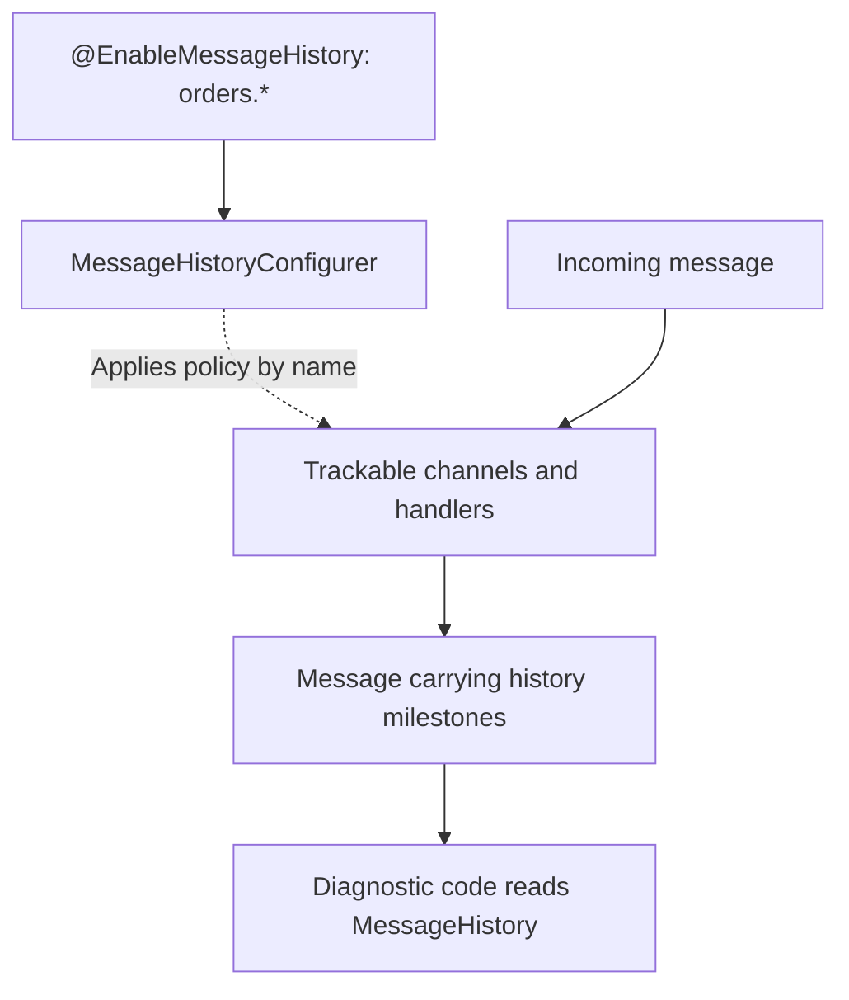
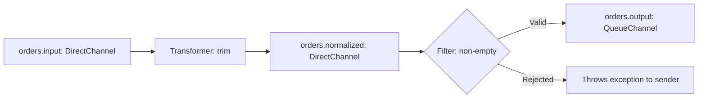

# MessageHistoryConfigurer

## 1. Objectives and Use Case

In the **System management** chapter of **SPRING_INTEGRATION_CORE**, `MessageHistoryConfigurer` configures recording of the components a message passes through. This lesson applies knowledge of `Message`, `MessageChannel`, endpoints, and Java DSL to answer one concrete operational question: **How far did the message travel before the outcome differed from expectations?**

Suppose a system receives an order code, trims whitespace, filters out empty inputs, and places valid results onto a queue. When an order fails to appear at the output, looking at the payload alone cannot tell you whether it never entered the flow, was rejected by the filter, or stopped at a processing step.

After this lesson, you will be able to:

- Explain the roles of `MessageHistoryConfigurer` and the `history` header.
- Enable history via Java configuration or XML, scoping by component name.
- Read journey milestones from the message actually received at the output.
- Adjust tracking scope while the application is running.
- Use history to aid troubleshooting, and understand its limits with branching and asynchronous processing.
- Design journey checks without depending on auto-generated bean names.

The main example uses **Java 17 and Spring Integration 6.5.x**. The project needs `org.springframework.integration:spring-integration-core`; the test illustration uses JUnit Jupiter. Let your project's dependency management select compatible Spring versions. This lesson does not require a broker, database, or Spring Boot.

## 2. Distinguishing the Configurer from History Data

There are three components to distinguish:

| Component | Responsibility | When do you use it? |
| --- | --- | --- |
| `@EnableMessageHistory` | Declares that the feature is enabled and sets component name patterns | When configuring the application context |
| `MessageHistoryConfigurer` | Applies the tracking policy and provides lifecycle control | When administering tracking scope |
| `MessageHistory` | Holds the milestones recorded on a message | When diagnosing a message's journey |

`MessageHistoryConfigurer` lives in package `org.springframework.integration.history`. It serves both a lifecycle role and a bean post-processor role; this is management infrastructure, not a transformer you insert between two channels. See the [MessageHistoryConfigurer API](https://docs.spring.io/spring-integration/api/org/springframework/integration/history/MessageHistoryConfigurer.html).

A component that participates in this mechanism must support `TrackableComponent`. That interface extends `NamedComponent` and provides `setShouldTrack(boolean)`. Consequently, merely having a POJO bean name match a pattern is not enough for all of its method calls to appear in history. See the [TrackableComponent API](https://docs.spring.io/spring-integration/api/org/springframework/integration/support/management/TrackableComponent.html).

At the implementation level, the configurer matches `getComponentName()` against the patterns and sets the tracking flag. On startup, it discovers eligible components; at runtime, post-processing also applies the policy to beans initialized later. See the [MessageHistoryConfigurer 6.5.0 Source](https://raw.githubusercontent.com/spring-projects/spring-integration/v6.5.0/spring-integration-core/src/main/java/org/springframework/integration/history/MessageHistoryConfigurer.java).

You can visualize this relationship as follows:



Dashed arrows represent configuration. The data path itself is still governed by channels, endpoints, and business logic.

## 3. What Does the `history` Header Contain?

The header name is `history`; in Java, prefer the constant `MessageHistory.HEADER_NAME`. Its value has type `MessageHistory`, which implements `List<Properties>`. Each element has these primary properties:

| Property | Meaning | Illustrative example |
| --- | --- | --- |
| `name` | Component name at the recording point | `orders.input` |
| `type` | Component type | `channel` |
| `timestamp` | Recording timestamp in milliseconds since the Unix epoch | `1800000000000` |

You can read it with `MessageHistory.read(message)` or retrieve the header with its expected type. The result can be `null` if no history has been recorded yet. See the [MessageHistory API](https://docs.spring.io/spring-integration/api/org/springframework/integration/history/MessageHistory.html).

The snippet below is a formatted representation of the entries, not a guarantee of `toString()` output:

```text
[
  {name=orders.input,      type=channel, timestamp=1800000000000},
  {name=orders.normalized, type=channel, timestamp=1800000000002},
  {name=orders.output,     type=channel, timestamp=1800000000003}
]
```

To reason accurately, separate **observed checkpoints** from **business outcomes**:

- Presence of `orders.input`: the message was recorded at that channel.
- Presence of `orders.output`: the message reached the example's output observation point.
- Absence of output milestone: investigate errors, discard branches, or processing state.
- Presence of a handler milestone: not enough by itself to prove an external transaction committed.

By default, history does not capture payload snapshots at each step. If you need to know an order code before and after normalization, add intentional observation at those boundaries.

### Timestamps Are Not Handler Execution Time Measurements

Suppose two milestones are 40 ms apart. That gap can include scheduling delay, queue wait time, and intermediate processing. It is a hint for narrowing down where to look, not proof that a single method ran for exactly 40 ms.

Two consecutive milestones can also have the exact same timestamp when the flow runs quickly. Therefore, tests should not require timestamps to increase strictly at every step.

## 4. Enabling History and Limiting by Name

### 4.1. Java Configuration

General configuration:

```java
import org.springframework.context.annotation.Configuration;
import org.springframework.integration.config.EnableIntegration;
import org.springframework.integration.config.EnableMessageHistory;

@Configuration
@EnableIntegration
@EnableMessageHistory
public class HistoryConfiguration {
}
```

The annotation's default value is `"*"`. When you need to narrow scope, pass each pattern as an array element:

```java
@EnableMessageHistory({"orders.*", "*Gateway", "billingInput"})
```

Elements are alternatives: a component matching at least one pattern falls within the tracking scope. The annotation accepts `String[]`; avoid combining multiple patterns into a single comma-containing string. See the [EnableMessageHistory API](https://docs.spring.io/spring-integration/api/org/springframework/integration/config/EnableMessageHistory.html).

| Pattern | Intent in the example |
| --- | --- |
| `orders.*` | Names starting with `orders.` |
| `*Gateway` | Names ending with `Gateway` |
| `billingInput` | Exact name `billingInput` |
| `*` | All trackable components |

This is simple wildcard matching, not regular expressions. For example, `orders.*` expresses the `orders.` prefix; there is no need to write expressions like `^orders\..*$`.

In the lesson's examples, the names `orders.input`, `orders.normalized`, and `orders.output` serve as stable checkpoints to observe. Choosing names with business meaning makes journeys far easier to read than a sequence of auto-generated names.

### 4.2. XML Equivalent

In a Spring XML document declaring the Spring Integration `int` namespace:

```xml
<int:message-history tracked-components="orders.*,*Gateway,billingInput"/>
```

XML uses a comma-separated list. Choose one centralized configuration declaration per application context: either one `@EnableMessageHistory` or one `<int:message-history/>`. Do not register an extra `new MessageHistoryConfigurer()` via `@Bean` to replace this mechanism. See the [Message History guide](https://docs.spring.io/spring-integration/reference/message-history.html).

The configurations in this section are illustrative alternatives; you do not need to combine all of them into one application.

## 5. Complete Example: Tracking an Order Code Normalization Flow

### 5.1. Flow Design

The input is the string `"  DH-1042  "`. The transformer trims leading and trailing whitespace; the filter rejects blank strings; valid messages are placed onto the output `QueueChannel`.



Java DSL expresses the steps with `transform`, `filter`, and `channel`, finishing the builder with `get()`. The `IntegrationFlow` bean is parsed by the infrastructure to register the runtime components. See [Java DSL](https://docs.spring.io/spring-integration/reference/dsl.html).

### 5.2. Java Code

Place the following in a class inside a project with the dependencies listed at the start of the lesson:

```java
import java.util.List;
import java.util.Properties;

import org.springframework.context.annotation.AnnotationConfigApplicationContext;
import org.springframework.context.annotation.Bean;
import org.springframework.context.annotation.Configuration;
import org.springframework.integration.channel.DirectChannel;
import org.springframework.integration.channel.QueueChannel;
import org.springframework.integration.config.EnableIntegration;
import org.springframework.integration.config.EnableMessageHistory;
import org.springframework.integration.dsl.IntegrationFlow;
import org.springframework.integration.history.MessageHistory;
import org.springframework.messaging.Message;
import org.springframework.messaging.MessageChannel;
import org.springframework.messaging.support.MessageBuilder;

public class MessageHistoryLesson {

    @Configuration
    @EnableIntegration
    @EnableMessageHistory({"orders.*"})
    public static class OrderFlowConfig {

        @Bean("orders.input")
        public MessageChannel ordersInput() {
            return new DirectChannel();
        }

        @Bean("orders.normalized")
        public MessageChannel ordersNormalized() {
            return new DirectChannel();
        }

        @Bean("orders.output")
        public QueueChannel ordersOutput() {
            return new QueueChannel(10);
        }

        @Bean
        public IntegrationFlow orderFlow() {
            return IntegrationFlow.from("orders.input")
                    .transform(String.class, String::trim,
                            endpoint -> endpoint.id("orders.normalize"))
                    .channel("orders.normalized")
                    .filter(String.class, value -> !value.isBlank(),
                            endpoint -> endpoint
                                    .id("orders.nonBlank")
                                    .throwExceptionOnRejection(true))
                    .channel("orders.output")
                    .get();
        }
    }

    public static List<String> componentNames(Message<?> message) {
        MessageHistory history = MessageHistory.read(message);
        if (history == null) {
            return List.of();
        }
        return history.stream()
                .map(entry -> entry.getProperty(MessageHistory.NAME_PROPERTY))
                .toList();
    }

    public static void printHistory(Message<?> message) {
        MessageHistory history = MessageHistory.read(message);
        if (history == null) {
            System.out.println("Message does not have history yet");
            return;
        }

        for (Properties entry : history) {
            System.out.printf("%s | %s | %s%n",
                    entry.getProperty(MessageHistory.NAME_PROPERTY),
                    entry.getProperty(MessageHistory.TYPE_PROPERTY),
                    entry.getProperty(MessageHistory.TIMESTAMP_PROPERTY));
        }
    }

    public static void main(String[] args) {
        try (var context =
                     new AnnotationConfigApplicationContext(OrderFlowConfig.class)) {
            MessageChannel input =
                    context.getBean("orders.input", MessageChannel.class);
            QueueChannel output =
                    context.getBean("orders.output", QueueChannel.class);

            Message<String> request = MessageBuilder
                    .withPayload("  DH-1042  ")
                    .setHeader("businessRequestId", "REQ-1042")
                    .build();

            if (!input.send(request, 1_000)) {
                throw new IllegalStateException("Failed to send message");
            }

            Message<?> result = output.receive(1_000);
            if (result == null) {
                throw new IllegalStateException("No result received");
            }

            System.out.println("Payload: " + result.getPayload());
            System.out.println("Request: "
                    + result.getHeaders().get("businessRequestId"));
            printHistory(result);
        }
    }
}
```

When running `main`, the expected payload is `DH-1042`; the business header remains `REQ-1042`. The journey must contain the three named channels, in order:

```text
orders.input
orders.normalized
orders.output
```

These are the **milestones to look for**, not a guaranteed exhaustive list. The pattern `orders.*` can also match handlers whose names correspond to DSL endpoint IDs. An endpoint's bean name and a handler's name are two different concepts; do not try to deduce the entire history list solely from `id(...)` calls.

The DSL creates handlers and endpoints wrapping them; for instance, a transform step has a `MessageTransformingHandler` and its own endpoint infrastructure. See [DSL Basics](https://docs.spring.io/spring-integration/reference/dsl/java-basics.html).

### 5.3. Why Read `result` Instead of `request`?

A transformer can produce an output message different from the object originally created by the sender. Read the message received at the end of the flow to inspect the outcome after processing steps.

`MessageHeaders` protects the map structure, yet objects stored as header values have their own mutability rules. Do not infer that every header value is immutable merely because the header map disallows `put`. See [Message and MessageHeaders](https://docs.spring.io/spring-integration/reference/message.html).

The `businessRequestId` header in the example is an application-assigned business identifier. It connects records belonging to the same request when messages are transformed or resent; do not rely solely on the message ID as a substitute for this concept.

`QueueChannel` here holds the result so the program can call `receive`. The example places no consumer behind the queue, so no poller needs to be declared. Steps before the queue execute on the thread calling `send`.

## 6. Understanding the Change Since Version 6.3

Prior to Spring Integration 6.3, recording a history entry relied on copying the history and the message. Since 6.3, the mechanism switched to **append-only**: once the history container is created, subsequent writes append milestones to the existing container. See the [version notes in Message History](https://docs.spring.io/spring-integration/reference/message-history.html).

That does not grant business code arbitrary mutation rights over history. In the 6.5.0 implementation, public mutators such as `add`, `remove`, and `clear` remain blocked; `toString()` mainly joins component names. To view timestamps and component types, iterate over the entries like `printHistory` above. See the [MessageHistory 6.5.0 Source](https://raw.githubusercontent.com/spring-projects/spring-integration/v6.5.0/spring-integration-core/src/main/java/org/springframework/integration/history/MessageHistory.java).

Consequence for writing diagnostic utilities: a history reference held mid-flow is not necessarily a fixed snapshot of that moment. If you need to persist observed state, extract the values into separate data at an appropriate boundary.

Example creating immutable records to log after receiving the result:

```java
import java.util.List;

import org.springframework.integration.history.MessageHistory;
import org.springframework.messaging.Message;

record HistoryEntry(String name, String type, String timestamp) {
}

final class HistorySnapshot {

    static List<HistoryEntry> capture(Message<?> message) {
        MessageHistory history = MessageHistory.read(message);
        if (history == null) {
            return List.of();
        }

        return history.stream()
                .map(entry -> new HistoryEntry(
                        entry.getProperty(MessageHistory.NAME_PROPERTY),
                        entry.getProperty(MessageHistory.TYPE_PROPERTY),
                        entry.getProperty(MessageHistory.TIMESTAMP_PROPERTY)))
                .toList();
    }
}
```

This snippet copies the needed fields rather than retaining `Properties` objects as diagnostic data. Call it at a point where the message has completed the branch being observed; copying data does not by itself fix a flow that is improperly shared and mutated concurrently.

## 7. Changing Tracking Scope While the Application Is Running

### 7.1. Lifecycle Sequence

Commonly used APIs include:

| API | Purpose |
| --- | --- |
| `getComponentNamePatternsString()` | Read the currently configured patterns |
| `isRunning()` | Check the configurer's running state |
| `stop()` | Turn off the active tracking policy |
| `setComponentNamePatternsString(...)` | Set a comma-separated list of patterns |
| `setComponentNamePatterns(String[])` | Set patterns using an array |
| `start()` | Reapply using the current configuration |

You must stop the configurer before changing patterns. Calling the setter while it is running violates its state precondition. See the [Configuration and Lifecycle API](https://docs.spring.io/spring-integration/api/org/springframework/integration/history/MessageHistoryConfigurer.html).

The snippet below is used in a controlled diagnostic session when you explicitly want to enable tracking with a new scope:

```java
import org.springframework.context.ApplicationContext;
import org.springframework.integration.history.MessageHistoryConfigurer;

final class HistoryAdministration {

    static void trackOnlyBoundaryChannels(ApplicationContext context) {
        MessageHistoryConfigurer configurer =
                context.getBean(MessageHistoryConfigurer.class);

        configurer.stop();
        configurer.setComponentNamePatternsString(
                "orders.input,orders.output");
        configurer.start();
    }
}
```

Stopping the configurer disables the tracking flag on the components it manages; that operation is not equivalent to stopping all endpoints in the flow. See the [configurer's stop implementation](https://raw.githubusercontent.com/spring-projects/spring-integration/v6.5.0/spring-integration-core/src/main/java/org/springframework/integration/history/MessageHistoryConfigurer.java).

Therefore, if traffic keeps flowing during the `stop → set → start` window, some messages may end up with incomplete milestone journeys. When comparing before and after a change, submit new diagnostic requests after the new configuration is active.

Changing patterns neither deletes milestones already on existing messages nor retroactively fills in steps that were skipped earlier. When the diagnostic session ends, restore the original patterns and running state according to your application's operational procedure.

Administrative changes should be executed by a single coordinator. The calls above are not atomic transactions with respect to traffic, nor are they an authorization mechanism.

### 7.2. Controlling via JMX

When the application has an appropriate `IntegrationMBeanExporter`, the configurer can be managed via JMX with an ObjectName of the form:

```text
<domain>:name=messageHistoryConfigurer,type=MessageHistoryConfigurer
```

The procedure remains: read the old configuration, invoke `stop`, change `ComponentNamePatternsString`, then invoke `start`. See [Message History: MBean management](https://docs.spring.io/spring-integration/reference/message-history.html).

To export integration components, Spring Integration provides `IntegrationMBeanExporter` and `@EnableIntegrationMBeanExport`; the exporter's default domain is `org.springframework.integration`. The `MBeanServer` configuration and management filters determine which MBeans are actually exported. See [JMX Support — MBean Exporter](https://docs.spring.io/spring-integration/reference/jmx.html#jmx-mbean-exporter).

Patterns in `@EnableMessageHistory` select **components that record history**. The exporter's `managedComponents` filter selects **components exposed to JMX**. When an MBean does not appear, inspect the exporter, `MBeanServer`, domain, and management scope before concluding history is disabled.

## 8. Using History When Errors Occur

### 8.1. Synchronous Flow in the Example

Send a whitespace-only payload:

```java
Message<String> invalid = MessageBuilder.withPayload("   ").build();
input.send(invalid);
```

The transformer produces an empty string. The filter is configured with `throwExceptionOnRejection(true)`, so the request is rejected with an exception. With a `DirectChannel` chain and direct sends as in the example, the caller receives the error; do not assume the error is automatically forwarded to the global `errorChannel`.

In asynchronous flows, Spring Integration's error-handling infrastructure can create an `ErrorMessage` and select an error channel from headers or default configuration. Error propagation depends on the execution boundary; see [Error Handling](https://docs.spring.io/spring-integration/reference/error-handling.html).

### 8.2. Reading the Failed Message

A `MessagingException` may carry a `failedMessage`. You can read history from it, while also handling the case where no message is attached:

```java
import org.springframework.messaging.MessagingException;

try {
    input.send(MessageBuilder.withPayload("   ").build());
    throw new IllegalStateException("Filter should have rejected this");
}
catch (MessagingException exception) {
    var failed = exception.getFailedMessage();
    if (failed != null) {
        MessageHistoryLesson.printHistory(failed);
    }
    System.out.println(exception.getClass().getSimpleName());
}
```

If the error message being inspected is an `ErrorMessage`, distinguish:

- The `history` header of the `ErrorMessage` itself: the journey along the error-handling branch, if that branch is tracked.
- History on the `failedMessage` inside the exception: the trail attached to the failing message.
- `originalMessage` information, if present: extra context supplied by the error-creation mechanism.

Not every exception populates all of these objects. In a deeply wrapped exception chain, you may need to locate the relevant `MessagingException` along the cause chain.

### 8.3. Reading Traces Against a Concrete Hypothesis

In the current example, if a request has `orders.input` and `orders.normalized` but not `orders.output`, cross-reference the filter exception and the normalized content. That is a diagnostic hypothesis grounded in the example's configuration.

In another system, the same symptom might stem from a router picking a different branch, an unconsumed queue, or an unfinished handler. A missing milestone is meaningful only when you know that milestone is within tracking scope and you waited at the right observation point.

## 9. Branching, Splitters, and Aggregators

A multi-branch flow has no single linear list that captures every event across the entire system.

| Integration pattern | Questions to ask when reading history |
| --- | --- |
| Router | Which branch was selected for the message? Is that branch tracked? |
| Filter | Was the message accepted, sent to a discard channel, or rejected with an exception? |
| Splitter | Which child item is being read? What group ID and sequence number does it carry? |
| Publish-subscribe | Which subscriber produced this result? Do the branches run concurrently? |
| Aggregator | Are you inspecting an input item or the group's aggregated output message? |

Do not assume history on an aggregator's output merges every journey from all input items. If the goal is per-item auditing, design trace storage with explicit group identifiers and item identifiers.

With the append-only mechanism, the framework handles cloning history at standard multi-message dispatch points so branches retain independent trails. When writing custom code that emits multiple messages outside those components, handle history cloning carefully. See [Message History: multiple branches](https://docs.spring.io/spring-integration/reference/message-history.html).

Since Spring Integration 6.3, the built-in builder offers `cloneMessageHistoryIfAny()` to copy the history header to new messages. See the [AbstractIntegrationMessageBuilder API](https://docs.spring.io/spring-integration/api/org/springframework/integration/support/AbstractIntegrationMessageBuilder.html).

Example for two branches created manually by application code:

```java
import org.springframework.integration.support.MessageBuilder;
import org.springframework.messaging.Message;

Message<?> branchA = MessageBuilder.fromMessage(source)
        .cloneMessageHistoryIfAny()
        .setHeader("diagnosticBranch", "A")
        .build();

Message<?> branchB = MessageBuilder.fromMessage(source)
        .cloneMessageHistoryIfAny()
        .setHeader("diagnosticBranch", "B")
        .build();
```

`source` is the existing message at the branching point. This snippet illustrates building messages per branch and does not yet include sending them to channels.

Notice the import: this is `org.springframework.integration.support.MessageBuilder`, which provides the history-aware API; the message-sending example in section 5 uses the general builder in `org.springframework.messaging.support`.

## 10. Verifying Journeys with JUnit

The following test reuses `MessageHistoryLesson.OrderFlowConfig`. It verifies the business outcome and key channel milestones while allowing additional handler milestones in between:

```java
import static org.junit.jupiter.api.Assertions.*;

import org.junit.jupiter.api.Test;
import org.springframework.context.annotation.AnnotationConfigApplicationContext;
import org.springframework.integration.channel.QueueChannel;
import org.springframework.integration.history.MessageHistory;
import org.springframework.messaging.Message;
import org.springframework.messaging.MessageChannel;
import org.springframework.messaging.support.MessageBuilder;

class MessageHistoryLessonTest {

    @Test
    void recordsNamedChannelsInOrder() {
        try (var context = new AnnotationConfigApplicationContext(
                MessageHistoryLesson.OrderFlowConfig.class)) {

            var input = context.getBean("orders.input", MessageChannel.class);
            var output = context.getBean("orders.output", QueueChannel.class);

            assertTrue(input.send(
                    MessageBuilder.withPayload("  DH-1042  ").build(), 1_000));

            Message<?> result = output.receive(1_000);
            assertNotNull(result);
            assertEquals("DH-1042", result.getPayload());
            assertNotNull(MessageHistory.read(result));

            var names = MessageHistoryLesson.componentNames(result);
            int inputIndex = names.indexOf("orders.input");
            int normalizedIndex = names.indexOf("orders.normalized");
            int outputIndex = names.indexOf("orders.output");

            assertTrue(inputIndex >= 0, names.toString());
            assertTrue(normalizedIndex > inputIndex, names.toString());
            assertTrue(outputIndex > normalizedIndex, names.toString());
        }
    }
}
```

The timeout detects missing messages without waiting forever. Ordering is checked along this example's linear path; do not apply this comparison as a global ordering across concurrent branches.

This can be expanded into three independent behavioral tests:

1. **Scope change:** stop the configurer, set the two names `orders.input,orders.output`, restart, and send a new message. History must contain those two milestones and not `orders.normalized`.
2. **Disable tracking:** call `stop()`, and send a brand-new message. The payload is still normalized, yet there is no history added by these components.
3. **Input rejection:** send a blank string, assert the exception, and confirm no output appears on the output queue.

In the tracking-disabled test, you must use a fresh message that does not already carry a `history` header. If you reuse an old message, the presence of history does not prove tracking is still active.

This is illustrative code for practicing in a project with the corresponding dependencies; lesson text does not substitute for compiling and running tests in an actual project.

## 11. Scoping and Operations

Before turning on `"*"` for a multi-step flow, define the question you need answered. For "did the order pass normalization?", three clearly named milestones are usually more helpful than a long list operators cannot interpret.

You can apply the following diagnostic plan:

1. Pick a group of components relevant to the incident.
2. Save the current patterns and configurer state.
3. Apply the new scope using the proper lifecycle sequence.
4. Send a few requests carrying easily identifiable `businessRequestId` values.
5. Collect outputs or failed messages at the chosen boundaries.
6. Restore the configuration and re-evaluate hypotheses from the captured traces.

Application-level costs to watch include metadata size growing with milestone count, log formatting and write overhead, and message size if all headers are transmitted or persisted. Flows with loops or repeated retries need special care because trails can grow longer than expected.

Do not assume Java headers survive intact across a broker or into another application. Check header mappers and serialization mechanisms at each boundary in use. If the goal is correlating traces across multiple services, design correlation identifiers and integrate an appropriate tracing solution.

The table below shows how to select observability data for the lesson's operational scenario:

| What you need to know | Data to combine |
| --- | --- |
| Which milestones in the flow did a message visit? | Message history |
| What business logic ran there and why was it rejected? | Contextual logs and exceptions |
| Overall system error rate or latency? | Time-windowed metrics |
| How did a request traverse multiple services? | Distributed tracing and correlation IDs |
| Long-term retained business proof? | A purpose-built audit store |

History aids diagnostics, yet it does not create a durable audit store on its own. Unless the application persists the trail, that data lives only as long as the retained messages or diagnostic records.

## 12. Common Pitfalls

| Symptom | What to check | Next step |
| --- | --- | --- |
| No `history` header | Feature not enabled, configurer stopped, or no matching components | Check centralized configuration, state, and actual bean names |
| Only a few milestones appear | Pattern too narrow, generated names differ from guesses, or inspecting mid-flow | Inspect the message at the branch end and verify component names |
| Setter throws state error | Changing patterns while configurer is running | Follow `stop → set → start` |
| Tracking disabled yet message still has history | Header was created before tracking was stopped | Test with a brand-new message |
| History looks short when printed | Using only `toString()` | Iterate over each entry to see all fields |
| Test breaks on long name lists | Test asserts exact framework-generated names | Assert stable business milestones instead |
| Two custom branches share mixed trails | Reusing a shared history container when emitting multiple messages | Clone history separately for each branch |
| Management MBean missing | Exporter or MBean export filter mismatch | Inspect JMX independently of history patterns |
| No output and no sender exception | Asynchronous boundary or discard route involved | Check consumers, error channels, and discard branches |

An absent `history` header is a starting point for investigation. It is not enough to conclude the message was never processed.

## 13. Practice Exercises

Use the flow in section 5 to perform these steps in a learning environment:

1. Send three order codes: `" DH-1 "`, `"DH-2"`, `"   "`.
2. For the two valid inputs, print the payload, `businessRequestId`, and every history milestone.
3. For the post-normalization blank input, catch the exception and read `failedMessage` if present.
4. Change the tracking scope to keep only the input and output channels; resend with a fresh message.
5. Stop the configurer and send one more fresh message to compare data vs. metadata.
6. Restart the configurer and restore the original pattern.

Be ready to explain these outcomes:

- Why does disabling history not change order-code normalization?
- Why can a filter cause the output milestone to be absent?
- Why can't exact processing time be deduced from two timestamps?
- Why are DSL endpoint names alone insufficient to predict the entire history list?
- Why must you use a fresh message when testing configuration changes?

When extending the example to routers or aggregators on your own, start by sketching observation boundaries and deciding which message will be inspected. That decision guides your pattern and test selection, rather than collecting history first and trying to guess what it means afterward.
