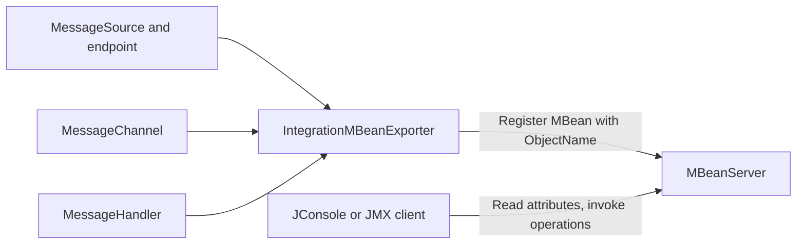
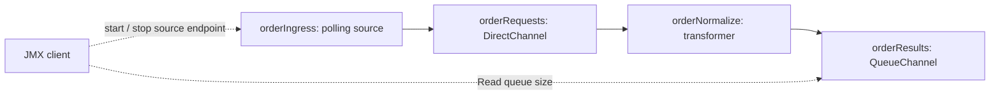

# IntegrationMBeanExporter

## 1. Objectives and Use Case

In the **System management** chapter of the **SPRING_INTEGRATION_CORE** module, this lesson explains how to expose Spring Integration components over JMX using `IntegrationMBeanExporter`. It builds directly on `Message`, `MessageChannel`, endpoints, and Java DSL: once a flow is running, operators need to identify components, inspect state, and invoke exposed management operations.

Suppose an application receives orders on a schedule, normalizes order codes, and forwards results to a queue. During a maintenance window, you want to pause intake, inspect the queue, and resume receiving orders while keeping the application context active. JMX provides a management interface for that scenario.

After this lesson, you will be able to:

- Explain the relationships among components, the exporter, MBeans, `ObjectName`, and `MBeanServer`.
- Configure the exporter using annotations or bean declarations.
- Select components to expose, assign stable names, and handle registration conflicts.
- Look up MBeans, read attributes, and invoke operations via the JMX API.
- Distinguish JMX management from Micrometer metrics.
- Build a procedure to stop intake and monitor in-flight processing.

Examples use the **Spring Integration 6.5.0** API, Java 17 or higher, and a compatible Spring Framework version. This is an API baseline for the exercise, not a claim about the latest release. When a project already uses Spring Boot or a BOM for version management, use the project's aligned dependency set.

## 2. What Does the Exporter Do in JMX Architecture?

JMX, short for Java Management Extensions, organizes management resources as **MBeans**. An MBean can provide:

- **Attribute**: readable or writable metadata-described data, such as running state.
- **Operation**: an invokable action, such as starting an endpoint.
- **Notification**: management notifications if that MBean itself supports them.

Exporting a component does not automatically cause it to emit notifications; that capability must be implemented and configured separately.

`IntegrationMBeanExporter` belongs to package:

```java
org.springframework.integration.monitor.IntegrationMBeanExporter
```

It extends Spring's export mechanism and adds recognition, naming, and registration for integration components. To manage a flow, the exporter must see the corresponding beans inside its application context. Simply adding the dependency without configuring the exporter does not complete resource publication.



This is the management path. Business messages continue flowing through sources, channels, transformers, routers, or other endpoints according to the flow configuration. The exporter never becomes a payload-processing step.

| Component | Responsibility |
| --- | --- |
| Spring Integration component | Receives, transfers, or processes messages |
| `IntegrationMBeanExporter` | Exposes management resources for selected components |
| `MBeanServer` | Holds the MBean registry and executes management requests |
| `ObjectName` | Identifies an MBean within a server |
| JMX client | Discovers metadata, reads attributes, and invokes operations |

The exporter does not automatically register itself as an MBean. To view aggregate attributes or invoke management operations on the exporter itself over JMX, you must export the exporter bean using an appropriate Spring exporter. [IntegrationMBeanExporter 6.5.0 API](https://docs.spring.io/spring-integration/docs/6.5.0/api/org/springframework/integration/monitor/IntegrationMBeanExporter.html)

## 3. Dependencies and Minimal Configuration

### 3.1. Adding the JMX Module

The JMX configuration classes in the example belong to the `spring-integration-jmx` module. In a standalone Maven project, the illustrative dependency is:

```xml
<dependency>
    <groupId>org.springframework.integration</groupId>
    <artifactId>spring-integration-jmx</artifactId>
    <version>6.5.0</version>
</dependency>
```

This module pulls in the required core pieces. If your project declares other Spring Integration modules, keep them on the same version line.

The official JMX documentation also describes adapters for receiving notifications, reading attributes, and invoking MBean operations. This lesson focuses on exposing the application's own components. [JMX Support](https://docs.spring.io/spring-integration/reference/6.5/jmx.html)

### 3.2. Using the Annotation

```java
import java.lang.management.ManagementFactory;
import javax.management.MBeanServer;

import org.springframework.context.annotation.Bean;
import org.springframework.context.annotation.Configuration;
import org.springframework.integration.config.EnableIntegration;
import org.springframework.integration.jmx.config.EnableIntegrationMBeanExport;
import org.springframework.jmx.support.RegistrationPolicy;

@Configuration
@EnableIntegration
@EnableIntegrationMBeanExport(
        server = "mbeanServer",
        defaultDomain = "vn.example.orders.integration",
        managedComponents = {"!orderInternal*", "order*"},
        registration = RegistrationPolicy.FAIL_ON_EXISTING)
public class OrderJmxConfig {

    @Bean
    public MBeanServer mbeanServer() {
        return ManagementFactory.getPlatformMBeanServer();
    }
}
```

Here `mbeanServer` is the bean name referenced by the annotation. Returning the platform `MBeanServer` ensures both Java code and local management tools target this JVM's registry.

Key options:

| Option | Meaning | Usage in the example |
| --- | --- | --- |
| `server` | Target `MBeanServer` bean name | Uses the explicitly declared server |
| `defaultDomain` | Domain for `ObjectName` instances created by the exporter | Groups resources for the order application |
| `managedComponents` | List of patterns selecting components | Includes `order*`, excludes internal components |
| `registration` | Policy when an `ObjectName` already exists | Fails fast to detect duplicate configuration |

The annotation creates an exporter bean named **`integrationMbeanExporter`**—note the capitalization. The default value of `managedComponents` is `*`; the default registration policy is `FAIL_ON_EXISTING`. [EnableIntegrationMBeanExport 6.5.0 API](https://docs.spring.io/spring-integration/docs/6.5.0/api/org/springframework/integration/jmx/config/EnableIntegrationMBeanExport.html)

A JMX domain is merely a namespace in the registry. It does not open a network port, determine a host address, or configure remote JMX connectivity on its own.

### 3.3. Using a Bean for Finer-Grained Configuration

When you need to add static properties to `ObjectName`, you can **replace the `@EnableIntegrationMBeanExport` annotation** with a bean:

```java
import java.util.Map;
import javax.management.MBeanServer;

import org.springframework.context.annotation.Bean;
import org.springframework.integration.monitor.IntegrationMBeanExporter;
import org.springframework.jmx.support.RegistrationPolicy;

// Place this method inside the @Configuration class with @EnableIntegration.
// Keep the mbeanServer bean and remove @EnableIntegrationMBeanExport.
@Bean
public IntegrationMBeanExporter orderIntegrationExporter(
        MBeanServer mbeanServer) {

    IntegrationMBeanExporter exporter = new IntegrationMBeanExporter();
    exporter.setServer(mbeanServer);
    exporter.setDefaultDomain("vn.example.orders.integration");
    exporter.setComponentNamePatterns(
            new String[] {"!orderInternal*", "order*"});
    exporter.setObjectNameStaticProperties(
            Map.of("application", "orderService", "context", "workerA"));
    exporter.setRegistrationPolicy(RegistrationPolicy.FAIL_ON_EXISTING);
    return exporter;
}
```

The static values in the example use simple characters to avoid quoting issues. When values must contain commas, equals signs, or special characters, follow `ObjectName` syntax rules.

Do not use both the annotation and this replacement bean simultaneously for the same group of components on the same server. Two exporters registering the same `ObjectName` can cause context initialization to fail.

## 4. Selecting Components and Designing Management Names

### 4.1. Patterns Are Evaluated in Order

In:

```java
managedComponents = {"!orderInternal*", "order*"}
```

the negated pattern is placed before the inclusion pattern. When a name matches multiple patterns, **the first match wins**. A name matching no inclusion pattern is not selected.

| Component name | Deciding pattern | Result |
| --- | --- | --- |
| `orderRequests` | `order*` | Selected |
| `orderNormalize` | `order*` | Selected |
| `orderInternalTrace` | `!orderInternal*` | Excluded |
| `paymentRequests` | None | Excluded |

If reversed to `{"order*", "!orderInternal*"}`, `orderInternalTrace` already matches the first pattern. The trailing pattern does not undo that match.

Patterns are simple wildcard matching rules, not regular expressions. Before applying them to a system with many Java DSL–generated beans, print the actual list of `ObjectName` entries to verify selection scope.

### 4.2. Giving Endpoints Clear Names

`@Bean` method names produce stable names for channels:

```java
@Bean
public QueueChannel orderResults() {
    return new QueueChannel(100);
}
```

In Java DSL, assign an ID to an endpoint:

```java
.transform(
        String.class,
        value -> value.trim(),
        endpoint -> endpoint.id("orderNormalize"))
```

`orderNormalize` is the endpoint ID; the framework can also create supporting handler and channel beans. Do not assume an auto-generated handler bean name is always identical to this ID. When choosing patterns, a consistent prefix such as `order*` is more convenient than trying to predict every internal suffix.

### 4.3. Reading an ObjectName

A channel identifier can look like:

```text
vn.example.orders.integration:type=MessageChannel,name=orderResults
```

The part before `:` is the domain. The part after consists of key-value pairs. Handlers often include a `bean` key indicating the naming source. Separately exposed endpoints can appear under type `ManagedEndpoint`.

For the polling source in the practice exercise, the 6.5.0 exporter creates a lifecycle MBean with the `.adapter` suffix. Do not assume every endpoint has its own `ManagedEndpoint` MBean or that every handler MBean exposes `start()` and `stop()`; inspect the metadata of the registered resource. Naming rules can be checked in the [IntegrationMBeanExporter 6.5.0 Source](https://github.com/spring-projects/spring-integration/blob/v6.5.0/spring-integration-jmx/src/main/java/org/springframework/integration/monitor/IntegrationMBeanExporter.java).

When comparing `ObjectName` instances, use `ObjectName` equality or `getCanonicalName()`. Key presentation order does not alter identity. When a query must allow extra static keys, append `,*` at the end of the pattern:

```text
vn.example.orders.integration:type=MessageChannel,name=orderResults,*
```

## 5. Hands-On: Managing an Order Flow over JMX

### 5.1. Flow and Expected Outcome

The flow uses a scheduled source to generate mock order codes:



The source is configured with `autoStartup(false)`. This lets the example demonstrate that a registered MBean still exists even while the endpoint is not running.

The generated payload is `"  don-1  "`. The transformer trims whitespace and converts to uppercase, producing `"DON-1"`. `DirectChannel` connects the source to the transformer; `QueueChannel` holds results for the program to receive.

### 5.2. Complete Java Program

The code below is the content of an illustrative Java class. All JMX read/invoke operations run inside the same JVM; the example does not need remote JMX enabled.

```java
import java.lang.management.ManagementFactory;
import java.util.Arrays;
import java.util.Locale;
import java.util.Set;
import java.util.concurrent.atomic.AtomicLong;

import javax.management.MBeanInfo;
import javax.management.MBeanServer;
import javax.management.ObjectName;

import org.springframework.context.annotation.AnnotationConfigApplicationContext;
import org.springframework.context.annotation.Bean;
import org.springframework.context.annotation.Configuration;
import org.springframework.integration.channel.DirectChannel;
import org.springframework.integration.channel.QueueChannel;
import org.springframework.integration.config.EnableIntegration;
import org.springframework.integration.dsl.IntegrationFlow;
import org.springframework.integration.dsl.Pollers;
import org.springframework.integration.jmx.config.EnableIntegrationMBeanExport;
import org.springframework.jmx.support.RegistrationPolicy;
import org.springframework.messaging.Message;

public class IntegrationJmxLesson {

    private static final String DOMAIN = "vn.example.orders.integration";

    @Configuration
    @EnableIntegration
    @EnableIntegrationMBeanExport(
            server = "mbeanServer",
            defaultDomain = DOMAIN,
            managedComponents = {"!orderInternal*", "order*"},
            registration = RegistrationPolicy.FAIL_ON_EXISTING)
    public static class Config {

        @Bean
        public MBeanServer mbeanServer() {
            return ManagementFactory.getPlatformMBeanServer();
        }

        @Bean
        public DirectChannel orderRequests() {
            return new DirectChannel();
        }

        @Bean
        public QueueChannel orderResults() {
            return new QueueChannel(100);
        }

        @Bean
        public IntegrationFlow orderFlow() {
            AtomicLong sequence = new AtomicLong();

            return IntegrationFlow
                    .fromSupplier(
                            () -> "  don-" + sequence.incrementAndGet() + "  ",
                            endpoint -> endpoint
                                    .id("orderIngress")
                                    .autoStartup(false)
                                    .poller(Pollers.fixedDelay(1000)
                                            .maxMessagesPerPoll(1)))
                    .channel(orderRequests())
                    .transform(
                            String.class,
                            value -> value.trim().toUpperCase(Locale.ROOT),
                            endpoint -> endpoint.id("orderNormalize"))
                    .channel(orderResults())
                    .get();
        }
    }

    public static void main(String[] args) throws Exception {
        try (var context =
                     new AnnotationConfigApplicationContext(Config.class)) {

            MBeanServer server =
                    context.getBean("mbeanServer", MBeanServer.class);
            QueueChannel results =
                    context.getBean("orderResults", QueueChannel.class);

            Set<ObjectName> names =
                    server.queryNames(new ObjectName(DOMAIN + ":*"), null);
            names.stream()
                    .map(ObjectName::getCanonicalName)
                    .sorted()
                    .forEach(System.out::println);

            ObjectName ingress = findOne(
                    server,
                    DOMAIN
                            + ":type=ManagedEndpoint,"
                            + "name=orderIngress.adapter,*");

            ObjectName resultChannel = findOne(
                    server,
                    DOMAIN
                            + ":type=MessageChannel,"
                            + "name=orderResults,*");

            describe(server, ingress);
            describe(server, resultChannel);
            requireNoArgOperation(server, ingress, "start");
            requireNoArgOperation(server, ingress, "stop");

            System.out.println(
                    "Running before start: "
                            + server.getAttribute(ingress, "Running"));

            Message<?> result;
            try {
                server.invoke(
                        ingress, "start", new Object[0], new String[0]);
                result = results.receive(5000);
            }
            finally {
                server.invoke(
                        ingress, "stop", new Object[0], new String[0]);
            }

            if (result == null) {
                throw new IllegalStateException(
                        "No order received within timeout");
            }

            System.out.println("Payload: " + result.getPayload());
            System.out.println(
                    "Running after stop: "
                            + server.getAttribute(ingress, "Running"));
            System.out.println(
                    "QueueSize: "
                            + server.getAttribute(resultChannel, "QueueSize"));
        }
    }

    private static ObjectName findOne(
            MBeanServer server, String pattern) throws Exception {

        Set<ObjectName> names =
                server.queryNames(new ObjectName(pattern), null);
        if (names.size() != 1) {
            throw new IllegalStateException(
                    "Expected exactly one MBean for " + pattern + ", found: " + names);
        }
        return names.iterator().next();
    }

    private static void describe(
            MBeanServer server, ObjectName name) throws Exception {

        MBeanInfo info = server.getMBeanInfo(name);
        System.out.println("MBean: " + name.getCanonicalName());

        Arrays.stream(info.getAttributes())
                .forEach(attribute -> System.out.println(
                        "  attribute=" + attribute.getName()
                                + ", readable=" + attribute.isReadable()
                                + ", writable=" + attribute.isWritable()));

        Arrays.stream(info.getOperations())
                .forEach(operation -> System.out.println(
                        "  operation=" + operation.getName()
                                + ", params="
                                + operation.getSignature().length));
    }

    private static void requireNoArgOperation(
            MBeanServer server, ObjectName name, String operation)
            throws Exception {

        boolean found = Arrays.stream(
                        server.getMBeanInfo(name).getOperations())
                .anyMatch(candidate ->
                        operation.equals(candidate.getName())
                                && candidate.getSignature().length == 0);

        if (!found) {
            throw new IllegalStateException(
                    "MBean does not expose operation: " + operation);
        }
    }
}
```

### 5.3. Reading the Output

Beyond the list of MBeans and metadata, the main expected output looks like:

```text
Running before start: false
Payload: DON-1
Running after stop: false
QueueSize: 0
```

`QueueSize` is a snapshot at the moment of reading. If the JVM is paused by a debugger or the machine runs slowly, the source may emit an extra order before receiving the stop command, so the queue size is not guaranteed to always be 0.

Sequence breakdown:

1. Context initializes and registers eligible MBeans.
2. The source endpoint stays stopped due to `autoStartup(false)`.
3. JMX locates the lifecycle MBean and invokes `start`.
4. The poller pulls from the supplier; the message travels through the channel and transformer.
5. The program receives one result with a bounded timeout.
6. The `finally` block invokes `stop` on the source endpoint.
7. When the outer `try` block exits, the context closes and resources are released.

A lifecycle-capable endpoint can be started via `start()` after being configured not to start automatically. [AbstractEndpoint 6.5.0 API](https://docs.spring.io/spring-integration/docs/6.5.0/api/org/springframework/integration/endpoint/AbstractEndpoint.html)

Setting `maxMessagesPerPoll(1)` ensures each supplier poll emits only one message. A supplier that always returns data combined with unlimited messages per poll can create unexpected load.

### 5.4. Inspecting with Tools

You can use JConsole to connect to the running JVM and expand the **MBeans** tree under the chosen domain. The program above closes the context immediately upon finishing; if you want to inspect manually, set a breakpoint before the context closes or use a longer-running application with the same configuration.

In the management tool:

1. Locate the domain `vn.example.orders.integration`.
2. Locate the source endpoint's MBean and inspect the `Running` attribute.
3. Read the list of operations displayed by the tool.
4. Only invoke `start` or `stop` on the verified resource.
5. Locate the `orderResults` MBean to read queue attributes.

When the context closes, the MBean tree disappearing is expected cleanup behavior. If the tool does not see the domain while the context is still open, check the target JVM and `MBeanServer` first.

## 6. Working with Attributes and Operations

### 6.1. Distinguishing Java Getters from JMX Attribute Names

The Java getter `getQueueSize()` corresponds to the `QueueSize` attribute. The boolean getter `isRunning()` is typically exposed as `Running`, according to JMX metadata.

```java
Object size = server.getAttribute(resultChannel, "QueueSize");
```

Attribute names are case-sensitive. Do not arbitrarily change it to `queueSize`, nor invoke `getQueueSize` as an operation when metadata exposes it only as an attribute.

A `QueueChannel` can report current size and remaining capacity. `DirectChannel` has no backing storage queue, so it has no equivalent backlog concept. [QueueChannel 6.5.0 API](https://docs.spring.io/spring-integration/docs/6.5.0/api/org/springframework/integration/channel/QueueChannel.html)

### 6.2. Checking Operation Signatures

`MBeanServer.invoke` takes the operation name, argument array, and Java type-name array. For a zero-argument operation:

```java
server.invoke(ingress, "stop", new Object[0], new String[0]);
```

For operations accepting parameters, use the exact types listed in `MBeanOperationInfo`. For example, a Java method accepting `long` uses the signature string `"long"`, not `"java.lang.Long"`.

Reading metadata before building a management script catches cases where the application changed versions or uses a different endpoint type.

### 6.3. Understanding Common API Errors

| Error or symptom | What to check |
| --- | --- |
| `InstanceNotFoundException` | `ObjectName`, server, and context lifecycle |
| `AttributeNotFoundException` | Attribute name and actual MBean type |
| `ReflectionException` on invoke | Operation name, parameter count, and type signatures |
| `MBeanException` | Underlying exception thrown by the management action |
| Query returns multiple MBeans | Missing context- or application-disambiguating keys |
| Query returns no MBeans | Domain, component selection patterns, and registration logs |

After locating an MBean, it can still be unregistered before the next read. Long-running operational tools should handle resources disappearing while an application shuts down or modifies flows.

## 7. Exposing the Exporter Itself and Orderly Shutdown

### 7.1. When You Need the Exporter's Own MBean

Aggregate attributes such as `ChannelCount`, `HandlerCount`, `SourceCount`, or `QueuedMessageCount` give an overview of the registry managed by the exporter. Component names and structural counts do not equate to completed business transactions.

To expose the exporter itself explicitly, you can add the following method to the annotation-based configuration in the hands-on section:

```java
import java.util.Map;
import javax.management.MBeanServer;

import org.springframework.beans.factory.annotation.Qualifier;
import org.springframework.context.annotation.Bean;
import org.springframework.integration.monitor.IntegrationMBeanExporter;
import org.springframework.jmx.export.MBeanExporter;
import org.springframework.jmx.export.annotation.AnnotationJmxAttributeSource;
import org.springframework.jmx.export.assembler.MetadataMBeanInfoAssembler;
import org.springframework.jmx.support.RegistrationPolicy;

@Bean
public MBeanExporter orderManagerExporter(
        MBeanServer mbeanServer,
        @Qualifier("integrationMbeanExporter")
        IntegrationMBeanExporter integrationExporter) {

    MBeanExporter managementExporter = new MBeanExporter();
    managementExporter.setServer(mbeanServer);
    managementExporter.setAutodetect(false);
    managementExporter.setRegistrationPolicy(
            RegistrationPolicy.FAIL_ON_EXISTING);
    managementExporter.setAssembler(
            new MetadataMBeanInfoAssembler(
                    new AnnotationJmxAttributeSource()));
    managementExporter.setBeans(Map.of(
            "vn.example.orders.management:"
                    + "type=IntegrationMBeanExporter,name=orderManager",
            integrationExporter));
    return managementExporter;
}
```

Here a specialized exporter manages integration components; a standard Spring exporter simply exposes the specified management bean. Configuring an annotation-driven assembler extracts the annotated management interface instead of indiscriminately exposing every public method. Spring supports explicit bean-to-`ObjectName` mappings via `setBeans`. [Exporting Your Beans to JMX](https://docs.spring.io/spring-framework/reference/integration/jmx/exporting.html)

If the system already has a general management exporter, add this mapping to the existing configuration and avoid registering the exporter bean twice.

### 7.2. Calling stopActiveComponents

Once the exporter's MBean is exposed as above:

```java
ObjectName manager = new ObjectName(
        "vn.example.orders.management:"
                + "type=IntegrationMBeanExporter,name=orderManager");

server.invoke(
        manager,
        "stopActiveComponents",
        new Object[] {5000L},
        new String[] {"long"});
```

`5000L` is the wait duration in milliseconds during the shutdown sequence, not a message count.

The orderly shutdown mechanism coordinates preparing supported components to stop, halting relevant inbound sources, and allowing time for in-flight work. Pollers are kept running during this window to help drain messages currently in flight within the flow. [Orderly Shutdown](https://docs.spring.io/spring-integration/reference/shutdown.html)

It can also be invoked directly from lifecycle management code:

```java
IntegrationMBeanExporter exporter =
        context.getBean(IntegrationMBeanExporter.class);

exporter.stopActiveComponents(5000L);
```

Direct invocation does not require the exporter itself to be registered in the JMX registry.

### 7.3. Limits of Orderly Shutdown

Stopping inbound intake gives in-flight work a chance to finish. Actual completion still depends on real processing duration, external resource availability, retry policies, transactions, and message persistence.

For example, an order-intake flow calling a shipping service with a 30-second timeout cannot be expected to complete every transaction inside a 5-second wait window. Choose timeouts based on operational budgets and plan how to handle incomplete orders.

`stopActiveComponents` is also not a JVM exit command. Deployment procedures still need to close the context and terminate the process using the runtime environment's mechanism. Do not treat this operation as a global pause button assuming a single resume command exists for all components.

## 8. JMX, Micrometer, and Business State

`IntegrationMBeanExporter` helps locate resources and perform management actions. Systems needing to track rates, latency percentiles, error rates, or backlog trends over time should configure Micrometer and a corresponding storage backend.

| Need | Approach |
| --- | --- |
| Check whether an endpoint is running | Lifecycle attribute on the relevant MBean |
| Stop a specific inbound source | Operation exposed by the endpoint |
| Check current queue depth | Attribute on the relevant queue channel |
| Track multi-hour queue trends | Periodically scraped gauges |
| Measure latency and error rates | `MeterRegistry`, appropriate metrics, and dashboards |
| Look up a specific order's outcome | Logs, traces, or business data with correlation IDs |

Spring Integration integrates with `MeterRegistry`; filtering meters uses mechanisms like `MeterFilter`. The `managedComponents` rules selecting JMX resources do not replace metric filters. Observation configuration also has its own mechanism. [Metrics and Management](https://docs.spring.io/spring-integration/reference/6.5/metrics.html)

Avoid writing scripts assuming that every counter, rate, or timing attribute from older-version documentation still exists on current MBeans. Inspect `MBeanInfo` from the running version and use a metrics system for long-term statistics.

Keep three interpretations distinct:

- `Running = true` indicates lifecycle is running; external downstream services can still be failing.
- A successful send to `QueueChannel` indicates the message was accepted into the queue; downstream business processing may not have occurred yet.
- An empty queue indicates no items remain in that specific queue; work may still be executing in a handler or external service.

Suppose backlog rises from 100 to 300 in one minute. A JMX snapshot alone cannot prove the transformer is slow: intake may have spiked, a consumer may be stopped, or a downstream target may be failing. Combine lifecycle state, intake/processing rates, errors, and relevant logs before altering the flow.

## 9. Naming Conflicts and Multiple Application Contexts

An `ObjectName` must be unique within a single `MBeanServer`. Two contexts sharing the same domain and channel name `orderResults` can collide on the same identifier even though they are distinct Java objects.

| Policy | Behavior when name exists | Operational consequence |
| --- | --- | --- |
| `FAIL_ON_EXISTING` | Registration fails | Detects duplicate configuration early |
| `IGNORE_EXISTING` | Keeps existing registration | Clients may actually be viewing another context's resource |
| `REPLACE_EXISTING` | Replaces existing registration | Switches which underlying resource clients with that name control |

This exercise uses `FAIL_ON_EXISTING` to surface issues immediately. When multiple contexts must coexist in the same JVM, choose separate domains or add static keys such as `context=workerA`.

Across separate JVMs, registries are separate too. Identical `ObjectName` values on two machines do not cause registration conflicts on their own; collection tools still need to distinguish machines or instances when aggregating data.

If Spring Boot JMX, a general exporter, and the integration exporter are all present, clarify which component owns each group of MBeans. Before changing the registration policy, verify whether the issue is caused by two exporters targeting the same resource.

Beans annotated with `@IntegrationManagedResource` are designed to be exposed via the integration exporter. Do not assume every bean with management annotations is handled identically by a standard exporter. [IntegrationManagedResource 6.5.0 API](https://docs.spring.io/spring-integration/docs/6.5.0/api/org/springframework/integration/support/management/IntegrationManagedResource.html)

## 10. Operational Procedure for Maintenance

For an order flow, a practical procedure might include:

1. Identify the exact instance, context, and MBean of the intake source to control.
2. Record current running state, backlog, and errors.
3. Halt or throttle external producers if they will continue generating load.
4. Invoke the appropriate stop operation on the intake source.
5. Monitor queues and in-flight work during the wait window.
6. Verify business outcomes or recovery mechanisms before starting maintenance.
7. After maintenance, start the required components and confirm data resumes flowing.

With a `QueueChannel` of capacity 100, stopping the consumer while producers keep sending will fill the queue up to its limit. Send calls may block or fail depending on timeout. Therefore, stopping a consumer must be paired with the system's message-intake policy.

Do not use purging or clearing a queue as a status-reading check; those are data-mutating operations. Nor should you call `receive()` on a production channel just to peek at payloads, as that removes messages from normal consumption.

Writing attributes and invoking operations amount to application control privileges. When enabling remote JMX connections, configure connectors, authentication, authorization, and transport security appropriate for your environment. Configuring the exporter alone does not establish those controls.

## 11. Diagnosing Common Scenarios

| Scenario | What to check |
| --- | --- |
| Cannot import JMX annotations | Is `spring-integration-jmx` present with an aligned version? |
| Context runs yet no MBeans appear | Exporter, target `MBeanServer`, domain, and patterns |
| Channel appears yet target endpoint is missing | Endpoint ID, DSL-generated names, and actual MBean types |
| MBean exists yet lacks `start` or `stop` | Inspect `MBeanInfo`; you may have selected a handler or channel MBean |
| Invoked `start` yet no output arrives | Poller, schedule, output channel, handler errors, and receive timeout |
| `Running` is true yet backlog keeps growing | Intake rate, processing capacity, and downstream resources |
| New context fails with duplicate MBean name | Domain, static keys, previous context, and exporter count |
| MBeans disappear after running the example | The context may have closed and unregistered resources |

Distinguish between **MBean is registered**, **endpoint is running**, and **business processing produced outcomes**. Those are three separate conditions that must be verified with corresponding evidence.

## 12. Extended Practice

Perform these steps in a learning environment with simulated data:

1. Change `managedComponents` to `{"orderResults"}`. Re-run and explain why the result channel is found while the source lifecycle query no longer returns any element.
2. Place `"!orderIngress*"` before `"order*"`. Predict which component gets excluded, then verify against the `ObjectName` list.
3. Let the source run for a moment without calling `receive`. Observe `QueueSize` and `RemainingCapacity`, then receive a message to see both values change.
4. Add static key `context=workerA` via bean configuration. Explain why queries ending with `,*` still locate the MBean.
5. Expose the exporter itself using an explicit mapping and inspect the `stopActiveComponents` operation from `MBeanInfo` before invoking it.
6. List three pieces of evidence to collect when `Running = true` yet the count of successfully processed orders drops.

When explaining results, tie each back to the flow's components: the source creates messages, channels transfer or store messages, transformers process payloads, endpoints determine how components participate in lifecycle management, and the exporter provides the management interface. Making that connection keeps JMX in its proper place within a Spring Integration application.
