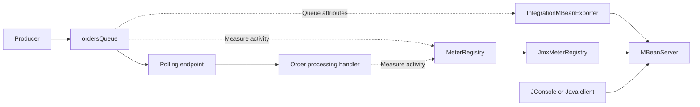

# JMX Metrics

## 1. Lesson Objectives and Scope

In the **System management** chapter of the **SPRING_INTEGRATION_CORE** module, JMX helps observe the operational state of components in a message flow. When a flow keeps receiving input yet processes slowly, you need to know whether messages are sitting in a queue, whether the consumer is running, and which operations are throwing errors.

After this lesson, you will be able to:

- Distinguish component management MBeans from meters tracking processing activity.
- Export Spring Integration components to an `MBeanServer` using `@EnableIntegrationMBeanExport`.
- Read `QueueSize` and `RemainingCapacity`, and inspect MBean metadata in Java or JConsole.
- Expose Micrometer metrics to JMX using `JmxMeterRegistry`.
- Interpret throughput, error rate, and processing duration within the right measurement boundaries.
- Diagnose scenarios such as growing queues, stopped consumers, or missing metrics.

You should already know `Message`, `MessageChannel`, `QueueChannel`, endpoints, pollers, and how to declare flows with Java DSL. That background also supports observing flows with gateways, transformers, routers, filters, or aggregators.

The main example selects **Java 17, Spring Integration 6.5.0, and Micrometer 1.15.0** as a concrete API baseline. This is an illustrative baseline, not a claim about the newest release. The example uses plain Spring to make the required beans explicit; a later section explains how this relates to Spring Boot.

## 2. What Does JMX Observe in a Message Flow?

**JMX — Java Management Extensions** is the Java platform's management mechanism. An object exposed for management is called an **MBean**. An MBean can provide readable/writable attributes, invokable operations, and notifications for emitting events.

For example, a queue can expose how many messages are waiting. A lifecycle-aware component can expose its running state or management operations if its metadata supports them. Management tools access objects registered in an `MBeanServer`.

| Concept | Role | Example in lesson |
| --- | --- | --- |
| MBean | Registered managed object | MBean representing `ordersQueue` |
| Attribute | Property exposed by an MBean | `QueueSize` |
| Operation | Action exposed by an MBean | Invoke only operation names present in actual metadata |
| `MBeanServer` | Registry and execution host for MBeans | JVM platform MBean server |
| `ObjectName` | MBean identifier within a server | `com.example.orders.integration:type=MessageChannel,name=ordersQueue` |
| JMX client | Tool or program accessing the server | JConsole, Java program |

Separating the business flow from the observation path clarifies how data travels:



The diagram shows two export paths. `IntegrationMBeanExporter` exposes component management interfaces to JMX; `JmxMeterRegistry` exposes Micrometer meters to JMX. Enabling one path does not mean the other exists automatically.

## 3. Distinguishing JMX Management from Modern Metrics

### 3.1. Why Older Examples May No Longer Work

Spring Integration removed **legacy metrics** starting in version **5.4**, after migrating to Micrometer. Therefore, do not take old 4.x or 5.x examples and assume MBeans in 6.5 still expose `SendCount`, `ErrorCount`, legacy average statistics, or the corresponding statistics toggle options. This change is recorded in [Spring Integration 5.3–5.4 history](https://docs.spring.io/spring-integration/docs/5.5.11/reference/html/history.html).

| Need | Mechanism to identify | Where to observe |
| --- | --- | --- |
| Number of messages waiting in `QueueChannel` | Channel management attributes | Channel MBean |
| Send count and duration of send operations | Micrometer Timer | `MeterRegistry`; can also be exported to JMX |
| Categorizing success or failure outcomes | Meters and tags at the measurement point | Active registry |
| Controlling a component's lifecycle | Management interface actually exposed by the component | MBean metadata or appropriate lifecycle API |
| Counting channels, handlers, and sources | Aggregate exporter attributes when exported separately | Exporter MBean |
| Tracking multi-instance trends | Centralized collection with history retention | Application monitoring system |

Do not infer an MBean's attribute set solely from a class name or an old JConsole screenshot. Inspect the registered MBean and verify metadata from the running version itself.

### 3.2. The JMX Exporter Does Not Export Itself Automatically

`IntegrationMBeanExporter` exposes aggregate attributes such as channel count and queued message count, yet it does not register itself as an MBean automatically. To view those over JMX, configure export for the exporter bean using an appropriate Spring JMX mechanism. The lesson's main example only needs the `ordersQueue` MBean, so it omits a second general exporter. See [IntegrationMBeanExporter 6.5.0 API](https://docs.spring.io/spring-integration/docs/6.5.0/api/org/springframework/integration/monitor/IntegrationMBeanExporter.html).

## 4. Practice Scenario

An application accepts order codes into `ordersQueue`. A consumer periodically polls messages and invokes the `ordersProcessor` handler. We intentionally leave the consumer stopped at startup, then send three sample messages.

Questions to answer:

1. Were all three messages placed into the queue?
2. How much space remains in the queue?
3. When the consumer starts, how does the waiting count change?
4. If the handler throws an exception, does the earlier queue-send success turn into a failure?
5. Under which domains do the channel management MBean and meter MBeans reside?

The queue has a fixed capacity of 100 so state is easy to interpret. `QueueChannel` in the example uses in-process memory; this exercise does not treat it as durable message storage.

## 5. Dependencies and Complete Java Configuration

### 5.1. Maven Dependencies

In a Maven project using Java 17, add the following sections to `pom.xml`. If your project already uses a Spring Boot BOM or another version-management mechanism, use your project's aligned versions instead of stacking these illustrative BOMs.

```xml
<properties>
    <maven.compiler.release>17</maven.compiler.release>
    <project.build.sourceEncoding>UTF-8</project.build.sourceEncoding>
</properties>

<dependencyManagement>
    <dependencies>
        <dependency>
            <groupId>org.springframework.integration</groupId>
            <artifactId>spring-integration-bom</artifactId>
            <version>6.5.0</version>
            <type>pom</type>
            <scope>import</scope>
        </dependency>
        <dependency>
            <groupId>io.micrometer</groupId>
            <artifactId>micrometer-bom</artifactId>
            <version>1.15.0</version>
            <type>pom</type>
            <scope>import</scope>
        </dependency>
    </dependencies>
</dependencyManagement>

<dependencies>
    <dependency>
        <groupId>org.springframework.integration</groupId>
        <artifactId>spring-integration-core</artifactId>
    </dependency>
    <dependency>
        <groupId>org.springframework.integration</groupId>
        <artifactId>spring-integration-jmx</artifactId>
    </dependency>
    <dependency>
        <groupId>io.micrometer</groupId>
        <artifactId>micrometer-registry-jmx</artifactId>
    </dependency>
</dependencies>
```

`spring-integration-jmx` provides Spring Integration's JMX support. `micrometer-registry-jmx` exports Micrometer data to JMX; it is not a reader for arbitrary existing JVM MBeans. Both capabilities are described in [Spring Integration JMX Support](https://docs.spring.io/spring-integration/reference/6.5/jmx.html) and [Micrometer JMX](https://docs.micrometer.io/micrometer/reference/implementations/jmx.html).

### 5.2. Sample Application

Place the following class in package `example`. You can run `main()` from your IDE using the project's Maven classpath.

```java
package example;

import java.io.BufferedReader;
import java.io.InputStreamReader;
import java.lang.management.ManagementFactory;
import java.nio.charset.StandardCharsets;

import javax.management.MBeanServer;
import javax.management.ObjectName;

import io.micrometer.core.instrument.Clock;
import io.micrometer.jmx.JmxConfig;
import io.micrometer.jmx.JmxMeterRegistry;

import org.springframework.context.Lifecycle;
import org.springframework.context.annotation.AnnotationConfigApplicationContext;
import org.springframework.context.annotation.Bean;
import org.springframework.context.annotation.Configuration;
import org.springframework.integration.channel.QueueChannel;
import org.springframework.integration.config.EnableIntegration;
import org.springframework.integration.config.EnableIntegrationManagement;
import org.springframework.integration.dsl.IntegrationFlow;
import org.springframework.integration.dsl.Pollers;
import org.springframework.integration.jmx.config.EnableIntegrationMBeanExport;
import org.springframework.messaging.support.GenericMessage;

@Configuration
@EnableIntegration
@EnableIntegrationManagement
@EnableIntegrationMBeanExport(
    server = "mbeanServer",
    defaultDomain = "com.example.orders.integration",
    managedComponents = {"orders*"}
)
public class OrdersJmxDemo {

    @Bean
    public MBeanServer mbeanServer() {
        return ManagementFactory.getPlatformMBeanServer();
    }

    @Bean(destroyMethod = "close")
    public JmxMeterRegistry meterRegistry() {
        JmxConfig config = new JmxConfig() {
            @Override
            public String get(String key) {
                return null; // Use defaults for all other properties.
            }

            @Override
            public String domain() {
                return "com.example.orders.metrics";
            }
        };
        return new JmxMeterRegistry(config, Clock.SYSTEM);
    }

    @Bean
    public QueueChannel ordersQueue() {
        return new QueueChannel(100);
    }

    @Bean
    public IntegrationFlow ordersFlow(QueueChannel ordersQueue) {
        return IntegrationFlow.from(ordersQueue)
            .handle(String.class, (payload, headers) -> {
                if (payload.startsWith("FAIL")) {
                    throw new IllegalStateException("Simulated processing error");
                }
                System.out.println("Processed: " + payload);
                return null; // End flow, emit no reply message.
            }, endpoint -> endpoint
                .id("ordersProcessor")
                .autoStartup(false)
                .poller(Pollers.fixedDelay(200).maxMessagesPerPoll(10)))
            .get();
    }

    public static void main(String[] args) throws Exception {
        try (var context = new AnnotationConfigApplicationContext(
                OrdersJmxDemo.class)) {
            QueueChannel queue = context.getBean("ordersQueue", QueueChannel.class);
            Lifecycle processor = context.getBean("ordersProcessor", Lifecycle.class);
            MBeanServer server = context.getBean("mbeanServer", MBeanServer.class);
            JmxMeterRegistry registry = context.getBean(JmxMeterRegistry.class);
            ObjectName queueName = new ObjectName(
                "com.example.orders.integration:type=MessageChannel,name=ordersQueue");

            for (int i = 1; i <= 3; i++) {
                if (!queue.send(new GenericMessage<>("ORDER-" + i), 0)) {
                    throw new IllegalStateException("Sample order was not accepted");
                }
            }

            System.out.println("PID: " + ProcessHandle.current().pid());
            System.out.println("Commands: show, start, stop, send <payload>, meters, quit");
            BufferedReader console = new BufferedReader(
                new InputStreamReader(System.in, StandardCharsets.UTF_8));

            for (String command; (command = console.readLine()) != null;) {
                if (command.equals("quit")) {
                    break;
                }
                if (command.startsWith("send ")) {
                    boolean accepted = queue.send(
                        new GenericMessage<>(command.substring(5).trim()), 0);
                    System.out.println("Accepted by queue: " + accepted);
                    continue;
                }
                switch (command) {
                    case "show" -> System.out.printf(
                        "QueueSize=%s, RemainingCapacity=%s, Running=%s%n",
                        server.getAttribute(queueName, "QueueSize"),
                        server.getAttribute(queueName, "RemainingCapacity"),
                        processor.isRunning());
                    case "start" -> processor.start();
                    case "stop" -> processor.stop();
                    case "meters" -> registry.getMeters().forEach(
                        meter -> System.out.println(meter.getId()));
                    default -> System.out.println("Invalid command");
                }
            }
        }
    }
}
```

Closing the application context ends the example and closes the registry. Registering and unregistering component MBeans is tied to the context lifecycle; do not use `start()` or `stop()` on the exporter as a way to re-register all MBeans.

### 5.3. Role of Each Configuration Part

`@EnableIntegrationMBeanExport` selects the server, domain, and set of components to export. `managedComponents` is an MBean export filter, not a switch enabling all metric types. Patterns can carry a `!` prefix to exclude; when multiple patterns match, the first match wins. For instance, `{"!ordersDebug*", "orders*"}` excludes debug components before accepting other components in the flow. See [EnableIntegrationMBeanExport 6.5.0 API](https://docs.spring.io/spring-integration/docs/6.5.0/api/org/springframework/integration/jmx/config/EnableIntegrationMBeanExport.html).

`@EnableIntegrationManagement` configures the framework's management infrastructure. The `JmxMeterRegistry` bean provides a destination for Micrometer measurements and places them into a separate domain. The constructor in the example starts the registry's reporter automatically; `close()` stops the reporter when the context closes. You can inspect [JmxMeterRegistry 1.15.0 Source](https://raw.githubusercontent.com/micrometer-metrics/micrometer/v1.15.0/implementations/micrometer-registry-jmx/src/main/java/io/micrometer/jmx/JmxMeterRegistry.java).

`autoStartup(false)` requires the consumer to be started explicitly. In the program, the `start`, `stop`, and `Running` commands call **Java's `Lifecycle` API**. They do not illustrate invoking operations over JMX. Do not infer that `Running` is an attribute of the `ordersQueue` MBean. This lifecycle behavior belongs to the endpoint, described in [AbstractEndpoint API](https://docs.spring.io/spring-integration/docs/6.5.0/api/org/springframework/integration/endpoint/AbstractEndpoint.html).

`maxMessagesPerPoll(10)` caps how many messages are pulled in one poll cycle; it does not spawn ten parallel workers. `fixedDelay(200)` also does not promise that a batch finishes every 200 ms when the handler is slow.

## 6. Reading Practice Results

### 6.1. While the Consumer Is Not Running

Right after startup, enter:

```text
show
```

In the example, only three sample sends happened and the consumer is not running, so the expected output is:

```text
QueueSize=3, RemainingCapacity=97, Running=false
```

`QueueSize` is the count of messages waiting to be pulled from the queue. It does not include messages a handler has already pulled and is currently processing. `RemainingCapacity` is the number of free slots at the moment of reading. Both attributes are exposed via `@ManagedAttribute` in [QueueChannelOperations](https://docs.spring.io/spring-integration/docs/6.5.0/api/org/springframework/integration/channel/QueueChannelOperations.html).

### 6.2. When Processing Begins

Enter:

```text
start
```

The program will print processing lines for `ORDER-1`, `ORDER-2`, and `ORDER-3`. Once they have been processed, enter `show` to see the queue return to 0, remaining capacity return to 100, and `Running=true`.

Do not rely on a single read immediately after `start` to assert the consumer has finished processing. The poller runs on a schedule while the console loop continues independently. When producer and consumer run concurrently, attributes read at two different moments also do not form an atomic snapshot.

### 6.3. When the Handler Fails

Keep the consumer running and enter:

```text
send FAIL-ORDER-4
```

The program may print `Accepted by queue: true` before logging the handler error. Both outputs are consistent with each other:

1. `QueueChannel.send()` succeeds because the message was accepted into the queue.
2. The poller picks up the message afterward.
3. The handler throws an exception while processing the payload.
4. The polling endpoint's error mechanism handles the exception; in the example's default configuration, the error is reported through the `errorChannel` infrastructure and corresponding logging.

The example does not configure retries, transactions, or requeuing on failure. Do not treat a handler failure as proof that the message automatically returned to the queue. In real flows, explicitly design retries, error routes, or failed-message storage for reprocessing.

### 6.4. When the Queue Is Full

Stop the consumer with `stop`, then send enough messages to reach capacity 100. Because the program calls `send(message, 0)`, the next send returns `false` if the queue is still full; the console thread does not block indefinitely.

`false` indicates the queue did not accept the message within the wait timeout, even without throwing an exception. The producer side must decide how to respond: report rejection, retry per policy, or route to alternate storage. Do not ignore the boolean result and count the order as accepted.

The parameterized `QueueChannel` constructor creates a queue with the specified capacity; the API also provides a default constructor with a very large effective capacity. See [QueueChannel 6.5.0](https://docs.spring.io/spring-integration/docs/6.5.0/api/org/springframework/integration/channel/QueueChannel.html).

## 7. Observing with JConsole and Exploring MBeans

### 7.1. Connecting in a Development Environment

While the sample application is still running:

1. Launch `jconsole` from the JDK.
2. Select the Java process matching the PID the program just printed.
3. Open the **MBeans** tab.
4. Locate domain `com.example.orders.integration`, then find the `ordersQueue` MBean under `MessageChannel`.
5. Watch `QueueSize` and `RemainingCapacity` as you send messages or change consumer state from the application console.
6. Locate domain `com.example.orders.metrics` to inspect the meters exported by the registry.

Local connections use JVM attach capabilities when environment and OS permissions allow. Typically JConsole and the application must run under the same user account. Local observation does not require opening a remote JMX port right away. Refer to the [JDK 17 JMX Management Guide](https://docs.oracle.com/en/java/javase/17/management/monitoring-and-management-using-jmx-technology.html).

### 7.2. Never Guess Operation or Attribute Names

The snippet below uses `MBeanServerConnection` to list MBeans in the management domain and print the attributes and operations they actually expose. For the local example, you can pass the `server` variable as the argument to the method.

```java
import javax.management.MBeanAttributeInfo;
import javax.management.MBeanInfo;
import javax.management.MBeanOperationInfo;
import javax.management.MBeanServerConnection;
import javax.management.ObjectName;

static void inspectIntegrationMBeans(MBeanServerConnection connection)
        throws Exception {
    ObjectName pattern = new ObjectName("com.example.orders.integration:*");
    for (ObjectName name : connection.queryNames(pattern, null)) {
        System.out.println(name.getCanonicalName());
        MBeanInfo info = connection.getMBeanInfo(name);

        for (MBeanAttributeInfo attribute : info.getAttributes()) {
            System.out.printf("  attribute=%s, type=%s, readable=%s%n",
                attribute.getName(), attribute.getType(), attribute.isReadable());
        }
        for (MBeanOperationInfo operation : info.getOperations()) {
            System.out.printf("  operation=%s, parameters=%d%n",
                operation.getName(), operation.getSignature().length);
        }
    }
}
```

`queryNames`, `getMBeanInfo`, and `getAttribute` are standard JMX APIs usable over both local and remote connections. See [JDK 17 MBeanServerConnection](https://docs.oracle.com/en/java/javase/17/docs/api/java.management/javax/management/MBeanServerConnection.html).

Different components expose different management interfaces. Only invoke a control operation after confirming it exists, verifying the exact target object, and understanding its effect on the flow.

### 7.3. Naming Conventions

For an explicitly named channel as in the example, an `ObjectName` can be:

```text
com.example.orders.integration:type=MessageChannel,name=ordersQueue
```

Handlers and sources follow their own naming rules; a handler may tie to an endpoint name and include an extra `bean` key. Special characters can also require quoting values. Do not rely on UI key display order as a fixed string identifier. Use `ObjectName` and MBean queries to handle names. The actual naming rules live in [IntegrationMBeanExporter 6.5.0 Source](https://raw.githubusercontent.com/spring-projects/spring-integration/v6.5.0/spring-integration-jmx/src/main/java/org/springframework/integration/monitor/IntegrationMBeanExporter.java).

Within a development team, give channels and endpoints stable names reflecting business meaning. A name like `ordersQueue` makes matching metrics to the design far faster than DSL auto-generated names.

## 8. Micrometer Metrics Exported over JMX

### 8.1. Choosing the Right Meter

In the direct Micrometer mechanism used in the example, these names are useful:

| Meter name | Representative type and scope | Operational meaning |
| --- | --- | --- |
| `spring.integration.send` | Timer; distinguished by `type=channel` or `type=handler` | Invocation count and duration of the measured operation |
| `spring.integration.receive` | Counter on pollable channels or message sources | Receive activity on the corresponding component |
| `spring.integration.channel.queue.size` | Gauge on `QueueChannel` | Number of waiting messages |
| `spring.integration.channel.queue.remaining.capacity` | Gauge on `QueueChannel` | Number of remaining free slots |

Tags in this mechanism distinguish `name`, `type`, `result`, and `exception` for the corresponding meters. Actual meters may appear only once a component starts being used. Standard names and tags are described in [Spring Integration 6.5 Metrics and Management](https://docs.spring.io/spring-integration/reference/6.5/metrics.html).

Enter `meters` to see the registry's actual `Meter.Id` values. A handler's name in the registry may differ from what you see in the management MBean tree, so cross-check rather than assuming they match.

### 8.2. Reading a Timer from the Registry to Cross-Check

This snippet can be placed where the example's `registry` variable is in scope:

```java
io.micrometer.core.instrument.Timer successfulSends = registry
    .find("spring.integration.send")
    .tag("type", "channel")
    .tag("name", "ordersQueue")
    .tag("result", "success")
    .timer();

if (successfulSends != null) {
    long count = successfulSends.count();
    double totalMillis = successfulSends.totalTime(
        java.util.concurrent.TimeUnit.MILLISECONDS);
    double meanMillis = count == 0 ? 0.0 : totalMillis / count;
    System.out.printf("count=%d, totalMs=%.3f, meanMs=%.3f%n",
        count, totalMillis, meanMillis);
}
```

A Timer records both event count and total duration; always specify an explicit time unit when computing values. You do not need to add a separate counter to recount the same events a timer already counts. Statistics such as histograms and percentiles also depend on configuration and backend support. See [Micrometer Timers](https://docs.micrometer.io/micrometer/reference/concepts/timers.html).

### 8.3. Meter Names and MBean Names Are Not Identical

Micrometer uses a multi-dimensional metric model with names and tags. JMX requires mapping those into an MBean-compatible name structure. `JmxMeterRegistry` performs that mapping; therefore, do not copy `spring.integration.send` verbatim and assume it is the entire `ObjectName`.

Look under the `com.example.orders.metrics` domain, inspect the names generated by the registry, and check the actual attributes of the meter. Hierarchical name mapping is explained in [Micrometer JMX](https://docs.micrometer.io/micrometer/reference/implementations/jmx.html).

### 8.4. If the Project Uses Micrometer Observation

Spring Integration 6.x also provides an Observation mechanism for metrics and tracing. When Observation is enabled for a component, metric collection for that component is delegated to the corresponding `ObservationHandler`. Names such as `spring.integration.handler`, `spring.integration.producer`, or `spring.integration.gateway` may appear with Observation conventions and tags.

Consequently, a dashboard built around `spring.integration.send` and the `name` tag should not be assumed automatically compatible with every Observation configuration. Check your registry, conventions, and active names/tags before writing queries. The lesson's example leaves `observationPatterns` unconfigured to keep the direct measurement boundary clear. See the Observation section in [Metrics and Management](https://docs.spring.io/spring-integration/reference/metrics.html).

## 9. Reading Numbers Within the Right Processing Boundaries

### 9.1. Counters, Gauges, and Timers Answer Different Questions

- **Counter**: reflects the number of recorded events. To get a rate, calculate change over time or use a rate provided by the backend.
- **Gauge**: reflects a point-in-time value when read, such as the number of waiting messages.
- **Timer**: reflects invocation count and duration of the measured operation. You must know where that operation starts and ends.

A single reading of `QueueSize=0` does not prove the system has no load. The consumer might be fast, producers might not have sent yet, or messages might already be inside handlers after leaving the queue.

Conversely, `QueueSize=80` can only be judged in context: is capacity 100 or 100,000, is the count rising or falling, and does wait time exceed business requirements?

### 9.2. A Successful Send Is Not Always Successful Business Processing

| Boundary | What a successful outcome typically reflects | What still needs checking |
| --- | --- | --- |
| Send to `QueueChannel` | The queue accepted the message | Did the handler process it successfully afterward? |
| Send through `DirectChannel` | The synchronous call chain returned normally at that boundary | Was any asynchronous work spawned downstream? |
| Transformer handler | The handler's operation completed per its contract | Did the result reach the business destination? |
| Request/reply gateway | The call completed per the gateway contract | Does the reply signify business success or merely intake acknowledgment? |
| Aggregator | One processing step at the component was recorded | Has the group met release conditions, or are other groups waiting? |

The `send FAIL-ORDER-4` example shows that the exact same message can produce one successful queue send and one failed handler execution. Do not sum event counts across both boundaries and call that two orders.

Routers, filters, and aggregators also intentionally change message counts across stages. A filter may discard valid data per business rules; a router may split branches; an aggregator combines multiple messages into one result. Counter differences must be checked against flow behavior before concluding messages were lost.

### 9.3. Channel Send Duration Depends on Channel Type

With a queue, `send()` duration primarily reflects putting the message onto the queue, including waiting for space if applicable. It does not represent total time spent waiting in the queue plus processing in the consumer.

With a synchronous chain over `DirectChannel`, the send call can include downstream work running directly on the caller thread. When switching a stage to a queue or executor, the asynchronous boundary changes the meaning of that measurement. Do not compare two latency charts while ignoring that boundary shift.

To measure business completion time, define the start point and the business completion confirmation point. For asynchronous flows, you may need business timestamps, message correlation, or appropriate tracing. A single channel timer does not replace that measurement.

## 10. Calculating Throughput, Error Rate, and Queue Utilization

Suppose you pick a single boundary, component, and instance, using cumulative counters that do not reset during the observation interval:

```text
t0: total = 4500, failed = 10
t1: total = 5100, failed = 16
t1 - t0 = 30 seconds
```

Then:

```text
Executions in interval = 5100 - 4500 = 600
Throughput = 600 / 30 = 20 operations/second
Failures in interval = 16 - 10 = 6
Error rate in interval = 6 / 600 = 1%
```

Here `total` must include both successes and failures at the **same** boundary; if the registry splits meters by `result`, aggregate the matching meters. Never divide failures from a 30-second window by the cumulative total since JVM startup.

If counts drop due to a restart, registry replacement, or reset, do not interpret a negative difference as negative throughput. Collectors must account for process lifecycle. For registries with windowed semantics, use those exact semantics rather than applying cumulative-difference formulas mechanically.

For a fixed-capacity queue of 100, you can approximate utilization:

```text
QueueSize = 80
RemainingCapacity = 20
Fill ratio ≈ 80 / (80 + 20) = 80%
```

Two separately read values can skew slightly under load. This formula applies only to interpreting fixed-capacity queues; do not apply it blindly to queues that report capacity differently.

Another trend example: a queue rising from 20 to 80 in 30 seconds means net backlog grew by roughly 2 messages/second. That signals producers are generating load faster than messages are leaving the queue during that window. It does not yet pinpoint whether the root cause is the poller, handler, external service, or JVM resources.

## 11. Step-by-Step Procedure for Diagnosing a Slow Flow

Follow this sequence to narrow the scope:

1. **Identify the instance and flow.** Record domain, channel, endpoint, application version, and observation time.
2. **Check backlog.** Read queue size at multiple timestamps and compare against configured capacity.
3. **Check the consumer.** Verify lifecycle state and poll schedule using the endpoint's actual management interface or API.
4. **Check stage-by-stage activity.** Compare receive counts, processing counts, and failure outcomes over the same interval.
5. **Check processing duration.** Identify which handler is slow and whether it is waiting on network, database, locks, or other resources.
6. **Correlate error logs.** Use correlation metadata in logs or tracing to inspect concrete failures; aggregate meters do not retain full message context.
7. **Adjust deliberately.** Tune poll schedules, concurrency, retry policies, or queue capacity based on the confirmed cause.

| Observation | Hypothesis to test | Next step |
| --- | --- | --- |
| Queue grows, consumer not running | Endpoint was never started or was stopped | Verify `autoStartup`, lifecycle state, and recent management actions |
| Queue grows, consumer running | Processing speed cannot keep up with intake | Check handler latency, actual worker count, and downstream services |
| Queue full, send returns `false` | Backpressure at intake | Check producer response and rejection-handling policy |
| Queue small yet clients wait long | Time is spent in another stage | Measure gateway, handler, external service, or aggregator group wait times |
| High errors and high processing count | Retries or repeated bad inputs | Compare attempt counts against unique business requests |
| Queue drops to 0 yet outputs are missing | Messages were pulled or routed elsewhere | Check error path, filters, routers, and business completion milestones |

Increasing queue capacity can delay when producers block, while increasing in-memory data and wait times. It does not increase handler throughput by itself. Likewise, raising max messages per poll does not automatically increase parallel execution.

## 12. Applying This in Spring Boot

Spring Boot provides auto-configuration for JMX and matching registries. In a Boot application, inspect what beans are already created before copying beans from the plain Spring example.

A common property is:

```yaml
spring:
  jmx:
    enabled: true
```

This property enables Spring Boot's JMX support; it does not mean the JVM opens a remote port automatically, nor that all meters are exported. Depending on application setup, you still need to verify Spring Integration's exporter and active registries. See [Spring Boot 3.5 Monitoring and Management over JMX](https://docs.spring.io/spring-boot/3.5/reference/actuator/jmx.html).

Distinguish three configuration groups when reading docs:

- `IntegrationMBeanExporter` domain and filters manage Spring Integration component MBeans.
- `JmxMeterRegistry` domain and name mapping manage meters exported to JMX.
- Actuator JMX exposure configuration manages Actuator's management endpoints.

They serve different purposes. For example, Actuator exposure configuration does not replace `managedComponents` on the integration exporter.

## 13. Controlling Cost and Management Access

Name meters and tags using bounded dimensions such as component, outcome type, or business group. Never use `messageId`, `orderId`, email, or payload as per-message tags: every distinct value can spawn additional metric series and MBeans, causing memory and the management tree to grow unboundedly with load.

For periodic monitoring, choose a sampling interval suited to the rate of change in the system. Polling too frequently does not turn separate attributes into an atomic transaction snapshot and can add observability overhead.

In deployed environments, JMX must be treated as an administrative interface because MBeans can expose state-mutating operations. If enabling remote JMX, configure authentication, encryption, and network access restrictions suited to your infrastructure. RMI also has specific address and port settings to verify across containers or firewalls; refer to the [JDK Remote JMX Guide](https://docs.oracle.com/en/java/javase/17/management/monitoring-and-management-using-jmx-technology.html).

Keep read and control permissions aligned with operational roles. Do not put payloads or sensitive data into MBean names just to make searching in JConsole easier.

## 14. Common Errors

| Symptom | Possible cause | Resolution |
| --- | --- | --- |
| Only JVM MBeans appear, no channels | Missing exporter, wrong context, wrong server, or excluded by pattern | Check exporter bean, `server`, domain, and `managedComponents` |
| Channel MBean exists, no timers/counters in JMX | Missing `JmxMeterRegistry` or looking in wrong domain | Check registry and metrics domain |
| Registry exists yet some meters are missing | Component not yet used or meter filtered out | Send sample data and list actual `Meter.Id` values |
| Cannot find `SendCount` on channel | Applying legacy docs to modern versions | Read appropriate Micrometer meters and inspect metadata |
| Cannot find `QueueSize` on `DirectChannel` | Channel has no local queue like `QueueChannel` | Choose measurements appropriate to the channel type |
| Reading `Running` on `ordersQueue` fails | Confusing endpoint state with channel attributes | Check the lifecycle object; use metadata to locate the right interface |
| `InstanceAlreadyExistsException` at startup | Multiple exporters or contexts registering duplicate names | Clarify registration ownership, separate domains, or design unique names |
| Metrics appear only after the first message | Meters may be registered lazily on first use | Distinguish no traffic yet from misconfiguration |
| Duration charts shift after adding a queue | Synchronous/asynchronous boundary changed | Redefine the operation measured by the timer |
| Local JConsole does not see the process | Different user account, JVM environment, or attach restricted | Check permissions and environment attach settings |

When encountering a name collision, do not rush into switching to an overwrite MBean policy. First identify why two parties are registering the same identifier; overwriting can silently point operators at the wrong object.

## 15. Reinforcement Exercises

Perform these on the sample application and record observations at each step:

1. Start the application with the consumer stopped. Confirm the queue holds three items using both the `show` command and JConsole.
2. Send one more valid order. Explain why the send succeeds while the consumer is still stopped.
3. Start the consumer. Watch the queue drain and list meters using the `meters` command.
4. Send a payload starting with `FAIL`. Contrast the successful queue send against the handler processing error.
5. Stop the consumer and send until the queue is full. Verify the producer receives `false` once no capacity remains.
6. Locate the meter MBean corresponding to channel sends. Compare it with the `ordersQueue` management MBean to recognize the two export paths.
7. Use `inspectIntegrationMBeans` to list metadata and verify which attributes are actually readable.

Your explanations should clearly state **where the message currently is**, **which operation actually completed**, and **which boundary the metric measures**. When those three points are clear, JMX becomes an effective diagnostic tool for Spring Integration flows involving many channels, endpoints, and complex integration patterns.
