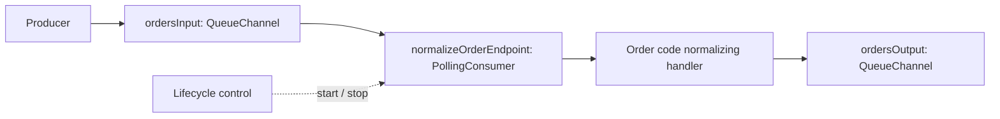
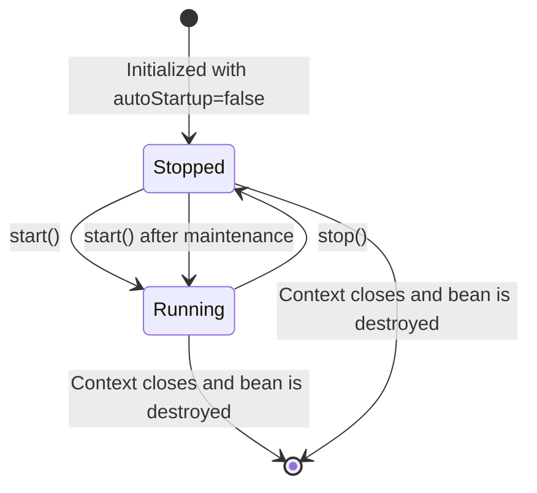

# Endpoint Lifecycle Control

## 1. Objectives and Context

In the `SPRING_INTEGRATION_CORE` module, we design flows using `Message`, `MessageChannel`, endpoints, gateways, and Java DSL. This lesson belongs to the **System management** chapter and addresses an operational requirement: explicitly telling an endpoint to start or stop accepting work while still knowing where messages reside.

After this lesson, you will be able to:

- Distinguish endpoint lifecycle from bean lifecycle, channel state, and business processing outcomes.
- Configure `autoStartup`, name endpoints, and control them via `SmartLifecycle`.
- Predict the impact of `stop()` on synchronous flows and queued flows.
- Order startup and shutdown using `phase`; manage multiple endpoints by role or via the Control Bus.
- Design bounded maintenance operations, observe backlog, and test restarting behavior.

**Running scenario:** the system accepts orders into a queue, normalizes order codes, and forwards them to the next stage. During maintenance on the order-processing service, we need to retain unprocessed orders, stop the right consumer, and restart it after maintenance. Stopping the wrong point can cause sender errors or unexpected queue growth.

Examples use Java 17, Spring Integration 6.5, and Java DSL. The project needs `org.springframework.integration:spring-integration-core`, with compatible Spring dependencies managed by a BOM or build configuration; tests use JUnit Jupiter. Examples do not require Spring Boot or an external broker. The code in this lesson is practice material and was not executed during lesson authoring.

## 2. Which Object Is the Endpoint to Control?

A service activator or transformer can involve two distinct objects:

1. **Handler** performs the work: transforming payloads, invoking services, routing, or filtering.
2. **Consumer endpoint** connects the handler to the input channel and manages how messages are received.



When you want to stop pulling orders from `ordersInput`, the object to control is `normalizeOrderEndpoint`. Calling a business method directly on the handler can still execute work while bypassing the endpoint's message-receiving mechanism.

A bean that has been created, dependency-injected, and registered in the context is not necessarily running yet. Conversely, a running endpoint does not prove the external service is healthy or that orders have completed.

In Java DSL, giving an endpoint an `id` keeps management operations independent of auto-generated names. Flow names, channel names, and endpoint names serve different roles; do not take a flow's `@Bean` method name and assume it is the consumer to stop. Endpoint naming is described in [DSL and Endpoint Configuration](https://docs.spring.io/spring-integration/reference/6.5/dsl/java-endpoints.html).

## 3. Lifecycle Contract: `start`, `stop`, and `autoStartup`

Endpoints based on `AbstractEndpoint` provide lifecycle management through `SmartLifecycle`. Key operations include:

| Member | Meaning |
| --- | --- |
| `start()` | Tells the endpoint to begin receiving or emitting messages according to its endpoint type. |
| `stop()` | Tells the endpoint to stop that activity. |
| `isRunning()` | Reads the running state reported by the endpoint at the time of inspection. |
| `isAutoStartup()` | Indicates whether the endpoint starts automatically on context refresh. |
| `getPhase()` | Value used to organize lifecycle ordering. |
| `stop(Runnable callback)` | Notifies the lifecycle manager when the component completes its stop procedure. |

`AbstractEndpoint` defaults `autoStartup` to `true`. Setting `false` lets the bean exist while waiting for an explicit `start()` command. See the [AbstractEndpoint API](https://docs.spring.io/spring-integration/docs/6.5.x/api/org/springframework/integration/endpoint/AbstractEndpoint.html).

The states relevant to this lesson can be visualized as follows:



This is an explanatory model, not every internal framework state. A start command can fail due to invalid configuration or unavailable resources.

Keep three distinctions clear in your design:

- `autoStartup(false)` is an initial startup policy, not a command to stop an already running endpoint.
- `stop()` does not remove the bean from the context. Destroying or removing a dynamic flow is a separate operation requiring its own resource management.
- `isRunning() == false` is not proof that every order committed, every HTTP call finished, or every aggregator group was released.

Do not persist maintenance state merely by calling `stop()` and assuming the next application startup will stay stopped. If configuration still allows auto-startup, the endpoint can start again when a new context is created. Long-term operational state must be represented in configuration or a persistent coordination mechanism.

## 4. How Stopping an Endpoint Affects Messages

### 4.1. Consumers Subscribed to a Channel

With `EventDrivenConsumer`, starting registers the handler with a `SubscribableChannel`; stopping unregisters it. This behavior can be verified in [EventDrivenConsumer 6.5.0 Source](https://github.com/spring-projects/spring-integration/blob/v6.5.0/spring-integration-core/src/main/java/org/springframework/integration/endpoint/EventDrivenConsumer.java).

If the input is a `DirectChannel`, there is only one consumer, and that consumer has stopped, the next send has no subscriber to receive it. The send call typically throws `MessageDeliveryException` because the dispatcher found no subscriber. This channel does not buffer messages while waiting for the consumer to restart.

If another consumer is still subscribed to the same `DirectChannel`, messages can be delivered to the remaining consumer. Thus, stopping one endpoint does not automatically halt all work on that channel.

### 4.2. Consumers Polling a Queue

With `PollingConsumer`, the endpoint uses a poller to receive from a `PollableChannel`. Stopping the endpoint stops polling, not the contents of the queue. Scheduling and task cancellation belong to [AbstractPollingEndpoint](https://github.com/spring-projects/spring-integration/blob/v6.5.0/spring-integration-core/src/main/java/org/springframework/integration/endpoint/AbstractPollingEndpoint.java).

In the order scenario, we choose `QueueChannel` so senders can still submit orders while the consumer is resting, as long as capacity remains. That shifts the operational requirement toward managing backlog and intake limits.

| Input connection | When the target consumer stops | What to observe |
| --- | --- | --- |
| `DirectChannel`, single subscriber | New sends lack a receiver; no default buffer. | Send failures and caller responses. |
| `QueueChannel` | Unpulled messages stay in the queue. | Capacity, wait time, and maintenance duration. |
| `ExecutorChannel` | Tasks already handed to the executor may still be running; stopping the consumer does not clear the executor's task queue. | Queued tasks, running tasks, and executor shutdown settings. |
| `PublishSubscribeChannel` | Other subscribers may keep receiving; lack of subscribers depends on `minSubscribers`. | Subscriber count and which branches remain active. |

Channel send semantics, buffering, and execution threads are covered in [Message Channel Implementations](https://docs.spring.io/spring-integration/reference/6.5/channel/implementations.html).

The table describes per-connection impact, not an end-to-end delivery guarantee. An order already pulled from the queue whose handler has not finished is **in-flight**, distinct from orders still sitting in the queue. At the moment `stop()` is called, a task may be running or receive an interrupt signal; inspect the endpoint, executor, and interruption handling.

An in-memory `QueueChannel` retains data only for the lifetime of the process. If maintenance includes shutting down the application, choose durable storage or an appropriate broker before promising orders will be preserved.

## 5. Java DSL Example: A Consumer Waiting for Start

### 5.1. Order Flow Configuration

Create the following configuration class in your practice project:

```java
import java.util.Locale;

import org.springframework.context.annotation.Bean;
import org.springframework.context.annotation.Configuration;
import org.springframework.integration.channel.QueueChannel;
import org.springframework.integration.config.EnableIntegration;
import org.springframework.integration.dsl.IntegrationFlow;
import org.springframework.integration.dsl.Pollers;

@Configuration
@EnableIntegration
public class OrderLifecycleConfig {

    @Bean
    public QueueChannel ordersInput() {
        return new QueueChannel(100);
    }

    @Bean
    public QueueChannel ordersOutput() {
        return new QueueChannel(100);
    }

    @Bean
    public IntegrationFlow orderFlow() {
        return IntegrationFlow.from(ordersInput())
                .transform(String.class,
                        order -> order.trim().toUpperCase(Locale.ROOT),
                        endpoint -> endpoint
                                .id("normalizeOrderEndpoint")
                                .autoStartup(false)
                                .phase(100)
                                .role("orders-processing")
                                .poller(Pollers.fixedDelay(100)
                                        .receiveTimeout(0)
                                        .maxMessagesPerPoll(1)))
                .channel(ordersOutput())
                .get();
    }
}
```

In this configuration, we deliberately choose:

- Input capacity of 100 messages so stopping the consumer cannot turn into unbounded memory growth.
- `normalizeOrderEndpoint` as the stable name of the consumer to manage.
- `autoStartup(false)` so we can observe state before the start command.
- Poller with a 100 ms fixed delay and at most one message per poll. `receiveTimeout(0)` avoids blocking inside a poll when the queue is empty.
- Output is also a queue; the exercise reads results via `receive(timeout)`.

These values are for experimentation, not capacity sizing for a production system. Limiting to one message per poll also does not mean the whole system processes only one message at a time if multiple consumers or other executors exist.

### 5.2. Starting, Stopping, and Restarting

Place the demo runner class in the same package as the configuration:

```java
import org.springframework.context.SmartLifecycle;
import org.springframework.context.annotation.AnnotationConfigApplicationContext;
import org.springframework.integration.channel.QueueChannel;
import org.springframework.messaging.Message;
import org.springframework.messaging.support.MessageBuilder;

public class OrderLifecycleDemo {

    public static void main(String[] args) {
        try (var context = new AnnotationConfigApplicationContext(
                OrderLifecycleConfig.class)) {

            var input = context.getBean("ordersInput", QueueChannel.class);
            var output = context.getBean("ordersOutput", QueueChannel.class);
            var endpoint = context.getBean(
                    "normalizeOrderEndpoint", SmartLifecycle.class);

            System.out.println("Initial: " + endpoint.isRunning());
            send(input, " order-001 ");
            System.out.println("Queued: " + input.getQueueSize());

            endpoint.start();
            System.out.println("Result 1: " + receivePayload(output));

            endpoint.stop();
            send(input, " order-002 ");
            System.out.println("After stop: " + endpoint.isRunning());
            System.out.println("Queued: " + input.getQueueSize());

            endpoint.start();
            System.out.println("Result 2: " + receivePayload(output));
        }
    }

    private static void send(QueueChannel channel, String payload) {
        boolean accepted = channel.send(
                MessageBuilder.withPayload(payload).build(), 200);
        if (!accepted) {
            throw new IllegalStateException("Queue is not accepting more orders");
        }
    }

    private static Object receivePayload(QueueChannel channel) {
        Message<?> message = channel.receive(2_000);
        if (message == null) {
            throw new IllegalStateException("No result received in time");
        }
        return message.getPayload();
    }
}
```

Expected console output, ignoring framework logs:

```text
Initial: false
Queued: 1
Result 1: ORDER-001
After stop: false
Queued: 1
Result 2: ORDER-002
```

The key behavior to verify is that the second order is processed after restarting. Successfully placing the order on input only confirms intake accepted the message; the business outcome is verified separately at the output.

The example intentionally avoids `Thread.sleep()` to guess completion timing. Calling `receive(2_000)` waits for the result with an explicit deadline and fails if the condition is not met. Two seconds is an experimental timeout that must be tuned to the runtime environment.

In larger applications, you can inject the endpoint via `@Qualifier("normalizeOrderEndpoint") SmartLifecycle endpoint` into a management service. Avoid fetching all `SmartLifecycle` beans and stopping them en masse because that list may include schedulers or shared resources.

## 6. Phase Ordering: Downstream Ready Before Upstream

`SmartLifecycle` starts from lower phase to higher phase, and stops in the reverse order. Components in the same phase have no guaranteed relative order; explicit `depends-on` relationships take precedence over phase. See the [SmartLifecycle API](https://docs.spring.io/spring-framework/docs/6.2.x/javadoc-api/org/springframework/context/SmartLifecycle.html).

Suppose we extend the example into three endpoints with independent lifecycles:

```text
Order intake source -> queue -> normalization -> queue -> partner dispatch
```

An application-chosen phase assignment:

| Endpoint | Application-chosen phase | Start order | Stop order |
| --- | --- | --- | --- |
| Partner dispatch, end of flow | 100 | 1 | 3 |
| Order normalization | 200 | 2 | 2 |
| Order intake source | 300 | 3 | 1 |

The goal is preparing receivers before the source begins producing more orders. On stop, the source closes first while downstream gets a chance to continue finishing work.

This is a suggested ordering for the diagram above. Do not copy those phase numbers blindly to every flow: account for shared resources, asynchronous boundaries, and real dependencies. Different endpoint classes may have their own default phases; do not infer from the interface default that all endpoints share the same phase.

Phase also does not automatically execute a queue-draining procedure. If the system stops the source and immediately stops the consumer right after, orders still in the queue may remain unprocessed. To drain, you need an explicit wait step and observable completion criteria.

When calling `endpoint.start()` or `endpoint.stop()` directly, you are acting on that single object. That call does not automatically walk all upstream and downstream endpoints and apply your ordering table. Coordinating multiple endpoints must be done by the container, a role controller, or a management service.

## 7. Stopping with a Callback and In-Flight Work

When a component's stop mechanism is asynchronous, `stop(Runnable)` lets you receive notification when lifecycle shutdown finishes. Example snippet inside a management method that already has `endpoint` of type `SmartLifecycle`:

```java
var stopped = new java.util.concurrent.CountDownLatch(1);
endpoint.stop(stopped::countDown);

boolean completed = stopped.await(
        5, java.util.concurrent.TimeUnit.SECONDS);
if (!completed) {
    throw new IllegalStateException("Endpoint did not finish stopping in time");
}
```

The method containing this snippet must handle `InterruptedException`, for instance by declaring `throws InterruptedException`. If catching and wrapping into another exception, restore the interrupt flag when appropriate for the application's contract.

Do not run this wait on a message-processing thread if that very thread must finish for the endpoint to stop. Using a dedicated management thread avoids having the control operation wait on itself.

The callback signals stop completion according to the component's contract; it does not automatically add tracking for all business tasks. For an order application, measure separately at least:

- Orders waiting in the queue.
- Orders already pulled but not yet finished.
- Orders retrying or awaiting partner responses.
- Commit, error, or dead-letter routing outcomes.

For example, queue size may be 0 while a payment call is still waiting for a response. Checking only the queue would end maintenance too early. Conversely, an endpoint may be running while a router sends all messages to another branch; running state does not describe business traffic.

## 8. Controlling via the Control Bus

The Control Bus delivers management commands via messaging. In Spring Integration 6.5, command payloads use the `beanName.methodName` format; methods with parameters receive arguments as a list in the `IntegrationMessageHeaderAccessor.CONTROL_BUS_ARGUMENTS` header. Do not mix syntax from older version documentation into this example. See [Control Bus](https://docs.spring.io/spring-integration/reference/6.5/control-bus.html).

In a `@Configuration` class loaded alongside `OrderLifecycleConfig`, add the following bean (importing `Bean` and `IntegrationFlow` as before):

```java
@Bean
public IntegrationFlow operationsFlow() {
    return IntegrationFlow.from("operationsInput")
            .controlBus()
            .get();
}
```

Once the context loads both configurations, retrieve the channel and send commands:

```java
var operations = context.getBean(
        "operationsInput", org.springframework.messaging.MessageChannel.class);

operations.send(
        org.springframework.messaging.support.MessageBuilder
                .withPayload("normalizeOrderEndpoint.stop")
                .build());

operations.send(
        org.springframework.messaging.support.MessageBuilder
                .withPayload("normalizeOrderEndpoint.start")
                .build());
```

A query returning a value needs a reply destination:

```java
var replies = new org.springframework.integration.channel.QueueChannel(1);

operations.send(
        org.springframework.messaging.support.MessageBuilder
                .withPayload("normalizeOrderEndpoint.isRunning")
                .setReplyChannel(replies)
                .build());

var reply = replies.receive(1_000);
if (reply == null) {
    throw new IllegalStateException("Missing lifecycle query reply");
}
System.out.println(reply.getPayload());
```

In the example's operational design, the management channel must stay active while the order consumer is paused. Therefore, never put `operationsFlow` in the same group that maintenance commands will stop. If commands come from HTTP or external systems, map allowed operations to specific endpoints, authenticate callers, and log operation outcomes; never pass raw business payloads as management commands.

Keep three milestones distinct: a command sent successfully, an endpoint changing state, and a maintenance procedure completing. These three milestones need separate evidence if commands travel over an asynchronous channel.

## 9. Managing Multiple Endpoints by Role

Roles group endpoints to start or stop together. The configuration in section 5 assigned `orders-processing`. With a running context, use the framework-provided controller:

```java
var roles = context.getBean(
        org.springframework.integration.support.SmartLifecycleRoleController.class);

roles.stopLifecyclesInRole("orders-processing");
System.out.println(roles.getEndpointsRunningStatus("orders-processing"));
roles.startLifecyclesInRole("orders-processing");
```

You can inspect a group with `allEndpointsRunning(role)` or `noEndpointsRunning(role)`. When using leader-election events to manage a group, set `autoStartup(false)` on endpoints waiting for leadership. API details and events are in [Endpoint Roles](https://docs.spring.io/spring-integration/reference/6.5/endpoint-roles.html).

For an order system, name roles by operational intent: intake group, processing group, or partner-dispatch group. Lumping all of them into a single group means stopping the group also loses the ability to finish already-accepted orders. Roles are a grouping tool; the drain workflow is still designed by the application.

A role applies only to the endpoints managed by that controller in that context. To stop processing across multiple instances, coordinate across the relevant instances. For example, if three instances pull orders from a broker, stopping one instance does not prove the other two stopped.

## 10. Controlled Maintenance Procedure

The steps below represent a recommended operational plan for a flow whose intake source is decoupled from its processing consumer:

1. **Choose the maintenance scope.** Identify which endpoints should pause, which queues will hold work, and which downstream branches must keep running.
2. **Stop new intake when draining.** Stop the source or close the intake gate with an explicit policy. If intake stays open, verify sufficient backlog capacity.
3. **Keep the consumer and outcome branches running.** Let already-accepted orders finish passing through transformers, routers, filters, aggregators, and partner calls.
4. **Wait for completion conditions with a deadline.** Combine backlog, in-flight counts, retries, and transaction states rather than reading only `isRunning()`.
5. **Stop the target endpoint.** Record the post-command state and the reason if a deadline expired.
6. **Perform maintenance and verify downstream readiness.** Check resources the consumer depends on before resuming processing.
7. **Start the consumer, then reopen intake.** Monitor backlog drain rate, new errors, and latency.

If the goal is merely pausing the consumer while continuing to accumulate orders, the drain wait does not apply the same way. In that case, explicitly decide the intake cap and when to reject or defer requests.

A planning estimate:

```text
Additional backlog ≈ order intake rate × consumer downtime
```

Suppose the input starts empty, receives a steady 20 orders/second, and the consumer rests for 30 seconds: expected growth is 600 orders. The example's queue capacity of 100 cannot handle that scenario. The estimate also excludes bursts or orders already queued beforehand.

After reopening, if the system processes 50 orders/second while still receiving 20 orders/second, net backlog drains at about 30 orders/second. A 600-order backlog takes around 20 seconds assuming steady rates. These calculations guide observation deadlines; they do not replace real measurements.

Spring Integration also provides orderly shutdown via `IntegrationMBeanExporter.stopActiveComponents(Long)`, taking a timeout in milliseconds. That mechanism prepares sources to stop and grants a wait window for messages already traversing the flow; pollers stay active to aid draining. See [Orderly Shutdown](https://docs.spring.io/spring-integration/reference/6.5/shutdown.html). Use that API only when an appropriate exporter is configured; its scope differs from stopping a single endpoint as in this example.

## 11. Relationship to Gateways, Errors, and Integration Patterns

### Gateways and Request–Reply

If a gateway sends to a stopped consumer, behavior depends on the channel. On a synchronous path, missing subscribers can cause the send to fail. On a queued path, the request may be accepted while the reply arrives after the caller's wait timeout.

Therefore, API contracts must distinguish "request accepted" from "processing completed." If a client times out and retries, the same order could be processed multiple times. Use business keys or idempotency mechanisms rather than assuming a timeout means no processing occurred.

### Transformers, Routers, and Filters

Stopping a transformer in the middle of a synchronous path can block upstream sends. With multi-branch routers, clarify which branches pause and which remain active. With filters, receiving no output may be a valid filtering decision, not necessarily a stopped endpoint.

When assessing draining, use metrics tied to business completion points. Counting only messages exiting a filter while ignoring its discard channel can mislead you into thinking orders vanished.

### Aggregators and Waiting Message Groups

An aggregator group that has not yet met release conditions can remain inside a message store even when no tasks are actively running. During maintenance or process restarts, know whether the store is durable and how incomplete groups will resume.

Do not assume stopping a consumer clears groups, releases all groups, or cancels scheduled timeouts. Those behaviors depend on the configuration and lifecycle of the handler and its resources. Operational procedures must account separately for incomplete groups and scheduled timeouts if they can emit output.

### Error Handling and Retries

On synchronous paths, errors usually return to the calling thread; polled or executor paths use their own configured error-reporting mechanisms. During draining, the error-handling branch must stay available to capture failures.

Stopping an endpoint does not turn an interrupted in-flight execution into a replayable transaction. For instance, an order pulled from an in-memory queue whose handler throws an exception does not automatically return to the queue. To guarantee recovery, design retries, failed-message storage, transactions, or redelivery-capable sources.

## 12. Testing Lifecycle Behavior

Tests should assert both state and message flow. With `OrderLifecycleConfig`, the following test covers: not auto-started, processing after start, retaining orders after stop, and resuming processing after restart.

```java
import org.junit.jupiter.api.Test;

import org.springframework.context.SmartLifecycle;
import org.springframework.context.annotation.AnnotationConfigApplicationContext;
import org.springframework.integration.channel.QueueChannel;
import org.springframework.messaging.Message;
import org.springframework.messaging.support.MessageBuilder;

import static org.junit.jupiter.api.Assertions.*;

class OrderLifecycleTest {

    @Test
    void retainsQueuedOrderWhileConsumerIsStopped() {
        try (var context = new AnnotationConfigApplicationContext(
                OrderLifecycleConfig.class)) {

            var input = context.getBean("ordersInput", QueueChannel.class);
            var output = context.getBean("ordersOutput", QueueChannel.class);
            var endpoint = context.getBean(
                    "normalizeOrderEndpoint", SmartLifecycle.class);

            assertFalse(endpoint.isRunning());
            assertTrue(input.send(
                    MessageBuilder.withPayload(" order-001 ").build(), 200));
            assertEquals(1, input.getQueueSize());
            assertNull(output.receive(0));

            endpoint.start();
            assertTrue(endpoint.isRunning());
            Message<?> first = output.receive(2_000);
            assertNotNull(first);
            assertEquals("ORDER-001", first.getPayload());

            // Wait for the first order's result before stopping the consumer.
            endpoint.stop();
            assertFalse(endpoint.isRunning());

            assertTrue(input.send(
                    MessageBuilder.withPayload(" order-002 ").build(), 200));
            assertEquals(1, input.getQueueSize());
            assertNull(output.receive(200));

            endpoint.start();
            Message<?> second = output.receive(2_000);
            assertNotNull(second);
            assertEquals("ORDER-002", second.getPayload());
            assertEquals(0, input.getQueueSize());
            assertNull(output.receive(0));
        }
    }
}
```

This pattern does not verify durability across process shutdown, transactions, or race conditions with many in-flight orders. Those are separate requirements needing dedicated experiments.

To extend this exercise, use a handler with a "started" latch and a "proceed" latch. Send an order, wait for the start signal, and call stop from a management thread. Observe separately: endpoint state, whether the task receives interruption, and the order processing outcome. That creates an exact in-flight scenario deterministically rather than flooding orders and hoping stop lands at the right moment.

## 13. Common Errors and Diagnostics

| Symptom | Hypothesis to check | Handling in the order scenario |
| --- | --- | --- |
| Endpoint still runs right after changing config to `autoStartup(false)` mentally | Confusing startup config with runtime control commands. | Call `stop()` on the running endpoint; ensure new contexts load the updated config. |
| Retrieved bean lacks expected lifecycle API | Retrieved handler, channel, or flow name instead of the consumer. | Use the endpoint's `id` and verify the exact bean type. |
| Sending to `DirectChannel` fails after maintenance | Target subscriber has not restarted and no other subscriber exists. | Start downstream before reopening intake; use a queue if accumulation is needed. |
| `send()` returns success yet no result appears | Request is sitting in a queue or executor. | Monitor output or reply with a timeout and order ID. |
| Queue fills up while consumer rests | Intake keeps sending past remaining capacity. | Configure intake caps, send timeouts, and overload handling. |
| Some orders still finish after `stop()` | Work was dispatched before stopping. | Track in-flight work; design a wait procedure rather than reading only the running flag. |
| Restarted endpoint yet old orders are missing | Process lost in-memory queue, or orders were pulled and failed. | Check persistence points, error logs, and recovery mechanisms before retrying. |
| Stopped one instance yet system still processes orders | Other instances or other consumers remain active. | Verify full orchestration scope and consumer groups. |
| Management commands stop arriving after stopping a group | The management flow itself was included in the stopped group. | Keep the control path independent of processing groups. |

For every operational action, a useful audit record captures endpoint name, instance, command, before/after state, timestamp, initiator or trigger, backlog, and outcome. When an action times out, preserve the cause and observed state; never report maintenance as successful merely because a command was sent.

## 14. Applied Exercises

### Exercise 1: Replace QueueChannel with DirectChannel

Switch `ordersInput` to `DirectChannel` and remove the consumer's poller configuration. Keep `autoStartup(false)` and send one order before `start()`, after `start()`, and after `stop()`.

**Outcome to explain:** with a single consumer, sends while stopped lack a subscriber; the send while running succeeds. There is no input backlog as in the queue example. Add a second consumer to observe why stopping one endpoint does not necessarily fail all sends.

### Exercise 2: 30-Second Maintenance

Suppose 10 orders are waiting and intake receives 15 orders/second. The consumer pauses for 30 seconds, and input capacity is 200.

**Hint:** expected unbounded backlog is `10 + 15 × 30 = 460`. Current capacity is insufficient. Propose an intake policy, send-timeout reporting, and order persistence if the application must restart. Clarify which changes are lifecycle control and which are messaging design.

### Exercise 3: Draining with an Aggregator

Each order splits into three tasks and an aggregator waits for all three results. Stop the intake source when two groups have received only two results.

**Hint:** distinguish an empty queue from completed groups. Decide whether to wait for remaining results, apply a timeout, or retain groups for post-maintenance recovery per business rules. Never use `noEndpointsRunning(role)` alone as proof that all orders are complete.

## 15. Key Takeaways

Endpoint lifecycle control governs whether a component continues receiving or emitting messages. Where messages reside depends on surrounding channels and resources: queues hold unpulled work, executors hold submitted tasks, aggregators hold unreleased groups, and gateways hold callers waiting for replies.

When designing a stop action, answer four questions: which endpoint is affected, where new orders go, how in-flight work is tracked, and what evidence permits restarting. Clear endpoint naming, dependency-aware ordering, bounded waits, and message-level verification make maintenance operations predictable and testable.
