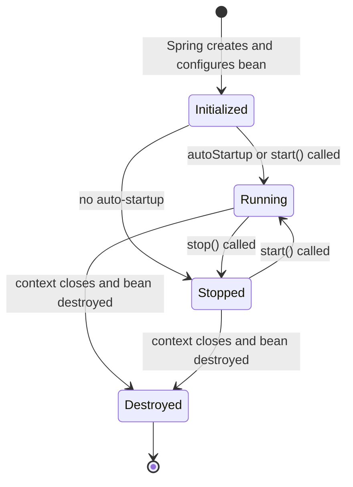

# Starting and Stopping Endpoints

In the **System management** chapter of the **SPRING_INTEGRATION_CORE** module, controlling endpoint lifecycles lets you operate message flows without restarting the entire application. A common scenario is pausing order intake while maintaining the inventory service, retaining pending work, and then resuming the flow.

This lesson focuses on the endpoints connecting `MessageChannel` to processing components, configuring them with Java DSL, calling `start()` and `stop()`, controlling them via the Control Bus, and verifying message behavior when an endpoint stops. Examples use Java 17 or higher and **Spring Integration 6.5.x** APIs. For Spring Boot applications, let Boot's BOM manage compatible Spring versions.

## 1. Learning Outcomes

After this lesson, you will be able to:

- Distinguish the states of a bean, endpoint, handler, and entire flow.
- Name endpoints and configure `autoStartup` in Java DSL or annotations.
- Control endpoints via `Lifecycle` and check `isRunning()`.
- Explain the difference between stopping a `QueueChannel` consumer and a `DirectChannel` consumer.
- Order startup and shutdown and handle in-flight work.
- Write tests for initial state, starting, and restarting an endpoint.

Prerequisites are `Message` structure, the difference between `SubscribableChannel` and `PollableChannel`, and how to declare an `IntegrationFlow`.

## 2. Which Object Is Started and Stopped as the Endpoint?

Consider a simple flow:

```text
Order source
      |
      v
ordersInbox (QueueChannel)
      |
      v
orderWorker (PollingConsumer)
      |
      v
order processing handler
      |
      v
processedOrders (QueueChannel)
```

Here:

- **Channel** determines how messages are sent, received, or buffered.
- **Handler** executes business work, such as calling an inventory service, transforming data, or routing.
- **Endpoint** coordinates connecting the handler to the channel: subscribing for messages or actively polling.
- **IntegrationFlow** describes a chain of components; one flow can contain multiple endpoints.

For typical consumers, Spring Integration uses `EventDrivenConsumer` for subscribable channels and `PollingConsumer` for pollable channels. Transformers, filters, routers, or service activators can all be attached to flows through this endpoint mechanism. [Message Endpoints Documentation](https://docs.spring.io/spring-integration/reference/6.5/endpoint.html)

Controlling the right endpoint matters more than merely finding the right business method. A service bean with a `processOrder()` method does not automatically serve as the lifecycle management object for the consumer invoking it.

| Component visible in configuration | Object to target when controlling |
| --- | --- |
| Handler receiving from `DirectChannel` | The endpoint subscribing the handler to the channel |
| Handler receiving from `QueueChannel` | The endpoint managing polling and invoking the handler |
| Scheduled inbound adapter reading a source | The adapter's endpoint managing source polling |
| Listener-based inbound adapter | The adapter's endpoint and corresponding listener mechanism |
| Multi-step flow | Each endpoint to manage, or the appropriate flow-level management object |
| Gateway feeding requests into a flow | Identify which gateway/adapter and downstream endpoints to control; do not infer endpoint names from gateway method names |

Adapters talking to external systems also have specific details around listeners, connections, acknowledgments, and transactions. The rules in this lesson establish the foundation, without replacing each adapter's own lifecycle contract.

## 3. Lifecycle and SmartLifecycle Contracts

### 3.1. Basic Operations

The `org.springframework.context.Lifecycle` interface has three key methods:

```java
void start();
void stop();
boolean isRunning();
```

Steady operational states can be visualized as follows:



The diagram omits transient starting, stopping, and error phases. The key point is that an endpoint already created and dependency-injected by Spring may still not be running.

The base class `AbstractEndpoint` supports `autoStartup`, which defaults to `true`. Set this property to `false` so an endpoint waits for an explicit start. [AbstractEndpoint API](https://docs.spring.io/spring-integration/docs/6.5.0/api/org/springframework/integration/endpoint/AbstractEndpoint.html)

### 3.2. `autoStartup` Is Not a Permanent Off Switch

`autoStartup(false)` controls automatic startup on context refresh. It does not forbid calling `start()` afterward.

Distinguish three cases:

| Action | Meaning |
| --- | --- |
| Configure `autoStartup(false)` | On context startup, the endpoint does not start automatically |
| Call `stop()` on a running endpoint | Requests the endpoint to stop according to its contract |
| Call `start()` on a stopped endpoint | Lets that same endpoint resume operating |

Once an endpoint has started, changing the `autoStartup` property does not replace calling `stop()`. Conversely, calling `stop()` does not persist configuration changes so that the endpoint stays disabled on the next application startup.

### 3.3. What Does SmartLifecycle Add?

`SmartLifecycle` extends `Lifecycle` with auto-startup configuration, `phase` ordering, and a `stop(Runnable callback)` variant. When Spring manages context lifecycle, lower phases start first and higher phases stop first. Beans in the same phase have no guaranteed order; explicitly declared dependency relationships take precedence. [SmartLifecycle API](https://docs.spring.io/spring-framework/docs/6.2.x/javadoc-api/org/springframework/context/SmartLifecycle.html)

`isRunning()` only reflects the lifecycle state reported by the component. For example, a worker can be running while the inventory service is failing or the queue is backing up. Therefore, read this status alongside waiting message counts, in-flight tasks, and business errors.

## 4. Complete Example: Holding Orders While the Worker Is Not Running

### 4.1. Preparation

The example requires `org.springframework.integration:spring-integration-core` along with compatible Spring dependencies. Java DSL is included in that artifact, so no separate Java DSL module is needed. Tests in a later section use JUnit Jupiter.

The two classes below can live in the same package of an existing application. They use plain Spring Java Configuration so lifecycle observation does not depend on Spring Boot startup mechanics.

### 4.2. Declaring Channels and the Consumer

```java
import java.util.Locale;

import org.springframework.beans.factory.annotation.Qualifier;
import org.springframework.context.annotation.Bean;
import org.springframework.context.annotation.Configuration;
import org.springframework.integration.channel.QueueChannel;
import org.springframework.integration.config.EnableIntegration;
import org.springframework.integration.dsl.IntegrationFlow;
import org.springframework.integration.dsl.Pollers;

@Configuration
@EnableIntegration
public class OrderLifecycleConfig {

    @Bean
    public QueueChannel ordersInbox() {
        return new QueueChannel(100);
    }

    @Bean
    public QueueChannel processedOrders() {
        return new QueueChannel(100);
    }

    @Bean
    public IntegrationFlow orderProcessingFlow(
            @Qualifier("ordersInbox") QueueChannel ordersInbox,
            @Qualifier("processedOrders") QueueChannel processedOrders) {

        return IntegrationFlow.from(ordersInbox)
                .handle(
                        String.class,
                        (payload, headers) ->
                                payload.trim().toUpperCase(Locale.ROOT),
                        endpoint -> endpoint
                                .id("orderWorker")
                                .autoStartup(false)
                                .phase(100)
                                .poller(Pollers.fixedDelay(100)
                                        .receiveTimeout(0)
                                        .maxMessagesPerPoll(1)))
                .channel(processedOrders)
                .get();
    }
}
```

In this configuration:

- `orderProcessingFlow` is the bean name describing the flow.
- `orderWorker` is the endpoint ID on the `handle` step; this is the name used to control the consumer.
- `autoStartup(false)` keeps the worker stopped after context refresh.
- The inbound `QueueChannel` requires a poller; each poll fetches at most one message.
- `receiveTimeout(0)` lets a poll return immediately if the queue is empty.
- Non-`null` results from the handler are sent to `processedOrders`.

In the example, `fixedDelay(100)` is in milliseconds. It is the delay between poll cycles in this configuration, not an order-processing deadline. Options such as `receiveTimeout`, `maxMessagesPerPoll`, executor, and error channel belong to poller configuration. [PollerSpec API](https://docs.spring.io/spring-integration/docs/6.5.0/api/org/springframework/integration/dsl/PollerSpec.html)

Both channels have capacity 100 so the exercise has clear bounds. They use in-process memory; stopping the worker does not turn the queue into durable storage.

### 4.3. Controlling with Lifecycle

```java
import org.springframework.context.Lifecycle;
import org.springframework.context.annotation.AnnotationConfigApplicationContext;
import org.springframework.integration.channel.QueueChannel;
import org.springframework.messaging.Message;
import org.springframework.messaging.support.GenericMessage;

public class OrderLifecycleDemo {

    public static void main(String[] args) {
        try (var context =
                     new AnnotationConfigApplicationContext(
                             OrderLifecycleConfig.class)) {

            Lifecycle worker =
                    context.getBean("orderWorker", Lifecycle.class);
            QueueChannel inbox =
                    context.getBean("ordersInbox", QueueChannel.class);
            QueueChannel results =
                    context.getBean("processedOrders", QueueChannel.class);

            System.out.println("Initial running = " + worker.isRunning());

            boolean accepted =
                    inbox.send(new GenericMessage<>("  ord-001  "), 0);
            if (!accepted) {
                throw new IllegalStateException("Input queue is full");
            }

            System.out.println("Queued = " + inbox.getQueueSize());

            worker.start();

            Message<?> result = results.receive(3000);
            if (result == null) {
                throw new IllegalStateException("No result received in time");
            }

            System.out.println("Result = " + result.getPayload());

            worker.stop();
            System.out.println("Running after stop = " + worker.isRunning());

            worker.start();
            System.out.println("Running after restart = " + worker.isRunning());

            worker.stop();
        }
    }
}
```

When the flow runs without errors, the primary observed values are:

```text
Initial running = false
Queued = 1
Result = ORD-001
Running after stop = false
Running after restart = true
```

`inbox.send(...)` succeeding before the worker starts proves the queue accepted the message. It does not prove business processing finished. Receiving `ORD-001` from the result channel shows that the message passed through the handler.

The 3-second timeout is the demo program's wait limit. It does not configure a timeout for network calls inside a handler. Using `send(..., 0)` also lets the producer detect immediately if the queue is full.

### 4.4. Avoiding Controlling the Wrong Bean

This call fetches the flow, not the consumer itself:

```java
context.getBean("orderProcessingFlow");
```

The call used in the example fetches the endpoint:

```java
Lifecycle worker =
        context.getBean("orderWorker", Lifecycle.class);
```

Assigning an explicit ID inside `endpoint -> ...` keeps the operational name stable when DSL steps are added or removed. Never rely on auto-generated bean names with numeric indices as a long-term management interface.

For endpoints created through factory beans, standard bean name lookup returns the product object provided by Spring. Do not add an `&` prefix, because that requests the factory bean itself.

## 5. How Does Stop Change Message Delivery?

### 5.1. QueueChannel Consumers

When `orderWorker` stops, it stops polling for new work via the endpoint's polling mechanism. Messages already sitting in the queue are not deleted by the stop command.

Producers can still send to `ordersInbox` while capacity remains. When the worker starts again, it resumes picking up waiting messages.

Separate two operational questions:

1. Should producers continue submitting new work into the system during maintenance?
2. Should the consumer continue pulling queued work for processing?

Stopping the consumer addresses only the second question. If producers keep running, backlog can grow up to the capacity limit. Once full, send behavior depends on the timeout the producer uses. By default `QueueChannel` stores in memory; surviving process shutdown requires appropriate persistent storage or a durable broker. [QueueChannel Documentation](https://docs.spring.io/spring-integration/reference/6.5/channel/implementations.html#queuechannel)

If multiple consumers pull from the same queue, stopping one endpoint does not prevent the other consumers from taking messages.

### 5.2. DirectChannel Consumers

`EventDrivenConsumer` connects a handler to a `SubscribableChannel`. With `DirectChannel`, starting the endpoint subscribes the handler; stopping the endpoint unsubscribes it. [EventDrivenConsumer API](https://docs.spring.io/spring-integration/docs/6.5.0/api/org/springframework/integration/endpoint/EventDrivenConsumer.html)

`DirectChannel` has no queue to hold requests for a later restart. If the stopped endpoint was the sole subscriber, the next send fails with a dispatch/delivery error rather than being buffered.

If another subscriber remains, the channel can still deliver messages to it according to dispatcher configuration. Therefore, do not assume stopping one endpoint closes the channel.

| Scenario | Consumer stopped, excluding already in-flight tasks |
| --- | --- |
| `QueueChannel` with space left | Producers can enqueue more messages; queue holds unpulled work |
| `QueueChannel` full | Producers block or get failed sends depending on timeout |
| `DirectChannel` with no subscribers left | New sends encounter message delivery errors |
| `DirectChannel` with another subscriber | Messages can be delivered to the remaining active subscriber |
| Broker inbound adapter | Pausing delivery, acknowledgments, and redelivery follow adapter and broker rules |

The table assumes the overall application context stays active. Closing the context is a broader operation affecting many other components' lifecycles.

### 5.3. In-Flight Messages Are a Separate Case

A message that has already left the queue or been dispatched to a handler is work currently executing, often called **in-flight**. It is no longer in the "waiting in input queue" category.

`stop()` is not a blanket guarantee that:

- Every active HTTP call or database query has finished.
- Current transactions have rolled back.
- Already received messages will automatically return to the queue.
- Downstream executors or asynchronous tasks have drained.
- Aggregator message groups have completed or been purged.

How an endpoint stops its poller/listener, handles interrupts, and waits for tasks depends on the component type. Downstream steps using executors also have their own lifecycles and queues. If business logic requires redelivery after failure, design acknowledgments, transactions, retries, and idempotency accordingly.

Specifically, `isRunning() == false` does not substitute for evidence that the system has finished all in-flight work.

## 6. Equivalent Annotation-Based Configuration

When an application uses annotations, you can place `autoStartup` on the handler method and assign the endpoint ID with `@EndpointId`.

The example below is an **alternative** to the `orderProcessingFlow` bean in section 4. Keep both channels, remove that flow, and register `OrderHandler` via component scanning or explicit bean declaration. Do not register both approaches with the same `orderWorker` ID.

```java
import java.util.Locale;

import org.springframework.integration.annotation.EndpointId;
import org.springframework.integration.annotation.Poller;
import org.springframework.integration.annotation.ServiceActivator;
import org.springframework.stereotype.Component;

@Component
public class OrderHandler {

    @EndpointId("orderWorker")
    @ServiceActivator(
            inputChannel = "ordersInbox",
            outputChannel = "processedOrders",
            autoStartup = "false",
            poller = @Poller(
                    fixedDelay = "100",
                    maxMessagesPerPoll = "1",
                    receiveTimeout = "0"))
    public String process(String order) {
        return order.trim().toUpperCase(Locale.ROOT);
    }
}
```

`autoStartup` in the annotation is a string value resolved through Spring Integration's configuration mechanism. The custom ID points to the method's endpoint without renaming the `OrderHandler` service bean. [Annotation Support Documentation](https://docs.spring.io/spring-integration/reference/6.5/configuration/annotations.html)

Looking up the bean for control remains the same:

```java
Lifecycle worker =
        context.getBean("orderWorker", Lifecycle.class);
```

There is no need to add a custom `start()` method on the business bean if the goal is simply starting the Spring Integration–managed consumer.

## 7. Controlling via Messages Through the Control Bus

### 7.1. When to Use the Control Bus

Calling `Lifecycle` directly fits when coordination code and the endpoint live in the same application context. The Control Bus is useful when you want to express management actions as messages—for example, an operational task sending a request to start a consumer.

In Spring Integration 6.5.x, `controlBus()` uses `ControlBusCommandRegistry`; payloads use the form `beanName.methodName`. Arguments, if any, are placed in the `IntegrationMessageHeaderAccessor.CONTROL_BUS_ARGUMENTS` header. This lesson uses zero-argument methods. [Control Bus 6.5 Documentation](https://docs.spring.io/spring-integration/reference/6.5/control-bus.html)

### 7.2. Adding a Management Flow

Register the configuration below alongside `OrderLifecycleConfig` to practice with the Control Bus:

```java
import org.springframework.context.annotation.Bean;
import org.springframework.context.annotation.Configuration;
import org.springframework.integration.channel.DirectChannel;
import org.springframework.integration.dsl.IntegrationFlow;

@Configuration
public class EndpointOperationsConfig {

    @Bean
    public DirectChannel operations() {
        return new DirectChannel();
    }

    @Bean
    public IntegrationFlow endpointOperationsFlow(
            DirectChannel operations) {

        return IntegrationFlow.from(operations)
                .controlBus()
                .get();
    }
}
```

When using a plain context as in the example, pass both configuration classes to the constructor:

```java
var context = new AnnotationConfigApplicationContext(
        OrderLifecycleConfig.class,
        EndpointOperationsConfig.class);
```

The management flow must remain active to receive commands. If you stop the endpoint receiving management commands without another control path, you cannot use that same path to start it back up.

### 7.3. Sending Start, Stop, and Status Queries

In a context containing both configurations:

```java
import org.springframework.integration.channel.QueueChannel;
import org.springframework.messaging.Message;
import org.springframework.messaging.MessageChannel;
import org.springframework.messaging.support.GenericMessage;
import org.springframework.messaging.support.MessageBuilder;

// This snippet runs inside a method that has the context variable.
MessageChannel operations =
        context.getBean("operations", MessageChannel.class);

operations.send(new GenericMessage<>("orderWorker.start"));

QueueChannel replies = new QueueChannel(1);

operations.send(
        MessageBuilder.withPayload("orderWorker.isRunning")
                .setReplyChannel(replies)
                .build());

Message<?> runningReply = replies.receive(1000);
if (runningReply == null) {
    throw new IllegalStateException("Did not receive endpoint status");
}

System.out.println(runningReply.getPayload()); // true

operations.send(new GenericMessage<>("orderWorker.stop"));
```

`start` and `stop` have no return value to wait on as a business result. `isRunning` returns status, so the example provides a `replyChannel`.

Do not blindly copy legacy Control Bus examples that pass arbitrary SpEL expressions. Verify APIs against your exact project version, especially when upgrading from older Spring Integration releases.

In real systems, restrict who can send commands and which endpoints may be controlled. Never take an arbitrary string from an end-user request and forward it verbatim to the management channel. When running multiple application replicas, a command on one context affects only the replica receiving it; use an orchestration mechanism to change the whole cluster.

## 8. Start and Stop Ordering in Multi-Endpoint Flows

Suppose a system has three tiers:

```text
orderIntake -> ordersInbox -> orderWorker -> inventory service connection
```

At startup, you usually want the inventory service connection ready first, then the worker running, and finally intake opened. When pausing order intake for maintenance, you usually close intake first and let the worker finish remaining work.

You can select `phase` values as part of lifecycle design:

| Lifecycle-managed component | Illustrative phase |
| --- | --- |
| Downstream resource that must be ready first | 0 |
| `orderWorker` | 100 |
| `orderIntake` | 200 |

When Spring controls context startup, the order is phase 0, 100, 200. On context shutdown, the order reverses. However, `phase` does not check external service health or guarantee a network connection is usable.

In section 4's example, the worker has `autoStartup(false)`. It does not start automatically merely because it has phase 100. Operational code still decides when to call `start()`.

Furthermore, manually calling:

```java
worker.start();
```

does not instruct Spring to start all other beans by phase. When manually coordinating multiple endpoints, invoke them in the designed order.

A controlled maintenance procedure might look like:

1. Stop the source of new work by stopping the inbound endpoint or closing intake at the producer.
2. Let workers process already-accepted work.
3. Monitor both backlog and active in-flight task counts with an explicit deadline.
4. Once work is complete, stop the worker and perform maintenance on related resources.
5. Restore downstream resources, verify service readiness, then start the worker.
6. Reopen intake and verify processing outcomes.

An empty queue does not mean the system has no work left: the worker may have just pulled the last message and be calling the inventory service. Waiting for completion must account for task execution state as well.

If you do not want to drain the entire backlog before maintenance, you can stop the worker early and retain remaining items in appropriate storage. That is a different business choice requiring clear message durability guarantees.

## 9. Stopping with Wait and the Limits of Callbacks

`SmartLifecycle` declares the method:

```java
void stop(Runnable callback);
```

The callback lets a component report that its contractual stop procedure has completed. When implementing a custom `SmartLifecycle` bean, never forget to invoke the callback once stopping finishes.

In orchestration code, you can wait for the callback with a bounded timeout:

```java
import java.util.concurrent.CountDownLatch;
import java.util.concurrent.TimeUnit;

import org.springframework.context.SmartLifecycle;

SmartLifecycle worker =
        context.getBean("orderWorker", SmartLifecycle.class);

CountDownLatch stopped = new CountDownLatch(1);
worker.stop(stopped::countDown);

if (!stopped.await(5, TimeUnit.SECONDS)) {
    throw new IllegalStateException("Endpoint did not report stop completion");
}
```

This snippet must sit in a method handling or declaring `InterruptedException`; if caught, restore the interrupt flag when appropriate.

Receiving the callback must still be interpreted within the component's scope. To prove all downstream business tasks finished, gather separate evidence such as task counters, futures, latches, or transaction states. Do not ascribe a stronger guarantee to the callback than the endpoint's contract provides.

## 10. Single Endpoints and Entire Flows Have Different Scopes

In Java DSL, a single flow often creates multiple endpoints: transformers, filters, routers, handlers, or bridges. Stopping an endpoint at one step does not automatically stop all other steps.

For instance, stopping a transformer between two `DirectChannel` beans can cause upstream sends to fail because the next hop no longer has a subscriber. Therefore, choose stop points based on intake boundaries and buffering mechanisms.

For dynamically registered flows, you can use `IntegrationFlowContext` and its registration handle to control the entire flow:

```java
import org.springframework.integration.dsl.IntegrationFlow;
import org.springframework.integration.dsl.context.IntegrationFlowContext;

// flowContext is an injected IntegrationFlowContext bean.
IntegrationFlow dynamicFlow = IntegrationFlow
        .from("temporaryOrders")
        .handle(String.class, (payload, headers) -> {
            System.out.println("Received: " + payload);
            return null;
        })
        .get();

IntegrationFlowContext.IntegrationFlowRegistration registration =
        flowContext.registration(dynamicFlow)
                .id("temporaryOrderFlow")
                .autoStartup(false)
                .register();

registration.start();
registration.stop();

// Run only when you want to remove the registration and its managed beans.
registration.destroy();
```

`stop()` preserves the registration for restarting later; `destroy()` removes the flow and dependent components managed by that registration. After destroying, reusing it requires registering a fresh flow. [Dynamic and Runtime Integration Flows](https://docs.spring.io/spring-integration/reference/6.5/dsl/java-runtime-flows.html), [IntegrationFlowRegistration API](https://docs.spring.io/spring-integration/docs/6.5.0/api/org/springframework/integration/dsl/context/IntegrationFlowContext.IntegrationFlowRegistration.html)

For flows declared statically with `@Bean`, components are registered in the application context with their own lifecycles. `StandardIntegrationFlow` wraps multi-component management logic; do not infer individual endpoint states solely from the flow bean name. [StandardIntegrationFlow API](https://docs.spring.io/spring-integration/docs/6.5.0/api/org/springframework/integration/dsl/StandardIntegrationFlow.html)

For the requirement "turn off one order-receiving consumer," an endpoint ID such as `orderWorker` remains the clearest control target.

## 11. Testing Lifecycle via Observable Behavior

### 11.1. Testing Initial State and Restarting

The following test reuses `OrderLifecycleConfig` from section 4. Each run creates a fresh context so lifecycle state is never shared across tests.

```java
import org.junit.jupiter.api.Test;
import org.springframework.context.Lifecycle;
import org.springframework.context.annotation.AnnotationConfigApplicationContext;
import org.springframework.integration.channel.QueueChannel;
import org.springframework.messaging.Message;
import org.springframework.messaging.support.GenericMessage;

import static org.junit.jupiter.api.Assertions.*;

class OrderLifecycleTest {

    @Test
    void shouldStartAndRestartWorker() {
        try (var context =
                     new AnnotationConfigApplicationContext(
                             OrderLifecycleConfig.class)) {

            Lifecycle worker =
                    context.getBean("orderWorker", Lifecycle.class);
            QueueChannel inbox =
                    context.getBean("ordersInbox", QueueChannel.class);
            QueueChannel results =
                    context.getBean("processedOrders", QueueChannel.class);

            // Never started yet: no worker is pulling from the input queue.
            assertFalse(worker.isRunning());
            assertTrue(inbox.send(new GenericMessage<>("  ord-001  "), 0));
            assertEquals(1, inbox.getQueueSize());
            assertNull(results.receive(0));

            worker.start();

            Message<?> firstResult = results.receive(3000);
            assertNotNull(firstResult);
            assertEquals("ORD-001", firstResult.getPayload());
            assertTrue(worker.isRunning());

            worker.stop();
            assertFalse(worker.isRunning());

            worker.start();
            assertTrue(worker.isRunning());

            assertTrue(inbox.send(new GenericMessage<>("  ord-002  "), 0));
            Message<?> secondResult = results.receive(3000);
            assertNotNull(secondResult);
            assertEquals("ORD-002", secondResult.getPayload());

            worker.stop();
        }
    }
}
```

This test verifies four facts: the endpoint does not auto-start, the queue retains the initial message, starting enables processing, and the endpoint can restart after stopping.

It does not verify semantics for in-flight tasks interrupted during stop. Do not use this test's result to claim that every active HTTP request is waited on to completion.

### 11.2. Deterministically Testing In-Flight Work

If operational requirements involve active tasks during shutdown, reproduce that state deterministically:

1. Use a test handler that signals it has started via a `CountDownLatch`.
2. Hold the handler at a controlled wait point with a timeout so the test never hangs.
3. Send a message and wait for the handler-started signal.
4. Call stop from a separate coordination thread if stop may wait on the handler.
5. Release the handler and assert callbacks, outputs, and storage state against the required contract.

Never call a potentially blocking stop on the sole thread needed to release the handler. Never replace synchronization signals with arbitrary `Thread.sleep` calls: sleeping proves neither that the endpoint received the message nor that stopping finished.

For broker adapters, add real integration tests covering acknowledgments, redelivery, and transactions; in-memory queue tests do not represent those behaviors.

## 12. Diagnosing Common Errors

| Symptom | Causes to check | Resolution |
| --- | --- | --- |
| Bean lookup by name fails | Using flow name, handler name, or wrong auto-generated ID | Set explicit endpoint IDs and look up the exact name |
| Endpoint has `autoStartup(false)` yet runs | Other code, Control Bus, or a coordinator called start | Audit management command sources and lifecycle config |
| Sending to `DirectChannel` fails after stop | Receiving subscriber was unregistered | Stop upstream intake first or introduce a buffering boundary |
| Worker stopped yet queue keeps growing | Producers keep submitting new work | Coordinate producers or enforce intake limits |
| Queue empty yet external service still receives requests | Message was already pulled by worker and is executing | Monitor in-flight tasks, not just queue size |
| Stopped one worker yet orders still process | Another consumer or already-dispatched task is running | Account for all consumers and asynchronous boundaries |
| Restarted yet no output appears | Empty queue, handler error, unready downstream, or wrong endpoint targeted | Check state, inputs, error channels, and processing outcomes |
| Control Bus does not answer status queries | Management flow not running, wrong command, or missing reply path | Keep management flow active and configure reply channel |
| Command affects only one replica | Each process has its own application context | Fan out commands to all target replicas |

When analyzing incidents, pair `isRunning()` with at least one behavioral signal: queued messages, emitted results, active task count, or errors on `errorChannel`. Handler errors alone do not prove an endpoint stopped; resumption, retries, or stopping intake must be designed and tested per component.

## 13. Applying to an Order Processing Flow

For the requirement "pause processing during inventory maintenance and resume afterward," clarify these before wiring start/stop into operational tooling:

- Which endpoint accepts new work and which endpoint processes accepted work.
- Where buffering occurs, what its capacity is, and whether data survives process shutdown.
- What criteria prove in-flight work has finished.
- Whether the worker restarts automatically once inventory recovers or requires operator confirmation.
- When replaying orders, which mechanism prevents duplicate business transactions.
- Whether management commands target a single process or all replicas.

In the lesson's example, `orderWorker` is the endpoint controlling queue intake; `ordersInbox` holds waiting messages in memory; `processedOrders` provides output evidence. When replacing the handler with a real inventory service call, add matching timeouts, error policies, and observability.

Keeping three factors clear—which endpoint is the control target, where messages currently live, and which criteria confirm completion—lets you apply `start()` and `stop()` to match the operational demands of your Spring Integration flows.
