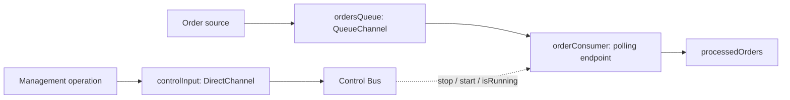
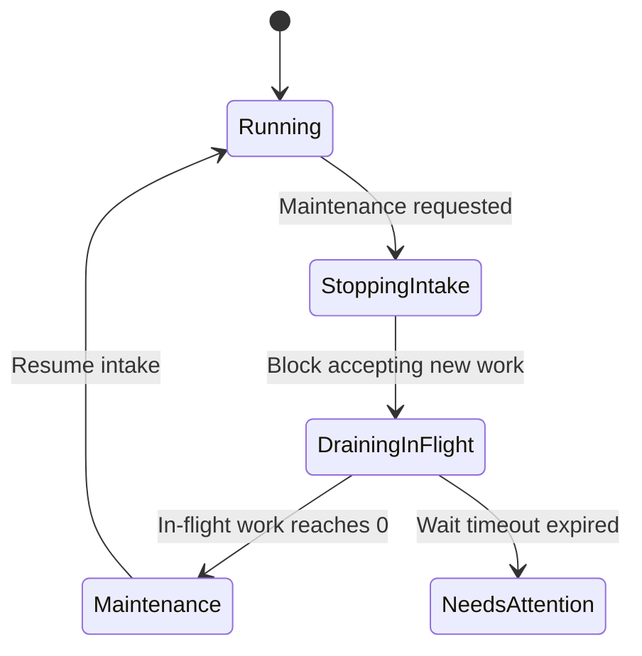

# Pausing Flows with the Control Bus

## Lesson Objectives

In the **System management** chapter of **SPRING_INTEGRATION_CORE**, "pausing a flow" is an operational requirement: temporarily stopping intake or processing at a chosen point, then letting work resume without restarting the application.

After this lesson, you will be able to:

- Select the endpoint to control based on message-intake and processing boundaries.
- Use `Message`, `MessageChannel`, and Java DSL to build a dedicated control bus.
- Send stop/start commands and query endpoint state.
- Distinguish `stop/start` from `pause/resume` on components that implement `Pausable`.
- Design buffered storage for waiting work, error handling, and operational verification.

The lesson assumes familiarity with channels, polling consumers, service activators, and request–reply. Examples target **Spring Integration 6.5.x and Java 17 or higher** for consistent syntax; that is the scope of the examples, not a claim about the version in your project.

## 1. The Problem: Pausing Order Processing for Maintenance

An application receives orders and calls an inventory system. When the inventory system undergoes maintenance, you want to hold pending orders and temporarily pause the consumer calling inventory. After maintenance, the consumer resumes picking up work.

Initial design:



There are two message flows:

| Flow | Example payload | Destination |
| --- | --- | --- |
| Business | `" order-001 "` | Order-processing consumer |
| Management | `"orderConsumer.stop"` | Control bus invoking an operation on the endpoint |

The control bus uses messaging to manage components inside the application. With the API used in this lesson, command payloads follow `beanName.methodName`; a registry determines which operations are allowed to be invoked. Lifecycle methods or methods exposed via management annotations are suitable operations. See [Spring Integration Control Bus](https://docs.spring.io/spring-integration/reference/6.5/control-bus.html).

Separating the management channel lets you send restart commands even while the business consumer is stopped. If management commands had to pass through that same consumer, recovery could get stuck.

## 2. Identifying Exactly What Will Stop

### 2.1. Endpoints, Handlers, and Flows Are Distinct Objects

A handler contains processing logic. An endpoint connects the handler to a channel and manages how the consumer receives messages. With queue-backed channels, the endpoint uses a poller; with subscribable channels, the endpoint receives messages in an event-driven manner. See [Message Endpoints](https://docs.spring.io/spring-integration/reference/6.5/endpoint.html).

In Java DSL:

```java
.handle(String.class,
        (payload, headers) -> payload.trim(),
        endpoint -> endpoint.id("orderConsumer"))
```

`orderConsumer` is the explicitly assigned endpoint name. That is the name that appears in the `orderConsumer.stop` command.

The bean name declaring `@Bean IntegrationFlow orderFlow()` does not automatically mean every inner endpoint is named `orderFlow`. A single flow can contain transformers, routers, filters, aggregators, and multiple consumers. Stopping one endpoint affects only that component.

This lesson chooses to control a specific endpoint so the scope of impact is clear. The `GenericEndpointSpec` API provides options such as `id`, `autoStartup`, and `poller`. See [GenericEndpointSpec](https://docs.spring.io/spring-integration/docs/6.5.0/api/org/springframework/integration/dsl/GenericEndpointSpec.html).

### 2.2. Two Common Ways to Implement "Pause"

| Component capability | Pause with | Resume with | State to inspect |
| --- | --- | --- | --- |
| Has `start/stop` lifecycle | `stop` | `start` | `isRunning` |
| Supports `Pausable` | `pause` | `resume` | `isPaused` and lifecycle state |

The main example uses `stop/start` on a polling endpoint to pause work. Do not assume every endpoint has a `pause` method.

`Pausable` is for components with dedicated pause support; a paused component may still hold external connections. Exact behavior depends on the adapter. Standard `SourcePollingChannelAdapter` exposes lifecycle yet does not implement `Pausable` in the 6.5.0 API. See [Pausable](https://docs.spring.io/spring-integration/docs/6.5.0/api/org/springframework/integration/core/Pausable.html) and [SourcePollingChannelAdapter](https://docs.spring.io/spring-integration/docs/6.5.0/api/org/springframework/integration/endpoint/SourcePollingChannelAdapter.html).

For a bean that actually implements `Pausable`, say a bean named `warehouseInbound`, commands could be:

```text
warehouseInbound.pause
warehouseInbound.isPaused
warehouseInbound.resume
```

The name `warehouseInbound` merely illustrates a separately configured adapter. These commands do not apply to `orderConsumer` in the example below.

### 2.3. Control Bus Syntax Depends on Version

| Version | Notable configuration approach |
| --- | --- |
| 6.3 and earlier | Older examples often use SpEL such as `@orderConsumer.stop()` |
| 6.4 | Introduced registry API `controlBusOnRegistry()`; legacy SpEL API marked deprecated |
| 6.5 | `controlBus()` uses the registry; legacy SpEL API removed |

Therefore, 6.5.x examples use `orderConsumer.stop` without `@` or `()`. When porting examples across versions, check both the DSL method and payload format. See [changes from 6.4 to 6.5](https://docs.spring.io/spring-integration/reference/7.2/changes-6.4-6.5.html) and [DSL 6.4 API](https://docs.spring.io/spring-integration/docs/6.4.x/api/org/springframework/integration/dsl/BaseIntegrationFlowDefinition.html).

## 3. Self-Contained Java DSL Example

### 3.1. Preparation

The example uses a plain Spring application—no web server, broker, or database required. The classpath needs:

- `org.springframework.integration:spring-integration-core` version 6.5.x.
- Spring Context and compatible dependencies managed by the application's dependency management.

If using Spring Boot, use the compatible dependency set managed by Boot. Do not swap in a single mismatched JAR to force the example onto another version line.

Place the content below into a class named `ControlBusPauseLesson` in your practice environment. The example contains both configuration and `main`; checks inside `main` throw if outcomes deviate from expectations.

### 3.2. Configuring Channels, Endpoint, and Management Flow

```java
import java.util.Locale;

import org.springframework.context.annotation.AnnotationConfigApplicationContext;
import org.springframework.context.annotation.Bean;
import org.springframework.context.annotation.Configuration;
import org.springframework.integration.channel.DirectChannel;
import org.springframework.integration.channel.QueueChannel;
import org.springframework.integration.config.EnableIntegration;
import org.springframework.integration.core.MessagingTemplate;
import org.springframework.integration.dsl.IntegrationFlow;
import org.springframework.integration.dsl.Pollers;
import org.springframework.messaging.Message;
import org.springframework.messaging.support.GenericMessage;

@Configuration
@EnableIntegration
public class ControlBusPauseLesson {

    @Bean
    public QueueChannel ordersQueue() {
        return new QueueChannel(100);
    }

    @Bean
    public QueueChannel processedOrders() {
        return new QueueChannel(100);
    }

    @Bean
    public QueueChannel businessErrors() {
        return new QueueChannel(20);
    }

    @Bean
    public DirectChannel controlInput() {
        return new DirectChannel();
    }

    @Bean
    public IntegrationFlow orderFlow() {
        return IntegrationFlow.from(ordersQueue())
                .handle(
                        String.class,
                        (payload, headers) ->
                                "PROCESSED: "
                                        + payload.trim().toUpperCase(Locale.ROOT),
                        endpoint -> endpoint
                                .id("orderConsumer")
                                .autoStartup(false)
                                .sendTimeout(1_000)
                                .poller(Pollers.fixedDelay(100)
                                        .receiveTimeout(0)
                                        .maxMessagesPerPoll(1)
                                        .errorChannel("businessErrors")))
                .channel(processedOrders())
                .get();
    }

    @Bean
    public IntegrationFlow controlFlow() {
        return IntegrationFlow.from(controlInput())
                .controlBus()
                .get();
    }

    public static void main(String[] args) {
        try (var context =
                     new AnnotationConfigApplicationContext(
                             ControlBusPauseLesson.class)) {

            QueueChannel input =
                    context.getBean("ordersQueue", QueueChannel.class);
            QueueChannel output =
                    context.getBean("processedOrders", QueueChannel.class);
            QueueChannel errors =
                    context.getBean("businessErrors", QueueChannel.class);
            DirectChannel controlInput =
                    context.getBean("controlInput", DirectChannel.class);

            MessagingTemplate control = new MessagingTemplate(controlInput);
            control.setSendTimeout(1_000);
            control.setReceiveTimeout(2_000);

            // Consumer is not running yet because of autoStartup(false).
            require(!isRunning(control), "Consumer must be stopped on initialization");

            require(
                    input.send(new GenericMessage<>(" order-001 "), 1_000),
                    "Failed to enqueue order");

            // No other consumer reads ordersQueue in this example.
            require(input.getQueueSize() == 1, "Order must be waiting in the queue");
            require(output.receive(0) == null, "No processed result may exist yet");
            System.out.println("Order order-001 is waiting.");

            command(control, "orderConsumer.start");
            require(isRunning(control), "Consumer must be running after start command");
            expectPayload(output, "PROCESSED: ORDER-001");

            command(control, "orderConsumer.stop");
            require(!isRunning(control), "Consumer must be stopped after stop command");

            // Restart the same endpoint without creating a new ApplicationContext.
            command(control, "orderConsumer.start");
            require(isRunning(control), "Consumer must be running again");

            require(
                    input.send(new GenericMessage<>(" order-002 "), 1_000),
                    "Failed to enqueue second order");
            expectPayload(output, "PROCESSED: ORDER-002");

            command(control, "orderConsumer.stop");
            require(!isRunning(control), "Consumer must be stopped at end of example");
            require(errors.receive(0) == null, "Example unexpectedly produced business errors");

            System.out.println("Completed start -> stop -> start -> stop cycle.");
        }
    }

    private static void command(MessagingTemplate control, String command) {
        // start/stop return void: one-way send.
        control.send(new GenericMessage<>(command));
    }

    private static boolean isRunning(MessagingTemplate control) {
        // isRunning returns boolean: use request-reply.
        Message<?> reply = control.sendAndReceive(
                new GenericMessage<>("orderConsumer.isRunning"));

        if (reply == null || !(reply.getPayload() instanceof Boolean)) {
            throw new IllegalStateException(
                    "Did not receive boolean status from control bus");
        }

        return (Boolean) reply.getPayload();
    }

    private static void expectPayload(QueueChannel output, String expected) {
        Message<?> result = output.receive(3_000);
        require(result != null, "Timed out waiting for result");
        require(expected.equals(result.getPayload()), "Unexpected result payload");
        System.out.println(result.getPayload());
    }

    private static void require(boolean condition, String message) {
        if (!condition) {
            throw new IllegalStateException(message);
        }
    }
}
```

Expected business lines:

```text
Order order-001 is waiting.
PROCESSED: ORDER-001
PROCESSED: ORDER-002
Completed start -> stop -> start -> stop cycle.
```

Spring may print additional startup and lifecycle logs. This is the expected output when learners run the program, not a report that the example was executed during lesson authoring.

### 3.3. Why Is This Configuration Suited to Observing Pause?

`autoStartup(false)` creates a controllable initial state: the consumer has not pulled any orders yet, while the control bus is already active. This property only governs auto-startup; it does not lock the endpoint permanently or persist maintenance state across the next application startup.

`ordersQueue` holds waiting orders, while the `orderConsumer` endpoint decides when to pull them. The handler returns a new payload to emit a result to `processedOrders`. Switching lifecycle state does not replace the handler's business logic.

`receiveTimeout(0)` keeps the poller from blocking during a receive when the queue is empty. `maxMessagesPerPoll(1)` caps each poll cycle at one message; it is not a guarantee that all work finishes before stopping.

`businessErrors` receives errors from polling tasks in this example. The poller API lets you specify an error channel by bean name. See [PollerSpec](https://docs.spring.io/spring-integration/docs/6.5.0/api/org/springframework/integration/dsl/PollerSpec.html).

The error and result queues here serve only this small-volume exercise. Production systems need consumers for those queues and must account for them filling up.

## 4. One-Way Commands and Status Queries

### 4.1. State-Changing Commands Do Not Always Produce a Reply

`start` and `stop` return `void`. Therefore, the example sends them with `send`. Never use "waiting for a reply and timing out" to conclude that a `stop` command failed.

`isRunning` returns a value, so it fits `sendAndReceive`. `MessagingTemplate` supports request–reply over channels; in the example, the template manages the reply path to receive the `Message` holding the boolean. See [MessagingTemplate](https://docs.spring.io/spring-integration/docs/6.5.0/api/org/springframework/integration/core/MessagingTemplate.html).

If you send a query message directly without a configured output channel or reply path, the control bus can invoke the method yet fail to return the result where expected.

### 4.2. Synchronous Management Channels Clarify Send Outcomes

`controlInput` is a `DirectChannel`, so management operations run on the calling thread in this setup. If resolving or invoking the command throws an exception, the error propagates back to the sender.

If replaced with an asynchronous channel, a successful send only confirms the message was accepted at that boundary. You must design separate feedback to know whether the operation ran, is still waiting, or failed.

Do not interpret a template timeout as canceling the operation. Especially on synchronous channels, a send timeout is not a general deadline capable of interrupting any running method.

### 4.3. Commands with Parameters

With the registry API, arguments are passed via the `IntegrationMessageHeaderAccessor.CONTROL_BUS_ARGUMENTS` header. For example, a managed bean exposing `setMaintenanceReason(String)` via `@ManagedOperation` can receive a command as follows:

```java
import java.util.List;

import org.springframework.integration.IntegrationMessageHeaderAccessor;
import org.springframework.messaging.Message;
import org.springframework.messaging.MessageChannel;
import org.springframework.messaging.support.MessageBuilder;

// Assumes maintenanceAdmin is registered in the context
// and setMaintenanceReason(String) is an allowed management operation.
Message<?> request = MessageBuilder
        .withPayload("maintenanceAdmin.setMaintenanceReason")
        .setHeader(
                IntegrationMessageHeaderAccessor.CONTROL_BUS_ARGUMENTS,
                List.of("Inventory system maintenance"))
        .build();

boolean accepted = controlInput.send(request, 1_000);
```

This snippet illustrates the parameter-passing convention, not a mandatory addition to the practice class. Do not concatenate arguments directly into a Java or SpEL expression in the payload. Verify argument types and method signatures when methods are overloaded. The registry handles command lookup by method and parameter types. See [ControlBusCommandRegistry](https://docs.spring.io/spring-integration/docs/6.5.0/api/org/springframework/integration/support/management/ControlBusCommandRegistry.html).

In an operational UI, map an action like "Pause order processing" to a predefined command. A management gateway or service can expose `pauseOrders()`, `resumeOrders()`, and `ordersRunning()`, wrapping the messages internally. UI users should not have to type bean names or method names.

## 5. Choosing Where to Pause Based on Desired Behavior

### 5.1. Stop New Work and Let Existing Work Finish

Suppose you have the chain:

```text
inboundAdapter -> inputQueue -> transformer -> router -> worker
```

To maintain the entire branch and drain everything already received, usually:

1. Stop or pause the inbound-receiving component.
2. Keep downstream consumers running to process queued work.
3. Monitor queues and active tasks.
4. Once maintenance criteria are met, stop the required consumers.

This procedure must be designed per application. It shares the goal of controlling in-flight work with orderly shutdown, yet a single `endpoint.stop` command does not replace the full procedure. See [Orderly Shutdown](https://docs.spring.io/spring-integration/reference/6.5/shutdown.html).

### 5.2. Continue Receiving and Buffer Waiting Work

The main example stops the consumer behind `ordersQueue`. That fits when you want to keep accepting orders during a bounded maintenance window.

You must size the buffer capacity. If arrival rate is roughly 20 orders/second and maintenance lasts 5 minutes, new orders can reach about 6,000—excluding any pre-existing backlog. The 100-item queue in the exercise cannot handle that scenario.

A simple estimation formula:

```text
required buffer slots ≈ arrival rate × pause duration
                       + headroom for burst variance
```

Also add send timeouts, overload rejection handling, and producer retry policies. Unbounded retries can cause queued demand to climb faster than expected.

### 5.3. Stopping a Consumer on DirectChannel

A `DirectChannel` provides no backlog storage. Once the sole consumer unsubscribes, new sends can fail because no subscriber remains. If another consumer remains subscribed, messages go to that consumer instead of being "frozen."

`QueueChannel` can hold messages up to its capacity, yet defaults to in-memory storage; surviving process shutdown requires appropriate durable storage or a broker. See [MessageChannel Implementations](https://docs.spring.io/spring-integration/reference/6.5/channel/implementations.html).

Therefore, do not swap `ordersQueue` in the example for a `DirectChannel` and still expect orders to wait while the consumer is stopped.

### 5.4. Flows with Aggregators or Asynchronous Processing

If you pause an aggregator's input, partially populated groups can still exist. Timeouts and group release policies must be evaluated per their own configuration; stopping one endpoint does not automatically stop every related scheduled task.

If an executor sits mid-flow, work may have already left the channel and be sitting in the executor's queue or running on a worker thread. Checking only `isRunning` on the inbound endpoint does not reflect all of that state.

Every pause point must answer a concrete question: are you stopping intake, stopping queue pulls, or waiting for all accepted work to finish?

## 6. Stop Is Not a Guarantee That "All Work Is Done"

Sending `orderConsumer.stop` asks the endpoint to change lifecycle state. However, in multi-threaded systems, a message may already have been pulled or a handler may have begun running before control arrived.

Do not infer that:

- All side effects are complete simply because `isRunning` returns `false`.
- A stop command rolls back committed transactions or cancels already-sent HTTP requests.
- An empty queue means no tasks are currently executing.
- A message retried after maintenance cannot repeat business side effects.

If maintenance requires zero ongoing calls to inventory, build an explicit drain-completion procedure. You can use active-task counters, transaction state, latches in tests, or completion signals from workers. Set a wait deadline and define what happens on timeout.

A useful operational state model:



These states are managed by the application or operations tooling, not new states automatically provided by the control bus.

Additionally, controlling via an application context affects only the instance receiving the command. If three replicas process orders concurrently, stopping one replica does not put the whole cluster into maintenance mode. Target specific instances, collect outcomes from each controlled instance, and handle unresponsive instances.

## 7. Management Errors and Business Errors

### 7.1. Two Error Categories Follow Different Paths

| Scenario | Where observed in the example | How to handle |
| --- | --- | --- |
| Typo in bean name, e.g., `orderConsumerTypo.stop` | Exception at the command sender | Check endpoint ID and command |
| Calling an unexposed method | Error resolving or invoking command | Check registry and bean capabilities |
| Order-processing handler throws exception | Poller's `businessErrors` | Record failed order and apply recovery policy |
| Query gets no reply before timeout | `sendAndReceive` returns null or throws per config | Verify reply path and actual state |
| Inbound order queue is full | `send` returns `false` on timeout | Report overload or retry per policy |

With synchronous execution, exceptions can return to the caller. With asynchronous execution, Spring Integration uses error messages and appropriate error channels. See [Error Handling](https://docs.spring.io/spring-integration/reference/6.5/error-handling.html).

Setting `errorChannel` on the business poller does not turn synchronous management errors into messages on `businessErrors`. Observe errors at the boundary where they actually originate.

### 7.2. Control Privileges Tied to Business Impact

Even a syntactically valid command can cause an outage if a caller stops the wrong endpoint. When taking this exercise into production:

- Expose only the management operations actually needed.
- Authenticate and authorize at the management ingress boundary.
- Map allowed actions to known endpoints instead of accepting arbitrary command payloads from outside.
- Audit who acted, the reason, target instance, timestamp, and observed outcome.
- Serialize or lock conflicting state-change requests on the same endpoint.

For example, two operators issuing `stop` and `start` back-to-back may end up in a state different from the original maintenance intent. Logging "received stop request" does not prove the final state stayed stopped.

The control bus itself must also have an independent recovery path. Never include the management channel or endpoint in the set of components stopped by the same maintenance procedure.

## 8. Verifying Behavior in Practice

`ControlBusPauseLesson` includes basic checks right inside `main`. When building a real system, expand tests around observable behavior:

| Scenario | How to test | Required outcome |
| --- | --- | --- |
| Consumer not started | Read `isRunning` after context creation | `false` |
| Order arrives while consumer stopped | Send an order, check queue and output | Order waits; no output yet |
| Start consumer | Send command, then receive output with timeout | Processed payload arrives |
| Stop consumer | Send command, then read status | Lifecycle is stopped |
| Restart after stop | Start, then send next order | Processed by the same endpoint |
| Invalid management command | Send nonexistent bean name | Error observed at caller |
| Queue full during maintenance | Keep consumer stopped, send past capacity with bounded timeout | Sender knows request was not accepted |
| Order in flight during stop | Hold handler with latch, send stop from another thread | Observe active work according to endpoint behavior |
| Multiple replicas | Target commands and collect per-instance status | Distinguish stopped vs. running instances |

Checking `isRunning` and checking business outputs answer two different questions. You need both to confirm the endpoint changed state and work resumes properly after recovery.

For in-flight scenarios, use `CountDownLatch` or similar synchronization primitives to know the handler has started. Never use arbitrary `Thread.sleep` durations as proof that work is definitely running or finished.

The practice exercise uses a result queue to wait for events with a timeout. It does not prove durability, exactly-once delivery, or coordinated multi-instance shutdown.

## 9. Common Misconceptions

**"Sending `flow.pause` pauses every component."**  
First identify the target bean and its management capabilities. In this lesson, commands target the `orderConsumer` endpoint and use `stop/start` lifecycle.

**"Every endpoint supports `pause/resume`."**  
Check the API of the adapter or endpoint. Having lifecycle support does not automatically provide `Pausable`.

**"`autoStartup(false)` prevents the control bus from starting the endpoint."**  
That is a context-initialization policy. The example explicitly uses a start command to activate the endpoint afterward.

**"A filter rejecting all messages is a way to hold waiting work."**  
A filter accepts or discards messages per configuration. To hold work for later processing, design an explicit buffer and resumption path.

**"Stopping the consumer makes the queue durable automatically."**  
Lifecycle and persistence are separate decisions. An in-memory queue does not protect work against process loss.

**"Command sent successfully means the system is ready for maintenance."**  
Verify target state, in-flight tasks, and instance scope. Success at one send point does not describe the whole flow.

## 10. Applied Exercise

In your practice environment, replace the string-normalizing handler with a simulated inventory call. Keep the endpoint name fixed and implement these requirements:

1. Create an internal API or management service with three operations: pause pulling from the queue, resume, and check status.
2. Wrap control bus commands inside the service or gateway so callers cannot supply arbitrary bean names.
3. Reduce queue capacity to 3, keep the consumer stopped, and send 4 orders with a bounded timeout. Explain which orders were accepted.
4. Add in-flight tracking to distinguish "endpoint stopped" from "zero active inventory calls."
5. Make the handler throw an error for one specific order, observe the error channel, and design how that order is reprocessed.
6. Describe maintenance when two instances read from a shared order source.

Completion criteria require identifying the stop point, where waiting work is stored, which states to monitor, and how processing resumes. For each action, explain what happens to messages received beforehand and messages arriving during maintenance.
