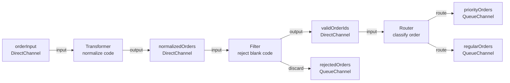

# Viewing the Integration Graph Structure

## 1. Objectives and Use Case

In the **System management** chapter of the **SPRING_INTEGRATION_CORE** module, the integration graph lets you observe how Spring Integration components are wired together in a running application. After designing a flow with `Message`, `MessageChannel`, endpoints, gateways, and Java DSL, the next step is verifying the intended flow against the actual structure built in the Spring container.

Suppose a system receives order codes with three branches:

- Codes starting with `VIP-` go to the priority queue.
- Other valid codes go to the regular queue.
- Codes that are blank after normalization go to the rejected queue.

When a priority order lands in the regular branch, operators need to check where the router is connected before hunting for a bug in the classification condition. When no output appears, you need to distinguish an unconsumed queue from an unregistered endpoint. The integration graph provides the map for those investigative steps.

After this lesson, you will be able to:

1. Retrieve the graph via `IntegrationGraphServer` or Spring Boot Actuator.
2. Read `contentDescriptor`, `nodes`, `links`, and the direction of each link type.
3. Match a Java DSL flow against the graph structure.
4. Rebuild the graph after dynamic structural changes.
5. Combine the graph with behavioral tests, metrics, and diagnostic data.

Examples use **Java 17+, Spring Boot 3.5.x, and Spring Integration 6.5.x**, with dependency versions managed by Spring Boot. This is a compatibility baseline for the examples; when applying to another project, verify APIs against your project's version.

## 2. What Does the Integration Graph Describe?

### 2.1. Structural Model of the Running Application

The integration graph represents the integration components recognized by the framework along with the connections between them. You can read that model as a directed graph:

```text
inbound channel → processing endpoint → outbound channel → next endpoint
```

The model is collected from runtime objects. That makes it useful when configuration is assembled across multiple Java classes, annotations, or dynamically registered flows. The graph can contain branches, cycles, and disconnected groups; never assume every application is a single linear chain.

The graph answers questions about **wiring structure**. An edge from a router to a channel indicates a routing relationship known to the graph; message-processing evidence is still needed to conclude that a specific order traversed that edge.

Spring Integration provides the graph to observe the runtime model; its documentation also describes link types such as `input`, `output`, `error`, `discard`, and `route`. See [Integration Graph](https://docs.spring.io/spring-integration/reference/graph.html).

### 2.2. Choosing Evidence Matched to the Question

| Operational question | Evidence to inspect |
| --- | --- |
| Does the router connect to the priority queue? | Graph nodes and links |
| Was the transformer created in the running configuration? | Graph combined with bean config when needed |
| How many send failures occurred in one minute? | Time-series metrics |
| Which steps did order `VIP-001` actually pass through? | Logs with correlation ID, message history, or configured tracing |
| How many incomplete groups is the aggregator holding? | Message store data and aggregator-specific metrics |
| Is the external payment service healthy? | Health checks and external system telemetry |

In practice, investigations often start with the graph to locate components, then use corresponding runtime data to verify hypotheses.

## 3. Three Core Parts of Graph Data

The `Graph` class exposes three datasets via `getContentDescriptor()`, `getNodes()`, and `getLinks()`. The model can be serialized to JSON for external tools to read. See the [Graph 6.5 API](https://docs.spring.io/spring-integration/docs/6.5.0/api/org/springframework/integration/graph/Graph.html).

### 3.1. `contentDescriptor`: Identifying the Data Source

This section describes the source providing the graph, for example:

```json
{
  "provider": "spring-integration",
  "providerVersion": "6.5.x",
  "providerFormatVersion": 1.2,
  "name": "order-routing-demo"
}
```

This is an illustrative example; actual `providerVersion` holds the specific library version.

When receiving a graph from an instance, first confirm it is the expected application and version. In multi-replica systems, two responses may come from two different processes. When logging an incident, include the timestamp, instance, and deployment version supplied by the runtime environment.

`providerFormatVersion` describes the graph schema version, not the application's business API version.

### 3.2. `nodes`: Integration Components

A node typically contains these fields:

| Field | How to use when reading the graph |
| --- | --- |
| `nodeId` | Look up link endpoints within the current graph |
| `name` | Identify the component and match against configuration names |
| `componentType` | Identify component kind, such as channel or router |
| `integrationPatternType` | Identify Enterprise Integration Pattern type when provided |
| `integrationPatternCategory` | Group integration patterns when provided |
| `properties` | Read additional node properties |
| `observed` | See whether the component is instrumented for observation, when provided by the version |

Endpoint-type nodes may carry extra details about inputs, outputs, or secondary branches. Write JSON consumers to tolerate optional and additional fields.

`observed: false` does not mean the endpoint is stopped. That field refers to observation instrumentation, not lifecycle status or business outcomes. See the [IntegrationNode API](https://docs.spring.io/spring-integration/api/org/springframework/integration/graph/IntegrationNode.html).

### 3.3. `links`: Directed Relationships Between Nodes

Each link has `from`, `to`, and `type`. The first two fields reference `nodeId`, not array indices into `nodes`. See the [LinkNode 6.5 API](https://docs.spring.io/spring-integration/docs/6.5.0/api/org/springframework/integration/graph/LinkNode.html).

| Link type | Direction to read | Practical meaning |
| --- | --- | --- |
| `input` | Channel → endpoint | Endpoint receives messages from channel |
| `output` | Output-emitting component → channel | Result is sent to outbound channel |
| `route` | Router → target channel | Routing branch known to the graph |
| `discard` | Component with discard path → discard channel | Rejected messages are routed to a separate branch |
| `error` | Component with matching error-emission config → error channel | Relationship to an error branch visible to the model |

For instance, if node 11 is `orderInput` and node 12 is the transformer, the following link reads as "the transformer receives messages from `orderInput`":

```json
{
  "from": 11,
  "to": 12,
  "type": "input"
}
```

Do not flip the arrow simply because the word `input` sounds like "input of the channel." Here, input is framed from the endpoint's perspective.

## 4. Building an Easily Observable Java DSL Example

### 4.1. Dependencies and Actuator Configuration

In a Maven application already using the Spring Boot 3.5.x parent or BOM, include these dependencies:

```xml
<dependencies>
    <dependency>
        <groupId>org.springframework.boot</groupId>
        <artifactId>spring-boot-starter-integration</artifactId>
    </dependency>
    <dependency>
        <groupId>org.springframework.boot</groupId>
        <artifactId>spring-boot-starter-actuator</artifactId>
    </dependency>
    <dependency>
        <groupId>org.springframework.boot</groupId>
        <artifactId>spring-boot-starter-web</artifactId>
    </dependency>
</dependencies>
```

The web starter runs an HTTP application to access the endpoint in this example. Simply viewing the graph via Actuator does not require adding `spring-integration-http`.

Application configuration:

```yaml
spring:
  application:
    name: order-routing-demo

management:
  endpoints:
    web:
      exposure:
        include: health,integrationgraph
```

Spring Boot exposes only a subset of endpoints by default; including `integrationgraph` in the exposure list enables HTTP access. This endpoint requires Spring Integration core on the classpath. Endpoint access permission and HTTP exposure are separate conditions, so also check access settings if your application restricts them. See [Spring Boot 3.5 Actuator Endpoints](https://docs.spring.io/spring-boot/3.5/reference/actuator/endpoints.html).

The HTTP URLs below assume port `8080`, the default Actuator base path, and a practice environment without authentication requirements. For secured applications, supply appropriate credentials and administrative privileges.

### 4.2. Defining the Flow

The example uses three clearly named intermediate channels and three `QueueChannel` beans as result sinks.

```java
package example.integrationgraph;

import java.util.Locale;

import org.springframework.boot.SpringApplication;
import org.springframework.boot.autoconfigure.SpringBootApplication;
import org.springframework.context.annotation.Bean;
import org.springframework.integration.channel.DirectChannel;
import org.springframework.integration.channel.QueueChannel;
import org.springframework.integration.config.EnableIntegration;
import org.springframework.integration.dsl.IntegrationFlow;

@SpringBootApplication
@EnableIntegration
public class IntegrationGraphDemo {

    public static void main(String[] args) {
        SpringApplication.run(IntegrationGraphDemo.class, args);
    }

    @Bean
    DirectChannel orderInput() {
        return new DirectChannel();
    }

    @Bean
    DirectChannel normalizedOrders() {
        return new DirectChannel();
    }

    @Bean
    DirectChannel validOrderIds() {
        return new DirectChannel();
    }

    @Bean
    QueueChannel priorityOrders() {
        return new QueueChannel(100);
    }

    @Bean
    QueueChannel regularOrders() {
        return new QueueChannel(100);
    }

    @Bean
    QueueChannel rejectedOrders() {
        return new QueueChannel(100);
    }

    @Bean
    IntegrationFlow orderRoutingFlow() {
        return IntegrationFlow.from("orderInput")
                .transform(String.class,
                        value -> value.strip().toUpperCase(Locale.ROOT))
                .channel("normalizedOrders")
                .filter(String.class,
                        value -> !value.isBlank(),
                        endpoint -> endpoint
                                .id("rejectBlankOrderId")
                                .discardChannel("rejectedOrders"))
                .channel("validOrderIds")
                .<String, Boolean>route(
                        value -> value.startsWith("VIP-"),
                        router -> router
                                .id("classifyOrder")
                                .channelMapping(true, "priorityOrders")
                                .channelMapping(false, "regularOrders"))
                .get();
    }
}
```

Normalization trims leading and trailing whitespace and converts to uppercase. The filter rejects blank codes. The router translates boolean outcomes into channel names via two explicit mappings.

The DSL API supports specifying payload types with `Class` in transformers and filters; the router's `<String, Boolean>` typing clarifies input and condition result types. See [BaseIntegrationFlowDefinition 6.5](https://docs.spring.io/spring-integration/docs/6.5.0/api/org/springframework/integration/dsl/BaseIntegrationFlowDefinition.html) and [IntegrationFlowDefinition 6.5](https://docs.spring.io/spring-integration/docs/6.5.0/api/org/springframework/integration/dsl/IntegrationFlowDefinition.html).

The three bounded queues are for practice and have no automatic consumers. Consequently, the graph terminating at these queues is intentional. In this example, learners pull results using `receive(timeout)`.

`QueueChannel` buffers messages for a receiver to read later; `DirectChannel` hands processing to subscribers on the calling thread. Without a dedicated message store, queues store data in memory by default. See [Message Channel Implementations](https://docs.spring.io/spring-integration/reference/channel/implementations.html).

### 4.3. Reference Diagram to Compare Against the Graph



This diagram shows only the business flow. Actual JSON may also contain infrastructure components such as `errorChannel`, `errorLogger`, and `nullChannel`.

Channel bean names are chosen explicitly so they are easy to locate in the graph. `.id(...)` names the endpoint; the corresponding handler node's name may include framework-generated suffixes. The transformer in the example uses an auto-generated name. When matching, combine names, component types, and connecting edges—avoid assuming node names always match endpoint names verbatim.

## 5. Retrieving the Graph via Spring Boot Actuator

### 5.1. Reading JSON

After starting the application, run:

```powershell
$graphUri = 'http://localhost:8080/actuator/integrationgraph'
$graph = Invoke-RestMethod -Uri $graphUri -Method Get
$graph | ConvertTo-Json -Depth 20
```

These commands keep the response in a PowerShell session variable. `-Depth` prints nested structures more completely.

Actuator provides `GET /actuator/integrationgraph` to fetch the graph; `POST` on the same path rebuilds the graph and responds with `204 No Content` on success. See [Spring Boot 3.5 Spring Integration Graph endpoint](https://docs.spring.io/spring-boot/3.5/api/rest/actuator/integrationgraph.html).

The JSON snippet below is a **trimmed illustrative excerpt**, keeping only the router and related channels. IDs are chosen to explain how data connects; actual responses may have different IDs, handler names, and ordering.

```json
{
  "contentDescriptor": {
    "provider": "spring-integration",
    "providerVersion": "6.5.x",
    "providerFormatVersion": 1.2,
    "name": "order-routing-demo"
  },
  "nodes": [
    {
      "nodeId": 21,
      "name": "validOrderIds",
      "componentType": "channel"
    },
    {
      "nodeId": 22,
      "name": "classifyOrder.handler",
      "componentType": "router",
      "input": "validOrderIds"
    },
    {
      "nodeId": 23,
      "name": "priorityOrders",
      "componentType": "queue-channel"
    },
    {
      "nodeId": 24,
      "name": "regularOrders",
      "componentType": "queue-channel"
    }
  ],
  "links": [
    { "from": 21, "to": 22, "type": "input" },
    { "from": 22, "to": 23, "type": "route" },
    { "from": 22, "to": 24, "type": "route" }
  ]
}
```

Read the excerpt in three steps:

1. Look up node `21` to identify `validOrderIds`.
2. Follow the `input` link from `21` to `22`: the router receives messages from this channel.
3. Follow the two `route` links from `22`: the router connects to both output channels.

This graph does not yet show that `true` maps to priority and `false` maps to regular. Cross-check `channelMapping` in the DSL to understand the business rule. Seeing both edges also does not report how many messages traversed each edge.

### 5.2. Listing Nodes by Name

```powershell
$graph.nodes |
    Sort-Object name |
    Select-Object nodeId, name, componentType
```

Focus on the names declared in the example:

```powershell
$graph.nodes |
    Where-Object {
        $_.name -in @(
            'orderInput',
            'normalizedOrders',
            'validOrderIds',
            'priorityOrders',
            'regularOrders',
            'rejectedOrders'
        )
    } |
    Select-Object nodeId, name, componentType
```

If a name is missing, do not immediately search by an ID from a previous startup. First confirm the application is running the right configuration and that the flow was created.

### 5.3. Resolving Link IDs to Names for Readability

```powershell
$nodeNames = @{}
foreach ($node in $graph.nodes) {
    $nodeNames[[int]$node.nodeId] = $node.name
}

$edges = foreach ($link in $graph.links) {
    [pscustomobject]@{
        From = $nodeNames[[int]$link.from]
        Type = $link.type
        To   = $nodeNames[[int]$link.to]
    }
}

$edges | Format-Table -AutoSize
```

A row like this means the endpoint receives messages from `validOrderIds`:

```text
From           Type   To
----           ----   --
validOrderIds  input  classifyOrder.handler
```

To isolate discard and routing branches:

```powershell
$edges |
    Where-Object { $_.Type -in @('discard', 'route') } |
    Format-Table -AutoSize
```

If building your own visualization tool, you can use a similar lookup to draw edges. Preserving the link type in the display helps separate business outputs, discard paths, and error paths.

## 6. Reading the Graph Directly in Java

### 6.1. Using `IntegrationGraphServer`

`IntegrationGraphServer` builds and holds the graph. In a Boot application with Actuator properly configured, reuse the auto-configured bean rather than creating a second server just to read data.

A graph-reading service can be written as follows:

```java
package example.integrationgraph;

import org.springframework.integration.graph.Graph;
import org.springframework.integration.graph.IntegrationGraphServer;
import org.springframework.stereotype.Service;

@Service
public class GraphInspectionService {

    private final IntegrationGraphServer graphServer;

    public GraphInspectionService(IntegrationGraphServer graphServer) {
        this.graphServer = graphServer;
    }

    public Graph currentGraph() {
        return graphServer.getGraph();
    }

    public Graph rebuildGraph() {
        return graphServer.rebuild();
    }
}
```

The API distinguishes two operations:

- `getGraph()` returns the currently cached graph.
- `rebuild()` rebuilds the graph, updates the cache, and returns the new result.

Call `rebuild()` when application components have been added or removed and you need to re-inspect the structure. See the [IntegrationGraphServer 6.5 API](https://docs.spring.io/spring-integration/docs/6.5.0/api/org/springframework/integration/graph/IntegrationGraphServer.html).

When using Spring Integration outside Boot, you can register the server as a bean in an application configuration with Spring Integration enabled:

```java
@Bean
IntegrationGraphServer integrationGraphServer() {
    IntegrationGraphServer server = new IntegrationGraphServer();
    server.setApplicationName("order-routing-demo");
    return server;
}
```

Spring manages the lifecycle and supplies `ApplicationContext` to this bean. Avoid instantiating `new IntegrationGraphServer()` outside the container and calling `getGraph()` immediately assuming it is fully initialized.

### 6.2. Names and Additional Properties

The application name in the descriptor can come from `spring.application.name` or be set via `setApplicationName(...)`. The server also provides `setAdditionalPropertiesCallback(...)` to attach extra metadata to components.

For example, if declaring the server yourself, you can add a static label for display:

```java
server.setAdditionalPropertiesCallback(component ->
        java.util.Map.<String, Object>of(
                "owningService", "order-routing-demo"));
```

This is added when configuring the server bean, not by creating a second server. Properties added by the application should have clear meaning; for example, a static ownership tag differs from a point-in-time lifecycle indicator.

Do not assume a `properties.running` field written by custom code is always live. Know when the callback runs and whether that data is recomputed on every read or only at node creation time.

## 7. When Should You Rebuild the Graph?

### 7.1. Application Structure Can Change

For statically declared flows, the graph built after context initialization is usually enough to inspect wiring. In systems registering or removing flows dynamically via `IntegrationFlowContext`, the component list can change after the graph was built.

Suppose a practice environment registers an extra refund-handling branch:

1. The application has started and the initial graph was fetched.
2. The refund flow is registered successfully.
3. The learner reads the old graph and does not see the refund channel yet.
4. The learner triggers a graph rebuild and fetches the fresh JSON to verify.

This is a case where you should check the graph's update lifecycle before concluding flow registration failed.

### 7.2. Rebuilding via Actuator

```powershell
$graphUri = 'http://localhost:8080/actuator/integrationgraph'

Invoke-WebRequest -Uri $graphUri -Method Post |
    Select-Object StatusCode

$graph = Invoke-RestMethod -Uri $graphUri -Method Get
```

When write operations are permitted, `POST` returns `204` on success; follow with `GET` to read the updated structure.

In Boot 3.5, if the endpoint is set to `access: read-only`, the rebuild operation is not available even though reading is. Endpoint access may also be capped by `management.endpoints.access.max-permitted`. This is independent of whether the endpoint is exposed over HTTP.

Rebuilding the graph updates the structural description. It does not register missing flows, start stopped consumers, or reprocess messages sitting in queues. If you have not confirmed the flow itself was created, resolve that root cause first.

There is no need to call `rebuild()` after every message. A visualization tool can poll periodically and request a rebuild only upon known structural changes or when an operator explicitly inspects.

### 7.3. Distinguishing Actuator from Integration Graph Controller

Spring Integration also has its own HTTP controller for the graph. The two access mechanisms use different paths and operations:

| Mechanism | Read graph | Rebuild graph |
| --- | --- | --- |
| Spring Boot Actuator, default config | `GET /actuator/integrationgraph` | `POST /actuator/integrationgraph` |
| Integration Graph Controller, default path | `GET /integration` | `GET /integration/refresh` |
| Direct Java invocation | `getGraph()` | `rebuild()` |

The standalone controller requires the corresponding HTTP or WebFlux module and activation configuration. For HTTP MVC, the docs describe `@EnableIntegrationGraphController`; the default path can be customized. See [Integration Graph Controller](https://docs.spring.io/spring-integration/reference/integration-graph-controller.html).

In this lesson, practice commands use **Actuator**. Do not append the standalone controller's `/refresh` suffix to the Actuator URL expecting the same HTTP contract.

## 8. Using the Graph to Investigate Flow Issues

### 8.1. Expected Component Is Missing

Example: `rejectedOrders` cannot be found in the JSON.

Check in order:

1. Did the response come from the intended application, instance, and deployment?
2. Is the configuration class containing the flow component-scanned or imported?
3. Does the bean depend on an unmet profile or conditional setting?
4. If the flow was registered after startup, did registration actually succeed?
5. Was the graph rebuilt after that change?

A common mistake is viewing replica A's graph while dynamic registration happened only on replica B. Rebuilding the graph on A will not make B's flow appear.

### 8.2. Node Exists Yet No Output Appears

Example: the graph shows `priorityOrders`, yet a business screen has not received priority orders.

From the example's graph, you can form concrete hypotheses:

- Router points to the wrong target channel: check the `route` edges.
- Code was rejected by the filter before the router: check `discard` and the normalized payload.
- Message reached the queue, yet the queue has no consumer: read with a timeout in the practice environment or check queue metrics.
- Router structure is right, yet classification logic is wrong: test `" vip-001 "` and check the post-transformer payload.
- Consumer in an extended part of the application is stopped: inspect lifecycle state and poller configuration.

The graph shows wiring only; seeing a node is not enough to confirm a send completed the entire process.

With an aggregator, an edge into the aggregator node and an outgoing edge still do not reveal which message groups have met release conditions. When an order stalls there, inspect correlation keys, release strategy, timeouts, and group state in the message store.

### 8.3. Dynamic Routing Branch Has Not Appeared as Expected

The example uses explicit mappings, so priority and regular destinations are declared up front. For routers resolving channel names dynamically from message data, the routes shown in the graph may depend on destinations the router has already seen and the router's route-reporting limit.

When investigating such flows, compare router configuration, actual resolved channel names, and when the graph was captured. Never treat a missing dynamic edge as sole proof that messages were lost.

If structural changes add new target channels or flows, rebuild the graph once changes finish. Also confirm which conditions cause the router to choose the new destination.

### 8.4. Missing Error Edge to `errorChannel`

In synchronous flows using `DirectChannel`, exceptions can propagate back to the caller. Having an `errorChannel` bean in the application does not mean every endpoint automatically gets an error edge to it.

To investigate errors, identify the execution boundary: synchronous call, gateway, polling consumer, or asynchronous component. Then inspect the error channel configuration and error-handling mechanism for that component.

A message rejected by a filter and sent to `rejectedOrders` is the outcome of a data-acceptance rule. It is not inherently a technical exception. In the graph, distinguish `discard` clearly from `error`.

### 8.5. Gateways and Boundaries Between Systems

For a messaging gateway with multiple methods, the graph may represent each method as a separate node. When searching, match the gateway name combined with the method rather than assuming the entire interface maps to a single node.

A request–reply call may use a temporary reply channel. Do not expect the graph to contain a static edge for every temporary reply channel created per call.

When a flow sends messages to a broker or calls another service, the current process's graph helps inspect the adapter or gateway at that boundary. To build an end-to-end picture across multiple applications, combine broker details, target names, deployment info, and configured tracing.

## 9. Combining the Graph with Metrics and Message History

### 9.1. Using Metrics to Quantify Hypotheses

Suppose the `route` edge to `priorityOrders` is verified. The next step might be checking success counts, failure counts, and processing duration on the relevant components.

Spring Integration integrates with Micrometer when a `MeterRegistry` is present. Meters like `spring.integration.send` and `spring.integration.receive`, tagged with component name, connect numbers back to graph nodes. See [Metrics and Management](https://docs.spring.io/spring-integration/reference/metrics.html).

In an application exposing and permitting access to the `metrics` endpoint, list meter names before querying specifics:

```powershell
$metricsUri = 'http://localhost:8080/actuator/metrics'
Invoke-RestMethod -Uri $metricsUri -Method Get
```

Section 4's configuration exposes only `health` and `integrationgraph`; to try this command, add `metrics` to the practice environment's exposure list while keeping appropriate access controls.

Do not write monitoring tools assuming the graph always includes legacy statistical fields like `sendTimers` or `receiveCounters`. For the modern versions in this lesson, collect metrics via supported Micrometer mechanisms. Error rates and latency over time should be read from the metrics system.

### 9.2. Using Message History to Trace a Single Message

When you need to see the trail across named components, enable message history in your practice configuration:

```java
import org.springframework.integration.config.EnableMessageHistory;

@EnableMessageHistory
```

Place this annotation on a Spring-managed configuration class. It records history into a message header at tracked components; you can scope by component name when needed. See [Message History](https://docs.spring.io/spring-integration/reference/message-history.html).

You can read the header via the API:

```java
import org.springframework.integration.history.MessageHistory;

MessageHistory history = message.getHeaders()
        .get(MessageHistory.HEADER_NAME, MessageHistory.class);
```

Here `message` is the message under inspection, such as a result pulled from `priorityOrders`. The value can be `null` if tracking is not enabled or the message has not passed through any tracked component.

A consistent investigation technique uses component names to join all three sources: the graph shows position in the flow, metrics show aggregate health, and history or logs show the trail of the individual message. Avoid logging entire order payloads just to determine which branch was taken.

## 10. Testing Structure Together with Behavior

### 10.1. Choosing Stable Assertions

A graph test should assert facts meaningful to the design:

- Required business channels exist.
- There is a link from the router's input channel to the router node.
- Representative messages take the right branch with normalized payloads.

Avoid comparing raw JSON strings or asserting fixed numeric `nodeId` values. Those assertions break easily when bean registration order, library versions, or infrastructure components shift even while business behavior stays intact.

The test example below uses `spring-boot-starter-test` in test scope and the application from section 4. This is practice code for the sample project.

```java
package example.integrationgraph;

import java.util.Set;
import java.util.stream.Collectors;

import org.junit.jupiter.api.Test;
import org.springframework.beans.factory.annotation.Autowired;
import org.springframework.boot.test.context.SpringBootTest;
import org.springframework.context.ApplicationContext;
import org.springframework.integration.channel.DirectChannel;
import org.springframework.integration.channel.QueueChannel;
import org.springframework.integration.graph.Graph;
import org.springframework.integration.graph.IntegrationGraphServer;
import org.springframework.integration.graph.IntegrationNode;
import org.springframework.messaging.Message;
import org.springframework.messaging.support.GenericMessage;

import static org.assertj.core.api.Assertions.assertThat;

@SpringBootTest(classes = IntegrationGraphDemo.class)
class IntegrationGraphDemoTest {

    @Autowired
    ApplicationContext context;

    @Autowired
    IntegrationGraphServer graphServer;

    @Test
    void graphAndRoutingMatchTheDeclaredFlow() {
        Graph graph = graphServer.rebuild();

        assertThat(graph.getNodes())
                .extracting(IntegrationNode::getName)
                .contains(
                        "orderInput",
                        "normalizedOrders",
                        "validOrderIds",
                        "priorityOrders",
                        "regularOrders",
                        "rejectedOrders");

        int routerInputId = graph.getNodes().stream()
                .filter(node -> node.getName().equals("validOrderIds"))
                .findFirst()
                .orElseThrow()
                .getNodeId();

        Set<Integer> routerIds = graph.getNodes().stream()
                .filter(node -> node.getName().contains("classifyOrder"))
                .map(IntegrationNode::getNodeId)
                .collect(Collectors.toSet());

        assertThat(routerIds).isNotEmpty();
        assertThat(graph.getLinks()).anyMatch(link ->
                link.getFrom() == routerInputId
                        && routerIds.contains(link.getTo()));

        DirectChannel input =
                context.getBean("orderInput", DirectChannel.class);

        assertThat(input.send(new GenericMessage<>(" vip-001 ")))
                .isTrue();
        assertThat(input.send(new GenericMessage<>(" ord-002 ")))
                .isTrue();
        assertThat(input.send(new GenericMessage<>("   ")))
                .isTrue();

        assertPayload("priorityOrders", "VIP-001");
        assertPayload("regularOrders", "ORD-002");
        assertPayload("rejectedOrders", "");

        assertThat(queue("priorityOrders").receive(0)).isNull();
        assertThat(queue("regularOrders").receive(0)).isNull();
        assertThat(queue("rejectedOrders").receive(0)).isNull();
    }

    private void assertPayload(String channelName, String expected) {
        Message<?> message = queue(channelName).receive(1_000);
        assertThat(message).isNotNull();
        assertThat(message.getPayload()).isEqualTo(expected);
    }

    private QueueChannel queue(String name) {
        return context.getBean(name, QueueChannel.class);
    }
}
```

The test verifies edges by looking up IDs by name inside the current graph. It does not hardcode IDs across startups. The router check accepts handler names with prefixes or suffixes around `classifyOrder` instead of requiring the entire auto-generated name to stay fixed.

The three input messages produce expected results:

| Sent payload | Normalized payload | Result channel |
| --- | --- | --- |
| `" vip-001 "` | `"VIP-001"` | `priorityOrders` |
| `" ord-002 "` | `"ORD-002"` | `regularOrders` |
| `"   "` | `""` | `rejectedOrders` |

The receives use bounded timeouts to avoid hanging forever. Asserting the queues are empty afterward catches leftover messages in this test context. If adding multiple tests sharing the same context, ensure queues are drained cleanly before each test case.

### 10.2. Understanding the Limits of the Test

The presence of nodes and edges verifies part of the registered structure. Three sample payloads verify three basic branches. They do not cover queue capacity, concurrent load, retries, gateway errors, or extended routing rules.

When changing a flow, add tests for new business rules. For example, if you switch the priority rule to a `customerTier` header, send a message with a representative header; seeing two `route` edges alone does not prove the router reads the right header.

## 11. Practice: Observing and Explaining the Graph

Follow these steps in the sample application:

1. Start the application with the configuration from section 4 and call `GET /actuator/integrationgraph`.
2. Find all six business channels by name.
3. Resolve links from IDs to names using the PowerShell snippet in section 5.
4. Trace the path from `orderInput` through the transformer and filter to the router against the diagram.
5. Locate the `discard` branch to `rejectedOrders` and both `route` branches.
6. Run the test to confirm outcomes for all three sample payloads.
7. If you have a dynamically registered flow in a separate practice environment, capture the graph before the change, complete registration, request a rebuild, and compare the new graph.

When describing findings, state what was observed alongside its evidence. For example: "The graph shows the router connects to `priorityOrders`; the test sent `' vip-001 '` and received `'VIP-001'` from that queue." That phrasing separates configured wiring from verified runtime outcomes.

In production, the graph can expose component names, channel names, expressions, and custom metadata. Expose the endpoint only within an appropriate administrative scope; if tooling only needs to view structure, consider read-only access. Avoid putting tokens, passwords, or sensitive payloads into component names or graph extra properties.

The completion criterion for this practice is being able to trace a business path using node names and link types, explain why a queue can be an intentional endpoint, and select the next piece of evidence when wiring is right yet messages do not yield expected outcomes.
