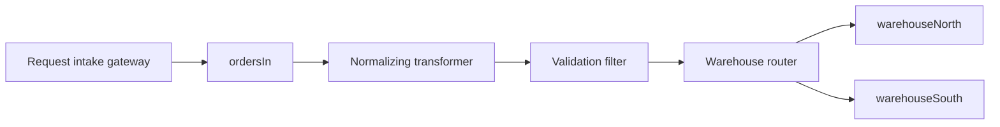

# Tracking Message History

In the **System management** chapter of **SPRING_INTEGRATION_CORE**, Message History lets you observe which components a message passed through. This lesson uses `Message`, `MessageChannel`, endpoints, and Java DSL to build a small flow, then reads history at the output and at failure points. This technique helps when a transformer misbehaves, a router picks an unexpected branch, or a message fails to reach its final destination.

## 1. Objectives and Prerequisites

After this lesson, you will be able to:

- Enable Message History and select which components to track.
- Read history entries via the API, handling cases where the header is absent.
- Compare the actual path against flow design and error data.
- Write tests verifying that the trail survives payload transformation.
- Choose a tracking scope matched to traffic volume and operational needs.

You should already know how to build a `Message<?>`, send messages through channels, declare beans, and construct an `IntegrationFlow`. Examples use Java 17 and APIs from Spring Integration 6.3 and later; explanations of the append mechanism are explicitly scoped to this version line. The project needs `spring-integration-core`; the test example also uses JUnit Jupiter. Keep Spring versions aligned via your application's dependency management.

## 2. From an Incident to a Question About the Path

Suppose an application receives an order code, normalizes data, checks conditions, and routes to a warehouse:



An operator gets a report: order `ORD-42` was accepted, yet the South warehouse never saw the request. Questions to answer include: did the message reach the router, did the North branch receive it, or did the filter reject it earlier?

Message History supplies milestones to test those hypotheses. Because it stores the trail inside the message, you must capture the message at an observation point: output, discard channel, error flow, or a diagnostic store. Simply enabling the feature and discarding every message after processing does not create a searchable history archive.

In an operational design for this scenario, you might persist a record holding `requestId`, application name, observation time, outcome, and the list of traversed components. That is an application-level persistence policy; design it separately if you need to search by order hours later.

## 3. What Does the `history` Header Contain?

Spring Integration places history under the `history` header; in Java, prefer `MessageHistory.HEADER_NAME`. Its value is `MessageHistory`, which lets you iterate over a list of `Properties`. Field-name constants include `NAME_PROPERTY`, `TYPE_PROPERTY`, and `TIMESTAMP_PROPERTY`. [MessageHistory API](https://docs.spring.io/spring-integration/api/org/springframework/integration/history/MessageHistory.html).

| Property | Content | How to use in diagnostics |
| --- | --- | --- |
| `name` | Component name at recording time | Match against channel or handler in config |
| `type` | Component type if available | Distinguish transformers, gateways, and channel types |
| `timestamp` | Recording time in milliseconds since the Unix epoch | Inspect intervals between milestones |

One representation of history in the order example might look like:

```text
name=ordersIn        type=channel        timestamp=1700000000000
name=ordersNormalize type=transformer    timestamp=1700000000002
name=ordersOut       type=channel        timestamp=1700000000004
```

This is illustrative data formatted for this lesson; specific type names may be more detailed depending on the component. Do not use this display string as an interchange format across systems.

### 3.1. Interpreting a Milestone Accurately

A milestone shows that the component recorded the message at that point. It does not by itself prove the task succeeded, a transaction committed, or an external system accepted the data. For example, `ordersNormalize` can appear even before normalization logic throws an exception: the framework handler records history before executing internal processing. [AbstractMessageHandler Source](https://raw.githubusercontent.com/spring-projects/spring-integration/6.5.x/spring-integration-core/src/main/java/org/springframework/integration/handler/AbstractMessageHandler.java).

For a payment system, you therefore must also check business outcomes and reference IDs returned by the provider. A history ending at an outbound handler only narrows down where to investigate.

### 3.2. Reading Timestamps as Signals

Suppose two consecutive milestones are 800 ms apart. You can hypothesize that time was spent somewhere between those two observation points: work in the earlier step, queue wait, executor wait, or other operations. There is not enough basis to blame the entire 800 ms on the downstream step.

For instance, observing `ordersQueue` followed by `reserveStock` with a large gap suggests inspecting both queue depth and worker allocation. In a very fast synchronous flow, multiple milestones can share the exact same millisecond; a difference of 0 does not mean zero resource cost.

## 4. Enabling and Scoping Tracked Components

Place `@EnableMessageHistory` on a configuration class loaded into the application context:

```java
import org.springframework.context.annotation.Configuration;
import org.springframework.integration.config.EnableIntegration;
import org.springframework.integration.config.EnableMessageHistory;

@Configuration
@EnableIntegration
@EnableMessageHistory
public class HistoryConfiguration {
}
```

The annotation supports a list of component name patterns. The default pattern is `*`; you can specify exact names or wildcards such as `orders*`. These are name patterns, not regular expressions and not payload predicates. [EnableMessageHistory API](https://docs.spring.io/spring-integration/api/org/springframework/integration/config/EnableMessageHistory.html).

```java
@EnableMessageHistory({"ordersIn", "ordersNormalize", "ordersOut"})
```

In a large application, the order-intake team might select channels at the boundaries of each step. When investigating deeper, they add relevant handlers. Naming conventions like `ordersIn`, `ordersValidated`, and `ordersRejected` help readers understand milestone meanings immediately.

Choose one place to manage history configuration per application context, avoiding declarations with conflicting tracking scopes. Official documentation recommends using the dedicated configuration mechanism rather than defining a plain `MessageHistoryConfigurer` bean manually. [Configuring Message History](https://docs.spring.io/spring-integration/reference/message-history.html).

## 5. Complete Example: Normalizing Order Codes with Java DSL

The practice example narrows the flow down to three stably named points:

```text
ordersIn -> ordersNormalize -> ordersOut
```

`ordersIn` receives a string; `ordersNormalize` trims leading/trailing whitespace and converts to uppercase; `ordersOut` holds results for the program to read back. Blank codes are rejected with an exception so we have a failure path to test.

### 5.1. Configuration

```java
import java.util.Locale;

import org.springframework.beans.factory.annotation.Qualifier;
import org.springframework.context.annotation.Bean;
import org.springframework.context.annotation.Configuration;
import org.springframework.integration.channel.DirectChannel;
import org.springframework.integration.channel.QueueChannel;
import org.springframework.integration.config.EnableIntegration;
import org.springframework.integration.config.EnableMessageHistory;
import org.springframework.integration.dsl.IntegrationFlow;
import org.springframework.integration.transformer.MessageTransformingHandler;
import org.springframework.messaging.MessageChannel;
import org.springframework.messaging.support.MessageBuilder;

@Configuration
@EnableIntegration
@EnableMessageHistory({"ordersIn", "ordersNormalize", "ordersOut"})
public class OrderHistoryConfig {

    @Bean
    public MessageChannel ordersIn() {
        return new DirectChannel();
    }

    @Bean
    public QueueChannel ordersOut() {
        return new QueueChannel(10);
    }

    @Bean
    public MessageTransformingHandler ordersNormalize() {
        return new MessageTransformingHandler(message -> {
            String orderCode = ((String) message.getPayload())
                    .strip()
                    .toUpperCase(Locale.ROOT);

            if (orderCode.isEmpty()) {
                throw new IllegalArgumentException("Order code must not be empty");
            }

            return MessageBuilder.withPayload(orderCode)
                    .copyHeaders(message.getHeaders())
                    .build();
        });
    }

    @Bean
    public IntegrationFlow orderHistoryFlow(
            @Qualifier("ordersIn") MessageChannel input,
            @Qualifier("ordersOut") QueueChannel output,
            @Qualifier("ordersNormalize") MessageTransformingHandler normalizer) {

        return IntegrationFlow.from(input)
                .handle(normalizer)
                .channel(output)
                .get();
    }
}
```

Java DSL creates and wires endpoints and channels in the context from the `IntegrationFlow` bean. In this example, the transformer handler is declared as a dedicated bean so the name `ordersNormalize` is easy to use for tracking and testing. [Java DSL](https://docs.spring.io/spring-integration/reference/dsl.html).

Do not also annotate the `ordersNormalize` bean with `@Transformer`: the DSL already wires the handler to its input and output. Creating two endpoints for the same handler would make the example harder to reason about.

The output queue has capacity 10 so the exercise has clear bounds. No poller is needed because the program calls `receive(...)` directly to fetch results. If another endpoint needs to consume automatically from a `QueueChannel`, configure an appropriate polling mechanism. [Message Channel Configuration](https://docs.spring.io/spring-integration/reference/channel/configuration.html).

### 5.2. History Formatting Helper

```java
import java.util.Properties;

import org.springframework.integration.history.MessageHistory;
import org.springframework.messaging.Message;

public final class HistoryPrinter {

    private HistoryPrinter() {
    }

    public static String render(Message<?> message) {
        MessageHistory history = MessageHistory.read(message);
        if (history == null || history.isEmpty()) {
            return "No message history at observation point";
        }

        StringBuilder text = new StringBuilder();
        for (Properties entry : history) {
            text.append("name=")
                    .append(entry.getProperty(MessageHistory.NAME_PROPERTY, "?"))
                    .append(" type=")
                    .append(entry.getProperty(MessageHistory.TYPE_PROPERTY, "?"))
                    .append(" timestamp=")
                    .append(entry.getProperty(MessageHistory.TIMESTAMP_PROPERTY, "?"))
                    .append(System.lineSeparator());
        }
        return text.toString();
    }
}
```

Checking for `null` is necessary when history is not enabled, no components matched, or a message was newly constructed without the header. Use explicit properties instead of parsing `history.toString()`: in the 6.5 source code, `toString()` joins component names without emitting full metadata. [MessageHistory Source](https://raw.githubusercontent.com/spring-projects/spring-integration/6.5.x/spring-integration-core/src/main/java/org/springframework/integration/history/MessageHistory.java).

### 5.3. Sending Requests and Reading Results

```java
import org.springframework.context.annotation.AnnotationConfigApplicationContext;
import org.springframework.integration.channel.QueueChannel;
import org.springframework.messaging.Message;
import org.springframework.messaging.MessageChannel;
import org.springframework.messaging.support.MessageBuilder;

public class OrderHistoryDemo {

    public static void main(String[] args) {
        try (var context = new AnnotationConfigApplicationContext(OrderHistoryConfig.class)) {
            MessageChannel input = context.getBean("ordersIn", MessageChannel.class);
            QueueChannel output = context.getBean("ordersOut", QueueChannel.class);

            Message<String> request = MessageBuilder.withPayload("  ord-42  ")
                    .setHeader("requestId", "req-1001")
                    .build();

            if (!input.send(request, 1_000)) {
                throw new IllegalStateException("Failed to send request");
            }

            Message<?> result = output.receive(1_000);
            if (result == null) {
                throw new IllegalStateException("No result received");
            }

            System.out.println(result.getPayload());
            System.out.println(result.getHeaders().get("requestId"));
            System.out.println(HistoryPrinter.render(result));
        }
    }
}
```

Expected outcomes are payload `ORD-42`, header `requestId` equal to `req-1001`, and milestones `ordersIn`, `ordersNormalize`, `ordersOut` in order. The classes in the example should be in the same package or have matching imports.

Read history from `result`. The framework can create a new message during tracking or transformation; holding onto the original `request` variable is not a reliable way to observe the end-of-flow trail. `requestId` is an application-maintained key for joining diagnostic records.

### 5.4. Why Copy Headers When Transforming Payloads?

The transformer in the example constructs a new message manually. Calling `copyHeaders(...)` preserves application headers and existing history; the new message's ID is not an end-to-end business key.

Try replacing the return statement with:

```java
return MessageBuilder.withPayload(orderCode).build();
```

Then the request still produces `ORD-42`, yet `requestId` and the pre-transformer history segment are no longer copied to the result. The output may retain only history added by downstream components. This illustrates a case where business output is right while investigative telemetry is broken.

With a transformer returning only a payload, the framework handles header propagation via the endpoint's mechanism. When returning a `Message<?>` manually, explicitly decide which headers to preserve and test that decision.

## 6. Diagnosing Errors Using the Message at the Failure Point

With the configuration above, sending a whitespace-only string causes `ordersNormalize` to throw an exception. Because the input is a `DirectChannel`, the synchronous processing error propagates to the caller. Do not assume that merely having an `errorChannel` bean causes every synchronous error to route there automatically. Processing via executors, pollers, or gateways with custom configurations must be evaluated against their respective error mechanisms. [Error Handling](https://docs.spring.io/spring-integration/reference/error-handling.html).

When receiving an `ErrorMessage`, the payload usually holds the exception and may carry `failedMessage`; `originalMessage` is supplemental information sometimes provided where the error message was created. Those two objects can reflect different points in time. [ErrorMessage API](https://docs.spring.io/spring-framework/docs/current/javadoc-api/org/springframework/messaging/support/ErrorMessage.html).

You can write a helper shared by both synchronous catches and `ErrorMessage` handlers:

```java
import org.springframework.messaging.Message;
import org.springframework.messaging.MessagingException;
import org.springframework.messaging.support.ErrorMessage;

public final class HistoryDiagnostics {

    private HistoryDiagnostics() {
    }

    public static Message<?> findFailedMessage(Throwable failure) {
        Message<?> candidate = null;
        Throwable current = failure;
        while (current != null) {
            if (current instanceof MessagingException messagingException
                    && messagingException.getFailedMessage() != null) {
                candidate = messagingException.getFailedMessage();
            }
            current = current.getCause();
        }
        return candidate;
    }

    public static String describe(ErrorMessage error) {
        Message<?> failed = findFailedMessage(error.getPayload());
        if (failed == null) {
            failed = error.getOriginalMessage();
        }
        return failed == null
                ? "Exception has no attached message to read history"
                : HistoryPrinter.render(failed);
    }
}
```

This helper selects the message from the deepest populated exception in a normal cause chain. If your application constructs exceptions with cyclic causes, add cycle detection before traversing this way.

In the error branch, distinguish three pieces of data:

- History of the business message: milestones up to or at the time of failure.
- History of the `ErrorMessage` itself: the path of the error message across error-handling components.
- Stack trace and root cause: details of the operation that failed.

For example, `ordersNormalize` as the last milestone on the failed message narrows down the normalizer. The message `Order code must not be empty` explains the invalid input condition. Together they complement each other in an incident report.

## 7. Testing the Flow's Trail

Tests should verify payload, correlation header, and the order of meaningful milestones. The example below applies to the exact three-bean configuration declared above:

```java
import java.util.List;

import org.junit.jupiter.api.Test;
import org.springframework.context.annotation.AnnotationConfigApplicationContext;
import org.springframework.integration.channel.QueueChannel;
import org.springframework.integration.history.MessageHistory;
import org.springframework.messaging.Message;
import org.springframework.messaging.MessageChannel;
import org.springframework.messaging.MessagingException;
import org.springframework.messaging.support.GenericMessage;
import org.springframework.messaging.support.MessageBuilder;

import static org.junit.jupiter.api.Assertions.*;

class OrderHistoryTest {

    @Test
    void preservesBusinessHeaderAndTrackedPath() {
        try (var context = new AnnotationConfigApplicationContext(OrderHistoryConfig.class)) {
            MessageChannel input = context.getBean("ordersIn", MessageChannel.class);
            QueueChannel output = context.getBean("ordersOut", QueueChannel.class);

            assertTrue(input.send(MessageBuilder.withPayload("  ord-42  ")
                    .setHeader("requestId", "req-1001")
                    .build(), 1_000));

            Message<?> result = output.receive(1_000);
            assertNotNull(result);
            assertEquals("ORD-42", result.getPayload());
            assertEquals("req-1001", result.getHeaders().get("requestId"));

            MessageHistory history = MessageHistory.read(result);
            assertNotNull(history);
            List<String> names = history.stream()
                    .map(entry -> entry.getProperty(MessageHistory.NAME_PROPERTY))
                    .toList();

            assertEquals(List.of("ordersIn", "ordersNormalize", "ordersOut"), names);
            for (var entry : history) {
                String timestamp = entry.getProperty(MessageHistory.TIMESTAMP_PROPERTY);
                assertNotNull(timestamp);
                assertDoesNotThrow(() -> Long.parseLong(timestamp));
            }
        }
    }

    @Test
    void keepsFailurePathWithoutProducingSuccessfulOutput() {
        try (var context = new AnnotationConfigApplicationContext(OrderHistoryConfig.class)) {
            MessageChannel input = context.getBean("ordersIn", MessageChannel.class);
            QueueChannel output = context.getBean("ordersOut", QueueChannel.class);

            MessagingException failure = assertThrows(MessagingException.class,
                    () -> input.send(new GenericMessage<>("   "), 1_000));

            Message<?> failed = HistoryDiagnostics.findFailedMessage(failure);
            assertNotNull(failed);
            MessageHistory history = MessageHistory.read(failed);
            assertNotNull(history);

            List<String> names = history.stream()
                    .map(entry -> entry.getProperty(MessageHistory.NAME_PROPERTY))
                    .toList();

            assertEquals(List.of("ordersIn", "ordersNormalize"), names);
            assertNull(output.receive(0));
        }
    }
}
```

Never assert timestamps against fixed values. Clocks and scheduling vary across runs. In a real flow with additional infrastructure components, assert relative ordering of business milestones rather than forcing the entire list to match a minimal example.

Each test builds its own context so the output queue never leaks data from another test. The timeout on `receive(...)` ensures the test terminates within a finite time if the flow produces no output.

## 8. Boundaries to Understand

### 8.1. Versions and Appended History

Before Spring Integration 6.3, each tracking step created a new history copy alongside a new message copy. Since 6.3, after the initial header is created, the framework appends entries to the existing history container. Framework components that split into multiple branches clone history so each branch keeps its own trail. For custom logic emitting multiple messages outside those mechanisms, documentation recommends the `cloneMessageHistoryIfAny()` API on the integration message builder. [Message History Mechanism Changes](https://docs.spring.io/spring-integration/reference/message-history.html).

Applications should treat history as read-only diagnostic data. To capture state at a specific point, convert each entry into a DTO or string right at the observation point. Holding a reference to the header and reading it later can cause the record to reflect steps executed afterward.

### 8.2. Routers, Filters, Splitters, and Aggregators

| Scenario | How to design observation for the order example |
| --- | --- |
| Router selects warehouse | Also track each warehouse's inbound channel to confirm the selected target |
| Filter rejects invalid code | Configure a named discard channel and read messages there |
| Splitter splits order lines | Preserve `requestId` plus line identifiers to distinguish branches |
| Aggregator combines results | Verify output-creation and header-preservation policies of the aggregator |
| Flow ends without returning a message | Emit a diagnostic record at the terminal point if later lookup is needed |

Do not assume an aggregator output's history automatically unions every member's history. In a design combining multiple order lines, if investigations require per-line paths, persist per-branch data alongside the group key and join them via the application's data model.

### 8.3. Gateways and External Systems

A gateway is a convenient boundary for attaching request IDs and recording outcomes. However, a gateway method returning only the payload will not give the caller all reply headers. Place observation points inside the flow or design an appropriate return type if callers need to read history.

When messages cross Kafka, AMQP, or HTTP, whether headers survive depends on adapters, mappers, and serializers. Never assume the Java `MessageHistory` object transfers intact. In cross-service designs, use request keys and appropriate trace-context propagation; export internal history externally only under an explicit data contract.

## 9. Distinguishing History from Other Observability Tools

| Tool | Typical question | How to combine in an order incident |
| --- | --- | --- |
| Message History | Which milestones did a specific message pass through? | Narrow down which segment of the flow to inspect |
| Application logs | What were the data and decision at a given step? | See why a warehouse was chosen or a code rejected |
| Metrics | How is the overall system performing? | Check error counts, processing durations, and queue depth |
| Distributed tracing | Which services and operations did a request cross? | Connect intake app, inventory service, and external calls |
| Business audit | Which business events were confirmed? | Persist order outcomes per application policy |

Spring Integration integrates with Micrometer for metrics and Observation. Enabling `@EnableMessageHistory` does not automatically configure registries, exporters, or trace storage systems. Each mechanism has its own configuration and lifecycle. [Metrics and Management](https://docs.spring.io/spring-integration/reference/metrics.html).

For a slow-order report, a sound investigation workflow uses metrics to pinpoint the anomalous window, uses a request key to pull history records, and uses logs or traces to explain operations inside the suspected segment.

## 10. Operational Cost and Scope Changes

Operational recommendations for the order system:

1. Start with a small set of milestones at major flow boundaries.
2. Measure message size, memory, latency, and log volume under representative load.
3. Expand scope during investigations, then narrow it once enough data is gathered.
4. Move retained diagnostic data into an application storage format with a retention policy.
5. Avoid logging entire payloads or all headers when milestone names and request IDs suffice.

Each milestone adds data to the message. A business loop revisiting steps multiple times can make history longer than expected. Sampling logs at the output only cuts log emission; it does not eliminate tracking overhead already incurred earlier.

`MessageHistoryConfigurer` allows changing tracking patterns once the configurer is stopped. The snippet below uses the bean created by the enable mechanism; do not create a second configurer:

```java
import org.springframework.integration.history.MessageHistoryConfigurer;

MessageHistoryConfigurer configurer =
        context.getBean(MessageHistoryConfigurer.class);

configurer.stop();
try {
    configurer.setComponentNamePatterns(new String[] {"ordersIn", "ordersOut"});
}
finally {
    configurer.start();
}
```

Here `context` is the running application context; this snippet is intended for admin tooling or controlled exercises. Stopping the configurer pauses tracking, not the entire business flow. Changing patterns does not backfill missed milestones. The API requires calling `stop()` before modifying patterns. [MessageHistoryConfigurer API](https://docs.spring.io/spring-integration/api/org/springframework/integration/history/MessageHistoryConfigurer.html).

## 11. Troubleshooting Common Symptoms

| Symptom | Hypothesis to check | Resolution |
| --- | --- | --- |
| No `history` header | Config not loaded or patterns do not match | Verify active configuration and actual bean names |
| History exists yet early steps are missing | Message rebuilt without preserving headers | Check transformers or custom message-building code |
| DSL endpoint name is missing | Handler and endpoint may be registered under different names | Inspect actual component names; declare handler as a bean for stable naming |
| Filter present yet no output | Message may have been discarded | Check discard channel and filter predicate |
| Last milestone is a handler yet task failed | History records before operation succeeds | Read failed message and failure cause |
| Only error-handling steps appear | Reading history of `ErrorMessage` | Look up the business message in the exception or original message |
| Data changes when read later | Holding a reference to an appended container | Take a snapshot at the moment data needs saving |
| Very long history | Broad scope, loops, or repeated forwards | Limit tracked milestones and review routing design |

With DSL, an endpoint ID should not be assumed to be the history name of every related object. Bean registration distinguishes consumer endpoints, message handlers, and handler aliases. The example uses the `ordersNormalize` bean to avoid relying on auto-generated names. [IntegrationFlow Registration Source](https://raw.githubusercontent.com/spring-projects/spring-integration/6.5.x/spring-integration-core/src/main/java/org/springframework/integration/dsl/context/IntegrationFlowBeanPostProcessor.java).

## 12. Reinforcement Exercises

Use the configuration and tests in this lesson to make each change independently:

1. Track only `ordersIn` and `ordersOut`. Confirm the payload is still normalized while the transformer milestone no longer appears.
2. Remove `copyHeaders(...)` in the transformer. Observe `requestId` and the remaining history to see the impact of building a fresh message.
3. Send a whitespace-only code. Extract the failed message from the exception and explain why the transformer milestone exists while the output milestone does not.
4. Insert another named channel between two processing steps. Decide whether to track that milestone based on a specific investigative question.
5. Design a dedicated diagnostic record for orders: correlation key, milestones, outcome, and timestamp saved; explain how to query it once messages are no longer kept in memory.

The goal is being able to use trails to test path hypotheses, pair them with outcome evidence, and preserve sufficient context at flow boundaries.
