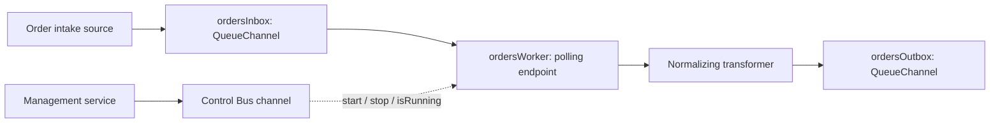
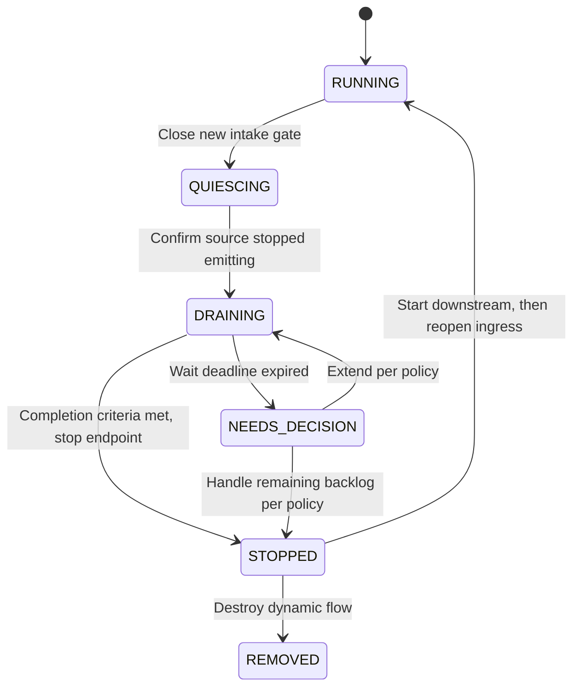

# Managing Flows at Runtime

## 1. Context and Objectives

An integration system receives orders continuously, yet a partner's pricing service needs maintenance. Shutting down the entire application would interrupt inventory synchronization and notification flows as well. Simply cutting off a handler mid-flow can cause messages to pile up in queues, time out, or fail when no consumer remains to receive them.

**Managing flows at runtime** means controlling the lifecycle and operational configuration of message flows while the application remains running. This covers starting, stopping, observing, registering, and removing flows, while defining how already-accepted messages are handled.

Within **SPRING_INTEGRATION_CORE**, this lesson belongs to the **System management** chapter and builds on the core components: `Message`, `MessageChannel`, endpoints, gateways, and Java DSL. The examples illustrate how to operate these components when flows include transformers, routers, filters, or aggregators.

After this lesson, you will be able to:

- Choose whether to control a single endpoint, an entire flow, or an intake source.
- Assign stable endpoint names and control them via `Lifecycle` or the Control Bus.
- Create and manage dynamic flows using `IntegrationFlowContext`.
- Design a procedure to stop intake, drain in-flight data, and switch to a new flow version.
- Verify outcomes using runtime state, business results, and operational metrics.

The Java DSL snippets use **Spring Integration 6.5** APIs and Java 17 or higher. The Control Bus syntax in this lesson is `beanName.methodName` with arguments placed in a dedicated header; do not mix it with expression syntax from older documentation. Command formats can be checked in [Spring Integration 6.5 Control Bus](https://docs.spring.io/spring-integration/reference/6.5/control-bus.html).

## 2. Flows, Endpoints, and Resources Have Distinct Lifecycles

An `IntegrationFlow` describes a chain of components. Upon registration, the framework creates the corresponding channels, handlers, and endpoints. In a typical consumer model:

- **Channel** transports or buffers `Message` instances.
- **Handler** executes work: transforming, routing, filtering, calling services, or aggregating.
- **Endpoint** connects the handler to a channel, via subscription or polling.
- **Gateway** provides an invocation interface, often with request-and-reply mechanics.
- **Supporting resources** include schedulers, executors, connection factories, and message stores.

Consequently, the `@Bean` method name defining a flow is not automatically the endpoint name to stop. When you want to stop polling a queue, locate the right polling endpoint; targeting the handler instead will not manage the subscription or poller.

| Control target | Typical purpose | What to clarify |
| --- | --- | --- |
| Inbound adapter from external source | Pause data intake | Where does new data stay, and will it be redelivered? |
| Consumer on a channel | Stop one processing stage | Can upstream producers still send? |
| Dynamic flow registration | Manage the group of components in the flow | Must downstream stay running to drain first? |
| Shared executor or connection | Manage infrastructure resources | Which other flows share this dependency? |
| `ApplicationContext` | Stop at application scope | Is application-wide shutdown really the required maintenance scope? |

Never shut down a shared executor just to stop one flow. It may also be serving error-handling endpoints and other flows.

### 2.1. Basic Lifecycle

`Lifecycle` provides three core methods:

```java
void start();
void stop();
boolean isRunning();
```

`SmartLifecycle` adds auto-startup, `phase` ordering, and stopping with a callback. When Spring coordinates application context lifecycle, lower phases start first; on stop, the order reverses. Beans in the same phase have no guaranteed order; explicit dependency relationships take precedence over phase. [SmartLifecycle Javadoc](https://docs.spring.io/spring-framework/docs/current/javadoc-api/org/springframework/context/SmartLifecycle.html)

For example, you can place downstream consumers at a lower phase than intake sources so downstream is ready before sources emit messages. That is lifecycle ordering, not a mechanism proving all messages have finished processing.

Two practical notes:

1. `autoStartup(false)` governs automatic startup; it does not prevent an operator from calling `start()` later.
2. A component reporting `isRunning() == true` confirms only that component's lifecycle state. Partner services, databases, or downstream consumers may still be failing.

### 2.2. Stopping, Pausing, and Destroying

| Operation | Operational meaning | Reusability |
| --- | --- | --- |
| `stop()` | Asks the component to stop activity per its lifecycle | Typically can be started again with `start()` |
| `pause()` if supported by the component | Pauses per the component's own contract | Use `resume()` when supported by the API |
| Drain | Stop new intake and wait for accepted work to reach completion | Coordinated and verified by the application |
| Registration `destroy()` | Removes the dynamic flow and dependent beans managed by the registration | Must create a new registration to use again |

Do not assume every endpoint has `pause()`. This lesson uses `start()` and `stop()` as the general control mechanism; `pause/resume` must be checked on each specific adapter's API.

**Stopping does not mean rollback, persistence, or draining.** An active task may still complete, be interrupted, or fail depending on the implementation, executor, and transactions. Delivery contracts must be established separately.

## 3. Understanding Message Paths Before Stopping



The diagram separates the order delivery path from the management command path. The Control Bus uses messages, yet its payloads represent management operations rather than orders.

### 3.1. Channel Impact

| Channel type | When the consumer stops | Consequences to anticipate |
| --- | --- | --- |
| `DirectChannel` | Typical event-driven endpoints unsubscribe when stopped | If no subscriber remains, sends can throw `MessageDeliveryException` |
| `QueueChannel` | Consumer stops polling; channel can still accept messages while capacity remains | Backlog grows; producers may block or fail sends when full |
| `ExecutorChannel` | Introduces an execution boundary via an executor | Account for tasks already submitted to the executor, not only subscription state |
| `PublishSubscribeChannel` | One subscriber stopping does not stop other subscribers | Send success criteria depend on configuration, such as `minSubscribers` |

Specifically for `QueueChannel`, `send()` succeeding indicates only that the message entered the queue. It does not prove the handler completed business processing. The default in-memory channel also does not become durable storage merely because an endpoint stopped. [Message Channel Implementations](https://docs.spring.io/spring-integration/reference/6.5/channel/implementations.html)

That is why queued flows generally need capacity bounds, send timeouts, and an overflow policy.

### 3.2. Interaction with Other EIPs

- **Transformer:** stopping the endpoint stops the transformation stage from receiving; messages already past the transformer can keep moving.
- **Filter:** a rejected message is an intentional outcome. When counting completed items for draining, include the discard branch.
- **Router:** when switching routing to a new flow, messages that already chose the old route do not automatically move to the new route.
- **Aggregator:** groups waiting for remaining items are not finished just because the inbound channel is empty. You need policies for incomplete groups, message stores, timeouts, and emitted outputs.
- **Gateway:** requests waiting for replies can time out during maintenance. Client retries can cause duplicate operations if the processing side lacks idempotency.

Therefore, "queue size equals 0" must always be interpreted in the context of the full data path.

## 4. Example Configuration of a Controllable Flow

The example below uses only core components—no broker or database needed. The application needs `org.springframework.integration:spring-integration-core` with consistent version management; if using Spring Boot, use the integration starter and compatible BOM.

The goal is putting strings into `ordersInbox`, normalizing them, and reading results from `ordersOutbox`. The `ordersWorker` endpoint is pre-created yet does not start automatically.

```java
import java.time.Duration;
import java.util.Locale;

import org.springframework.beans.factory.annotation.Qualifier;
import org.springframework.context.annotation.Bean;
import org.springframework.context.annotation.Configuration;
import org.springframework.integration.channel.DirectChannel;
import org.springframework.integration.channel.QueueChannel;
import org.springframework.integration.config.EnableIntegration;
import org.springframework.integration.dsl.IntegrationFlow;
import org.springframework.integration.dsl.Pollers;
import org.springframework.messaging.MessageChannel;

@Configuration
@EnableIntegration
public class RuntimeFlowConfiguration {

    @Bean
    public QueueChannel ordersInbox() {
        return new QueueChannel(100);
    }

    @Bean
    public QueueChannel ordersOutbox() {
        return new QueueChannel(100);
    }

    @Bean
    public IntegrationFlow ordersFlow(
            @Qualifier("ordersInbox") QueueChannel input,
            @Qualifier("ordersOutbox") QueueChannel output) {

        return IntegrationFlow.from(input)
                .<String, String>transform(
                        text -> text.trim().toUpperCase(Locale.ROOT),
                        endpoint -> endpoint
                                .id("ordersWorker")
                                .autoStartup(false)
                                .poller(Pollers
                                        .fixedDelay(Duration.ofMillis(100))
                                        .maxMessagesPerPoll(1)))
                .channel(output)
                .get();
    }

    @Bean
    public MessageChannel runtimeCommands() {
        return new DirectChannel();
    }

    @Bean
    public IntegrationFlow runtimeControlFlow(
            @Qualifier("runtimeCommands") MessageChannel commands) {

        return IntegrationFlow.from(commands)
                .controlBus()
                .get();
    }
}
```

Design decisions in the example:

- `ordersFlow` names the flow; `ordersWorker` sets an explicit ID for the endpoint receiving from the queue. That is the target to manage.
- The poller belongs to the endpoint connecting the transformer to `ordersInbox`, not to `QueueChannel` itself.
- `maxMessagesPerPoll(1)` limits messages per poll cycle; it is not a backlog cap or total concurrency limit across all architectures.
- Both queues have capacity 100 so the example cannot accumulate unboundedly.
- The control flow stays independent so it can restart a stopped worker.

`ordersOutbox` is the result observation point in this exercise. Real applications must have a downstream consumer draining it; if it fills up, forwarding results can block the worker.

## 5. Controlling Directly with Lifecycle

When the management service and endpoint live in the same application context, direct calls are readable and strongly typed.

```java
import org.springframework.beans.factory.annotation.Qualifier;
import org.springframework.context.Lifecycle;
import org.springframework.stereotype.Service;

@Service
public class OrdersRuntimeAdmin {

    private final Lifecycle worker;

    public OrdersRuntimeAdmin(
            @Qualifier("ordersWorker") Lifecycle worker) {
        this.worker = worker;
    }

    public void startWorker() {
        worker.start();
    }

    public void stopWorker() {
        worker.stop();
    }

    public boolean isWorkerRunning() {
        return worker.isRunning();
    }
}
```

This service controls the exact endpoint given an ID in the DSL. It does not invoke factory methods to create another flow, nor does it stop the application context.

In the example, after stopping the worker, producers can keep sending to `ordersInbox` until the queue is full. If the maintenance goal is halting new intake, add a mechanism to close the intake source or reject requests at ingress.

A helpful management response should record the affected target, timestamp, observed state after the command, and actor. An endpoint's `STOPPED` state must be distinguished from a business workflow's `DRAINED` outcome.


## 6. Controlling via the Control Bus

The Control Bus fits when you want to represent management actions as a `Message` passing through one unified command intake point. It still invokes bean operations inside its application context; the Control Bus itself does not provide multi-JVM orchestration.

With the configuration from the previous section, payloads look like:

```text
ordersWorker.start
ordersWorker.stop
ordersWorker.isRunning
```

The commands target the `ordersWorker` endpoint. The Control Bus resolves operations through a registry and permits only supported management methods, such as lifecycle methods or methods annotated for management. Arbitrary Java methods do not automatically become commands. [Control Bus](https://docs.spring.io/spring-integration/reference/6.5/control-bus.html), [ControlBusCommandRegistry](https://docs.spring.io/spring-integration/docs/6.5.0/api/org/springframework/integration/support/management/ControlBusCommandRegistry.html)

### 6.1. Intentional Command-Sending Client

```java
import org.springframework.beans.factory.annotation.Qualifier;
import org.springframework.integration.core.MessagingTemplate;
import org.springframework.messaging.MessageChannel;
import org.springframework.stereotype.Service;

@Service
public class OrdersControlBusClient {

    private final MessagingTemplate commands;

    public OrdersControlBusClient(
            @Qualifier("runtimeCommands") MessageChannel channel) {
        this.commands = new MessagingTemplate(channel);
        this.commands.setSendTimeout(1_000);
        this.commands.setReceiveTimeout(1_000);
    }

    public void startWorker() {
        commands.convertAndSend("ordersWorker.start");
    }

    public void stopWorker() {
        commands.convertAndSend("ordersWorker.stop");
    }

    public boolean isWorkerRunning() {
        Boolean running = commands.convertSendAndReceive(
                "ordersWorker.isRunning", Boolean.class);

        if (running == null) {
            throw new IllegalStateException(
                    "Did not receive status reply for ordersWorker");
        }
        return running;
    }
}
```

`start` and `stop` return `void`, so the client uses one-way send. `isRunning` returns a value, so the client uses request/reply; `MessagingTemplate` sets up the reply path for that call.

The example uses `DirectChannel` for commands. Command delivery to the Control Bus runs synchronously on the sender's thread. Template timeouts do not create a deadline that forcibly interrupts synchronous calls inside handlers.

You can replace this client with a gateway exposing equivalent methods. Choosing a gateway or template changes the calling surface; it does not change lifecycle semantics.

### 6.2. Commands with Parameters

In the API selected for this lesson, method arguments are passed as a list in the `IntegrationMessageHeaderAccessor.CONTROL_BUS_ARGUMENTS` header. The payload contains only bean name and method name. Each value's type must match the managed method's signature.

Never interpolate user-supplied arguments into arbitrary expressions. If exposing an HTTP API for operations, accept structured actions like `START`, `STOP`, and `STATUS`, then map them server-side to allowed commands. The client above follows that exact principle using fixed command strings.

Control Bus method restrictions do not replace authentication and authorization on the management API. Control who can send commands, which tenants they may affect, and which endpoints are in scope.

### 6.3. Choosing a Control Mechanism

| Scenario | Suitable mechanism |
| --- | --- |
| Internal service controlling a fixed endpoint | Inject `Lifecycle` |
| Management flow already built on messaging | Control Bus over a dedicated channel |
| Creating and removing flows while the app runs | `IntegrationFlowContext` |
| Operations tooling already uses JMX | Management operations exported over JMX |
| Remote administrative API | Authorized API layer delegating to one of the internal mechanisms above |

Establish a single authority for operational policy. If REST, JMX, and the Control Bus can all mutate state, requests must still be coordinated to prevent conflicting start and stop commands.

## 7. Registering Dynamic Flows with IntegrationFlowContext

Stopping an existing endpoint does not solve the case where a new tenant needs its own processing flow added. For dynamic flows, `IntegrationFlowContext` provides a registration builder to add flows, assign IDs, control auto-startup, and destroy dependent beans when no longer needed. `useFlowIdAsPrefix()` avoids name collisions when multiple flows use the same internal IDs. [Dynamic and Runtime Integration Flows](https://docs.spring.io/spring-integration/reference/dsl/java-runtime-flows.html)

### 7.1. Example Per-Tenant Normalization Flow

Each flow receives a string and replies with the normalized string prefixed by tenant. It uses `DirectChannel`, so there is no intermediate backlog in this example.

```java
import java.util.Locale;

import org.springframework.integration.channel.DirectChannel;
import org.springframework.integration.core.MessagingTemplate;
import org.springframework.integration.dsl.IntegrationFlow;
import org.springframework.integration.dsl.context.IntegrationFlowContext;
import org.springframework.integration.dsl.context.IntegrationFlowContext
        .IntegrationFlowRegistration;
import org.springframework.stereotype.Service;

@Service
public class TenantFlowManager {

    private final IntegrationFlowContext flowContext;

    public TenantFlowManager(IntegrationFlowContext flowContext) {
        this.flowContext = flowContext;
    }

    public synchronized String registerStopped(String tenantId) {
        String flowId = flowId(tenantId);

        if (flowContext.getRegistrationById(flowId) != null) {
            throw new IllegalStateException(
                    "Flow is already registered: " + flowId);
        }

        IntegrationFlow flow = IntegrationFlow
                .from(new DirectChannel())
                .<String, String>transform(
                        text -> tenantId + ":"
                                + text.trim().toUpperCase(Locale.ROOT),
                        endpoint -> endpoint.id("normalize"))
                .get();

        IntegrationFlowRegistration registration = flowContext
                .registration(flow)
                .id(flowId)
                .useFlowIdAsPrefix()
                .autoStartup(false)
                .register();

        return registration.getId();
    }

    public synchronized void start(String tenantId) {
        requireRegistration(tenantId).start();
    }

    public synchronized String request(String tenantId, String payload) {
        MessagingTemplate template = requireRegistration(tenantId)
                .getMessagingTemplate();
        template.setSendTimeout(1_000);
        template.setReceiveTimeout(1_000);
        return template.convertSendAndReceive(payload, String.class);
    }

    public synchronized void stop(String tenantId) {
        requireRegistration(tenantId).stop();
    }

    public synchronized void remove(String tenantId) {
        requireRegistration(tenantId).destroy();
    }

    private IntegrationFlowRegistration requireRegistration(
            String tenantId) {
        String flowId = flowId(tenantId);
        IntegrationFlowRegistration registration =
                flowContext.getRegistrationById(flowId);

        if (registration == null) {
            throw new IllegalArgumentException(
                    "Flow not found: " + flowId);
        }
        return registration;
    }

    private String flowId(String tenantId) {
        if (tenantId == null
                || !tenantId.matches("[a-z0-9]{1,24}")) {
            throw new IllegalArgumentException(
                    "tenantId may contain only a-z, 0-9; length 1 to 24 characters");
        }
        return "tenantOrders-" + tenantId;
    }
}
```

Once this class is registered as a Spring bean, a typical call sequence looks like:

```java
String id = tenantFlowManager.registerStopped("hcm");
// id = "tenantOrders-hcm"

tenantFlowManager.start("hcm");

String result = tenantFlowManager.request("hcm", "  don-42  ");
// result = "hcm:DON-42"

tenantFlowManager.stop("hcm");
tenantFlowManager.start("hcm");

tenantFlowManager.remove("hcm");
// Registration was removed; register a new flow to use it again.
```

These lines represent caller code inside a component or test injected with `TenantFlowManager`, not a standalone `main` program.

### 7.2. Key Points in the Example

**Intentional IDs.** `tenantOrders-hcm` aids lookup, auditing, and tying tenant configuration to the flow. Format validation constrains naming, though it does not replace tenant ownership authorization.

**Isolated components per flow.** Each flow creation instantiates a new `DirectChannel`. Internal endpoints named `normalize` are scoped under each flow's prefix rather than colliding on one shared bean name.

**Unstarted registration.** `autoStartup(false)` lets you register first, verify configuration, and then open the flow. With this `DirectChannel`, sending before start or after stop can fail due to having no subscriber; it does not buffer data for the next start.

**Replies travel through the request's reply channel.** The flow ends with a value-returning transformer, so `MessagingTemplate` can receive replies. For flows starting from a source other than a `MessageChannel`, `getMessagingTemplate()` cannot automatically be used this way. [IntegrationFlowRegistration Javadoc](https://docs.spring.io/spring-integration/api/org/springframework/integration/dsl/context/IntegrationFlowContext.IntegrationFlowRegistration.html)

**Synchronized locking applies only within this example.** The `synchronized` methods serialize registration, request sending, and lifecycle changes through the same manager instance. That works to illustrate small synchronous flows; a slow request would hold the lock and block operations for other tenants. High-throughput systems need per-flow coordination and must keep asynchronous work outside coarse locks.

**Destroying a flow does not recall already-sent external data.** `destroy()` removes the registration and the dependent beans it manages. It does not roll back committed transactions, delete shared application resources, or guarantee in-flight messages finished.

### 7.3. Pre-Declared Flows vs. Runtime-Registered Flows

`StandardIntegrationFlow` is a logical container of components. When a flow is declared as a standard bean, Spring coordinates starting components inside the application context. For dynamically registered flows, control them via the registration handle; registrations may auto-start flows by default unless disabled. [StandardIntegrationFlow Javadoc](https://docs.spring.io/spring-integration/api/org/springframework/integration/dsl/StandardIntegrationFlow.html)

Therefore, do not assume every pre-declared flow stays idle simply because a flow container does not auto-start. Put `autoStartup(false)` on the specific endpoint that must stay stopped, such as `ordersWorker`, or on the registration when creating dynamic flows.

The runtime registry also does not replace durable business configuration storage. If the JVM restarts, the application must read tenant configurations from an appropriate data store and re-register desired flows; in-memory registrations are not persistent config.


## 8. Stopping a Flow with a Drain Procedure

In real environments, the requirement is usually "stop accepting new orders while finishing already-accepted orders." That is a multi-step operational procedure.



The states in this diagram represent an administrative application model, not a built-in state enum on `IntegrationFlowContext`.

### 8.1. Flow Maintenance Runbook

| Step | Action | Evidence to advance |
| --- | --- | --- |
| 1. Define scope | Select flow, instance, tenant, and maintenance window | Ingress, queues, endpoints, and shared resources identified |
| 2. Stop new intake | Close admission gate or stop appropriate inbound source | No new requests accepted into maintenance scope |
| 3. Keep downstream running | Keep consumers, error handlers, and result sinks active | Backlog drops; system continues emitting final outcomes |
| 4. Verify drain | Inspect queues, in-flight tasks, and group state | All accepted data reached contractual outcomes |
| 5. Stop or remove | Stop endpoint; destroy only if registration is no longer needed | Lifecycle and registry state match requirements |
| 6. Recover | Start downstream, confirm readiness, then reopen ingress | Smoke checks pass; live traffic recovers within bounds |

If multiple sources feed the same flow, step 2 must cover all of them. Blocking HTTP ingress does not stop an internal scheduled job from continuing to send onto a channel.

**Drain criteria must reflect business completion.** A reference condition is:

```text
no new data is accepted into the maintenance scope
AND no messages remain waiting in relevant queues
AND no tasks or requests remain in flight
AND aggregator groups and error branches are handled per policy
```

This is a design specification, not a single built-in check API. To use it, the application must track all work categories and establish a clean boundary between before and after intake stopped.

For instance, a queue can drop to 0 right after a worker pulls an order, while the partner call is still running. Conversely, another flow's queue still holding data does not affect the current maintenance scope.

### 8.2. When the Wait Timeout Expires

Never automatically flip state to "drained" just because a deadline expired. Choose a predefined policy:

- Extend the wait if work is still making progress and the maintenance window allows.
- Keep unprocessed items in a durable queue or message store for recovery.
- Route unfinishable messages to an error channel or reprocessing store with full identifiers and causes.
- Force stop if permitted by contract, recording unfinished items and compensation or replay mechanisms.

The last option can produce duplicate processing or ambiguous state in external systems. Use stable business keys and idempotency so retries do not create two transactions for one request.

For aggregators, incomplete groups need an explicit policy: keep waiting on recovery, time out, emit partial results if business rules permit, or route to an exception branch. Never wipe a message store just to force group counts to 0.

### 8.3. Framework Orderly Shutdown

Spring Integration provides `stopActiveComponents` on `IntegrationMBeanExporter` for orderly shutdown across the managed application scope. It coordinates components supporting shutdown, stops inbound sources, and grants a grace period for in-flight messages. It keeps necessary pollers running so queued data has a chance to drain. [Orderly Shutdown](https://docs.spring.io/spring-integration/reference/shutdown.html)

That operation is not identical to calling `stop()` on a single endpoint, nor is it a per-tenant drain command. When maintaining only one flow, the application still needs a scoped procedure like the table above.

## 9. Modifying Running Flows and Version Cutover

Changing an API-supported value, such as a dynamically updatable trigger setting, is different from swapping topology. Never assume every setter is safe to invoke concurrently with message processing.

When you need to swap a transformer, add a filter, or change service invocation logic, a controllable approach is creating a new flow version.

Example naming design:

```text
tenantOrders-hcm-v1
tenantOrders-hcm-v2
```

This extends the tenant example's design; `TenantFlowManager` above does not yet implement version management.

Cutover procedure:

1. Register v2 with a dedicated ID without opening business traffic yet.
2. Start it, verify resources, and test v2 with safe synthetic data that causes no unintended side effects.
3. Switch routing at ingress to v2 for newly accepted messages.
4. Keep v1 running for already-accepted messages and requests awaiting replies.
5. Drain v1 according to defined completion criteria.
6. Remove v1 after confirming zero remaining work belongs to that version.

A stable ingress can pick the target version channel from application-managed routing config. Decide when routing selection occurs and carry a version identifier on messages when needed.

Common pitfalls:

- **Attaching two consumers to one `DirectChannel`:** does not create controlled version cutover. Normal round-robin dispatching may deliver messages to either subscriber.
- **Aggregator spanning two versions:** if parts of one group enter different message stores or aggregation policies, both sides can wait indefinitely. Pin routing by correlation key or finish groups before switching.
- **Pending gateway calls:** destroying v1 too early can time out older requests even though v2 is healthy.
- **Rollback:** routing back to v1 affects only messages routed afterward. Side effects already produced by v2 still require separate compensation or handling.

Registering v2 successfully only proves the components were created. Flow readiness must also verify dependent resources and real processing behavior.

## 10. Runtime Observability and Coordination

### 10.1. Monitoring Three Signal Layers

| Layer | Signals to capture | Meaning |
| --- | --- | --- |
| Lifecycle | Desired state, observed state, flow ID, endpoint ID, instance ID | Confirms commands target the right object |
| Message processing | Intake rate, success count, errors, discards, retries, processing duration | Confirms whether the flow is completing work |
| Backlog | Queue depth, oldest waiting message age, active tasks, open aggregator groups | Indicates pressure and drain readiness |

Shallow queue depth is not necessarily healthy if the oldest message has been waiting a long time. A running endpoint with zero intake also does not prove downstream is healthy; cross-check all signal layers.

Spring Integration provides Integration Graph to inspect runtime structure and links between components. After adding or removing dynamic flows, fetch or refresh the graph according to the API and integration setup in use. The graph helps verify topology, without replacing active-work metrics. [Integration Graph](https://docs.spring.io/spring-integration/reference/6.5/graph.html)

### 10.2. Auditing Management Commands

An operation record should include:

```text
operationId, actor, reason, tenantId, instanceId,
flowId, action, requestedAt, completedAt, observedState, outcome
```

`operationId` helps detect duplicate requests. If a client times out, the final state may already have changed; before retrying, inspect the operation outcome or current state. Never assume a timeout always means the command did not execute.

Repeated `start()` or `stop()` calls are usually easier to keep safe than creating two registrations with the same ID. Even so, management workflows must define behavior for duplicate requests, missing targets, or concurrent conflicting operations.

### 10.3. Running Multiple Instances

`IntegrationFlowContext`, registries, and the Control Bus in these examples are scoped to a single instance's application context. Sending a command to instance A does not stop an identically named endpoint on instance B.

If three instances consume data for a tenant, stopping one instance may simply shift load onto the other two. Tenant-wide maintenance requires:

- Identifying all instances hosting that flow.
- Coordinating desired state and execution permissions.
- Confirming outcomes on every instance, including freshly restarted instances.
- Preventing configuration recovery from auto-starting a flow marked under maintenance.

You can store desired configuration and config versions in shared storage and have each instance reconcile its runtime against it. That is application-level orchestration responsibility, not an automatic clustering feature of the Control Bus.

## 11. Hands-On with Fixed Flows

Once you place the configuration classes into a project with the proper dependencies, you can run the demo program below. It creates an isolated in-memory context, sends data while the worker is stopped, starts it via the Control Bus, and verifies outcomes.

```java
import org.springframework.context.annotation.AnnotationConfigApplicationContext;
import org.springframework.integration.channel.QueueChannel;
import org.springframework.integration.core.MessagingTemplate;
import org.springframework.messaging.Message;
import org.springframework.messaging.MessageChannel;
import org.springframework.messaging.support.GenericMessage;

public class RuntimeFlowDemo {

    public static void main(String[] args) {
        try (var context = new AnnotationConfigApplicationContext(
                RuntimeFlowConfiguration.class)) {

            QueueChannel input =
                    context.getBean("ordersInbox", QueueChannel.class);
            QueueChannel output =
                    context.getBean("ordersOutbox", QueueChannel.class);

            MessagingTemplate commands = new MessagingTemplate(
                    context.getBean(
                            "runtimeCommands", MessageChannel.class));
            commands.setReceiveTimeout(1_000);

            Boolean initiallyRunning = commands.convertSendAndReceive(
                    "ordersWorker.isRunning", Boolean.class);
            require(Boolean.FALSE.equals(initiallyRunning),
                    "Worker must not be running on initialization");

            require(input.send(new GenericMessage<>("  don-42  "), 1_000),
                    "Failed to enqueue message into inbox");
            require(output.receive(200) == null,
                    "Worker is stopped so no result may exist yet");

            commands.convertAndSend("ordersWorker.start");

            Message<?> result = output.receive(2_000);
            require(result != null
                            && "DON-42".equals(result.getPayload()),
                    "Did not receive expected normalized result");

            commands.convertAndSend("ordersWorker.stop");

            Boolean runningAfterStop = commands.convertSendAndReceive(
                    "ordersWorker.isRunning", Boolean.class);
            require(Boolean.FALSE.equals(runningAfterStop),
                    "Worker must be stopped after stop command");
        }
    }

    private static void require(boolean condition, String message) {
        if (!condition) {
            throw new IllegalStateException(message);
        }
    }
}
```

The program uses timeouts when receiving results instead of waiting with fixed `sleep` intervals. This illustrates core behavior, without proving draining mechanics in the presence of executors, brokers, or external systems.

Continue practicing in this order:

1. After stopping the worker, send another order: data must wait in the inbox and be processed after the next start.
2. Keep the worker stopped, push 100 messages into the inbox, then try sending the 101st message with a finite timeout: observe send behavior when the queue is full.
3. Slow down downstream processing: compare queue size against active in-flight work before concluding draining is complete.
4. Create dynamic flows for `hcm` and `hn`: confirm each flow returns its tenant prefix and internal endpoint IDs do not collide.
5. Remove the `hcm` flow: the registry no longer holds that registration, while the `hn` flow continues processing.
6. Simulate an error in the transformer: determine whether the error returns to the caller or flows through the poller's error mechanism, then verify recovery paths before reopening ingress.

On synchronous paths over `DirectChannel`, exceptions typically propagate back to the sending thread. With polling or asynchronous processing, `ErrorHandler` and `errorChannel` mechanisms must be configured and observed at their respective execution boundaries. Never assume all errors across all flows automatically land on the same error channel.

## 12. Common Operational Errors

| Symptom | Causes to check | Resolution |
| --- | --- | --- |
| Command sends successfully yet worker state never changes | Wrong endpoint ID, wrong instance, or command waiting on an async channel | Confirm target, operation result, and post-command state |
| Flow stopped yet data keeps entering queue | Stopped consumer without stopping producer | Close ingress or define explicit buffering policy |
| `DirectChannel` reports no subscribers | Endpoint not started, stopped, or destroyed | Verify admission and lifecycle before sending |
| Queue grows rapidly during maintenance | Intake source still running or downstream cannot drain | Stop new intake, inspect capacity and drain rate |
| Registering second tenant causes duplicate bean error | Reused flow ID or component ID | Assign distinct flow IDs and use prefixing for internal IDs |
| Flow stopped yet requests still complete afterward | Work was already accepted before stop | Track in-flight work and define drain criteria |
| JVM restart loses dynamic flows | Configuration existed only in runtime registry | Persist and restore desired configurations |
| Aggregator does not drain despite empty queue | Incomplete groups still waiting on release conditions | Check correlation, timeouts, and incomplete-group policy |
| Stopped one replica yet business work continues | Other replicas continue consuming | Coordinate across the full instance scope |
| API times out after management command | Slow reply or operation still running | Query status by operation ID before retrying |

A reliable runtime management design must answer three concrete questions: **which component is being controlled, where already-received data goes, and what evidence confirms the operation is complete**. When all three are clear, starting, stopping, versioning, and removing flows can operate consistently.
