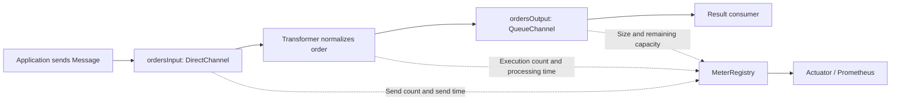

# Micrometer integration metrics

## 1. Objectives and scope

In a Spring Integration flow, a message can pass through channels, transformers, routers, filters, and multiple handlers before completing a business process. When the flow slows down or fails, you need to identify where the issue lies: ingestion rate, processing time, endpoint errors, or queue backlog accumulation.

This lesson belongs to the **Metrics and observability** chapter of the **SPRING_INTEGRATION_CORE** module. After this lesson, you will be able to:

- Recognize `Counter`, `Timer`, `Gauge`, and the role of `MeterRegistry`.
- Correctly read metrics for channels, handlers, message sources, and queues.
- Set up a Java DSL example, inspect metrics via Actuator, and export data to Prometheus.
- Distinguish Spring Integration's direct metrics from metrics via Micrometer Observation.
- Design tags with bounded cardinality and add business-level measurements when needed.
- Analyze metrics without confusing execution counts with the number of completed business messages.

The examples use Java 17, Spring Boot 3.5.x, and Spring Integration 6.5.x. This is the version scope of the lesson; projects using other version lines should verify the corresponding APIs and metric names. It is assumed that you already know `Message`, `MessageChannel`, and how to declare an `IntegrationFlow`.

## 2. Where do metrics fit in observability?

Suppose a system receives orders and normalizes data:



Metrics show trends across many executions. Logs help you read the details of a single event. Traces help you follow a single execution across multiple components. The three data types answer different questions:

| Operational question | Suitable data |
| --- | --- |
| How many sends are accepted per second? | Rate calculated from count |
| Has latency increased over the past 15 minutes? | Timer and histogram |
| Is the queue getting close to full? | Gauge |
| Which payload caused a transformation error? | Logs with sensitive data controlled |
| Which endpoints did a single request pass through? | Trace |

A drop in a throughput chart does not by itself reveal the root cause. You need to combine it with latency, errors, and backlog to form a hypothesis, then use logs or traces to verify it.

## 3. Micrometer components to understand

### 3.1. MeterRegistry and meter identity

`MeterRegistry` is where an application registers and records meters. A registry for Prometheus exposes data for Prometheus to scrape; `SimpleMeterRegistry` keeps measurements in memory, suitable for small examples and in-process checks.

A meter is identified by a name and a set of tags. For example:

```text
name = spring.integration.send
tags = {
  type = channel,
  name = ordersInput,
  result = success,
  exception = none
}
```

Here, `spring.integration.send` is the metric name, while the tags also have a `name` key indicating the measured component. Both concepts use the word "name", but at two different levels.

When analyzing, you must keep all necessary distinguishing dimensions. Aggregating all of `spring.integration.send` can mix channel measurements with handler measurements.

### 3.2. Counter: monotonically increasing event total

`Counter` is used to count events such as the number of received messages or the number of discards according to a rule. When observing a long-running system, rate is usually more useful than total count: an instance running for two days can naturally have a higher total count than one that just started. `Timer` already includes a count, so you usually do not need a separate counter to count the same executions already measured by a timer. [Micrometer Counter documentation](https://docs.micrometer.io/micrometer/reference/concepts/counters.html).

### 3.3. Timer: execution count and duration

`Timer` provides at minimum a count and total duration. Backends and configuration can additionally provide max, histograms, or percentiles. Export units depend on the backend; Prometheus typically uses seconds for durations. [Micrometer Timer documentation](https://docs.micrometer.io/micrometer/reference/concepts/timers.html).

For the same set of messages:

```text
count      = 120
total time = 3 seconds
mean       = 3 / 120 = 0.025 seconds = 25 ms
```

An average of 25 ms does not prove the system always responds quickly. For example, most messages taking 5 ms while a small group takes several seconds can still be hidden by the mean.

### 3.4. Gauge: state at the time of observation

`Gauge` reads the current state, such as the number of waiting messages. It does not record every fluctuation between two scrapes. If a queue spikes to 500 and drops back to 0 between two samples, the backend may never see the peak of 500. When creating your own gauge, keep a reference to the observed object rather than creating a temporary object and discarding it. [Micrometer Gauge documentation](https://docs.micrometer.io/micrometer/reference/concepts/gauges.html).

Therefore, count and gauge complement each other: count describes the amount of work passing through, while gauge describes the amount of work currently present.

## 4. Two collection mechanisms to distinguish

Spring Integration supports direct metrics via Micrometer and the Observation mechanism. With the direct mechanism, having a `MeterRegistry` bean allows the framework to create metrics on supported components. The Observation mechanism requires an `ObservationRegistry`, component selection configuration, and an appropriate handler to turn observations into metrics or traces. When a component uses Observation, the corresponding timing measurement is delegated to the observation handler. [Spring Integration 6.5 Metrics and Management](https://docs.spring.io/spring-integration/reference/6.5/metrics.html).

The initial hands-on example uses **direct metrics**. The Observation section near the end of the lesson is a configuration variant with a different metric family and tags.

### 4.1. Common direct metrics

| Meter | Type | Component / distinguishing tag |
| --- | --- | --- |
| `spring.integration.send` | Timer | `type=channel` or `type=handler` |
| `spring.integration.receive` | Counter | `type=channel` or `type=source` |
| `spring.integration.channels` | Gauge | Number of channels |
| `spring.integration.handlers` | Gauge | Number of handlers |
| `spring.integration.sources` | Gauge | Number of message sources |

The send/receive meters have tags such as `name`, `result`, and `exception`. Read them together with `type` to identify the exact measured object. This table describes the direct mechanism, according to the [Spring Integration metrics catalog](https://docs.spring.io/spring-integration/reference/6.5/metrics.html#micrometer-integration).

`MessageSource` is a component that produces messages for polling; it is different from a channel that can receive messages via `receive()`. A flow starting from a `DirectChannel` does not therefore gain a message source.

### 4.2. Do not infer meter names from endpoint names

In Java DSL, the `id` of a consumer endpoint and the bean name of the inner handler can differ. A service bean called by a handler is also not necessarily the name that appears in the metric.

To find the actual names, you can list meter IDs in the registry:

```java
registry.getMeters().stream()
        .filter(meter -> meter.getId().getName()
                .startsWith("spring.integration."))
        .map(meter -> meter.getId().toString())
        .sorted()
        .forEach(System.out::println);
```

Use the actual tag list to build dashboards. Important channels should have explicit bean names that remain stable across deployments.

## 5. Measurement boundaries determine what numbers mean

### 5.1. DirectChannel: the send call runs on the same thread as the subscriber

`DirectChannel` invokes the subscriber directly on the sending thread. Therefore, the `send()` duration can include downstream transformers, handlers, and synchronous forwarding until the call returns. [DirectChannel API](https://docs.spring.io/spring-integration/api/org/springframework/integration/channel/DirectChannel.html).

Illustrative example:

```text
ordersInput.send()
  └─ transformer: 2 ms
      └─ business handler: 35 ms
          └─ result forwarding: 1 ms
```

The input channel timer can be close to 38 ms plus overhead. An upstream handler's timer can also include synchronous downstream forwarding. Summing durations across all channels and handlers easily double-counts nested intervals.

If a handler throws an error and the error propagates back to the input channel, multiple meters may record a failure for the same message. Those are different viewpoints of a single failure, not necessarily multiple failed messages.

### 5.2. QueueChannel and ExecutorChannel create different boundaries

`QueueChannel` stores messages in a queue. A successful send to the queue indicates that the message was accepted into the queue, not that the receiver has finished processing the business logic successfully. A bounded queue can also make the sender wait when full, depending on the timeout. [QueueChannel API](https://docs.spring.io/spring-integration/api/org/springframework/integration/channel/QueueChannel.html).

With `ExecutorChannel`, work can shift to another thread. The send call duration usually reflects dispatching or handoff, while handler execution time must be observed separately. The executor policy can also run work on the calling thread, so you must inspect the actual configuration.

In an asynchronous flow, end-to-end latency can be broken down as:

```text
end-to-end latency
  = time waiting to be processed
  + processing time
  + forwarding time and other waits
```

A timer measuring enqueue does not automatically cover the time a message sits waiting. To measure end-to-end latency, you must define the start point, completion point, timeout handling, and how to correlate the two points for the same business operation.

### 5.3. Technical success vs. business success

| Scenario | Distinction to make |
| --- | --- |
| A filter actively discards an invalid message | The handler may complete normally even though the message does not continue |
| A router selects a rejection branch | Successful routing does not mean the order was accepted |
| Retry re-processes a message | Attempt count can be higher than business message count |
| An aggregator receives multiple messages | Multiple inputs can produce a single aggregated result |
| A splitter divides one message | One input can trigger multiple downstream executions |
| Recovery routes an error to a compensation branch | Observed outcome depends on where measurement sits relative to recovery |

Therefore, dashboards must state the unit clearly: send attempts, receive attempts, processing attempts, or completed orders.

## 6. Hands-on: an observable Java DSL flow

The following example creates two successful messages and one intentional error message on startup. Successful results are placed into `ordersOutput` and then read out. The application keeps running so you can inspect Actuator.

### 6.1. Dependencies

In a Spring Boot 3.5.x project using the corresponding dependency management, add:

```xml
<dependencies>
    <dependency>
        <groupId>org.springframework.boot</groupId>
        <artifactId>spring-boot-starter-integration</artifactId>
    </dependency>
    <dependency>
        <groupId>org.springframework.boot</groupId>
        <artifactId>spring-boot-starter-web</artifactId>
    </dependency>
    <dependency>
        <groupId>org.springframework.boot</groupId>
        <artifactId>spring-boot-starter-actuator</artifactId>
    </dependency>
    <dependency>
        <groupId>io.micrometer</groupId>
        <artifactId>micrometer-registry-prometheus</artifactId>
    </dependency>
</dependencies>
```

`spring-boot-starter-web` provides the HTTP server for Actuator in this example. Actuator configures the metrics infrastructure; the corresponding registry determines how data is exported. Use Boot's dependency management to keep Micrometer and Spring versions compatible. [Spring Boot 3.5 metrics guide](https://docs.spring.io/spring-boot/3.5/reference/actuator/metrics.html).

### 6.2. Configuring application.properties

```properties
spring.application.name=orders-integration

# This lab uses direct metrics.
spring.integration.management.observation-patterns=

management.endpoints.web.exposure.include=health,metrics,prometheus
management.metrics.tags.application=${spring.application.name}
```

In Spring Boot 3.5, Integration auto-configuration uses the `spring.integration.management.observation-patterns` property to configure Observation scope. An empty value in this example selects no components for Observation. [Boot 3.5 IntegrationAutoConfiguration source](https://github.com/spring-projects/spring-boot/blob/3.5.x/spring-boot-project/spring-boot-autoconfigure/src/main/java/org/springframework/boot/autoconfigure/integration/IntegrationAutoConfiguration.java).

### 6.3. Complete Java application

Place the following class in the `vn.example.integration` package under the project's main source set:

```java
package vn.example.integration;

import java.util.Locale;

import io.micrometer.core.instrument.MeterRegistry;
import io.micrometer.core.instrument.Timer;
import org.springframework.beans.factory.annotation.Qualifier;
import org.springframework.boot.CommandLineRunner;
import org.springframework.boot.SpringApplication;
import org.springframework.boot.autoconfigure.SpringBootApplication;
import org.springframework.context.annotation.Bean;
import org.springframework.integration.channel.DirectChannel;
import org.springframework.integration.channel.QueueChannel;
import org.springframework.integration.dsl.IntegrationFlow;
import org.springframework.messaging.Message;
import org.springframework.messaging.MessageChannel;
import org.springframework.messaging.MessagingException;
import org.springframework.messaging.support.GenericMessage;

@SpringBootApplication
public class IntegrationMetricsApplication {

    public static void main(String[] args) {
        SpringApplication.run(IntegrationMetricsApplication.class, args);
    }

    @Bean
    public DirectChannel ordersInput() {
        return new DirectChannel();
    }

    @Bean
    public QueueChannel ordersOutput() {
        return new QueueChannel(100);
    }

    @Bean
    public IntegrationFlow ordersFlow() {
        return IntegrationFlow.from("ordersInput")
                .transform(String.class, payload -> {
                    if ("FAIL".equals(payload)) {
                        throw new IllegalArgumentException(
                                "Error message used for the lab");
                    }
                    return payload.strip().toUpperCase(Locale.ROOT);
                }, endpoint -> endpoint.id("normalizeOrder"))
                .channel("ordersOutput")
                .get();
    }

    @Bean
    public CommandLineRunner demonstrateMetrics(
            @Qualifier("ordersInput") MessageChannel input,
            @Qualifier("ordersOutput") QueueChannel output,
            MeterRegistry registry) {

        return args -> {
            for (String payload :
                    new String[] {"  order-001  ", "order-002"}) {
                boolean sent = input.send(new GenericMessage<>(payload), 1000);
                if (!sent) {
                    throw new IllegalStateException("Failed to send message");
                }
            }

            boolean failureObserved = false;
            try {
                input.send(new GenericMessage<>("FAIL"), 1000);
            }
            catch (MessagingException expected) {
                failureObserved = true;
                System.out.println("Observed simulated error: "
                        + expected.getClass().getSimpleName());
            }

            Message<?> first = output.receive(1000);
            Message<?> second = output.receive(1000);
            if (!failureObserved
                    || first == null || second == null
                    || !"ORDER-001".equals(first.getPayload())
                    || !"ORDER-002".equals(second.getPayload())) {
                throw new IllegalStateException("Flow result is incorrect");
            }

            Timer success = registry.find("spring.integration.send")
                    .tags("type", "channel", "name", "ordersInput",
                            "result", "success")
                    .timer();

            Timer failure = registry.find("spring.integration.send")
                    .tags("type", "channel", "name", "ordersInput",
                            "result", "failure")
                    .timer();

            if (success == null || failure == null
                    || success.count() != 2 || failure.count() != 1) {
                throw new IllegalStateException(
                        "Expected 2 successful sends and 1 failed send");
            }

            System.out.println("ordersInput: success="
                    + success.count() + ", failure=" + failure.count());

            registry.getMeters().stream()
                    .filter(meter -> meter.getId().getName()
                            .startsWith("spring.integration."))
                    .map(meter -> meter.getId().toString())
                    .sorted()
                    .forEach(System.out::println);
        };
    }
}
```

In this synchronous flow, the transformer wraps the processing error in a `MessagingException` and propagates it back to the sender. The `catch` block is only for the simulated error message; it does not establish an error-handling strategy for a real application.

The `normalizeOrder` identifier is an endpoint ID. The metric verification relies on the explicitly named `ordersInput` channel, without assuming the handler name registered by the DSL.

### 6.4. Expected results to observe

When starting successfully with the configuration just described:

- The `ordersInput` timer has two `success` runs and one `failure` run.
- `ordersOutput` receives two messages, and after two `receive()` calls the queue is empty.
- The normalization handler has its own metrics; read the exact name and tags from the printed meter list.
- The application still runs an HTTP server to serve the Actuator endpoints.

The count checks above apply only to a freshly started lab with no other producers. As more messages are sent, the counts will change. Every time the process restarts, the data in the new process's registry starts over.

## 7. Inspecting via Actuator and verifying exported data

### 7.1. Finding meters and tags

The URLs in the example run on the default port 8080:

```text
GET http://localhost:8080/actuator/metrics
GET http://localhost:8080/actuator/metrics/spring.integration.send
GET http://localhost:8080/actuator/metrics/spring.integration.send?tag=type:channel&tag=name:ordersInput&tag=result:success
GET http://localhost:8080/actuator/prometheus
```

`/actuator/metrics` helps diagnose meters inside the application. `/actuator/prometheus` provides the scrape format and requires the Prometheus registry. HTTP exposure for these endpoints must be configured as shown in the previous section. [Spring Boot 3.5 Actuator endpoints](https://docs.spring.io/spring-boot/3.5/reference/actuator/endpoints.html).

When viewing a metric without filtering tags, measurements may be aggregated across multiple meters with the same name. Therefore, start with `availableTags` and then filter `type`, `name`, and `result` according to the question you are investigating.

If a meter has not appeared yet, trigger the corresponding operation first. Per-execution meters are typically created on use; simply having a handler in the application does not mean that handler has processed a message yet.

### 7.2. Micrometer names vs. Prometheus names

Under standard naming conventions, the `spring.integration.send` timer is exported into series such as:

```text
spring_integration_send_seconds_count
spring_integration_send_seconds_sum
```

When histograms are enabled, the `spring_integration_send_seconds_bucket` family is also added. The exact series depend on the meter type and configuration, so inspect the scrape output directly before writing queries. Prometheus uses a pull model to collect data from each instance. [Micrometer Prometheus](https://docs.micrometer.io/micrometer/reference/implementations/prometheus.html).

Having a working scrape endpoint is not enough to produce historical graphs: Prometheus must also be configured with the target and scrape successfully across multiple timestamps. The three messages on startup help verify counts; to see meaningful rates and percentiles, generate sustained load after the target is being scraped.

## 8. Throughput, error ratio, and latency with PromQL

The following queries assume **direct metrics**, the exported labels shown earlier, and existing data within a five-minute window. Each query selects a single measurement point: `ordersInput`.

### 8.1. Channel send rate

```promql
sum(
  rate(spring_integration_send_seconds_count{
    application="orders-integration",
    type="channel",
    name="ordersInput"
  }[5m])
)
```

The unit is sends per second, including both successes and failures in this selector. Add `result="success"` if the question asks for the rate of successful sends.

Calculate `rate` for each series first and then `sum`. This preserves per-instance counter reset handling. [Prometheus rate function](https://prometheus.io/docs/prometheus/latest/querying/functions/#rate).

### 8.2. Failure ratio at the same measurement point

```promql
(
  sum(
    rate(spring_integration_send_seconds_count{
      application="orders-integration",
      type="channel",
      name="ordersInput",
      result="failure"
    }[5m])
  ) or vector(0)
)
/
clamp_min(
  sum(
    rate(spring_integration_send_seconds_count{
      application="orders-integration",
      type="channel",
      name="ordersInput"
    }[5m])
  ),
  1e-9
)
```

Here, `or vector(0)` represents a numerator of 0 when no failure series exists yet, assuming the aggregation returns a single scalar-like value without keeping grouping labels. `clamp_min` prevents division by zero; it does not replace checking for traffic when designing alerts.

Do not divide errors across all handlers by sends into one input channel and call that the failed order rate. Numerator and denominator must share the same unit, processing boundary, and time window.

### 8.3. Mean latency of successful sends

```promql
sum(
  rate(spring_integration_send_seconds_sum{
    application="orders-integration",
    type="channel",
    name="ordersInput",
    result="success"
  }[5m])
)
/
sum(
  rate(spring_integration_send_seconds_count{
    application="orders-integration",
    type="channel",
    name="ordersInput",
    result="success"
  }[5m])
)
```

The result is in seconds. When there are no sends in the window, the mean is undefined; dashboards should show no data rather than interpreting it as 0 latency.

When aggregating across multiple instances, dividing total duration by total count produces a weighted average. Averaging per-instance means can be wrong when traffic volume differs across instances.

## 9. Histograms and percentiles

To observe the tail of the latency distribution, you can enable histograms for the timer in the lab:

```properties
management.metrics.distribution.percentiles-histogram.spring.integration.send=true
management.metrics.distribution.slo.spring.integration.send=10ms,50ms,100ms,500ms,1s
```

This configuration affects all timers named `spring.integration.send`, including both channels and handlers. For large systems, limit the scope with filters or targeted policies to control series count.

Histograms allow summing buckets across instances and then computing percentiles on the backend. Client-side precomputed percentiles cannot be aggregated by averaging per-instance percentiles. Every tag combination and every bucket adds to storage cost. [Micrometer Histograms and Percentiles](https://docs.micrometer.io/micrometer/reference/concepts/histogram-quantiles.html).

Example p95 for successful sends:

```promql
histogram_quantile(
  0.95,
  sum by (le) (
    rate(spring_integration_send_seconds_bucket{
      application="orders-integration",
      type="channel",
      name="ordersInput",
      result="success"
    }[5m])
  )
)
```

`le` is the bucket upper-bound label and must be preserved when aggregating classic histograms. [Prometheus histogram_quantile function](https://prometheus.io/docs/prometheus/latest/querying/functions/#histogram_quantile).

The p95 value is an estimate from the distribution in the active window. In the `DirectChannel` example, it describes the synchronous send-call boundary, and does not automatically become the end-to-end p95 of a system that includes queues or external services.

## 10. Queue metrics and backlog detection

In the direct mechanism, `QueueChannel` registers two gauges:

| Metric name | Meaning |
| --- | --- |
| `spring.integration.channel.queue.size` | Number of messages currently in the queue |
| `spring.integration.channel.queue.remaining.capacity` | Number of remaining slots |

They carry `type=channel` and the channel's `name` tag. [QueueChannel 6.5 source](https://github.com/spring-projects/spring-integration/blob/6.5.x/spring-integration-core/src/main/java/org/springframework/integration/channel/QueueChannel.java).

For a bounded queue, you can estimate utilization:

```text
utilization = size / (size + remaining capacity)
```

Suppose a queue has a capacity of 1,000 and currently holds 600 messages. During a steady period:

```text
enqueue rate = 200 messages/second
dequeue rate = 150 messages/second
backlog growth = 50 messages/second

estimated time to full = (1,000 - 600) / 50 = 8 seconds
```

This is a hypothetical calculation that holds only when rates are stable enough and both sides count the same type of message. Splitters, retries, filters, or multiple consumers can alter the model.

Queue size also does not tell you the age of the oldest message. A small queue can still hold a message stuck for a long time. If you need alerts based on wait time, add queue age or end-to-end latency measurements.

In the lab, `ordersOutput` drops to 0 after the runner reads the two results. To observe backlog, you can temporarily pause the receiver and send a controlled number of messages below capacity.

One common pitfall: in `AbstractPollableChannel` on the 6.5 line, a receive returning `null` because no message is available does not increment the successful receive counter and is not counted as a receive error. Do not treat polling an empty queue as a failed message. [AbstractPollableChannel source](https://github.com/spring-projects/spring-integration/blob/6.5.x/spring-integration-core/src/main/java/org/springframework/integration/channel/AbstractPollableChannel.java).

## 11. Failures do not necessarily come with an exception

In the direct mechanism, a channel send can fail in two ways: throwing an exception or returning `false`. When returning `false`, it can be recorded as `result=failure` with `exception=none`. When an exception is thrown, the exception tag reflects the exception class observed at that boundary, which may be a messaging wrapper exception. [AbstractMessageChannel 6.5 source](https://github.com/spring-projects/spring-integration/blob/6.5.x/spring-integration-core/src/main/java/org/springframework/integration/channel/AbstractMessageChannel.java).

Example testing a full queue with a non-blocking send:

```java
// Assume boundedQueue is a QueueChannel bean with capacity = 1,
// initialized by Spring and with direct metrics enabled.
boolean first = boundedQueue.send(new GenericMessage<>("A"), 0);
boolean second = boundedQueue.send(new GenericMessage<>("B"), 0);

// With no consumer reading in between:
// first == true; second == false.
```

If a dashboard only queries `exception!="none"`, it can miss the second failure mode. In direct mode, `result` is the primary dimension for counting send failures; `exception` helps classify them further.

At the same time, you cannot assume every error appears on `errorChannel`. In synchronous flows, errors usually propagate directly back to the caller. For asynchronous flows and pollers, where the error occurs and how error handling is configured determine how `ErrorMessage` instances are routed. Counting messages on the error channel and counting timer failures may be measuring two different sets of events.

## 12. Tags, cardinality, and business metrics

### 12.1. Choose tags with a bounded set of values

Cardinality is the number of tag name and value combinations that create distinct meters/series. Design it before shipping data to a backend.

| Tag | Example | Usage |
| --- | --- | --- |
| `application` | `orders-integration` | Identifies the application |
| `flow` | `orders`, `returns` | Suitable if the list of flows is bounded |
| `outcome` | `success`, `failure` | Standardized outcome classification |
| `reason` | `invalid_format`, `missing_field` | Use a bounded code set |
| `orderId` | Continuously changing order ID | Use in logs/traces where appropriate; avoid as a metric tag |
| `exceptionMessage` | Free-form error text | Normalize into reason groups |

For example, assuming 20 flows, 3 outcomes, and 5 reason groups, those three dimensions alone allow up to `20 × 3 × 5 = 300` combinations, before instance and histogram dimensions. Adding an order ID that is nearly unique per message will cause combinations to grow rapidly with traffic.

Dynamic bean names per customer can also generate many values for a component name tag. Not adding new custom tags is not enough by itself to guarantee low cardinality.

### 12.2. Limiting with MeterFilter

Spring Boot picks up `MeterFilter` beans and applies them to the registry. The example below caps the number of `flow` values for application metrics:

```java
import io.micrometer.core.instrument.config.MeterFilter;
import org.springframework.context.annotation.Bean;
import org.springframework.context.annotation.Configuration;

@Configuration(proxyBeanMethods = false)
public class MetricsPolicyConfiguration {

    @Bean
    public MeterFilter limitApplicationFlowTags() {
        return MeterFilter.maximumAllowableTags(
                "app.orders.",
                "flow",
                10,
                MeterFilter.deny());
    }
}
```

This filter applies only to the specified prefix and tag; it does not limit all other dimensions. A denied meter becomes a no-op and records no data. Configure filters before meters are created. [Micrometer Meter Filters](https://docs.micrometer.io/micrometer/reference/concepts/meter-filters.html).

This is a protective safeguard, not a way to legitimize tags with arbitrary input. If the valid list of flows exceeds the limit, review the policy because data may be dropped.

### 12.3. Adding measurements with explicit business boundaries

Built-in metrics describe framework activity. When you need to measure a specific business operation, you can add a dedicated timer with bounded tags:

```java
import java.util.Locale;

import io.micrometer.core.instrument.MeterRegistry;
import io.micrometer.core.instrument.Timer;

public final class MeasuredOrderService {

    private final MeterRegistry registry;
    private final Timer success;
    private final Timer failure;

    public MeasuredOrderService(MeterRegistry registry) {
        this.registry = registry;
        this.success = Timer.builder("app.orders.normalize.duration")
                .tags("flow", "orders", "outcome", "success")
                .register(registry);
        this.failure = Timer.builder("app.orders.normalize.duration")
                .tags("flow", "orders", "outcome", "failure")
                .register(registry);
    }

    public String normalize(String payload) {
        Timer.Sample sample = Timer.start(registry);
        Timer resultTimer = failure;
        try {
            if (payload == null || payload.isBlank()) {
                throw new IllegalArgumentException("Order content is missing");
            }
            String normalized = payload.strip().toUpperCase(Locale.ROOT);
            resultTimer = success;
            return normalized;
        }
        finally {
            sample.stop(resultTimer);
        }
    }
}
```

This is a standalone additional example. Register the service as a bean and invoke it from a transformer if you want to apply it in the flow. `Timer.Sample` lets you start a measurement and choose the target timer when stopping. [Using Timer.Sample](https://docs.micrometer.io/micrometer/reference/concepts/timers.html#_storing_start_state_in_timer_sample).

This measurement ends when `normalize` returns or throws an exception. It does not include sending the result to a downstream channel. Therefore, business metrics and framework metrics can coexist to answer two different questions; do not sum them into a total latency.

If you need to count completed orders, place the measurement at the completion confirmation point defined by the business contract. With retries or duplicate deliveries, decide whether to count each attempt or each unique business identifier; a counter alone does not provide deduplication.

## 13. Switching to Micrometer Observation

### 13.1. Enabling explicitly

In the Spring Boot 3.5 variant of the lab, change the scope configuration to:

```properties
spring.integration.management.observation-patterns=*
```

This selects all components matching the pattern for observation. When configuring Spring Integration directly, the corresponding API is `@EnableIntegrationManagement(observationPatterns = "*")`. By default, the annotation does not select all components; patterns can narrow the scope by name. [EnableIntegrationManagement API](https://docs.spring.io/spring-integration/api/org/springframework/integration/config/EnableIntegrationManagement.html).

If an application declares the annotation or an `IntegrationManagementConfigurer` itself, check that configuration directly: the Boot property takes effect only when the corresponding auto-configuration is used.

### 13.2. ObservationRegistry needs a handler to emit metrics

In a plain Spring application without Boot, the infrastructure can be declared as follows alongside the flow configuration:

```java
import io.micrometer.core.instrument.MeterRegistry;
import io.micrometer.core.instrument.observation.DefaultMeterObservationHandler;
import io.micrometer.core.instrument.simple.SimpleMeterRegistry;
import io.micrometer.observation.ObservationRegistry;
import org.springframework.context.annotation.Bean;
import org.springframework.context.annotation.Configuration;
import org.springframework.integration.config.EnableIntegration;
import org.springframework.integration.config.EnableIntegrationManagement;

@Configuration(proxyBeanMethods = false)
@EnableIntegration
@EnableIntegrationManagement(observationPatterns = "*")
public class ObservationInfrastructure {

    @Bean
    public MeterRegistry meterRegistry() {
        return new SimpleMeterRegistry();
    }

    @Bean
    public ObservationRegistry observationRegistry(MeterRegistry meters) {
        ObservationRegistry observations = ObservationRegistry.create();
        observations.observationConfig()
                .observationHandler(
                        new DefaultMeterObservationHandler(meters));
        return observations;
    }
}
```

This snippet illustrates infrastructure for plain Spring; do not copy it into a Boot application that already configures the corresponding registry and handler.

`DefaultMeterObservationHandler` converts the Observation lifecycle into meters, using low-cardinality key values as tags and adding an `error` tag. High-cardinality key values do not become metric tags in this handler. Having Observation does not automatically mean trace export is enabled; tracing also requires the corresponding tracing infrastructure. [Micrometer Observation components](https://docs.micrometer.io/micrometer/reference/observation/components.html#_defaultmeterobservationhandler).

### 13.3. Metric names and tags change

Primary timers of the Observation mechanism:

| Target | Timer |
| --- | --- |
| Sending a message through a channel | `spring.integration.producer` |
| Handler receiving/processing a message | `spring.integration.handler` |
| Inbound gateway request/reply | `spring.integration.gateway` |

Component identification tags use forms such as `spring.integration.name` and `spring.integration.type`; gateways also have `spring.integration.outcome` by convention. This is a different schema from `name`, `type`, and `result` in the direct mechanism. [Spring Integration 6.5 Observation metrics catalog](https://docs.spring.io/spring-integration/reference/6.5/metrics.html#observability-metrics).

When using the corresponding meter observation handler, you may also see a `.active` `LongTaskTimer` family representing in-flight observations. They are not counts of completed work; tags added after start may also not appear on active meters.

When running the Observation variant of the lab, you must **replace the check block for the two `spring.integration.send` timers in the runner**. Example checking the total of three sends into the channel:

```java
long attempts = registry.find("spring.integration.producer")
        .tag("spring.integration.name", "ordersInput")
        .timers()
        .stream()
        .mapToLong(Timer::count)
        .sum();

if (attempts != 3) {
    throw new IllegalStateException("Expected to observe all 3 send attempts");
}
```

Keep the message result check and the meter listing. Then inspect the actual `error` tag to distinguish success from failure; do not copy the `result=failure` query verbatim from the previous mode.

When changing the collection mechanism, update histograms, dashboards, and alerts in sync. For example, histogram configuration for `spring.integration.send` does not automatically carry over to `spring.integration.producer`. Do not assume all auxiliary gauges or counters disappear alongside timing changes; check the actual registry of the version in use.

### 13.4. Metrics support tracing but do not replace propagation

In systems with queues or thread switches, appropriate context propagation is needed to connect spans. Enabling separate timers on both sides does not prove two measurements belong to the same message.

At the design level, keep the two goals distinct: metrics tell you whether the overall flow is healthy; traces help you follow a specific execution. Only add detailed identifying data when genuinely needed for the second goal, while still controlling what gets exported.

## 14. Reading symptoms and narrowing down root causes

| Observation | Hypothesis to check | Verification step |
| --- | --- | --- |
| Input channel timer increases, synchronous steps are slow | A handler or downstream dependency call is stretching the chain | Compare per-step timers and traces |
| Fast queue sends, queue size climbs continuously | Consumption rate is lower than ingestion rate | Compare rates on both sides and consumer state |
| Queue near full, send timer increases | Senders are waiting for available capacity | Check timeout and capacity |
| Failures increase without exceptions | `send()` returns `false` on some channels | Filter by `result` and check send timeout |
| Framework records success but fewer business results | Filter, router, or recovery terminated normally | Check discard branches and business metrics |
| Processing logs exist, expected meters are missing | Wrong schema, denied by filter, or different registry | List meter IDs in the injected registry |
| Timer chart disappears after config change | Component switched to Observation | Look for producer/handler/gateway families |
| Count grows higher than completed orders | Retries, splits, or multiple measurement points summed together | Re-select boundary and counting unit |

These are operational hypotheses, not definitive conclusions from a single metric. For example, growing backlog can be caused by a slow consumer, or by a stopped consumer or a sudden upstream traffic spike.

A practical diagnostic sequence:

1. Confirm whether the application uses direct metrics or Observation for the component under inspection.
2. Trigger a single flow with easily identifiable data.
3. List actual meter names and tags in the registry.
4. Check whether Actuator sees that meter.
5. Check Prometheus scrape data and target health.
6. Write selectors for one processing boundary before aggregating across instances.
7. Cross-check throughput, errors, latency, and queue depth, then verify with logs or traces.

## 15. Reinforcement exercises

Perform these steps in order on the lesson example:

1. **Observe synchronous boundaries.** Record counts and latency on `ordersInput`, the normalization handler, and `ordersOutput`. Explain why these durations must not be summed directly into end-to-end latency.
2. **Observe a full queue.** Create a `QueueChannel` bean with capacity 1, send two messages with timeout 0 without receiving any. Inspect the return value of send, the failure tag, and the queue gauges.
3. **Switch collection mechanisms.** Enable Observation, replace the timer check block per section 13, and find the new metrics and tags. Update selectors and histogram configuration to match the new schema.

The target outcome is the ability to answer with numbers: which operation is being measured, what one count unit represents, where timing starts and ends, and what work lies outside that boundary.
