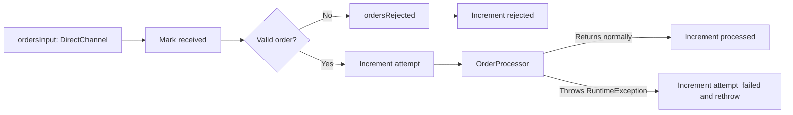

# Message counters

> **Chapter:** Metrics and observability  
> **Scope:** SPRING_INTEGRATION_CORE — observing message flows built with Message, MessageChannel, endpoints, and Java DSL.

An order processing flow receives 1,000 messages but completes only 930 executions. The remaining ones might be sitting in a queue, dropped by a filter, retrying, or failed. With only a single `messageCount` variable, an operator cannot tell which event that variable represents.

This lesson guides you through designing counters with clear semantics, placing counter increments in Spring Integration, and reading numbers over time windows. The running example uses a flow that receives orders, filters out invalid ones, and processes the rest.

## 1. Objectives and prerequisites

After this lesson, you will be able to:

- Distinguish the number of messages entering a flow, processing attempts, and completed executions.
- Use `MeterRegistry` and `Counter` to record message events.
- Choose counting points on an endpoint or channel based on the question to answer.
- Use tags with bounded cardinality, avoiding creating a time series per message.
- Read throughput and failure rates without mistakenly summing different measurement points.
- Verify counting behavior when messages are discarded, raise errors, or are retried.

You should be familiar with `Message<T>`, `DirectChannel`, filters, and service activators in Java DSL. The Java examples use Java 17 and Spring Integration 6.x APIs. When applying to a project, use compatible Spring and Micrometer versions according to your project's BOM.

## 2. Which events does a counter count?

### 2.1. The counting unit must be defined upfront

In this lesson, each occurrence of a defined event increments the corresponding counter by `1`. "One message" is not enough as a measurement contract; you must state which point the message passed and under what conditions.

For example:

| Counter by event | When incremented | Question answered |
|---|---|---|
| `received` | Message enters the first measured step of the flow | How many passes through this step has the flow accepted? |
| `rejected` | Message goes to the filter's discard branch | How many entries were discarded by the rule? |
| `attempt` | Right before each call to the business processor | How many times was the processor invoked? |
| `processed` | Processor returns normally | How many invocations completed normally? |
| `attempt_failed` | Processor invocation throws `RuntimeException` | How many attempts failed within this catch scope? |

`received` in the table is an application-defined event. It does not automatically mean received from a broker, received from a `QueueChannel`, or received at a gateway. The measurement contract must state that exact boundary.

An order resent twice can produce two `received` events. One receipt retried three times can produce three `attempt` events. A counter does not automatically recognize events belonging to the same order.

### 2.2. Counter, gauge, and timer

`Counter` represents the occurrence count of an event; increments use positive amounts. When you need rate, compute it from the change in the counter over a time interval. If a `Timer` already exists for the exact event you need to measure, you can use the timer's recorded count. [Micrometer Counter documentation](https://docs.micrometer.io/micrometer/reference/concepts/counters.html)

In this lesson's design:

| Question | Appropriate metric type |
|---|---|
| How many entries were rejected by the filter? | Counter |
| How many messages are currently waiting in the queue? | Gauge |
| How long does each execution take and how many executions ran? | Timer |
| How many jobs are currently running? | Gauge or an appropriate in-flight measurement |

Do not call `counter.increment(-1)` when a message leaves a queue. The number of waiting messages can increase and decrease; that is a current state and should be measured with a gauge.

With a cumulative registry such as `SimpleMeterRegistry` in the example, `count()` shows the total events since the meter was created in that process. Do not generalize this direct reading to every backend: step-based registries may export data per backend interval.

## 3. Choosing counting points in Spring Integration

Consider the flow:



A valid message that processes successfully increments `received`, `attempt`, and `processed`. These three increments describe three events of a single execution, not three independent messages.

### 3.1. Counting on a channel vs. an endpoint answers different questions

| Measurement point | Meaning | Caveat to remember |
|---|---|---|
| `ChannelInterceptor.preSend` | The send call reached this interceptor | The send can still be blocked or fail |
| After `send()` returns `true` | The channel reported a successful send under its mechanics | Not enough to conclude business completion in async flows |
| Start of business endpoint | An execution has actually started | Can be counted multiple times due to retries |
| After business method returns | That invocation finished normally | Does not guarantee an outer transaction committed |
| Filter discard branch | Message entered the configured discard branch | Should not be lumped together with technical errors |
| Error-handling branch | Error message reached that branch | Not every exception automatically routes to this branch |

With `DirectChannel` in the example, the subscriber runs synchronously on the calling thread. If the endpoint throws an error, the caller observes the send call failing. With `ExecutorChannel` or a queue-backed flow, downstream work may not yet be finished when the sender gets a successful send result.

Therefore, "send succeeded" and "processing completed" names must stay separate. Placing counters close to the event you want to measure makes reading dashboards less dependent on assumptions about channel types.

### 3.2. Reusing built-in metrics when appropriate

Spring Integration provides these technical meters in the direct Micrometer metrics mechanism:

| Meter | Type | Typical scope |
|---|---|---|
| `spring.integration.send` | Timer | Channel or handler; distinguished by the `type` tag |
| `spring.integration.receive` | Counter | Receiving from a pollable channel or message source |

Use `Timer.count()` if you need the count already recorded on that timer. When Micrometer Observation is enabled for a component, the collection path and meter names may differ; check the active configuration. [Spring Integration Metrics and Management](https://docs.spring.io/spring-integration/reference/metrics.html)

Custom counters in the next section serve business milestones such as `rejected` and `processed`. Do not add them to technical meter counts to fabricate a single "total messages" figure.

## 4. Designing metric names and tags

The example uses one metric family:

```text
Micrometer name: app.integration.message.events
Tags:
  flow=orders
  event=received | rejected | attempt | processed | attempt_failed
```

The `event` values form a closed set defined in source code. Each `name + tags` combination identifies one meter. This metric family counts **events at flow milestones**, so queries must always explicitly select `event`.

Do not sum all five `event` values to infer order count. In this flow, one successful run produces three events and one rejected run produces two events.

### 4.1. Limiting cardinality

Cardinality is the number of tag value combinations that can occur. If a metric has 10 flows and 5 event types, this design produces at most 50 combinations per instance, before counting common tags.

If you add `orderId` with one million values, the combinations can grow into the millions. Put `orderId`, `messageId`, or `traceId` in logs or traces to look up a specific message instead of turning them into metric tags.

| Tag | Appropriate usage |
|---|---|
| `flow` | Stable flow name, such as `orders` or `invoices` |
| `event` | Enum or fixed value set |
| `reason` | Normalized reason code, such as `invalid_amount` |
| `orderId` | Put in logs or traces |
| `exceptionMessage` | Log details; avoid using as a tag |
| Full payload | Never use as a tag |

Even `reason` needs a bounded list. An error message containing input data does not become a stable value just because it is placed under a tag named `reason`.

### 4.2. Creating and retaining counter references

Register fixed counters during bean initialization and keep references for reuse. On the message processing path, only call `increment()`. This makes the measurement contract easy to find in code and avoids repeatedly building names and tags per message.

Do not use a `static long` counter and increment it manually. Meters must be registered in the registry that the application actually exports to the monitoring system.

## 5. Complete Java DSL example

### 5.1. Libraries and example scope

Required dependencies:

| Dependency | Purpose |
|---|---|
| `org.springframework.integration:spring-integration-core` | Channels, endpoints, and Java DSL |
| `io.micrometer:micrometer-core` | Counter, MeterRegistry, and SimpleMeterRegistry |
| `org.junit.jupiter:junit-jupiter`, test scope | Verifying counting behavior |

Choose versions according to your active BOM; the example does not pin a specific version combination.

The configuration below is a standalone example using `SimpleMeterRegistry` for in-memory observation. It does not expose an HTTP endpoint or send data to Prometheus yet. `simulateFailure` is only used to create predictable failures in the lab.

### 5.2. Flow and counter configuration

In the example, the class is named `MessageCounterConfiguration` in package `example.metrics`:

```java
package example.metrics;

import io.micrometer.core.instrument.Counter;
import io.micrometer.core.instrument.MeterRegistry;
import io.micrometer.core.instrument.simple.SimpleMeterRegistry;

import org.springframework.context.annotation.Bean;
import org.springframework.context.annotation.Configuration;
import org.springframework.integration.channel.DirectChannel;
import org.springframework.integration.config.EnableIntegration;
import org.springframework.integration.dsl.IntegrationFlow;

@Configuration(proxyBeanMethods = false)
@EnableIntegration
public class MessageCounterConfiguration {

    @Bean
    public MeterRegistry meterRegistry() {
        return new SimpleMeterRegistry();
    }

    @Bean
    public MessageCounters messageCounters(MeterRegistry registry) {
        return new MessageCounters(registry);
    }

    @Bean
    public OrderProcessor orderProcessor() {
        return new OrderProcessor();
    }

    @Bean
    public DirectChannel ordersInput() {
        return new DirectChannel();
    }

    @Bean
    public DirectChannel ordersRejected() {
        return new DirectChannel();
    }

    @Bean
    public IntegrationFlow ordersFlow(
            MessageCounters counters,
            OrderProcessor processor) {

        return IntegrationFlow.from("ordersInput")
                .handle(Order.class, (order, headers) -> {
                    counters.received();
                    return order;
                }, endpoint -> endpoint.id("orders.recordReceipt"))
                .filter(
                        Order.class,
                        Order::isValid,
                        endpoint -> endpoint
                                .discardChannel("ordersRejected"))
                .handle(Order.class, (order, headers) -> {
                    counters.attempt();
                    try {
                        processor.process(order);
                        counters.processed();
                        return null;
                    }
                    catch (RuntimeException ex) {
                        counters.attemptFailed();
                        throw ex;
                    }
                }, endpoint -> endpoint.id("orders.process"))
                .get();
    }

    @Bean
    public IntegrationFlow rejectedOrdersFlow(
            MessageCounters counters) {

        return IntegrationFlow.from("ordersRejected")
                .handle(message -> counters.rejected())
                .get();
    }

    public record Order(
            String id,
            long amount,
            boolean simulateFailure) {

        public boolean isValid() {
            return amount > 0;
        }
    }

    public static final class OrderProcessor {

        public void process(Order order) {
            if (order.simulateFailure()) {
                throw new IllegalStateException(
                        "Simulated processing failure");
            }
            // Placeholder for actual application business logic.
        }
    }

    public static final class MessageCounters {

        private final Counter received;
        private final Counter rejected;
        private final Counter attempt;
        private final Counter processed;
        private final Counter attemptFailed;

        public MessageCounters(MeterRegistry registry) {
            this.received = register(registry, "received");
            this.rejected = register(registry, "rejected");
            this.attempt = register(registry, "attempt");
            this.processed = register(registry, "processed");
            this.attemptFailed = register(
                    registry, "attempt_failed");
        }

        private static Counter register(
                MeterRegistry registry,
                String event) {

            return Counter.builder(
                            "app.integration.message.events")
                    .description(
                            "Message lifecycle events in the orders flow")
                    .tags("flow", "orders", "event", event)
                    .register(registry);
        }

        public void received() {
            received.increment();
        }

        public void rejected() {
            rejected.increment();
        }

        public void attempt() {
            attempt.increment();
        }

        public void processed() {
            processed.increment();
        }

        public void attemptFailed() {
            attemptFailed.increment();
        }
    }
}
```

### 5.3. Reading the configuration behavior accurately

The `orders.recordReceipt` endpoint returns the payload to continue the flow after counting. This is an observation marker step; it does not alter business data.

The filter only lets orders with `amount > 0` proceed. Invalid orders are routed to `ordersRejected`; the endpoint on that branch increments `rejected` and finishes processing. In this example, rule-based rejection does not throw an exception.

The final endpoint increments `attempt` before the business call. If the method returns normally, it increments `processed`. If a `RuntimeException` occurs, it increments `attempt_failed` and rethrows the exception to preserve the error signal for Spring Integration.

`return null` ends the success branch of this one-way flow. There is no reply message for a request-reply gateway in this configuration. If connecting a gateway awaiting a reply here, design an appropriate reply result or configure a one-way invocation.

The scope of `attempt_failed` in the example is a `RuntimeException` thrown inside the `try` block. It does not represent payload conversion errors before the endpoint, filter errors, errors in another flow, or all JVM errors.

`processed` only means `OrderProcessor.process` returned. The example has no broker acknowledgement, transaction, or retry; do not infer such guarantees from the counter name.


## 6. Verifying counts along each path

The test below uses a standalone Spring context, requiring no broker or HTTP server. It verifies both send outcomes and the count milestones across the three main paths.

The test class uses the same `example.metrics` package:

```java
package example.metrics;

import io.micrometer.core.instrument.MeterRegistry;

import org.junit.jupiter.api.Test;
import org.springframework.context.annotation.AnnotationConfigApplicationContext;
import org.springframework.messaging.MessageChannel;
import org.springframework.messaging.MessagingException;
import org.springframework.messaging.support.MessageBuilder;

import example.metrics.MessageCounterConfiguration.Order;

import static org.junit.jupiter.api.Assertions.assertEquals;
import static org.junit.jupiter.api.Assertions.assertThrows;
import static org.junit.jupiter.api.Assertions.assertTrue;

class MessageCounterConfigurationTest {

    @Test
    void countsReceivedRejectedAndProcessingOutcomes() {
        try (var context = new AnnotationConfigApplicationContext(
                MessageCounterConfiguration.class)) {

            MessageChannel input = context.getBean(
                    "ordersInput", MessageChannel.class);
            MeterRegistry registry = context.getBean(
                    MeterRegistry.class);

            assertEquals(0.0, count(registry, "received"));

            assertTrue(input.send(MessageBuilder.withPayload(
                    new Order("ORD-001", 100_000, false))
                    .build()));

            assertTrue(input.send(MessageBuilder.withPayload(
                    new Order("ORD-002", 0, false))
                    .build()));

            assertThrows(MessagingException.class,
                    () -> input.send(MessageBuilder.withPayload(
                            new Order("ORD-003", 200_000, true))
                            .build()));

            assertEquals(3.0, count(registry, "received"));
            assertEquals(1.0, count(registry, "rejected"));
            assertEquals(2.0, count(registry, "attempt"));
            assertEquals(1.0, count(registry, "processed"));
            assertEquals(1.0, count(registry, "attempt_failed"));
        }
    }

    private static double count(
            MeterRegistry registry,
            String event) {

        return registry.get("app.integration.message.events")
                .tags("flow", "orders", "event", event)
                .counter()
                .count();
    }
}
```

Expected results per message:

| Message | received | rejected | attempt | processed | attempt_failed |
|---|---:|---:|---:|---:|---:|
| ORD-001: valid, processed normally | 1 | 0 | 1 | 1 | 0 |
| ORD-002: amount equals 0 | 1 | 1 | 0 | 0 | 0 |
| ORD-003: valid, processor throws error | 1 | 0 | 1 | 0 | 1 |
| **Total** | **3** | **1** | **2** | **1** | **1** |

Here the counters are registered as soon as the bean is created, so `0` can still be read before the flow receives any messages. Do not assume all automatic framework meters are registered before first use.

### 6.1. Verifiable relationships

After all three synchronous calls finish, given the example's data and error scope:

```text
received = rejected + attempt
attempt  = processed + attempt_failed
```

These relationships require specific conditions:

- Every message has an `Order` payload and takes exactly one branch.
- No errors occur between the `received` step and entering the discard or processing branch.
- There are no retries, redeliveries, splitters, or fan-outs.
- No executions are still in progress at the time of comparison.

These are relationships of the chosen topology and measurement contract. When changing topology, re-derive the relationships; do not turn them into a universal law for every Spring Integration flow.

In asynchronous flows, tests must wait for a completion condition with a timeout. Reading counters immediately after `send()` can observe intermediate states even when the flow works properly.

## 7. When you need to count send outcomes on a channel

Sometimes the operational question is "what send outcomes did the channel report?", not "how did the business logic end?". You can attach an interceptor to the specific channel you want to monitor.

The snippet below is a **replacement for the `ordersInput` bean** in the example, not a second bean with the same name. Add the imports for `ChannelInterceptor`, `Message`, and `MessageChannel` as shown:

```java
import org.springframework.messaging.Message;
import org.springframework.messaging.MessageChannel;
import org.springframework.messaging.support.ChannelInterceptor;

@Bean
public DirectChannel ordersInput(MeterRegistry registry) {
    Counter sent = Counter.builder("app.integration.channel.sends")
            .tags("channel", "ordersInput", "result", "sent")
            .register(registry);

    Counter refused = Counter.builder("app.integration.channel.sends")
            .tags("channel", "ordersInput", "result", "refused")
            .register(registry);

    Counter failed = Counter.builder("app.integration.channel.sends")
            .tags("channel", "ordersInput", "result", "exception")
            .register(registry);

    DirectChannel channel = new DirectChannel();
    channel.addInterceptor(new ChannelInterceptor() {
        @Override
        public void afterSendCompletion(
                Message<?> message,
                MessageChannel messageChannel,
                boolean wasSent,
                Exception exception) {

            if (exception != null) {
                failed.increment();
            }
            else if (wasSent) {
                sent.increment();
            }
            else {
                refused.increment();
            }
        }
    });
    return channel;
}
```

`afterSendCompletion` receives both the result flag and the exception. This callback has a precondition: the interceptor's `preSend` must complete and return a message. Thus, it does not guarantee observing calls blocked before reaching this interceptor. [ChannelInterceptor Javadoc](https://docs.spring.io/spring-framework/docs/current/javadoc-api/org/springframework/messaging/support/ChannelInterceptor.html)

For the three messages in the main test, if using this option:

- ORD-001 increments `result=sent`.
- ORD-002 also increments `result=sent`, because the discard flow handled it normally.
- ORD-003 increments `result=exception`, because the synchronous processor threw an error.

That result shows `result=sent` is not the count of valid orders. If replaced with a queue-backed channel, an accepted send also does not tell you that the consumer has finished processing.

Keep the `channel.sends` metric family separate from `message.events`. Choose metrics based on the question to answer and avoid creating overlapping measurements for the same event.

## 8. Exposing metrics to a monitoring system

### 8.1. In-memory registry vs. exporting registry

`SimpleMeterRegistry` is suitable for examples and tests. For Prometheus to scrape, you need a Prometheus registry along with an HTTP scrape endpoint. In a Spring Boot application, you can use Actuator and the `io.micrometer:micrometer-registry-prometheus` dependency. [Micrometer Prometheus integration](https://docs.micrometer.io/micrometer/reference/implementations/prometheus.html)

When moving the example configuration into a Boot application that already auto-configures a registry, remove the example's `meterRegistry()` bean that creates `SimpleMeterRegistry` and inject the `MeterRegistry` provided by the application. The business counters still register into that same registry.

A minimal exposure configuration in a Boot application with Actuator:

```properties
management.endpoints.web.exposure.include=health,prometheus
```

With the default base path, Prometheus data is served at `/actuator/prometheus`. Opening the endpoint is one part of exporting metrics; the backend still needs to be configured to scrape each instance.

Under the Prometheus registry's default naming convention, the example counters are exported as:

```text
app_integration_message_events_total{flow="orders",event="received"} 3.0
app_integration_message_events_total{flow="orders",event="rejected"} 1.0
app_integration_message_events_total{flow="orders",event="attempt"} 2.0
app_integration_message_events_total{flow="orders",event="processed"} 1.0
app_integration_message_events_total{flow="orders",event="attempt_failed"} 1.0
```

This illustrates the business series and does not yet show common tags or extra exporter metadata. Inspect the actual exported names if the application has custom filters or naming conventions. In Java, you still look them up by the Micrometer name `app.integration.message.events`.

### 8.2. Throughput is rate over time

If a cumulative counter rises from 10,000 to 10,600 in 60 seconds, the average rate over that interval is:

```text
(10,600 - 10,000) / 60 = 10 events/second
```

This simple subtraction assumes no reset. With Prometheus, use `rate` to compute per-second speed and handle counter resets; use `increase` to estimate growth over a window. Apply `rate` per series before aggregating across instances. [Prometheus query functions](https://prometheus.io/docs/prometheus/latest/querying/functions/#rate)

Rate of messages entering the receipt step per flow:

```promql
sum by (flow) (
  rate(app_integration_message_events_total{
    event="received"
  }[5m])
)
```

Rate of completed processing:

```promql
sum by (flow) (
  rate(app_integration_message_events_total{
    event="processed"
  }[5m])
)
```

The two queries measure two different events. Any gap between them may relate to discarded messages, failed executions, or work still in progress; cross-check the related metrics.

Do not use cumulative counter totals to directly compare two instances with different start times. An older instance usually has a larger total even if it is currently receiving less load.

### 8.3. Failure rate must have the right denominator

Under the lesson's measurement contract, the **attempt** failure rate is:

```text
Failed attempts / Total attempts
```

PromQL:

```promql
sum by (flow) (
  rate(app_integration_message_events_total{
    event="attempt_failed"
  }[5m])
)
/
sum by (flow) (
  rate(app_integration_message_events_total{
    event="attempt"
  }[5m])
)
```

This is not the final order failure rate. If an order fails twice and then succeeds, the attempt failure rate reflects two failures even though the final outcome for the order is success.

When there are no attempts, the division may not yield a useful ratio. Dashboards should show "no traffic" when appropriate; ratio alerts should include a minimum-sample condition. Do not force the denominator to `1` and treat that as a true ratio.

An `increase` value can have a fractional part due to extrapolation at window boundaries. It does not replace a message list or a business reconciliation ledger.

## 9. Counters when topology or execution mechanics change

### 9.1. Retry: one message, multiple attempts

Suppose a message is received once. The processor fails twice and succeeds on the third try:

| Event | Increment count |
|---|---:|
| `received` | 1 |
| `attempt` | 3 |
| `attempt_failed` | 2 |
| `processed` | 1 |

This holds if the `attempt` and `attempt_failed` increments sit inside the retried execution block. If the counter sits outside the entire retry mechanism, it may only see a single outer call.

When adding retry advice to an endpoint, check which call the advice wraps. Do not rely solely on how many times `increment()` appears in source code to deduce actual counts.

If you need to measure "failed after exhausting retries", create a separate event, such as `exhausted`, at the recovery or final failure boundary. Do not sum `attempt_failed` counts and treat them as abandoned messages.

### 9.2. Redelivery and duplicate processing

A broker or sender can resend the same business request. The new message can carry the same `orderId` but a different `MessageHeaders.ID`. Comparing message UUIDs does not automatically solve unique order counting.

In the example flow, resending the same order twice increments `received` twice. If you need to count unique accepted orders, you must have an explicit deduplication or idempotency boundary and increment the metric after that decision.

Uniqueness must rely on a business key together with appropriate state storage. A counter only observes the decision; it does not provide deduplication.

### 9.3. Router, filter, and publish-subscribe

A router selects where a message goes next. If each message takes exactly one branch and every branch is measured, you can compare the count received before the router with the sum entering the branches once processing settles.

With publish-subscribe, one input message can trigger multiple subscriber executions. If three subscribers all receive it, one incoming event can produce three processing events. Add a stable branch tag or measure each subscriber separately when you need to see the breakdown.

A filter needs a discard observation point if you want to explain dropped traffic. A silent flow with no discard measurement can make a volume drop look like data loss.

### 9.4. Splitter and aggregator

A message containing 10 items can be split by a splitter into 10 child messages. In that case, name and document distinctions clearly:

- Number of batch messages entering the splitter.
- Number of item messages emitted.
- Number of items processed.
- Number of groups released by the aggregator.

An aggregator may wait for groups, release partial groups, or expire groups depending on configuration. You cannot compare message counts before and after an aggregator to conclude message loss without defining the counting unit.

### 9.5. Error channel and synchronous errors

In the `DirectChannel` example, exceptions are thrown back to the sender. Do not assume that throwing an exception automatically sends an `ErrorMessage` to the global `errorChannel`.

At asynchronous boundaries, pollers, or gateway configurations, error handling may route failures to an error flow. If incrementing a counter in an error flow, define it as "number of error messages arriving at this flow", unless you have proven a one-to-one mapping to business failures.

Counting in a `catch` block and counting in an error flow can observe the same failure at two milestones. Use them as two separate measurements; do not add them into a single error total.

## 10. Limits regarding transactions, restarts, and completeness

### 10.1. Counters do not roll back with business data

Suppose the processor increments `processed`, and then an outer transaction fails on commit. The data may roll back, but the incremented count remains in the process's registry.

If the question is "how many transactions committed", the increment point must be tied to the post-commit event of that transaction. If the question is "how many results were confirmed by the target system", measure at that confirmation boundary.

Even a post-commit counter can miss numbers if the process stops between committing and incrementing the counter, or before the next scrape. Operational metrics do not provide exactly-once guarantees for business data.

Reconciliation for orders, payments, or invoices must rely on durable data such as business tables, event logs, or an outbox as designed by the system.

### 10.2. Restarts and multiple instances

Local counters reset when an instance restarts. Do not read a value drop after a restart as "negative messages".

With multiple instances:

- Preserve instance identification in the collection system.
- Compute rates per series before aggregating by `flow`.
- Check collection behavior when an instance disappears.
- Distinguish a nonexistent series from a series with value `0`.

A process can increment a counter and stop before the backend scrapes it. Consequently, throughput and error trends are appropriate targets for metrics; a complete delivery history requires another durable data source.

### 10.3. Unfinished work is not simply counter subtraction

In this exact single-branch, no-retry example, the difference between `attempt` and its outcomes can suggest work in flight. With multiple threads, meter reads do not form a transactional snapshot.

To observe queue backlog, measure queue size. To observe the number of currently running tasks, use an in-flight state measurement. Do not infer overall backlog by subtracting counters with different boundaries.

## 11. Common mistakes and fixes

| Symptom | Common cause | Fix |
|---|---|---|
| One successful order counts as three messages | Summing `received`, `attempt`, and `processed` | Pick the exact milestone for the question being measured |
| Success counter increases even though consumer fails later | Counting after enqueue or async handoff | Count completion at the processing endpoint or confirmation boundary |
| Errors appear higher than received messages | Retries or errors measured at multiple milestones | Separate per-attempt errors from final errors |
| Invalid messages disappear from dashboards | Discard branch is not measured | Increment a counter when messages enter the defined discard branch |
| Too many time series | Tags contain IDs or dynamic error text | Use bounded tags; move details to logs or traces |
| Counter appears in tests but missing in backend | Counter registered to a different registry | Verify the injected registry and export path |
| Erratic failure rate during low traffic | Small sample size or mismatched denominator event type | Use the same window and boundary; require sufficient attempts |
| Metric drops after redeployment | Instance restarted | Use counter queries that handle resets |
| Completed count differs from committed data | Counting point sits before commit | Place metrics at the business boundary to observe |
| Technical and business counters show different numbers | Two metrics measure two different events | Read measurement contracts before comparing |

## 12. Applying to a real flow

Start from a concrete question, such as: "Per minute, how many orders enter validation, how many are rejected, and how many processing attempts fail?".

1. Draw the flow's receipt, discard, processing, and outcome boundaries.
2. Write a one-sentence description for each event, stating the counting unit and increment moment.
3. Check built-in meters; use a timer's count if it already measures the exact event.
4. Create missing business counters with stable names and bounded tags.
5. Test success, discard, and error paths separately; add retry cases if applicable.
6. Build rate and ratio queries using the same measurement boundary and same window.
7. Cross-check the dashboard against logs or traces from a few executions to confirm each branch.

For this lesson's example, a measurement setup meets requirements when you can explain why three input messages produce three `received`, one `rejected`, two `attempt`, one `processed`, and one `attempt_failed`. When adding retries, queues, or aggregators, the measurement contract must continue to explain the new numbers.
