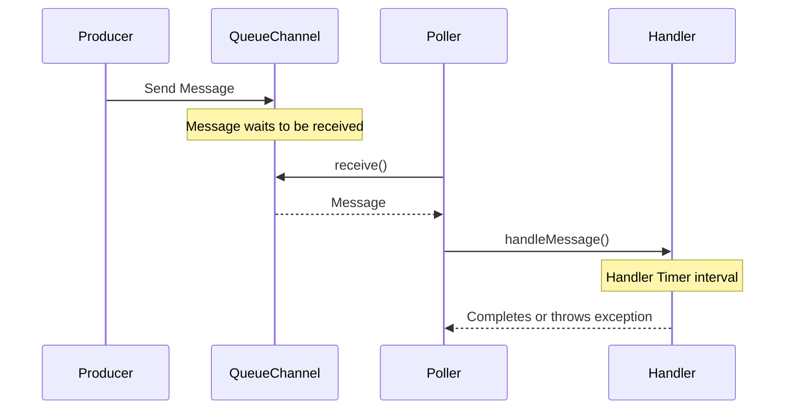

# Handler timers

In the **Metrics and observability** chapter of **SPRING_INTEGRATION_CORE**, Timers help answer two questions: how many times is a handler invoked, and how long does each execution take? Measurements help locate bottlenecks in message flows built with Message, MessageChannel, endpoints, and Java DSL.

For example, an order ingestion flow might process quickly inside the handler yet still respond slowly because messages sit waiting in a queue. Conversely, a handler might look slow because it synchronously calls the downstream portion of the flow. To use Timers properly, you must identify the exact start point, end point, and meaning of each tag set.

## 1. Objectives and scope

After this lesson, you will be able to:

- Read counts, total duration, and mean duration from a Timer.
- Identify which handler is measured and distinguish handler metrics from channel metrics.
- Configure a Java DSL flow with handlers automatically measured by Micrometer.
- Track successful and failed executions separately.
- Use histograms to query p95 and read metrics across multiple instances.
- Recognize when wait time, business logic duration, or full-flow latency requires a different measurement.

The hands-on section targets **Java 17+, Spring Boot 3.5.x, and Spring Integration 6.5.x**, using the direct Micrometer metrics mechanism. This is the version baseline for the examples, not a requirement to upgrade or downgrade your current project. The final section explains how to identify Timers when using Observation.

You should know how to declare beans, send a `Message` to a `DirectChannel`, and connect a handler with `IntegrationFlow`.

## 2. What does a Timer record?

A Timer stores timing samples of completed executions. It provides at least sample count and total duration; support for max, percentiles, and histograms depends on the registry and configuration. APIs for reading duration require specifying a `TimeUnit`. [Micrometer: Timers](https://docs.micrometer.io/micrometer/reference/concepts/timers.html)

Self-constructed example for reading measurements:

| Invocation | Duration | Outcome |
| --- | ---: | --- |
| 1 | 20 ms | Success |
| 2 | 30 ms | Success |
| 3 | 250 ms | Success |
| 4 | 10 ms | Failure |

If combining all four samples:

```text
count = 4
totalTime = 310 ms
mean = 310 / 4 = 77.5 ms
```

If selecting only successful samples, the mean is `300 / 3 = 100 ms`. Both results are accurate for their respective datasets. Therefore, dashboards must clearly state which outcomes they filter.

Concepts to distinguish:

| Metric | Question it answers | Interpretation |
| --- | --- | --- |
| Count | How many invocations were recorded? | Number of handler calls, not necessarily distinct orders |
| Total time | What is the sum of sample durations? | Can sum durations of concurrent invocations |
| Mean | How long does a sample take on average? | Can hide a small group of very slow executions |
| p95 | What duration threshold do ~95% of samples not exceed? | Requires defining the query window and calculation method |
| Max | What is the largest sample within the statistic scope? | Timer max may be windowed, not an all-time record |

Micrometer treats max and several distribution statistics as time-windowed; do not treat them as permanent cumulative highs. [Micrometer: Timer statistics](https://docs.micrometer.io/micrometer/reference/concepts/timers.html)

**Concurrency example:** two invocations running concurrently during one second, each taking one second, produce a total time of two seconds. That does not mean the application ran for two wall-clock seconds.

## 3. Handler measurement boundaries

In Spring Integration 6.5, the direct metrics mechanism of `AbstractMessageHandler` starts a sample before handling and stops it when the call completes or throws an exception. The exception continues to propagate after recording the failure. From this boundary, you can deduce the consequences in the examples below. [AbstractMessageHandler 6.5 source](https://raw.githubusercontent.com/spring-projects/spring-integration/6.5.x/spring-integration-core/src/main/java/org/springframework/integration/handler/AbstractMessageHandler.java)

### 3.1. Wait time before the handler



Suppose a message waits in `QueueChannel` for 800 ms and is then processed by the handler in 25 ms. The handler's Timer reflects the 25 ms processing interval, not the 825 ms elapsed since sending.

To detect backlogs, combine processing latency with queue depth, ingress/egress rates, and a wait-time measurement with explicit start and end points. Do not use the queue send Timer as a substitute for time spent inside the queue.

### 3.2. Synchronous processing chains

Consider the flow:

```text
DirectChannel → handler A → DirectChannel → handler B → end
```

If handler A produces a result and sends it synchronously to B before returning, A's measurement interval can include B's execution time. Handler B also has its own Timer for its invocation.

For example, A does 5 ms of local work and B does 40 ms of work:

```text
Timer A: approximately 45 ms, plus message-passing overhead
Timer B: approximately 40 ms
```

Summing both into 85 ms double-counts B's execution interval. To measure just the business logic inside A, place a Timer around that business method.

### 3.3. Asynchronous boundaries and aggregators

With `ExecutorChannel`, separate executor queue wait time from when the handler actually starts executing. If a handler returns after handing off work to another task, do not assume that invocation's Timer covers completion in the other task. Check the async mode, adapter type, and actual completion point.

Similarly, a single aggregator call may just add one message to a group and return. The time from the first message until group release is a different quantity from the duration of each individual handler call.

## 4. Identifying the exact metric and tags

The direct Micrometer metrics mechanism uses the name **`spring.integration.send`** for both handlers and channels. A handler Timer has the following tags. Meters are usually created the first time the component is used. [Spring Integration 6.5: Micrometer Integration](https://docs.spring.io/spring-integration/reference/6.5/metrics.html)

| Identifier field | Handler value |
| --- | --- |
| Meter name | `spring.integration.send` |
| `type` | `handler` |
| `name` | Component name |
| `result` | `success` or `failure` |
| `exception` | `none` or simple exception class name |

Because one meter name represents multiple components, querying by name alone easily mixes metrics. Correct example for a specific handler:

```text
spring.integration.send
    type=handler
    name=orderHandler
    result=success
    exception=none
```

A handler's bean name and endpoint name are two separate concepts. When configuring Java DSL with lambdas, do not guess the component name solely from the flow name or endpoint ID. The hands-on example declares the handler as a bean with a stable name so queries are clear.

The `exception` tag reflects the exception observed at the wrapper around the handler. A business error may be wrapped in `MessageHandlingException`; do not assume the tag always carries the deepest root-cause exception name.

## 5. Hands-on: automatic Timer for a handler

### 5.1. Dependencies and observation endpoints

In a Maven project using the Spring Boot 3.5.x parent or BOM, the dependencies for the example are:

```xml
<dependencies>
    <dependency>
        <groupId>org.springframework.boot</groupId>
        <artifactId>spring-boot-starter-integration</artifactId>
    </dependency>
    <dependency>
        <groupId>org.springframework.boot</groupId>
        <artifactId>spring-boot-starter-actuator</artifactId>
    </dependency>
    <dependency>
        <groupId>org.springframework.boot</groupId>
        <artifactId>spring-boot-starter-web</artifactId>
    </dependency>
    <dependency>
        <groupId>io.micrometer</groupId>
        <artifactId>micrometer-registry-prometheus</artifactId>
    </dependency>
</dependencies>
```

Spring Boot Actuator auto-configures the Micrometer infrastructure; the Prometheus registry exposes data for Prometheus to scrape. There is no need to manually create an extra `SimpleMeterRegistry` for this hands-on application. [Spring Boot 3.5: Metrics](https://docs.spring.io/spring-boot/3.5/reference/actuator/metrics.html)

The configuration below illustrates `application.yml` in the hands-on application:

```yaml
management:
  endpoints:
    web:
      exposure:
        include: health,metrics,prometheus
```

The `/actuator/metrics` endpoint helps inspect meters and tags, while `/actuator/prometheus` serves data scraping. The HTTP server in the example is provided by the web starter. [Micrometer: publishing Prometheus metrics](https://docs.micrometer.io/micrometer/reference/implementations/prometheus.html)

### 5.2. Complete Java application

Save the Java example in the `example.metrics` package of the hands-on application:

```java
package example.metrics;

import java.util.concurrent.TimeUnit;

import io.micrometer.core.instrument.MeterRegistry;
import io.micrometer.core.instrument.Timer;

import org.springframework.beans.factory.annotation.Qualifier;
import org.springframework.boot.ApplicationRunner;
import org.springframework.boot.SpringApplication;
import org.springframework.boot.autoconfigure.SpringBootApplication;
import org.springframework.context.annotation.Bean;
import org.springframework.integration.channel.DirectChannel;
import org.springframework.integration.config.EnableIntegration;
import org.springframework.integration.config.EnableIntegrationManagement;
import org.springframework.integration.dsl.IntegrationFlow;
import org.springframework.integration.handler.AbstractMessageHandler;
import org.springframework.messaging.Message;
import org.springframework.messaging.MessageHandlingException;
import org.springframework.messaging.support.MessageBuilder;

@SpringBootApplication
@EnableIntegration
@EnableIntegrationManagement(observationPatterns = {})
public class HandlerTimerDemo {

    public static void main(String[] args) {
        SpringApplication.run(HandlerTimerDemo.class, args);
    }

    @Bean
    DirectChannel orderInput() {
        return new DirectChannel();
    }

    @Bean
    OrderHandler orderHandler() {
        return new OrderHandler();
    }

    @Bean
    IntegrationFlow orderFlow(
            @Qualifier("orderInput") DirectChannel input,
            @Qualifier("orderHandler") OrderHandler handler) {

        return IntegrationFlow.from(input)
                .handle(handler)
                .get();
    }

    @Bean
    ApplicationRunner sendExamples(
            @Qualifier("orderInput") DirectChannel input,
            MeterRegistry registry) {

        return args -> {
            input.send(MessageBuilder
                    .withPayload(new Order("O-001", 2)).build());
            input.send(MessageBuilder
                    .withPayload(new Order("O-002", 5)).build());

            try {
                input.send(MessageBuilder
                        .withPayload(new Order("O-003", -1)).build());
            }
            catch (MessageHandlingException ex) {
                System.out.println("Observed error: "
                        + ex.getClass().getSimpleName());
            }

            for (Timer timer : registry.find("spring.integration.send")
                    .tag("type", "handler")
                    .tag("name", "orderHandler")
                    .timers()) {

                System.out.printf(
                        "%s count=%d totalMs=%.3f meanMs=%.3f%n",
                        timer.getId().getTags(),
                        timer.count(),
                        timer.totalTime(TimeUnit.MILLISECONDS),
                        timer.mean(TimeUnit.MILLISECONDS));
            }
        };
    }

    public record Order(String id, int quantity) {
    }

    static final class OrderHandler extends AbstractMessageHandler {

        @Override
        protected void handleMessageInternal(Message<?> message) {
            Order order = (Order) message.getPayload();
            if (order.quantity() <= 0) {
                throw new IllegalArgumentException(
                        "Quantity must be greater than 0");
            }
            System.out.printf("Accepted order %s, quantity %d%n",
                    order.id(), order.quantity());
        }
    }
}
```

The handler extends `AbstractMessageHandler` and is managed by Spring as the `orderHandler` bean, so it can use the framework's measurement infrastructure. Simply implementing the `MessageHandler` interface is not enough to confirm it has the same automatic instrumentation. [Spring Integration: metrics support scope](https://docs.spring.io/spring-integration/reference/6.5/metrics.html)

Points to observe:

1. `observationPatterns = {}` keeps the example on the direct metrics mechanism. Do not add other Observation configurations while comparing these meter names.
2. The flow uses `DirectChannel`, so when `send()` finishes, the corresponding handler has already completed or thrown an error.
3. The handler is a terminal endpoint and returns no result. Thus the example needs no `replyChannel`; if switching to a request/reply gateway, design a reply path.
4. The example code prints to the console inside the handler. Console I/O cost is included in handler duration; this is a functional illustration, not a real load benchmark.

### 5.3. Expected results

On a single startup, with the three messages above and no other senders:

| Handler tag set | Expected count |
| --- | ---: |
| `result=success, exception=none` | 2 |
| `result=failure` | 1 |
| Total across `orderHandler` Timers | 3 |

Exact durations depend on the host machine, JVM, logging, and load; they do not need to match a fixed number. The failed handler invocation in the example still records its execution duration.

Count only `type=handler,name=orderHandler`. If you add the Timer of `orderInput` with `type=channel`, you are adding two measurements of different operations in the same flow.

### 5.4. Inspecting via Actuator

You can open the following endpoint after the application has processed messages:

```text
http://localhost:8080/actuator/metrics/spring.integration.send
```

To view only the handler's successful invocations:

```text
http://localhost:8080/actuator/metrics/spring.integration.send?tag=type:handler&tag=name:orderHandler&tag=result:success
```

Check `availableTags`, `COUNT`, `TOTAL_TIME`, and `baseUnit` in the actual response. If you omit the `result` tag, data may aggregate both successes and failures. Meter names at this endpoint still use dot notation, even though the exported Prometheus name differs. [Spring Boot: metrics endpoint](https://docs.spring.io/spring-boot/3.5/reference/actuator/metrics.html)

## 6. Technical success, business errors, and retries

### 6.1. What causes a Timer to record a failure?

For the measurement boundary in question, a normal return is a technical success; an escaping exception is a technical failure. A handler returning a business result with status `REJECTED` without throwing an error may still be recorded as a success.

If a handler catches an exception itself, logs it, and returns, the outer measurement layer no longer sees that exception. When you need to classify `accepted`, `rejected`, `duplicate`, create a business metric with a bounded value set.

Transformers, routers, and filters also have different termination behaviors. For instance, a filter actively discarding a message per configuration is not necessarily a technical error. Do not equate successful handler invocations with the number of messages meeting business requirements.

### 6.2. Retries change how counts and durations are interpreted

Suppose a single call to a handler is wrapped by retry advice:

```text
Start handler call
    attempt 1: error
    backoff
    attempt 2: success
End handler call
```

If retries happen inside the Timer-wrapped call, the measurement may reflect all attempts and backoff as one successful completion. If the message is re-sent from outside, causing `handleMessage()` to be invoked again, the count can increment for each new invocation.

Therefore, describe the retry placement before concluding whether the count represents attempts or initial messages. To know retry counts, measure attempts at the exact point where retries execute.

### 6.3. Error channels do not rewrite past measurements

An error may be turned into an `ErrorMessage` for an error-handling flow, depending on the endpoint and execution mechanism. Subsequent successful recovery in the error flow does not retroactively change the failure sample of the handler that already ended.

With the synchronous flow in the example, the caller catches the error from `send()`. When moving to a poller or asynchronous processing, identify where errors are emitted and how `errorChannel` is configured; do not assume every error returns to the original sending thread.

## 7. Measuring business logic separately with Timer.Sample

When you need to measure a business segment inside a handler, create a dedicated Timer. Choose a name that describes the boundary, such as `orders.reservation.duration`, so it does not mix with automatic framework Timers.

The following class accepts a synchronous business operation, records exactly one sample, and lets exceptions continue propagating:

```java
package example.metrics;

import io.micrometer.core.instrument.MeterRegistry;
import io.micrometer.core.instrument.Timer;

public final class ReservationTiming {

    private final MeterRegistry registry;
    private final Timer success;
    private final Timer failure;

    public ReservationTiming(MeterRegistry registry) {
        this.registry = registry;
        this.success = Timer.builder("orders.reservation.duration")
                .tag("result", "success")
                .register(registry);
        this.failure = Timer.builder("orders.reservation.duration")
                .tag("result", "failure")
                .register(registry);
    }

    public void run(Runnable reservation) {
        Timer.Sample sample = Timer.start(registry);
        boolean completed = false;
        try {
            reservation.run();
            completed = true;
        }
        finally {
            sample.stop(completed ? success : failure);
        }
    }
}
```

`Timer.Sample` lets you start before knowing the outcome and choose the target Timer when finishing. Both Timers in the example are registered once and then reused. [Micrometer: Timer.Sample](https://docs.micrometer.io/micrometer/reference/concepts/timers.html)

The boundary of this class is the execution duration of `Runnable`. If the Runnable only schedules another task and returns, it measures scheduling time. To measure until the task truly finishes, stop the sample at the corresponding completion point and ensure each operation stops only once.

Do not place the same Timer on two wrappers around the exact same boundary. If both a business Timer and a framework Timer exist, read them as two viewpoints with different scopes.

## 8. Histograms, p95, and SLOs for a handler

### 8.1. Why are histograms needed?

A 30 ms mean does not tell you whether a small group of messages takes several seconds. Histograms store sample counts across duration buckets; backends can use those buckets to estimate percentiles.

Precomputed percentiles from individual instances cannot be aggregated by averaging p95 values. Histograms can be aggregated bucket by bucket before computing percentiles. [Micrometer: Histograms and Percentiles](https://docs.micrometer.io/micrometer/reference/concepts/histogram-quantiles.html)

### 8.2. Enabling histograms only for the handler under observation

Add the following imports and bean to the hands-on application's configuration class:

```java
import java.time.Duration;

import io.micrometer.core.instrument.Meter;
import io.micrometer.core.instrument.config.MeterFilter;
import io.micrometer.core.instrument.distribution.DistributionStatisticConfig;

@Bean
MeterFilter orderHandlerHistogram() {
    return new MeterFilter() {
        @Override
        public DistributionStatisticConfig configure(
                Meter.Id id, DistributionStatisticConfig config) {

            if ("spring.integration.send".equals(id.getName())
                    && "handler".equals(id.getTag("type"))
                    && "orderHandler".equals(id.getTag("name"))) {

                return DistributionStatisticConfig.builder()
                        .percentilesHistogram(true)
                        .serviceLevelObjectives(
                                Duration.ofMillis(50).toNanos(),
                                Duration.ofMillis(100).toNanos(),
                                Duration.ofMillis(250).toNanos())
                        .build()
                        .merge(config);
            }
            return config;
        }
    };
}
```

This configuration applies to Timers matching the exact name and two selected tags, including different result tag sets. The SLO boundaries are 50 ms, 100 ms, and 250 ms. When using `DistributionStatisticConfig` directly on a Timer, those duration values are passed in nanoseconds; when exported to Prometheus, the time series unit is seconds.

`merge(config)` preserves remaining settings from existing configuration. A MeterFilter must be registered before meters are created; declaring it as a bean lets Spring Boot apply it during registry initialization. [Micrometer: configuring histograms with MeterFilter](https://docs.micrometer.io/micrometer/reference/concepts/histogram-quantiles.html), [Spring Boot: customizing metrics](https://docs.spring.io/spring-boot/3.5/reference/actuator/metrics.html)

Adding buckets does not make the handler faster; it improves distribution analysis while also increasing storage cost. After this change, restart the hands-on application and generate enough load to read a meaningful distribution.

### 8.3. Prometheus queries

The queries below use standard Prometheus export names for the direct metrics mechanism. Verify the names and labels in `/actuator/prometheus` before using them. In multi-application environments, add `job`, environment, or application filters to select the right data source.

**Completion rate of handler invocations, in calls/second:**

```promql
sum(
  rate(spring_integration_send_seconds_count{
    type="handler",
    name="orderHandler"
  }[5m])
)
```

**Mean duration over five minutes, in seconds:**

```promql
sum(
  rate(spring_integration_send_seconds_sum{
    type="handler",
    name="orderHandler"
  }[5m])
)
/
sum(
  rate(spring_integration_send_seconds_count{
    type="handler",
    name="orderHandler"
  }[5m])
)
```

**p95 of successful invocations across selected instances:**

```promql
histogram_quantile(
  0.95,
  sum by (le) (
    rate(spring_integration_send_seconds_bucket{
      type="handler",
      name="orderHandler",
      result="success"
    }[5m])
  )
)
```

This is a query for a classic histogram. Preserve the `le` label when aggregating buckets. p95 is an estimate; accuracy depends on bucket spacing and sample distribution. [Prometheus: histograms and summaries](https://prometheus.io/docs/practices/histograms/)

Reading notes:

- The first two queries combine successes and failures; the p95 query selects only successes. Document this difference clearly on dashboards.
- Mean and p95 results are in seconds; multiply by 1,000 if the UI displays milliseconds.
- When there are no samples in the window, mean or p95 can be undefined. That is different from 0 latency.
- Three startup messages are not enough to produce a stable load chart. You need a recurring sender and multiple scrapes within the observation window.
- `count` reflects completed samples; a hanging call does not increment count yet.

For an SLO of "99% of successful invocations complete within 100 ms", you can compare the `le="0.1"` bucket of the success set against the count of that same set. First decide whether the SLO counts errors as violations or separates them into a success-rate target; the two approaches yield different definitions.

## 9. Keeping tag cardinality bounded

Every combination of meter name and tags creates a meter identity. With histograms, each combination also creates multiple bucket series. Therefore, choose classification dimensions with controllable numbers of values.

| Information | Appropriate location |
| --- | --- |
| Stable handler name | Metric tag |
| `success/failure` outcome | Metric tag |
| Flow type from a small list | Can be a tag if there is a clear analytical purpose |
| Order ID or message ID | Logs or traces |
| Exception message varying by input data | Logs |
| Full payload | Only in properly controlled diagnostic locations |

Self-check example: 20 handlers × 2 outcomes × 3 deployment regions create up to 120 combinations before other dimensions. Adding 100,000 order IDs as a tag raises theoretical scale to 12 million combinations. Histogram buckets further multiply the number of stored series.

Stable component naming also helps compare before and after deployments. Letting handler names change automatically with DSL structure can make dashboards appear as if the old handler stopped receiving traffic.

## 10. When the application uses Micrometer Observation

Spring Integration since 6.0 supports Observation. For components selected for observation, metric generation is delegated to `ObservationHandler` instances in `ObservationRegistry`, replacing the direct metrics path. The handler's default convention uses the `spring.integration.handler` Timer and keys such as `spring.integration.name` and `spring.integration.type`. [Spring Integration: Micrometer Observation](https://docs.spring.io/spring-integration/reference/metrics.html)

Configuration selecting all components can be written as:

```java
@EnableIntegrationManagement(observationPatterns = "*")
```

This configuration replaces the annotation in the example and must be paired with an `ObservationRegistry` and an appropriate metrics-recording handler. The annotation alone does not guarantee data is exported.

| Item to check | Direct metrics in the example | Observation with default convention |
| --- | --- | --- |
| Handler Timer name | `spring.integration.send` | `spring.integration.handler` |
| Component name key | `name` | `spring.integration.name` |
| Component type key | `type` | `spring.integration.type` |
| Measurement source | Metrics captor | Observation and ObservationHandler |

Do not run a query with `name=orderHandler` from the direct mechanism and conclude Observation is broken. List the actual meters and check the active convention, tags, and observation handler configuration. Additional error labels depend on the Observation infrastructure; do not copy assumptions about `result` and `exception` verbatim to this mechanism.

Standard Timers serve completed invocations. If you need to know how many operations are still running or have run too long, look at active-operation measurements such as LongTaskTimer when provided by the observation infrastructure. [Micrometer: Long Task Timers](https://docs.micrometer.io/micrometer/reference/concepts/long-task-timers.html)

## 11. Self-check through operational scenarios

### Scenario A: handler is fast, but callers wait a long time

Hypothetical metrics:

```text
Handler mean: 15 ms
Handler p95: 25 ms
Time from send to completion: 1,500 ms
Queue depth: continuously increasing
```

One hypothesis to test is that messages wait a long time before reaching the handler. Compare ingress/egress rates, worker counts, and queue wait times before optimizing the 15 ms business logic.

### Scenario B: handler A and handler B are both similarly slow

If A synchronously sends results to B and both Timers rise together, A may be including B's duration. Use internal business measurements or traces to check whether B is the main source of latency; do not add both Timers to infer total latency.

### Scenario C: mean drops while errors increase

A fast-failing error branch can pull down the combined mean. Separate `result=success` and `result=failure`, and examine error rate alongside throughput. A lower mean does not prove the flow is healthier.

### Scenario D: expected Timer is missing

Check in order:

1. Has the handler actually received a message? Many meters appear only upon activity.
2. Is the queried registry the same registry the application records to?
3. Are you using direct metrics or Observation?
4. What are the actual component name and tags?
5. Is the handler of a type automatically instrumented by the framework?
6. Is a MeterFilter dropping meters, or is configuration preventing metrics export?

## 12. Practice exercises

1. Run the example and verify two successful runs and one failed run specifically for `orderHandler`.
2. Inspect the Timer for `orderInput` separately and explain why it differs from the handler Timer despite sharing the same meter name.
3. Change the invalid-data branch to log and return instead. Predict the counts by outcome before re-running.
4. Design a queue-backed version; indicate where to measure wait time and where to measure processing time. When implementing, remember to configure a poller for the `QueueChannel` consumer.
5. Enable histograms, generate load across varying processing durations, and compare mean against p95.
6. Describe how dashboards need to change when switching to Observation.

The completion criterion is being able to identify **the exact handler, the exact tag set, the exact timing boundary, and the exact unit**. Whenever reading a Timer chart, always state which invocation and which part of the message flow the numbers represent.
