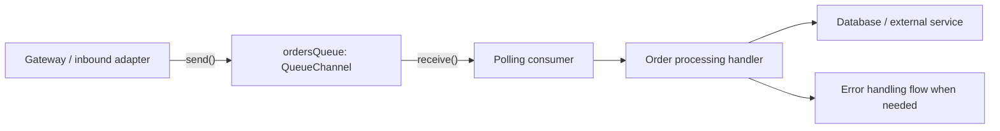

# Send rate and receive rate

## 1. Objectives and context

In the **Metrics and observability** chapter of Spring Integration Core, send rate and receive rate help answer two questions: how fast do messages enter a point in the flow, and how fast are they taken out? When placed alongside queue depth, processing duration, and error counts, they give a basis to tell whether a flow is steady, accumulating work, or temporarily idle.

This lesson uses an order ingestion flow: a gateway or inbound adapter creates a `Message`, sends it to a `MessageChannel`, and an endpoint receives the message for processing. The concepts apply to Java DSL flows with transformers, routers, filters, or aggregators, provided each measurement is tied to a specific boundary.

After this lesson, you will be able to:

- Distinguish count, rate, latency, and queued message count.
- Identify what send rate and receive rate mean for each channel type.
- Read counts from Micrometer and compute rates over a time interval.
- Write rate queries for Prometheus, interpret a growing queue, and choose the next diagnostic step.

Prerequisites: `Message<?>`, `MessageChannel.send()`, `PollableChannel.receive()`, `QueueChannel`, endpoints, and pollers.

## 2. Choose the exact measurement point before computing rates

Consider the following flow:



There are at least three distinct events:

1. **Enqueued successfully:** the channel accepted the message.
2. **Dequeued successfully:** the consumer retrieved a message.
3. **Business completion:** the handler satisfied the completion condition defined by the application, such as committing the order persistence transaction.

In this lesson:

- **Successful send rate** is the number of successful send operations on the selected channel per second.
- **Successful receive rate** is the number of messages retrieved from the selected pollable channel per second.
- **Completion rate** is the rate of business completion; the application must select and measure the appropriate completion boundary.

An order may already be counted in receive rate while the handler is still calling a payment service. If that call fails, the channel dequeue counter does not automatically become a business failure counter.

Units are usually written as `messages/second`, `msg/s`, or `ops/s`. If a measurement counts send operations, the panel title should state that clearly: an internal operation does not necessarily correspond to a single unique order.

## 3. How are count and rate different?

### 3.1. Time-window formula

Let:

- `S(t)`: total successful sends recorded at time `t`.
- `R(t)`: total successful receives recorded at time `t`.
- `Δt = t₂ - t₁`: length of the observation interval, in seconds.

If the counters did not reset during that interval:

```text
send_rate    = (S(t₂) - S(t₁)) / Δt
receive_rate = (R(t₂) - R(t₁)) / Δt
```

Example over 60 seconds:

| Quantity | Start of interval | End of interval | Delta | Rate |
| --- | ---: | ---: | ---: | ---: |
| Successful sends | 10,000 | 17,200 | 7,200 | 120 msg/s |
| Messages received | 9,500 | 15,500 | 6,000 | 100 msg/s |

Count is a cumulative total. Rate describes activity within the chosen window. Two instances of different ages can have vastly different counts while serving the same rate. Micrometer recommends using the rate of change of counters to observe current load. [Micrometer documentation on counters](https://docs.micrometer.io/micrometer/reference/concepts/counters.html).

### 3.2. Do not divide the total since startup by uptime

Suppose a system processed 1 million messages over several hours, but the consumer stopped during the last 5 minutes. The since-startup average can still look fairly high, while the receive rate over the last 5 minutes is 0.

The window should match the question:

| Observation window | Good for viewing | Limitations |
| --- | --- | --- |
| Tens of seconds | Short fluctuations, controlled load tests | Noisy when message volume is low |
| One to five minutes | Operational monitoring and alerting | Smooths out very brief spikes |
| Fifteen minutes or longer | Longer-term load trends | Reflects new incidents more slowly |

These are illustrative intervals. Scrape cadence, event frequency, and desired reaction time determine the actual choice.

### 3.3. Rate is not the reciprocal of latency

A handler taking 100 ms on average does not mean the whole flow always achieves 10 msg/s. That approximation only holds roughly for a single sequential worker that continuously has work and no other wait time.

If there are `n` independent workers and average service time is `L` seconds, a rough capacity estimate when continuously busy is:

```text
service capacity ≈ n / L
```

This is a simplified model for forming hypotheses. External service quotas, connection pools, data locks, pollers, and shared resources can make actual capacity much lower.

A Timer also holds the count of measured events alongside total duration. You can derive rate from that count; you do not need an extra counter just to count the same events again. [Micrometer documentation on timers](https://docs.micrometer.io/micrometer/reference/concepts/timers.html).

## 4. Meaning of both rates by channel type

| Channel type | Key semantics |
| --- | --- |
| `QueueChannel` | `send()` enqueues; `receive()` dequeues. The two rates can differ. |
| `DirectChannel` | Invokes the handler on the sending thread; no polling `receive()` operation. |
| `ExecutorChannel` | Typically hands off work via an executor; send completion does not guarantee handler completion. |
| `PublishSubscribeChannel` | One send can be broadcast to multiple subscribers; no polling `receive()`. |

These characteristics govern how throughput and send duration are interpreted. [MessageChannel implementations](https://docs.spring.io/spring-integration/reference/channel/implementations.html).

With `DirectChannel`, send duration can include the synchronous downstream chain. With `QueueChannel`, send duration mainly reflects enqueuing and may include waiting for space.

Not seeing a receive metric for `DirectChannel` does not mean the consumer stopped. For that flow, choose the handler execution counter or an appropriate business counter.

Also do not sum all channel rates to infer external request volume:

- One message passing through three channels produces send activity in three places.
- A splitter can turn one message into many messages.
- A router splits traffic across branches.
- A filter can stop a portion of messages.
- An aggregator combines multiple messages into one result.
- Retries and redeliveries can make the same piece of work appear multiple times.

Therefore, only compare two rates when you know the relationship between the two measurement boundaries. Gateway input rate and aggregator output rate usually do not have a one-to-one relationship.

## 5. Count the right events

### 5.1. Send attempts, successes, and failures

Distinguish:

```text
send_attempt_rate = send_success_rate + send_failure_rate
```

The equality above assumes operations within the measurement scope have completed and been fully classified. In-flight operations do not necessarily appear in the timer's count yet.

An easy-to-observe example is a full `QueueChannel`. Calling `send(message, 0)` can return `false`: there is a failed send operation, yet no message is added to the queue. Do not use total send attempts to calculate queue growth.

In the direct metrics mechanism, the send path has branches recording both return value outcomes and exceptions. Cases returning `false` must still be observed even without an exception. [AbstractMessageChannel 6.5.0 source](https://raw.githubusercontent.com/spring-projects/spring-integration/v6.5.0/spring-integration-core/src/main/java/org/springframework/integration/channel/AbstractMessageChannel.java).

### 5.2. Polling without data is not receiving a message

In the lesson's `QueueChannel` example, `receive(0)` returns `null` when the queue is empty. The successful receive counter increments when a message is retrieved, not just because the poller attempted a receive call. Thus, a thousand checks on an empty queue can still correspond to a receive count of 0. [AbstractPollableChannel 6.5.0 source](https://raw.githubusercontent.com/spring-projects/spring-integration/v6.5.0/spring-integration-core/src/main/java/org/springframework/integration/channel/AbstractPollableChannel.java).

Distinguish three questions:

| Question | Signal to inspect |
| --- | --- |
| Is the poller running? | Scheduler activity, endpoint state, or poll-attempt metric |
| Are messages being retrieved? | Successful receive count/rate |
| Is the work completing? | Handler outcomes and business completion boundary |

If you need to observe empty polls as well, add a dedicated metric whose name clearly reflects that meaning.

### 5.3. Interceptors can shift the observation boundary

Channel interceptors can intervene before and after sends and receives. Therefore, in systems with custom interceptors, identify whether the measurement sits before or after transformations or message blocking. [Channel Interceptors](https://docs.spring.io/spring-integration/reference/channel/interceptors.html).

The lesson example adds no custom interceptors. As a result, a successful receive can be interpreted directly as taking one message from the queue. When adding interceptors, do not assume every counter describes the exact same event.

## 6. Reading Spring Integration metrics

In the direct Micrometer metrics mechanism, the primary names and tags are:

| Meter | Type | Distinguishing tag |
| --- | --- | --- |
| `spring.integration.send` | Timer | `type=channel` or `type=handler` |
| `spring.integration.receive` | Counter | `type=channel` or `type=source` |

Also filter by `name`, `result=success/failure`, and `exception`. Queues have the `spring.integration.channel.queue.size` gauge.

Since Spring Integration 6.0, Observation is a separate mechanism. When a component has Observation enabled, measurement is delegated to observation handlers; names may be `spring.integration.producer` or `spring.integration.handler`, with convention-based tags. Do not reuse direct-metrics queries as-is for Observation. [Metrics and Management](https://docs.spring.io/spring-integration/reference/metrics.html).

In practice, state explicitly:

```text
component: ordersQueue
operation: send / receive
result: success
instrumentation: Micrometer direct metrics
window: 5 minutes on dashboard
unit: msg/s
```

Selecting `type=channel` avoids mixing channel sends with handler executions. If the application has multiple instances, keep the instance label for per-node diagnostics; aggregate only when viewing the service as a whole.

Bean names should be stable, like `ordersQueue`. Do not use order IDs, UUIDs, or payload contents as tags, because each new value can create additional time series.

## 7. Java example: measuring counts and computing rates

### 7.1. Example scope

The standalone example below uses Java 17 or higher, Spring Integration 6.5.x, and compatible Micrometer. Required dependencies:

- `org.springframework.integration:spring-integration-core`.
- `io.micrometer:micrometer-core`.

If the project uses Spring Boot, take versions from the project's dependency management. The example uses a Spring context directly and `SimpleMeterRegistry` so counts can be observed without needing Prometheus yet.

Configuration sets `observationPatterns = {}` and declares no `ObservationRegistry`. This attribute selects components instrumented with Observation; an empty array suits the direct-metrics lab. [EnableIntegrationManagement API](https://docs.spring.io/spring-integration/api/org/springframework/integration/config/EnableIntegrationManagement.html).

### 7.2. Demonstration program

```java
package lesson.observability;

import io.micrometer.core.instrument.Counter;
import io.micrometer.core.instrument.MeterRegistry;
import io.micrometer.core.instrument.Timer;
import io.micrometer.core.instrument.simple.SimpleMeterRegistry;

import org.springframework.context.annotation.AnnotationConfigApplicationContext;
import org.springframework.context.annotation.Bean;
import org.springframework.context.annotation.Configuration;
import org.springframework.integration.channel.QueueChannel;
import org.springframework.integration.config.EnableIntegration;
import org.springframework.integration.config.EnableIntegrationManagement;
import org.springframework.messaging.support.GenericMessage;

@Configuration
@EnableIntegration
@EnableIntegrationManagement(observationPatterns = {})
public class ChannelRateDemo {

    @Bean
    SimpleMeterRegistry meterRegistry() {
        return new SimpleMeterRegistry();
    }

    @Bean
    QueueChannel ordersQueue() {
        return new QueueChannel(10);
    }

    record Snapshot(long sent, double received, long nanoTime) {
    }

    static Snapshot snapshot(MeterRegistry registry) {
        long sent = registry.find("spring.integration.send")
                .tags("type", "channel",
                      "name", "ordersQueue",
                      "result", "success",
                      "exception", "none")
                .timers()
                .stream()
                .mapToLong(Timer::count)
                .sum();

        double received = registry.find("spring.integration.receive")
                .tags("type", "channel",
                      "name", "ordersQueue",
                      "result", "success",
                      "exception", "none")
                .counters()
                .stream()
                .mapToDouble(Counter::count)
                .sum();

        return new Snapshot(sent, received, System.nanoTime());
    }

    public static void main(String[] args) {
        try (var context =
                     new AnnotationConfigApplicationContext(ChannelRateDemo.class)) {

            var registry = context.getBean(SimpleMeterRegistry.class);
            var queue = context.getBean("ordersQueue", QueueChannel.class);

            Snapshot before = snapshot(registry);

            for (int i = 1; i <= 5; i++) {
                boolean sent = queue.send(new GenericMessage<>("ORDER-" + i), 0);
                if (!sent) {
                    throw new IllegalStateException("Failed to send ORDER-" + i);
                }
            }

            for (int i = 0; i < 3; i++) {
                if (queue.receive(0) == null) {
                    throw new IllegalStateException("Missing message to receive");
                }
            }

            Snapshot after = snapshot(registry);
            long sentDelta = after.sent() - before.sent();
            double receivedDelta = after.received() - before.received();
            double seconds =
                    (after.nanoTime() - before.nanoTime()) / 1_000_000_000.0;

            System.out.printf("sentDelta=%d%n", sentDelta);
            System.out.printf("receivedDelta=%.0f%n", receivedDelta);
            System.out.printf("queueSize=%d%n", queue.getQueueSize());
            System.out.printf("sendRate=%.2f msg/s%n", sentDelta / seconds);
            System.out.printf("receiveRate=%.2f msg/s%n", receivedDelta / seconds);

            // Drain the remaining two messages; the last call hits an empty queue.
            while (queue.receive(0) != null) {
                // Only demonstrates dequeuing from the queue.
            }

            System.out.printf("receivedAfterDrain=%.0f%n",
                    snapshot(registry).received());
            System.out.printf("emptyPoll=%s%n", queue.receive(0));
        }
    }
}
```

Expected counts are:

```text
sentDelta=5
receivedDelta=3
queueSize=2
receivedAfterDrain=5
emptyPoll=null
```

The two rate lines depend on actual execution time and therefore have no fixed value. Very short runs are also affected by meter initialization, JIT, and taking snapshots. The example proves the calculation method; do not use those numbers as a system capacity benchmark.

The `snapshot()` method uses `find(...).timers()` and `counters()`. Before a meter appears, the sum of an empty collection is 0, so a baseline snapshot can be taken before the first send/receive.

In a real application, a snapshot across multiple meters is also not an atomic transaction. Tiny discrepancies can appear while producers and consumers are still running. Choose a sufficiently long window and cross-check the queue gauge rather than demanding exact sample-by-sample equality.

### 7.3. Observing send failures when the queue is full

After the queue has been drained in the example above, you can test separately:

```java
for (int i = 0; i < 10; i++) {
    if (!queue.send(new GenericMessage<>("FILL-" + i), 0)) {
        throw new IllegalStateException("Queue filled sooner than expected");
    }
}

boolean accepted = queue.send(new GenericMessage<>("OVERFLOW"), 0);
System.out.println("accepted=" + accepted);
System.out.println("queueSize=" + queue.getQueueSize());
```

This snippet is placed inside the open scope of the context with no concurrent consumer running. The expected output is `accepted=false`, `queueSize=10`.

The successful send count increments by 10. The final send increments the `result=failure, exception=none` branch count, without growing the queue to 11. When reading rates, keep success and failure results separate.

### 7.4. Wiring the queue into a Java DSL endpoint

When switching from manual receives to a polling consumer, you can add the following bean. Import `IntegrationFlow` and `Pollers` from `org.springframework.integration.dsl`.

```java
@Bean
IntegrationFlow processOrders(QueueChannel ordersQueue) {
    return IntegrationFlow.from(ordersQueue)
            .handle(String.class, (payload, headers) -> {
                System.out.println("Processing " + payload);
                return null;
            }, endpoint -> endpoint
                    .id("orderProcessor")
                    .poller(Pollers.fixedDelay(1000)
                            .maxMessagesPerPoll(20)))
            .get();
}
```

This is an alternative configuration for practicing an automatic consumer; do not combine it with the manual receive counting snippet above, as both sides would compete for messages and alter the counts.

In this single sequential poller model, each poll handles at most 20 messages, plus service time and the fixed delay interval. The number 20 is not a guarantee of 20 msg/s. If each message takes longer to process, actual receive rate will be lower; if the queue is empty, messages received per poll will also be lower.

## 8. Observing with Prometheus

### 8.1. Exported naming assumptions

The following queries are for **direct metrics** and do not apply verbatim to Observation. Suppose the actual Prometheus endpoint exposes:

```text
spring_integration_send_seconds_count{
  job="spring-integration-demo",
  instance="app-1:8080",
  type="channel",
  name="ordersQueue",
  result="success",
  exception="none"
}

spring_integration_receive_total{
  job="spring-integration-demo",
  instance="app-1:8080",
  type="channel",
  name="ordersQueue",
  result="success",
  exception="none"
}
```

This is a common naming pattern after the registry exports Micrometer names to Prometheus. Inspect actual scrape output before using: exporter settings, conventions, or versions can alter names. `job` and `instance` in the example are labels attached by the scrape configuration.

`SimpleMeterRegistry` in the earlier program does not expose an HTTP endpoint by itself. When using Spring Boot, deployment configuration typically needs Actuator, the Prometheus registry, and exposing the `prometheus` endpoint, plus configuring Prometheus to scrape that endpoint.

### 8.2. Successful send rate

```promql
sum by (job, name) (
  rate(spring_integration_send_seconds_count{
    job="spring-integration-demo",
    type="channel",
    name="ordersQueue",
    result="success"
  }[5m])
)
```

The result shows the total successful send rate into `ordersQueue` across instances belonging to the selected job. To view each instance separately, add `instance` to the `by` list.

### 8.3. Successful receive rate

```promql
sum by (job, name) (
  rate(spring_integration_receive_total{
    job="spring-integration-demo",
    type="channel",
    name="ordersQueue",
    result="success"
  }[5m])
)
```

Use the same window, same job, and same instance scope when comparing against send rate.

`rate()` computes the per-second average rate and handles counter resets. Always compute `rate` per series before aggregating. `increase()` is appropriate when you want event growth over an interval; `irate()` uses the last two samples and is thus sensitive to short fluctuations. [Prometheus query functions](https://prometheus.io/docs/prometheus/latest/querying/functions/).

### 8.4. Rules to avoid misreading dashboards

- Do not take `rate()` of the queue size gauge and call it receive rate.
- Do not use `_seconds_sum` as message count; that is total measured duration.
- Do not take a simple average of per-instance rates when the question asks for total service throughput.
- Do not double-count scrapes of the same target.
- Keep scope filters identical when placing send rate and receive rate side by side.
- Choose a window with enough scrape samples. With a 15-second scrape interval, a 5-minute window is a convenient starting point for the lab.

A meter may appear only after the relevant operation occurs. A missing or no-longer-scraped series differs from an active series with samples and a rate of 0. If a chart is blank, check metric name, labels, and target health before concluding the application has no load.

## 9. Using rate differences to interpret queues

### 9.1. Balance equation

For a simple queue with no out-of-band deletions, no replays back into the queue, no restarts losing data, and no rollbacks affecting queue contents:

```text
Q(t₂) - Q(t₁) = Δsend_success - Δreceive_success

queue rate of change ≈ send_success_rate - receive_success_rate
```

Here `Q(t)` is the number of messages currently in the queue. The formula describes **waiting work**, excluding work already dequeued and currently in processing.

Returning to the 60-second example above:

```text
send rate             = 120 msg/s
receive rate          = 100 msg/s
avg queue growth      = 20 msg/s
queue growth in 60 s  = 1,200 messages
```

Starting from a queue with 500 messages, the expected total at the end of the interval is 1,700. You can compare this against the queue size gauge; gauge samples and counts are not necessarily recorded at the exact same instant, so values may differ slightly.

If reality diverges significantly from this balance, check redelivery paths, queue purges, transactions, restarts, and label scopes before concluding data was lost.

### 9.2. When receive rate exceeds send rate

This can be a healthy state: the consumer is draining previously accumulated backlog.

For example, the queue holds 6,000 messages, input is 50 msg/s, and dequeue rate holds steady at 80 msg/s:

```text
backlog drain rate     = 80 - 50 = 30 msg/s
estimated time to drain = 6,000 / 30 = 200 seconds
```

This estimate is only useful when both rates remain fairly steady. Once the queue empties, observed receive rate becomes bounded by incoming volume; you cannot keep pulling 80 messages per second from an empty queue.

### 9.3. Estimating time until queue is full

If a queue has capacity `C`, currently holds `Q`, and ingress exceeds egress:

```text
time until full ≈ (C - Q) / (send_rate - receive_rate)
```

Example with `C=10,000`, `Q=4,000`, send rate 150, and receive rate 100 msg/s:

```text
(10,000 - 4,000) / (150 - 100) = 120 seconds
```

This is an extrapolation to support operational decisions. As a queue nears capacity, send operations may block or fail, changing the very rates used in the calculation.

Increasing capacity only extends buffering time. To resolve sustained backlog growth, balance ingestion rate and processing capacity.

## 10. Interpreting common scenarios

| Observation in the same scope | Likely interpretation | Next checks |
| --- | --- | --- |
| Send rises, receive steady, queue grows | Input exceeds dequeue rate | Poller, workers, handler duration, shared resources |
| Send positive, receive 0, queue grows | Consumer is not pulling work | Endpoint started?, scheduler, hung tasks, poller config |
| Send and receive near 0, queue empty | Likely low traffic | Upstream producer and scrape status |
| Send and receive near 0, queue non-empty | Flow may be stuck or stopped | Thread dumps, endpoint state, infrastructure errors |
| Receive exceeds send, queue shrinks | Draining backlog | Verify queue trends down and errors aren't spiking |
| Rates equal, queue stays high | Backlog is not draining | Message age and wait latency |
| Both rates high, completion low | Messages dequeued but business logic unfinished | In-flight count, timeouts, retries, error flow, commits |

A structured diagnostic sequence:

1. **Check observability data:** is the target scraped, with the right metric name and labels?
2. **Check ingress:** does the upstream source have load, and are sends succeeding or failing?
3. **Check queue boundary:** do queue depth and both rates align?
4. **Check consumer:** endpoints, pollers, executors, and resources required to pull/process messages.
5. **Check business outcomes:** completion, errors, retries, and commit times.

Increase worker counts only after confirming work can run in parallel and identifying where the bottleneck sits. If all workers wait on a saturated connection pool, adding workers will not reliably increase receive rate or completion rate.

## 11. Designing dashboards and alerts

A minimal dashboard for `ordersQueue` should place these signals side by side:

| Panel | Question answered |
| --- | --- |
| Successful and failed send rates | Is input being accepted by the channel? |
| Successful receive rate | How fast is the queue being drained? |
| Queue size and remaining capacity | How much work is waiting, and how much room remains? |
| Handler duration, timeouts, and errors | Is processing slow or failing? |
| Business completion rate | How much work is actually finishing? |
| Waiting message age or end-to-end latency | How long are users waiting? |

Alerts should combine conditions. For example:

- Queue has items, receive rate is near 0 for several minutes, and scraping is healthy.
- Queue grows continuously over a sufficiently long interval while remaining capacity is low.
- Send failure rate rises when the queue is near full.
- Completion rate drops at the same time timeouts or business errors rise.

Thresholds must reflect normal traffic patterns and system latency targets. A receive rate of 0 when the queue is empty is usually not worth alerting on.

When using failure ratios, define the denominator clearly:

```text
send_failure_ratio =
    failed_send_operations / all_completed_send_operations
```

Only interpret ratios in intervals with meaningful traffic. Do not divide by zero when there are no operations, and do not turn missing data into a "zero errors" conclusion.

Alongside service-wide totals, keep a per-instance view. A stable aggregate can hide one instance that stopped receiving while remaining instances absorb the load.

## 12. Hands-on observation and expected results

Perform each step on the standalone example, keeping measurement conditions clear:

1. **Send five, receive three:** successful send delta is 5, receive is 3, and queue holds 2.
2. **Drain completely then poll an empty queue:** receive count stops at 5; subsequent `null` returns do not increase received message count.
3. **Fill a capacity-10 queue:** the 11th send with timeout 0 returns `false`, and queue still holds 10.
4. **Switch to the Java DSL consumer:** remove manual receive code, generate controlled load, and observe counts over multiple intervals.
5. **Slow down the handler in the lab:** observe receive rate, queue size, and completion rate; then reduce input to watch the queue drain.

When recording results, always include component name, channel type, filtered operation outcome, measurement window, and unit. Two figures both labeled "100 msg/s" are comparable only when they count corresponding events.

The key takeaway is the relationship between **ingress**, **egress**, and **completion**. For a queue, the difference between the two rates explains waiting work; to assess processing quality, examine duration, errors, and business outcomes as well.
