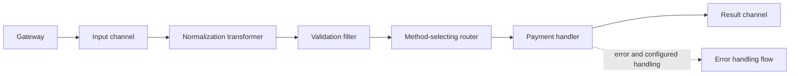

# Endpoint error rate

In the **Metrics and observability** chapter of **SPRING_INTEGRATION_CORE**, error rate answers: out of the completed executions at an endpoint, how many failed? This indicator helps detect degrading integration flows and isolate components to investigate. For the numbers to be meaningful, you must clearly define the measurement point, counting unit, and failure definition.

This lesson uses an illustrative payment flow to connect `Message`, `MessageChannel`, handlers, endpoints, gateways, and Java DSL. The scope is measuring, interpreting, and alerting on errors; the payment service in the example is simulated in memory.

## 1. Objectives and prerequisites

After this lesson, you will be able to:

- Define the numerator and denominator for an endpoint's error rate.
- Distinguish error ratio from error occurrence rate, per-attempt errors, and post-retry errors.
- Use built-in timer counts or a custom measurement with an explicit contract.
- Write PromQL queries that aggregate multiple instances with proper weighting.
- Explain the effects of asynchronous channels, `errorChannel`, recovery, and business outcomes.
- Design alerts with time windows, traffic conditions, and missing-data handling.

You should know Java DSL well enough to build an `IntegrationFlow`, how a handler receives a message, and how exceptions propagate through a synchronous flow. The hands-on section assumes Java 17+, a Spring Boot application with Spring Integration 6.x, and Micrometer; library versions are managed by the application's Spring Boot BOM.

## 2. What does error rate measure?

For endpoint `e` and time window `W`, let:

- `S(e, W)`: number of executions that completed successfully.
- `F(e, W)`: number of executions that completed with failure.
- `T(e, W) = S(e, W) + F(e, W)`: total completed executions.

When `T(e, W) > 0`:

```text
error_ratio(e, W) = F(e, W) / T(e, W)
error_percentage(e, W) = 100 × error_ratio(e, W)
```

For example, in 5 minutes an endpoint completes 980 times successfully and fails 20 times:

```text
T = 980 + 20 = 1,000 executions
error_ratio = 20 / 1,000 = 0.02
error_percentage = 2%
```

Do not use `F / S`: in this example, `20 / 980` is not the failure ratio across all executions. Also do not divide handler errors by messages sent into the entire application if those two datasets do not match.

The phrase "error rate" is often used in two senses. Dashboards must state the unit explicitly:

| Indicator | Illustrative formula | Unit | Meaning |
| --- | --- | --- | --- |
| Error ratio | `F / (S + F)` | Ratio from 0 to 1 or % | Prevalence of failures among outcomes |
| Error rate (occurrence) | `F / observation seconds` | Errors/second | Volume of errors to handle |
| Completion throughput | `(S + F) / observation seconds` | Executions/second | Volume of work reaching an outcome |

An endpoint with 1 error/second out of 1,000 calls/second has a 0.1% error ratio. An endpoint with 1 error/second out of 2 calls/second has a 50% error ratio. Both endpoints have the same error occurrence rate, yet very different operational health.

If there are no completed executions, `0 / 0` is undefined. Dashboards should display "no traffic" or "insufficient data" per operational convention; do not infer an endpoint is healthy merely because no errors have been seen.

## 3. Choose the measurement boundary before choosing a metric

Consider the flow:



Each location answers a different question:

| Boundary | Appropriate counting unit | Question answered |
| --- | --- | --- |
| Channel send | One `send()` call | Was the send accepted or did it fail? |
| Payment handler | One completed handler execution | Did the measured logic throw an error or return normally? |
| Endpoint after retry | One outer call wrapping all retries | Did retries resolve the error within this invocation? |
| Request/reply gateway | One completed gateway call | Did the caller receive a response per contract? |
| Final business outcome | One order or transaction reaching a terminal state | Did the business request succeed overall? |

In this lesson, **endpoint error rate** defaults to the failure ratio of the instrumented handler logic. A handler returning normally is counted as a technical success. That measurement does not by itself confirm every downstream step succeeded.

Endpoint names and framework-managed handler names can differ. For instance, `.id("chargeEndpoint")` identifies the endpoint; the name appearing in the handler's tags may carry a suffix or generated name. When building dashboards, verify actual tags instead of guessing names from DSL configuration.

In particular, one call can pass through multiple handlers. If the same exception propagates across multiple synchronous layers, multiple measurements may record the error. Summing all endpoint errors and calling that "failed transactions" double-counts a single transaction.

## 4. Success and failure conventions

Before implementing, write a concise measurement contract. Example for `chargeEndpoint`:

```text
Unit: one execution of the payment handler logic.
Success: logic returns normally, including null if permitted.
Failure: logic exits via an exception or Error.
Count moment: when the execution ends.
Scope: handler logic, excluding the full downstream flow after it.
Identifier labels: stable application and endpoint.
```

This contract clarifies commonly confused cases:

| Scenario | Outcome under the technical contract above | Additional measurement if needed |
| --- | --- | --- |
| Handler returns `PaymentResult.declined()` normally | Technical success | Declined payment ratio |
| Handler catches exception and returns fallback | Success at the boundary outside fallback | Fallback count and root error |
| Filter discards messages per rule | Not automatically a technical error | Discarded message count by reason |
| Router picks an unexpected branch without throwing | Can still be technical success | Business routing outcome |
| Aggregator waiting for a full message group | Not enough basis to conclude an error | Wait time, expired groups, incomplete groups |
| Message redelivered by broker | A new execution if handler runs again | Final outcome by business key and durable state |

If business requirements treat `declined` as a failure, build a business outcome metric with its own outcome set. Avoid silently changing the definition of `failure` across endpoints and then comparing them on the same dashboard.

## 5. Prefer built-in counts when appropriate

In the traditional Micrometer metrics mechanism, the `spring.integration.send` timer carries `type=handler` or `type=channel`, `name`, `result=success|failure`, and `exception`. A channel `failure` with `exception=none` can occur when `send()` returns `false`. For Prometheus, inspect the actual series, typically `spring_integration_send_seconds_count`.

When Observation is enabled for selected components, measurements are delegated to observation handlers; names such as `spring.integration.handler` belong to a different contract. Do not mix metric names from one mechanism with tags from the other. See [Spring Integration — Metrics and Management](https://docs.spring.io/spring-integration/reference/metrics.html).

A timer already provides event counts; if the timer's counts and classifications meet your needs, use them as the data source. A dedicated counter is only necessary when you want a different, explicitly defined contract. See [Micrometer — Counters](https://docs.micrometer.io/micrometer/reference/concepts/counters.html).

Example query **only for the traditional timer mechanism**, after confirming the exported schema:

```promql
sum by (application, name) (
  rate(spring_integration_send_seconds_count{
    type="handler", result="failure"
  }[5m])
)
/
sum by (application, name) (
  rate(spring_integration_send_seconds_count{type="handler"}[5m])
)
```

Both numerator and denominator select handlers. The numerator aggregates all exception classes instead of selecting just one specific exception and calling it the overall error rate.

An error series may not exist before the first failure. In that case, division may return no data for that endpoint. You can supply a zero numerator using `or on (application, name)` with a `0 * total_rate` vector carrying the same labels. Only fill zero when the total series actually exists; do not turn missing collection data into an endpoint showing 0% errors.

Subsequent sections use a custom metric to keep the illustrative contract fixed. That metric stands alone; do not add it to framework timer counts.

## 6. Hands-on: measuring with advice on a handler

### 6.1. Preparing the application

The example uses the following dependencies in an existing Spring Boot application:

- `org.springframework.boot:spring-boot-starter-integration`.
- `org.springframework.boot:spring-boot-starter-actuator`.
- `org.springframework.boot:spring-boot-starter-web` to provide HTTP for Actuator.
- `io.micrometer:micrometer-registry-prometheus`.

Illustrative configuration for a learning environment:

```yaml
management:
  endpoints:
    web:
      exposure:
        include: health,metrics,prometheus
  metrics:
    tags:
      application: payment-integration
```

With default web configuration, Prometheus data is served at `/actuator/prometheus`. Before running queries, confirm that endpoint is reachable in your environment and Prometheus is scraping the application. Registry dependencies and export mechanisms are described in [Spring Boot — Metrics](https://docs.spring.io/spring-boot/reference/actuator/metrics.html).

### 6.2. Defining the measurement and flow

Place the Java configuration in a package scanned by the application. This is the content of an illustrative configuration class; you do not need to modify business logic to increment counters at every return branch.

```java
import io.micrometer.core.instrument.Counter;
import io.micrometer.core.instrument.MeterRegistry;
import org.springframework.context.annotation.Bean;
import org.springframework.context.annotation.Configuration;
import org.springframework.integration.annotation.EnableIntegration;
import org.springframework.integration.channel.DirectChannel;
import org.springframework.integration.dsl.IntegrationFlow;
import org.springframework.integration.handler.advice.AbstractRequestHandlerAdvice;
import org.springframework.messaging.Message;
import org.springframework.messaging.MessageChannel;

@Configuration(proxyBeanMethods = false)
@EnableIntegration
public class PaymentMetricsConfiguration {

    public record PaymentRequest(String orderId, boolean simulateFailure) {
    }

    @Bean
    MessageChannel paymentInput() {
        return new DirectChannel();
    }

    @Bean
    EndpointOutcomeAdvice chargeOutcomeAdvice(MeterRegistry registry) {
        return new EndpointOutcomeAdvice(registry, "chargeEndpoint");
    }

    @Bean
    IntegrationFlow paymentFlow(EndpointOutcomeAdvice chargeOutcomeAdvice) {
        return IntegrationFlow.from("paymentInput")
                .handle(PaymentRequest.class, (request, headers) -> {
                    if (request.simulateFailure()) {
                        throw new IllegalStateException(
                                "Simulated payment provider failure");
                    }
                    return "PAID:" + request.orderId();
                }, endpoint -> endpoint
                        .id("chargeEndpoint")
                        .advice(chargeOutcomeAdvice))
                .get();
    }

    public static final class EndpointOutcomeAdvice
            extends AbstractRequestHandlerAdvice {

        private final Counter success;
        private final Counter failure;

        public EndpointOutcomeAdvice(MeterRegistry registry, String endpoint) {
            this.success = Counter.builder("demo.integration.endpoint.completed")
                    .description("Completed handler executions by outcome")
                    .tags("endpoint", endpoint, "outcome", "success")
                    .register(registry);
            this.failure = Counter.builder("demo.integration.endpoint.completed")
                    .description("Completed handler executions by outcome")
                    .tags("endpoint", endpoint, "outcome", "failure")
                    .register(registry);
        }

        @Override
        protected Object doInvoke(ExecutionCallback callback,
                                  Object target,
                                  Message<?> message) throws Exception {
            boolean completedNormally = false;
            try {
                Object result = callback.execute();
                completedNormally = true;
                return result;
            } finally {
                Counter outcome = completedNormally ? success : failure;
                outcome.increment();
            }
        }
    }
}
```

`AbstractRequestHandlerAdvice` provides a callback to invoke the wrapped logic. This measurement invokes the callback once, returns the result unchanged, and does not swallow exceptions to turn them into successes. See [Spring Integration — Custom Advice Classes](https://docs.spring.io/spring-integration/reference/handler-advice/custom.html).

The `completedNormally` flag is set only after the callback returns. Hence `finally` picks exactly one outcome for each finished invocation, even if the logic throws an `Error`. If the process is killed abruptly mid-execution, there is no guarantee that invocation was recorded; an in-memory counter is not a durable transaction ledger.

Both counters are registered upfront, allowing the `failure` series to be exported with value zero before any errors occur. The `endpoint` label is explicitly set by the example; it does not depend on framework-generated handler names. Each distinct endpoint needs an advice with its own name; do not share this same instance across endpoints with different identities.

For a handler producing a reply, the request advice boundary does not encompass sending the reply and downstream steps. If the callback returns a successful result but sending the reply subsequently fails, this metric can still increment `success`. That is why it must be described as handler logic outcome.

The example targets synchronous processing. If the logic returns a `CompletableFuture` or an incomplete publisher, the method returning does not yet reflect background execution outcome. To measure that kind of processing, attach instrumentation to the completion/error signal of the corresponding async task.

### 6.3. Generating traffic and checking expectations

In test or driver code with a Spring context, retrieve the `paymentInput` bean and send request-reply messages using `MessagingTemplate`:

```java
import org.springframework.context.ApplicationContext;
import org.springframework.integration.core.MessagingTemplate;
import org.springframework.messaging.MessageChannel;
import org.springframework.messaging.MessagingException;

// context is the ApplicationContext of the started application.
MessageChannel input = context.getBean("paymentInput", MessageChannel.class);
MessagingTemplate template = new MessagingTemplate();
template.setReceiveTimeout(1000);

int receivedReplies = 0;
int observedFailures = 0;
for (int i = 0; i < 100; i++) {
    boolean simulateFailure = i < 5;
    try {
        String reply = template.convertSendAndReceive(
                input,
                new PaymentMetricsConfiguration.PaymentRequest(
                        "order-" + i, simulateFailure),
                String.class);
        if (reply == null) {
            throw new IllegalStateException("Expected a payment reply");
        }
        receivedReplies++;
    } catch (MessagingException ex) {
        observedFailures++;
    }
}

if (receivedReplies != 95 || observedFailures != 5) {
    throw new IllegalStateException("Unexpected sample execution results");
}
```

In a freshly started application with no other traffic, the expected counter data is:

```text
demo_integration_endpoint_completed_total{
  application="payment-integration",
  endpoint="chargeEndpoint",
  outcome="success"
} 95

demo_integration_endpoint_completed_total{
  application="payment-integration",
  endpoint="chargeEndpoint",
  outcome="failure"
} 5
```

Line breaks above are for readability; actual export format may place each sample on a single line and include environment-configured labels. The expected outcome is 100 completed executions and a 5% error ratio.

If run again in the same process, use the before/after counter delta; cumulative values keep increasing. To observe via `rate()`, scrapes are needed before and after the traffic burst. Increments occurring before the first sample cannot be reconstructed by Prometheus into observed history.

A gateway calling the same channel could also use this flow, though you should measure the gateway's reply contract separately if you want to know caller experience. The example above omits a gateway to keep the measurement boundary easy to observe.

## 7. Computing error rate with PromQL

With the custom metric just created, the 5-minute error ratio query is:

```promql
sum by (application, endpoint) (
  rate(demo_integration_endpoint_completed_total{outcome="failure"}[5m])
)
/
sum by (application, endpoint) (
  rate(demo_integration_endpoint_completed_total[5m])
)
```

The result is a ratio from 0 to 1; multiply the entire expression by `100` if the dashboard uses percentage units. The denominator includes both `success` and `failure`.

Use `rate()` on each series before `sum` to handle per-instance counter resets. `increase()` is appropriate when estimating counts over a window; due to extrapolation, the result can be fractional. See [Prometheus — Query functions](https://prometheus.io/docs/prometheus/latest/querying/functions/).

Do not use cumulative `failure_total / completed_total` to represent current status: a fresh burst of errors can be masked by millions of historical successes.

### 7.1. Aggregating multiple instances weighted by execution count

Suppose within the same window:

| Instance | Success | Failure | Total | Error ratio |
| --- | ---: | ---: | ---: | ---: |
| A | 990 | 10 | 1,000 | 1% |
| B | 0 | 10 | 10 | 100% |
| Whole service | 990 | 20 | 1,010 | About 1.98% |

The unweighted average of the two ratios is `(1% + 100%) / 2 = 50.5%`, which misrepresents the overall ratio. You must sum numerators, sum denominators, and then divide. The query above achieves this by dropping the `instance` label during aggregation.

Keep `instance` in a separate panel to spot a broken instance even when the overall ratio is still low. If data spans multiple environments or clusters, add filters or keep those labels in `by (...)` for both numerator and denominator.

### 7.2. Zero, no traffic, and missing data

Three states must be displayed distinctly:

| State | Observation | Interpretation |
| --- | --- | --- |
| Traffic present, no errors | Total rate positive; error rate zero | 0% in the measured window |
| No completed traffic | Both rates zero | Undefined ratio; investigate why traffic is absent |
| No series or scrape failed | Insufficient data | Cannot draw conclusions about the endpoint |

Vector operators require matching label sets on both sides; comparisons or combining conditions must preserve the same label set too. See [Prometheus — Operators](https://prometheus.io/docs/prometheus/latest/querying/operators/).

Do not arbitrarily add a large constant to the denominator to eliminate division by zero: that artificially lowers the error ratio on low-traffic endpoints. Let dashboards show no-data state and use traffic conditions in alerts.

## 8. Retries change the counting unit

A request that fails twice and succeeds on the third try produces:

```text
Per-attempt:         failure, failure, success
Post-retry outcome:  success
```

If measuring each attempt, the error ratio is `2 / 3`, about 66.7%. If measuring the outcome after all retries, there is one successful call and the error ratio is 0%. Both numbers are useful, answering two different questions.

With stateless retries, advice wrapping order defines the boundary:

```text
Measuring post-retry outcome:
OutcomeAdvice -> RetryAdvice -> Handler

Measuring per-attempt:
RetryAdvice -> AttemptAdvice -> Handler
```

In the corresponding DSL configuration, the outer advice is placed first:

```java
// Choose configuration measuring post-retry outcome.
endpoint.advice(finalOutcomeAdvice, retryAdvice);

// Or choose configuration measuring each attempt.
endpoint.advice(retryAdvice, attemptOutcomeAdvice);
```

These are two illustrative configuration choices, not two statements to apply back-to-back on the same endpoint. If you want both, use two measurements with distinct names or scope labels, such as `scope="attempt"` and `scope="invocation"`; do not sum those two count sets.

`RequestHandlerRetryAdvice` supports retries and recovery; stateful retries may span multiple redeliveries. In that case, a single advice call does not automatically equal the final outcome of a message. See [Spring Integration — Provided Advice Classes](https://docs.spring.io/spring-integration/reference/handler-advice/classes.html).

A recovery callback can handle the final error and return normally. An outer advice will record technical success under the current contract. If you need to know requests exhausted retries and entered recovery, record a separate outcome or counter directly at the recovery point.

Likewise, an open circuit breaker can fail calls before the handler is actually invoked. A measurement wrapping outside the breaker captures call failures; a measurement placed close to handler logic does not count executions that never happened. Name dashboards after the chosen boundary.

## 9. Asynchronous channels and errorChannel

With `DirectChannel`, handlers typically run on the sending thread; errors can propagate to the caller. With channels that offload processing to another thread, a successful send does not prove the handler succeeded. Integration tasks with error-publishing mechanisms can send an `ErrorMessage` to the channel in the `errorChannel` header, or to the global error channel when appropriate. See [Spring Integration — Error Handling](https://docs.spring.io/spring-integration/reference/error-handling.html).

Consider an operational example:

```text
100 messages are accepted into the queue.
Within the measurement window, the consumer has finished 40 messages:
  35 succeeded, 5 failed.
60 messages are still waiting or in flight.
```

Under the contract counting completed executions, the handler error ratio is `5 / 40 = 12.5%`. Dividing `5 / 100 = 5%` mixes ingress count with outcomes at a different stage.

Counting `ErrorMessage` instances helps observe error flows, though it is not sufficient as a numerator for every endpoint:

- An error may be recorded at the handler and also forwarded as an error message; those are two representations of the same incident.
- Errors may be caught or recovered before reaching an error channel.
- A shared error channel receives errors from many sources, lacking a single natural denominator.
- The error-handling handler itself can fail, creating additional incidents to measure separately.

If the goal is the error rate of `chargeEndpoint`, measure at that endpoint's boundary and use the error flow for diagnosis and handling. If the goal is the final outcome per order, you need a business state model capable of reconciling received orders with completed orders.

Also monitor queue depth, message age, or in-flight task count when needed. A hung consumer may produce zero completions, keeping error rate from rising even when the system is failing to serve requests.

## 10. Alerting with traffic conditions

The example below creates recording rules for completion rate, failure rate, and error ratio; it then alerts when the ratio exceeds 5% with at least roughly 100 completions over 5 minutes.

```yaml
groups:
  - name: integration-endpoint-quality
    interval: 30s
    rules:
      - record: demo_endpoint:completed:rate5m
        expr: |
          sum by (application, endpoint) (
            rate(demo_integration_endpoint_completed_total[5m])
          )

      - record: demo_endpoint:failed:rate5m
        expr: |
          sum by (application, endpoint) (
            rate(demo_integration_endpoint_completed_total{
              outcome="failure"
            }[5m])
          )

      - record: demo_endpoint:error:ratio5m
        expr: |
          demo_endpoint:failed:rate5m
          /
          demo_endpoint:completed:rate5m

      - alert: IntegrationEndpointErrorRatioHigh
        expr: |
          (demo_endpoint:error:ratio5m > 0.05)
          and on (application, endpoint)
          (
            sum by (application, endpoint) (
              increase(demo_integration_endpoint_completed_total[5m])
            ) >= 100
          )
        for: 10m
        labels:
          severity: warning
        annotations:
          summary: "High error rate at {{ $labels.endpoint }}"
          description: >-
            Endpoint {{ $labels.endpoint }} of {{ $labels.application }}
            exceeded a 5% error ratio with sufficient traffic over 5 minutes;
            condition persisted for 10 minutes.
```

This is a Prometheus rules configuration, not `application.yml`. The values 5 minutes, 5%, 100 executions, and 10 minutes are illustrative choices; adjust them to your service objectives and actual traffic.

`[5m]` is a sliding observation window. `for: 10m` requires the condition to remain true across evaluations during that duration before firing; it does not mean evaluating a single 15-minute window. See [Prometheus — Alerting rules](https://prometheus.io/docs/prometheus/latest/configuration/alerting_rules/).

Traffic conditions reduce noise from a few rare calls, while potentially missing critical low-volume endpoints. For such endpoints, complement ratio alerts with absolute error-count alerts or active probing. Monitor failed scrapes, missing expected series, and backlogs separately; error-ratio alerts do not cover those cases.

## 11. Metric labels and diagnostic data

Keep labels used for aggregation within a bounded set of values:

| Attribute | Appropriate place in example | Reason |
| --- | --- | --- |
| Application name | `application` tag | Aggregate by service |
| Fixed configured endpoint name | `endpoint` tag | Isolate measurement point |
| Bounded outcome | `outcome` tag | Compute numerator and denominator |
| Normalized error group | Optional tag like `error_category` | Analyze a few stable categories |
| Order ID, message ID, trace ID | Structured logs or traces | Correlate one specific execution |
| Full exception message | Logs per allowed data policy | Avoid generating huge numbers of distinct label values |

If every order creates a new tag value, series count grows with orders instead of endpoints. That makes operational metrics resource-intensive and difficult to aggregate.

When adding `error_category`, drop that label when computing overall error ratio. Do not keep `error_category` on the numerator while dropping it on the denominator without handling vector matching, as the two sides will no longer match.

In error logs, include endpoint name, necessary business identifiers, and trace ID if tracing is enabled. Avoid logging raw sensitive payloads. Metrics help detect and localize; logs and traces help explain the specific incident.

## 12. Process for observing and troubleshooting an error spike

When a dashboard shows rising error rate, follow this order:

1. Confirm metrics are still collected, check denominator and traffic; distinguish genuine error increases from missing data.
2. Identify which endpoints and instances contribute the most errors using the same time window.
3. Cross-check error ratio with error rate, latency, retries, fallbacks, and backlog.
4. Inspect a few representative traces or logs to pinpoint the initial failure; avoid treating every downstream stack trace as an independent incident.
5. Check root-cause categories such as external service timeouts, invalid data, or resource exhaustion.
6. After mitigation, watch subsequent windows with sufficient traffic and monitor backlog; cumulative counters do not automatically drop back to zero.

You can validate the measurement contract with small scenarios before going to production:

| Validation scenario | Expectation at stated boundary |
| --- | --- |
| 95 successes, 5 thrown errors, no retries | 100 completed executions; 5% error ratio |
| Two failures followed by success | Per-attempt: `2/3`; post-retry: `0/1` |
| Recovery returns fallback normally | Advice outside recovery records technical success; dedicated recovery metric tracks recovery |
| Queue send succeeds, consumer throws error | Separate send outcome from handler outcome |
| Zero completed executions | Do not infer 0% errors to conclude health |
| One instance restarts | Rate query handles resets; check sufficient samples post-restart |
| Reply or downstream step fails after handler | Handler logic measurement may still record success |

These expectations verify the meaning of the measurement, not just whether a counter increments. In production deployments, choose the measurement boundary first, confirm exported metric names and labels, and then build dashboards and alerts on top of them.