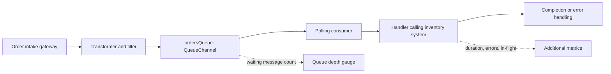

# Queue depth

In the **Metrics and observability** chapter of `SPRING_INTEGRATION_CORE`, queue depth is the indicator that reveals whether messages are accumulating at a buffering point in an integration flow. When combined with ingestion rate, dequeue rate, processing time, and errors, you can spot bottlenecks before users experience severe latency spikes.

This lesson focuses on `QueueChannel` in Spring Integration: defining queue depth, measuring it with Micrometer, reading charts, and responding when a queue grows. The examples use Java DSL to wire channels to endpoints; gateways, transformers, routers, filters, and aggregators are placed in context to identify the exact boundary to observe.

## 1. Objectives and background

After this lesson, you will be able to:

- Distinguish waiting messages, in-flight messages, and total messages that passed through the system.
- Read queue depth alongside capacity, remaining capacity, ingress/egress rates, and message age.
- Declare a bounded `QueueChannel`, a polling consumer, and gauges observing the queue.
- Design queries, alerts, and response procedures when backlog grows.
- Explain why a queue depth of zero is not enough to prove a processing flow is healthy.

You should know `Message<?>`, `MessageChannel`, `PollableChannel`, service activators, and the basic structure of `IntegrationFlow`. Configuration examples use Java 17 or higher and the Java DSL API of Spring Integration 6.x or higher; dependencies should match the version set managed by your Spring Boot application.

## 2. The problem: receiving orders faster than processing capacity

A service receives orders through a gateway. After normalizing data with a transformer and checking it with a filter, the flow puts valid orders into `ordersQueue`. A polling consumer takes each order to call the inventory system.



When inventory responds slowly, the consumer dequeues and processes orders more slowly. A growing queue helps absorb a short burst of load, but if the mismatch persists, wait times rise and eventually the queue can fill up.

A router might split regular and priority orders into two queues. In that case, each queue must be observed individually: a small combined backlog can hide that one branch has run out of room. If an aggregator sits downstream waiting to complete groups, the items held in the aggregator's message store are another accumulation area needing their own metric.

## 3. What does queue depth actually count?

### 3.1. Definition and boundary

**Queue depth** at time `t`, denoted `Q(t)`, is the number of messages sitting in the queue waiting to be retrieved at that instant. The unit is typically **messages**.

With `QueueChannel`, the API to read element count is `getQueueSize()`; `getRemainingCapacity()` reads remaining slots. These are values of the measured channel, not the total number of unfinished orders across the entire system. See [QueueChannel Javadoc](https://docs.spring.io/spring-integration/api/org/springframework/integration/channel/QueueChannel.html).

Suppose a queue has a capacity of 100:

| Event, with no other concurrent operations | Depth | In-flight count |
| --- | ---: | ---: |
| Queue holds 30 messages | 30 | 0 |
| Consumer dequeues one message | 29 | 1 |
| Handler is still waiting for inventory response | 29 | 1 |
| Handler finishes that message | 29 | 0 |
| Producer successfully enqueues two more messages | 31 | 0 |

The key point sits in the second row: depth decreases when the message is dequeued, before business processing completes. If the consumer drains data and hands it off to an executor with its own queue, `ordersQueue` can be empty while work is still backed up in the executor.

In a simple model without secondary branches, you can picture:

```text
Unfinished work
    = messages waiting in queue
    + work currently in flight
    + work awaiting retry or sitting in other buffers
```

This defines the observation scope, not an arbitrary formula to sum every metric. If the same piece of work is counted across multiple layers or produces multiple messages after a splitter, handle duplicates and unit differences before summing.

### 3.2. Queue depth is a gauge

Depth rises on enqueue and falls on dequeue, so it fits a **gauge**, the metric type representing a current value. Counters suit event totals, such as successful enqueues or rejected sends. Timers are for durations.

Micrometer reads a gauge at sampling time; fluctuations between two samples may not appear in collected data. Therefore, a depth chart does not replace counters that record events. See [Micrometer Gauges](https://docs.micrometer.io/micrometer/reference/concepts/gauges.html).

For example, Prometheus scrapes at 10:00:00 and 10:00:15 both see a depth of 0. In between, the queue could have spiked to 800 and drained completely. Two zero samples do not prove there were no traffic bursts or failed sends.

## 4. Reading depth alongside capacity and rates

### 4.1. Capacity and utilization

For an in-memory `QueueChannel` with fixed capacity `C`:

```text
Q = waiting message count
R = remaining slots
U = Q / C

In a consistent queue state: Q + R = C
```

If `C = 10,000` and `Q = 8,000`, utilization is 80%, leaving around 2,000 slots. Two gauges read sequentially while the queue undergoes concurrent operations may not sum to exactly `C`; they do not form a single atomic snapshot.

Choose capacity based on acceptable burst load, allowable wait time, and actual memory. A message-count limit does not strictly bound byte count: 10,000 messages holding short strings differ greatly from 10,000 messages holding large documents.

The no-arg constructor of `QueueChannel` has an effective capacity of `Integer.MAX_VALUE`. In operations, that is rarely a useful safeguard before memory runs out. Declare an explicit bound as recommended in [QueueChannel configuration](https://docs.spring.io/spring-integration/reference/channel/configuration.html#queuechannel-configuration).

### 4.2. Backlog growth rate

Over an observation interval, assuming no purges, rollbacks, or other entry/exit paths:

```text
ΔQ / Δt ≈ r_enqueue_success - r_dequeue
```

Distinguish two rates on the input side:

- **Offered rate:** messages per second that producers attempt to send.
- **Accepted enqueue rate:** messages per second actually accepted by the queue.

When the queue is full, producers may block or fail to send. Depth can then plateau at capacity even while offered rate still exceeds processing capacity. Inspect send timeouts, errors, producer blocking, and rejected requests as well.

Suppose `C = 10,000`, current depth is 4,000, the queue successfully accepts 600 messages/second, and the consumer dequeues 500 messages/second. Assuming rates remain constant:

```text
Growth rate = 600 - 500 = 100 messages/second
Estimated time until full = (10,000 - 4,000) / 100 = 60 seconds
```

This is an extrapolation to aid decisions, not a guarantee. Rates can change due to autoscaling, retries, bursty traffic, or downstream degradation. If growth rate is zero or negative, do not apply this division to infer a finite time to full.

### 4.3. Backlog drain time

With depth at 4,000, if dequeue rate is steady at 500 messages/second:

- New arrivals stop: time to empty the queue is roughly `4,000 / 500 = 8 seconds`.
- Still receiving 300 messages/second: time to empty is roughly `4,000 / (500 - 300) = 20 seconds`.

These values describe draining the queue boundary only. The final messages may still be in flight. If ingress rate equals or exceeds egress rate, the queue will not drain under those assumptions.

## 5. Locating the actual queue

Not every `MessageChannel` shares the same meaning of queue depth.

| Component | Where to observe |
| --- | --- |
| `QueueChannel` | Messages buffered inside the channel's queue |
| `PriorityChannel` | Waiting messages, paired with wait time per priority group |
| `DirectChannel` | Send duration, handler duration, and calling thread; the channel has no internal message buffer |
| `ExecutorChannel` | Task queue and active task count of the configured executor |
| `RendezvousChannel` | Handoff behavior and wait time; the structure does not store messages like a positive-capacity queue |
| Broker inbound adapter | Broker backlog and local post-adapter backlog are two separate scopes |
| Aggregator | Incomplete groups, held message count, and group age in the message store |

Channel characteristics are described in [Message Channel Implementations](https://docs.spring.io/spring-integration/reference/channel/implementations.html). When using an executor, inspect the actual executor configuration to know whether it buffers tasks.

Low internal queue depth does not prove the broker has no backlog. Likewise, high `PriorityChannel` depth does not tell you how long low-priority messages have waited. Observation must follow where data actually sits and how it is consumed there.

## 6. Built-in metrics vs. application-declared metrics

In Spring Integration's Micrometer metrics mechanism, `QueueChannel` provides these gauges:

| Micrometer name | Meaning | Typical tags |
| --- | --- | --- |
| `spring.integration.channel.queue.size` | Waiting message count | `type=channel`, `name=<componentName>` |
| `spring.integration.channel.queue.remaining.capacity` | Remaining slots | `type=channel`, `name=<componentName>` |

Since Spring Integration 6.0, Micrometer Observation is also available. When a component is instrumented with Observation, its metric collection is handed to appropriate `ObservationHandler` instances; do not assume the direct meter set and observation set always coexist. Check actual meters before writing dashboards. See [Metrics and Management](https://docs.spring.io/spring-integration/reference/metrics.html).

In this lesson, the example explicitly registers gauges under a custom name `app.integration.queue.*`. This makes it clear which queue is measured without inferring depth from timer or span names. These are application-defined metrics, not mandatory standard Spring Integration names.

If built-in metrics already meet your needs, you can use them directly. When keeping both sets, pick one set per dashboard and alert to avoid double-counting the same queue. Never register custom metrics with the exact same name and tags as framework metrics.

## 7. Java DSL example: bounded queue and direct gauges

### 7.1. Dependencies and runtime prerequisites

Put the following dependencies under `<dependencies>` in a Spring Boot application configured with the corresponding parent or BOM:

```xml
<dependency>
    <groupId>org.springframework.boot</groupId>
    <artifactId>spring-boot-starter-integration</artifactId>
</dependency>
<dependency>
    <groupId>org.springframework.boot</groupId>
    <artifactId>spring-boot-starter-actuator</artifactId>
</dependency>
<dependency>
    <groupId>io.micrometer</groupId>
    <artifactId>micrometer-registry-prometheus</artifactId>
</dependency>
```

The HTTP endpoint example later assumes the application includes the web starter and a Spring Boot main class. To run the JUnit snippet, add `spring-boot-starter-test` in test scope. Do not mix arbitrary Spring Integration and Micrometer versions; [Micrometer recommends managing versions via BOM or framework](https://docs.micrometer.io/micrometer/reference/implementations/prometheus.html).

### 7.2. Queue, consumer, and metrics configuration

Place the configuration in a package scanned by the application. The `Order` payload is declared inside the class so the example is self-contained.

```java
import java.time.Duration;

import io.micrometer.core.instrument.Gauge;
import io.micrometer.core.instrument.binder.MeterBinder;
import org.slf4j.Logger;
import org.slf4j.LoggerFactory;
import org.springframework.beans.factory.annotation.Qualifier;
import org.springframework.context.annotation.Bean;
import org.springframework.context.annotation.Configuration;
import org.springframework.integration.channel.QueueChannel;
import org.springframework.integration.config.EnableIntegration;
import org.springframework.integration.dsl.IntegrationFlow;
import org.springframework.integration.dsl.Pollers;

@Configuration(proxyBeanMethods = false)
@EnableIntegration
public class OrderQueueConfiguration {

    private static final Logger log =
            LoggerFactory.getLogger(OrderQueueConfiguration.class);

    private static final int CAPACITY = 10_000;

    public record Order(String id) {
    }

    @Bean
    public QueueChannel ordersQueue() {
        return new QueueChannel(CAPACITY);
    }

    @Bean
    public IntegrationFlow ordersFlow(
            @Qualifier("ordersQueue") QueueChannel queue) {

        return IntegrationFlow.from(queue)
                .handle(Order.class, (order, headers) -> {
                    // Replace with actual business processing.
                    log.info("Processing order {}", order.id());
                    return null;
                }, endpoint -> endpoint
                        .id("ordersConsumer")
                        .poller(Pollers.fixedDelay(Duration.ofMillis(200))
                                .maxMessagesPerPoll(10)
                                .receiveTimeout(0)))
                .get();
    }

    @Bean
    public MeterBinder ordersQueueMetrics(
            @Qualifier("ordersQueue") QueueChannel queue) {

        return registry -> {
            Gauge.builder("app.integration.queue.depth",
                            queue, QueueChannel::getQueueSize)
                    .tag("channel", "ordersQueue")
                    .description("Messages currently waiting in ordersQueue")
                    .register(registry);

            Gauge.builder("app.integration.queue.remaining.capacity",
                            queue, QueueChannel::getRemainingCapacity)
                    .tag("channel", "ordersQueue")
                    .description("Remaining message slots in ordersQueue")
                    .register(registry);

            Gauge.builder("app.integration.queue.capacity",
                            queue, ignored -> CAPACITY)
                    .tag("channel", "ordersQueue")
                    .description("Configured capacity of ordersQueue")
                    .register(registry);
        };
    }
}
```

Spring Boot binds `MeterBinder` beans to the configured registry. The gauges read directly from the queue bean; Spring retains this bean's lifecycle. You do not need to manually maintain a counter variable and increment/decrement it on every send, receive, and error path. Registering meters via beans is documented in [Spring Boot Metrics](https://docs.spring.io/spring-boot/reference/actuator/metrics.html#actuator.metrics.registering-custom).

The capacity gauge here reflects the configuration constant used to create the in-memory queue. If replaced by an external queue or dynamic capacity, update how capacity is supplied to match the implementation.

The consumer uses a `QueueChannel`, so a poller is required. `maxMessagesPerPoll(10)` caps the messages fetched in one poll cycle; it does not mean 10 workers run in parallel. `receiveTimeout(0)` makes a receive on an empty queue return immediately. With no task executor attached in this example, the handler processes sequentially within each poll. See [Message Endpoints](https://docs.spring.io/spring-integration/reference/endpoint.html) and [Pollers API](https://docs.spring.io/spring-integration/api/org/springframework/integration/dsl/Pollers.html).

`fixedDelay(200 ms)` is the pause after the previous poll completes. If each message takes 50 ms and each poll always handles a full batch of 10 messages, a simple throughput model is:

```text
Cycle duration ≈ 10 × 50 ms + 200 ms = 700 ms
Throughput ≈ 10 / 0.7 ≈ 14.3 messages/second
```

This is an illustrative calculation for sequential execution, ignoring scheduler overhead and processing time variance. Increasing `maxMessagesPerPoll` can reduce the idle-time fraction, but it does not by itself introduce parallel processing or fix a bottlenecked downstream.

### 7.3. Sending with a timeout and handling a full queue

A method in an ingestion component can send through the injected queue bean as follows:

```java
import java.util.concurrent.RejectedExecutionException;

import org.springframework.integration.channel.QueueChannel;
import org.springframework.messaging.Message;
import org.springframework.messaging.support.MessageBuilder;

public class OrderSubmitter {

    private final QueueChannel queue;

    public OrderSubmitter(QueueChannel queue) {
        this.queue = queue;
    }

    public void submit(OrderQueueConfiguration.Order order) {
        Message<OrderQueueConfiguration.Order> message =
                MessageBuilder.withPayload(order).build();

        boolean accepted = queue.send(message, 100L);
        if (!accepted) {
            throw new RejectedExecutionException(
                    "ordersQueue did not accept the message within 100 ms");
        }
    }
}
```

This class illustrates the producer; to use it in an application, create an `OrderSubmitter` bean taking `ordersQueue` as its constructor argument. When the queue is full, a timed send waits up to the configured timeout for free space. If the message cannot be accepted, the result can be `false`; the application must also handle exceptions appropriately for the calling flow. `accepted = true` only confirms successful enqueue, not that the order finished processing.

Define a policy for rejected sends: return a busy status to the caller, throttle input, or spill to a designed durable store. If retrying, use an attempt limit, backoff, and deduplication when business logic requires it.

Do not use the pattern `if (queue.getRemainingCapacity() > 0) { queue.send(...); }` as a guarantee of free space. Another producer can claim the slot between the two calls. The result of timed `send` is the actual basis for admission handling at send time.

## 8. Exporting metrics and verifying actual names

In a hands-on application configuration, expose the following endpoints to authorized monitoring environments:

```yaml
management:
  endpoints:
    web:
      exposure:
        include: health,metrics,prometheus
```

With Actuator and the Prometheus registry, `/actuator/prometheus` serves scrape data once exposed. `/actuator/metrics` lets you inspect meter names inside the application. The export mechanism is described in [Spring Boot Prometheus Metrics](https://docs.spring.io/spring-boot/reference/actuator/metrics.html#actuator.metrics.export.prometheus).

Micrometer names in the example use dots; under standard Prometheus export configuration, expect these names:

```text
app_integration_queue_depth{channel="ordersQueue"} 420.0
app_integration_queue_remaining_capacity{channel="ordersQueue"} 9580.0
app_integration_queue_capacity{channel="ordersQueue"} 10000.0
```

This is illustrative output, omitting labels added by Prometheus on scrape such as `job` and `instance`. Meter filters, naming conventions, or common tag configurations can change actual output. Verify the endpoint before copying queries.

Prefer tags with small, stable value sets: channel name, flow name, bounded work type. Do not attach `messageId`, `orderId`, full URLs, or correlation IDs to gauges. Per-message values belong in logs or traces to avoid creating extra time series per order.

## 9. Querying and alerting with PromQL

The queries below use the custom metric set from section 7. In multi-application setups, add appropriate `job`, namespace, or service filters so queues with matching names are not mixed.

### 9.1. Depth and utilization per instance

```promql
app_integration_queue_depth{
  job="spring-integration-core",
  channel="ordersQueue"
}
```

```promql
app_integration_queue_depth{job="spring-integration-core", channel="ordersQueue"}
/
app_integration_queue_capacity{job="spring-integration-core", channel="ordersQueue"}
```

In the example, gauges for the same queue share the same label set, so division aligns corresponding series properly. For values of 8,000 and 10,000, the result is `0.8`; set the dashboard unit to percentage or multiply by 100 when needed.

### 9.2. Observed peak and growth trend

```promql
max_over_time(
  app_integration_queue_depth{
    job="spring-integration-core", channel="ordersQueue"
  }[5m]
)
```

```promql
deriv(
  app_integration_queue_depth{
    job="spring-integration-core", channel="ordersQueue"
  }[5m]
)
```

`max_over_time` returns the peak among collected samples; it does not recover peaks missed between two scrapes. `deriv` estimates the per-second slope of the gauge; a positive value suggests backlog growth. Do not use `rate(queue_depth[5m])` to compute ingress speed: `rate` is for counters, whereas depth legitimately rises and falls. See [Prometheus query functions](https://prometheus.io/docs/prometheus/latest/querying/functions/).

### 9.3. Alerts with sustained duration

Example rule for local queues with positive capacity:

```yaml
groups:
  - name: integration-queue
    rules:
      - alert: OrdersQueueHighUtilization
        expr: |
          (
            app_integration_queue_depth{job="spring-integration-core", channel="ordersQueue"}
            /
            app_integration_queue_capacity{job="spring-integration-core", channel="ordersQueue"}
          ) > 0.8
        for: 5m
        labels:
          severity: warning
        annotations:
          summary: "ordersQueue exceeded 80% capacity continuously for 5 minutes"
          description: "Check consumer and downstream on instance {{ $labels.instance }}"
```

The 80% and 5-minute thresholds are illustrative starting points and should be tuned to load and response times. In the section 4 example with only 60 seconds left until full, waiting 5 minutes would be too late; use an earlier threshold or a predictive rule based on growth rate.

A practical alert suite should distinguish: queue near full, sustained backlog growth, messages waiting too long, rejected enqueues, and lost monitoring data. Missing series or an instance failing scrapes does not mean depth is 0. Use scrape-health alerts and check metric presence against expected queues.

## 10. Multiple instances and shared queues

With an in-memory `QueueChannel`, each application instance usually has its own queue. Dashboards need both total backlog and maximum per-instance utilization.

For example, four instances each with capacity 1,000 have depths of `980, 10, 5, 5`. Total backlog is 1,000 and total capacity is 4,000, so aggregate utilization is only 25%. Yet the first instance has already used 98% of its room and may begin rejecting sends ahead of the others.

Thus, total depth answers "how much work is waiting across the cluster?", while per-instance ratio answers "which node is about to fill?". Also inspect load distribution, key-based routing, and data skew toward one branch.

If multiple instances read from a single persistent queue in a shared store, each instance may report the same count. Summing those gauges would multiply-count the backlog. Establish data ownership and pick one measurement source for a shared queue; sum only when series represent disjoint partitions of data.

Queues backed by a message store also have different measurement costs than in-memory queues: reading size may require querying the store. Consider scrape intervals, timeouts, and timestamped caching if reads are expensive. Persistent queues are introduced in [Persistent QueueChannel Configuration](https://docs.spring.io/spring-integration/reference/channel/configuration.html#persistent-queuechannel-configuration).

## 11. Adding wait time and business signals

### 11.1. Same depth, different impact

A queue holding 100 background notification tasks may still be well within capacity. A queue holding 100 payment confirmation requests with a multi-second SLA may already be violating business requirements. Having plenty of remaining capacity does not guarantee wait times meet targets.

Track additionally:

| Signal | Question answered |
| --- | --- |
| Queue depth | How many messages are waiting in this queue? |
| Age of oldest waiting message | Is any message stuck too long or starved? |
| Wait-time distribution | How long do most messages and the slowest group wait? |
| In-flight work count | How many jobs left the queue but are not finished yet? |
| Handler duration and errors | Where is downstream slow or failing? |
| Business completion rate | Is the system actually finishing work? |
| Retries and error stores | Is work looping or diverted to error flows? |

`getQueueSize()` does not provide message age. If measuring wait time using a timestamp header, define clearly when it is recorded: message creation timestamp, send-attempt start timestamp, and successful-enqueue timestamp mean different things. Measuring from send start to consumer receive includes producer time spent waiting for queue space.

Do not call `receive()` to peek at the head of a queue for observability, because that removes the message from the flow. For in-memory queues used in business processing, you also cannot assume every implementation supports inspecting the head element without mutating state.

### 11.2. Using Little's Law within its valid scope

In long-term steady state and at the same measurement boundary, you can apply the relation:

```text
Lq = λ × Wq

Lq: average waiting message count
λ: average throughput passing through the queue
Wq: average wait time in the queue
```

For example, if a queue is steady with an average depth of 200 and throughput of 100 messages/second, average wait time is roughly 2 seconds. This is an average estimate; it does not tell you p95, oldest message age, or post-dequeue processing time.

Do not divide instantaneous depth by offered rate during a sharp backlog surge and claim that is the true latency of every message. When retries or splitters are present, standardize the "message through queue" unit before relating it to business transaction counts.

## 12. Diagnosing a growing queue

Reading multiple charts on the same time axis helps distinguish root causes:

| Symptom | Investigation direction |
| --- | --- |
| Depth rising, slow handlers, CPU not high | Downstream, database, I/O timeouts, connection pools |
| Depth rising, CPU near saturation | Processing cost, GC, large payloads, resource limits |
| Depth rising, dequeue near 0 | Endpoint started?, poller, scheduler, blocked threads |
| Depth low, executor backlog rising | Accumulation shifted to the executor |
| Depth low, business errors rising | Work leaves queue but fails during processing |
| Depth flat near capacity, send timeouts rising | Queue saturated, producers under backpressure |
| Only one instance rising | Load balancing, key routing, uneven data across instances |
| Retries rising alongside depth | Retry loops amplifying load or downstream still degraded |

A structured response procedure can follow this order:

1. **Verify data:** right queue, right instance, scrapes active, meter names and labels accurate.
2. **Assess impact:** utilization ratio, growth slope, message age, and remaining time to act.
3. **Inspect consumer:** endpoint state, poller, task scheduler, executor, and thread dumps if blocking is suspected.
4. **Inspect downstream:** latency, errors, timeouts, connection pools, and target system limits.
5. **Relieve pressure or scale appropriately:** throttle producers, tune pollers, add consumers where ordering and business rules allow.
6. **Monitor recovery:** backlog declines steadily, wait time returns to target, completion rises, and errors drop.

Adding consumers can overload downstream further or break ordering requirements. Increasing capacity can delay filling up while simultaneously increasing memory usage and wait times; it does not by itself raise processing throughput.

Do not purge a queue just to make charts return to 0. With an in-memory `QueueChannel`, restarting can also discard currently buffered items. Any backlog intervention must align with data preservation and work recovery policies.

## 13. Testing gauge semantics

The JUnit 5 snippet below tests gauges on a standalone queue without starting a polling consumer. It verifies enqueue, full-queue, and dequeue state transitions without depending on scheduler timing.

```java
import io.micrometer.core.instrument.Gauge;
import io.micrometer.core.instrument.simple.SimpleMeterRegistry;
import org.junit.jupiter.api.Test;
import org.springframework.integration.channel.QueueChannel;
import org.springframework.messaging.Message;
import org.springframework.messaging.support.MessageBuilder;

import static org.junit.jupiter.api.Assertions.assertEquals;
import static org.junit.jupiter.api.Assertions.assertFalse;
import static org.junit.jupiter.api.Assertions.assertNotNull;
import static org.junit.jupiter.api.Assertions.assertTrue;

class QueueDepthTest {

    @Test
    void gaugeMeasuresMessagesStillWaitingInQueue() {
        QueueChannel queue = new QueueChannel(2);

        try (SimpleMeterRegistry registry = new SimpleMeterRegistry()) {
            Gauge depth = Gauge.builder("test.queue.depth",
                            queue, QueueChannel::getQueueSize)
                    .register(registry);

            assertEquals(0.0, depth.value(), 0.001);
            assertEquals(2, queue.getRemainingCapacity());

            assertTrue(queue.send(MessageBuilder.withPayload("A").build(), 0));
            assertTrue(queue.send(MessageBuilder.withPayload("B").build(), 0));
            assertEquals(2.0, depth.value(), 0.001);
            assertEquals(0, queue.getRemainingCapacity());

            assertFalse(queue.send(MessageBuilder.withPayload("C").build(), 0));
            assertEquals(2.0, depth.value(), 0.001);

            Message<?> received = queue.receive(0);
            assertNotNull(received);
            assertEquals("A", received.getPayload());
            assertEquals(1.0, depth.value(), 0.001);
            assertEquals(1, queue.getRemainingCapacity());
            // Handler for A has not run yet, but A is no longer in the queue.

            assertNotNull(queue.receive(0));
            assertEquals(0.0, depth.value(), 0.001);
        }
    }
}
```

In full asynchronous flow tests, you can pause a handler with a latch to observe the dequeued-but-not-yet-completed state. Use bounded waits and deterministic conditions instead of fixed `Thread.sleep()`. Testing a gauge directly does not verify exported metric names; that requires checking the live endpoint and actual registry configuration.

## 14. Guided practice

Run these steps in a test application with reproducible data:

1. Create a queue with capacity 100 and a handler simulating 50 ms of processing time. Keep the queue name fixed in metrics.
2. Start the consumer, send load below consumption capacity, and observe depth staying near 0. Record throughput and wait time as a baseline.
3. Increase send rate for a bounded period. Observe slope, remaining capacity, and scraped peaks; compare with failed sends.
4. Stop only the consumer endpoint and send a known number of messages. Confirm depth increases by the number of messages accepted by the queue, not the number of send attempts.
5. Restart the endpoint while keeping ingress below egress. Compare actual backlog drain time with the estimate in section 4.
6. Hold one message inside the handler with a latch. Confirm the message left the queue even though business processing is incomplete.
7. Trigger a controlled error branch. Observe that falling depth does not prove success; add errors, retries, and completions to the dashboard.

The target outcome is a dashboard that identifies the queue and instance, displaying depth alongside capacity, growth trend, wait age or wait time, throughput, and errors. Alerts should pinpoint the affected location and the first check to perform. Queue depth delivers value when it helps answer simultaneously: **where work is waiting, how fast it is accumulating, and how much time remains to intervene**.
