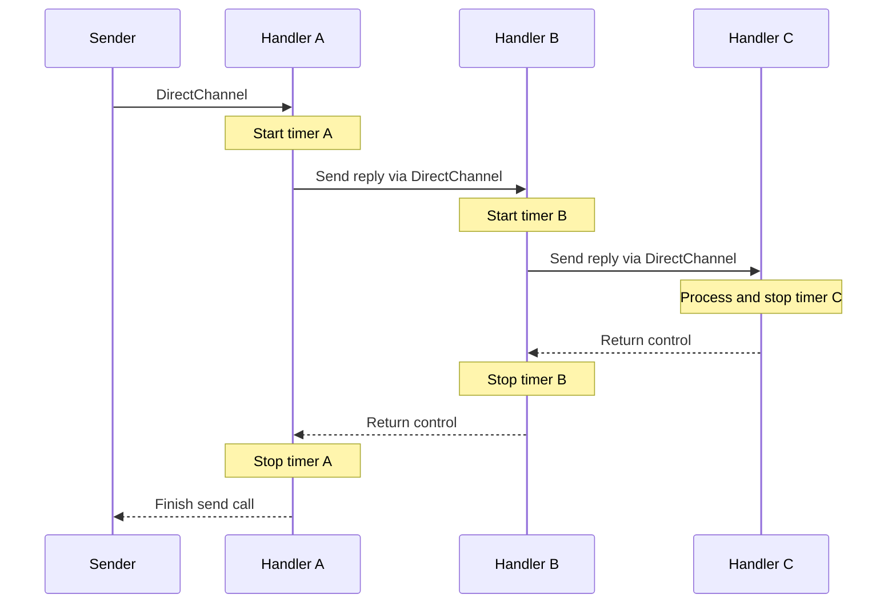

# Handler duration

In the **Metrics and observability** chapter of the **SPRING_INTEGRATION_CORE** module, handler duration helps answer: how long does a single message execution hold the execution flow, and where does that time go?

An integration flow may pass through transformers, filters, routers, service activators, and aggregators. When orders process slowly, looking only at gateway response time is not enough to identify where to investigate. Conversely, seeing a high handler duration and immediately blaming its business method can also lead to fixing the wrong place. To read metrics accurately, determine the **measurement boundary**, **asynchronous boundaries**, and **set of sampled messages**.

After this lesson, you will be able to:

- Explain the duration of a handler invocation and distinguish it from queue wait time, CPU time, and full-flow latency.
- Read a `Timer` via count, total time, mean, and percentiles.
- Configure a Java DSL example with a stable handler name to observe via Micrometer and Actuator.
- Write Prometheus queries for mean latency, p95, and error ratio.
- Isolate slowdowns without double-counting durations or overlooking errors and backlogs.

Examples use Java 17+, Spring Boot 3.5.x, and Spring Integration 6.5.x, with library versions managed by Spring Boot. This is the specific version scope of the example, not a requirement to upgrade your current learning project. You should know `Message`, `MessageChannel`, `DirectChannel`, `QueueChannel`, endpoints, and how to declare an `IntegrationFlow`.

## 1. What does a handler duration sample measure?

For a typical synchronous handler, you can picture the measurement as follows:

```text
t0: instrumented handler execution starts
    message handling, business call, reply creation, downstream send if any
t1: that execution returns or throws an exception

duration = t1 - t0
```

This is elapsed wall time inside the measured boundary. It can include waiting on HTTP, databases, connection pools, locks, or message sends. Thus, a 400 ms duration does not mean the thread consumed CPU continuously for 400 ms.

In Spring Integration 6.5, `AbstractMessageHandler` wraps instrumentation around `doHandleMessage(...)`. If the handler has Observation attached, it uses the Observation branch; otherwise, it can use the direct Micrometer metrics branch. This structure explains why the same handler does not necessarily appear in both metric groups. See [AbstractMessageHandler 6.5.0 source](https://github.com/spring-projects/spring-integration/blob/v6.5.0/spring-integration-core/src/main/java/org/springframework/integration/handler/AbstractMessageHandler.java).

Separate three questions:

| Question | Boundary to observe |
| --- | --- |
| How long did the handler hold the current call? | Handler instrumentation |
| How long did `reserve(...)` itself take? | Timer or span placed around the business method |
| How long from sending the request to receiving the result? | Request–reply boundary at the gateway or full-flow measurement |

All three values can differ even when referring to the same order.

## 2. Duration can include downstream handlers

Consider a synchronous flow:



`DirectChannel` invokes subscribers directly on the sending thread. A reply-producing handler can send its reply right inside the measured execution. When the output channel is also a `DirectChannel`, that send triggers downstream processing before the upstream handler returns. This follows from synchronous dispatch and reply sending, not from a custom dashboard duration formula. See [how DirectChannel dispatches subscribers](https://docs.spring.io/spring-integration/reference/channel/implementations.html#channel-implementations-directchannel) and [AbstractMessageProducingHandler source](https://github.com/spring-projects/spring-integration/blob/v6.5.0/spring-integration-core/src/main/java/org/springframework/integration/handler/AbstractMessageProducingHandler.java).

Suppose the local work of A, B, and C takes 12 ms, 80 ms, and 8 ms respectively. Ignoring overhead, the timers wrapping the calls may record:

| Timer | Observed duration | Interpretation |
| --- | ---: | --- |
| C | About 8 ms | C's execution |
| B | About 88 ms | B plus synchronous call to C |
| A | About 100 ms | A plus downstream synchronous chain |

Summing all three durations into 196 ms double-counts work. Use them to locate the slow call segment, then use child spans, business timers, or a profiler to determine exclusive local time.

Do not subtract p95(B) from p95(A) to compute the p95 of A's own work. The two percentiles may represent different sets of calls. Time subtraction is meaningful only when matching the exact same execution and fully understanding the call structure.

## 3. Asynchronous boundaries change how readings work

Consider two other milestones:

```text
message is placed into queue
        |----- wait time -----|
                              handler starts
                              |--- duration ---|
                                               handler ends
```

A message waiting in a queue for 2 seconds and then processed in 20 ms still produces a handler duration sample near 20 ms. A healthy handler does not guarantee the flow meets response-time goals.

| Flow arrangement | What to check when reading duration |
| --- | --- |
| Input is a `QueueChannel` with a poller | Time spent in the queue before the handler is invoked is not inside that handler's sample |
| Sending to an `ExecutorChannel` | Downstream work usually runs on another thread; observe both the executor and task wait time |
| Handler sends to a full output queue | Time spent waiting to send may still be inside the sending handler's duration |
| Executor uses CallerRuns policy when overloaded | Do not assume every send creates an asynchronous boundary |
| Handler starts a `CompletableFuture` or publisher | Check whether instrumentation stops when returning the handle or when async work actually finishes |

In particular, do not assume every timer around a method returning `Mono` automatically measures until publisher completion. Attach measurement to the appropriate completion lifecycle if your goal is measuring the entire async task.

With an aggregator, the time a message group accumulates until meeting its release condition is also distinct from the duration of each individual handler call. When you need to track group age, add a measurement aligned with group lifecycle.

## 4. Reading a Timer from data, not from a single number

A Micrometer `Timer` records at minimum execution count and total time; the backend and configuration determine additional statistics. Export units depend on the registry, so verify actual units when reading data. See [Micrometer Timer](https://docs.micrometer.io/micrometer/reference/concepts/timers.html).

| Quantity | Meaning when reading handler duration |
| --- | --- |
| `count` | Number of executions recorded in the examined timer |
| `totalTime` / `_sum` | Sum of durations across those executions |
| Mean | Total duration divided by count; must use the same tag set and observation window |
| `max` | Peak value under the timer's rolling window mechanics; do not assume all-time process peak |
| p95, p99 | Estimated threshold covering a percentage of samples; requires distribution data |

Hypothetical example with 1,000 executions:

- 990 executions take 10 ms.
- 10 executions take 1,000 ms.

The mean is:

```text
(990 × 10 + 10 × 1,000) / 1,000 = 19.9 ms
```

A mean under 20 ms still hides 10 executions taking 1 second. In this dataset, p95 is also still near 10 ms; a single percentile alone may miss the tail too. Read percentiles alongside threshold-exceedance ratios, errors, and traffic volume.

In real systems, dashboards usually need a 5-minute windowed average rather than an average since application startup. If a process restarts, cumulative counters reset as well; queries must handle that reset.

## 5. Distinguishing the two metric mechanisms

### 5.1. Direct Micrometer metrics

For supported components, the direct metrics mechanism uses the `spring.integration.send` timer for both channels and handlers. Handler distinguishing labels include:

| Label | Example |
| --- | --- |
| `type` | `handler` |
| `name` | `reserveInventoryHandler` |
| `result` | `success` or `failure` |
| `exception` | `none` or the recorded exception simple class name |

Filter `type=handler` to avoid mixing channel send duration into handler duration. Meters usually appear only after the component is used. See [Micrometer Integration in Spring Integration 6.5](https://docs.spring.io/spring-integration/reference/6.5/metrics.html#micrometer-integration).

### 5.2. Micrometer Observation

When a handler is instrumented with Observation, the completion timer is typically named `spring.integration.handler`. Identifying labels under the default convention are `spring.integration.name` and `spring.integration.type`. Do not apply the `type`, `name`, `result` filters from the previous mechanism verbatim to this metric. See [handler default convention](https://github.com/spring-projects/spring-integration/blob/v6.5.0/spring-integration-core/src/main/java/org/springframework/integration/support/management/observation/DefaultMessageReceiverObservationConvention.java).

In the example below, we explicitly use the direct metrics mechanism. `@EnableIntegrationManagement` does not specify `observationPatterns`; by default the pattern list is empty. Merely having an `ObservationRegistry` in the context does not imply every integration handler is instrumented with Observation. Component selection rules are in [EnableIntegrationManagement Javadoc](https://docs.spring.io/spring-integration/docs/6.5.0/api/org/springframework/integration/config/EnableIntegrationManagement.html).

There is no requirement that the lesson title "Handler duration" correspond to a meter named `handler.duration`. Meter names are governed by the contract of the active instrumentation.

## 6. Java DSL example: observing an inventory reservation handler

### 6.1. Dependencies and observation configuration

In a Spring Boot 3.5.x application with the corresponding parent or BOM, the following dependencies are needed. This is a configuration snippet for learners to place into a practice project, not an entire `pom.xml`:

```xml
<dependencies>
    <dependency>
        <groupId>org.springframework.boot</groupId>
        <artifactId>spring-boot-starter-integration</artifactId>
    </dependency>
    <dependency>
        <groupId>org.springframework.boot</groupId>
        <artifactId>spring-boot-starter-actuator</artifactId>
    </dependency>
    <dependency>
        <groupId>org.springframework.boot</groupId>
        <artifactId>spring-boot-starter-web</artifactId>
    </dependency>
    <dependency>
        <groupId>io.micrometer</groupId>
        <artifactId>micrometer-registry-prometheus</artifactId>
        <scope>runtime</scope>
    </dependency>
</dependencies>
```

`spring-boot-starter-web` provides the HTTP server for Actuator in the example. Practice configuration:

```yaml
spring:
  application:
    name: inventory-integration-demo

management:
  endpoints:
    web:
      exposure:
        include: health,metrics,prometheus
  metrics:
    tags:
      application: inventory-integration-demo
    distribution:
      percentiles-histogram:
        "spring.integration.send": true
      slo:
        "spring.integration.send": 50ms,100ms,200ms,500ms
```

Histograms enable percentile queries; SLO boundaries add buckets at thresholds of interest. Configuring by the name `spring.integration.send` also affects channel timers sharing that prefix; to restrict overhead to one handler, filter by tags using a `MeterFilter` at registry initialization. Spring Boot supports these distribution properties and the `metrics` endpoint to inspect available meters. See [Spring Boot metrics and per-meter configuration](https://docs.spring.io/spring-boot/3.5/reference/actuator/metrics.html#actuator.metrics.customizing.per-meter-properties).

### 6.2. Sample application

Place the following class in a package of your practice application. `Thread.sleep` merely creates observable latency for the lesson; it does not realistically model database or HTTP service performance.

```java
package example.integration;

import java.util.concurrent.TimeUnit;

import io.micrometer.core.instrument.MeterRegistry;
import io.micrometer.core.instrument.Timer;
import org.springframework.beans.factory.annotation.Qualifier;
import org.springframework.boot.ApplicationRunner;
import org.springframework.boot.SpringApplication;
import org.springframework.boot.autoconfigure.SpringBootApplication;
import org.springframework.context.annotation.Bean;
import org.springframework.integration.channel.DirectChannel;
import org.springframework.integration.channel.QueueChannel;
import org.springframework.integration.config.EnableIntegrationManagement;
import org.springframework.integration.dsl.IntegrationFlow;
import org.springframework.integration.handler.ServiceActivatingHandler;
import org.springframework.messaging.Message;
import org.springframework.messaging.MessageChannel;
import org.springframework.messaging.MessagingException;
import org.springframework.messaging.support.MessageBuilder;

@SpringBootApplication
@EnableIntegrationManagement
public class HandlerDurationApplication {

    public static void main(String[] args) {
        SpringApplication.run(HandlerDurationApplication.class, args);
    }

    @Bean
    DirectChannel reservationRequests() {
        return new DirectChannel();
    }

    @Bean
    QueueChannel reservationResults() {
        return new QueueChannel(10);
    }

    @Bean
    InventoryService inventoryService() {
        return new InventoryService();
    }

    @Bean
    ServiceActivatingHandler reserveInventoryHandler(InventoryService service) {
        ServiceActivatingHandler handler =
                new ServiceActivatingHandler(service, "reserve");
        handler.setRequiresReply(true);
        handler.setSendTimeout(1_000);
        return handler;
    }

    @Bean
    IntegrationFlow reservationFlow(
            ServiceActivatingHandler reserveInventoryHandler) {
        return IntegrationFlow.from("reservationRequests")
                .handle(reserveInventoryHandler,
                        endpoint -> endpoint.id("reserveInventoryEndpoint"))
                .channel("reservationResults")
                .get();
    }

    @Bean
    ApplicationRunner demo(
            @Qualifier("reservationRequests") MessageChannel requests,
            @Qualifier("reservationResults") QueueChannel results,
            MeterRegistry registry) {
        return args -> {
            requests.send(MessageBuilder
                    .withPayload(new Order("ORDER-1", 2, 40))
                    .build());
            requests.send(MessageBuilder
                    .withPayload(new Order("ORDER-2", 1, 250))
                    .build());

            for (int i = 0; i < 2; i++) {
                Message<?> reply = results.receive(1_000);
                if (reply == null) {
                    throw new IllegalStateException("Missing reservation reply");
                }
                System.out.println(reply.getPayload());
            }

            try {
                requests.send(MessageBuilder
                        .withPayload(new Order("ORDER-INVALID", 0, 0))
                        .build());
                throw new IllegalStateException("Expected validation failure");
            }
            catch (MessagingException expected) {
                System.out.println("Validation failure reached the sender");
            }

            for (Timer timer : registry.find("spring.integration.send")
                    .tag("type", "handler")
                    .tag("name", "reserveInventoryHandler")
                    .timers()) {
                System.out.printf(
                        "result=%s exception=%s count=%d meanMs=%.2f%n",
                        timer.getId().getTag("result"),
                        timer.getId().getTag("exception"),
                        timer.count(),
                        timer.mean(TimeUnit.MILLISECONDS));
            }
        };
    }

    public record Order(String orderId, int quantity, long delayMillis) {
    }

    public record Reservation(String orderId, String status) {
    }

    public static class InventoryService {
        public Reservation reserve(Order order) {
            if (order.quantity() <= 0) {
                throw new IllegalArgumentException("quantity must be positive");
            }
            try {
                Thread.sleep(order.delayMillis());
            }
            catch (InterruptedException ex) {
                Thread.currentThread().interrupt();
                throw new IllegalStateException("Reservation interrupted", ex);
            }
            return new Reservation(order.orderId(), "RESERVED");
        }
    }
}
```

Execution flow:

```text
ApplicationRunner
    -> reservationRequests (DirectChannel)
    -> reserveInventoryHandler
    -> reservationResults (QueueChannel)
    -> ApplicationRunner actively receives results
```

The handler is a dedicated bean named `reserveInventoryHandler`; the endpoint has ID `reserveInventoryEndpoint`. These two objects serve different roles. Creating an explicitly named handler bean helps select the exact series without relying on auto-generated names when editing the DSL chain. How the DSL registers endpoints and handlers can be checked in [IntegrationFlowBeanPostProcessor](https://github.com/spring-projects/spring-integration/blob/v6.5.0/spring-integration-core/src/main/java/org/springframework/integration/dsl/context/IntegrationFlowBeanPostProcessor.java).

The output is a queue so that receiving and printing results in the runner does not become a synchronous chain behind the handler. In this example, the queue has enough capacity for two replies; if a queue fills in another variant, waiting to send can affect duration.

After the runner completes on a fresh process, expect to observe two successes and one failure for this handler. The success group's mean lies in the neighborhood of 40 ms and 250 ms plus overhead; do not demand an exact 145 ms reading. Messaging-layer exceptions may wrap business exceptions, so do not assume the `exception` tag is always `IllegalArgumentException`.

### 6.3. Inspecting the exact meter on Actuator

Open the meter list first, then filter the timer:

```http
GET http://localhost:8080/actuator/metrics

GET http://localhost:8080/actuator/metrics/spring.integration.send?tag=type:handler&tag=name:reserveInventoryHandler

GET http://localhost:8080/actuator/metrics/spring.integration.send?tag=type:handler&tag=name:reserveInventoryHandler&tag=result:success

GET http://localhost:8080/actuator/prometheus
```

Querying without filtering `result` aggregates timers matching the label set; when reading max statistics, do not treat that aggregated value as the sole max across all calls. To read distributions across multiple series, use an appropriate histogram query.

In Prometheus under standard conventions, look for these names:

```text
spring_integration_send_seconds_count
spring_integration_send_seconds_sum
spring_integration_send_seconds_bucket
```

Check actual names and labels on the endpoint before building dashboards. Actuator `metrics` still uses dot-separated Micrometer names; Prometheus typically converts them to underscores and uses seconds for durations.

## 7. Querying duration in Prometheus

The following examples use the classic histogram from the configuration above. Assume Prometheus has scraped the application and all instances export the same metric name, labels, and bucket configuration.

### 7.1. Mean over a 5-minute window

```promql
1000 *
sum by (application, name) (
  rate(spring_integration_send_seconds_sum{
    application="inventory-integration-demo",
    type="handler",
    name="reserveInventoryHandler"
  }[5m])
)
/
sum by (application, name) (
  rate(spring_integration_send_seconds_count{
    application="inventory-integration-demo",
    type="handler",
    name="reserveInventoryHandler"
  }[5m])
)
```

The result is in milliseconds because of multiplying by 1,000. The query combines both successes and failures. If you want only the success group, add `result="success"` to **both the numerator and denominator**.

Taking `rate` on each series before summing handles per-instance counter resets. Do not take an unweighted average of per-pod means: a pod with 10 executions should not carry the same weight as a pod with 10,000 executions.

If there are no executions in the window, the denominator can be 0 or missing data. Dashboards should display a no-samples state; replacing it with "0 ms, healthy" hides a lack of incoming traffic.

### 7.2. p95 of successful executions

```promql
1000 * histogram_quantile(
  0.95,
  sum by (application, name, le) (
    rate(spring_integration_send_seconds_bucket{
      application="inventory-integration-demo",
      type="handler",
      name="reserveInventoryHandler",
      result="success"
    }[5m])
  )
)
```

Keep the `le` label when aggregating classic histograms. This is a quantile estimated from buckets, not the exact duration of a specific message. Histograms allow aggregating distributions across instances; client-computed percentiles cannot be properly aggregated by averaging per-instance p95 values. See [Micrometer histograms and percentiles](https://docs.micrometer.io/micrometer/reference/concepts/histogram-quantiles.html).

### 7.3. Success ratio completing within 200 ms

Using the configured 200 ms SLO bucket:

```promql
sum by (application, name) (
  rate(spring_integration_send_seconds_bucket{
    application="inventory-integration-demo",
    type="handler",
    name="reserveInventoryHandler",
    result="success",
    le="0.2"
  }[5m])
)
/
sum by (application, name) (
  rate(spring_integration_send_seconds_count{
    application="inventory-integration-demo",
    type="handler",
    name="reserveInventoryHandler",
    result="success"
  }[5m])
)
```

The result lies in 0–1 when samples exist. This is the fast ratio within the **success group**. If you want to define "succeeded and fast out of all requests", keep the numerator and drop the `result="success"` filter in the denominator. The two definitions serve two different operational questions.

Classic histogram buckets are cumulative: the 200 ms bucket already includes samples faster than 50 ms and 100 ms. Do not add three buckets together to count samples under 200 ms. See [interpreting histograms in Prometheus](https://prometheus.io/docs/practices/histograms/).

### 7.4. Error rate must be read alongside latency

```promql
sum by (application, name) (
  rate(spring_integration_send_seconds_count{
    application="inventory-integration-demo",
    type="handler",
    name="reserveInventoryHandler",
    result="failure"
  }[5m])
)
/
sum by (application, name) (
  rate(spring_integration_send_seconds_count{
    application="inventory-integration-demo",
    type="handler",
    name="reserveInventoryHandler"
  }[5m])
)
```

The failure series may not exist before the first error; panels must distinguish that from losing all scrape data. Do not treat the absence of all metrics as proof of a 0 error rate.

For instance, a broken dependency rejecting requests in 2 ms can sharply drop mean duration. That is not a performance improvement if error rate climbs from 0.1% to 50%.

## 8. When switching the example to Observation

To select just this example's handler, replace the management annotation with:

```java
@EnableIntegrationManagement(
        observationPatterns = "reserveInventoryHandler")
```

The application also needs an `ObservationRegistry` and an observation handler that produces the corresponding metrics. In a typical Spring Boot Actuator setup, this infrastructure is auto-configured. In plain Spring, register them completely rather than creating an empty registry.

After this change, look for `spring.integration.handler` and label `spring.integration.name=reserveInventoryHandler`. On a fresh instance, the direct timer for the Observation-selected handler may no longer appear as before; replace the direct-timer printing block in the runner with the corresponding Observation query.

Example reading the completion timer in Java:

```java
for (Timer timer : registry.find("spring.integration.handler")
        .tag("spring.integration.name", "reserveInventoryHandler")
        .tag("spring.integration.type", "handler")
        .timers()) {
    System.out.println(timer.getId());
    System.out.println(timer.mean(TimeUnit.MILLISECONDS));
}
```

Also update histogram and SLO configuration keys to `spring.integration.handler`. Under typical Prometheus conventions, the duration name becomes `spring_integration_handler_seconds_*`, and identifying labels become `spring_integration_name` and `spring_integration_type`.

Do not copy the earlier error-ratio query using `result="failure"` here and assume it works. Inspect the actual error labels emitted by your observation handler/convention; Spring Integration's naming convention does not promise the full direct-metrics label set.

In addition to the completion timer, Observation documentation describes `spring.integration.handler.active` as a long task timer. This provides a way to observe in-flight calls, depending on the configured observation handler and registry. See [Spring Integration Observation metrics](https://docs.spring.io/spring-integration/reference/6.5/metrics.html#observation-metrics).

Standard timers update only after execution finishes. A hanging handler does not immediately raise the current p95. A long task timer offers visibility into active work without replacing the distribution of completed work. See [Micrometer Long Task Timers](https://docs.micrometer.io/micrometer/reference/concepts/long-task-timers.html).

Metrics and traces complement each other: metrics tell you how often a phenomenon occurs; a trace of a slow message shows which steps it took. If a flow crosses threads, ensure context propagation matches your infrastructure before expecting traces to link the entire flow.

## 9. Measuring business logic separately when a narrower boundary is needed

If the goal is timing the inventory call itself, wrap that specific business operation in a dedicated timer. The snippet below shows a method inside a class that already holds `MeterRegistry registry`; `client` is the dependency making the synchronous call:

```java
public Reservation reserveWithBusinessTimer(Order order) {
    Timer.Sample sample = Timer.start(registry);
    String outcome = "failure";
    try {
        Reservation reservation = client.reserve(order);
        outcome = "success";
        return reservation;
    }
    finally {
        sample.stop(Timer.builder("inventory.reservation.duration")
                .description("Duration of the synchronous inventory operation")
                .tag("operation", "reserve")
                .tag("outcome", outcome)
                .register(registry));
    }
}
```

The `Order` and `Reservation` types can come from the earlier example; `client` should be replaced by the real application client. `finally` guarantees the exception branch still stops the sample. This timer answers a narrower question than the timer wrapping the integration handler, so give it a distinct name and define it clearly on dashboards.

Keep tag value sets bounded: `operation=reserve`, `outcome=success|failure` is better than using order IDs. Putting `orderId`, message ID, trace ID, customer name, or full error messages into tags causes series count to grow with incoming data. Use structured logs or traces to inspect individual messages.

Do not rename a custom timer to `spring.integration.send` to "merge" it with the framework. Mixing two measurement boundaries makes counts and distributions meaningless. Likewise, when adding `@Timed` to a method, annotation support infrastructure is required and the measurement boundary must be defined explicitly; the annotation itself does not alter Spring Integration's timer definitions.

For asynchronous tasks, `finally` in a future-returning method usually runs before the future completes. Stop the sample in the completion callback instead, stopping it exactly once and handling both success and failure. Do not reuse this synchronous snippet verbatim to measure an entire async task.

## 10. Errors, retries, and business outcomes

Duration measures the time of an execution boundary; success/failure labels reflect how that boundary terminated. Cross-check business outcomes as well.

| Scenario | How to read metrics |
| --- | --- |
| Business logic throws an exception out of the handler | Failed durations still need observation; inspect root cause in logs/traces |
| Business logic catches error and returns `Reservation(..., "REJECTED")` | Technical call can succeed even though business rejected the request |
| Recovery handles exception and returns fallback | Success at outer boundary does not guarantee dependency health |
| Retry sits inside one handler execution | One duration sample may span multiple attempts and backoff sleeps |
| Message is returned to a queue for reprocessing | Can generate multiple handler calls for the same business message |
| Handler A receives an error from B via synchronous chain | A can record a failure even though root cause sits in B |

Hypothetical example where one outer execution wraps three attempts of 100 ms each and two 200 ms backoffs:

```text
outer duration ≈ 100 + 200 + 100 + 200 + 100 = 700 ms
```

Looking only at outer boundary count, you might see one execution while the dependency received three calls. Before comparing counts to order volume, determine where retries sit and whether metrics count attempts or handler invocations.

With `DirectChannel`, exceptions can propagate to the sender as in the example. With pollers or executors, monitor the corresponding error routing and `errorChannel`; do not assume every async error surfaces at the initial sender.

## 11. Investigation procedure when handler duration increases

1. **Identify the meter and boundary.** Are you using direct metrics or Observation? Is the series a channel, handler, or gateway? Did config or bean names change after deployment?
2. **Check sample volume.** Compare traffic, completion counts, error ratio, and query window. A p99 from a handful of samples has limited diagnostic value.
3. **Check wait points before the handler.** Inspect queue depth, message age, and executor backlog. Low duration does not rule out upstream congestion.
4. **Check the synchronous chain downstream.** Is an upstream handler waiting on a downstream router, HTTP handler, or database handler? Use traces to correlate the exact same message.
5. **Check resources.** Inspect HTTP timeouts, connection pools, locks, CPU, GC, and retries. Adding threads does not fix an overloaded dependency.
6. **Verify results after changes.** Compare under equivalent load, checking latency distribution, errors, and backlogs to avoid unintended trade-offs.

A reference table helps guide next investigation steps:

| Observation | Hypothesis to check |
| --- | --- |
| Low duration, slow gateway, growing queue | Messages are waiting before being processed |
| Duration increases, low CPU | Waiting on I/O, pools, locks, or backoffs |
| Duration increases, high CPU | Heavy computation, serialization/deserialization, loops, or GC pressure |
| Both A and B rise in a `DirectChannel` chain | A may be including increased latency from B |
| Duration drops, errors rise | Fast failures or fallbacks are changing the outcome mix |
| Completion count stops rising while requests arrive | Work may be hung; check active tasks and threads |

These are hypotheses to guide evidence gathering, not automatic conclusions from a single chart.

## 12. Hands-on exercises to verify measurement boundaries

Perform these on a copy of the practice application, changing one variable per hypothesis:

1. Run the baseline example and identify the exact labels for `reserveInventoryHandler`. Inspect success and failure groups separately without merging channel into handler.
2. Increase simulated latency for one order from 250 ms to 1,000 ms. Observe total duration and distribution after the call completes; do not expect p95 from three samples to behave like real production load.
3. Add a slow synchronous handler after the inventory handler. Predict the upstream timer increase and compare against actual measurements.
4. Insert a queue and poller between the two steps, continuing to observe both full-flow latency and the queue. Do not use a drop in the upstream timer to conclude the overall flow got faster.
5. Trigger a business error and a recovery case. Compare technical completion against the business status in the payload.

When writing instrumentation tests, focus on verifying meter name, tags, expected count increments, and that exceptions still record samples. For custom timing components, use a controllable clock to test durations. Avoid assertions like "duration must be exactly 40 ms" on real machines because CPU scheduling, JVM warmup, and I/O introduce variance.

A useful handler dashboard places side by side: completion rate, mean and p95 latency, error ratio, and queue depth/age or executor saturation at related boundaries. Clearly label which panels measure the handler alone and which measure the entire request–reply path. Consistent boundaries ensure metrics point to the right investigation action.