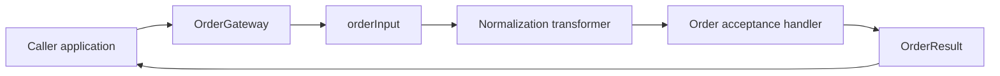
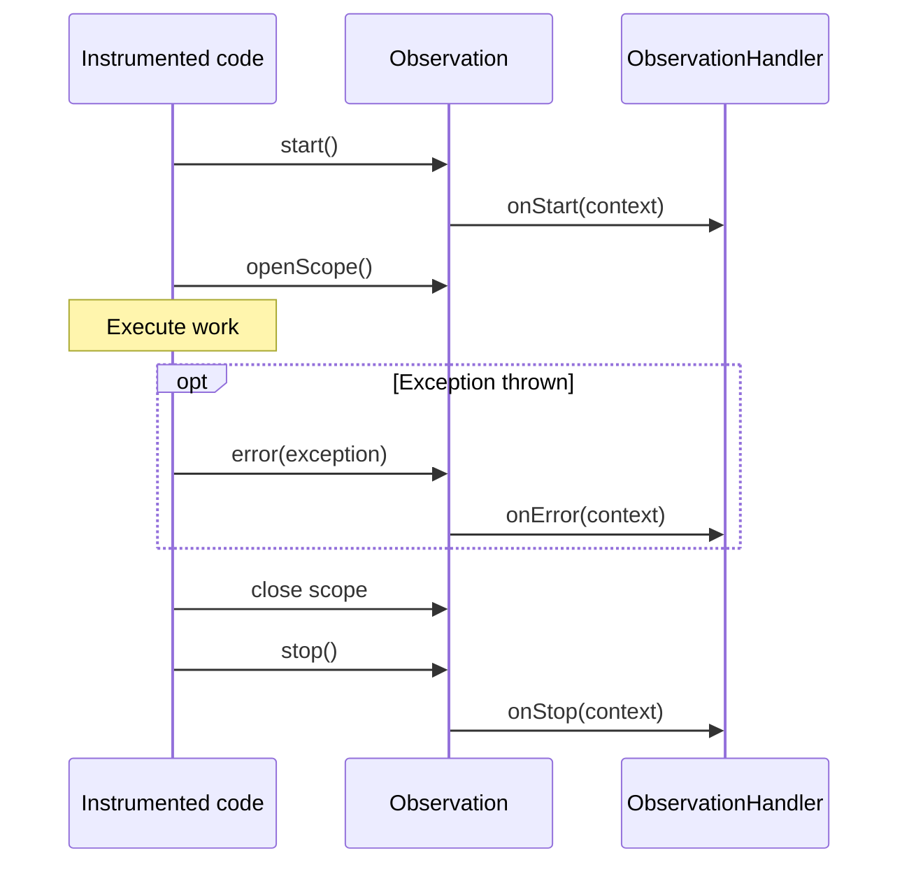
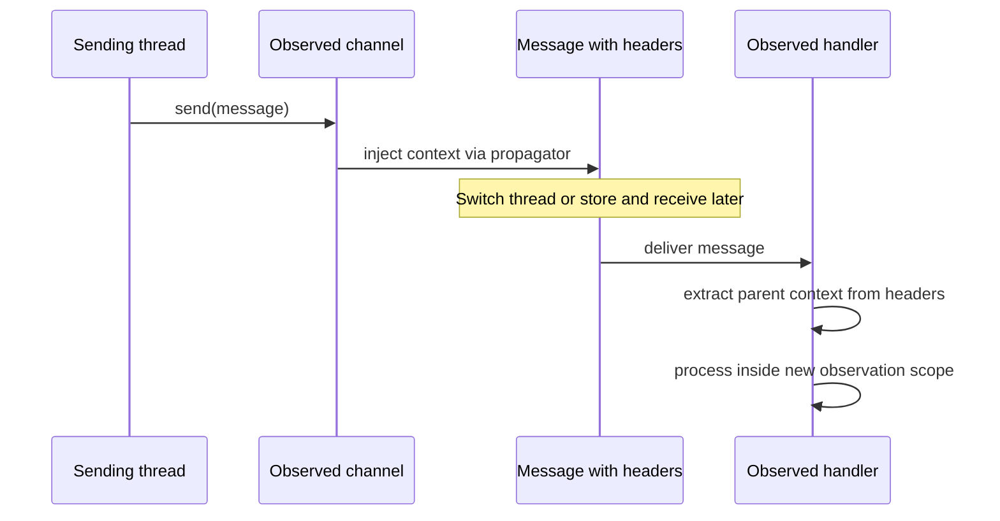

# Observation in a message flow

## 1. Objectives and scope

In the **Metrics and observability** chapter of **SPRING_INTEGRATION_CORE**, this lesson explains how to use Micrometer Observation to observe message flows passing through gateways, channels, and handlers. The goal is to relate observed data to Spring Integration's execution structure: knowing which component ran, what work a measurement covers, and why traces can break across thread switches.

After this lesson, you will be able to:

- Distinguish `Observation`, metrics, spans, and the current active scope.
- Configure `ObservationRegistry` and select Spring Integration components to observe.
- Write a Java DSL flow with a gateway, transformer, and service activator to inspect observed measurements.
- Explain trace context propagation across synchronous channels, asynchronous channels, and system boundaries.
- Design additional business metadata, handle errors, and test the Observation lifecycle.

You should know `Message<?>`, message headers, `DirectChannel`, `ExecutorChannel`, gateways, and Java DSL. Examples target **Java 17 or higher and Spring Integration 6.5.x APIs**. Your learning project should manage compatible Spring and Micrometer versions via a BOM; do not mix arbitrary library versions.

## 2. From a slow order to answerable questions

Suppose an application receives orders through a gateway, normalizes data, validates, and returns a result:



When users report a slow operation, a log line saying "order received" is not enough to identify the cause. Separate distinct questions:

| Operational question | Appropriate data |
| --- | --- |
| How did throughput and latency change over ten minutes? | Aggregated metrics by component, operation type, and outcome |
| Which steps did a specific call pass through? | Trace consisting of related spans |
| Which rule caused the handler to reject the order? | Logs or business events with an appropriate reason code |
| How many orders were ultimately accepted? | Business measurement at the result confirmation point |

A single message can pass through multiple handlers. A single request can spawn multiple messages via split, retry, or fan-out. Thus, counting technical flow activity is not enough to infer successful business transactions.

### 2.1. Observation is a hook for recording an activity

`Observation` describes the lifecycle of an activity along with its associated context. `ObservationRegistry` is where recipients of that activity are configured. An `ObservationHandler` can turn start, stop, or error signals into metrics or tracing data. These concepts and signals are described in [Micrometer Observation Introduction](https://docs.micrometer.io/micrometer/reference/observation/introduction.html).

Picture one handler invocation:

```text
Receive message
  -> start Observation
  -> execute handler
  -> record error if any
  -> stop Observation
```

From the same measurement site, an application can serve multiple needs. However, configuring metric creation alone does not mean tracing exists, and having in-memory traces does not mean data is exported to a storage backend.

### 2.2. Distinguishing the two registries

| Component | Responsibility |
| --- | --- |
| `ObservationRegistry` | Coordinates the Observation lifecycle and observation handlers |
| `MeterRegistry` | Manages meters such as timers, counters, and gauges |
| Tracer and propagator | Creates spans, establishes trace relationships, injects and extracts context from carriers |
| Exporter or reporter | Ships data to the corresponding collection backend |

`DefaultMeterObservationHandler` bridges Observation to `MeterRegistry`. In the hands-on example, we use this handler with `SimpleMeterRegistry` to view data in-process. How they connect is presented in [Micrometer Observation Components](https://docs.micrometer.io/micrometer/reference/observation/components.html).

## 3. Observation lifecycle and scope

Two concepts to keep separate are **activity lifetime** and **the activity currently active in the executing code block**.

- `start()` begins the measured activity.
- `openScope()` places the Observation into the current scope so inner code can find it.
- Closing the scope restores the previous scope.
- `error(exception)` records an error; this call itself does not rethrow the exception.
- `stop()` ends the measurement.

Closing the scope does not replace `stop()`. Conversely, calling `stop()` does not replace properly closing the scope. Ensure both steps when managing lifecycle manually. See [Micrometer's lifecycle and scope description](https://docs.micrometer.io/micrometer/reference/observation/introduction.html).



For synchronous work, you can use `observe(...)` to manage standard steps:

```java
Observation.createNotStarted("orders.validate", observationRegistry)
        .lowCardinalityKeyValue("order.kind", "standard")
        .observe(() -> validate(order));
```

This snippet illustrates code inside a class that already has `observationRegistry`, `order`, and `validate`. If the lambda body finishes while the actual work continues in another task, this measurement boundary covers only the lambda. You must separately design context propagation and async completion timing.

## 4. Observation boundaries in Spring Integration

Spring Integration has supported Micrometer Observation since the 6.0 line. Under the corresponding default configuration, the major operation groups are:

| Operation group | Default Observation name | Span kind |
| --- | --- | --- |
| Gateway receiving request and replying | `spring.integration.gateway` | `SERVER` |
| Sending through a channel | `spring.integration.producer` | `PRODUCER` |
| Handling at a message handler | `spring.integration.handler` | `CONSUMER` |

Timers may be accompanied by long task timers with the `.active` suffix. Component-identifying metadata includes `spring.integration.name` and `spring.integration.type`; gateways also include `spring.integration.outcome`. Reference: [Spring Integration 6.5: Metrics and Management](https://docs.spring.io/spring-integration/reference/6.5/metrics.html).

Do not infer span kind solely from Java class names. For instance, an inbound endpoint pulling external data into a flow has a different perspective from sending a message over an internal channel. In this lesson, stick to the boundaries of receiving requests, sending messages, and executing handlers.

### 4.1. Reading durations according to channel mechanics

Suppose the transformer takes 2 ms and the final handler takes 18 ms. Ignoring overhead for illustration:

```text
DirectChannel:
  caller -> send -> transformer -> handler -> return to caller

ExecutorChannel:
  caller -> send -> submit task to executor -> return
                         worker -> transformer -> handler
```

With `DirectChannel`, subscribers run directly on the calling thread. The `send()` duration can include downstream work in the synchronous chain. With `ExecutorChannel`, the send operation can finish before the worker finishes processing. This execution threading also determines how exceptions return to the sender, as explained in [Spring Integration: Error Handling](https://docs.spring.io/spring-integration/reference/6.5/error-handling.html).

Key conclusions from the example:

- Do not sum nested timers to compute total request duration. The 18 ms work may already be inside the outer 20 ms measurement.
- A short producer timer on an asynchronous channel does not prove the system processes fast; work may be waiting in an executor or queue.
- Span lifetime and parent–child relationships are two different pieces of information. A child span in asynchronous processing can continue after the sending span has ended.
- `*.active` represents in-flight instrumented activities, not a replacement for measuring queued message counts.

If you need to measure queue wait time, clearly define the enqueue timestamp, processing-start timestamp, and how to correlate them. Do not attach "whole-system latency" meaning to a timer covering only a send operation.

## 5. Enabling Observation on the right components

A clear learning configuration consists of:

1. A shared `ObservationRegistry` in the application context.
2. Observation handlers matching the types of telemetry to collect.
3. Spring Integration management configuration selecting which components receive the registry.

In plain Spring, the following annotation is the direct starting point:

```java
@EnableIntegrationManagement(observationPatterns = "*")
```

`observationPatterns` defaults to empty; `"*"` selects all eligible integration components. When narrowing scope, patterns match component names, not payload class names or message contents. See [EnableIntegrationManagement 6.5 Javadoc](https://docs.spring.io/spring-integration/docs/6.5.0/api/org/springframework/integration/config/EnableIntegrationManagement.html).

For example, after inspecting actual names of the gateway, channel, and handlers, you can use:

```java
@EnableIntegrationManagement(observationPatterns = {
        "orderGateway*",
        "orderInput",
        "normalizeOrder*",
        "acceptOrder*",
        "orderFlow*"
})
```

This is a name-group selection example, not a guaranteed list covering every component generated by every DSL version. When changing flow structure or adding async channels, re-verify components at send and receive boundaries.

An endpoint ID declared in the DSL can differ from the inner handler bean name. Therefore, the reliable check is inspecting actual tags on meters or actual contexts on Observations before locking down patterns and dashboard queries.

### 5.1. Notes for Spring Boot

In a Boot application with auto-configured observability infrastructure, use the provided registry and inspect existing settings. The plain Spring example below creates registries manually to make the mechanics explicit; do not copy that infrastructure into a running Boot application.

Boot supports registering beans such as `ObservationHandler`, `ObservationFilter`, and conventions into the registry. Extending built-in infrastructure is described in [Spring Boot: Observability](https://docs.spring.io/spring-boot/reference/actuator/observability.html). Trace collection also depends on the tracing bridge, exporter, and version-appropriate configuration.

## 6. Complete example: observing an order processing flow

### 6.1. Example dependencies

The POM snippet below assumes the project already has dependency management compatible with the version baseline stated earlier. This is the added dependencies section, not a full `pom.xml`:

```xml
<dependencies>
    <dependency>
        <groupId>org.springframework.integration</groupId>
        <artifactId>spring-integration-core</artifactId>
    </dependency>
    <dependency>
        <groupId>io.micrometer</groupId>
        <artifactId>micrometer-core</artifactId>
    </dependency>
</dependencies>
```

The example uses `SimpleMeterRegistry`, so no monitoring backend is needed to read timers. Tracing libraries and exporters are outside this metric demo.

### 6.2. Demonstration source code

Place the entire snippet below in an example file `OrderObservationDemo.java` in package `example.integration`. `FlowConfig` holds the business flow; `DemoConfig` supplies observation infrastructure for the demo program.

```java
package example.integration;

import java.math.BigDecimal;

import io.micrometer.core.instrument.MeterRegistry;
import io.micrometer.core.instrument.observation.DefaultMeterObservationHandler;
import io.micrometer.core.instrument.simple.SimpleMeterRegistry;
import io.micrometer.observation.ObservationRegistry;

import org.springframework.context.annotation.AnnotationConfigApplicationContext;
import org.springframework.context.annotation.Bean;
import org.springframework.context.annotation.Configuration;
import org.springframework.context.annotation.Import;
import org.springframework.integration.channel.DirectChannel;
import org.springframework.integration.config.EnableIntegration;
import org.springframework.integration.config.EnableIntegrationManagement;
import org.springframework.integration.dsl.IntegrationFlow;

public class OrderObservationDemo {

    public record Order(String id, BigDecimal amount) {
    }

    public record OrderResult(String orderId, String status) {
    }

    public interface OrderGateway {
        OrderResult submit(Order order);
    }

    @Configuration(proxyBeanMethods = false)
    @EnableIntegration
    @EnableIntegrationManagement(observationPatterns = "*")
    public static class FlowConfig {

        @Bean
        public DirectChannel orderInput() {
            return new DirectChannel();
        }

        @Bean
        public IntegrationFlow orderFlow(DirectChannel orderInput) {
            return IntegrationFlow
                    .from(OrderGateway.class,
                            gateway -> gateway.beanName("orderGateway")
                                    .replyTimeout(2_000L))
                    .channel(orderInput)
                    .<Order, Order>transform(
                            order -> new Order(order.id().strip(), order.amount()),
                            endpoint -> endpoint.id("normalizeOrder"))
                    .<Order>handle((order, headers) -> {
                        if (order.amount().signum() <= 0) {
                            throw new IllegalArgumentException(
                                    "Order amount must be positive");
                        }
                        return new OrderResult(order.id(), "ACCEPTED");
                    }, endpoint -> endpoint.id("acceptOrder"))
                    .get();
        }
    }

    @Configuration(proxyBeanMethods = false)
    @Import(FlowConfig.class)
    public static class DemoConfig {

        @Bean
        public MeterRegistry meterRegistry() {
            return new SimpleMeterRegistry();
        }

        @Bean
        public ObservationRegistry observationRegistry(MeterRegistry meters) {
            ObservationRegistry registry = ObservationRegistry.create();
            registry.observationConfig().observationHandler(
                    new DefaultMeterObservationHandler(meters));
            return registry;
        }
    }

    public static void main(String[] args) {
        try (AnnotationConfigApplicationContext context =
                     new AnnotationConfigApplicationContext(DemoConfig.class)) {

            OrderGateway gateway = context.getBean(OrderGateway.class);
            MeterRegistry meters = context.getBean(MeterRegistry.class);

            OrderResult result = gateway.submit(
                    new Order(" ORD-001 ", new BigDecimal("125000")));
            System.out.println(result);

            meters.find("spring.integration.producer")
                    .tag("spring.integration.name", "orderInput")
                    .timers()
                    .forEach(timer -> System.out.println(
                            "orderInput tags=" + timer.getId().getTags()
                                    + ", count=" + timer.count()));

            meters.getMeters().stream()
                    .filter(meter -> meter.getId().getName()
                            .startsWith("spring.integration."))
                    .forEach(meter -> System.out.println(meter.getId()));
        }
    }
```

Here Java DSL creates a gateway proxy from the interface and feeds requests into the flow. Starting a flow from an interface and customizing gateway names is covered in [Spring Integration: IntegrationFlow as a Gateway](https://docs.spring.io/spring-integration/reference/6.5/dsl/integration-flow-as-gateway.html).

### 6.3. What to observe when running the example

The business result should be:

```text
OrderResult[orderId=ORD-001, status=ACCEPTED]
```

After the first successful call, the producer timer of `orderInput` has one recorded execution for the corresponding tag combination. The meter list also reveals the gateway and handlers. Do not hardcode a fixed timing value as an expected result: durations depend on hardware, class loading, and load at runtime.

Notice three points:

1. `orderInput` is a channel with an explicit bean name, making it easy to query by tag.
2. `normalizeOrder` and `acceptOrder` are endpoint IDs; read the actual handler names from printed output.
3. One gateway call generates multiple technical activities. Do not sum counts across all meters to count orders.

No tracing handler is added in this example, so expected outputs are in-memory metrics. To verify trace relationships, add tracing infrastructure and inspect spans in the corresponding backend.

### 6.4. Timers do not replace business counters

If the flow later adds a router, each branch may execute a different number of steps. If a splitter is added, one order with multiple line items can trigger handlers multiple times. If retries occur, one job may be retried.

Therefore, define business counting at a clear boundary, such as "order confirmed after result persistence succeeds". You must also define duplicate-message handling before treating this count as unique orders.

## 7. Adding an Observation for a business operation

Built-in Observations help identify slow components. When a handler performs multiple tasks, you may want to measure a specific stage separately, such as computing final pricing or checking limits.

The example below is a standalone extension class using the demo's data types. It measures order acceptance under a stable business name:

```java
package example.integration;

import io.micrometer.observation.Observation;
import io.micrometer.observation.ObservationRegistry;

import example.integration.OrderObservationDemo.Order;
import example.integration.OrderObservationDemo.OrderResult;

public class ObservedOrderService {

    private final ObservationRegistry registry;

    public ObservedOrderService(ObservationRegistry registry) {
        this.registry = registry;
    }

    public OrderResult accept(Order order) {
        return Observation.createNotStarted("orders.accept", registry)
                .lowCardinalityKeyValue("order.kind", "standard")
                .highCardinalityKeyValue("order.id", order.id())
                .observe(() -> {
                    if (order.amount().signum() <= 0) {
                        throw new IllegalArgumentException(
                                "Order amount must be positive");
                    }
                    return new OrderResult(order.id(), "ACCEPTED");
                });
    }
}
```

To use this variant in `FlowConfig`, add a bean:

```java
@Bean
public ObservedOrderService observedOrderService(ObservationRegistry registry) {
    return new ObservedOrderService(registry);
}
```

Then add `ObservedOrderService service` as a parameter to `orderFlow`, and replace the final `.handle(...)` step with:

```java
.handle(service, "accept", endpoint -> endpoint.id("acceptOrder"))
```

The handler's Observation wraps endpoint execution; `orders.accept` marks the business boundary inside. Add this measurement only if it helps analyze work or produces a needed operational signal. For a method that merely repeats an existing boundary without adding information, an extra measurement only clutters telemetry.

If you need to change naming conventions and metadata for a context type, explore `ObservationConvention`. Convention changes must fit the component's context type and retain keys needed by shared queries. Do not use a global convention to strip identifying metadata from every flow.

## 8. Choosing tags: useful for queries and controlling cardinality

A tag's cardinality reflects how many distinct values can appear. With multiple tags, combinations can grow much faster than any single tag. For example, three dimensions with 4, 5, and 10 values can yield up to 200 combinations before adding other tags.

Micrometer distinguishes **low cardinality** from **high cardinality**. In standard observability infrastructure, low-cardinality tags feed metrics and traces; high-cardinality tags feed traces only, not metric labels. See [Spring Boot: Observability, key-value rules](https://docs.spring.io/spring-boot/reference/actuator/observability.html).

| Suggested data | Usage in example |
| --- | --- |
| Order type from fixed list | Low cardinality, e.g., `standard`, `express` |
| Intake channel from fixed list | Low cardinality, e.g., `web`, `mobile`, `partner` |
| Normalized outcome group | Low cardinality, e.g., `accepted`, `rejected` |
| Specific order ID | High cardinality if genuinely needed for tracing |
| Full payload or free-form exception text | Never use as a metric label |

In `ObservedOrderService`, every order uses the name `orders.accept`. Never generate names like `orders.accept.ORD-001`. Component names should also stay stable across messages; do not create flows or handlers per order ID just to separate measurements.

`order.id` in the example is synthetic data for learning. In production systems, pick attributes compliant with your application's data policy. Whether a value is high cardinality does not by itself decide whether it is safe to export to tracing backends.

When adding metadata known only after execution completes, remember that in-flight measurements and completed measurements read tags at different times. Do not expect identical tag sets if a tag is added only at the end of work.

## 9. Propagating context across threads or system boundaries

### 9.1. Tracing context vs. business correlation info

The following values serve different purposes:

| Value | Role |
| --- | --- |
| Order ID | Identifies a business entity |
| Message correlation ID | Links messages according to application rules or integration patterns |
| Trace ID and span ID | Identifies an execution and trace relationships |
| Logging MDC | Attaches contextual info to logs within a configured execution scope |

Setting a `correlationId` header does not automatically create a distributed trace. Likewise, copying a trace ID string into MDC does not guarantee the tracer established the right parent span.

### 9.2. Propagating across messages requires both sender and receiver

With proper tracing support, the sender can inject trace context into message headers; the receiver extracts context from headers to continue observation continuity. For Spring Integration, Observation must be enabled on both the relevant channel and consumer. `MessageSenderContext` and `MessageReceiverContext` serve these two sides. See [Spring Integration 6.5: Observation Propagation](https://docs.spring.io/spring-integration/reference/6.5/metrics.html#observation-propagation).



Practical conditions to verify include:

- The active registry has the required tracing handlers for sender and receiver.
- Components at the handoff boundary are selected by observation configuration.
- Headers are preserved or mapped properly across adapters, brokers, or serializers.
- Both sides use compatible propagation mechanisms.

Sender and receiver context handlers and how they coordinate are described in [Micrometer Tracing: Configuring with Observation](https://docs.micrometer.io/tracing/reference/configuring.html). A `DefaultMeterObservationHandler` only provides metrics and does not satisfy these tracing requirements.

### 9.3. ExecutorChannel variant of the demo

To test worker-thread execution, add these imports to the demo:

```java
import java.util.concurrent.ExecutorService;
import java.util.concurrent.Executors;

import org.springframework.integration.channel.ExecutorChannel;
import org.springframework.messaging.MessageChannel;
```

Add two beans to `FlowConfig`:

```java
@Bean(destroyMethod = "shutdown")
public ExecutorService orderExecutor() {
    return Executors.newFixedThreadPool(2);
}

@Bean
public MessageChannel orderAsync(ExecutorService orderExecutor) {
    return new ExecutorChannel(orderExecutor);
}
```

Keep `orderInput`, add `.channel("orderAsync")` right after `.channel(orderInput)` in the flow, and keep the two downstream processing steps. With pattern `"*"`, the new channel is included. If you narrowed patterns per section 5, add `orderAsync` to the list.

To see the thread boundary, temporarily print thread names before the gateway call and inside the handler. The demo's gateway still returns `OrderResult`, so the caller still waits for the result; internal worker execution does not turn this method into an async API for the caller.

Compare the producer timer on `orderAsync` with the handler timer. They describe two different operations. To verify trace continuity, run a tracing-enabled variant and inspect span relationships; looking at timers alone cannot verify that.

### 9.4. Custom tasks outside message boundaries

If a handler uses `CompletableFuture`, submits a standalone task, or switches to Reactor, message-based propagation does not automatically cover every new segment of work. Configure an appropriate mechanism at that boundary.

Micrometer Context Propagation provides `ContextSnapshot` to capture and restore context, along with bridges across different context holders. See [Purpose of Micrometer Context Propagation](https://docs.micrometer.io/context-propagation/reference/purpose.html). Do not assume thread-local state follows arbitrary executors automatically.

In flow design, avoid storing an open `Observation` object inside a payload or message store to carry across processes. Propagate context via appropriate carriers, then create or continue observation boundaries on the executing side.

## 10. Technical errors, business rejections, and retries

An Observation records what happens within its boundary. It does not automatically know every business conclusion across downstream branches.

| Scenario | Meaning to interpret |
| --- | --- |
| Handler throws exception | Execution at that boundary failed; may also be wrapped by messaging exceptions |
| Service returns valid `REJECTED` result | Method returned normally; business data is needed to distinguish rejection |
| Filter drops message by rule | Can be normal processing if that is designed behavior |
| Error flow recovers and returns fallback | Caller outcome and root-step failure may carry two different meanings |
| Retry succeeds after several tries | Distinguish attempt count from final transaction outcome |

In the synchronous demo, change amount to negative to trigger an error. Handler exceptions may be wrapped by Spring Integration before reaching the gateway caller. In asynchronous flows, error routing depends on error-handling infrastructure; do not assume an exception on a worker jumps back to a `try/catch` around `channel.send()` on the sending thread. Rules for `errorChannel` and `ErrorMessage` are presented in [Spring Integration: Error Handling](https://docs.spring.io/spring-integration/reference/6.5/error-handling.html).

When writing an Observation with explicit lifecycle calls, do not swallow exceptions just to hide errors on dashboards:

```java
Observation observation = Observation.start("orders.persist", registry);
try (Observation.Scope scope = observation.openScope()) {
    persistOrder(order);
}
catch (RuntimeException exception) {
    observation.error(exception);
    throw exception;
}
finally {
    observation.stop();
}
```

This snippet illustrates code inside a class that already has `registry`, `order`, and `persistOrder`. If returning a fallback is a business requirement, represent the fallback explicitly in the result or appropriate metadata. If an error was handled inside the method and never escapes, the outer boundary cannot infer that an exception occurred earlier.

With retries, decide where to place measurements: outside retries to measure total effort, or inside each attempt to measure individual tries. Do not assume an endpoint timer always equals attempt count because advice can wrap different parts of the chain.

## 11. Observing integration patterns in a flow

The concepts above help interpret other core components without turning every technical datum into a business KPI:

| Component | Questions to ask |
| --- | --- |
| Transformer | Does transformation duration grow with payload size? Are format errors occurring here? |
| Router | Which branches receive load? Does a slow branch match a normalized request type? |
| Filter | Dropped due to valid rules or misconfiguration? Is the discard path instrumented? |
| Splitter | How many child messages does one request spawn, and how does that affect handler counts? |
| Aggregator | Slow due to per-message processing or waiting for a full group to release? Are groups timing out or piling up? |
| Gateway | Did the caller receive a reply, an error, or a timeout? |

For example, an aggregator waits 30 seconds for a missing message. A timer measuring one short handler call does not represent the entire 30-second group lifetime. If your goal is measuring from group creation to release, define a measurement tied to group lifecycle and timeout policies.

Similarly, a router branch with zero traffic may be due to current routing rules. Only conclude an error after checking input data, route configuration, and expected processing state.

## 12. Testing Observations in a flow

Testing return values proves only part of behavior. For observability infrastructure, also verify that expected activities are created, stopped, and leave no stray current Observation outside scope.

Micrometer provides `micrometer-observation-test`, `TestObservationRegistry`, and lifecycle assertions. See [Micrometer: Testing Observations](https://docs.micrometer.io/micrometer/reference/observation/testing.html).

### 12.1. Test dependencies

Add these test dependencies to a POM with compatible version management:

```xml
<dependency>
    <groupId>io.micrometer</groupId>
    <artifactId>micrometer-observation-test</artifactId>
    <scope>test</scope>
</dependency>
<dependency>
    <groupId>org.junit.jupiter</groupId>
    <artifactId>junit-jupiter</artifactId>
    <scope>test</scope>
</dependency>
<dependency>
    <groupId>org.assertj</groupId>
    <artifactId>assertj-core</artifactId>
    <scope>test</scope>
</dependency>
```

### 12.2. Testing the success path

This test uses `FlowConfig` from the original demo, without adding the `ObservedOrderService` or `ExecutorChannel` variants. It supplies a test registry instead of `DemoConfig` infrastructure:

```java
package example.integration;

import java.math.BigDecimal;

import io.micrometer.observation.ObservationRegistry;
import io.micrometer.observation.tck.TestObservationRegistry;
import org.junit.jupiter.api.Test;
import org.springframework.context.annotation.AnnotationConfigApplicationContext;

import example.integration.OrderObservationDemo.FlowConfig;
import example.integration.OrderObservationDemo.Order;
import example.integration.OrderObservationDemo.OrderGateway;
import example.integration.OrderObservationDemo.OrderResult;

import static io.micrometer.observation.tck.TestObservationRegistryAssert.assertThat;
import static org.junit.jupiter.api.Assertions.assertEquals;

class OrderObservationTest {

    @Test
    void recordsGatewayLifecycle() {
        TestObservationRegistry registry = TestObservationRegistry.create();

        try (AnnotationConfigApplicationContext context =
                     new AnnotationConfigApplicationContext()) {
            context.registerBean(ObservationRegistry.class, () -> registry);
            context.register(FlowConfig.class);
            context.refresh();

            OrderGateway gateway = context.getBean(OrderGateway.class);
            OrderResult result = gateway.submit(
                    new Order(" ORD-001 ", new BigDecimal("125000")));

            assertEquals(new OrderResult("ORD-001", "ACCEPTED"), result);
            assertThat(registry)
                    .hasObservationWithNameEqualTo("spring.integration.gateway")
                    .that()
                    .hasBeenStarted()
                    .hasBeenStopped();
            assertThat(registry).doesNotHaveAnyRemainingCurrentObservation();
        }
    }
}
```

The test uses a dedicated context and dedicated test registry to isolate data from other tests. It verifies instrumentation without needing a live tracing backend, though it does not prove exporters or cross-application header mapping work.

### 12.3. Scenarios to expand when applying in practice

- Send a negative amount, verify the expected exception and that the errored activity stopped; do not pin to one wrapper type if the tested layer can change.
- Use `SimpleMeterRegistry` and `DefaultMeterObservationHandler` in the test context to assert timers by name and specific tags instead of searching for a string in logs.
- With asynchronous channels, wait for a bounded completion signal before checking telemetry; avoid arbitrary sleep durations.
- With tracing, verify trace and parent-context links across message boundaries using your tracer's test utilities.
- Test both having no outer scope after error handling and having an outer scope that must be restored after the call.

Do not test latency by asserting a timer equals a fixed millisecond value. For functional tests, presence, count, metadata, and stopped state provide much more reliable signals.

## 13. Diagnosing when observed telemetry does not match expectations

| Symptom | Investigation direction |
| --- | --- |
| No Observations for flow | Is the registry used by components? Do patterns match actual names? Was the flow invoked? |
| Activities appear in test registry, no metrics | Are a meter observation handler and `MeterRegistry` configured? |
| Timers exist, no traces | How are tracing handler, tracer, sampling, and exporter configured? |
| Trace splits at async channel | Check channel, consumer, propagation handler, and header preservation at handoff |
| Tag not found by endpoint ID | Inspect actual handler bean name and tags rather than guessing from DSL labels |
| Fast producer, slow gateway | Check worker duration, queues, downstream, and reply wait time |
| Execution count higher than order count | Check endpoint count, splits, fan-outs, retries, and duplicate messages |
| Time series growing rapidly | Look for tags holding order IDs, message IDs, users, or unbounded strings |
| Business error counter stays zero despite many rejections | Check normal return outcomes and the definition of rejection metrics |

When switching from direct metrics to Observation, also check meter names and tag sets used by dashboards. Avoid concluding a flow is idle just because queries still rely on the old naming convention.

## 14. Practice exercises

Perform these steps in order on a separate learning project:

1. Run the original demo and record component names on meters. Explain why a single gateway call produces multiple activities.
2. Add a negative-amount request. Distinguish the thrown technical error from a design alternative that returns `REJECTED` normally.
3. Add `orderAsync`, comparing execution threads and timing boundaries of producer vs. handler. Explain why the gateway can still wait for the result.
4. Use `ObservedOrderService` to add the `orders.accept` measurement. Choose only a few meaningful tags and explain the possible value count of each tag.
5. If the project includes tracing, verify messages passing through an asynchronous channel preserve trace linkage. Deliberately drop headers at a handoff in the learning environment and identify the evidence of a broken trace.

When interpreting results, always state **which activity is being measured, at which boundary, and what completion means**. Those three facts govern how you use Observation to analyze performance, errors, and business progress in a message flow.