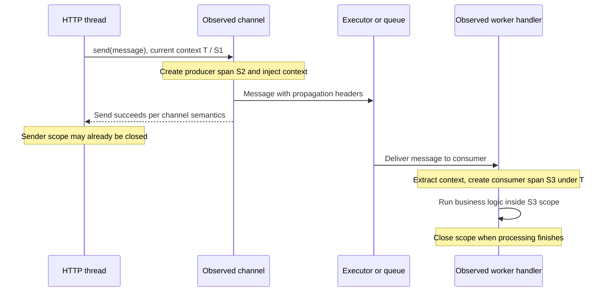

# Trace context across channels

## 1. Objectives and real-world scenario

In the **Metrics and observability** chapter of the **SPRING_INTEGRATION_CORE** module, this lesson explains how to preserve trace linkage when messages pass through a `MessageChannel`, especially at the boundary where execution moves from a sending thread to a processing thread. This knowledge helps track a Spring Integration flow built with Messages, endpoints, gateways, and Java DSL without coupling business components to one another.

After this lesson, you will be able to:

- Distinguish trace context, message headers, correlation ID, and MDC.
- Identify points where context is easily lost when using `ExecutorChannel`, `QueueChannel`, or asynchronous publish-subscribe.
- Enable observation on both channels and handlers so tracing infrastructure propagates and restores context.
- Write a Java DSL demonstration flow, inspect results, and design tests that detect broken or cross-contaminated traces between messages.
- Apply the same principles to gateways, transformers, routers, filters, aggregators, and error flows.

Suppose a service receives an order creation request. An HTTP controller sends an `OrderCommand` into a data normalization flow and hands it off to a worker. The controller returns immediately after handing off the message. When an error occurs on the worker, you want to find the original HTTP request, the normalization step, and the order persistence step within the same trace.

Searching only for `orderId` in logs is not enough: an order may be processed multiple times, retries may run later, and the same thread in a pool can sequentially process many different orders.

**Example scope:** Java 17+, Spring Boot 3.5.x, and Spring Integration 6.5.x using Micrometer Tracing. This is an illustrative version baseline, not a requirement to use the latest version. Do not mix older-generation Spring Cloud Sleuth configuration into this example.

## 2. What is trace context?

A trace represents a chain of causally related operations. Each individually measured operation is a span.

| Concept | Meaning | Practical example |
| --- | --- | --- |
| Trace ID | Identifier of the entire trace | Links order intake request and order processing |
| Span ID | Identifier of a single operation | Distinguishes message send span from processing span |
| Parent span ID | Parent relationship of the recorded span | Shows which operation triggered the processing |
| Sampling decision | Sampling choice propagated with context | Controls recording and exporting traces |
| Baggage | Configured contextual metadata carried forward | An approved business region code |
| Scope | Execution window where context is made current | Allows `tracer.currentSpan()` to find the span |

Across a processing boundary, the **trace ID is usually preserved while the span ID changes** because the new operation has its own span. Therefore, asserting that all span IDs are equal is a wrong test criterion.

With W3C Trace Context, a typical `traceparent` looks like:

```text
00-4bf92f3577b34da6a3ce929d0e0e4736-00f067aa0ba902b7-01
│  └──────── trace-id ──────────┘ └── parent-id ──┘ └ flags
└ version
```

`parent-id` in the header is the ID of the sender-side span that the receiver uses as parent; the header does not contain the entire span tree. `tracestate` carries vendor-specific tracing extensions. Specific header names depend on the propagator: systems using B3 may use `b3` or `X-B3-*` fields. Both sides must agree on the format for producing and consuming context. See [W3C Trace Context specification](https://www.w3.org/TR/trace-context/).

### 2.1. Identifiers that do not replace trace context

- `MessageHeaders.ID` identifies one message; constructing a new message can generate a new ID.
- `correlationId` is commonly used to group business-related messages, such as parts of an aggregator group.
- `orderId` identifies an order, which can appear in multiple distinct traces.
- `traceId` belongs to tracing infrastructure, accompanied by sampling and span relationships.

Do not set `correlationId` to the trace ID just to make logs match. An aggregator group may receive inputs from multiple traces; a single trace can also contain multiple business groups.

### 2.2. Headers and scope are two distinct parts

In the imperative model, the current context is typically bound to a thread through a tracing scope. MDC can mirror trace ID and span ID so loggers print them. Headers act as the carrier transporting context elsewhere.

Therefore:

- A message having `traceparent` does not prove the handler already has a current span.
- MDC containing a `traceId` string does not prove a span is being managed by tracing infrastructure.
- `Tracer.currentSpan()` returns a span only when an active scope is bound on that thread.

Micrometer illustrates opening a scope with `tracer.withSpan(...)` and closing it when exiting a `try` block; ending the span is a separate operation. See [Micrometer Tracing API](https://docs.micrometer.io/tracing/reference/api.html).

## 3. Why can crossing a channel break a trace?

A synchronously running flow can hide propagation misconfigurations because sender and consumer see the same thread's context. When switching to asynchronous execution, that assumption no longer holds.

| Channel | Primary execution model | Context caveat |
| --- | --- | --- |
| `DirectChannel` | Invokes subscriber on sending thread | Current context may remain available; instrumentation is still needed to measure steps properly |
| `ExecutorChannel` | Hands work to an executor | Never assume worker threads inherit sender context automatically |
| `QueueChannel` | Holds messages waiting for consumer receive | Consumer may run after the sending scope has closed |
| `PublishSubscribeChannel` without executor | Invokes subscribers on sending thread | Multiple handler executions occur even without switching threads |
| `PublishSubscribeChannel` with executor | Dispatches work via executor | Each branch needs proper context and span lifecycle |

These are channel characteristics described in [Message Channel Implementations](https://docs.spring.io/spring-integration/reference/6.5/channel/implementations.html). With `ExecutorChannel`, the executing thread also depends on the executor and rejection policy; for instance, `CallerRunsPolicy` can run tasks on the sending thread under overload. Do not assume switching threads is guaranteed across all executor configurations.



A message sitting in a queue must not rely on an HTTP thread's `ThreadLocal` staying alive. Context must live in the carrier that the consumer will receive.

## 4. Spring Integration's propagation mechanism

In Spring Integration 6.x, the standard approach is enabling Micrometer Observation on sending and receiving components. Channels use sender context to inject tracing into headers; handlers use receiver context to extract it and start a child observation. This mechanism is described in [Observation Propagation](https://docs.spring.io/spring-integration/reference/6.5/metrics.html#observation-propagation).

The sequence of steps to distinguish is:

1. **Instrument:** identify operations to measure, such as sending a message or invoking a handler.
2. **Inject:** propagator writes context data into the carrier on send.
3. **Transport:** channel, executor, or message store moves the message.
4. **Extract:** consumer reads context from the carrier.
5. **Activate:** consumer opens the processing span scope on the executing thread.
6. **Close:** scope and observation close when the operation ends.

In this setup, the framework manages the lifecycle above. Do not keep an HTTP thread's scope open waiting for workers, do not store `Span` or `Observation` objects in a message store, and do not manually add a `traceId` header expecting the framework to infer parent–child span relationships.

### 4.1. Required infrastructure layers

| Component | Responsibility |
| --- | --- |
| `ObservationRegistry` | Receives and coordinates observations |
| Tracing observation handlers | Translates observations into tracing actions, handles sender/receiver context |
| Micrometer Tracing bridge | Connects tracing API to Brave or OpenTelemetry |
| Propagator | Injects/extracts according to configured format |
| Exporter/reporter | Ships finished spans to a backend |

A `MeterRegistry` for metrics does not by itself create tracing infrastructure. Likewise, calling `ObservationRegistry.create()` in plain Spring does not create a tracer or required tracing handlers.

### 4.2. Enabling observation on the right components

```java
@EnableIntegrationManagement(observationPatterns = "*")
```

When an appropriate registry is present, this pattern selects all integration components supporting observation. By default, the annotation does not select all components. If narrowing patterns, select both the channel and the handler executing across the boundary. See [Javadoc for `observationPatterns`](https://docs.spring.io/spring-integration/api/org/springframework/integration/config/EnableIntegrationManagement.html#observationPatterns()).

In Java DSL, endpoint IDs and inner message handler bean names are not necessarily identical. When tuning patterns, verify actual component names; do not assume a pattern matching `.id(...)` covers every handler. Using `"*"` keeps the learning example free of that discrepancy.

## 5. Complete example: from HTTP to ExecutorChannel

### 5.1. Dependencies and illustrative configuration

In a project using Spring Boot 3.5.x dependency management, add the following dependencies:

```xml
<dependencies>
    <dependency>
        <groupId>org.springframework.boot</groupId>
        <artifactId>spring-boot-starter-web</artifactId>
    </dependency>
    <dependency>
        <groupId>org.springframework.boot</groupId>
        <artifactId>spring-boot-starter-integration</artifactId>
    </dependency>
    <dependency>
        <groupId>org.springframework.boot</groupId>
        <artifactId>spring-boot-starter-actuator</artifactId>
    </dependency>
    <dependency>
        <groupId>io.micrometer</groupId>
        <artifactId>micrometer-tracing-bridge-brave</artifactId>
    </dependency>
    <dependency>
        <groupId>org.springframework.boot</groupId>
        <artifactId>spring-boot-starter-test</artifactId>
        <scope>test</scope>
    </dependency>
</dependencies>
```

The baseline example inspects context via APIs and logs without shipping spans over the network. If you want to view trace trees in Zipkin, add `io.zipkin.reporter2:zipkin-reporter-brave` and a corresponding backend. Do not add both the Brave bridge and OpenTelemetry bridge hoping one gets chosen automatically. Bridge/reporter options are described in [Spring Boot Tracing](https://docs.spring.io/spring-boot/3.5/reference/actuator/tracing.html).

The configuration below illustrates settings for the practice application:

```properties
spring.application.name=orders-integration-demo
management.tracing.sampling.probability=1.0
management.tracing.propagation.type=w3c
logging.pattern.correlation=[%X{traceId:-},%X{spanId:-}] 
```

100% sampling makes observation easy in the lab. Under production traffic, choose sampling according to operational needs. Not seeing spans on a backend can also result from sampling or export, so do not conclude context loss from a backend UI alone.

### 5.2. Java DSL application

Place the demonstration code below in a dedicated package, such as `vn.example.tracing`. `TraceReceipt` and the result-collecting queue are solely for lesson observation and testing; real systems do not need to keep all tracing results in memory.

```java
package vn.example.tracing;

import java.util.concurrent.BlockingQueue;
import java.util.concurrent.LinkedBlockingQueue;

import io.micrometer.tracing.Span;
import io.micrometer.tracing.Tracer;
import org.slf4j.Logger;
import org.slf4j.LoggerFactory;
import org.springframework.beans.factory.annotation.Qualifier;
import org.springframework.boot.SpringApplication;
import org.springframework.boot.autoconfigure.SpringBootApplication;
import org.springframework.context.annotation.Bean;
import org.springframework.http.ResponseEntity;
import org.springframework.integration.channel.DirectChannel;
import org.springframework.integration.channel.ExecutorChannel;
import org.springframework.integration.config.EnableIntegrationManagement;
import org.springframework.integration.dsl.IntegrationFlow;
import org.springframework.messaging.MessageChannel;
import org.springframework.messaging.support.MessageBuilder;
import org.springframework.scheduling.concurrent.ThreadPoolTaskExecutor;
import org.springframework.web.bind.annotation.PathVariable;
import org.springframework.web.bind.annotation.PostMapping;
import org.springframework.web.bind.annotation.RestController;

@SpringBootApplication
@EnableIntegrationManagement(observationPatterns = "*")
public class TraceChannelApplication {

    private static final Logger log =
            LoggerFactory.getLogger(TraceChannelApplication.class);

    public static void main(String[] args) {
        SpringApplication.run(TraceChannelApplication.class, args);
    }

    @Bean
    DirectChannel ordersInput() {
        return new DirectChannel();
    }

    @Bean
    ThreadPoolTaskExecutor ordersExecutor() {
        ThreadPoolTaskExecutor executor = new ThreadPoolTaskExecutor();
        executor.setCorePoolSize(1);
        executor.setMaxPoolSize(1);
        executor.setQueueCapacity(100);
        executor.setThreadNamePrefix("orders-worker-");
        executor.setWaitForTasksToCompleteOnShutdown(true);
        executor.setAwaitTerminationSeconds(5);
        return executor;
    }

    @Bean
    MessageChannel ordersAsync(
            @Qualifier("ordersExecutor") ThreadPoolTaskExecutor executor) {
        return new ExecutorChannel(executor);
    }

    @Bean
    BlockingQueue<TraceReceipt> traceReceipts() {
        return new LinkedBlockingQueue<>();
    }

    @Bean
    IntegrationFlow ordersFlow(Tracer tracer,
                              BlockingQueue<TraceReceipt> receipts) {
        return IntegrationFlow.from("ordersInput")
                .<OrderCommand, OrderCommand>transform(
                        order -> new OrderCommand(order.orderId().trim()),
                        endpoint -> endpoint.id("normalizeOrder"))
                .channel("ordersAsync")
                .handle(OrderCommand.class, (order, headers) -> {
                    Span current = tracer.currentSpan();
                    String traceId = current == null
                            ? "NONE" : current.context().traceId();
                    String spanId = current == null
                            ? "NONE" : current.context().spanId();
                    String thread = Thread.currentThread().getName();

                    log.info("Processed order={} trace={} span={} thread={}",
                            order.orderId(), traceId, spanId, thread);
                    receipts.offer(new TraceReceipt(
                            order.orderId(), traceId, spanId, thread));
                    return null;
                }, endpoint -> endpoint.id("processOrder"))
                .get();
    }
}

record OrderCommand(String orderId) {
}

record TraceReceipt(String orderId, String traceId,
                    String spanId, String threadName) {
}

@RestController
class OrderController {

    private static final Logger log =
            LoggerFactory.getLogger(OrderController.class);

    private final MessageChannel input;
    private final Tracer tracer;

    OrderController(@Qualifier("ordersInput") MessageChannel input,
                    Tracer tracer) {
        this.input = input;
        this.tracer = tracer;
    }

    @PostMapping("/orders/{orderId}")
    ResponseEntity<Void> submit(@PathVariable("orderId") String orderId) {
        Span current = tracer.currentSpan();
        log.info("Submitting order={} trace={} thread={}", orderId,
                current == null ? "NONE" : current.context().traceId(),
                Thread.currentThread().getName());

        boolean accepted = input.send(MessageBuilder
                .withPayload(new OrderCommand(orderId))
                .build(), 1_000);

        return accepted ? ResponseEntity.accepted().build()
                : ResponseEntity.status(503).build();
    }
}
```

Spring manages starting and shutting down `ThreadPoolTaskExecutor` because the executor is a bean. A single worker is chosen here to make testing thread reuse easier; it does not imply production applications should always use one worker.

The application does not populate `traceparent` manually. HTTP observation starts or continues the incoming trace; flow instrumentation performs inject/extract at messaging steps.

### 5.3. Sending requests and reading output

After starting the demo application, send two independent requests without passing trace headers from the client:

```bash
curl -X POST http://localhost:8080/orders/ORD-1001
curl -X POST http://localhost:8080/orders/ORD-1002
```

Expected output format, with IDs shortened for readability:

```text
Submitting order=ORD-1001 trace=T1 thread=http-nio-8080-exec-1
Processed order=ORD-1001 trace=T1 span=C1 thread=orders-worker-1
Submitting order=ORD-1002 trace=T2 thread=http-nio-8080-exec-2
Processed order=ORD-1002 trace=T2 span=C2 thread=orders-worker-1
```

Lines may interleave due to asynchronous execution. What matters is the correspondence per `orderId`, not log line order.

- `ORD-1001` preserves trace T1 from controller to worker.
- `ORD-1002` preserves trace T2, uncontaminated by T1 even though the worker thread is reused.
- The processing span has its own ID; it should not equal the HTTP span ID.
- A `NONE` value at the worker signals you should inspect registry, tracing handlers, and instrumentation.

`202 Accepted` only confirms handoff per the example design. It does not confirm the order was persisted successfully. Nor does the `send` timeout turn the whole flow into a business processing deadline or a reply wait timeout.

## 6. When replacing ExecutorChannel with QueueChannel

With `QueueChannel`, the consumer must have a poller. To practice separately, replace the `ordersAsync` bean and final endpoint configuration; do not keep two beans with the same name simultaneously.

```java
import org.springframework.integration.channel.QueueChannel;
import org.springframework.integration.dsl.Pollers;

@Bean
QueueChannel ordersAsync() {
    return new QueueChannel(100);
}
```

In the flow above, keep the `handle` logic and replace its endpoint customizer with:

```java
endpoint -> endpoint
        .id("processOrder")
        .poller(Pollers.fixedDelay(100).maxMessagesPerPoll(10))
```

This is a replacement inside the `.handle(...)` call, not a complete second flow. The old executor is no longer used by this channel.

The notable difference is that the message can sit in the queue after the HTTP request has ended. The receiver must still continue the trace from headers. Never expect the poller thread to already hold the HTTP request's context.

If moving to a persistent message store, ensure the storage configuration preserves propagation headers. If crossing out to a broker or another process, check both header mappers and adapter instrumentation. Enabling observation on internal channels alone does not guarantee external transports carry all headers across system boundaries.

Do not use an executor task decorator instead of storing context in the message across a queue boundary. A periodic poller task may have been scheduled long before the order was sent; context at scheduling time does not represent each message it later pulls.

## 7. Preserving headers while processing messages

Standard transformers take a payload and return a new payload, as in the order normalization example, allowing the framework to handle building the reply message. When constructing messages manually or selectively copying headers, you must explicitly preserve required metadata.

Example manually modifying the same logical message:

```java
Message<?> updated = MessageBuilder.fromMessage(incoming)
        .setHeader("processingRegion", "south")
        .build();
```

If actually replacing the payload in manual message-building code:

```java
Message<OrderCommand> updated = MessageBuilder
        .withPayload(normalizedOrder)
        .copyHeaders(incoming.getHeaders())
        .build();
```

These snippets use `org.springframework.messaging.Message` and `org.springframework.messaging.support.MessageBuilder`. The builder manages special headers such as message ID; copying headers does not mean two messages share the same ID.

Common places where context gets lost include overly broad header filters, custom mappers keeping only business headers, or serializing just the payload and constructing a fresh message in another process. For the same logical message, keep permitted propagation headers. For an instrumented outbound operation, let instrumentation inject the current send's context instead of freezing headers from an older send.

Before editing headers, decide whether you are continuing the current message, creating a child message, or starting an independent business job. That decision affects the tracing relationship to represent.

## 8. Applying to other core components

### 8.1. Gateway

A gateway translates Java calls into message exchanges and can have its own observation. If the flow crosses an async channel, propagation rules still apply. For a reply-producing gateway, check both the request path and reply path; a caller timeout does not mean the worker stopped processing.

In this example, the controller sends directly so the channel boundary stays clear. When replacing it with `@MessagingGateway`, still observe the channels and handlers used by the gateway.

### 8.2. Router and filter

A router selects a branch; it should not mint a new trace ID just because branches differ. Each branch with an asynchronous boundary should be configured like the main branch.

A filter can terminate a message's path. Seeing no downstream handler span can be the intended result of filtering. If a discard flow exists, verify propagation on the discard channel and its consumer to distinguish rule-based discards from technical errors.

### 8.3. Splitter, publish-subscribe, and aggregator

A message split into multiple branches usually needs to keep linkage to the original work, while each step gets its own span. Aggregators are more nuanced: a business group may contain messages arriving from different requests and traces.

Do not claim an aggregator automatically creates multi-parent spans. The design must specify whether to use one parent relationship, span links when supported by the tracer/instrumentation, or a separate business observation with correlation keys. This is a modeling decision for a specific flow; verify actual output rather than looking only at `correlationId`.

## 9. Asynchronous tasks outside the integration flow

Suppose a handler already received the right context, yet calls:

```java
CompletableFuture.runAsync(() -> callAnotherSystem());
```

That task runs on a different executor if no explicit executor is passed. Spring Integration does not automatically manage every thread spawned by application code.

For tasks within the same JVM, you can use an executor configured with Micrometer Context Propagation, such as:

```java
import org.springframework.core.task.support.ContextPropagatingTaskDecorator;
import org.springframework.scheduling.concurrent.ThreadPoolTaskExecutor;

@Bean
ThreadPoolTaskExecutor auxiliaryExecutor() {
    ThreadPoolTaskExecutor executor = new ThreadPoolTaskExecutor();
    executor.setCorePoolSize(2);
    executor.setMaxPoolSize(2);
    executor.setQueueCapacity(50);
    executor.setThreadNamePrefix("auxiliary-");
    executor.setTaskDecorator(new ContextPropagatingTaskDecorator());
    return executor;
}
```

This requires `io.micrometer:context-propagation` on the classpath and appropriate accessors for the context types being propagated. The decorator captures context when submitting the task and restores it when the task executes; it does not automatically create a new business span. See [Context Propagation](https://docs.micrometer.io/context-propagation/reference/purpose.html) and [ContextPropagatingTaskDecorator](https://docs.spring.io/spring-framework/docs/6.2.x/javadoc-api/org/springframework/core/task/support/ContextPropagatingTaskDecorator.html).

This is supplemental configuration for application-managed task boundaries. The channel example earlier relies on message-based propagation and does not need this decorator just to work. For reactive flows, consider Reactor Context and the corresponding bridge; do not infer from one thread's log still having context that context holds across the whole reactive chain.

## 10. Errors, retries, and processing duration

### 10.1. Error flows also need observation

When a synchronous handler throws an error, it can propagate back to the caller on the same call stack. When a worker runs asynchronously, you cannot rely on a `try/catch` around the send call to catch business errors happening later. Spring Integration supports turning failures into an `ErrorMessage` sent to an error channel, with resolution rules and conditions explained in [Error Handling](https://docs.spring.io/spring-integration/reference/6.5/error-handling.html).

Key points to observe in design:

- Does the failed handler record the error on its span, or did application code swallow it?
- Are both the error channel and the error-handling consumer instrumented?
- Where is `ErrorMessage` created, and does it retain linkage to the failed message under the active error strategy?
- If the error flow crosses another queue or broker, does context continue across that boundary?

Do not assume every custom `ErrorMessage` automatically copies all propagation headers from the original message. Inspect the error strategy and test error paths explicitly.

### 10.2. Retry does not mean a new trace

Synchronous retries inside a handler may sit within the same handler span; each retry attempt does not necessarily get its own span. If you need to track attempt count, add intentional events or instrumentation.

Broker redelivery or reprocessing an order hours later is a different scenario. Explicitly specify whether to continue the old trace, start a new linked trace, or use a dedicated business observation. Whichever option you choose, never overwrite trace ID with `orderId` to represent retries.

### 10.3. Interpreting latency accurately

With an async channel, successful send time does not represent completion time. With a queue, there is also wait time before the consumer begins. With `DirectChannel`, the send call can include subscriber execution time.

On a timeline, distinguish:

1. Request intake and handoff time.
2. Wait time in an executor or queue.
3. Consumer business execution time.
4. Retry time, external service calls, or persistence time.

Gaps between spans may represent legitimate wait time. Do not simply sum durations when branches run concurrently, and do not label a metric "queue wait" if current instrumentation does not actually measure that interval.

## 11. Testing propagation across workers

Tests must traverse real channels with an actual thread switch in the chosen configuration. Calling a handler lambda directly does not test channel propagation.

The example below lives in the same package as the application in section 5, using base dependencies with **no external exporter added yet**. `@AutoConfigureObservability` enables observability configuration in full application tests. If using test slices or mock registries/tracers, double-check whether the test uses a real tracer or a no-op tracer. See [Spring Boot testing: observability](https://docs.spring.io/spring-boot/3.5/reference/testing/spring-boot-applications.html) and [Javadoc for `AutoConfigureObservability`](https://docs.spring.io/spring-boot/3.5/api/java/org/springframework/boot/test/autoconfigure/actuate/observability/AutoConfigureObservability.html).

```java
package vn.example.tracing;

import java.util.concurrent.BlockingQueue;
import java.util.concurrent.TimeUnit;

import io.micrometer.tracing.Span;
import io.micrometer.tracing.Tracer;
import org.junit.jupiter.api.Test;
import org.springframework.beans.factory.annotation.Autowired;
import org.springframework.beans.factory.annotation.Qualifier;
import org.springframework.boot.test.autoconfigure.actuate.observability.AutoConfigureObservability;
import org.springframework.boot.test.context.SpringBootTest;
import org.springframework.messaging.MessageChannel;
import org.springframework.messaging.support.MessageBuilder;

import static org.assertj.core.api.Assertions.assertThat;

@SpringBootTest(
        classes = TraceChannelApplication.class,
        webEnvironment = SpringBootTest.WebEnvironment.NONE,
        properties = "management.tracing.sampling.probability=1.0")
@AutoConfigureObservability
class TraceChannelTest {

    @Autowired
    Tracer tracer;

    @Autowired
    @Qualifier("ordersInput")
    MessageChannel input;

    @Autowired
    BlockingQueue<TraceReceipt> receipts;

    @Test
    void preservesEachTraceWhenReusingWorker() throws Exception {
        receipts.clear();

        String firstTrace = sendInNewTrace("ORD-A");
        TraceReceipt first = receipts.poll(5, TimeUnit.SECONDS);
        assertThat(first).isNotNull();
        assertThat(first.orderId()).isEqualTo("ORD-A");
        assertThat(first.traceId()).isEqualTo(firstTrace);
        assertThat(first.spanId()).isNotEqualTo("NONE");
        assertThat(first.threadName()).startsWith("orders-worker-");

        String secondTrace = sendInNewTrace("ORD-B");
        TraceReceipt second = receipts.poll(5, TimeUnit.SECONDS);
        assertThat(second).isNotNull();
        assertThat(second.orderId()).isEqualTo("ORD-B");
        assertThat(second.traceId()).isEqualTo(secondTrace);
        assertThat(secondTrace).isNotEqualTo(firstTrace);
        assertThat(second.threadName()).isEqualTo(first.threadName());

        assertThat(tracer.currentSpan()).isNull();
    }

    private String sendInNewTrace(String orderId) {
        assertThat(tracer.currentSpan()).isNull();
        Span root = tracer.nextSpan().name("test.submit.order").start();
        try (Tracer.SpanInScope ignored = tracer.withSpan(root)) {
            assertThat(input.send(MessageBuilder
                    .withPayload(new OrderCommand(orderId))
                    .build(), 1_000)).isTrue();
            return root.context().traceId();
        }
        finally {
            root.end();
        }
    }
}
```

No `Thread.sleep` is needed: the result queue provides bounded waiting. Both sends have separate root scopes, and reusing the same worker detects cases where a previous context leaks into a later message.

The limits of this test should also be clear: it verifies current context during both executions and that the sending thread's scope was closed. It does not fully prove parent span IDs, export, or that the worker is completely clean of context after the handler exits scope. If those assertions are needed, use an in-memory finished span collector and a dedicated executor cleanup test.

Additional scenarios to add when applying to a project:

| Scenario | What to verify |
| --- | --- |
| `QueueChannel` and poller | Handler reads each message's trace accurately even after the sending request ends |
| Custom transformer or header mapper | Propagation headers still cross the actual boundary |
| No incoming trace | Instrumentation creates a valid context per design, without reusing a prior message's context |
| Handler throws error | Error span is recorded and error flow keeps linkage per configuration |
| Fan-out | Branches retain expected trace relationships and get separate processing spans |
| Collector unavailable | Local context testing is not mistaken for export testing |

Do not assert hardcoded IDs and do not assume span count is always a constant. Instrumentation changes can add spans while preserving correct business relationships.

## 12. Diagnosing broken traces

| Symptom | Hypothesis to check | Next verification |
| --- | --- | --- |
| Worker has `currentSpan() == null` | Consumer uninstrumented or missing tracing handler | Check registry, bridge, and pattern-selected components |
| Worker gets an unexpected new trace ID | Lost headers or mismatched propagation format | Compare carrier before and after boundary; check propagator |
| Controller logs trace, worker does not | Context only lived on sending thread | Check both channel and consumer, then custom async tasks |
| Current span is right, log lacks trace | MDC correlation or logging pattern misconfigured | Check logging config rather than altering headers manually |
| Logs show trace, backend shows nothing | Sampling, unclosed span, or exporter error | Check sampling, reporter, and flush timing |
| Order B gets order A's trace | Leaked scope or stale context re-attached | Test two root traces on the same worker and audit scope-opening code |
| Only error branch loses trace | Error message or error channel lacks propagation | Check error strategy and error flow boundaries |

An effective investigation sequence is confirming current span right before sending, confirming the carrier at the crossing boundary, confirming current span inside the consumer, and only then checking the exporter and backend.

When inspecting headers in practice environments, extract only the fields needed. Never dump full message payloads, credentials, or sensitive baggage into logs.

## 13. Design principles and hands-on practice

Trace context serves observability; never use it as an idempotency key, authorization decision, or replacement for database transactions. Headers from external systems are also not proof of user authentication.

Do not place trace IDs, message IDs, or order IDs into unbounded metric tags. To look up a specific execution, use traces or logs following your system's data policy. Baggage should carry only small, approved fields with a clear purpose.

To practice this lesson:

1. Run the `ExecutorChannel` example and send two independent orders; record trace IDs at the controller and worker.
2. Keep the worker single-threaded to observe thread reuse; confirm the two orders' traces stay separate.
3. Switch to `QueueChannel`, add the poller as guided, and observe messages processed after handoff.
4. In an experimental branch, drop propagation headers at a custom boundary and observe a new trace appearing; restore configuration afterward.
5. Have the handler throw an intentional error, inspect the error span, and trace the `ErrorMessage` path through the configured error flow.
6. If a tracing backend is available, compare parent–child relationships on the backend against API and log observations; distinguish propagation bugs from export bugs.

You have mastered this topic when you can explain why a flow working on `DirectChannel` can still lose traces after switching to an async channel, pinpoint where context is injected/extracted, and verify each message carries the right context on the consumer thread.
