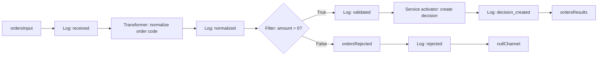
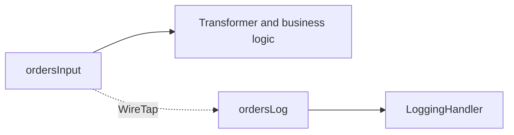

# Logging message flows

## 1. Objectives and context

In Spring Integration Core, a request can pass through a gateway, multiple `MessageChannel`s, transformers, filters, routers, and service activators before producing a result. In operations, common questions are: where did the request get to, was the data transformed yet, why is there no result, and on which branch did an error occur?

**Logging message flows** means recording meaningful events at those boundaries along with sufficient identifiers to stitch them into a single request's journey. This lesson belongs to the **Metrics and observability** chapter, focusing on observing message flows in the `SPRING_INTEGRATION_CORE` module.

After this lesson, you will be able to:

- Place `.log()` at the right positions in Java DSL and explain precisely what a log line proves.
- Choose safe log fields and distinguish a message ID from a request-wide correlation ID.
- Use wire taps and `LoggingHandler` to create dedicated logging branches.
- Trace filter discard branches, router branches, processing errors, and retry attempts.
- Recognize the limits of logging across queues, multiple threads, transactions, and external systems.

Examples use Java 17, Spring Boot 3.x, and Spring Integration 6.x. Projects need the `org.springframework.boot:spring-boot-starter-integration` dependency; let Spring Boot dependency management select compatible Spring Integration versions.

## 2. What does a log line prove?

Consider a simple flow:



The log boxes in the diagram represent logical observation points. In the DSL, `.log()` is implemented using `WireTap` and `LoggingHandler`, observing messages on the current channel or before the next endpoint. For example, a log placed after a filter only sees messages that passed the filter. [The log() operator documentation](https://docs.spring.io/spring-integration/reference/6.4/dsl/java-log.html)

| Observation point | What can be concluded | What cannot yet be concluded |
|---|---|---|
| Before transformer | Message reached the input intake point | Transformer ran successfully |
| After transformer | Transformer produced output reaching the log point | Overall business logic succeeded |
| After filter | Message passed the filter condition | Every incoming message continues onward |
| Inside discard branch | Message entered the discard branch | A technical error occurred |
| After decision handler | Handler produced observable output | Transaction committed or external system received it |
| Before result channel | Message is about to be forwarded | Final consumer finished processing |

Event names must match the observation boundary. `decision_created` describes creating the decision; `order_persisted` is appropriate only with corresponding persistence evidence. If a transaction can still roll back after the log line, do not call that event `transaction_committed`.

Conversely, **not seeing a log is not enough to conclude a message was lost**. The logger might be disabled at that level, logs may be sampled, appenders may be overloaded, or log ingestion may lag.

## 3. Designing log fields before adding code

### 3.1. Minimal field set

A search-friendly log line can carry the structure:

```text
event=normalized flow=orders flowRequestId=req-001 messageId=... orderId=ORD-101 payloadType=Order
```

| Field | Meaning and usage |
|---|---|
| `event` | Bounded, stable event name: `received`, `normalized`, `rejected` |
| `flow` | Business flow name, e.g., `orders` |
| `flowRequestId` | Application-defined header linking steps of the same request |
| `messageId` | The `id` header value of the observed message |
| `orderId` | Log-safe business key; may need omission or masking depending on data |
| `payloadType` | Payload type at the current step |
| `route`, `reason` | Normalized branch code or rejection reason, when applicable |
| `attempt` | Attempt number when a mechanism supplies this information |
| `durationMs` | Duration of a clearly defined measurement scope |
| `traceId`, `spanId` | Identifiers supplied by tracing infrastructure, if tracing is configured |

Timestamps, log levels, logger names, and threads are usually added by the logging backend. Example lines in this lesson show only the event body.

The `key=value` format here aids readability. In production, you can use a JSON encoder or structured logging API from your backend to preserve types and escape characters. String concatenation in the example does not produce a JSON record by itself.

### 3.2. Distinguishing three types of identifiers

A `Message` contains a payload and headers; `id` identifies the message, while additional headers can carry application-set metadata. When creating new messages during processing, the ID can change. Thus, never rely on a single `messageId` to identify an entire journey. [Message and headers model](https://docs.spring.io/spring-integration/reference/6.4/message.html)

In this lesson:

- `messageId` distinguishes each individual observed message.
- `flowRequestId` is an application contract, created or validated at intake and preserved across steps.
- `orderId` links to the business entity; a single order may have multiple distinct update requests.

Do not default to using the integration pattern's `correlationId` header instead of `flowRequestId`: splitters and aggregators have their own group-correlation needs. You may log group IDs when diagnosing an aggregator, while clearly stating which group they belong to.

Custom headers do not automatically cross every adapter or external system. At HTTP, broker, or other protocol boundaries, verify header mapping and identifier propagation contracts.

### 3.3. Logging by allowlist

Pick only selected fields. Avoid logging raw `message`, all `headers`, or `payload.toString()` in business flows:

- Payloads may contain personal data, addresses, payment details, or document contents.
- Headers may contain tokens, cookies, credentials, or internal channel objects.
- Large payloads increase formatting, storage, and shipping costs.
- Stream payloads may be read or consumed if logging logic opens and reads their contents.

Sanitizing characters and capping lengths prevent log injection or oversized records. However, **character sanitization is not anonymization**: sensitive data must still be stripped or handled according to data policy.

## 4. Complete Java DSL example

### 4.1. Order intake and classification flow

Place the following class in a Spring Boot project for the lab. The example calls no database or external service; the handler merely creates an in-memory `Receipt`.

```java
package example.integration;

import java.util.Locale;

import org.springframework.boot.SpringApplication;
import org.springframework.boot.autoconfigure.SpringBootApplication;
import org.springframework.context.ConfigurableApplicationContext;
import org.springframework.context.annotation.Bean;
import org.springframework.integration.channel.DirectChannel;
import org.springframework.integration.channel.QueueChannel;
import org.springframework.integration.config.EnableIntegration;
import org.springframework.integration.dsl.IntegrationFlow;
import org.springframework.integration.handler.LoggingHandler;
import org.springframework.messaging.Message;
import org.springframework.messaging.support.MessageBuilder;

@SpringBootApplication
@EnableIntegration
public class OrderLogApplication {

    private static final String FLOW_LOGGER =
            "learning.integration.orders";

    public record Order(String orderId, long amountVnd) {
    }

    public record Receipt(String orderId, String status) {
    }

    @Bean
    public DirectChannel ordersInput() {
        return new DirectChannel();
    }

    @Bean
    public DirectChannel ordersRejected() {
        return new DirectChannel();
    }

    @Bean
    public QueueChannel ordersResults() {
        return new QueueChannel(10);
    }

    @Bean
    public IntegrationFlow ordersFlow() {
        return IntegrationFlow.from("ordersInput")
                .log(LoggingHandler.Level.INFO, FLOW_LOGGER,
                        m -> summary("received", m))
                .transform(Order.class,
                        order -> new Order(
                                order.orderId().trim()
                                        .toUpperCase(Locale.ROOT),
                                order.amountVnd()),
                        endpoint -> endpoint.id("normalizeOrder"))
                .log(LoggingHandler.Level.DEBUG, FLOW_LOGGER,
                        m -> summary("normalized", m))
                .filter(Order.class,
                        order -> order.amountVnd() > 0,
                        endpoint -> endpoint
                                .id("positiveAmountFilter")
                                .discardChannel("ordersRejected"))
                .log(LoggingHandler.Level.DEBUG, FLOW_LOGGER,
                        m -> summary("validated", m))
                .handle(Order.class,
                        (order, headers) ->
                                new Receipt(order.orderId(), "ACCEPTED"),
                        endpoint -> endpoint.id("createOrderDecision"))
                .log(LoggingHandler.Level.INFO, FLOW_LOGGER,
                        m -> summary("decision_created", m))
                .channel("ordersResults")
                .get();
    }

    @Bean
    public IntegrationFlow rejectedOrdersFlow() {
        return IntegrationFlow.from("ordersRejected")
                .log(LoggingHandler.Level.INFO, FLOW_LOGGER,
                        m -> summary("rejected", m)
                                + " reason=NON_POSITIVE_AMOUNT")
                .nullChannel();
    }

    private static String summary(String event, Message<?> message) {
        Object payload = message.getPayload();

        String orderId = payload instanceof Order order
                ? order.orderId()
                : payload instanceof Receipt receipt
                        ? receipt.orderId()
                        : "unknown";

        return "event=" + event
                + " flow=orders"
                + " flowRequestId="
                + token(message.getHeaders().get("flowRequestId"))
                + " messageId=" + message.getHeaders().getId()
                + " orderId=" + token(orderId)
                + " payloadType="
                + token(payload.getClass().getSimpleName());
    }

    private static String token(Object value) {
        if (value == null) {
            return "unknown";
        }

        String text = String.valueOf(value);
        String limited = text.substring(0, Math.min(text.length(), 96));
        return limited.replaceAll("[^A-Za-z0-9_.:-]", "_");
    }

    private static Message<Order> request(
            String requestId, String orderId, long amountVnd) {

        return MessageBuilder
                .withPayload(new Order(orderId, amountVnd))
                .setHeader("flowRequestId", requestId)
                .build();
    }

    public static void main(String[] args) {
        try (ConfigurableApplicationContext context =
                     SpringApplication.run(OrderLogApplication.class, args)) {

            DirectChannel input =
                    context.getBean("ordersInput", DirectChannel.class);
            QueueChannel results =
                    context.getBean("ordersResults", QueueChannel.class);

            input.send(request("req-001", "ord-101", 125_000));
            input.send(request("req-002", "ord-102", 0));

            Message<?> result = results.receive(1_000);
            if (result == null
                    || !(result.getPayload() instanceof Receipt)) {
                throw new IllegalStateException("Missing order receipt");
            }

            Receipt receipt = (Receipt) result.getPayload();
            if (!"ORD-101".equals(receipt.orderId())
                    || !"ACCEPTED".equals(receipt.status())) {
                throw new IllegalStateException("Unexpected order receipt");
            }

            if (results.receive(0) != null) {
                throw new IllegalStateException("Unexpected extra receipt");
            }

            System.out.println("Received valid receipt for ORD-101");
        }
    }
}
```

Key details in the code:

1. `ordersInput` and `ordersRejected` are `DirectChannel`s; steps linked by synchronous channels execute on the message-sending call.
2. The transformer creates a new payload with the normalized order ID. It does not mutate the incoming payload in place.
3. The filter routes messages with non-positive amounts to `ordersRejected`; that branch logs the reason and terminates explicitly via `nullChannel()`.
4. `decision_created` sits after the handler producing `Receipt`. It confirms observing the handler's output, not that a consumer of `ordersResults` received it.
5. `ordersResults` is a 10-message bounded queue so the demo program can pull results with `receive()`. There is no automatic poller processing results in this example.
6. `token()` only accepts allowlisted characters for logging. For real inputs, validate `orderId`, payload types, and header contracts right at the application boundary.

The checks in `main()` support the lab: business outcomes are verified directly via the channel. Log line count must never be used as the sole criterion for flow success.

### 4.2. Configuring log levels

In the Spring Boot configuration of the practice application:

```yaml
logging:
  level:
    root: INFO
    learning.integration.orders: DEBUG
    learning.integration.orders.error: ERROR
    learning.integration.orders.tap: DEBUG
    org.springframework.integration: INFO
```

A `DEBUG` log appears only when both the logger and backend filters allow it. Setting `root: INFO` does not prevent a child logger configured separately at `DEBUG` from logging.

You do not need to turn all of `org.springframework.integration` to `TRACE` to see well-designed business events. When internal logs are needed, scope the logger and duration so diagnostic output stays readable.

This is application configuration for the example, not a request to modify the module's config files while reading.

### 4.3. Expected observation output

Omitting prefixes and replacing UUIDs with illustrative symbols, log bodies look like:

```text
event=received flow=orders flowRequestId=req-001 messageId=<m1> orderId=ord-101 payloadType=Order
event=normalized flow=orders flowRequestId=req-001 messageId=<m2> orderId=ORD-101 payloadType=Order
event=validated flow=orders flowRequestId=req-001 messageId=<m2> orderId=ORD-101 payloadType=Order
event=decision_created flow=orders flowRequestId=req-001 messageId=<m3> orderId=ORD-101 payloadType=Receipt

event=received flow=orders flowRequestId=req-002 messageId=<m4> orderId=ord-102 payloadType=Order
event=normalized flow=orders flowRequestId=req-002 messageId=<m5> orderId=ORD-102 payloadType=Order
event=rejected flow=orders flowRequestId=req-002 messageId=<m5> orderId=ORD-102 payloadType=Order reason=NON_POSITIVE_AMOUNT
```

Symbols `<m1>` through `<m5>` merely distinguish messages in the example, not real UUID values.

For `req-002`, the absence of `validated` and `decision_created` is by design: the message entered the discard branch. Do not mark this rule-based rejection as a technical `ERROR`.

When lowering the logger to `INFO`, the `normalized` and `validated` logs disappear; the result received from `ordersResults` must remain unchanged.

## 5. Distinguishing the log() operator from LoggingHandler

These two approaches serve different roles:

| Usage | Role in the flow |
|---|---|
| `.log(level, loggerName, expression)` | Observes at the current position via a tap branch |
| `.handle(loggingHandler)` | Hands the message to a logging handler; this handler produces no reply |

`LoggingHandler` logs the payload by default. You can specify a logger name and content-selection expression; full-message logging mode includes headers too. Therefore, do not treat leaving it unconfigured as a safe default for business data. [Logging Channel Adapter](https://docs.spring.io/spring-integration/reference/6.4/logging-adapter.html)

One version-dependent detail to remember: **since Spring Integration 6.0, `.log()` at the end of a flow behaves consistently with mid-flow usage**. Do not rely on placing `.log()` last to consume or discard replies. For a one-way branch that should drop output, end with `.nullChannel()`; for a flow needing to reply to a gateway, ensure the reply path remains intact. [log() behavior since 6.0](https://docs.spring.io/spring-integration/reference/6.4/dsl/java-log.html)

Example of a branch that only observes and then terminates:

```java
@Bean
public IntegrationFlow diagnosticsOnlyFlow() {
    return IntegrationFlow.from("diagnosticsInput")
            .log(LoggingHandler.Level.DEBUG,
                    "learning.integration.diagnostics",
                    m -> "event=diagnostic"
                            + " messageId=" + m.getHeaders().getId())
            .nullChannel();
}
```

Placing `.handle(loggingHandler)` mid-flow and expecting it to forward the message to the next step can terminate the path right there. When the goal is both logging and continuing, use `.log()` or an appropriate wire tap.

## 6. Creating a separate logging branch with wire tap

### 6.1. An observation branch that does not compete with business logic

Suppose you want to separate logging from the business flow definition. In `ordersFlow()`, you can **replace the first log** with:

```java
return IntegrationFlow.from("ordersInput")
        .wireTap("ordersLog");
```

This is only a replacement for the start of the builder; keep the transformer, filter, handler, and `.get()` steps from the earlier flow. Do not register a second flow also reading from `ordersInput`.

Add these two beans to the configuration class:

```java
@Bean
public DirectChannel ordersLog() {
    return new DirectChannel();
}

@Bean
public IntegrationFlow ordersLogFlow() {
    LoggingHandler handler =
            new LoggingHandler(LoggingHandler.Level.DEBUG);
    handler.setLoggerName("learning.integration.orders.tap");
    handler.setLogExpressionString(
            "'event=tapped messageId=' + headers.id"
                    + " + ' payloadType='"
                    + " + payload.getClass().getSimpleName()");

    return IntegrationFlow.from("ordersLog")
            .handle(handler)
            .get();
}
```

This branch logs ID and payload type, not the entire payload. `LoggingHandler` is the terminal consumer of the tap branch.



Do not attach a logging consumer directly to `ordersInput` as a second business subscriber expecting both to receive every message. `DirectChannel` dispatches to one consumer per send according to its configuration; a wire tap creates a separate observation branch. [MessageChannel Implementations](https://docs.spring.io/spring-integration/reference/channel/implementations.html)

### 6.2. Wire tap is not asynchronous by default

A wire tap sends the message to an observation channel. Whether that branch runs synchronously or on another thread depends on the target channel type, not the word "tap". [Wire Tap Configuration](https://docs.spring.io/spring-integration/reference/channel/configuration.html#channel-wiretap)

| Log branch channel | Consequence to anticipate |
|---|---|
| `DirectChannel` | Log handler runs on the synchronous call path, potentially increasing send latency |
| `ExecutorChannel` | Offloads work to an executor; must manage capacity, rejection, and shutdown |
| `QueueChannel` | Needs a consumer/poller to drain messages; must set capacity and full-queue behavior |

Offloading threads does not eliminate cost: it shifts cost to queues, executors, and log collectors. When the observation branch bottlenecks, define an explicit policy for waiting, rejecting, or dropping events; do not use an unbounded queue to hide the problem.

Wire tap also does not guarantee a deep copy of the payload. If the payload is mutable and the main branch modifies it, an async log branch may read state different from the tap instant. Under strict observation needs, build an immutable summary right at the boundary being logged.

Log expressions should be simple: no external API calls, no database reads, and no state mutations. An observation branch can slow down or fail; never treat it as completely free or unconditionally harmless.

## 7. Recording router, filter, and aggregator decisions

A `received` log only shows intake. Decision-making endpoints need corresponding events:

| Component | Useful log placement | Fields to consider |
|---|---|---|
| Filter | Accepted or discard branch as needed | `reason`, `flowRequestId` |
| Router | Start of each branch after route selection | `route`, `businessId` |
| Splitter | When creating or receiving each part to track | Request ID, group ID, sequence number |
| Aggregator | When group releases, expires, or is discarded | Group ID, part count, release reason |
| Gateway | Request, reply, or timeout boundary | Request ID, target call, wait time |
| Outbound adapter | Send boundary and corresponding ack mechanism | Normalized destination, ack status |

A router can send to multiple branches. Hence, total logs across branches can exceed input request count without indicating unintended duplicate processing.

With an aggregator, multiple child messages can share one `flowRequestId` while having different IDs or sequence numbers. Do not deduplicate logs merely because they share a request ID. When a group fails to release, check release strategy, expiry, and group state rather than searching only for post-aggregator logs.

Do not re-evaluate router conditions inside a log expression if the condition can change or has side effects. Logging at the start of the chosen branch records the actual decision made.

## 8. Error logging: keeping linkage to the original message

### 8.1. Synchronous vs. asynchronous errors

With synchronous flows over `DirectChannel`, processing errors can propagate back to the caller. Merely setting an `errorChannel` header does not mean every synchronous exception on a direct send automatically turns into an error message. Gateways have their own error handling that must be configured appropriately.

With asynchronous processing managed by Spring Integration components, errors can be published as an `ErrorMessage` whose payload is the exception. Error publishing typically checks the request's `errorChannel` header first, then falls back to the global error channel. [Error Handling Mechanism](https://docs.spring.io/spring-integration/reference/error-handling.html)

Therefore, **the ID of an ErrorMessage is not the ID of the failed business message**. When you have a `MessagingException`, inspect `getFailedMessage()` to recover correlation headers from the failed message.

### 8.2. A safe error-logging consumer

You can add the following bean to `OrderLogApplication`. Add an import for `org.springframework.messaging.MessagingException`.

```java
@Bean
public IntegrationFlow ordersErrorsFlow() {
    return IntegrationFlow.from("ordersErrors")
            .log(LoggingHandler.Level.ERROR,
                    "learning.integration.orders.error",
                    errorMessage -> {
                        Object payload = errorMessage.getPayload();
                        Throwable failure = payload instanceof Throwable t
                                ? t : null;

                        Message<?> failed =
                                failure instanceof
                                        org.springframework.messaging.MessagingException ex
                                        ? ex.getFailedMessage()
                                        : null;

                        String requestId = failed == null
                                ? "unknown"
                                : token(failed.getHeaders()
                                        .get("flowRequestId"));

                        String errorType = failure == null
                                ? "UnexpectedErrorPayload"
                                : failure.getClass().getSimpleName();

                        return "event=flow_failed"
                                + " flow=orders"
                                + " flowRequestId=" + requestId
                                + " failedMessageId="
                                + (failed == null ? "unknown"
                                        : failed.getHeaders().getId())
                                + " errorType=" + errorType;
                    })
            .nullChannel();
}
```

In the snippet, the fully qualified name of `MessagingException` is kept to make the checked type explicit; an import can shorten it when integrating into an app.

This bean only creates **an error-receiving endpoint for logging**; it does not wire every error source to it. Configure error-producing components, gateways, or recovery policies to send `ErrorMessage` instances to `ordersErrors`. The order example in section 4 does not send errors to this channel automatically.

If exceptions are wrapped across multiple layers, or an error source provides the original message differently, extend the correlation extraction logic. When not found, log `unknown` explicitly; do not substitute the error message's ID and treat it as the request ID.

The snippet logs only the exception class name. This is an intentional log-content restriction, not a complete error handler. Stack traces and exception messages can contain payloads or `failedMessage` data; if you must store them, use an appropriate sink and sanitize data before output.

Error logging does not retry, move to a DLQ, roll back, or confirm recovery. Each of those behaviors needs its own explicit policy.

### 8.3. Distinguishing retry attempts from final failure

A handler with retries can emit multiple events for the same request:

```text
event=attempt_failed flow=orders flowRequestId=req-009 attempt=1 errorType=RemoteTimeout
event=attempt_failed flow=orders flowRequestId=req-009 attempt=2 errorType=RemoteTimeout
event=recovered flow=orders flowRequestId=req-009 attempt=3
```

This is an application-designed log format, not something `.log()` generates automatically. Obtain attempt counts from your retry/recovery mechanism; do not assume every message already carries an `attempt` header.

If an error was retried and succeeded, do not count each attempt as a final failed request. Standardize where the final event is logged so gateway, error handler, and recovery handler do not repeatedly log the same failure without clear roles.

## 9. Using Message History when you need the traversal path

Business logs answer "what event happened"; sometimes you also need the list of components a message traversed.

You can enable tracking for the named channels in the example using this annotation on the configuration class:

```java
import org.springframework.integration.config.EnableMessageHistory;

@EnableMessageHistory({
        "ordersInput",
        "ordersRejected",
        "ordersResults"
})
```

In a real application, place `@EnableMessageHistory` alongside the class's other configuration annotations; the snippet above shows only the annotation to add.

Read the information attached to headers by the framework:

```java
import org.springframework.integration.history.MessageHistory;

MessageHistory history = message.getHeaders().get(
        MessageHistory.HEADER_NAME, MessageHistory.class);
```

Message History records tracked components and supports filtering by name or pattern. Only tracked components contribute to history; it does not automatically become a distributed trace across all services. [Message History Configuration](https://docs.spring.io/spring-integration/reference/message-history.html)

In the example, the pattern is limited to three channels, so do not expect every handler to appear. To track more, deliberately expand the component list.

Read history at the end of the path under inspection. Reading before a step does not reflect completion of downstream steps. Do not infer exact endpoint processing durations merely by arbitrarily subtracting timestamps in history.

## 10. How logs, MDC, metrics, and tracing work together

The four tools answer different operational questions:

| Tool | Appropriate question |
|---|---|
| Event logs | Why was `req-002` rejected? Which branch did the message reach? |
| Metrics | How are error rates, throughput, and latency distributions changing? |
| Tracing | Which services did a request traverse, and which span took time? |
| Message History | Within Spring Integration tracking scope, which components did the message visit? |

MDC puts correlation values into log prefixes, yet MDC data is bound to the execution context; it does not automatically follow messages across executors or pollers. If using MDC, provide lifecycle-safe context propagation and cleanup so an earlier request's ID does not leak into a subsequent request.

The lesson example reads `flowRequestId` from headers at each log point, avoiding dependence on MDC propagation. However, if a processing step drops the header, this approach also loses correlation.

When Micrometer Observation and tracing are properly configured, use the trace context managed by the tracing system. Do not invent a custom `traceId` header and assume tracing is active.

Request IDs are great for searching logs or traces, but usually unsuitable as metric tags because distinct values grow with every request. Use bounded dimensions such as flow, endpoint name, outcome, and normalized error codes for metrics.

## 11. Cost, log levels, and data volume

### 11.1. Choosing log levels by meaning

| Level | Reference usage |
|---|---|
| `INFO` | Significant boundary events, operational business outcomes |
| `DEBUG` | Intermediate step details, payload types, diagnostic decisions |
| `WARN` | Unusual conditions needing attention that remain recoverable |
| `ERROR` | Technical errors requiring action or final failures per operational convention |
| `TRACE` | Very fine-grained detail, enabled only in controlled scopes |

An order rejected under valid business rules does not have to be `WARN` or `ERROR`. Log levels must align with expectations and how operations respond to events.

### 11.2. Estimating volume before logging every step

Suppose there are 2,000 messages per second, each producing 6 log lines averaging 500 bytes:

```text
2,000 × 6 × 500 = 6,000,000 bytes/second
6,000,000 × 86,400 = 518,400,000,000 bytes/day
```

That is roughly 518.4 GB/day in decimal units, before ingestion metadata, replicas, and indexes.

Keep logs at boundaries with high diagnostic value. If sampling is needed, sample consistently by request ID so steps of one request have a chance to be observed together. Any sampling must be accounted for when reading results: missing lines no longer imply skipped processing steps.

When durable auditing is required, design dedicated storage channels, acknowledgments, and retention policies. Standard diagnostic logs do not by themselves guarantee completeness or post-incident recovery.

## 12. Practice and verification procedure

Run on a standalone example project; inspect both the data on the result channel and log output.

| Scenario | Business result to verify | Log trail to cross-check |
|---|---|---|
| `ord-101`, positive amount | One `ACCEPTED` receipt, code `ORD-101` | Same `flowRequestId` across steps; final payload is `Receipt` |
| `ord-102`, zero amount | No receipt on main branch | `rejected` with reason; no `decision_created` for that request |
| Business logger at `INFO` | Same business result as with `DEBUG` | Intermediate `DEBUG` logs absent |
| Input ID contains newline | Outcome follows app validation rules | If logged, value is length-capped with no line injection |
| Handler intentionally throws in sync flow | Caller receives corresponding error | Do not assume `ordersErrors` consumer is invoked |
| Log branch uses slow executor | Check outcomes and overload behavior separately | Log order across threads may differ from single-thread observation order |

Extension exercises:

1. Add a router by order type and log `route` at the start of each branch; verify logs reflect the branch that actually received the message.
2. Route one step through an asynchronous channel, then cross-check `flowRequestId`, thread, and error policy; test MDC separately if used.
3. Add a sensitive field to the payload and confirm it never appears in summary events.
4. Pick a clear timing scope, such as handler start to result return; do not call it whole-system latency without including queue wait time.

Absence of `ERROR` logs is not sufficient proof that a lab succeeded. Verify receipts, discard branches, error paths, and correlation contracts.

## 13. Common design mistakes

| Mistake | Consequence | Fix |
|---|---|---|
| Logging only at flow entry | Unknown where messages get blocked or routed | Log decisions and outcomes at key boundaries |
| Logging only after filters | Rejected requests appear to vanish | Log in the discard branch with a reason code |
| Using `messageId` as the request-wide ID | Cannot link logs after a new message is created | Maintain an application-contract request ID |
| Logging entire messages | Data leaks or oversized logs | Select fields via an allowlist |
| Naming an event `success` too early | Misleads when later steps fail or transactions roll back | Use names describing only what was observed |
| Attaching another logging consumer to main `DirectChannel` | Observation consumer may compete for messages | Use wire tap or intentional broadcast design |
| Assuming wire tap always runs in background | Misjudges latency and error paths | Check the tap branch's channel type |
| Expecting MDC to cross threads automatically | Lost or mixed correlation IDs | Propagate, restore, and clear context; test with multiple requests |
| Using `.log()` at flow end to drop output in 6.x | Flow terminates unexpectedly | Specify terminal target explicitly such as `nullChannel()` |
| Counting log lines as exact transaction totals | Wrong under retries, multi-branching, sampling, or dropped logs | Cross-check metrics and durable business state |

When designing a new log point, determine three things: what event actually occurred, which fields locate the request, and what still cannot be concluded from that log line. Those three questions keep logs effective for diagnosing message journeys in Spring Integration.
