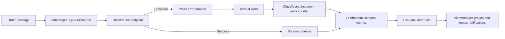

# Alerting on error channels

## 1. Objectives and real-world scenario

In the **Metrics and observability** chapter of **SPRING_INTEGRATION_CORE**, this lesson uses `Message`, `MessageChannel`, endpoints, and Java DSL to build alerts from error flows. Upon completion, you will be able to:

- Identify which errors actually enter an error channel and which return to the caller.
- Inspect `ErrorMessage`, locate the failed message, and normalize root-cause categories.
- Record errors with Micrometer using a bounded tag set.
- Set up alerts by error count, error ratio, and impact.
- Test error routing paths, avoid double-counting, and detect when monitoring itself is interrupted.

Suppose a flow receives inventory reservation requests for purchase orders. After receiving the message, an endpoint calls the inventory system. Some requests have invalid quantities; some fail because the inventory system is unreachable; some hit unexpected programming errors.

Looking at logs alone, operators struggle to tell whether errors are spiking across all instances or occurring sporadically. Sending a notification per exception during an inventory outage can generate thousands of notifications. The right design is routing errors to a well-defined handler, recording metrics at one clear boundary, and letting the alerting system evaluate impact over time.

## 2. Distinguishing error events, metrics, and alerts

These three serve different roles:

| Concept | Meaning | Example |
|---|---|---|
| Error event | A single failed execution at a specific boundary | Reservation endpoint throws an exception |
| Metric | Aggregated numbers to observe trends | 25 dependency errors in 5 minutes |
| Alert | Condition requiring human or external system response | Inventory errors rising steadily and impacting order processing |

An `ErrorMessage` does not automatically become an alert sent to an on-call engineer. It is input to observability. Thresholds, duration (`for`), grouping, and notification targets belong to operational policy.



In this design, the `ordersErrors` consumer performs only short work: classify, increment a counter, and log necessary context. Calling webhooks or sending emails directly inside the consumer drags notification latency and outages into the error-handling path.

Before writing code, state the measurement contract clearly: **each event entering `ordersErrors` is counted once at that channel's consumer**. This is the count of observed error events, not necessarily the count of unique failed orders.

## 3. When does an exception enter an error channel?

### 3.1. Execution boundaries determine error routing

| Execution mode | Where to watch for errors |
|---|---|
| Direct send over `DirectChannel`, handler runs on calling thread | Exception may propagate back to the sender |
| `QueueChannel` polled by an endpoint's poller | Poller's error handler may publish an `ErrorMessage` |
| Flow using `ExecutorChannel` | Monitor error handling at the executor boundary |
| Calling via a messaging gateway | Check reply contract and gateway error-channel configuration |

Specifically, adding an `errorChannel` header to a directly sent message does not turn every synchronous exception into an error message. Publishing an `ErrorMessage` requires a corresponding error-handling component. Synchronous and asynchronous mechanisms are explained in [Spring Integration: Error Handling](https://docs.spring.io/spring-integration/reference/7.0/error-handling.html).

A gateway also has a reply contract to its caller. If you configure an error flow to handle errors for a call expecting a reply, decide explicitly whether to return a fallback or propagate failure; merely recording a metric and ending the error flow can leave the caller without an appropriate response. See [Messaging Gateways](https://docs.spring.io/spring-integration/reference/gateway.html).

### 3.2. Custom headers vs. default error targets

For error handlers publishing messages via the standard mechanism, the `MessageHeaders.ERROR_CHANNEL` header on the failed message can specify the error target. Without a dedicated target, the handler uses the configured default target; the global default typically has bean name `errorChannel`.

The lesson example sets the poller's default target to `ordersErrors` via `PollerSpec.errorChannel(...)`. This API accepts a bean name or a `MessageChannel`, per [PollerSpec Javadoc](https://docs.spring.io/spring-integration/api/org/springframework/integration/dsl/PollerSpec.html).

This creates two test scenarios: messages without an error header and messages with a custom error header. If a custom header routes the error to another channel, `ordersErrors` counters will not see that event. Edge policies should control internal routing headers rather than accepting them arbitrarily from external inputs.

## 4. Reading `ErrorMessage` structure accurately

`ErrorMessage` is a `Message<Throwable>`. Its payload is the exception, not the original business payload. Information about the failed message may reside in:

1. `MessagingException.getFailedMessage()` along the cause chain.
2. `ErrorMessage.getOriginalMessage()` if the error-creation site supplied the original message.
3. Neither location, such as when an error occurs before a message is retrieved from the source.

`failedMessage` may be a post-transformer message, whereas `originalMessage` represents the message at the error-context creation point. The two objects are not necessarily identical, nor is either guaranteed to exist. This contract is documented in [ErrorMessage Javadoc](https://docs.spring.io/spring-framework/docs/current/javadoc-api/org/springframework/messaging/support/ErrorMessage.html).

Do not cast like this:

```java
// Wrong: ErrorMessage payload is Throwable.
Order order = (Order) errorMessage.getPayload();
```

An error is typically wrapped like:

```text
ErrorMessage
  payload: MessageHandlingException
    failedMessage: Message<Order>
    cause: InventoryUnavailableException
```

To classify, walk the cause chain and map to a small list: `validation`, `dependency`, `unexpected`. Never use the full exception message as a metric label. For detailed lookup, extract `messageId`, correlation ID, and endpoint identifier from available context and write them to structured logs.

## 5. Choosing the channel type for the error path

| Channel type | Suitable when | Design consequences |
|---|---|---|
| `DirectChannel` | One fast error consumer runs directly on the error-publishing thread | A slow or throwing consumer affects the publisher |
| `PublishSubscribeChannel` | Multiple branches must observe the same error | Control per-subscriber errors and counter ownership |
| `QueueChannel` | Wanting to decouple error publishing pace from consumer pace | Needs a poller, queue bounds, and backlog monitoring |

`DirectChannel` does not broadcast copies to all subscribers. Its default setup dispatches to one handler with failover. Therefore, do not attach three independent consumers assuming metrics, logging, and storage all receive every error. To fan out to multiple branches, choose publish-subscribe or orchestrate steps within one flow. See [Configuring Message Channels](https://docs.spring.io/spring-integration/reference/channel/configuration.html).

The example below chooses a dedicated `DirectChannel` for errors and a single consumer to keep ownership clear. The input `QueueChannel` is an in-memory queue; a successful send confirms only queue admission, not successful business processing or durable persistence.

## 6. Java DSL example: collecting errors in an order flow

### 6.1. Prerequisites

The example uses Java 17+ syntax and the Java DSL API in modern Spring Integration lines. Place the classes under your Spring Boot application's component-scan scope; let Spring Boot's BOM manage compatible versions across libraries.

In an existing Spring Boot application, add these corresponding dependencies:

```xml
<dependency>
    <groupId>org.springframework.boot</groupId>
    <artifactId>spring-boot-starter-integration</artifactId>
</dependency>
<dependency>
    <groupId>org.springframework.boot</groupId>
    <artifactId>spring-boot-starter-actuator</artifactId>
</dependency>
<dependency>
    <groupId>io.micrometer</groupId>
    <artifactId>micrometer-registry-prometheus</artifactId>
</dependency>
```

To hit the HTTP endpoints in the example, the application also needs web configuration such as the web starter matching your Boot version. Boot auto-configures the registry based on implementations on the classpath. The Prometheus registry and Actuator endpoints are covered in [Spring Boot: Metrics](https://docs.spring.io/spring-boot/reference/actuator/metrics.html).

### 6.2. Flow and metric recorder configuration

```java
package example.integration;

import java.util.Map;

import io.micrometer.core.instrument.Counter;
import io.micrometer.core.instrument.MeterRegistry;
import org.slf4j.Logger;
import org.slf4j.LoggerFactory;
import org.springframework.beans.factory.annotation.Qualifier;
import org.springframework.context.annotation.Bean;
import org.springframework.context.annotation.Configuration;
import org.springframework.integration.channel.DirectChannel;
import org.springframework.integration.channel.QueueChannel;
import org.springframework.integration.config.EnableIntegration;
import org.springframework.integration.dsl.IntegrationFlow;
import org.springframework.integration.dsl.Pollers;
import org.springframework.messaging.Message;
import org.springframework.messaging.MessageHandler;
import org.springframework.messaging.MessagingException;
import org.springframework.messaging.support.ErrorMessage;

@Configuration(proxyBeanMethods = false)
@EnableIntegration
public class OrdersObservabilityConfig {

    public record Order(String orderId, String sku, int quantity) {
    }

    public static class InventoryUnavailableException extends RuntimeException {
        public InventoryUnavailableException(String message) {
            super(message);
        }
    }

    @Bean
    QueueChannel ordersInput() {
        return new QueueChannel(100);
    }

    @Bean
    DirectChannel ordersErrors() {
        return new DirectChannel();
    }

    @Bean
    OrderMetrics orderMetrics(MeterRegistry registry) {
        return new OrderMetrics(registry);
    }

    @Bean
    IntegrationFlow ordersFlow(
            @Qualifier("ordersInput") QueueChannel input,
            OrderMetrics metrics) {

        return IntegrationFlow.from(input)
                .handle(Order.class, (order, headers) -> {
                    if (order.quantity() <= 0) {
                        throw new IllegalArgumentException("quantity must be positive");
                    }

                    // Simulate an inventory outage for the lab.
                    if ("OUTAGE".equals(order.sku())) {
                        throw new InventoryUnavailableException("inventory unavailable");
                    }

                    // In a real application, call the inventory reservation service here.
                    metrics.recordSuccess();
                    return null; // Terminal endpoint, produces no reply.
                }, endpoint -> endpoint
                        .id("reserveStock")
                        .poller(Pollers.fixedDelay(250)
                                .maxMessagesPerPoll(10)
                                .errorChannel("ordersErrors")))
                .get();
    }

    @Bean
    IntegrationFlow ordersErrorFlow(
            @Qualifier("ordersErrors") DirectChannel errors,
            OrderMetrics metrics) {

        MessageHandler observer = message ->
                metrics.recordFailure((ErrorMessage) message);

        return IntegrationFlow.from(errors)
                .handle(observer)
                .get();
    }

    public static final class OrderMetrics {
        private static final Logger log =
                LoggerFactory.getLogger(OrderMetrics.class);

        private final Counter completed;
        private final Map<String, Counter> failures;

        public OrderMetrics(MeterRegistry registry) {
            completed = Counter.builder("integration.order.completed")
                    .description("Successful order-processing events")
                    .tag("flow", "orders")
                    .register(registry);

            failures = Map.of(
                    "validation", failureCounter(registry, "validation"),
                    "dependency", failureCounter(registry, "dependency"),
                    "unexpected", failureCounter(registry, "unexpected"));
        }

        private static Counter failureCounter(
                MeterRegistry registry, String reason) {
            return Counter.builder("integration.order.failures")
                    .description("Failure events observed on ordersErrors")
                    .tag("flow", "orders")
                    .tag("channel", "ordersErrors")
                    .tag("reason", reason)
                    .register(registry);
        }

        public void recordSuccess() {
            completed.increment();
        }

        public void recordFailure(ErrorMessage error) {
            String reason = classify(error.getPayload());
            failures.get(reason).increment();

            Message<?> failed = findFailedMessage(error);
            Object messageId = failed == null
                    ? "unknown" : failed.getHeaders().getId();
            Object correlationId = failed == null
                    ? "unknown"
                    : failed.getHeaders().getOrDefault("correlationId", "unknown");

            log.warn("event=integration_failure flow=orders channel=ordersErrors "
                            + "reason={} messageId={} correlationId={}",
                    reason, messageId, correlationId);
        }

        private static String classify(Throwable failure) {
            Throwable current = failure;
            while (current != null) {
                if (current instanceof InventoryUnavailableException) {
                    return "dependency";
                }
                if (current instanceof IllegalArgumentException) {
                    return "validation";
                }
                Throwable next = current.getCause();
                current = next == current ? null : next;
            }
            return "unexpected";
        }

        private static Message<?> findFailedMessage(ErrorMessage error) {
            Throwable current = error.getPayload();
            while (current != null) {
                if (current instanceof MessagingException messaging
                        && messaging.getFailedMessage() != null) {
                    return messaging.getFailedMessage();
                }
                Throwable next = current.getCause();
                current = next == current ? null : next;
            }
            return error.getOriginalMessage();
        }
    }
}
```

This pattern assumes a standard exception cause chain without cyclic references across multiple exceptions. If receiving exceptions from libraries that can form complex cause graphs, add a visited set or depth limit.

`ordersErrors` is reserved for `ErrorMessage` instances published by error handling, so the consumer casts the whole message. If using a handler that receives the **payload** instead of `MessageHandler`, the payload seen by that handler will be `Throwable`; keep these two input shapes distinct when writing DSL.

All three failure counters are registered upfront at initialization, even before any errors occur. This creates zero-valued series before an incident starts, making observation and computing growth easier once Prometheus has scraped baseline samples.

Treating every `IllegalArgumentException` as a validation error fits only this lesson's simple model. In a real application, use a dedicated business exception type to avoid masking a programming bug under an invalid-data label.

### 6.3. Sending a message that triggers an error

The snippet below runs after the application context has started, with `ordersInput` injected by its exact bean name:

```java
import org.springframework.messaging.Message;
import org.springframework.messaging.MessageHeaders;
import org.springframework.messaging.support.MessageBuilder;

Message<OrdersObservabilityConfig.Order> request = MessageBuilder
        .withPayload(new OrdersObservabilityConfig.Order("O-101", "OUTAGE", 1))
        .setHeader("correlationId", "C-101")
        .setHeader(MessageHeaders.ERROR_CHANNEL, "ordersErrors")
        .build();

boolean accepted = ordersInput.send(request, 1_000);
if (!accepted) {
    throw new IllegalStateException("ordersInput is full");
}
```

`accepted` reflects only queue insertion. Afterward the poller dequeues the message, the endpoint throws `InventoryUnavailableException`, the error handler publishes the error, and the consumer increments the `reason="dependency"` counter.

Try omitting the `MessageHeaders.ERROR_CHANNEL` header: errors must still reach `ordersErrors` via the poller's default setting. Try quantity 0: the `validation` counter must increment. With a normal SKU and positive quantity, only the success counter increments.

Send failures due to a full queue in the sender code sit outside the poller's business execution path. If you need alerts for input overload, measure failed sends, queue depth, or send wait times separately; do not expect `ordersErrors` counters to cover that case automatically.

### 6.4. Exporting metrics to Prometheus

Example application configuration:

```yaml
spring:
  application:
    name: orders-demo

management:
  endpoints:
    web:
      exposure:
        include: health,prometheus
  metrics:
    tags:
      application: ${spring.application.name}
      environment: ${APP_ENV:local}
```

When the application has an active HTTP management endpoint, Prometheus scrapes `/actuator/prometheus`. Access permissions on the endpoint should match the application's internal observability infrastructure. The configuration above sets the environment label to `local` if `APP_ENV` is unset; the sample rules later target `prod`, so supply the matching deployment value.

Under the Prometheus registry's default naming convention, the failure counter looks like:

```text
integration_order_failures_total{
  application="orders-demo",
  environment="prod",
  flow="orders",
  channel="ordersErrors",
  reason="dependency"
} 12.0
```

This is one sample wrapped across lines for readability, not the entire scrape response. Micrometer recommends lowercase dot-separated meter names, which the registry converts to backend conventions. See [Naming Meters](https://docs.micrometer.io/micrometer/reference/concepts/naming.html). Prometheus counters carry the `_total` suffix; avoid adding `.total` in Java names to reduce collision risk after conversion, as noted in the [Micrometer Prometheus migration guide](https://github.com/micrometer-metrics/micrometer/wiki/1.17-Migration-Guide).

## 7. Designing metrics for meaningful alerts

### 7.1. Tag sets must be bounded

| Attribute | Where to store | Reason |
|---|---|---|
| Flow name, error channel, cause group | Metric labels | Controlled set of values |
| Application, environment, deployment region | Common labels when separation is needed | Avoid merging different operational scopes |
| `messageId`, `orderId`, `correlationId` | Logs or trace attributes | Each message can generate a new value |
| Stack trace, payload, exception message | Selectively controlled logs | Long, hard to aggregate, may hold sensitive data |

If every order ID becomes a label, time-series count grows with order volume. With only three cause groups, series count is bounded by flows, channels, and deployment scopes.

Suppose there are 4 flows, 3 cause groups, and 10 instances: those three dimensions alone create at most 120 series. Adding one label with millions of values completely changes storage and query cost. Decide this limit while designing metrics, not after monitoring infrastructure is overloaded.

### 7.2. Cumulative counters and time windows

Counters increase over a process's lifetime and usually reset on restart. Comparing `counter > 10` directly keeps an alert firing after a past incident. With Prometheus, use `increase(counter[5m])` to estimate growth over a window or `rate(counter[5m])` for speed. Interpreting counters via rates is explained in [Micrometer: Counters](https://docs.micrometer.io/micrometer/reference/concepts/counters.html).

With multiple instances, compute `rate` or `increase` per series before summing. This lets Prometheus detect resets on each counter. Scrape data is sampled; estimated increases can be fractional, and errors occurring before the first sample or during very short-lived processes may not be fully observed.

### 7.3. Separating technical error metrics from business outcomes

Built-in channel or handler metrics help inspect processing time and component activity. Custom counters in this lesson represent events received on a specific error channel. Do not add both sources into an error total if both can reflect the same incident.

Similarly, a filter dropping a message or a router picking a rejection branch does not necessarily throw an exception. Aggregators timing out also require inspecting group policies, outputs, and discard flows. If those outcomes affect business goals, add metrics at the terminating branch itself rather than inferring health from silence on the error channel.

## 8. Writing alert rules

### 8.1. Alerting on error count over a time window

Example Prometheus rules, assuming the scrape job collects the metrics above:

```yaml
groups:
  - name: spring-integration-orders
    rules:
      - alert: OrdersDependencyFailuresHigh
        expr: |
          sum by (application, environment, flow, channel) (
            increase(integration_order_failures_total{
              application="orders-demo",
              environment="prod",
              reason="dependency"
            }[5m])
          ) >= 10
        for: 2m
        labels:
          severity: warning
          team: order-platform
        annotations:
          summary: "Flow {{ $labels.flow }} is experiencing high dependency failures"
          description: "Estimated {{ $value }} errors in 5-minute window. Check inventory system and backlog."

      - alert: OrdersUnexpectedFailure
        expr: |
          sum by (application, environment, flow, channel) (
            increase(integration_order_failures_total{
              application="orders-demo",
              environment="prod",
              reason="unexpected"
            }[5m])
          ) > 0
        labels:
          severity: critical
          team: order-platform
        annotations:
          summary: "Flow {{ $labels.flow }} raised unclassified failures"
          description: "Search integration_failure logs by application, environment, and incident time range."
```

The first rule requires the 5-minute growth condition to persist continuously for 2 minutes across evaluations. `for: 2m` does not mean accumulating errors only over 2 minutes. The second rule omits `for` because the illustrative policy wants to notice unclassified errors on the first evaluation meeting the condition. Pending and firing behavior is described in [Prometheus: Alerting rules](https://prometheus.io/docs/prometheus/latest/configuration/alerting_rules/).

The 10-error threshold and `critical` severity for unclassified errors are illustrative choices, not universal defaults for every system. A critical financial flow and a replayable data-sync flow require different policies.

### 8.2. Alerting on error ratio

In this lesson's simple model, every execution ends either in success or in an error sent to `ordersErrors`. Error ratio is calculated as:

```text
error ratio = failed results / (failed results + successful results)
```

The PromQL expression below checks whether the ratio exceeds 5% while requiring at least ~100 outcomes in 5 minutes:

```promql
(
  sum by (application, environment, flow) (
    increase(integration_order_failures_total{
      application="orders-demo", environment="prod"
    }[5m])
  )
  /
  clamp_min(
    sum by (application, environment, flow) (
      increase(integration_order_failures_total{
        application="orders-demo", environment="prod"
      }[5m])
    )
    +
    sum by (application, environment, flow) (
      increase(integration_order_completed_total{
        application="orders-demo", environment="prod"
      }[5m])
    ),
    1
  )
) > 0.05
and on (application, environment, flow)
(
  sum by (application, environment, flow) (
    increase(integration_order_failures_total{
      application="orders-demo", environment="prod"
    }[5m])
  )
  +
  sum by (application, environment, flow) (
    increase(integration_order_completed_total{
      application="orders-demo", environment="prod"
    }[5m])
  )
) >= 100
```

A minimum-traffic guard prevents one failure out of one request from creating a 100% ratio and constantly paging. However, it also makes low-traffic flows harder to trigger. For critical low-volume flows, supplement with absolute error-count or business-deadline alerts.

Numerator and denominator must share the same unit and completion boundary. If an error channel collects technical errors from multiple endpoints, or recovery returned success while still counting as a failure, this expression no longer accurately represents business failure ratio.

Do not mechanically use newly received messages as the denominator: queues can back up, so a window may see many new arrivals yet very few completed outcomes. The ratio above measures completed outcomes within the window, not a fixed cohort of orders by arrival time.

### 8.3. Grouping notifications and attaching actionable context

Keep alert labels stable, such as `application`, `environment`, `flow`, `channel`, and `severity`. Put current numbers and long explanations in annotations. Never put `messageId` in alert labels because each value creates a distinct alert identity.

Alertmanager can group alerts by application and flow, route by owning team, apply maintenance silences, and inhibit alerts when a root incident is already firing. These features are described in [Alertmanager](https://prometheus.io/docs/alerting/latest/alertmanager/).

A useful notification must identify which flow is affected, which environment, which error type, the growth or ratio over what duration, and where to look up logs/runbooks. In multi-cluster deployments, add a cluster label to both metrics and rule groupings when incidents need to be scoped per cluster.

## 9. Retries, recovery, and risk of double-counting

Suppose a message calls inventory three times: the first two time out, and the third succeeds. There are at least two distinct quantities:

- Failed call attempts: 2.
- Final failed processing outcomes: 0.

Counters incremented inside each attempt and counters incremented on the error branch after retries are exhausted are not interchangeable. Name and describe them so readers clearly know whether they measure attempts or final outcomes.

In Spring Integration, `RequestHandlerRetryAdvice` can drive retries around a handler; once retries are exhausted, recovery can use `ErrorMessageSendingRecoverer` to publish the error to a channel. Without an appropriate recoverer, the final exception may continue propagating to the caller. Retry configuration also depends on the version line in use; do not assume a fixed default attempt count. See [Provided Advice Classes: Retry Advice](https://docs.spring.io/spring-integration/reference/handler-advice/classes.html).

The lesson's main example does not configure retries. When adding them, pick one clear place responsible for recording final failures:

1. Recovery publishes one event to the final error channel, or the final exception reaches the poller's error handler.
2. That channel's consumer increments the final failure counter.
3. If intermediate attempts need counting, record them in a separate metric.

Common double-counting pitfalls include bridging `ordersErrors` to the global `errorChannel` where both consumers increment the same counter; an error consumer recording a metric and rethrowing so another layer records it again; or multiple subscribers receiving the same error and both claiming ownership of counting.

Counters also do not automatically count each order once across broker redeliveries or post-incident replays. If unique order statistics are required, establish a business key, deduplication scope, and appropriate state store. An `ErrorMessage` ID identifies a new error event; it does not replace a business key for deduplicating across separate error emissions.

Recovery handling an exception can also alter rollback, acknowledgment, or redelivery behavior of external sources. Recording a metric does not determine whether a message was saved to a dead-letter queue or whether business data committed; design those contracts explicitly at the source and transaction boundaries.

## 10. Observing the error-handling path itself

Seeing no new error events is not enough to conclude the system is healthy. The flow might be receiving no messages, the poller might have stopped, the error consumer might be down, or Prometheus might no longer be scraping the application.

| Risk | Additional signal to observe |
|---|---|
| Slow error consumer | Processing latency; queue depth and message age if queue-backed |
| Business endpoint stopped | Lifecycle state, throughput, and backlog |
| Monitoring lost connectivity | Scrape status, missing metric series, or exporter errors |
| Input queue full | Failed send counts and send wait times |
| Error loop | Abnormal error growth rate and repeated logs with matching context |
| Flow hung before throwing | Timeouts, work item age, and business SLA deadlines |

These signals depend on your real infrastructure and are not all implemented in the sample code. When using an error queue, bound its capacity and define full-queue behavior. An in-memory queue does not replace durable error storage.

Never feed errors from a notification consumer back into the same notification path indefinitely. If splitting off a notification or storage branch, give it timeouts, a retry policy, and its own failure signal. With `DirectChannel` in the example, an exception from the observing consumer can fail the error-publishing operation; that is another reason to keep the consumer short and avoid network dependencies inside it.

Traces can connect steps of a single request while logs keep event details. Do not assume MDC or thread-locals cross queues/executors automatically. If cross-thread linkage is needed, configure the corresponding context propagation mechanism; `correlationId` in the example is an application-managed lookup key and does not create spans or traces by itself.

## 11. Testing instrumentation behavior

### 11.1. Testing the classifier without Prometheus

The following JUnit 5 example uses an in-memory `SimpleMeterRegistry`. Place the test class in the same package as the example configuration; tests do not need to boot the application or send external notifications.

```java
package example.integration;

import io.micrometer.core.instrument.simple.SimpleMeterRegistry;
import org.junit.jupiter.api.Test;
import org.springframework.messaging.Message;
import org.springframework.messaging.MessageHandlingException;
import org.springframework.messaging.support.ErrorMessage;
import org.springframework.messaging.support.MessageBuilder;

import static org.junit.jupiter.api.Assertions.assertEquals;

class OrderMetricsTest {

    @Test
    void countsWrappedDependencyFailureOnlyInDependencyGroup() {
        SimpleMeterRegistry registry = new SimpleMeterRegistry();
        var metrics = new OrdersObservabilityConfig.OrderMetrics(registry);

        Message<?> failed = MessageBuilder
                .withPayload(new OrdersObservabilityConfig.Order(
                        "O-201", "OUTAGE", 1))
                .setHeader("correlationId", "C-201")
                .build();

        var cause = new OrdersObservabilityConfig
                .InventoryUnavailableException("inventory unavailable");
        metrics.recordFailure(new ErrorMessage(
                new MessageHandlingException(failed, cause)));

        assertEquals(1.0, registry.get("integration.order.failures")
                .tag("reason", "dependency").counter().count());
        assertEquals(0.0, registry.get("integration.order.failures")
                .tag("reason", "validation").counter().count());
        assertEquals(0.0, registry.get("integration.order.completed")
                .counter().count());
        registry.close();
    }

    @Test
    void countsFailureEvenWhenOriginalMessageIsMissing() {
        SimpleMeterRegistry registry = new SimpleMeterRegistry();
        var metrics = new OrdersObservabilityConfig.OrderMetrics(registry);

        metrics.recordFailure(new ErrorMessage(
                new RuntimeException("failure without message context")));

        assertEquals(1.0, registry.get("integration.order.failures")
                .tag("reason", "unexpected").counter().count());
        registry.close();
    }
}
```

These tests protect two critical behaviors: wrappers do not hide the cause category, and missing message context does not crash the observing consumer. They do not yet verify that the poller actually routes errors to the right channel.

### 11.2. Integration-testing the error path

In a dedicated test context, verify these scenarios:

| Input or condition | Outcome to verify |
|---|---|
| Valid order | Success increments by 1, failure total unchanged |
| Quantity equals 0 | `validation` increments by 1 |
| SKU `OUTAGE` | `dependency` increments by 1 |
| No error header | Poller still routes error to `ordersErrors` |
| Custom error header to a test channel | Error reaches test channel; old channel's counter unchanged |
| Add retry, then succeeds | Final failure counter does not increment |
| Add retry and exhaust attempts | Final failure counter increments only per chosen contract |
| Error consumer stopped | Test detects dispatch error or backlog per channel type |

Because poller execution is asynchronous, wait on conditions with an explicit timeout rather than checking counters immediately after `send()`. Use a fresh context or registry per test, or compare deltas from a baseline to avoid test-order interference.

### 11.3. Testing alert rules

Accurate metrics do not guarantee accurate rules. Test series for alert rules should cover normal baseline counters, short spikes, sustained spikes, counter resets, missing data, and low traffic. Verify both output labels and pending/firing timing.

When testing in a lab environment, let Prometheus scrape baseline counters before injecting errors. Then inject enough errors to cross the threshold, wait for the corresponding evaluations, and confirm notifications route to a test receiver. Waiting exercises the full pipeline of scraping, rule evaluation, and notification grouping—not just Java code.

## 12. Response procedure when an alert fires

A runbook for `OrdersDependencyFailuresHigh` can proceed in order:

1. Confirm the exact application, environment, flow, and timestamp; check whether the alert affects one instance or the whole cluster.
2. Compare errors against throughput, successful outcomes, backlog, and oldest waiting request age to gauge impact.
3. Search `integration_failure` logs in the same time window; use `correlationId` to trace a specific request.
4. Inspect the inventory system, timeouts, connections, resource limits, and recent deployments.
5. Check whether retries are amplifying load on the dependency; apply load-shedding measures within authorized operational controls.
6. Identify where failed messages are retained and conditions for safe replay, including whether partial business work ran before the error.
7. After recovery, verify error rate drops, successful processing recovers, and backlog drains; record root cause and any needed metric or rule updates.

Alert notifications should link to the operations team's real runbook. Never treat an alert resolving as proof the system recovered: the signal can also vanish because the flow stopped or monitoring lost data.

## 13. Extended practice exercises

Perform these steps in order on a test application:

1. Start the sample flow, let monitoring scrape baseline counters, then send 20 valid orders and 5 orders with SKU `OUTAGE`. Verify success and per-reason failure increments.
2. Send 3 orders with quantity 0. Confirm they do not increment the `dependency` counter and do not trigger the inventory-specific rule.
3. Remove the error header from messages, then point the header to a test channel with its own consumer. Document why `ordersErrors` counters behave differently.
4. Add bounded retries around the inventory call, separate attempt metrics from final outcome metrics, and verify one message is not counted as multiple final outcomes.
5. Replace the error channel with a bounded queue in a test configuration, add a poller, and observe backlog when the consumer is slow. Define bounds and full-queue handling.
6. Stop metric collection or the processing endpoint in the test environment. Add signals to distinguish zero errors from missing observability data.

The expected outcome is an explainable observability chain: knowing at which boundary errors arise, what each counter counts, what conditions fire an alert, and what the recipient should do next.
